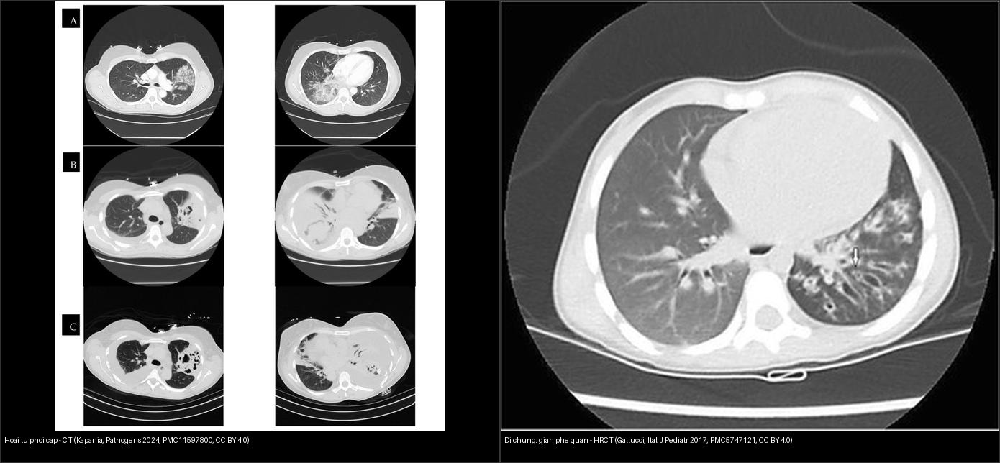
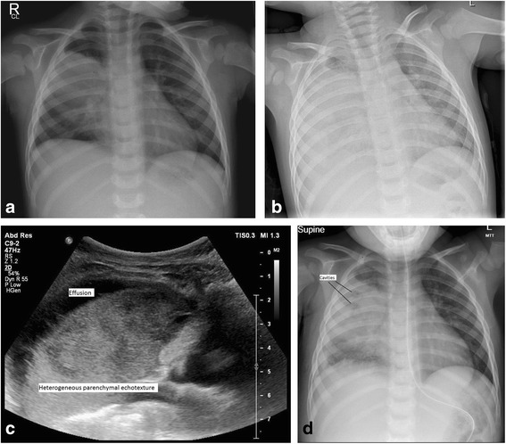
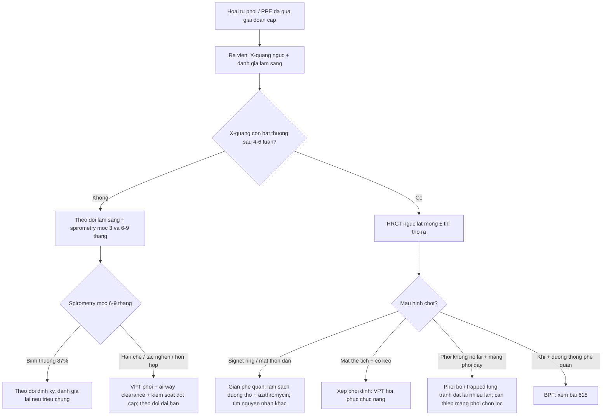
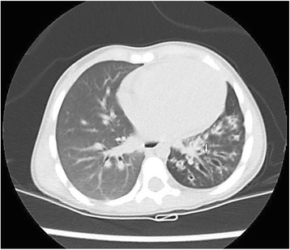
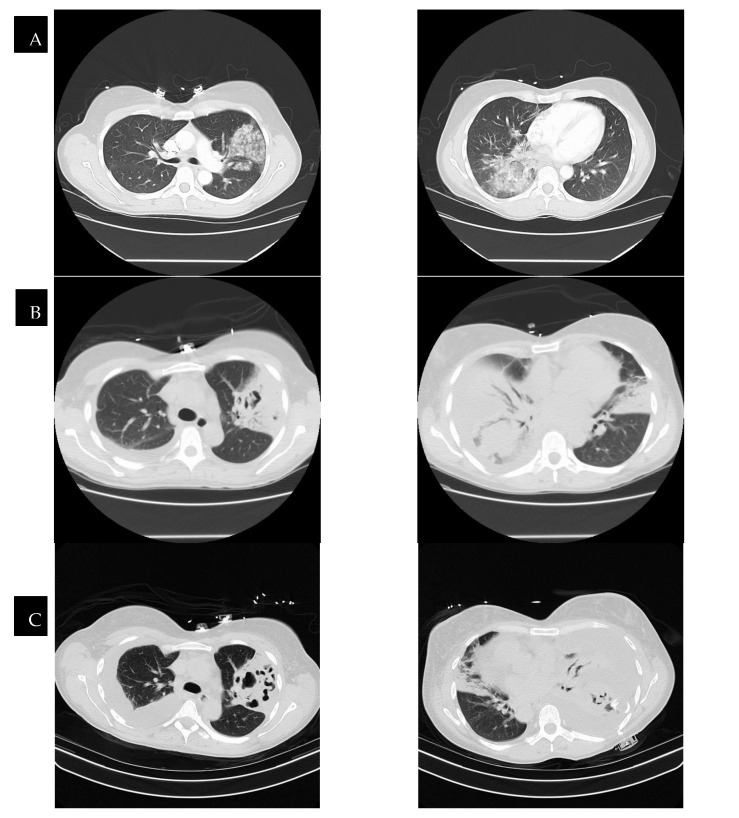
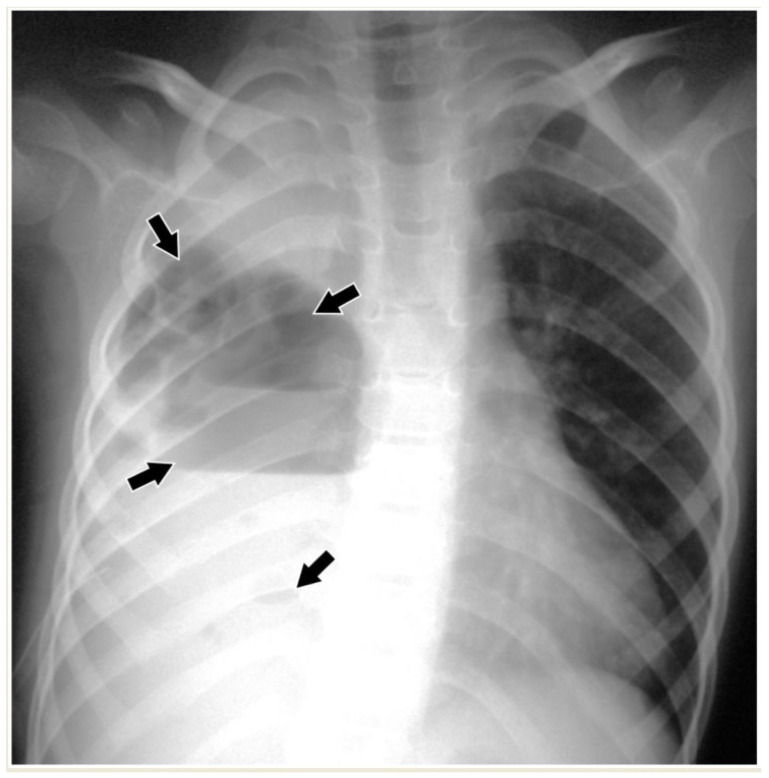
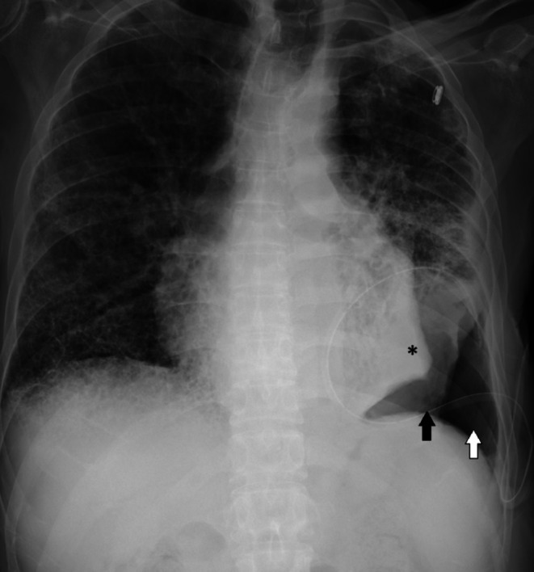

# 619 — Di chứng hô hấp sau hoại tử phổi & cắt thùy ở trẻ: giãn phế quản, phổi bó / Long-term respiratory sequelae after necrotizing pneumonia & lobectomy in children

**Tags:** `pattern:gian-phe-quan` `pattern:phoi-bo` `pattern:xo-phoi` `pattern:day-mang-phoi` `vung:phoi` `vung:mang-phoi` `protocol:HRCT` `protocol:HRCT-thi-tho-ra` `score:spirometry`
**Mức chắc chắn (certainty):** tổng hợp y văn (literature synthesis) — nhóm tự biên từ y văn mở (CC BY 4.0, CC BY-NC 4.0); các ca minh họa giữ đúng tuổi/mô tả của bài gốc (**ca nguyên văn**).

> Đây là **bước tiếp theo của [616 – Biến chứng viêm phổi nhi: empyema & hoại tử phổi](../616-bien-chung-viem-phoi-nhi-empyema-hoai-tu/lesson.md)** và [614 – BO & Swyer–James](../614-benh-tieu-phe-quan-tac-nghen-BO-Swyer-James/lesson.md): qua giai đoạn **cấp** (hang, mủ màng phổi, rò khí), câu hỏi đổi thành **"phổi có hồi phục hoàn toàn không, còn lại di chứng gì ở mốc 6–9 tháng, và chức năng hô hấp ra sao?"**.

## 1. Tổng quan bệnh học – cơ chế hình ảnh

- **Hoại tử phổi (necrotizing pneumonia — NP)** và **tràn dịch cạnh phổi (parapneumonic effusion — PPE)** gặp ở **~3% trẻ viêm phổi mắc phải cộng đồng (CAP)** [Pediatr Pulmonol 2025, PMC12363156]. NP = **hoại tử + hóa lỏng nhu mô** → nhiều **hang mỏng thành nhỏ (< 2 mm vách)**; hay kèm **empyema, rò phế quản–màng phổi (BPF), nang khí (pneumatocele)**.
- **TẠI SAO để lại di chứng (cơ chế → hình ảnh):**
  - **Giãn phế quản (bronchiectasis):** hoại tử + nhiễm trùng phá hủy **sụn và cơ trơn thành phế quản** → phế quản **mất khả năng đàn hồi, giãn vĩnh viễn** và **mất kiểu thon dần (lack of tapering)** về ngoại vi. Trên HRCT là **dấu nhẫn con dấu (signet ring sign)** — phế quản to hơn động mạch đi kèm (**tỷ lệ phế quản/động mạch — bronchoarterial ratio, BAR > 1**, chấp nhận cả ở nhũ nhi theo thang Brody-II) [Thorax 2014, PMC3963531]. Ba kiểu: **hình trụ (cylindrical), dạng búi/cành nho (varicose), dạng nang (cystic)** — độ nặng tăng dần.
  - **Xẹp phổi dính tồn dư (residual atelectasis):** xơ hóa + dính màng phổi giữ phổi không nở → **mờ đông đặc có mất thể tích** (xem học thuyết thể tích, bài [030](../030-dong-dac-xep-phoi/lesson.md)).
  - **Phổi bó / phổi không nở (trapped lung / non-expandable lung):** **màng phổi dày – xơ như vỏ** giới hạn sự nở của phổi; khi dẫn lưu dịch/khí, phổi **không áp về thành ngực** → hình thành **tràn khí do giảm thể tích (pneumothorax ex vacuo)** và khoang **dịch–khí tồn dư** dù ống dẫn lưu thông. Trên X-quang là **phổi "bó" không nở theo ổ dịch/khí** (dấu hoa thị trong ảnh). Siêu âm màng phổi: **mất trượt phổi (lung sliding) / dấu phổi đập** với **AUC 0,81** cho M-mode [Diagnostics 2024, PMC10813923].
  - **Dày màng phổi (pleural thickening)** và **dày – co rút rãnh liên thùy** sau empyema.
- **Ngưỡng định lượng nằm lòng** [Pediatr Pulmonol 2025, PMC12363156 — 123 trẻ, trung vị 57 tháng]:
  - **Di chứng X-quang/CT ở mốc 6–9 tháng:** NP **56,41%** (44/78) so với PPE **40,0%** (18/45) (p = 0,080).
  - **Thành phần di chứng ở NP:** **dày màng phổi 41,02%** (32), **xẹp phổi 26,92%** (21), **giãn phế quản 3,84%** (3), **BPF 2,56%** (2).
  - **Spirometry 3 tháng sau ra viện:** bất thường ở NP **54,54%** (**18,18% kiểu hạn chế**, **36,36% kiểu hỗn hợp**) so với PPE **25,0%**; **mốc 6–9 tháng hồi phục bình thường 87%** ở cả hai nhóm. Đa số di chứng X-quang **tan trong 2–13 tháng**, chỉ **10,25%** còn di chứng dài hạn.
- **Sau cắt thùy phổi ở trẻ** (bẩm sinh hoặc do hủy hoại): gộp 10 nghiên cứu, **FEV₁% trung bình 80,09% (KTC 95%: 75,03–85,16)** → **rối loạn thông khí tắc nghẽn nhẹ**; **rối loạn đường thở nhỏ** (TPTEF/TE, PF/V25%) rõ **1 tháng** sau mổ; trẻ CLM nhỏ tuổi thường **chức năng phổi bình thường**, thời điểm mổ không ảnh hưởng [BMJ Paediatr Open 2023, PMC10582896; Front Pediatr 2021, PMC8578933].

*Trái: **hoại tử phổi cấp** — CT chuỗi thời gian, hang mỏng thành/giảm ngấm tiến triển rồi co lại theo điều trị (Kapania EM et al., Pathogens 2024, PMC11597800, CC BY 4.0). Phải: **di chứng giãn phế quản** — HRCT trẻ 3 tuổi, các phế quản hình trụ giãn ở thùy dưới trái, mũi tên chỉ **dấu nhẫn con dấu (signet ring sign)** (Gallucci M et al., Ital J Pediatr 2017, PMC5747121, CC BY 4.0). Ảnh ghép letterbox giữ nguyên tỷ lệ.*

## 2. Mẫu hình + chẩn đoán phân biệt theo mốc theo dõi (Gamut)

- **Theo MỐC thời gian sau đợt cấp:**
  - **Giai đoạn cấp (< 4–6 tuần):** hang khí, nang khí (pneumatocele), mủ màng phổi, rò khí — **còn thay đổi, chưa gọi là di chứng**.
  - **Trung hạn (3–6 tháng):** đa số co nhỏ – tan dần; spirometry có thể **hạn chế/hỗn hợp** rồi hồi phục.
  - **Muộn (6–9 tháng trở đi):** phần **không hồi phục** = **di chứng thật** (giãn phế quản, xẹp dính, dày màng phổi, BPF).
- **Theo MẪU HÌNH HRCT:**
  - **Phế quản giãn:** signet ring / tram-track, mất thon dần, dày thành phế quản → **giãn phế quản**.
  - **Giảm tỷ trọng thì thở ra không xẹp:** **ứ khí/bẫy khí (air trapping)** → bệnh đường thở nhỏ (nối bài [614](../614-benh-tieu-phe-quan-tac-nghen-BO-Swyer-James/lesson.md)).
  - **Mất thể tích + mờ đông đặc co kéo:** **xẹp phổi dính**.
- **Theo BỐI CẢNH để loại nguyên nhân khác của giãn phế quản:** xơ nang (CF, mồ hôi), loạn vận động lông (PCD, nitric oxide mũi thấp + viêm mũi–xoang), suy giảm miễn dịch (IgG/IgA), dị vật đường thở (giãn phế quản **một bên** đột ngột → soi!), hít sặc [Ital J Pediatr 2017, PMC5747121].
- **Theo vị trí:** giãn phế quản sau NP **khu trú vùng hoại tử cũ** (thường thùy dưới) khác giãn phế quản **lan tỏa hai bên** của CF/PCD.

## 3. Bảng so sánh phân biệt (ma trận đối chiếu)

| Thực thể (entity) | Hình ảnh điển hình (HRCT/CT) | Chốt vào (rule-in) | Chốt loại (rule-out) | Gợi ý xác nhận |
|---|---|---|---|---|
| **Giãn phế quản sau nhiễm trùng (post-infectious bronchiectasis)** | Phế quản **to hơn động mạch đi kèm**, mất thon dần; hình trụ → búi → nang; mũi tên **signet ring** | **BAR > 1 (signet ring) + mất thon dần** ở vùng phổi đã hoại tử | Phế quản **thon dần bình thường** theo mạch máu → không giãn | HRCT lát mỏng; đối chiếu phổi lành xa tổn thương |
| **Xẹp phổi dính tồn dư (residual atelectasis)** | Mờ **đông đặc + mất thể tích**, co kéo rãnh/phế quản thùy | **Mất thể tích + co kéo dấu hiệu phổi lành** | Mờ **không mất thể tích** → đông đặc, không xẹp | So phim cũ; CT thì hít vào/thở ra |
| **Phổi bó / không nở (trapped lung)** | Phổi **không áp thành ngực**, **pneumothorax ex vacuo**, dịch–khí tồn dư dù ống thông | **Phổi không nở lại sau dẫn lưu + màng phổi dày xơ; mất trượt phổi trên siêu âm** | Phổi **nở hết** sau dẫn lưu → tràn khí/dịch đơn thuần | Siêu âm màng phổi (M-mode AUC 0,81); CT sau dẫn lưu |
| **Dày màng phổi (pleural thickening)** | **Dày lá màng phổi ngấm thuốc**, ± co rút lồng ngực | Dày màng phổi **tồn tại > 6 tháng** ở vùng empyema cũ | Dịch màng phổi **tự do**, màng phổi mỏng → chưa di chứng | CT ngực sau tiêm; so 2 bên |
| **Rò phế quản–màng phổi tồn dư (BPF)** | Đường thông phế quản–khoang màng phổi, khí dai dẳng dù kẹp ống | **Khí/rò ngay khi kẹp ống (DIPAL)** + đường thông thấy được | Rò **hết khi tối ưu dẫn lưu** → rò ngoại vi tạm thời | CT lát mỏng; nội soi phế quản (bài [618](../618-ro-phe-quan-mang-phoi-va-ro-khi-dai-dang-o-tre/lesson.md)) |
| **Nang khí tồn dư (pneumatocele)** | Nang thành mỏng, chứa khí, thường đỉnh hang cũ | Nang **thành rất mỏng, co nhỏ theo tháng** | Nang **thành dày + mức khí–dịch** → áp-xe/hang hoạt động | CT chuỗi; X-quang lặp |

*Diễn tiến **hoại tử phổi** ở trẻ 2 tuổi (sốt, ho 4 ngày, dịch màng phổi dương tính kháng nguyên phế cầu): (a) phim đầu; các panel sau cho thấy **hang hoại tử + mủ màng phổi** tiến triển rồi cải thiện dưới dẫn lưu/kháng sinh — biết mốc để phân biệt **đang hồi phục** với **di chứng cố định**. Masters IB et al., Pneumonia 2017 (PMC5525269), CC BY 4.0.*

## 4. Protocol + theo dõi chức năng + flowchart

- **Theo dõi hình ảnh:** X-quang ngực **lúc ra viện** rồi **lặp nếu còn bất thường**; **CT/HRCT ngực** khi nghi di chứng (giãn phế quản, phổi bó, BPF). **HRCT lát mỏng + chuỗi hít vào–thở ra** (đánh giá ứ khí) và **nghiệm pháp nằm sấp** khi phân vân tổn thương cố định vs dịch.
- **Chức năng hô hấp (spirometry — bắt buộc theo dõi):** đo ở mốc **3 tháng, 6–9 tháng** rồi theo triệu chứng.
  - **Kiểu hạn chế:** **FVC% thấp** (dưới giới hạn dưới 5% theo tuổi/giới).
  - **Kiểu tắc nghẽn:** **FEV₁/FVC thấp**; mức độ theo FEV₁% (80–100% bình thường, 60–79% nhẹ, 40–59% trung bình, < 40% nặng).
  - **Hỗn hợp:** cả hai. Bổ sung **khí phế dung (TLC)**, **DLCO%**, và **test đi bộ 6 phút** khi tổn thương rộng.
- **Hệ thống phân độ chức năng & di chứng:** **FEV₁% gộp sau cắt thùy ở trẻ ≈ 80,09%** (rối loạn tắc nghẽn nhẹ) [PMC10582896]; **di chứng X-quang NP 56,41% / PPE 40,0%** [PMC12363156].
- **Xử trí di chứng:** **kỹ thuật làm sạch đường thở (airway clearance)**, **kháng sinh đợt cấp**, **azithromycin** dự phòng ở giãn phế quản không-CF có đợt cấp tái diễn; **vaccine cú phế cầu**; **phẫu thuật** (cắt thùy phổi bị hủy hoại) chỉ khi tổn thương khu trú + triệu chứng dai dẳng.

## 5. Biến thể bình thường và cạm bẫy

- **Đừng gọi "giãn phế quản" quá sớm trong giai đoạn cấp:** phế quản có thể **giãn thoáng qua** do viêm/đông đặc quanh nó, tự hồi phục sau vài tháng → chỉ chốt di chứng ở **mốc ≥ 6–9 tháng**.
- **Nang khí (pneumatocele) thoái triển là bình thường**, không đồng nghĩa hủy hoại vĩnh viễn; ngược lại **hang thành dày + mức khí–dịch** mới là tổn thương hoạt động.
- **Phổi bó (trapped lung) ≠ tràn khí tồn dư:** nếu **phổi không nở lại** kèm màng phổi dày xơ và **mất trượt phổi** → đừng đặt lại ống dẫn lưu nhiều lần vô ích.
- **Cạm bẫy mặt cắt:** một ổ **dịch–khí trong khoang màng phổi khu trú** dễ bị đọc nhầm là **hang/áp-xe nhu mô** — phân biệt bằng **vị trí khoang màng phổi (đẩy phổi, đổi theo tư thế)**; xem thêm quy tắc **dịch màng phổi vs cổ trướng** ở các bài bụng.
- **Đừng bỏ sót nguyên nhân khác:** giãn phế quản **một bên** đột ngột → **dị vật đường thở** (soi); hai bên lan tỏa → **CF/PCD/suy giảm miễn dịch** (sweat test, NO mũi, IgG/IgA).
- **Cắt thùy ở trẻ không "hủy" chức năng phổi:** gộp lại chỉ **rối loạn tắc nghẽn nhẹ (FEV₁% ≈ 80%)**, trẻ CLM nhỏ thường bình thường — trấn an nhưng vẫn theo dõi.

## 6. Tự lượng giá — Blind Quiz

**Ca 1 — Trẻ 2 tuổi, sốt 4 ngày, ho, thở rít ngắt quãng; dịch màng phổi dương tính kháng nguyên phế cầu. Nhìn chuỗi phim trước, mô tả trước.**

- Hỏi: mẫu hình chính là gì? Đây là **tổn thương cấp còn thay đổi** hay đã là di chứng? Vì sao?

<b>Bấm để hiện đáp án (findings + chẩn đoán)</b>

- **Dấu hiệu:** các panel cho thấy **hang hoại tử mỏng thành + mủ màng phổi** thay đổi rõ theo thời gian (tiến triển rồi co nhỏ dưới dẫn lưu/kháng sinh).
- **Chẩn đoán:** **hoại tử phổi (NP) + tràn dịch cạnh phổi** ở giai đoạn cấp — **còn thay đổi**, chưa gọi là di chứng; chỉ xác định di chứng ở mốc **6–9 tháng**. Nguồn: Masters IB et al., Pneumonia 2017 (PMC5525269), CC BY 4.0.

**Ca 2 — Trẻ 3 tuổi, ho có đờm mạn, đáp ứng giãn phế quản âm. HRCT ngực thùy dưới trái:**

- Hỏi: mũi tên chỉ dấu gì? Tiêu chuẩn định lượng nào xác nhận?

<b>Bấm để hiện đáp án (findings + chẩn đoán)</b>

- **Dấu hiệu:** các phế quản **to hơn động mạch đi kèm**, **mất thon dần** về ngoại vi — mũi tên chỉ **dấu nhẫn con dấu (signet ring sign)**.
- **Chẩn đoán:** **giãn phế quản** (post-infectious). Chốt bằng **tỷ lệ phế quản/động mạch BAR > 1**. Nguồn: Gallucci M et al., Ital J Pediatr 2017 (PMC5747121), CC BY 4.0.

**Ca 3 — Trẻ hoại tử phổi đang điều trị, CT ngực chuỗi theo thời gian:**

- Hỏi: hàng (D) khác gì các hàng trước? Vùng giảm ngấm nghĩ tới gì?

<b>Bấm để hiện đáp án (findings + chẩn đoán)</b>

- **Dấu hiệu:** các hàng A–C cho thấy **đông đặc giảm ngấm + hang hóa lỏng** (hoại tử); hàng (D) — sau khi hoàn tất điều trị — **co nhỏ/cải thiện**.
- **Chẩn đoán:** **hoại tử phổi**; vùng giảm ngấm không tăng dần = **nhu mô hoại tử/mất tưới máu**. Nguồn: Kapania EM & Cavallazzi R, Pathogens 2024 (PMC11597800), CC BY 4.0.

**Ca 4 — Trẻ 8 tuổi viêm phổi biến chứng, X-quang + CT ngực:**

- Hỏi: mô tả dấu hiệu chính? Phân biệt hoại tử phổi với áp-xe đơn thuần?

<b>Bấm để hiện đáp án (findings + chẩn đoán)</b>

- **Dấu hiệu:** X-quang **mờ đặc nửa ngực phải + vẹo cột sống lõm về bên tổn thương + nhiều hang**; CT xác nhận **đông đặc có nhiều ổ hang mỏng thành**.
- **Chẩn đoán:** **hoại tử phổi (NP)** — nhiều hang nhỏ mỏng thành khác **áp-xe đơn độc (một hang lớn, thành dày hơn)**. Nguồn: Alexopoulou E et al., Children 2024 (PMC10814200), CC BY 4.0.

**Ca 5 — Trẻ sau viêm màng phổi mủ/dẫn lưu, X-quang ngực kiểm tra:**

- Hỏi: các mũi tên/dấu hoa thị chỉ gì? Vì sao phổi không nở lại?

<b>Bấm để hiện đáp án (findings + chẩn đoán)</b>

- **Dấu hiệu:** X-quang cho thấy **phổi bó (dấu \*)**, **tràn khí do giảm thể tích (pneumothorax ex vacuo, mũi tên trắng)** và **dịch–khí (mũi tên đen)**.
- **Chẩn đoán:** **phổi không nở (non-expandable / trapped lung)** — màng phổi dày xơ giữ phổi không áp thành ngực; phổi **không nở lại** sau dẫn lưu. Nguồn: Ali MB et al., Clin Case Rep 2026 (PMC12950998), CC BY 4.0.

## Bài liên quan chéo
- [600 – Tổng quan Hệ Nhi khoa](../600-tong-quan-nhi-khoa/lesson.md)
- [616 – Biến chứng viêm phổi nhi: empyema & hoại tử phổi](../616-bien-chung-viem-phoi-nhi-empyema-hoai-tu/lesson.md) (giai đoạn cấp — bước trước)
- [618 – Rò phế quản–màng phổi & rò khí dai dẳng ở trẻ](../618-ro-phe-quan-mang-phoi-va-ro-khi-dai-dang-o-tre/lesson.md) (di chứng BPF)
- [614 – Bệnh tiểu phế quản tắc nghẽn (BO) & Swyer–James](../614-benh-tieu-phe-quan-tac-nghen-BO-Swyer-James/lesson.md) (ứ khí/bệnh đường thở nhỏ)
- [613 – Viêm tiểu phế quản ở nhũ nhi (RSV)](../613-viem-tieu-phe-quan-nhi/lesson.md)
- [030 – Đông đặc – xẹp phổi](../030-dong-dac-xep-phoi/lesson.md) (học thuyết thể tích)
- [035 – Xơ mô kẽ UIP vs NSIP & tổ ong](../035-xo-mo-ke-UIP-NSIP/lesson.md) (giãn phế quản co kéo do xơ)

## Ảnh
- Xem `images/CREDITS.md`. Ảnh **CC BY 4.0** được phép ghép letterbox (composite); ảnh **CC BY-NC-ND 4.0** (nếu dùng) giữ nguyên bản.

> Không dùng để chẩn đoán độc lập khi chưa có người hướng dẫn.
