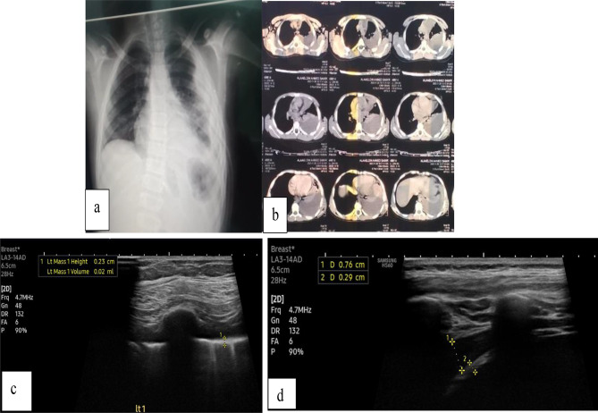
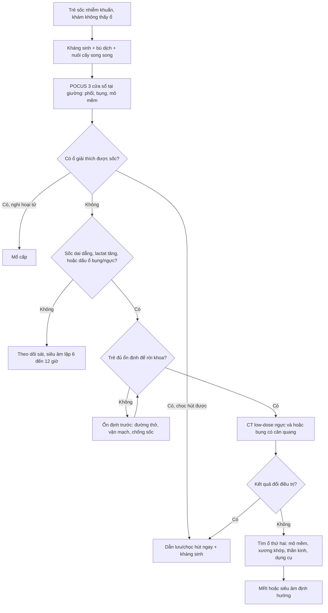
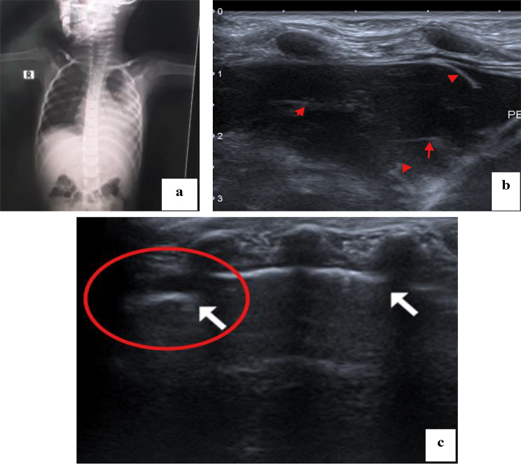
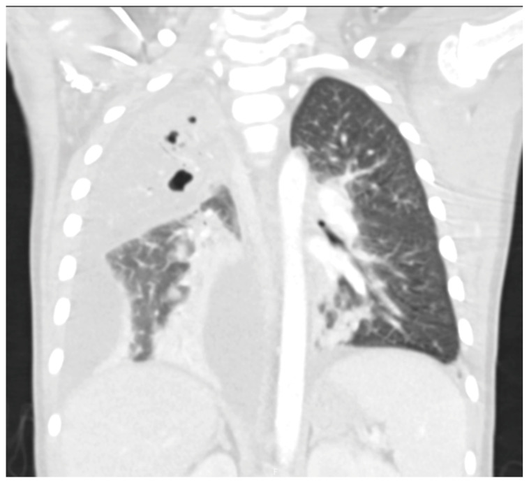
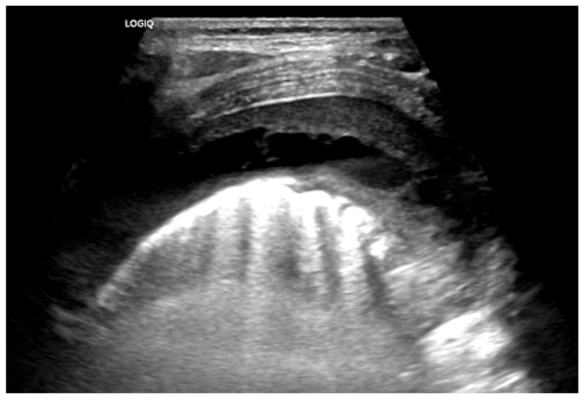
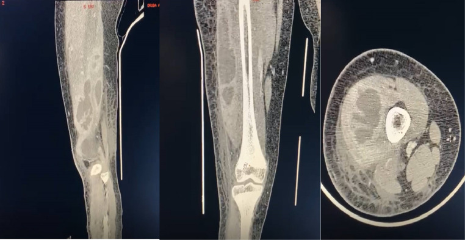

# 6190 — Sốc nhiễm khuẩn ở trẻ với ổ nhiễm khuẩn kín: siêu âm trước hay CT? / Septic shock in children with an occult source: ultrasound first or CT?

**Tags:** `pattern:o-nhiem` `pattern:dich` `vung:phoi` `vung:bung` `vung:mo-mem` `protocol:POCUS` `protocol:CT-tre` `score:Phoenix` `score:LUS`

**Mức chắc chắn (certainty):** tổng hợp y văn (literature synthesis) — số liệu dịch tễ và ngưỡng lấy từ các đoàn hệ/ thử nghiệm lâm sàng ngẫu nhiên (RCT) có toàn văn mở; ảnh minh hoạ là **ca riêng lẻ của các bài gốc**, ghi rõ PMCID trong chú thích, không gán bệnh nhi của bài này cho ảnh của bài khác.

> **Câu chốt:** trẻ **sốc nhiễm khuẩn (septic shock)** mà khám không thấy ổ thì câu hỏi hình ảnh **không phải "siêu âm hay CT cái nào tốt hơn"**, mà là **"kết quả này có đổi việc tôi làm trong 60 phút tới không?"** — có **ổ dịch chọc hút được**, có **hoại tử phải mổ**, có **tắc phải giải ép**, hay **dụng cụ phải tháo**. Kháng sinh + bù dịch chạy **song song**, không chờ hình ảnh; **siêu âm tại giường (point-of-care ultrasound, POCUS)** là bước 0 vì không xạ, không cần chuyển phòng; **CT** chỉ vào cuộc khi nó **đổi quyết định** (hoặc siêu âm không trả lời được) và sau khi trẻ **đủ ổn định để rời khoa**.

## 1. Tổng quan bệnh học – cơ chế hình ảnh

### 1.1 Vì sao "ổ kín" là chỗ chết người

Sốc nhiễm khuẩn ở trẻ là **rối loạn tuần hoàn + chuyển hoá** do nhiễm trùng: giãn mạch, rò mao mạch, giảm thể tích tuần hoàn hiệu dụng, tăng nhu cầu mô → **lactate tăng**. Kháng sinh diệt vi khuẩn nhưng **không dẫn lưu mủ, không cắt hoại tử, không giải ép tắc nghẽn** — đó là phần việc của **kiểm soát ổ nhiễm (source control)**, và hình ảnh là công cụ tìm ổ đó.

- Trong một đoàn hệ hồi cứu **193 trẻ** (2 tháng–15 tuổi) nhập vì nghi nhiễm khuẩn, **48,2% có sốc nhiễm khuẩn**, **40,9% tử vong**; tử vong ở nhóm sốc **66,7%** so với **17,0%** ở nhóm không sốc (**OR 9,77**; KTC 95% 4,96–19,24). Đây là trung tâm đơn lẻ, có thể phản ánh cả bệnh nền và nguồn lực — nhưng cho thấy **sốc là biến số tiên lượng mạnh nhất**, mạnh hơn lactate đơn thuần (*Arch Acad Emerg Med* 2026, **PMC13542529**).
- **Lactate định vị mức nguy cơ, KHÔNG định vị ổ**: trong 149 trẻ sepsis, lactate tại giường (point-of-care) tăng ở **38,9%**; dự báo nhập PICU **AUC 0,641** nhưng **không dự báo tử vong (AUC 0,544)** (*Front Pediatr* 2026, **PMC13649680**). Vì vậy lactate cao là lý do **đi tìm ổ**, không phải bằng chứng "đã đủ".
- Khuyến cáo **Surviving Sepsis Campaign (SSC) Nhi 2026** có **61 khuyến cáo** nhưng chỉ **5 mạnh**, **24 có điều kiện**, **10 thực hành tốt**, và **22 câu hỏi PICO không đưa ra được khuyến cáo** — nghĩa là **chiến lược hình ảnh chưa có chuẩn mực chung**, càng phải dựa vào nguyên lý và ngưỡng của từng phương thức (DOI 10.1097/PCC.0000000000003927).

**Vì sao ổ bị bỏ sót:** trẻ nhỏ **không khu trú được**, dấu màng não **vắng ở nhũ nhi**, đau bụng bị che bởi giảm tri giác/giảm đau, mô mềm bị chăn/đai cố định che, và **một ổ đã thấy không loại trừ ổ thứ hai** (viêm phổi + viêm xương, catheter + áp-xe). Vì vậy khám lại toàn thân và **siêu âm có hệ thống 3 cửa sổ** (phổi–màng phổi, bụng, mô mềm) có giá trị hơn "chụp theo triệu chứng".

### 1.2 TẠI SAO siêu âm thấy được ổ dịch — và tại sao nó mù ở đâu

| Đặc tính vật lý | Hệ quả lâm sàng | Giới hạn |
|---|---|---|
| Sóng âm **2–15 MHz**; đầu dò thẳng **7–12 MHz** cho mô nông, đầu dò cong **3–5 MHz** cho ổ bụng sâu | Phân giải cao ở mô mềm/pleura; thấy **vách, cặn, khí trong dịch** mà X-quang không thấy | Độ xuyên giảm theo tần số: trẻ béo/phù nhiều, ổ sâu sau ruột khó thấy |
| **Dịch** không có hồi âm; **mủ** có thể **tăng âm, lơ lửng, vách** do tế bào/fibrin | Phân biệt dịch trong (grade 1) với dịch **có vách (grade 3–4)** → quyết định dẫn lưu kiểu nào | Máu tụ/máu cục cũng tăng âm → dễ gọi nhầm là mủ |
| **Không khí và xương chặn sóng** | Phổi chỉ đọc được **qua màng phổi và vùng phổi đông đặc (hepatization)**; ruột đầy hơi che sau phúc mạc | **Áp-xe phổi trong nhu mô lành, trung thất, sau phúc mạc** gần như "vùng mù" của siêu âm |
| **Động học thời gian thực** | Dấu **trượt màng phổi (lung sliding)**, **dấu điểm phổi (lung point)**, **phế quản đồ khí động (dynamic air bronchogram)**, **đè xẹp (compressibility)** | Phụ thuộc người làm; kết quả **phụ thuộc toán học của đầu dò và góc đặt** |

Hệ quả: siêu âm **rất mạnh ở câu hỏi "có dịch/ổ chọc được không"**, **yếu ở câu hỏi "hoại tử sâu tới đâu, có khí trong trung thất, có vỡ bao gan"**.

### 1.3 TẠI SAO CT thấy được — và cái giá phải trả

- CT đo **hệ số suy giảm tia X (Hounsfield unit, HU)**: nước **0 HU**, mỡ **−40 đến −120 HU**, cơ **40–60 HU**, máu tươi **40–60 HU**, **trung tâm áp-xe 0–20 HU** (dịch/hoại tử) với **vỏ ngấm thuốc** sau tiêm. Vì vậy CT trả lời được **vách bao còn nguyên hay đã vỡ**, **khí trong mô/trung thất**, **mức độ hoại tử**, và **tương quan với mạch máu** để lên kế hoạch can thiệp.
- **Giá trị của "vỡ hay chưa vỡ"**: trong **94 trẻ** có áp-xe gan lan rộng/vỡ (trên 349 trẻ áp-xe gan), CT phân tầng được **lan dưới bao còn nguyên vỏ 52%** — nhóm này **chỉ cần kháng sinh tĩnh mạch**; phần còn lại gồm **vỡ vào lồng ngực 18%**, **vỡ dưới hoành 16%**, **vỡ tự do trong phúc mạc 14%** — nhóm cần **dẫn lưu xâm lấn chọn lọc** (*J Indian Assoc Pediatr Surg* 2026, **PMC13614804**). Đây là ví dụ rõ nhất: **cùng một "áp-xe gan", CT đổi hoàn toàn đường đi**.
- **Cái giá:** trẻ phải rời khoa, có thể cần **an thần**, cản quang (nguy cơ thận), và **liều xạ tích luỹ**. Ở **177 trẻ ≤ 5 tuổi** với **514 lần CT sọ**, **CTDIvol 8,9–51,7 mGy** và **DLP 177–1.310 mGy·cm**, dao động rất lớn và **liều tích luỹ tăng theo số lần chụp** (*Diagnostics* 2026, **PMC13162818**) — lý do phải **ALARA** và chỉ chụp khi có câu hỏi cụ thể.
- **Rời khoa là một can thiệp có biến chứng**: theo dõi **138 lượt vận chuyển trong bệnh viện** ở **96 sơ sinh**, **51,4% lượt có biến cố** (định nghĩa rộng), **hạ nhiệt độ 74,0%** (40 nhẹ, 34 vừa), và **89% biến cố xảy ra ở lượt về hoặc ngay sau về** (*Front Pediatr* 2026, **PMC13279696**). Ở trẻ lớn, con số khác nhưng nguyên lý giữ nguyên: **người đi cùng, monitor, bơm tiêm điện, đường thở dự phòng** phải được chuẩn bị **trước** khi đẩy xe.

## 2. Mẫu hình + chẩn đoán phân biệt theo khoang (gamut)

Trước khi chọn máy, đặt **5 câu hỏi** — nhớ **DRAIN**:

- **D — Dịch khu trú (collection)?** có ổ chọc hút/dẫn lưu được không (màng phổi, ổ bụng, cơ, khớp)?
- **R — Rách/vỡ bao (rupture)?** vỏ bao còn nguyên hay đã tràn sang khoang khác (màng phổi, phúc mạc, dưới hoành)?
- **A — Air?** khí trong mô/màng phổi/trung thất/ổ áp-xe (khí tự do, khí trong thành ruột, khí trong tĩnh mạch cửa)?
- **I — Ischemia/hoại tử?** mô không ngấm thuốc, khí trong mô, hoại tử nhu mô (viêm phổi hoại tử, viêm cân mạc hoại tử, hoại tử ruột)?
- **N — Neuroaxis?** màng não/tủy: có chỉ định chọc dò, có ổ tụ mủ ngoài màng cứng/dưới màng cứng?

### 2.1 Lồng ngực – màng phổi

- **Viêm phổi thuỳ/đông đặc:** siêu âm phổi (lung ultrasound, LUS) thấy **đông đặc dạng mô (hepatization)** + **phế quản đồ khí**; đây là ổ nhiễm hay gặp nhất ở trẻ sốc.
- **Tràn dịch cạnh viêm phổi/mủ màng phổi (parapneumonic effusion/empyema):** LUS phân độ **1–4** (1 = dịch trong; 2 = dịch đục không vách; 3 = có vách/ổ khu trú; 4 = vách + thành phần đặc > 1/3) — **grade 3–4 = "dịch phức tạp"**, cần **dẫn lưu có kế hoạch** (ống nhỏ + tiêu sợi huyết) (*Ital J Pediatr* 2026, **PMC13640073**).
- **Viêm phổi hoại tử/áp-xe phổi:** **CT là chuẩn tham chiếu**; LUS **bỏ sót áp-xe** (độ nhạy **33,3% phổi phải, 0% phổi trái** trong một đoàn hệ 56 trẻ) (*Ital J Pediatr* 2025, **PMC12837357**).
- **Tràn khí/tràn dịch–khí:** LUS thấy **mất trượt màng phổi + điểm phổi (lung point)**; nhưng **hydropneumothorax** cũng dễ bị bỏ sót trên LUS → **CT khi nghi**.

### 2.2 Ổ bụng

- **Viêm ruột thừa (appendicitis):** siêu âm là **bước đầu** (không xạ, sẵn có); nhưng **không phân biệt tốt đơn thuần vs phức hợp** (độ nhạy **54,9%** cho thể phức hợp trong loạt 152 trẻ) (*J Indian Assoc Pediatr Surg* 2024, **PMC11521236**) → **CT/MRI khi cần biết có áp-xe/ thủng** hoặc siêu âm không kết luận.
- **Áp-xe gan:** siêu âm phát hiện ổ, nhưng **CT có cản quang** mới phân tầng **vỏ bao/vỡ** và lên kế hoạch dẫn lưu (số liệu 52%/18%/16%/14% ở mục 1.3).
- **Áp-xe thận/quanh thận:** siêu âm thấy ổ thận, nhưng **lan ra cơ thắt lưng, khoang sau phúc mạc** thường cần CT.
- **Viêm túi mật, viêm tụy, thủng ruột:** siêu âm đầu tiên; **khí tự do** có thể chỉ thấy trên CT (X-quang bụng đứng bỏ sót khí ít) — xem bài 6191 (hàng chờ).

### 2.3 Mô mềm – cơ – xương – khớp

- **Viêm mô tế bào/áp-xe dưới da:** siêu âm phân biệt **viêm mô lan toả** với **ổ dịch** (có vỏ, đè xẹp, tăng âm trong lòng) → quyết định **chọc hút tại giường**.
- **Viêm cơ mủ (pyomyositis):** trong **102 trẻ** (11 bệnh viện Thụy Sĩ), cơ **vùng chậu 57%**, **chi dưới 28%**, **57% phải mổ**, cấy máu dương **58%** (*Pediatr Infect Dis J* 2024, **PMC11319086**). Siêu âm thấy ổ nông; **MRI** là chốt cho ổ sâu/lan theo khoang; **CT** khi cần xem xương/ổ chậu.
- **Viêm cân mạc hoại tử (necrotizing fasciitis):** **khí chỉ có ở 20–50%**, và **hiếm hơn ở đầu–cổ** → **CT thiếu khí KHÔNG loại trừ** (bài 1986); bộ ba **dày cân > 3 mm + dịch dọc cân + cân không ngấm thuốc** mới là lý do mổ.
- **Viêm xương tủy/viêm khớp nhiễm:** **MRI** (bài 6179); siêu âm khớp chỉ trả lời "có dịch không", không loại trừ viêm xương.

### 2.4 Thần kinh trung ương – dụng cụ

- **Viêm màng não:** chọc dò tủy sống là chẩn đoán; **không chụp CT thường quy trước chọc dò** — chỉ chụp khi có **dấu ổ thần kinh, giảm miễn dịch, co giật mới khởi phát, rối loạn tri giác không giải thích**.
- **Tụ mủ dưới màng cứng/não, viêm xoang biến chứng:** **MRI có cản quang** là lựa chọn; CT có cản quang khi không thể MRI.
- **Nhiễm dụng cụ (catheter trung tâm, shunt, VP shunt):** siêu âm + X-quang định vị; **CT/MRI khi nghi lan vào mô lân cận**; cấy máu qua catheter là chốt (bài 1771).

## 3. Bảng so sánh phân biệt (ma trận đối chiếu)

| Thực thể (entity) | Hình ảnh điển hình | Chốt vào (rule-in) | Chốt loại (rule-out) | Gợi ý xác nhận |
|---|---|---|---|---|
| **Tràn dịch/mủ màng phổi cạnh viêm phổi** | LUS: khoang không hồi âm, **vách/cặn**, đông đặc phổi kèm; X-quang: mờ góc sườn hoành | **Dịch có vách + dày màng phổi > 2,2 mm** (dự báo cần mổ: Se 73,5%/Sp 50%) | LUS chỉ thấy dịch trong, không vách, không dày → theo dõi kháng sinh | LUS 12 vùng + chọc hút; CT khi cần bản đồ |
| **Viêm phổi hoại tử/áp-xe phổi** | CT: đông đặc **không ngấm thuốc trung tâm**, **pneumatocele/hang**, có thể có dịch phức tạp | **CT thấy hoại tử/hang** + sốt kéo dài dù kháng sinh đúng | LUS bình thường/không thấy hang **không loại trừ** (Se 33,3%/0%) | CT ngực có cản quang; theo dõi 48–72 giờ |
| **Viêm ruột thừa phức hợp** | US: ruột thừa **> 6 mm**, không đè xẹp, **mỡ quanh tăng âm**; CT: áp-xe/khí ngoài lòng | **CT/US thấy áp-xe hoặc thủng** + sốc/đau khu trú | US thấy ruột thừa bình thường **không loại trừ** nếu không thấy được (5,38%) | US → CT/MRI khi không kết luận |
| **Áp-xe gan lan rộng/vỡ** | CT cản quang: ổ **0–20 HU**, vỏ ngấm thuốc; **mất liên tục vỏ gan**, dịch dưới hoành/màng phổi | **Vỏ bao mất liên tục + dịch ngoài gan** (vỡ) | Ổ còn trong bao, không dịch ngoài gan → kháng sinh đơn thuần (52%) | CT 2 thì; siêu âm theo dõi |
| **Viêm cơ mủ (pyomyositis)** | US: ổ dịch trong cơ, **tăng âm lơ lửng**; MRI: **T2/STIR tăng tín hiệu**, ổ dịch viền ngấm | **Ổ dịch trong cơ + sốt/đau khu trú** | MRI chỉ phù cơ, không ổ dịch → viêm cơ, không mổ | MRI; CT khi cần xương/chậu |
| **Viêm cân mạc hoại tử** | CT: **dày cân > 3 mm**, dịch dọc cân, **khí trong mô (chỉ 20–50%)** | **Khí trong mô hoặc dịch dọc cân + đau không tương xứng** | **Thiếu khí không loại trừ**; MRI bình thường cũng không loại trừ sớm | Mổ thăm dò là chuẩn vàng |
| **Tụ mủ dưới màng cứng/não** | MRI T1 sau tiêm: **viền màng não–vỏ ngấm thuốc**, hạn chế khuếch tán trung tâm | **Ổ viền ngấm + hạn chế khuếch tán** + dấu thần kinh | CT không cản quang bình thường **không loại trừ** | MRI cản quang; cấy dịch não tủy/mủ |
| **Nhiễm catheter trung tâm** | US: **huyết khối quanh catheter**, tắc trong lòng; X-quang: vị trí đầu catheter | **Cấy máu qua catheter (+) và ngoại vi (+)** cùng loại vi khuẩn | Cấy ngoại vi (+) nhưng catheter (−) → ổ khác | Siêu âm Doppler; CT khi nghi lan |

*Cùng một bệnh nhi 9 tuổi: X-quang chỉ nói "mờ đáy phổi trái"; CT định vị tràn dịch + xẹp phổi; siêu âm đo được **màng phổi dày 2,3–2,9 mm** — ngưỡng **> 2,2 mm** gợi ý cần can thiệp phẫu thuật trong loạt 56 trẻ. Nguồn: Ital J Pediatr 2025, PMC12837357, CC BY 4.0.*

## 4. Protocol chụp + hệ phân độ

### 4.1 POCUS 3 cửa sổ — làm ngay tại giường, trong lúc hồi sức

1. **Phổi–màng phổi (12 vùng):** đầu dò thẳng **7–12 MHz**; mỗi bên 6 vùng (trước/lateral/sau × trên/dưới), đầu dò cong **3–5 MHz** cho vùng sâu. Ghi: **trượt màng phổi, B-line, đông đặc, phế quản đồ khí, dịch + vách, dày màng phổi (mm)**.
2. **Bụng:** **FAST** (dịch tự do 4 góc) + **hố chậu phải** (ruột thừa) + **gan–mật–thận** (áp-xe, ứ nước) + **bàng quang**; đo **đường kính ruột thừa**, tìm **dấu bia** (lồng ruột), **dịch tự do**.
3. **Mô mềm–cơ–khớp:** so sánh hai bên, đè xẹp, Doppler; ghi **kích thước ổ (mm)**, **vách**, **dịch dọc cân**, **khí trong mô**.

**Điểm LUS (LUS score):** 12 vùng × 0–3 điểm = **0–36**; **> 8** phân biệt viêm phổi có biến chứng (viêm phổi hoại tử + tràn dịch cạnh viêm phổi) với viêm phổi thường: **AUC 0,881** (nhập viện, độ nhạy **79,02%**) và **AUC 0,861** (ngày 5, độ đặc hiệu **93,86%**) (*Ital J Pediatr* 2026, **PMC13640073**). Điểm cao còn **dự báo nằm viện dài hơn** (β = 0,221; p < 0,001).

**Ngưỡng màng phổi:** **> 2,2 mm** dự báo cần can thiệp phẫu thuật (Se **73,5%**, Sp **50%**); **grade 3–4** (có vách/ thành phần đặc) là **dịch phức tạp**, cần dẫn lưu có kế hoạch — không chờ "tự tiêu" (*Ital J Pediatr* 2025 **PMC12837357**; 2026 **PMC13640073**).

### 4.2 CT — chỉ khi câu hỏi rõ ràng

- **Chỉ định:** (1) nghi **hoại tử/áp-xe** mà siêu âm không trả lời; (2) **áp-xe sâu** (sau phúc mạc, trung thất, chậu); (3) cần **bản đồ mạch máu/ống mật** trước can thiệp; (4) **chấn thương/tắc** không rõ; (5) **không thể MRI** mà cần thần kinh.
- **Trình tự:** ổn định đường thở – tuần hoàn – monitor → **người đi cùng có kỹ năng đường thở** → chụp **low-dose theo cân nặng** → về khoa **báo lại kết quả trực tiếp**. Không đẩy trẻ đang tụt áp đi chụp "cho đủ hồ sơ".
- **Kỹ thuật:** ngực **không cản quang** đủ cho nhu mô/hoại tử; bụng **thì tĩnh mạch cửa** cho áp-xe/tạng; **ghi HU trung tâm, độ dày vỏ, khí, vỡ bao** — vì các con số này đổi đường đi (52% áp-xe gan còn trong bao chỉ cần kháng sinh).
- **Lặp lại:** nếu sốc dai dẳng/ lactat không giảm mà CT đầu âm, **chụp lại 48–72 giờ** (hoại tử/áp-xe có thể chưa rõ sớm); ưu tiên **siêu âm lặp** nếu cùng câu hỏi.

### 4.3 MRI — khi câu hỏi là thần kinh hoặc xương

- **MRI sọ có cản quang** cho tụ mủ/viêm màng não biến chứng; **MRI cột sống** khi nghi viêm đĩa–đốt sống; **MRI chi** cho viêm cơ mủ/viêm xương (bài 6179).
- Ở trẻ sốc, MRI thường **không phải bước đầu** vì thời gian + an thần; nhưng **không trì hoãn quá 24 giờ** nếu câu hỏi là ổ mủ thần kinh.

## 5. Biến thể bình thường và cạm bẫy

- **"Đông đặc" trên siêu âm có thể là xẹp phổi do đè ép** (trong tràn dịch lớn): đông đặc do xẹp **không có phế quản đồ khí động**, bờ phẳng theo dịch; đừng gọi là viêm phổi rồi bỏ qua ổ bụng.
- **B-line không đồng nghĩa nhiễm trùng:** phù phổi, truyền dịch quá tải, ARDS đều có B-line; trong sốc, **B-line hai bên + trượt màng phổi còn** gợi ý phù chứ không phải mủ.
- **Siêu âm bỏ sót áp-xe phổi (Se 33,3% phải, 0% trái) và hydropneumothorax** → **CT khi nghi**, đừng "yên tâm vì siêu âm sạch" (*Ital J Pediatr* 2025).
- **Siêu âm ruột thừa không thấy được ở 5,38%** và **chỉ nhạy 54,9% cho thể phức hợp** → không loại trừ, không phân giai đoạn thay CT/MRI.
- **CT thiếu khí không loại trừ viêm cân mạc hoại tử** (khí chỉ 20–50%, đầu–cổ còn ít hơn — bài 1986); **đau không tương xứng + nhiễm độc** mới là chỉ định mổ.
- **CT sớm có thể âm trong viêm phổi hoại tử/áp-xe** — nếu sốc tiếp diễn, **chụp lại 48–72 giờ** thay vì kết luận "không có ổ".
- **Bỏ sót ổ thứ hai (satisfaction of search):** thấy viêm phổi không loại trừ viêm xương/huyết khối catheter; **khám lại + siêu âm hệ thống** sau khi đã xử lý ổ đầu.
- **Vận chuyển là can thiệp:** 51,4% lượt vận chuyển sơ sinh có biến cố, **89% ở lượt về** (PMC13279696) → chuẩn bị **úp ấm, monitor, bơm tiêm, đường thở** trước khi rời khoa; trẻ đang tăng vận mạch nhanh **chưa phải lúc đi CT**.
- **Cản quang khi đang AKI:** cân nhắc lợi ích (áp-xe cần dẫn lưu) vs nguy cơ; **không dùng cản quang chỉ để "chụp cho đẹp"**.

## 6. Tự lượng giá — Blind Quiz

**Ca 1 — Trẻ 5 tuổi, sốt 5 ngày, thở nhanh, sốc; X-quang mờ đáy phổi trái. Nhìn phim và siêu âm, mô tả trước khi mở đáp án.**

- Hỏi: (1) Siêu âm thêm được gì mà X-quang không có? (2) Dấu trong khung (c) là gì? (3) Hai chẩn đoán phân biệt và bước xử trí?

<b>Bấm để hiện đáp án (findings + chẩn đoán)</b>

- **Dấu hiệu:** (a) X-quang: mờ đáy phổi trái, **mất góc sườn hoành**; (b) siêu âm: khoang dịch **có vách tăng âm** (mũi tên đỏ) — **tràn dịch phức tạp**; (c) **dấu điểm phổi (lung point)**: bên trái còn **trượt màng phổi**, bên phải mất trượt — chứng minh **tràn khí màng phổi khu trú**.
- **Chẩn đoán:** **viêm phổi có biến chứng + tràn dịch–khí màng phổi (hydropneumothorax)**. Siêu âm trả lời được hai câu X-quang không trả lời: **có vách trong dịch** (grade 3–4 → cần dẫn lưu có kế hoạch) và **có tràn khí kèm**.
- **Xử trí:** dẫn lưu màng phổi (ống nhỏ) ± tiêu sợi huyết; kháng sinh phổ rộng; **không chọc mù khi chưa loại trừ tràn khí**.
- **Vì sao X-quang không đủ:** mờ đáy phổi có thể do dịch, xẹp, hoặc đông đặc — X-quang không phân biệt được **vách/khí**; LUS tại giường làm được ngay trong cấp cứu.
- Nguồn ảnh: *Ital J Pediatr* 2025, PMC12837357, CC BY 4.0.

**Ca 2 — Trẻ 6 tuổi, sốt cao 8 ngày, ho, kháng sinh không đỡ, sốc nhẹ; CT ngực có cản quang.**

- Hỏi: (1) Mô tả tổn thương phổi phải? (2) Vì sao CT được chỉ định ở đây thay vì chỉ siêu âm? (3) Siêu âm cùng bệnh nhân sẽ thấy gì — và có thể bỏ sót gì?

<b>Bấm để hiện đáp án (findings + chẩn đoán)</b>

- **Dấu hiệu:** đông đặc **thuỳ trên phổi phải** với **nhiều ổ hoại tử/hang nhỏ (pneumatocele)**, **tràn dịch cạnh viêm phổi lượng vừa–nhiều** phải; không có mức khí–dịch lớn.
- **Chẩn đoán:** **viêm phổi hoại tử (necrotizing pneumonia)** — nguyên nhân thường gặp *S. pneumoniae*, *S. aureus*, *Mycoplasma* (đang tăng ở châu Á); CT là **chuẩn tham chiếu** cho hoại tử/hang (*Children* 2025, **PMC12468505**).
- **Vì sao CT:** siêu âm chỉ thấy đông đặc + dịch, **bỏ sót hang/hoại tử trong nhu mô lành** (Se áp-xe 33,3%/0%); câu hỏi "có hoại tử cần mổ/dẫn lưu không" **chỉ CT trả lời được**.
- **Siêu âm cùng bệnh nhân:** thấy **dịch có vách** và đông đặc; có thể thấy hang lớn nằm sát màng phổi nhưng **không thấy hang trung tâm**.
- **Đối chiếu siêu âm dịch phức tạp:**

- Hình siêu âm cho thấy **vách/ dải tăng âm trong khoang dịch** (dịch phức tạp grade 3–4) — lý do cần **dẫn lưu có kế hoạch**, không chỉ kháng sinh.
- Nguồn ảnh: *Children (Basel)* 2025, PMC12468505, CC BY 4.0.

**Ca 3 — Trẻ 9 tuổi, sốt + đau đùi phải, không đi được; X-quang đùi bình thường; CT đùi.**

- Hỏi: (1) Ổ bất thường nằm ở đâu, trong cơ hay xương? (2) X-quang bình thường loại trừ được gì? (3) Siêu âm có thể thay CT trong ca này không?

<b>Bấm để hiện đáp án (findings + chẩn đoán)</b>

- **Dấu hiệu:** **ổ dịch nhiều thuỳ trong cơ đùi** (giảm đậm độ, viền ngấm thuốc), **không phá xương**; mô dưới da dày.
- **Chẩn đoán:** **viêm cơ mủ (pyomyositis)** — ổ sâu trong cơ, cần **dẫn lưu + kháng sinh**; cấy máu/tissue dương 58%/88%, *S. aureus* hàng đầu (**PMC11319086**).
- **X-quang bình thường:** chỉ loại trừ **gãy xương/ hủy xương rõ**, **không loại trừ ổ dịch trong cơ** — đây là cạm bẫy "phim sạch = không ổ".
- **Siêu âm thay CT?** Có thể thấy ổ nông, nhưng **ổ sâu trong cơ lớn/ nhiều thuỳ** và cần đánh giá **lan theo khoang, xương lân cận** → **MRI hoặc CT**; ở trẻ sốc, **CT nhanh hơn** nếu chỉ cần dẫn lưu cấp.
- Nguồn ảnh: *Radiol Case Rep* 2025, PMC12281509, CC BY 4.0.

## 7. Câu hỏi nghiên cứu & điểm chưa đồng thuận (tính đến 11/2026)

1. **[Tranh cãi] Ở trẻ sốc nhiễm khuẩn không rõ ổ, siêu âm tại giường có hệ thống (phổi + bụng + mô mềm) có rút ngắn thời gian kiểm soát ổ và giảm tử vong so với chăm sóc thường không?**
   - **Đã biết:** POCUS cải thiện thành công thủ thuật lần đầu (**RR 1,25**; KTC 95% 1,09–1,43) và thành công chung (**RR 1,12**; 1,03–1,22) trong **18 RCT/2.264 trẻ** ở cấp cứu nhi, nhưng **không** giảm thời gian thủ thuật/số lần thử/nhập viện (PMC12729704).
   - **Chưa rõ:** chưa có RCT nào lấy **thời gian tới kiểm soát ổ** hoặc **tử vong** làm kết cục chính; các nghiên cứu khác nhau về định nghĩa "ổ kín" và người làm siêu âm.
   - **Hướng nghiên cứu:** RCT đa trung tâm tại khoa cấp cứu/PICU, so sánh **POCUS 3 cửa sổ** với khám lâm sàng, kết cục **thời gian tới dẫn lưu/mổ + tử vong 28 ngày**.
   - **Nguồn:** PMC12729704 (2025); PMC13462805 (2026).

2. **[Khoảng trống] Ngưỡng nào của siêu âm phổi (LUS score) hoặc CT đủ để quyết định mổ ở trẻ viêm phổi hoại tử — và có cần kết hợp cả hai?**
   - **Đã biết:** **LUS score > 8** phân biệt viêm phổi có biến chứng với viêm phổi thường (**AUC 0,881**; độ nhạy 79,02%) (PMC13640073); **dày màng phổi > 2,2 mm** dự báo cần can thiệp (Se 73,5%/Sp 50%) (PMC12837357).
   - **Chưa rõ:** chưa có ngưỡng LUS/CT được **thẩm định tiền cứu với kết cục mổ**; các nghiên cứu dùng **CT làm chuẩn** nên vòng lặp chẩn đoán chưa khép kín.
   - **Hướng nghiên cứu:** đoàn hệ tiền cứu có **hội đồng mổ độc lập**, so sánh LUS score + CT với quyết định mổ và kết cục (thời gian thở máy, biến chứng).
   - **Nguồn:** PMC13640073 (2026); PMC12837357 (2025).

3. **[Khác biệt thực hành] "Siêu âm trước" hay "CT trước" ở trẻ nghi mủ màng phổi/viêm phổi hoại tử: tỷ lệ CT đổi điều trị khác nhau giữa các trung tâm đến mức nào?**
   - **Đã biết:** tổng quan mủ màng phổi nhi khuyến cáo **siêu âm để đặc tả ổ và hướng dẫn dẫn lưu**, **CT dành cho bệnh không điển hình/ biến chứng**; dẫn lưu + tiêu sợi huyết và VATS cho kết cục tương đương trong các thử nghiệm nhỏ (PMC13763771).
   - **Chưa rõ:** **tỷ lệ CT thực sự đổi quyết định** (từ "kháng sinh" sang "mổ/dẫn lưu") chưa được báo cáo nhất quán; chỉ định CT khác nhau giữa trung tâm có/không có siêu âm phổi chuyên sâu.
   - **Hướng nghiên cứu:** registry đa trung tâm ghi **chuỗi hình ảnh → quyết định**, phân tích tỷ lệ đổi điều trị và chi phí–lợi ích của chiến lược siêu âm trước.
   - **Nguồn:** PMC13763771 (2026); PMC12468505 (2025).

## Bài liên quan chéo

- [600 – Tổng quan Hệ Nhi khoa](../600-tong-quan-nhi-khoa/lesson.md)
- [031 – Viêm phổi mẫu hình](../031-viem-phoi-mau-hinh/lesson.md) (đông đặc, phế quản đồ khí)
- [040 – Tràn dịch màng phổi](../040-tran-dich-mang-phoi/lesson.md) (dịch đơn thuần vs mủ)
- [041 – Tràn khí màng phổi](../041-tran-khi-mang-phoi/lesson.md) (dấu điểm phổi)
- [088 – Áp-xe phổi & mủ màng phổi sau VAP](../088-apxe-phoi-mu-mang-phoi-sau-vap/lesson.md)
- [609 – Ống dẫn lưu màng phổi ở trẻ](../609-ong-dan-luu-mang-phoi-o-tre/lesson.md)
- [103 – Áp-xe gan Klebsiella](../103-ap-xe-gan-klebsiella/lesson.md) (phân tầng vỏ bao)
- [1986 – Viêm mô hoại tử ở trẻ](../1986-viem-mo-hoai-tu-o-tre/lesson.md) (khí chỉ 20–50%)
- [6179 – Viêm xương tủy cấp ở trẻ](../6179-viem-xuong-tuy-cap-o-tre/lesson.md) (MRI là chốt)
- [1771 – CLABSI catheter trung tâm ở trẻ](../1771-clabsi-catheter-trung-tam-o-tre/lesson.md)
- [605 – Siêu âm phổi & điểm số ở sơ sinh](../605-sieu-am-phoi-diem-so-sinh/lesson.md)
- [1668 – Viêm ruột thừa ở trẻ dưới 3 tuổi](../1668-viem-ruot-thua-o-tre-duoi-3-tuoi/lesson.md)

## Ảnh

- `6190_soc-nhiem-khuan_XR-LUS_PMC12837357.jpg` — X-quang + siêu âm phổi (vách dịch, dấu điểm phổi) — *Ital J Pediatr* 2025, **PMC12837357**, **CC BY 4.0** (nguyên bản Hình 1).
- `6190_soc-nhiem-khuan_CT-LUS_PMC12837357.jpg` — X-quang + CT + siêu âm đo màng phổi 2,3–2,9 mm — *Ital J Pediatr* 2025, **PMC12837357**, **CC BY 4.0** (nguyên bản Hình 3).
- `6190_soc-nhiem-khuan_CT_PMC12468505.jpg` — CT ngực viêm phổi hoại tử + tràn dịch — *Children (Basel)* 2025, **PMC12468505**, **CC BY 4.0** (nguyên bản Hình 4).
- `6190_soc-nhiem-khuan_LUS_PMC12468505.jpg` — siêu âm dịch màng phổi có vách — *Children (Basel)* 2025, **PMC12468505**, **CC BY 4.0** (nguyên bản Hình 6).
- `6190_soc-nhiem-khuan_CT_PMC12281509.jpg` — CT đùi viêm cơ mủ — *Radiol Case Rep* 2025, **PMC12281509**, **CC BY 4.0** (nguyên bản Hình 3).

> Không dùng để chẩn đoán độc lập khi chưa có người hướng dẫn.
