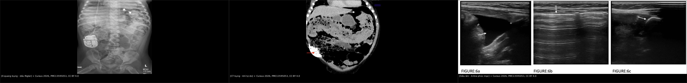
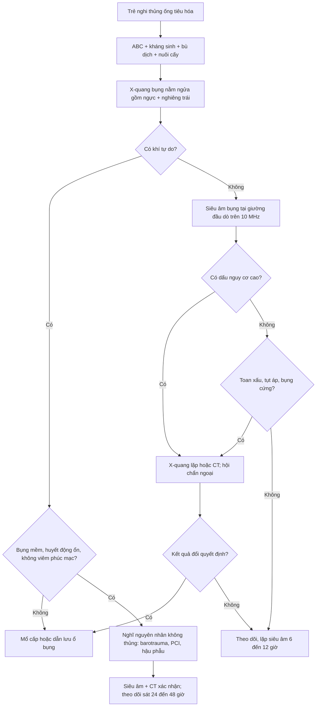
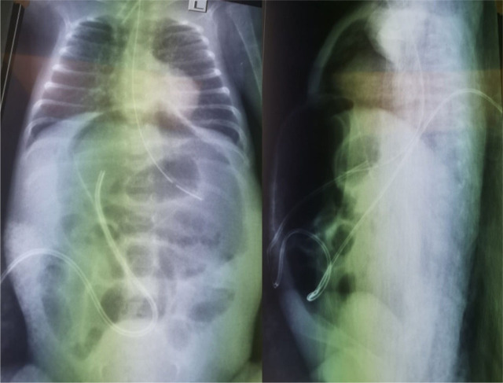
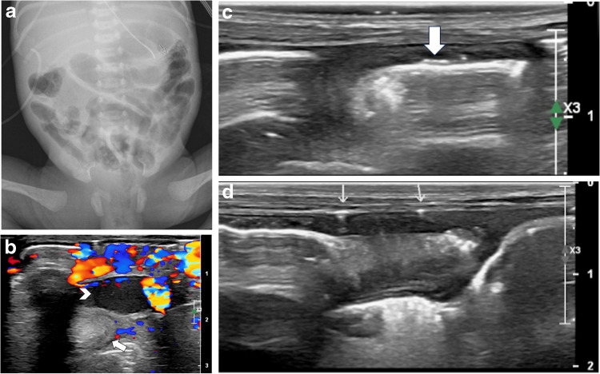
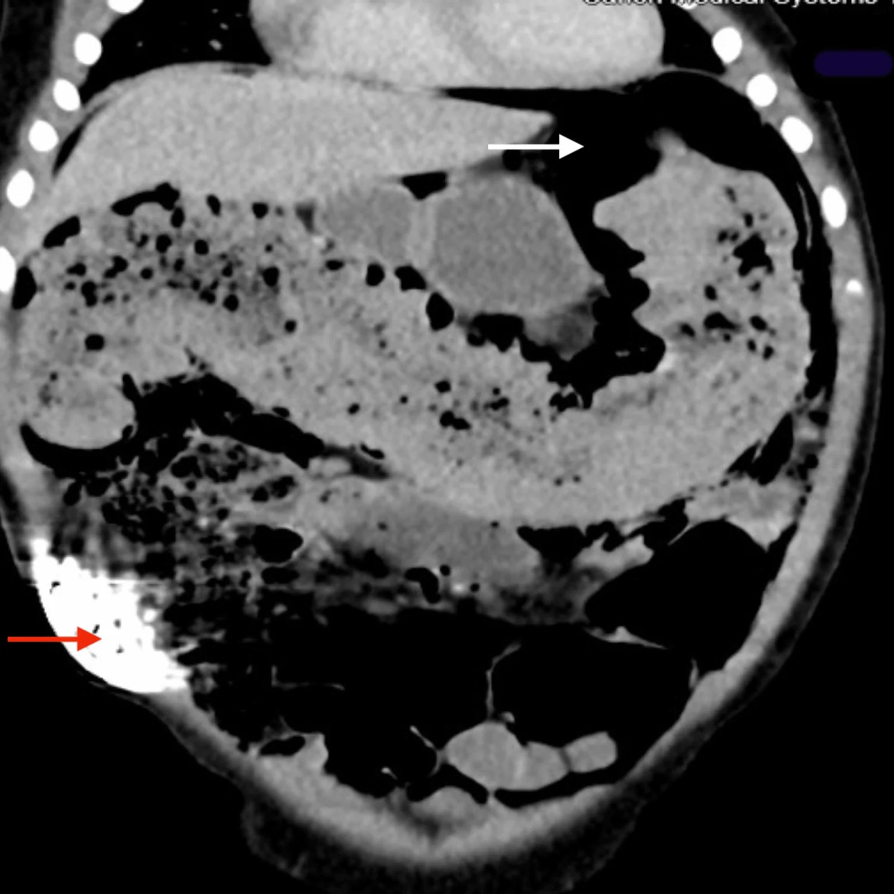

# 6191 — Thủng ống tiêu hóa ở trẻ: khí tự do — X-quang, siêu âm hay CT? / Pediatric gastrointestinal perforation: free air — radiograph, ultrasound or CT?

**Tags:** `pattern:khi-tu-do` `pattern:khi-trong-thanh` `vung:bung` `protocol:POCUS` `protocol:CT-tre` `score:Bell`

**Mức chắc chắn (certainty):** tổng hợp y văn (literature synthesis) — ngưỡng và tỷ lệ lấy từ đoàn hệ, meta-analysis và tổng quan có toàn văn mở; ảnh là **ca riêng lẻ** của từng bài gốc, ghi PMCID, không gán bệnh nhi của bài này cho ảnh của bài khác.

> **Câu chốt:** khi trẻ có khí tự do, câu hỏi **không phải "máy nào tốt hơn"** mà là **ba câu**: (1) khí này **trong phúc mạc hay trong lòng tạng/trong thành ruột**? (2) có **viêm phúc mạc, hoại tử, tụt áp** đòi mổ **ngay** không? (3) nếu bụng mềm và trẻ ổn định, có nguyên nhân **không do thủng** (barotrauma, khí trong thành, hậu phẫu) không? **X-quang** trả lời nhanh câu 1 ở trẻ nhỏ; **siêu âm tại giường** thấy khí tự do **lượng nhỏ** và khí trong thành **sớm hơn** X-quang; **CT** phát hiện được **< 1 mL** khí và định vị ổ thủng nhưng là phương thức **phải rời khoa**. Không có khí tự do **không loại trừ** thủng.

## 1. Tổng quan bệnh học – cơ chế hình ảnh

### 1.1 Vì sao "khí tự do" là dấu chứng, không phải chẩn đoán

Thủng ống tiêu hóa để khí trong lòng tạng thoát vào phúc mạc. Bản thân khí **không phải** thứ làm trẻ chết; thứ làm trẻ chết là **viêm phúc mạc do dịch ruột/mật/acid**, **hoại tử ruột lan rộng**, **nhiễm khuẩn huyết** và **hội chứng khoang bụng**. Vì vậy khí tự do là **dấu chứng của một biến cố cần kiểm soát ổ nhiễm (source control)** — mổ hoặc dẫn lưu — chứ không phải một chẩn đoán đứng riêng.

- Ở trẻ non tháng, **viêm ruột hoại tử (necrotizing enterocolitis, NEC)** gặp ở **~7%** trẻ non tháng/nhẹ cân; tử vong ở nhóm **cực nhẹ cân (ELBW)** tới **50,9%**; **~1/4** trẻ NEC cần can thiệp mổ (*Children (Basel)* 2026, **PMC13297530**).
- Khí tự do trên phim ở NEC tương ứng **giai đoạn IIIB** của phân độ Bell cải tiến — đây là mốc **chỉ định mổ** kinh điển, không phải mốc "theo dõi thêm".
- Nhưng **không phải mọi khí tự do ở sơ sinh đều là NEC**: **thủng ruột tự phát (spontaneous intestinal perforation, SIP)** ở trẻ cực non có bệnh cảnh khác — chẩn đoán **sớm hơn nhiều** (trung vị **ngày 7, khoảng 5–8** so với **ngày 20, khoảng 10–29** của NEC), ít khí trong thành hơn, và trong loạt đã mổ thì **khí tự do có ở 100% SIP vs 53% NEC**; điều trị cũng khác: **dẫn lưu ổ bụng 98% vs 45%**, **mở bụng 67% ở NEC vs 5% ở SIP** (*BMJ Paediatr Open* 2025, **PMC12243581**).

### 1.2 TẠI SAO khí nổi lên trên — và tại sao tư thế chụp quyết định thấy hay không

Khí trong phúc mạc có tỷ trọng gần **−1.000 HU** (không khí), so với mô mềm **40–60 HU** và dịch **0–20 HU**. Chênh lệch tỷ trọng này khiến khí **nổi lên vị trí cao nhất** của khoang phúc mạc:

| Tư thế | Khí tập trung ở đâu | Dấu hiệu điển hình |
|---|---|---|
| **Đứng / ngồi** | Dưới hai vòm hoành | **Liềm khí dưới hoành** — dấu nhạy nhất trên phim ngực đứng |
| **Nằm ngửa (supine)** | Mặt trước ổ bụng, dưới thành bụng trước | **Dấu Rigler** (thấy **hai thành** của cùng một quai ruột), **dấu bóng bầu dục (football sign)**, **dấu vòm (cupola sign)**, **dấu dây chằng liềm**, **dấu chữ V ngược** (dây chằng tròn) |
| **Nghiêng trái (left lateral decubitus)** | Giữa gan và thành bụng bên phải | **Liềm khí trên gan** — thấy được lượng khí nhỏ hơn nhiều so với phim nằm ngửa |
| **Nằm sấp / cross-table lateral** | Mặt trước, dưới thành bụng | Liềm khí trước gan, dễ thấy ở sơ sinh |

**Hệ quả thực hành:** sơ sinh **luôn được chụp nằm ngửa**, nên một lượng khí nhỏ có thể **không tạo liềm dưới hoành** mà chỉ là **dấu Rigler thoáng qua** hoặc **vùng sáng trước gan** — dễ bị đọc là "hơi nhiều trong ruột". Trong một ca 31 tuần 3/7 ngày tuổi thứ 7, phim **AP nằm ngửa chỉ thấy khí trong thành**, còn **siêu âm làm sau 178 phút thấy khí tự do lượng nhỏ trong dịch tự do**, nâng **Bell 2A → 3B** (*Pediatr Radiol* 2025, **PMC12708678**, Hình 3). Vì vậy khi nghi ngờ, phải thêm **tư thế nghiêng trái** hoặc chuyển sang **siêu âm**, không kết luận "không thủng" từ một phim nằm ngửa.

Trên **CT**, khí tự do được phát hiện tới **< 1 mL** — mô hình AI đo thể tích trên 2.072 ca cho thấy sau khi loại các ca khí **< 1 mL**, độ nhạy tăng lên **96%** (*Insights Imaging* 2026, **PMC13380604**). Đây là lý do CT là **chuẩn tham chiếu** cho khí lượng rất nhỏ, nhưng cái giá là vận chuyển, an thần và liều xạ.

### 1.3 TẠI SAO siêu âm thấy khí tự do — và tại sao nó không thay được X-quang

Khí và mô mềm chênh **trở kháng âm** rất lớn, gần như **phản xạ toàn phần** sóng siêu âm. Vì vậy khí tự do **không** hiện thành "ổ đen có bờ" như dịch, mà tạo **chuỗi hồi âm lặp (reverberation)**:

- **Dấu dải phúc mạc tăng âm (enhanced peritoneal stripe sign):** dải phúc mạc dày, sáng hơn bình thường, kèm **A-line phúc mạc** phía sau — giống "A-line của phổi" nhưng nằm trên **mặt trước gan/lách**.
- **Bóng mờ bẩn (dirty shadowing)** và **ring-down artifact** từ khí.
- Khí tự do **di chuyển khi đè đầu dò** và **không nằm trong lòng quai ruột**; khí trong lòng ruột **không vượt qua mặt trước gan** và **không đổi theo áp lực đầu dò** (tiêu chí Moriwaki).
- **Nghiệm pháp kéo (scissors maneuver):** cho trẻ nằm nghiêng trái để khí tự do nổi lên **hạ sườn phải**, rồi so sánh với khí trong lòng ruột.

POCUS ở người lớn đạt **độ nhạy 95% / độ đặc hiệu 81%** cho khí phúc mạc (*POCUS J* 2026, **PMC13161770**) — đủ để **nghi ngờ và hành động sớm**, không đủ để thay CT khi cần định vị ổ thủng.

Ở sơ sinh, **siêu âm bụng (bowel ultrasound, BUS)** còn thấy được **8 dấu nguy cơ cao (high-risk findings, HRF)**: khí tự do, thành ruột dày/mỏng bất thường, giảm tưới máu trên Doppler màu, mất/giảm nhu động, giãn ruột, dịch ổ phức tạp, đảo hướng động mạch–tĩnh mạch mạc treo trên. Trong 28 lượt siêu âm của 18 sơ sinh trước mổ, **trung vị chỉ 2 HRF được báo cáo (0–8)**; đầu dò **> 10 MHz** làm tăng số dấu được mô tả (**4 vs 1**), và **siêu âm lặp trong 7 ngày** tốt hơn một lần đơn độc (**6 vs 3**) (*Front Pediatr* 2025, **PMC12589060**).

**So sánh trực tiếp với X-quang trong NEC:** siêu âm có **độ nhạy 0,91** so với **0,68** của X-quang; **32%** ca siêu âm (+) có **X-quang đầu bình thường**; **59%** ca siêu âm **nâng giai đoạn Bell** (*Pediatr Radiol* 2025, **PMC12708678**). Meta-analysis **20 nghiên cứu / 1.793 sơ sinh** xác nhận siêu âm phát hiện **khí trong tĩnh mạch cửa** nhiều hơn (**OR 2,32**; KTC 95% 1,35–3,99), trong khi X-quang **có xu hướng** phát hiện **khí tự do** nhiều hơn (**OR 0,62**; 0,31–1,26 — **không có ý nghĩa thống kê**) (*Front Pediatr* 2026, **PMC13461621**).

> **Đọc đúng con số:** siêu âm **giỏi hơn** ở khí trong thành, khí tĩnh mạch cửa và dịch phức tạp; X-quang **không bị loại bỏ** vì vẫn là phương thức **sẵn có, nhanh, chuẩn hóa** cho khí tự do lượng lớn. Hai phương thức **bổ sung**, không thay thế.

### 1.4 Cái giá của CT

CT bụng có cản quang ở trẻ cần **rời khoa**, có thể cần **an thần**, dùng **cản quang** (nguy cơ thận) và **liều xạ tích lũy** — ở trẻ chụp lặp lại, liều tích lũy tăng theo số lần chụp (bài 6190, **PMC13162818**). Vì vậy CT chỉ vào cuộc khi **kết quả đổi quyết định**: định vị ổ thủng, phát hiện khí **< 1 mL** khi X-quang/siêu âm không kết luận, đánh giá **hoại tử lan rộng** hoặc **hội chứng khoang bụng**, hoặc lập **bản đồ trước mổ**.

## 2. Mẫu hình + chẩn đoán phân biệt theo tuổi và vị trí (gamut)

### 2.1 Sơ sinh (0–28 ngày)

- **NEC giai đoạn IIIB:** khí tự do + khí trong thành + khí tĩnh mạch cửa, bụng chướng, máu trong phân, toan/chuyển hóa xấu. Khí tự do = **mổ** (hoặc dẫn lưu ổ bụng ở trẻ cực non theo chiến lược).
- **SIP:** trẻ **< 1.000 g**, thường **ngày 5–8**, bụng chướng đột ngột, **ít/không khí trong thành**, X-quang có thể chỉ là "bụng hơi nhiều"; liên quan **hydrocortisone sau sinh** (76% vs 55%) và indomethacin.
- **Thủng dạ dày sơ sinh:** khí tự do **rất nhiều**, bụng căng, thường sau thông khí áp lực dương hoặc đặt ống dạ dày; hình ảnh **bóng khí dạ dày mất liên tục**.
- **Tắc ruột non/đại tràng bẩm sinh (teo, meconium ileus):** giãn quai **trước chỗ tắc**, có thể thủng **trước sinh** → **khí tự do + vôi hóa trong phúc mạc (meconium peritonitis)**.
- **Do can thiệp:** thông khí áp lực dương, đặt catheter rốn, thụt baryt/contrast, đặt ống thông dạ dày — luôn hỏi **"có can thiệp gì trong 24 giờ qua?"**.

### 2.2 Nhũ nhi – trẻ nhỏ (1 tháng – 5 tuổi)

- **Lồng ruột (intussusception):** khí tự do **hiếm** và là dấu **muộn** (đã hoại tử/thủng) — không chờ khí tự do mới xử lý.
- **Xoắn ruột do malrotation:** bụng **ít hơi**, nôn mật, đau từng cơn; khí tự do là dấu **muộn**; siêu âm thấy **dấu xoáy (whirlpool)**.
- **Dị vật/thỏi nam châm:** thủng do **hoại tử áp lực** giữa hai nam châm — khí tự do có thể **rất ít**; X-quang thấy nam châm, CT thấy lỗ thủng và dịch.
- **Chấn thương bụng kín:** thủng ruột non/tá tràng; khí tự do **có thể vắng**; CT có cản quang là chốt.

### 2.3 Trẻ lớn (> 5 tuổi)

- **Viêm ruột thừa thủng:** khí tự do **không thường gặp**; dấu chính là **áp-xe/đám quánh hố chậu phải**, mất liên tục thành ruột thừa.
- **Loét dạ dày–tá tràng thủng:** khí tự do **nhiều**, đau thượng vị đột ngột, bụng cứng; thường gặp ở trẻ dùng NSAID/corticoid hoặc stress.
- **Rò miệng nối/hậu phẫu:** khí tự do **sau mổ** có thể là **bình thường** (khí tồn dư sau nội soi ổ bụng) — phải đọc theo **thời gian, số lượng, triệu chứng**, không theo "có/không".
- **Khí trong thành + khí tự do do pneumatosis cystoides intestinalis (PCI):** trẻ suy giảm miễn dịch, dùng corticoid, bệnh mạn — **85% chỉ cần bảo tồn**; chỉ **11% phẫu thuật** và **3/95 ca** có thủng thật (*J Clin Med* 2025, **PMC12470710**).

### 2.4 Khí tự do KHÔNG do thủng (phải nghĩ trước khi mổ)

- **Barotrauma ở trẻ thở máy:** khí từ phổi/trung thất **lan qua lỗ cơ hoành** hoặc qua khoang sau phúc mạc vào ổ bụng. Trẻ 2 tháng thở máy áp lực cao có **khí dưới hoành nhưng bụng mềm, huyết động ổn**; dẫn lưu ổ bụng giải áp, sau đó **tràn khí màng phổi phải**; nuốt cản quang **không thấy thủng** → điều trị bảo tồn, **hạ áp lực đỉnh** (*Cureus* 2025, **PMC11955197**).
- **Sau nội soi ổ bụng, sau mở dạ dày qua da (PEG), sau thẩm phân phúc mạc:** khí tồn dư, tự tiêu.
- **PCI lành tính:** khí trong thành ruột **vỡ vào phúc mạc** mà không thủng thật — bụng mềm, không sốt, chỉ số viêm bình thường (*Cureus* 2026, **PMC13595053**).
- **Chilaiditi:** đại tràng chen giữa gan và cơ hoành — **giả khí tự do**, có **haustra** và **không thấy hai thành ruột**.

## 3. Bảng so sánh phân biệt (ma trận đối chiếu)

*Cùng một bệnh nhi 6 tuổi (PEG, động kinh, kích thích não sâu): X-quang cho **dấu Rigler**, CT xác nhận **khí tự do + khí trong thành đại tràng**, siêu âm thấy **dịch tự do + A-line phúc mạc + khí trong thành**. Bụng mềm, không sốt, chỉ số viêm bình thường → **khí phúc mạc lành tính do pneumatosis coli**, điều trị bảo tồn. Nguồn: Cureus 2026, PMC13595053, CC BY 4.0.*

| Thực thể (entity) | Hình ảnh điển hình | Chốt vào (rule-in) | Chốt loại (rule-out) | Gợi ý xác nhận |
|---|---|---|---|---|
| **NEC giai đoạn IIIB** | X-quang: khí tự do + khí trong thành + khí tĩnh mạch cửa; siêu âm: khí tự do nhỏ, dịch phức tạp, mất nhu động | **Khí tự do + khí trong thành + bệnh cảnh non tháng** (Bell IIIB) | Không có khí tự do **không loại trừ** (chỉ 53% NEC có khí tự do) | Siêu âm lặp + X-quang nghiêng trái; hội chẩn ngoại |
| **SIP** | X-quang: bụng chướng, **ít khí trong thành**, khí tự do; siêu âm: dịch tự do, không pneumatosis rõ | **Trẻ < 1.000 g, ngày 5–8, khí tự do + bụng chướng đột ngột** | Khí trong thành lan rộng + khí tĩnh mạch cửa → nghiêng NEC | Dẫn lưu ổ bụng ± mổ; cấy dịch |
| **Thủng dạ dày sơ sinh** | Khí tự do **rất nhiều**, bóng dạ dày mất liên tục, bụng căng | **Khí tự do lượng lớn + bóng dạ dày biến dạng** | Khí ít, bụng mềm → nghĩ nguyên nhân khác | X-quang nghiêng + mổ cấp |
| **Barotrauma (không thủng)** | Khí dưới hoành ± khí trung thất/tràn khí màng phổi; **bụng mềm** | **Trẻ thở máy áp lực cao + khí tự do + huyết động ổn + bụng mềm** | Có viêm phúc mạc, toan tăng, bụng cứng → **không** phải barotrauma | Hạ áp lực đỉnh; nuốt cản quang; theo dõi |
| **PCI lành tính** | CT: khí trong thành + khí tự do, **không có ổ dịch mủ**, thành ruột mỏng | **Khí tự do + khí trong thành + bụng mềm, không nhiễm độc** | Sốt, đau khu trú, CRP tăng mạnh, dịch ổ → nghi thủng/hoại tử | CT bụng; theo dõi 24–48 giờ |
| **Viêm ruột thừa thủng** | Siêu âm: ruột thừa > 6 mm, mất liên tục thành, áp-xe; CT: khí ngoài lòng hố chậu phải | **Áp-xe/đám quánh hố chậu phải + mất liên tục thành ruột thừa** | Ruột thừa bình thường **không loại trừ** nếu không thấy được | Siêu âm → CT khi không kết luận; mổ/dẫn lưu |
| **Rò miệng nối/hậu phẫu** | CT: khí ngoài lòng **quanh miệng nối**, dịch, mất liên tục thành; X-quang: khí tự do | **Khí + dịch quanh miệng nối + sốt/đau sau mổ** | Khí ít, không dịch, không triệu chứng → khí tồn dư | CT cản quang; nội soi/kiểm tra miệng nối |
| **Thủng do dị vật/nam châm** | X-quang: nam châm/dị vật; CT: lỗ thủng, dịch, khí tự do ít | **Dị vật + khí tự do/ dịch tự do + đau khu trú** | Chỉ có dị vật, không khí/dịch → theo dõi | CT bụng; nội soi/mổ |
| **Chilaiditi (giả khí tự do)** | Đại tràng giữa gan và cơ hoành, **có haustra**, không thấy hai thành ruột | **Haustra + thay đổi theo tư thế + không có dịch** | Có khí **hai bên thành ruột** (Rigler) → khí tự do thật | CT bụng xác nhận |

## 4. Protocol chụp + hệ phân độ

### 4.1 X-quang bụng sơ sinh — "hai phim, một ngực"

1. **Phim nằm ngửa (AP supine)** gồm **cả ngực** (để thấy khí dưới hoành và loại trừ tràn khí màng phổi/trung thất).
2. **Phim nghiêng trái (left lateral decubitus)** hoặc **cross-table lateral** — đây là phim **quyết định** cho khí lượng nhỏ; đặt trẻ nằm nghiêng trái **≥ 5 phút** trước chụp.
3. **Lặp lại 6–8 giờ** nếu bệnh cảnh cấp và phim đầu âm; **ngay** nếu bụng chướng tăng nhanh, tụt áp, toan xấu.
4. Ghi rõ: **khí tự do (có/không, lượng), khí trong thành, khí tĩnh mạch cửa, giãn ruột, mức khí–dịch, bóng dạ dày**.

### 4.2 Siêu âm bụng tại giường (BUS/POCUS)

- Đầu dò **thẳng > 10 MHz** cho sơ sinh nhẹ cân, **cong 3–5 MHz** cho ổ sâu; **so sánh hai bên**, đè nhẹ.
- Quét **mặt trước gan/lách** tìm **A-line phúc mạc**; **hố chậu phải** tìm quai ruột dày, dịch; **toàn bộ ổ bụng** tìm dịch tự do, khí trong thành, khí tĩnh mạch cửa.
- **Nghiệm pháp kéo (scissors maneuver):** nằm nghiêng trái → khí tự do nổi lên hạ sườn phải; khí trong lòng ruột **không** đi theo.
- Báo cáo đủ **8 HRF**: khí tự do, thành ruột dày/mỏng, tưới máu Doppler, nhu động, giãn ruột, dịch ổ phức tạp, đảo hướng mạc treo.
- **Lặp lại trong 6–12 giờ** nếu còn nghi ngờ — siêu âm lặp cho nhiều dấu hơn một lần đơn độc (**6 vs 3 HRF**; **PMC12589060**).

### 4.3 CT bụng — khi nào thực sự cần

- **Chỉ định:** (1) X-quang và siêu âm **không kết luận** mà nghi thủng; (2) cần **định vị ổ thủng** hoặc **bản đồ trước mổ**; (3) nghi **hoại tử lan rộng/hội chứng khoang bụng**; (4) chấn thương bụng kín; (5) rò miệng nối sau mổ.
- **Kỹ thuật:** **low-dose** theo cân nặng, **cản quang tĩnh mạch** thì tĩnh mạch cửa; không cản quang đủ cho khí tự do nhưng kém cho tụ dịch/hoại tử.
- **Đọc:** khí tự do (**< 1 mL** vẫn thấy), **khí trong thành**, **khí tĩnh mạch cửa**, **mất liên tục thành tạng**, **dịch tự do**, **vị trí ổ thủng** (tá tràng, hồi tràng, đại tràng), **dấu hiệu hoại tử**.

### 4.4 Phân độ Bell cải tiến + chỉ định mổ

| Giai đoạn | Đặc điểm chính | Xử trí |
|---|---|---|
| **I** | Nghi ngờ: chướng bụng, ứ dịch, phân máu vi thể | Nhịn ăn, kháng sinh, theo dõi |
| **IIA** | Nhẹ: chướng rõ, ứ hơi, không có khí trong thành | Nhịn ăn, kháng sinh, X-quang lặp |
| **IIB** | Vừa: **khí trong thành**, **khí tĩnh mạch cửa**, toan nhẹ, giảm tiểu cầu | Kháng sinh, hội chẩn ngoại, siêu âm lặp |
| **IIIA** | Nặng **không thủng**: viêm phúc mạc, toan, tụt áp, thiểu niệu | Hồi sức + hội chẩn ngoại |
| **IIIB** | **Thủng**: **khí tự do** | **Mổ cấp** (hoặc dẫn lưu ổ bụng ở cực non) |

> **Khi không có khí tự do mà vẫn phải mổ:** trong **115 trẻ NEC Bell II–III không có khí tự do**, **viêm phúc mạc** và **phim bất thường** là hai yếu tố liên quan mạnh nhất với can thiệp mổ; bộ **8 tham số** (đặt nội khí quản, tụt áp, viêm phúc mạc, phim bất thường, giảm bạch cầu, giảm tiểu cầu, toan, hạ natri) được dùng như **bảng điểm hỗ trợ quyết định**, không phải tiêu chuẩn tuyệt đối (*Children (Basel)* 2026, **PMC13297530**).

## 5. Biến thể bình thường và cạm bẫy

- **Chilaiditi:** đại tràng chen giữa gan và cơ hoành tạo vùng sáng dưới hoành; phân biệt nhờ **haustra**, **không thấy hai thành ruột**, thay đổi theo tư thế.
- **Mỡ dưới hoành/dây chằng:** trên CT mỡ **−40 đến −120 HU**, không phải khí **−1.000 HU**; trên X-quang là vùng sáng **bờ mờ**, không có liềm sắc nét.
- **Xẹp đáy phổi/đường cong màng phổi:** có thể giả liềm khí; đọc kèm phim ngực và so sánh hai bên.
- **Khí trong lòng ruột trên siêu âm:** khí trong lòng **không vượt mặt trước gan**, **không di chuyển theo áp lực đầu dò** (Moriwaki); đừng gọi là khí tự do.
- **Barotrauma:** khí tự do ở trẻ **thở máy áp lực cao + bụng mềm** có thể **không do thủng**; dẫn lưu giải áp và **hạ áp lực đỉnh** trước khi mổ (*Cureus* 2025, **PMC11955197**).
- **PCI lành tính:** **85%** ca trẻ em chỉ cần **bảo tồn**, **11%** mổ, chỉ **3/95** thủng thật (*J Clin Med* 2025, **PMC12470710**) — nhưng **không** được bỏ qua **sốt, đau khu trú, CRP tăng mạnh, dịch ổ**.
- **"Không có khí tự do" ≠ "không thủng":** chỉ **53%** NEC có khí tự do trong loạt đã mổ (**PMC12243581**); trẻ có thể thủng mà phim nằm ngửa âm — phải **siêu âm lặp** và đánh giá **lâm sàng + toan + tụt áp**.
- **Khí tự do sau mổ:** khí tồn dư sau nội soi ổ bụng có thể tồn tại vài ngày; đọc theo **triệu chứng + dịch quanh miệng nối**, không mổ chỉ vì "còn khí".
- **Satisfaction of search:** thấy khí tự do rồi dừng lại — vẫn phải tìm **ổ thứ hai** (thủng tá tràng + thủng đại tràng, dị vật bỏ sót, hoại tử lan).

## 6. Tự lượng giá — Blind Quiz

**Ca 1 — Sơ sinh non tháng 24 ngày, bụng chướng, bú kém, phân có máu; X-quang bụng AP và tư thế nghiêng.**

- Hỏi: (1) Phim nào thấy khí tự do rõ hơn — AP hay nghiêng? (2) Mô tả dấu hiệu? (3) Chẩn đoán và bước xử trí?

<b>Bấm để hiện đáp án (findings + chẩn đoán)</b>

- **Dấu hiệu:** (A) AP: quai ruột **giãn, thành dày** (mũi tên), bụng chướng; (B) **tư thế nghiêng**: **khí tự do** (mũi tên) tách khỏi quai ruột — dấu chỉ thấy rõ khi đổi tư thế.
- **Chẩn đoán:** **NEC có thủng dạ dày** — khí tự do lượng lớn + bệnh cảnh non tháng; tương ứng **Bell IIIB**.
- **Xử trí:** hồi sức, kháng sinh, **mổ cấp** (hoặc dẫn lưu ổ bụng nếu cực non); không chờ thêm phim.
- **Bài học:** phim **nằm ngửa** có thể chỉ thấy "ruột giãn"; **tư thế nghiêng** là phim quyết định.
- Nguồn ảnh: *Journal of Critical Care Medicine* 2026, PMC13403010, CC BY 4.0.

**Ca 2 — Sơ sinh 31 tuần 3/7, ngày thứ 7, bụng chướng; X-quang AP thấy khí trong thành; siêu âm làm sau 178 phút.**

- Hỏi: (1) Siêu âm thêm được gì mà X-quang không có? (2) Vì sao giai đoạn Bell thay đổi? (3) Siêu âm có thay được X-quang không?

<b>Bấm để hiện đáp án (findings + chẩn đoán)</b>

- **Dấu hiệu:** (a) X-quang: khí trong thành ruột; (b) siêu âm: **tăng sinh mạch**, **thành ruột dày**, **dịch gian quai phức tạp**; (c) **khí trong thành**; (d) **khí tự do lượng nhỏ** trong dịch tự do.
- **Chẩn đoán:** **NEC** — siêu âm phát hiện **khí tự do nhỏ** mà phim AP **không thấy**, nâng **Bell 2A → 3B** (từ theo dõi sang **chỉ định mổ**).
- **Vì sao Bell đổi:** khí tự do là tiêu chuẩn **IIIB**, không phụ thuộc lượng khí; siêu âm nhạy hơn với lượng nhỏ.
- **Siêu âm có thay X-quang?** Không — X-quang vẫn cần cho **khí tự do lượng lớn, phân độ Bell, theo dõi nhanh**; hai phương thức **bổ sung** (meta-analysis: X-quang có xu hướng tốt hơn cho khí tự do, **OR 0,62**; siêu âm tốt hơn cho khí tĩnh mạch cửa, **OR 2,32**).
- Nguồn ảnh: *Pediatric Radiology* 2025, PMC12708678, CC BY 4.0.

**Ca 3 — Trẻ 6 tuổi, bại não, đặt PEG, kích thích não sâu, nhập vì co giật; bụng mềm, không sốt, CRP bình thường; CT bụng.**

- Hỏi: (1) Khí tự do ở đâu, có khí trong thành không? (2) Vì sao không mổ ngay? (3) Theo dõi bằng gì và dấu nào buộc mổ?

<b>Bấm để hiện đáp án (findings + chẩn đoán)</b>

- **Dấu hiệu:** **khí tự do nhiều** trong phúc mạc (mũi tên trắng), quai ruột giãn chứa phân, **khí trong thành đại tràng** (mũi tên đỏ); **không có ổ dịch mủ**.
- **Chẩn đoán:** **khí phúc mạc lành tính do pneumatosis coli** — khí trong thành vỡ vào phúc mạc, **không thủng thật**; bụng mềm, không nhiễm độc, chỉ số viêm bình thường.
- **Vì sao không mổ:** bệnh cảnh **không viêm phúc mạc**; mổ ở đây là **mổ oan** — tổng quan 95 ca trẻ PCI cho thấy **85% bảo tồn**, chỉ **11% mổ**, **3 ca thủng thật**.
- **Theo dõi:** X-quang/siêu âm **mỗi 12–24 giờ**, khám bụng lặp; **mổ khi** bụng cứng, sốt cao, toan xấu, dịch ổ mới, khí tăng nhanh.
- Nguồn ảnh: *Cureus* 2026, PMC13595053, CC BY 4.0.

## 7. Câu hỏi nghiên cứu & điểm chưa đồng thuận (tính đến 11/2026)

1. **[Tranh cãi] Ở sơ sinh nghi NEC, chiến lược "siêu âm bụng trước/đồng thời với X-quang" có làm giảm thời gian tới mổ và tử vong so với "X-quang trước" không?**
   - **Đã biết:** siêu âm có độ nhạy **0,91** so với **0,68** của X-quang, **nâng Bell ở 59%** ca và phát hiện khí tự do nhỏ mà X-quang bỏ sót (**PMC12708678**); meta-analysis 1.793 sơ sinh cho thấy siêu âm tốt hơn cho khí tĩnh mạch cửa (**OR 2,32**), X-quang có xu hướng tốt hơn cho khí tự do nhưng **không có ý nghĩa** (**OR 0,62**; **PMC13461621**).
   - **Chưa rõ:** chưa có RCT lấy **thời gian tới mổ** hoặc **tử vong** làm kết cục chính; các nghiên cứu khác nhau về người làm siêu âm (bác sĩ nhiệt đới chuyên trách vs neonatologist) và về định nghĩa "khí tự do".
   - **Hướng nghiên cứu:** RCT đa trung tâm so sánh **US-first** với **X-quang-first**, kết cục **thời gian tới mổ, tỷ lệ mổ âm, tử vong 28 ngày**.
   - **Nguồn:** PMC12708678 (2025); PMC13461621 (2026).

2. **[Khoảng trống] Ngưỡng thể tích/vị trí khí tự do trên CT nào đủ để dự báo cần mổ ở trẻ — và đo thể tích tự động có thay được đánh giá định tính?**
   - **Đã biết:** CT phát hiện khí **< 1 mL**, mô hình AI đạt **AUC 0,97** (test) và **0,89** (ngoại kiểm) với **ICC thể tích 0,996** (**PMC13380604**); ở NEC **không có khí tự do**, **viêm phúc mạc** và **phim bất thường** là yếu tố liên quan mạnh nhất với mổ (**PMC13297530**).
   - **Chưa rõ:** chưa có ngưỡng **mL** hoặc **vị trí** (dưới gan vs quanh ruột non) được thẩm định tiền cứu với **kết cục mổ**; AI mới được đánh giá so với **báo cáo đọc**, chưa so với **quyết định mổ**.
   - **Hướng nghiên cứu:** đoàn hệ tiền cứu đo thể tích khí tự do bằng AI, đối chiếu với **quyết định của hội đồng mổ độc lập** và kết cục (thời gian thở máy, biến chứng, tử vong).
   - **Nguồn:** PMC13380604 (2026); PMC13297530 (2026).

3. **[Khác biệt thực hành] Tỷ lệ mổ "âm" (không tìm thấy thủng) ở trẻ có khí tự do khác nhau đến mức nào giữa trung tâm có/không có siêu âm bụng chuyên sâu — và có nên theo dõi bảo tồn ở mọi trẻ bụng mềm?**
   - **Đã biết:** **85%** trẻ PCI có khí tự do được **bảo tồn**, **11% mổ**, chỉ **3/95** thủng thật (**PMC12470710**); ca trẻ 6 tuổi có khí tự do nhiều + Rigler vẫn **bảo tồn thành công** (**PMC13595053**); ngược lại, barotrauma ở trẻ thở máy có thể **giả thủng** và chỉ cần **hạ áp lực đỉnh** (**PMC11955197**).
   - **Chưa rõ:** chưa có registry ghi **tỷ lệ mổ âm** theo chiến lược hình ảnh; tiêu chí "bụng mềm + ổn định" được dùng khác nhau, và **không có ngưỡng thời gian theo dõi** thống nhất.
   - **Hướng nghiên cứu:** registry đa trung tâm ghi **chuỗi hình ảnh → quyết định mổ → kết quả mô bệnh**, so sánh tỷ lệ mổ âm và biến chứng của chiến lược "bảo tồn có chọn lọc" với "mổ sớm".
   - **Nguồn:** PMC12470710 (2025); PMC13595053 (2026); PMC11955197 (2025).

## Bài liên quan chéo

- [600 – Tổng quan Hệ Nhi khoa](../600-tong-quan-nhi-khoa/lesson.md)
- [620 – Cấp cứu tiêu hóa sơ sinh](../620-cap-cuu-tieu-hoa-so-sinh-nhu-nhi/lesson.md) (bệnh cảnh nền)
- [622 – Tắc ruột sơ sinh](../622-tac-ruot-so-sinh/lesson.md) (giãn quai trước tắc, thủng trước sinh)
- [6178 – Lồng ruột ở trẻ](../6178-long-ruot-o-tre/lesson.md) (khí tự do là dấu muộn)
- [1668 – Viêm ruột thừa ở trẻ dưới 3 tuổi](../1668-viem-ruot-thua-o-tre-duoi-3-tuoi/lesson.md)
- [649 – Khí trung thất & khí dưới da ở trẻ](../649-khi-trung-that-hoai-tu-va-sinh-khi-o-tre/lesson.md) (khí từ ngực lan xuống)
- [617 – Hội chứng rò khí ở nhũ nhi](../617-hoi-chung-ro-khi-o-nhu-nhi/lesson.md) (barotrauma)
- [646 – Hội chứng khoang bụng ở trẻ](../646-hoi-chung-khoang-bung-o-tre/lesson.md) (khi nào giải áp)
- [1779 – Hẹp miệng nối sau kéo trực tràng ở trẻ](../1779-hep-mieng-noi-sau-keo-truc-trang-o-tre/lesson.md) (biến chứng miệng nối)
- [623 – Chấn thương tụy–tá tràng ở trẻ](../623-chan-thuong-tuy-ta-trang-nhi/lesson.md) (thủng tá tràng sau chấn thương)
- [6190 – Sốc nhiễm khuẩn ở trẻ: siêu âm trước hay CT?](../6190-soc-nhiem-khuan-o-tre-sieu-am-hay-ct/lesson.md) (nguyên lý chọn phương thức)

## Ảnh

- `6191_thung-ot-tieu-hoa_XR_PMC13403010.jpg` — X-quang bụng AP + nghiêng: khí tự do, quai giãn — *Journal of Critical Care Medicine* 2026, **PMC13403010**, **CC BY 4.0** (nguyên bản Hình 1).
- `6191_thung-ot-tieu-hoa_US_PMC12708678.jpg` — X-quang AP + siêu âm: khí trong thành, dịch phức tạp, khí tự do nhỏ — *Pediatric Radiology* 2025, **PMC12708678**, **CC BY 4.0** (nguyên bản Hình 3).
- `6191_thung-ot-tieu-hoa_CT_PMC13595053.jpg` — CT bụng: khí tự do + khí trong thành đại tràng — *Cureus* 2026, **PMC13595053**, **CC BY 4.0** (nguyên bản Hình 2).
- `6191_thung-ot-tieu-hoa_XR-Rigler_PMC13595053.jpg` — X-quang bụng: dấu Rigler — *Cureus* 2026, **PMC13595053**, **CC BY 4.0** (nguyên bản Hình 4).
- `6191_thung-ot-tieu-hoa_US_PMC13595053.jpg` — Siêu âm: dịch tự do, A-line phúc mạc, khí trong thành — *Cureus* 2026, **PMC13595053**, **CC BY 4.0** (nguyên bản Hình 6).
- `composite_khi-tu-do_3-phuong-thuc.jpg` — ghép X-quang + CT + siêu âm cùng bệnh nhi, tạo bằng `tools/make_composite.py`; từng ô CC BY 4.0 (PMC13595053).

> Không dùng để chẩn đoán độc lập khi chưa có người hướng dẫn.
