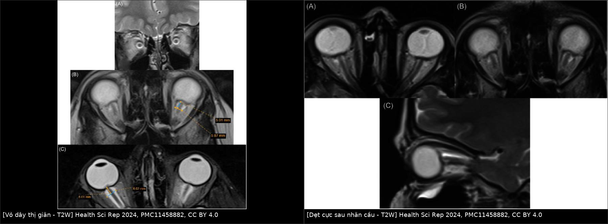
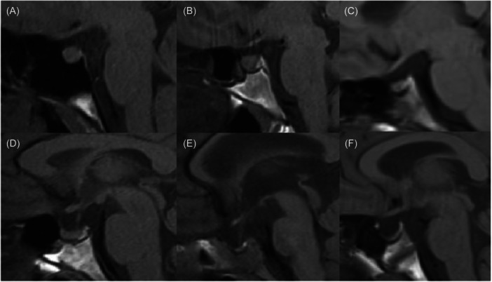
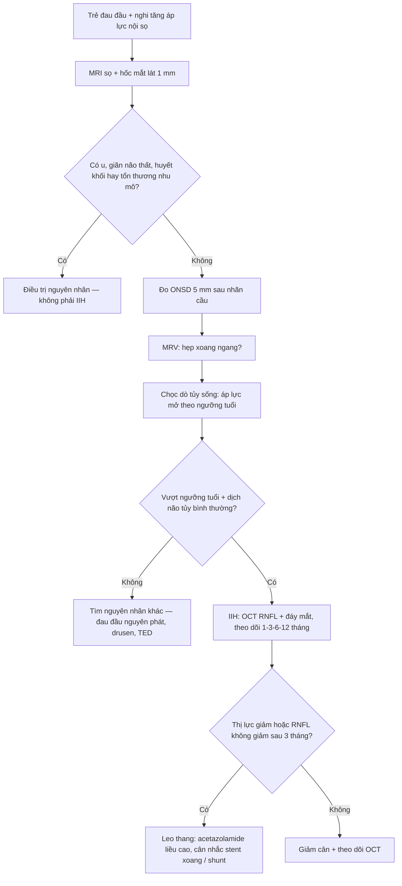
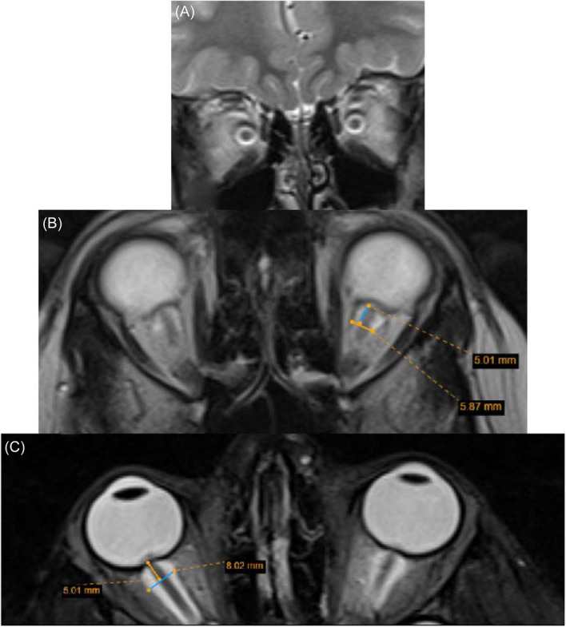
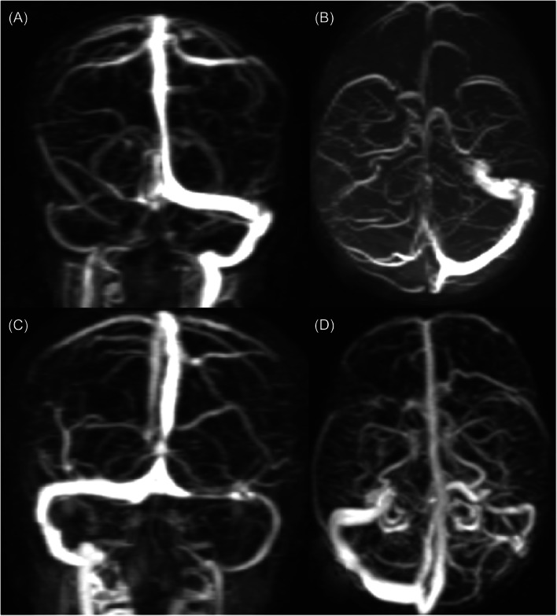
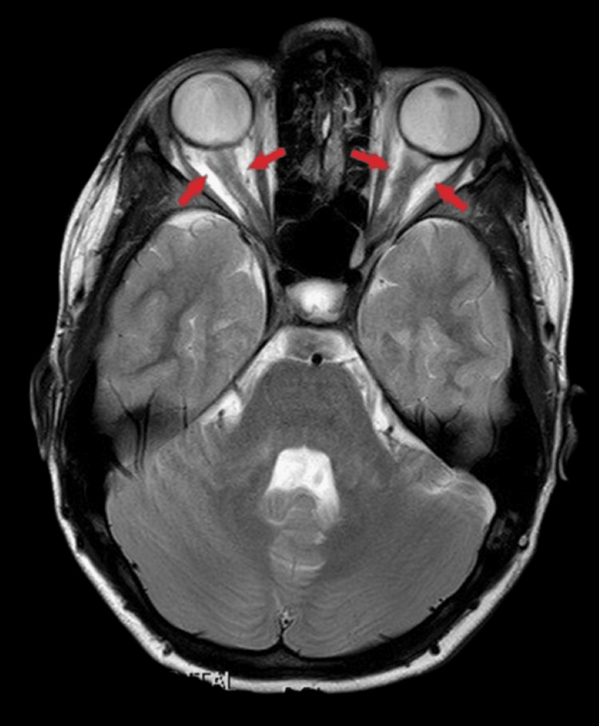

# 6194 — Tăng áp lực nội sọ vô căn ở trẻ: bộ dấu hiệu MRI–MRV, ngưỡng ONSD theo tuổi & khi nào OCT đủ theo dõi / Paediatric idiopathic intracranial hypertension

**Tags:** `pattern:gian-vo-day-thi` `pattern:tuyen-yen-rong` `pattern:hep-xoang-ngang` `pattern:phu-gai-thi` `vung:gai-thi` `vung:than-kinh-thi` `vung:nao` `score:ONSD` `protocol:MRI-hoc-mat` `protocol:MRV` `anatomy:xoang-tinh-mach-ngang`

**Mức chắc chắn (certainty):** tổng hợp y văn (literature synthesis) — ghép **612 ca IIH** trong 14 năm tại Victoria (108 trẻ, **PMC13264580**), **300 ca < 36 tháng** (tổng quan hệ thống, **PMC12296176**), **62 trẻ IIH so với 62 trẻ chứng** (Pediatr Radiol 2026, **PMC13357526**), **44 trẻ 7–17 tuổi** theo dõi OCT 1 năm (**PMC12896765**), **81 trẻ** theo dõi 10 năm (**PMC13216665**), tổng quan dấu hiệu MRI nhi (**PMC11458882**), tổng quan béo phì – IIH nhi (**PMC12840101**), cùng **ca nguyên văn có ảnh** (**PMC12863709**) và hình ảnh dấu hiệu từ **PMC12133799**. Không có thử nghiệm ngẫu nhiên nào ở trẻ về ngưỡng điều trị — chỗ suy luận được ghi rõ.

> **Câu chốt:** ở trẻ, IIH **không phải "người lớn thu nhỏ"**. Ba khác biệt quyết định cách đọc phim: **(1)** trẻ **< 36 tháng không có phù gai ở 49,0%** ca, và dấu hiệu hay gặp nhất là **thóp căng (67,7%)** chứ không phải nhìn gai thị (PMC12296176); **(2)** ngưỡng áp lực mở **thay đổi theo tuổi** — sơ sinh **> 7,6**, nhũ nhi **> 8,2**, trẻ nhỏ **> 9,5 cm H₂O** (đề xuất 2025, PMC12296176), so với **> 25 cm H₂O** ở trẻ lớn/người lớn (PMC12840101); **(3)** **hẹp xoang tĩnh mạch ngang hiếm hơn nhiều ở trẻ trước dậy thì (67%)** so với trẻ 11–17 tuổi (**93%**) và người lớn (**96%**, PMC11458882) — nên **MRV bình thường ở trẻ nhỏ không loại trừ IIH**. Chẩn đoán vẫn là **áp lực mở + loại trừ nguyên nhân**, hình ảnh chỉ **hỗ trợ**.

> **Phân vai với bài khác:** [1777](../1777-ro-dich-nao-tuy-nen-so-truoc-tu-phat/lesson.md) dùng IIH như **cơ chế của rò dịch não tủy tự phát** ở người lớn; [430](../430-duong-thi-giac/lesson.md)/[433](../433-phu-dia-thi-drusen/lesson.md)/[434](../434-teo-thi-than-kinh-thi-doc-va-LHON/lesson.md) phủ **đường thị giác và phù gai**. Bài này chỉ đi sâu **bộ dấu hiệu MRI/MRV + ngưỡng theo tuổi + lịch theo dõi mắt ở trẻ**.

## 1. Tổng quan bệnh học – cơ chế hình ảnh (TẠI SAO áp lực lại để lại dấu vết)

### 1.1 Dịch tễ — con số đang tăng

- **Trẻ em Victoria (Úc), 2010–2023:** tỷ lệ mới mắc tăng từ **0,33/100.000** lên **1,01/100.000** (gấp 3 lần); trẻ có **tuổi trung bình 12,4 ± 3,5**, **76% nữ**, **BMI 31,9 ± 8,4 kg/m²**; **đau đầu là triệu chứng hay gặp nhất (86%)**, và **nhìn đôi / liệt dây VI gặp ở trẻ nhiều hơn người lớn** (PMC13264580).
- **Trẻ < 36 tháng (300 ca):** **nam 48,3%** — tức **mất hẳn ưu thế nữ** của tuổi dậy thì; **phù gai chỉ 23,0%**, **không phù gai 49,0%**; **thóp căng 67,7%**, kích thích 34,3%, nôn 33,0%, sốt 18,3%; **thuốc là yếu tố khởi phát số 1 (35,3%)**, nhiễm trùng 15,0%; **áp lực mở trung bình 35,1 cm H₂O (9,5–77)** (PMC12296176).

### 1.2 TẠI SAO mỗi dấu hiệu xuất hiện — giải thích bằng cơ học, không học vẹt

Khoang dưới nhện quanh dây thị **thông trực tiếp** với khoang dưới nhện nội sọ. Vì vậy mọi thay đổi áp lực dịch não tủy đều **truyền ra sau nhãn cầu** theo 4 đường cơ học:

| Dấu hiệu | Cơ chế | Vì sao thấy trên chuỗi xung đó |
|---|---|---|
| **Giãn vỏ dây thị (ONSD ↑)** | Vỏ dây thị là **khoang dịch tuân thủ** (compliance cao) → áp lực cao đẩy dịch vào, vỏ căng ra như bóng | **T2W: dịch sáng** → vòng sáng dày quanh dây thị tối; đo trên T2 axial/coronal, **5 mm sau cực sau nhãn cầu** |
| **Dẹt cực sau nhãn cầu** | Áp lực truyền dọc vỏ tới **củng mạc sau** → đẩy lõm thành sau nhãn cầu vào trong | Mất **độ lồi sinh lý** của cực sau trên T2 axial/sagittal; đây là dấu **muộn** hơn giãn vỏ |
| **Dây thị ngoằn ngoèo** | Dây thị **dài ra tương đối** trong vỏ đã giãn → thừa chiều dài, gấp khúc | Mất thấy **đoạn giữa dây thị** trên T1/T2 axial; hình **chữ S** trên sagittal |
| **Tuyến yên rỗng** | Xung áp lực dịch não tủy lâu ngày **đẩy khoang trên yên lấn vào hố yên**, ép tuyến | T1 sagittal: khoang dịch (tối) chiếm dần hố yên; **phân độ theo tỷ lệ chiều cao** (mục 2) |
| **Hẹp xoang tĩnh mạch ngang** | Áp lực nội sọ cao → **chênh áp xuyên thành** giữa lòng xoang và khoang dưới nhện → xoang bị ép; đồng thời hạt nhện to ra | MRV: **hẹp đối xứng hai bên, bờ nhẵn, không có khuyết thuốc trong lòng** — khác huyết khối |

- **Điều KHÔNG thấy (và đó là điểm chốt):** **DWI/ADC không tăng** trong IIH nhi — tức **không có phù não** (PMC11458882). Nếu ADC giảm lan tỏa → nghĩ nguyên nhân khác (thiếu máu, ngộ độc, viêm).
- **Vì sao hình ảnh chỉ "hỗ trợ":** mọi dấu hiệu trên đều là **hệ quả của áp lực cao kéo dài**, không phải nguyên nhân; trẻ mới khởi phát có thể **MRI gần bình thường**, và ngược lại người **béo, rỗng yên sinh lý** có dấu hiệu dương tính giả.

### 1.3 Ngưỡng định lượng phải nhớ

| Mốc | Ngưỡng | Nguồn |
|---|---|---|
| Áp lực mở, sơ sinh | **> 7,6 cm H₂O** | PMC12296176 (đề xuất cho < 36 tháng) |
| Áp lực mở, nhũ nhi | **> 8,2 cm H₂O** | PMC12296176 |
| Áp lực mở, trẻ nhỏ (toddler) | **> 9,5 cm H₂O** | PMC12296176 |
| Áp lực mở, trẻ lớn/người lớn | **> 25 cm H₂O** | PMC12840101 |
| **ONSD — trẻ < 1 tuổi** | **> 4,0 mm** là bất thường | PMC11458882 |
| **ONSD — trẻ > 1 tuổi** | **> 4,5 mm** là bất thường | PMC11458882 |
| ONSD — người lớn (đối chiếu) | **> 5,6 mm** bất thường; **> 6 mm** đặc hiệu hơn | PMC12133799 |
| Vị trí đo ONSD | **5 mm sau cực sau nhãn cầu**, trên T2 axial không/ có fat-sat | PMC11458882 |
| Tuyến yên rỗng — độ II (nhẹ) | giảm chiều cao tuyến **< 1/3** chiều cao hố yên | PMC11458882 |
| Tuyến yên rỗng — độ III (vừa) | khoang rỗng **1/3–2/3** | PMC11458882 |
| Tuyến yên rỗng — độ IV (nặng) | khoang rỗng **> 2/3** | PMC11458882 |
| Hẹp xoang ngang theo tuổi | **< 11 tuổi: 67%** · **11–17 tuổi: 93%** · **> 17 tuổi: 96%** | PMC11458882 |
| RNFL trên OCT (IIH so với chứng) | **133,1 ± 18,5 µm** so với **113,1 ± 8,7 µm** | PMC12896765 |

## 2. Mẫu hình + chẩn đoán phân biệt theo tuổi (gamut)

### 2.1 Năm dấu hiệu chính (major) + ba dấu hiệu phụ (minor)

**Major — đọc theo thứ tự "vỏ → cầu → dây → yên → xoang":**

1. **Giãn vỏ dây thị** (ONSD vượt ngưỡng tuổi) — nhạy nhất, dễ đo nhất.
2. **Dẹt cực sau nhãn cầu** — đặc hiệu hơn, xuất hiện muộn.
3. **Dây thị ngoằn ngoèo / mất đoạn giữa dây thị**.
4. **Tuyến yên rỗng một phần (độ II–IV)**.
5. **Hẹp xoang tĩnh mạch ngang hai bên** trên MRV.

**Minor (kém tin cậy, chỉ dùng để cộng điểm nghi ngờ):** **giãn dài Meckel's cave**, **sa hạnh nhân tiểu não**, **não thất khe (slit-like ventricles)** — không phải giãn não thất (PMC11458882).

### 2.2 Gamut theo NHÓM TUỔI — vì hình ảnh khác nhau thật

| Nhóm tuổi | Dấu hiệu "kỳ vọng" | Bẫy riêng |
|---|---|---|
| **< 12 tháng** | Thóp căng, **phù gai thường VẮNG**; MRI có thể chỉ giãn vỏ dây thị nhẹ | **Dễ bỏ** vì không có phù gai và không kêu đau đầu; ngưỡng áp lực **rất thấp** (7,6–8,2) |
| **1–10 tuổi (trước dậy thì)** | Giãn vỏ dây thị + dẹt cực sau; **hẹp xoang ngang chỉ 67%** | **MRV bình thường không loại trừ** |
| **11–17 tuổi** | Bộ dấu hiệu gần giống người lớn; **hẹp xoang ngang 93%**; BMI cao | Dễ nhầm **IIH với đau đầu do béo phì/OSA** |

### 2.3 Gamut theo bối cảnh lâm sàng (trẻ đau đầu + phù gai)

1. **IIH** — MRI không có tổn thương, không giãn não thất, MRV có/không hẹp xoang; áp lực mở vượt ngưỡng tuổi.
2. **Huyết khối xoang tĩnh mạch não** — **khuyết thuốc trong lòng xoang**, không phải hẹp bờ nhẵn; khởi phát **cấp**, có yếu tố nguy cơ (nhiễm trùng tai/xoang, thuốc tránh thai, mất nước).
3. **Viêm màng bọc dây thị (optic perineuritis)** — **dấu tram-track**: vỏ dây thị **ngấm thuốc** thành vòng, dây thị bên trong không ngấm; **kẻ bắt chước IIH rõ nhất** (ca PMC12863709).
4. **Viêm dây thị (optic neuritis)** — **thân dây thị ngấm thuốc**, vỏ không giãn; đau khi liếc, giảm thị lực nhanh, MS/NMOSD/MOGAD.
5. **U/thâm nhiễm màng não** (leptomeningeal carcinomatosis, lao màng não) — ngấm thuốc **màng não lan tỏa**, dày gốc dây thị không đối xứng.
6. **Bệnh mắt do tuyến giáp (TED)** — **thân cơ to, chừa gân**, không giãn vỏ dây thị đơn thuần (bài [421](../421-loi-mat-Graves/lesson.md)).
7. **Drusen gai thị** — phù gai **giả**; siêu âm B/Autofluorescence/OCT EDI; không có dấu hiệu nội sọ (bài [433](../433-phu-dia-thi-drusen/lesson.md)).
8. **Craniosynostosis / hẹp sọ** — hộp sọ nhỏ, khớp sọ đóng sớm, giãn não thất thường kèm.

## 3. Bảng so sánh phân biệt (ma trận đối chiếu)

| Thực thể (entity) | Hình ảnh điển hình | Chốt vào (rule-in) | Chốt loại (rule-out) | Gợi ý xác nhận |
|---|---|---|---|---|
| **IIH** | ONSD vượt ngưỡng tuổi, dẹt cực sau, tuyến yên rỗng, hẹp xoang ngang **bờ nhẵn đối xứng** | **ONSD > 4,5 mm (> 1 tuổi) + tuyến yên rỗng + MRV hẹp bờ nhẵn + áp lực mở vượt ngưỡng tuổi** | **Khuyết thuốc trong lòng xoang** → huyết khối; **thân dây thị ngấm thuốc** → viêm dây thị; có tổn thương nhu mô/giãn não thất → nguyên nhân khác | MRI + MRV, đo ONSD 5 mm sau nhãn cầu, áp lực mở, OCT |
| **Huyết khối xoang ngang** | **Khuyết thuốc lòng xoang** trên CTV/MRV có cản quang, bờ không đều, có thể lan vào xoang sigma | **Khuyết thuốc trong lòng + khởi phát cấp + yếu tố nguy cơ** | Hẹp **bờ nhẵn, đối xứng, hết sau chọc dò** → IIH | CTV/MRV có cản quang, D-dimer, kháng đông |
| **Viêm màng bọc dây thị** | **Dấu tram-track** (vỏ ngấm thuốc) và **doughnut sign** trên coronal | **Vỏ dây thị ngấm thuốc hình vòng, thân dây không ngấm** | Vỏ giãn nhưng **không ngấm thuốc** → IIH | MRI hốc mắt T1 fat-sat sau tiêm; đáp ứng corticoid |
| **Viêm dây thị** | Thân dây thị **tăng tín hiệu T2/ngấm thuốc**, dây hơi to | **Ngấm thuốc THÂN dây + đau khi liếc + giảm thị lực nhanh** | Vỏ giãn đơn thuần, thân dây bình thường → không phải viêm dây thị | MRI hốc mắt, OCT, kháng thể MOG/NMO |
| **Drusen gai thị** | Gai thị **lồi nhưng không có dấu hiệu nội sọ**; drusen **tăng âm/huỳnh quang tự động** | **Drusen thấy trên siêu âm/OCT EDI + MRI/MRV bình thường** | Có giãn vỏ dây thị + tuyến yên rỗng → nghi IIH thật | Siêu âm mắt, OCT EDI, chụp MRI |
| **TED** | **Thân cơ to, chừa gân**, proptosis, không giãn vỏ dây thị đơn thuần | **Cơ to chừa gân + bệnh tuyến giáp** | Cơ bình thường → không phải TED | MRI hốc mắt, TSH/TRAb |
| **U màng não/thâm nhiễm** | Ngấm thuốc màng não **lan tỏa/không đối xứng**, dày gốc dây thị | **Ngấm thuốc màng não lan + tổn thương nhu mô** | Màng não mỏng đều, không ngấm → loại | MRI + tế bào học dịch não tủy |

*Trái: vỏ dây thị giãn — vòng dịch sáng (T2) dày quanh dây thị hai bên, kèm số đo 5,01/5,87/8,02 mm đặt đúng 5 mm sau cực sau nhãn cầu. Phải: mất độ lồi sinh lý của cực sau nhãn cầu (dẹt cực sau). Cả hai: *Health Sci Rep* 2024, **PMC11458882**, CC BY 4.0. Ảnh ghép letterbox, giữ nguyên tỷ lệ.*

### Phân độ tuyến yên rỗng (dùng được cho mọi lứa tuổi)

| Độ | Mô tả | Ý nghĩa |
|---|---|---|
| **I — bình thường** | mặt trên tuyến **lồi** hoặc **phẳng** | Không gợi ý |
| **II — nhẹ** | giảm chiều cao tuyến **< 1/3** hố yên | Gặp ở người béo, sinh lý; cộng bối cảnh |
| **III — vừa** | khoang rỗng **1/3–2/3** | Nghi IIH nếu kèm dấu hiệu mắt |
| **IV — nặng** | khoang rỗng **> 2/3** | Rất gợi ý tăng áp lực kéo dài |

*Sáu mặt cắt T1 sagittal qua hố yên: (A–B) mặt trên tuyến lồi/phẳng — bình thường; (C) độ II; (D) độ III; (E–F) độ IV — khoang dịch chiếm > 2/3 hố yên. Nguồn: *Health Sci Rep* 2024, **PMC11458882**, CC BY 4.0.*

## 4. Protocol chụp + hệ phân độ/điểm chuẩn hóa

### 4.1 Trình tự bắt buộc: **chụp trước, chọc dò sau**

- **Bước 1 — MRI sọ + hốc mắt** (không cản quang trước): T1 sagittal (hố yên), T2 axial + coronal **lát 1 mm qua hốc mắt**, FLAIR, DWI/ADC. Mục đích: **loại trừ u, giãn não thất, huyết khối, tổn thương nhu mô** — và **đo ONSD**.
- **Bước 2 — MRV** (TOF 2D/3D hoặc MRV có cản quang): tìm **hẹp xoang ngang hai bên** và **loại trừ huyết khối**. Ở trẻ < 11 tuổi, nhớ **67%** ca IIH **không có hẹp** — MRV bình thường **không loại trừ**.
- **Bước 3 — chọc dò tủy sống** đo áp lực mở, **chỉ sau khi đã loại trừ khối choán chỗ**; so với ngưỡng **theo tuổi** (7,6 / 8,2 / 9,5 / 25 cm H₂O).
- **Bước 4 — mắt:** đáy mắt + **OCT RNFL** (nếu trẻ hợp tác, thường từ tuổi tiểu học). RNFL **133,1 µm** so với **113,1 µm** ở chứng; **phần lớn dày lên hết sau 3 tháng** điều trị (PMC12896765) → OCT là công cụ **theo dõi**, không phải chẩn đoán.

### 4.2 Đo ONSD đúng cách (3 lỗi hay gặp)

1. Đo **5 mm sau cực sau nhãn cầu** — không đo sát cực sau (vỏ mỏng, số nhỏ giả) và không đo xa (dây thị đã ngoằn ngoèo).
2. Đo **vuông góc với trục dây thị**, lấy **đường kính ngoài–ngoài của vòng dịch sáng**, không đo phần dây thị tối bên trong.
3. Dùng **ngưỡng theo tuổi** (4,0 mm cho < 1 tuổi; 4,5 mm cho > 1 tuổi) — áp ngưỡng người lớn (5,6 mm) cho trẻ sẽ **bỏ sót rất nhiều ca**.

### 4.3 Điều trị — bằng chứng ở trẻ mỏng hơn người lớn

- **< 36 tháng (300 ca):** chọc dò lặp **72,7%**, **ngừng thuốc khởi phát 26,3%**, **acetazolamide 18,7%**, corticoid 7,7%, **chỉ 3,0% cần shunt** — đa số **tự khỏi** (PMC12296176).
- **Giảm cân là điều trị duy nhất tác động nguyên nhân** ở trẻ béo: trong nhóm dậy thì, **phẫu thuật giảm béo** được AAP cân nhắc từ **13 tuổi** khi **BMI > 35 kg/m²** (hoặc > 120% bách phân vị 95) (PMC12840101).
- **Hẹp xoang ngang + IIH kháng trị:** stent xoang là lựa chọn ở trung tâm chuyên khoa; **chưa có ngưỡng hẹp được chuẩn hóa** cho trẻ (PMC11458882) — quyết định theo **thị lực đe dọa**, không theo % hẹp.

## 5. Biến thể bình thường và cạm bẫy

- **Tuyến yên rỗng sinh lý:** gặp ở người **béo, sau sinh, cao tuổi** — độ II đơn độc **không** đủ gợi ý IIH.
- **Hẹp xoang ngang "chảy" (flow-related):** hẹp **bờ nhẵn, đối xứng**, có thể **giảm sau khi hạ áp lực** bằng chọc dò → đừng gọi là hẹp cố định cần stent ngay.
- **Hạt nhện (arachnoid granulation):** lõm **bờ nhẵn** vào lòng xoang, **không chặn dòng** — khác huyết khối (khuyết thuốc) và khác hẹp do chèn ép.
- **ONSD bất đối xứng:** đo cả hai bên, lấy bên lớn; bất đối xứng mạnh (> 1 mm) gợi ý **nguyên nhân tại mắt** (viêm, u) hơn là IIH.
- **"Giãn não thất khe" không phải giãn não thất:** IIH có não thất **nhỏ/khe**, không bao giờ giãn — nếu giãn, nghĩ tắc nghẽn dịch não tủy.
- **Cạm bẫy chết người — chọc dò trước khi chụp:** ở trẻ có khối choán chỗ hoặc giãn não thất, chọc dò có thể gây **tụt kẹt não**. Luôn **MRI trước, chọc dò sau**.
- **Cạm bẫy "không phù gai = không IIH":** ở trẻ < 36 tháng, **49,0%** ca **không có phù gai** (PMC12296176). Bỏ sót → **mất thị lực không hồi phục**; ngược lại, coi mọi phù gai là IIH → **bỏ sót u/huyết khối**.
- **Cạm bẫy "chẩn đoán bằng hình ảnh":** IIH là **chẩn đoán áp lực**, không phải chẩn đoán ảnh; ca [1777](../1777-ro-dich-nao-tuy-nen-so-truoc-tu-phat/lesson.md) có **BMI 42,6** nhưng MRI **không có dấu hiệu IIH** và áp lực mở **bình thường** — và ngược lại, **vá rò mà không hạ áp lực = tái rò**.

## 6. Tự lượng giá — Blind Quiz ngay trên trang tĩnh

**Ca 1 — Bé gái 9 tuổi, đau đầu 3 tuần, nhìn đôi khi mệt. Nhìn ảnh trước, mô tả trước.**

- Gợi ý lâm sàng: không sốt, không chấn thương, đáy mắt hai bên phù nhẹ.
- Câu hỏi: Dấu hiệu chính là gì? Số đo đặt ở đâu? Ngưỡng bất thường cho tuổi này? Ba chẩn đoán phân biệt?

<b>Bấm để hiện đáp án (findings + chẩn đoán)</b>

- **Dấu hiệu:** vòng dịch sáng (T2) dày quanh dây thị hai bên — **giãn vỏ dây thị**; (B) số đo **5,01 / 5,87 mm**, (C) **5,01 / 8,02 mm**, đặt **5 mm sau cực sau nhãn cầu**.
- **Chẩn đoán:** **IIH** — với trẻ **> 1 tuổi**, ngưỡng là **4,5 mm**; các số đo đều vượt. Cơ chế: khoang dưới nhện quanh dây thị **thông với nội sọ** nên áp lực cao đẩy dịch vào vỏ.
- **Phân biệt:** viêm màng bọc dây thị (vỏ **ngấm thuốc**), viêm dây thị (ngấm **thân dây**), huyết khối xoang (khuyết thuốc lòng xoang).
- Nguồn ảnh: *Health Sci Rep* 2024, **PMC11458882**, CC BY 4.0.

**Ca 2 — Bé trai 13 tuổi, béo, đau đầu + ù tai mạch đập. MRV dưới đây.**

- Câu hỏi: Bất thường ở đâu? Hẹp này **chốt** hay **hệ quả**? Khi nào can thiệp?

<b>Bấm để hiện đáp án</b>

- **Dấu hiệu:** hẹp **hai bên xoang tĩnh mạch ngang**, bờ **nhẵn**, không có khuyết thuốc trong lòng; (A–B) MRV không cản quang, (C–D) MRV có thuốc.
- **Chẩn đoán:** hẹp xoang ngang **do chèn ép** trong IIH — ở trẻ **11–17 tuổi gặp 93%** (so với **67%** ở < 11 tuổi và **96%** ở người lớn), nên đây là **hệ quả của áp lực**, không phải nguyên nhân đơn thuần.
- **Khi nào can thiệp:** chỉ khi **thị lực đe dọa** và thất bại điều trị nội; **chưa có ngưỡng % hẹp chuẩn hóa** cho trẻ.
- Nguồn ảnh: *Health Sci Rep* 2024, **PMC11458882**, CC BY 4.0.

**Ca 3 — Bé trai 8 tuổi, đau mắt + giảm thị lực 1 tuần, không sốt. MRI T1 sau tiêm qua hốc mắt.**

- Câu hỏi: Cấu trúc nào ngấm thuốc? Dấu này tên gì? Vì sao **không** gọi là IIH đơn thuần?

<b>Bấm để hiện đáp án</b>

- **Dấu hiệu:** **vỏ dây thị hai bên ngấm thuốc thành vòng** quanh dây thị (mũi tên đỏ) — **dấu tram-track**; trên mặt cắt coronal là **doughnut sign**.
- **Chẩn đoán:** **viêm màng bọc dây thị (optic perineuritis)** — ca nguyên văn có **đồng thời IIH**, nhưng điểm mấu chốt là **vỏ ngấm thuốc**, khác IIH thuần (vỏ giãn nhưng **không ngấm**). Xử trí khác: **corticoid**, không chỉ hạ áp lực.
- **Phản biện nguồn:** đây là ca **IIH + viêm màng bọc dây thị hai bên** — hiếm; không được lấy ca này làm hình mẫu "IIH điển hình".
- Nguồn ảnh: *Cureus* 2026, **PMC12863709**, CC BY 4.0.

## Bài liên quan chéo
- [1777 – Rò dịch não tủy nền sọ tự phát](../1777-ro-dich-nao-tuy-nen-so-truoc-tu-phat/lesson.md) (IIH là cơ chế; vá mà không hạ áp lực → tái rò)
- [433 – Phù đĩa thị vs drusen](../433-phu-dia-thi-drusen/lesson.md) (phù thật vs giả phù, ONSD)
- [430 – Đường thị giác](../430-duong-thi-giac/lesson.md) (giải phẫu, đoạn trong hốc mắt)
- [434 – Teo thị thần kinh thị độc & LHON](../434-teo-thi-than-kinh-thi-doc-va-LHON/lesson.md) (hậu quả muộn của phù gai kéo dài)
- [421 – Lồi mắt Graves](../421-loi-mat-Graves/lesson.md) (cơ to chừa gân — phân biệt hốc mắt)
- [1948 – Co giật sau huyết khối xoang](../1948-co-giat-dong-kinh-huyet-khoi-xoang/lesson.md) (huyết khối xoang — phân biệt với hẹp do IIH)

## Ảnh
- `images/composite_vo-day-thi-va-det-cau.jpg` — ghép đối chiếu ONSD + dẹt cực sau (T2W).
- `images/6194_iih-tre_MRI_PMC11458882-g002-ONSD-CCBY.jpg` — ONSD, có số đo.
- `images/6194_iih-tre_MRI_PMC11458882-g005-empty-sella-CCBY.jpg` — phân độ tuyến yên rỗng I–IV.
- `images/6194_iih-tre_MRV_PMC11458882-g001-CCBY.jpg` — hẹp xoang ngang hai bên.
- `images/6194_iih-tre_MRI_PMC11458882-g003-globe-CCBY.jpg` — dẹt cực sau nhãn cầu.
- `images/6194_iih-tre_MRI_PMC11458882-g004-tortuosity-CCBY.jpg` — dây thị ngoằn ngoèo.
- `images/6194_iih-tre_MRI_PMC12863709-i03-tram-track-CCBY.jpg` — dấu tram-track (kẻ bắt chước).
- `images/6194_iih-tre_OCT_PMC12896765-g006-CCBY.jpg` — OCT gai thị theo dõi 12 tháng.

> Không dùng để chẩn đoán độc lập khi chưa có người hướng dẫn.
