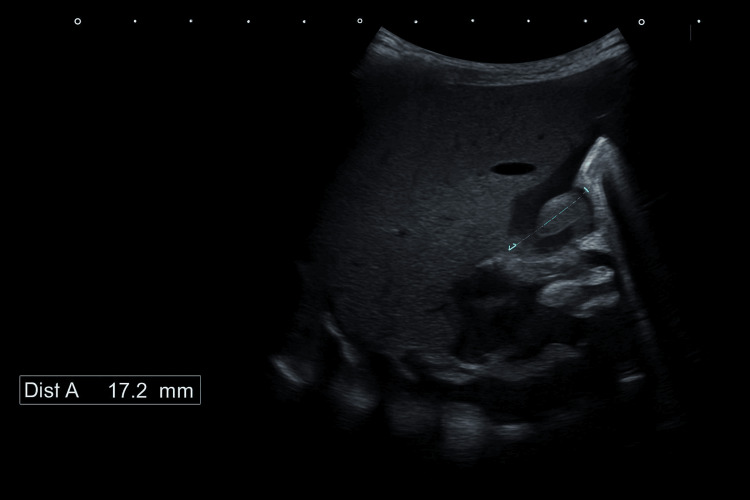
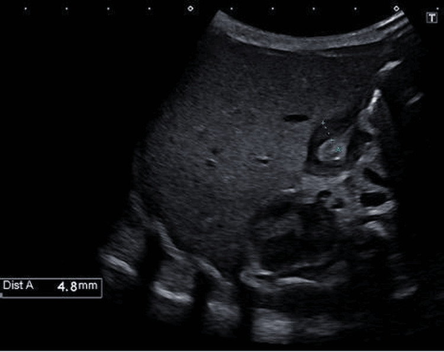
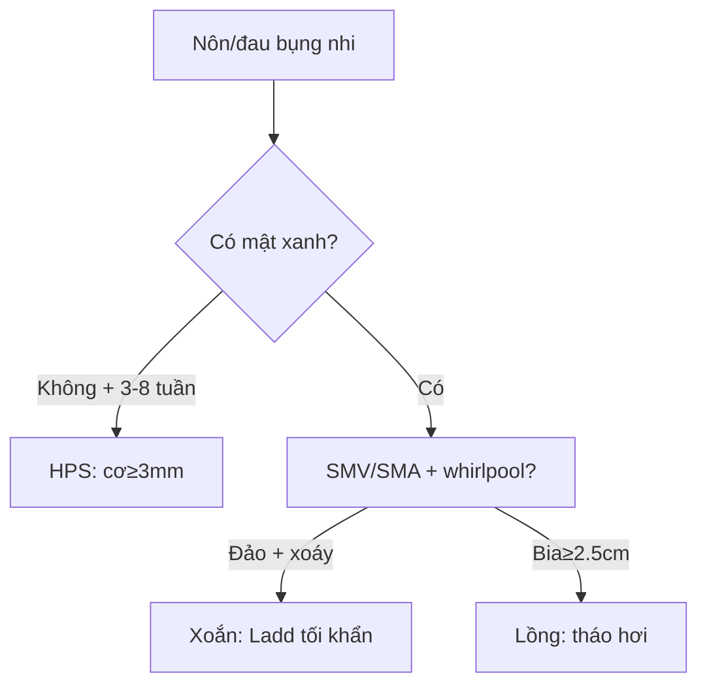

# 620 — Cấp cứu tiêu hóa nhi: HPS, xoắn, lồng & NEC / Peds GI emergency

**Tags:** `pattern:non-nhu-nhi` `pattern:tac-ruot-nhi` `vung:bung-nhi` `protocol:sieu-am-bung-nhi`
**Mức chắc chắn (certainty):** tổng hợp y văn (literature synthesis) — nhóm tự biên từ y văn mở, chưa gắn ca nguyên văn đơn lẻ.

## 1. Tổng quan — mật hay không mật là ranh giới sống còn

- Nôn KHÔNG mật (HPS 3–8 tuần): tắc trước bóng Vater — TẠI SAO cơ môn vị dày **≥ 3 mm** + dài **≥ 15 mm** + không dịch qua (cervix/antral nipple): cơ phì đại bít kênh.
- Nôn MẬT XANH (xoắn trung tràng): tắc sau bóng Vater — TẠI SAO SMV đảo trái SMA + whirlpool: ruột quay dở, mạc treo hẹp như cuống, xoắn theo chiều kim đồng hồ cắt máu toàn ruột giữa.
- Lồng hồi-manh tràng (6 tháng–3 tuổi): nhu động kéo đoạn gần vào đoạn xa — bia bắn **≥ 2,5 cm** (lồng non thoáng qua < 2 cm tự tháo!).
- NEC (non tháng): vi khuẩn + sữa + thiếu máu ruột — pneumatosis + khí TM cửa.

## 2. Gamut nôn/đau bụng nhi (Gamut)

- **Nôn vọt không mật + 3–8 tuần + cơ ≥ 3 mm:** HPS — bù kiềm + cắt cơ môn vị.
- **Nôn mật xanh + SMV trái SMA + whirlpool:** xoắn — mổ Ladd tối khẩn (từng phút!).
- **Đau cơn + phân máu + bia ≥ 2,5 cm:** lồng — tháo hơi/thủy (cấm khi thủng/viêm phúc mạc!).
- **Non tháng + bụng chướng + pneumatosis:** NEC — nhịn ăn + kháng sinh + mổ khi thủng.

## 3. Bảng so sánh phân biệt (ma trận đối chiếu)

| Thực thể (entity) | Hình ảnh điển hình | Chốt vào (rule-in) | Chốt loại (rule-out) | Gợi ý xác nhận |
|---|---|---|---|---|
| HPS | **Cơ ≥ 3 mm + dài ≥ 15 mm + không dịch qua** | **3–15–15 + nôn không mật** | Nôn mật → xoắn | Bù kiềm + Ramstedt |
| Xoắn trung tràng | **SMV trái SMA + whirlpool + Treitz thấp** | **Mật xanh + whirlpool = mổ ngay** | Không mật → HPS | Ladd tối khẩn |
| Lồng ruột | **Bia ≥ 2,5 cm + giả thận + hạch nhân** | **Cơn + máu + ≥ 2,5 cm** | < 2 cm thoáng qua → theo dõi | Tháo hơi (cấm khi thủng!) |
| NEC | **Pneumatosis + khí TM cửa + non tháng** | **Non + chướng + khí thành** | Khí tự do → thủng | Nhịn ăn + KS + mổ khi thủng |

*Kênh môn vị dài + cơ dày, không dịch qua — vượt ngưỡng 3–15. Nguồn: Ismail et al., Cureus 2025 Fig. 3, CC BY 4.0.*

*Đo cơ đơn thành 4,8 mm (≥ 3 mm). Nguồn: Ismail et al., Fig. 4, CC BY 4.0.*

## 4. Protocol siêu âm bụng nhi

- **Siêu âm đầu tay** (môn vị + SMV/SMA + bia + thành ruột); upper GI khi nghi xoắn; XR khi NEC (pneumatosis/khí tự do).

## 5. Cạm bẫy

- **HPS sớm ngày 3** (ca trên!) tưởng trào ngược — nôn dai + cơ dày là mổ dù chưa đủ 3 tuần.
- **Doppler xoắn bình thường giả** — mật xanh + lâm sàng là mổ, đừng chờ Doppler.
- **Tháo lồng khi đã thủng** = tử vong — khí tự do/viêm phúc mạc là chống chỉ định tuyệt đối.

## 6. Tự lượng giá — Blind Quiz

**Ca 1 — Sơ sinh 3 ngày nôn dai không mật. Đọc 2 ảnh siêu âm.**

- Hỏi: số đo bao nhiêu? Đủ ngưỡng 3–15 không? Mổ gì?

<b>Bấm để hiện đáp án</b>

- Dấu hiệu (findings): kênh dài 17,2 mm (≥ 15) + cơ dày 4,8 mm (≥ 3) + không dịch qua.
- Chẩn đoán (diagnosis): **hẹp phì đại môn vị sơ sinh sớm** — bù kiềm + cắt cơ môn vị Ramstedt (dù mới ngày 3!).
- Nguồn: Ismail et al., Fig. 3–4, CC BY 4.0.

**Ca 2 — Nôn mật xanh + SMV trái SMA + whirlpool:** HPS hay xoắn? Giờ mổ? *(Bảng mục 3.)*

<b>Bấm để hiện đáp án</b>

- **Xoắn trung tràng:** mổ Ladd tối khẩn từng phút (ruột hoại tử toàn bộ!).

## Bài liên quan chéo
- [600 – Tổng quan Nhi](../600-tong-quan-nhi-khoa/lesson.md)
- [162 – Tắc ruột](../162-tac-ruot/lesson.md) (người lớn)
- [160 – Bụng cấp GI](../160-bung-cap-GI/lesson.md) (ruột thừa)

> Không dùng để chẩn đoán độc lập khi chưa có người hướng dẫn.
