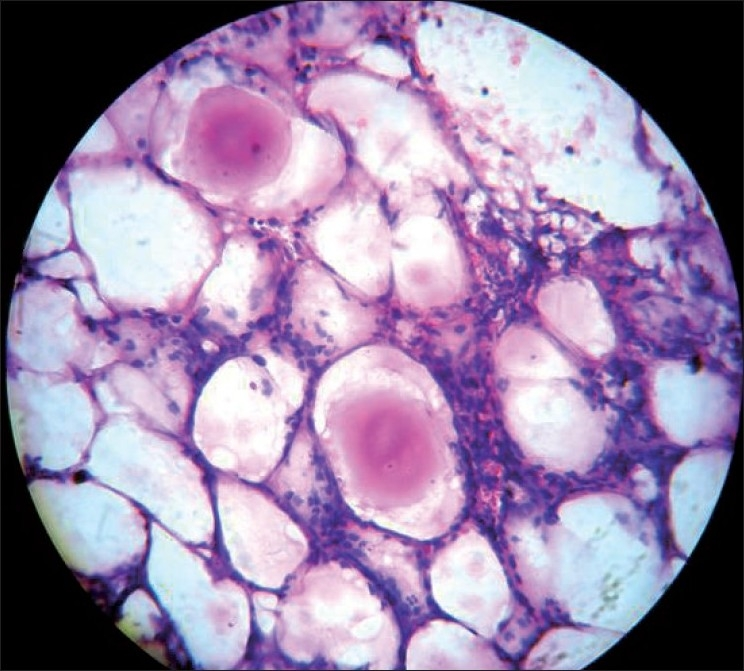
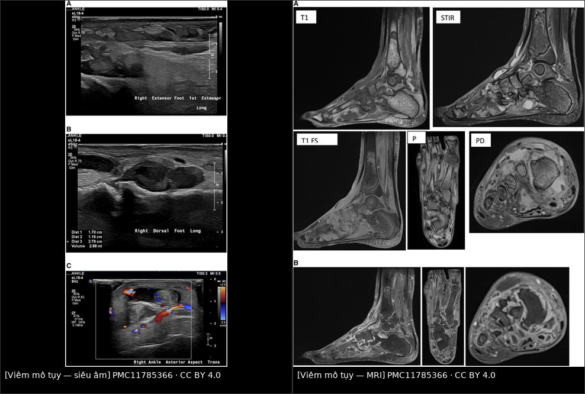
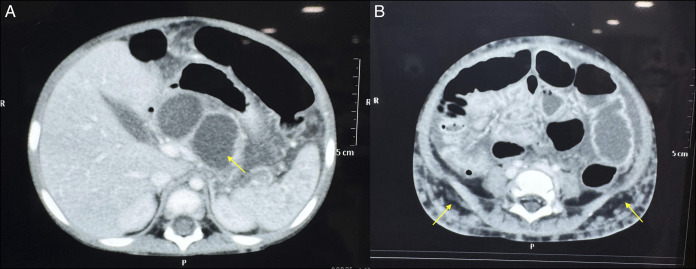
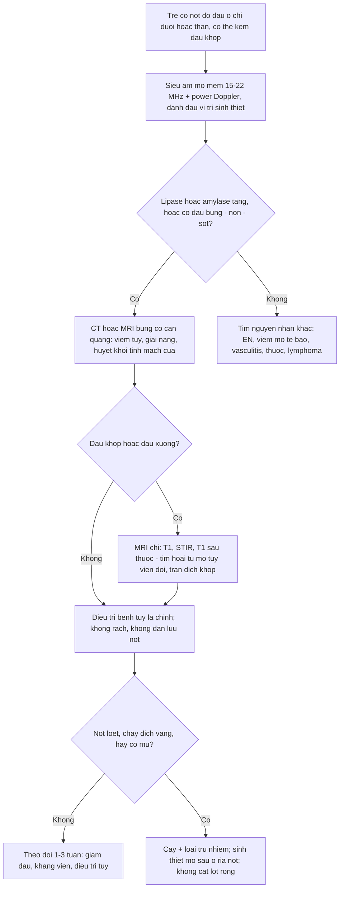

# 6202 — Viêm mô mỡ dưới da và viêm khớp do tụy ở trẻ: nốt da có thể đến TRƯỚC đau bụng, "ghost cells" là chốt mô bệnh, và vì sao không rạch – không dẫn lưu

**Tags:** `pattern:not-mo-duoi-da` `pattern:hoai-tu-mo` `pattern:viem-khop-vo-khuan` `pattern:hoai-tu-tuy-xuong` `pattern:gia-nang-tuy` `pattern:dau-bung` `vung:mo-mem` `vung:chi-duoi` `vung:khop` `vung:tuy` `vung:o-bung` `anatomy:tieu-thuy-mo` `protocol:sieu-am-mo-mem` `protocol:MRI-mo-mem` `protocol:CT-bung-co-can-quang` `protocol:sinh-thiet-mo` `score:khong-co` `incidentaloma:khong`

**Mức chắc chắn (certainty):** tổng hợp y văn (literature synthesis) — ghép **tổng quan hệ thống 163 ca** viêm mô mỡ do tụy (*Cureus* 2025, **PMC11852524**, CC BY 4.0), **tổng quan siêu âm mô mỡ chi** (*J Ultrasonography* 2026, **PMC13012388**, CC BY-NC-ND 4.0), **ca PPPS sau ERCP có đủ CT – siêu âm – MRI – mô bệnh** (*BJR Case Rep* 2025, **PMC11785366**, CC BY 4.0), **2 ca nhi** (**PMC12047867** — trẻ **2 tuổi**, CC BY-NC-ND 4.0; **PMC2887527** — trẻ **1,5 tuổi**, CC BY 2.0), **loạt 2 ca người lớn + điểm lại y văn** (*Cureus* 2024, **PMC11140439**, CC BY 4.0) và **ca PPPS có chỉ định ERCP** (*ACG Case Rep J* 2025, **PMC11789859**, CC BY-NC-ND 4.0). Nhóm **không có bệnh nhân của mình**; chỗ suy luận từ người lớn sang trẻ ghi **[suy luận]**. **Không ghi tên tác giả** — attribution = **tạp chí + năm + PMCID/DOI**.

> **Câu chốt:** bộ ba **nốt mỡ dưới da đau + viêm khớp vô khuẩn + bệnh tụy** là **hội chứng tụy – mô mỡ – viêm khớp (pancreatitis, panniculitis and polyarthritis syndrome, PPPS)**. Nốt có thể xuất hiện **trước** khi chẩn đoán bệnh tụy ở **44,8%** ca và **trước/sau** đợt viêm tụy **3–6 tuần**; mô bệnh chốt là **hoại tử mỡ do enzym với "tế bào bóng" (ghost cells)**. Trên hình ảnh, **siêu âm** thấy mô mỡ **dày, tăng hồi âm, có ổ dịch hóa lỏng**, **MRI** thấy **hoại tử mỡ tủy xương với bờ ngoằn ngoèo "viền đôi" (double rim)**; **điều trị là điều trị tụy** — **rạch/dẫn lưu nốt là sai hướng** vì ổ dịch **tái phát sau dẫn lưu** và dịch vàng là **mỡ hoại tử, không phải mủ**.

> **Ranh giới với bài đã có:** [6135](../6135-viem-tuy-cap-o-tre/lesson.md) trả lời **chẩn đoán – phân độ viêm tụy cấp ở trẻ**; [6171](../6171-viem-tuy-cap-do-asparaginase-tre-all/lesson.md) trả lời **viêm tụy do asparaginase**; [6152](../6152-viem-tuy-man-o-tre/lesson.md) trả lời **viêm tụy mạn**; [6172](../6172-bat-san-tuy-bam-sinh-thieu-lipase/lesson.md) trả lời **bất sản tụy**; [684](../684-tang-triglyceride-asparaginase-all-nhi/lesson.md) trả lời **tăng triglyceride do asparaginase**. Bài này chỉ trả lời **mặt NGOÀI ổ bụng của cùng bệnh tụy**: **nốt mô mỡ dưới da, viêm khớp vô khuẩn, hoại tử mỡ tủy xương**, cách đọc **siêu âm – MRI – CT**, và **vì sao phải đi tìm tụy thay vì điều trị da như nhiễm trùng**.

## 1. Tổng quan bệnh học – cơ chế hình ảnh (TẠI SAO)

### 1.1 Từ men tụy đến "tế bào bóng": hoại tử mỡ do enzym

- **Lipase** (cùng amylase, phospholipase A₂, trypsin) thoát vào tuần hoàn trong viêm tụy cấp, viêm tụy mạn, **giả nang tụy** hoặc u tụy tiết men; tại **tiểu thùy mỡ dưới da**, lipase **thủy phân triglyceride** thành **acid béo tự do + glycerol**. Acid béo gắn calci (**xà phòng hóa, saponification**) tạo **hoại tử mỡ dạng phấn**; tế bào mỡ mất nhân, còn **vách tế bào dày, bắt màu hồng–tím** = **tế bào bóng (ghost cell)** — dấu mô bệnh **đặc hiệu nhất** của viêm mô mỡ do tụy (PMC11852524; PMC2887527; PMC11140439).
- **Vì sao cơ chế này giải thích hình ảnh:** mô mỡ bình thường **rất ít nước**, nên trên MRI **T1 sáng, T2/STIR tối** và trên siêu âm **hồi âm thấp, đều**. Hoại tử mỡ làm **tăng nước nội bào/ngoại bào, tăng mặt phân cách mô** → **T2/STIR sáng, T1 tối**, siêu âm **tăng hồi âm không đồng nhất**; khi mỡ **hóa lỏng** tạo **ổ trống hồi âm (anechoic)** giả nang; khi **vôi hóa** (xà phòng calci) → **tăng hồi âm kèm bóng lưng** trên siêu âm, **tăng đậm độ (HU cao)** trên CT.
- **Vì sao tủy xương cũng bị:** tủy vàng là **mô mỡ**, nên enzym gây **hoại tử mỡ tủy (intramedullary fat necrosis)** — tổn thương **nhiều ổ, đối xứng, trong xương dài**; MRI cho **bờ ngoằn ngoèo với "viền đôi"**: trên STIR có **đường tăng tín hiệu chạy song song mặt trong của đường giảm tín hiệu** (viền xơ + mô hạt non), trong ổ **T1 tối, T2 tăng không đồng nhất, ngấm thuốc ngoại vi nhẹ** (PMC11785366).
- **Khớp bị vì sụn – xương dưới sụn:** **hoại tử sụn (chondronecrosis) và xương dưới sụn (osteonecrosis)** gây **viêm khớp vô khuẩn, nhiều khớp, đối xứng**, dịch khớp **vô khuẩn** — cấy âm, tế bào ít, trong khi bệnh nhân có **sốt + leukocytosis** nên rất dễ bị chẩn đoán **viêm khớp nhiễm trùng** và mổ/dùng kháng sinh (PMC11140439).

*H&amp;E ×400: các **tế bào mỡ mất nhân** với **vách dày, bắt màu hồng–tím**, cạnh **chất hoại tử dạng hạt ưa base** và **vôi hóa lấm tấm** — "ghost cells" của hoại tử mỡ do enzym. Đây là mảnh mô bệnh **chốt** của viêm mô mỡ do tụy, nhưng **chỉ lấy được nếu sinh thiết đủ sâu vào tiểu thùy mỡ**. Nguồn: *Indian J Dermatol* 2010 (PMC2887527), CC BY 2.0.*

### 1.2 Bốn con số định hình bệnh cảnh (và ba con số dễ đọc sai)

| Số liệu | Giá trị | Ý nghĩa thực hành | Nguồn |
|---|---|---|---|
| Tần suất trong bệnh tụy | **tới 2%** (một tổng quan khác ghi **0,3–3%**) | Hiếm nhưng **không phải ca lạ**; gặp nhiều ở viêm tụy cấp | PMC13012388; PMC11789859 |
| Vị trí **chi dưới** | **152/163 (93,3%)**, **hai bên 135** | Nốt ở **cẳng chân – đùi**, đối xứng là mẫu hình gợi ý | PMC11852524 |
| Kích thước nốt | **5 mm – 5 cm**, **73,6% đau** | To, đau, bờ không rõ — khác nốt lành tính thông thường | PMC11852524 |
| Viêm khớp kèm theo | **22/163 (13,5%)** | Thiểu số nhưng là **dấu hiệu đổi hoàn toàn chẩn đoán** | PMC11852524 |
| Nốt **loét** | **18,4%** (đơn độc 3,1% + nhiều ổ 15,3%) | Loét **không** đồng nghĩa nhiễm; 81% **không loét** | PMC11852524 |
| Dịch **vàng như dầu** | **15/163 (9,2%)** | Dịch này là **mỡ hoại tử**, không phải mủ → **không rạch** | PMC11852524 |
| Nốt xuất hiện **trước** chẩn đoán bệnh tụy | **44,8%** (đồng thời chỉ **5%**) | Da có thể là **triệu chứng đầu tiên** | PMC11852524 |

- **Đọc sai thường gặp:** coi **18,4% loét + 9,2% chảy dịch vàng** là "áp-xe cần rạch"; coi **13,5% viêm khớp** là "viêm khớp nhiễm trùng"; coi nốt ở cẳng chân là **ban đỏ nốt (erythema nodosum, EN)**. Ba sai lầm này dẫn tới **rạch/dẫn lưu, kháng sinh kéo dài, corticoid đơn thuần** — trong khi **điều trị tụy** mới làm nốt xẹp.

### 1.3 Vì sao **trẻ** là nhóm phải nhớ: hai ca nguyên văn và một bẫy mô bệnh

- **Trẻ 2 tuổi** (bé gái): **sốt + đau bụng + nốt đỏ đau ở hai chân, đùi, bụng, lưng trong 1 tuần**; CT = **viêm tụy hoại tử cấp + hoại tử mỡ dưới da lan rộng**; sinh thiết da = **viêm mô mỡ thể vách (septal) có hoại tử mỡ trung tâm, KHÔNG có viêm mạch**; **chỉ điều trị hỗ trợ**, nốt **xẹp trong khoảng 1 tuần** (PMC12047867).
- **Trẻ 1,5 tuổi** (bé trai): nốt đỏ đau hai chân + **bụng chướng, sốt, nôn**; **amylase 430 IU/L** (tăng nhưng không "khủng"); **siêu âm và CT đều thấy giả nang tụy**; sinh thiết = **viêm mô mỡ thể tiểu thùy (lobular) + tế bào bóng** (PMC2887527).
- **Bẫy mô bệnh phải nhớ:** tổng quan siêu âm ghi **viêm mô mỡ do tụy khởi đầu thể VÁCH rồi chuyển tiểu thùy/hỗn hợp**, và hoại tử mỡ **có từ giai đoạn sớm** (PMC13012388). Vì vậy **mô bệnh thể vách ở trẻ 2 tuổi không loại trừ** chẩn đoán — đừng đợi "phải lobular + ghost cells" mới nghĩ đến tụy.

## 2. Mẫu hình + chẩn đoán phân biệt theo vị trí (gamut)

**Mẫu hình trung tâm:** *trẻ (hoặc người trẻ) có **nốt mô mỡ dưới da đau, bờ không rõ, ở cẳng chân/đùi/thân**, có thể **loét hoặc chảy dịch vàng**, kèm **đau khớp nhiều ổ** hoặc **đau xương**, trong bối cảnh **đau bụng – nôn – sốt** hoặc **đã có bệnh tụy**.*

Gamut theo **vị trí tổn thương** (mỗi tầng cho một nhóm chẩn đoán khác nhau):

- **Mô mỡ dưới da chi dưới/thân:** viêm mô mỡ do tụy · ban đỏ nốt (EN) · viêm mô tế bào/áp-xe · viêm mô mỡ do thuốc · viêm mạch (vasculitis) · hoại tử mỡ do chấn thương · lymphoma thể mô mỡ dưới da (subcutaneous panniculitis-like T-cell lymphoma).
- **Bao hoạt dịch – gân:** **viêm bao gân do enzym (tenosynovitis)** kèm dịch bao gân và tăng sinh mạch (ca PPPS có siêu âm Doppler cổ chân, PMC11785366) · viêm bao gân nhiễm trùng · viêm bao gân do gai/lao.
- **Khớp:** **viêm khớp vô khuẩn của PPPS** · viêm khớp nhiễm trùng · viêm khớp thiếu niên thể hệ thống (sJIA) · viêm khớp phản ứng · gout (người lớn).
- **Tủy xương:** **hoại tử mỡ tủy/bone infarct của PPPS** · viêm tủy xương đa ổ · CRMO · thâm nhiễm leukemia/neuroblastoma · nhồi máu xương hồng cầu hình liềm.
- **Tụy – quanh tụy:** viêm tụy cấp/hoại tử · giả nang · huyết khối tĩnh mạch cửa/lách (biến chứng trong ca chỉ điểm, PMC11785366).

*Trái — **siêu âm đầu dò thẳng**: (A) mô dưới da mu bàn chân phải dày, **nhiều nốt tăng hồi âm**; (B) đo nốt **1,70 × 1,18 × 2,79 cm, thể tích 2,88 mL**; (C) Doppler bao gân cổ chân: **dịch bao gân + tăng sinh mạch** = viêm bao gân do enzym. Phải — **MRI cổ chân**: (A) T1/STIR/T1 FS/PD cho thấy **vô số ổ trong tủy xương**, **T1 tối, STIR sáng, bờ ngoằn ngoèo "viền đôi"**; (B) sau gadolinium: **ngấm thuốc ngoại vi nhẹ** — hoại tử mỡ tủy, không phải áp-xe. Nguồn: *BJR Case Rep* 2025 (**PMC11785366**), CC BY 4.0 — ghép letterbox bằng `tools/make_composite.py`, không crop.*

## 3. Bảng so sánh phân biệt (ma trận đối chiếu)

| Thực thể (entity) | Hình ảnh điển hình | Chốt vào (rule-in) | Chốt loại (rule-out) | Gợi ý xác nhận |
|---|---|---|---|---|
| **Viêm mô mỡ do tụy (PP)** | Nốt **đau, bờ mờ, 5 mm–5 cm** ở cẳng chân/đùi, **đối xứng**; siêu âm: mô dày, **tăng hồi âm ± ổ trống hồi âm**; CT: **tăng đậm độ mô mỡ dạng dải**; MRI: **T2/STIR sáng trong tiểu thùy, vách dày** | **Lipase/amylase tăng** + **bệnh tụy trên CT/MRI** + **ghost cells** ở sinh thiết sâu | Lipase bình thường **và** tụy bình thường; tổn thương **chỉ ở trung bì**, không vào tiểu thùy mỡ | **Siêu âm + CT/MRI bụng + lipase**; sinh thiết mỡ **mở/sâu**, không punch |
| **Ban đỏ nốt (EN)** | Nốt **cẳng chân trước**, **đau, không loét**, biến mất 3–6 tuần; siêu âm: **vách dày ≥ 1 mm ở ≥ 3 vách**, "jigsaw", tăng sinh mạch theo vách | **Vách dày, không có ổ hóa lỏng**, tụy và men tụy bình thường | **Có ổ dịch hóa lỏng, ghost cells, men tụy tăng**, tổn thương sâu | Siêu âm 22 MHz đếm vách; **lipase**; theo dõi |
| **Viêm mô tế bào / áp-xe** | Đỏ nóng lan, bờ không rõ, **một bên**, đau tăng khi sờ; siêu âm: dày mô mỡ **không có tiểu thùy rõ**, có thể có ổ dịch **có vách ngấm thuốc** | **Sốt + tấy đỏ khu trú + cấy mủ dương**, ổ dịch có vách | **Nốt rời rạc, đối xứng hai chân**, **không có vách**, không đáp ứng kháng sinh | Cấy; siêu âm Doppler; **đừng rạch khi chưa loại PP** |
| **Viêm khớp nhiễm trùng** | **Một khớp**, sưng nóng, hạn chế vận động; X-quang sớm bình thường | **Dịch khớp đục, BC > 50.000/mm³, cấy dương** | **Nhiều khớp, dịch trong, BC thấp, cấy âm**, kèm nốt da | **Chọc hút khớp**: tế bào, Gram, cấy, tinh thể |
| **Viêm khớp vô khuẩn của PPPS** | **Nhiều khớp** (gối, cổ chân, cổ tay), đối xứng; MRI: **phù tủy quanh khớp, tràn dịch**, có thể **xói mòn vỏ xương** | **Dịch khớp vô khuẩn + men tụy tăng + nốt da điển hình**; xuất hiện **3–6 tuần sau đỉnh viêm tụy** | Cấy dương; **có ổ mủ trong tủy/xương**; không có nốt da và tụy bình thường | Chọc hút khớp **trước kháng sinh**; MRI chi |
| **Hoại tử mỡ tủy / nhồi máu xương** | **Nhiều ổ trong tủy xương dài**, **bờ ngoằn ngoèo viền đôi**; T1 tối, STIR sáng, ngấm thuốc ngoại vi nhẹ; có thể **ổ dịch dạng nang + gãy bệnh lý** (xương bánh chè) | **Nhiều ổ, đối xứng, không phá vỏ, không phản ứng màng xương**, kèm bệnh tụy | **Phá vỏ xương, phản ứng màng xương, ổ mủ, cấy dương** → viêm tủy xương | MRI **T1 + STIR/T2FS + T1 sau thuốc**; X-quang để tìm gãy |
| **Viêm tủy xương đa ổ** | Ổ tiêu xương, **phản ứng màng xương**, phù tủy lan, có thể ổ mủ dưới màng xương | **Cấy dương (máu/xương) + phản ứng màng xương + phá vỏ** | **Không phá vỏ, không phản ứng màng xương**, tổn thương **trong tủy đối xứng** | Cấy máu; MRI; **có thể đồng thời với PPPS** (ca chỉ điểm nhiễm khuẩn huyết + nấm huyết) |
| **CRMO** | Trẻ, **nhiều ổ ở hành xương**, đau tái phát; MRI phù tủy + phản ứng màng xương | **Tái phát nhiều đợt, hành xương, không có bệnh tụy** | **Men tụy tăng, nốt da, tổn thương trong tủy thân xương** | MRI toàn thân; loại trừ nhiễm; **lipase** |
| **Thâm nhiễm leukemia/neuroblastoma** | Tổn thương tủy **lan tỏa hoặc nhiều ổ**, thay tủy; đau xương, tụt dòng tế bào | **Tủy T1 tối lan tỏa, tế bào non trong máu/tủy**, LDH tăng | **Không có bệnh tụy, không có ghost cells**, dòng tế bào bình thường | Tủy đồ; MRI; **không sinh thiết mỡ trước khi loại ung thư máu** |
| **Hoại tử mỡ dưới da sơ sinh** | Nốt chắc, đỏ–tím ở **lưng/vai/má** trẻ **< 1 tháng**, sau sinh khó | **Tuổi sơ sinh + không có bệnh tụy + calci máu có thể cao** | **Trẻ lớn hơn, có bệnh tụy, ghost cells do enzym** | Tuổi bệnh nhân + calci máu; **khác hoàn toàn PP** |
| **Viêm mô mỡ do thuốc / viêm mạch** | Nốt nhiều lứa tuổi, có thể loét; tiền sử thuốc | **Bệnh sử thuốc, tổn thương ngoài chi dưới, ANCA/tự kháng thể** | **Không có bệnh tụy, men tụy bình thường** | Bệnh sử + xét nghiệm miễn dịch; sinh thiết |

*(A) CT bụng có cản quang: **nhu mô tụy bị thay bằng vùng hoại tử lớn** (mũi tên vàng) — viêm tụy hoại tử cấp. (B) Cùng bệnh nhi: **mô mỡ dưới da thành bụng hai bên tăng đậm độ dạng dải** (mũi tên vàng) = **hoại tử mỡ dưới da lan rộng** — dấu ngoài ổ bụng của chính bệnh tụy. Nguồn: *ACG Case Rep J* 2025 (**PMC12047867**), CC BY-NC-ND 4.0 — **nguyên bản, không cắt/ghép**.*

## 4. Protocol chụp + hệ phân độ/điểm chuẩn hóa

### 4.1 Trình tự 6 bước cho "nốt da + đau khớp ở trẻ"

1. **Hỏi bệnh có cấu trúc:** thời điểm nốt so với **đau bụng/nôn/sốt**; **thuốc** (asparaginase, corticoid, kháng sinh); tiền sử **viêm tụy, giả nang, sỏi mật, tăng triglyceride, chấn thương bụng**; **đau khớp nào, mấy khớp, đối xứng**; **dịch vàng dầu** ở nốt.
2. **Xét nghiệm trước hình ảnh:** **lipase, amylase** (đừng chờ "rất cao" — ca trẻ chỉ **amylase 430 IU/L**), CRP, công thức máu; **cấy máu** nếu sốt (nhiễm khuẩn **có thể đồng thời**).
3. **Siêu âm mô mềm tại chỗ nốt — đầu tay:** đầu dò thẳng **15–22 MHz**, B-mode + **power Doppler** + **elastography** nếu có; đo **độ dày mô dưới da, độ sâu tổn thương, số vách dày ≥ 1 mm, ổ trống hồi âm (hóa lỏng), vôi hóa**; **đánh dấu vị trí** để sinh thiết. Mẫu hình: **vách** ("jigsaw", vách ≥ 1 mm ở ≥ 3 vách) vs **tiểu thùy** (tiểu thùy mờ, tăng hồi âm, ít mạch) (PMC13012388).
4. **CT/MRI bụng có cản quang khi men tụy tăng hoặc có triệu chứng tiêu hóa:** tìm **viêm tụy/hoại tử, giả nang, huyết khối tĩnh mạch cửa – lách**. Phân độ viêm tụy theo **chỉ số CT cải tiến (modified CTSI)** — ca chỉ điểm là **grade D** kèm ổ dịch đầu tụy do thủng ống tụy (PMC11785366). **CT không dùng để chẩn đoán nốt da.**
5. **MRI chi khi đau xương/khớp hoặc để lập kế hoạch:** **T1, STIR/T2 fat-sat, T1 sau gadolinium** — tìm **hoại tử mỡ tủy "viền đôi"**, tràn dịch khớp, viêm bao gân, xói mòn vỏ xương; thêm **X-quang** nếu nghi **gãy bệnh lý** (đã có ca **gãy xương bánh chè** trên nền ổ nang hoại tử mỡ — PMC11785366).
6. **Sinh thiết mỡ khi chưa rõ:** lấy **mở/mô sâu vào tiểu thùy mỡ** ở **rìa nốt mới**, tránh vùng loét/hoại tử trung tâm; gửi **mô bệnh + cấy vi khuẩn/nấm/lao**. Punch nông **bỏ sót tiểu thùy** và dễ kết luận sai "viêm mô mỡ không đặc hiệu" **[suy luận từ giải phẫu bệnh]**.

### 4.2 Ngưỡng và mốc thời gian cần nhớ

- **Thời gian PPPS:** **3–6 tuần** sau **đỉnh viêm tụy** (PMC11785366) — nốt da có thể **trước** đau bụng (44,8% ca) hoặc **đồng thời** (5%).
- **Men tụy:** trung bình **lipase 12.306 U/L**, **amylase 3.008 U/L** trong 163 ca người lớn (PMC11852524); nhưng **trẻ có thể chỉ tăng nhẹ** (amylase 430 IU/L — PMC2887527) → **men tụy bình thường không loại trừ nếu hình ảnh tụy bất thường**.
- **Siêu âm:** vách **≥ 1 mm ở ≥ 3 vách** = mẫu hình thể vách (PMC13012388); mô mỡ **cứng hơn trên elastography** nhưng **chưa có ngưỡng định lượng**.
- **Kích thước nốt:** **5 mm – 5 cm** (PMC11852524); không có ngưỡng "nốt to thì phải mổ".
- **Không có thang điểm hình ảnh được validate** cho viêm mô mỡ do tụy; phân độ duy nhất dùng trong thực hành là **phân độ viêm tụy (mCTSI)** — ghi rõ đây là **công cụ giao tiếp**, không phải tiêu chuẩn chẩn đoán.

### 4.3 Sơ đồ quyết định

## 5. Biến thể bình thường và cạm bẫy

- **Cạm bẫy 1 — "ban đỏ nốt" (EN):** ca 48 tuổi trong loạt 2 ca được **chẩn đoán EN, cho prednisone rồi về**, sau đó **đau lan hai gối – cổ chân, không đi được**, mới lộ **giả nang tụy 4,2 × 3,4 cm** trên MRI (PMC11140439). **EN không có ổ hóa lỏng, không có ghost cells, men tụy bình thường.**
- **Cạm bẫy 2 — "viêm mô tế bào → rạch":** nốt **đối xứng hai chân**, không có bờ rõ, **dịch vàng như dầu** là **mỡ hoại tử**; rạch tạo **vết loét mạn, bội nhiễm**, và tổng quan siêu âm ghi **ổ dịch có thể tái phát dù đã dẫn lưu** (PMC13012388; PMC11852524).
- **Cạm bẫy 3 — "viêm khớp nhiễm trùng":** sốt + leukocytosis + **một khớp sưng** dẫn tới **kháng sinh + mổ nội soi khớp**; trong khi dịch khớp **vô khuẩn, BC thấp**, và **đau lan nhiều khớp** là chìa khóa (PMC11140439). Luôn **chọc hút trước kháng sinh**, nhưng **đừng chờ cấy để loại trừ nhiễm**.
- **Cạm bẫy 4 — "chỉ có một nốt nên không nghĩ tụy":** 81% ca **không loét**, nhiều ca chỉ **vài nốt ở cẳng chân**; hỏi **đau bụng, sụt cân, tiền sử tụy** là bước rẻ nhất.
- **Cạm bẫy 5 — mô bệnh thể vách:** ca trẻ 2 tuổi có **viêm mô mỡ thể vách** dù bệnh tụy rõ (PMC12047867); **không loại trừ PP** chỉ vì không thấy tiểu thùy.
- **Cạm bẫy 6 — men tụy bình thường:** có ca chỉ **amylase 430 IU/L**; đừng đợi men "rất cao" mới chụp tụy.
- **Cạm bẫy 7 — nhiễm khuẩn thật đứng sau:** ca PPPS sau ERCP có **nhiễm khuẩn huyết Klebsiella oxytoca + Streptococcus milleri và nấm huyết Candida albicans**, rồi **viêm tủy xương đa ổ** (PMC11785366) — **sốt cao, cấy dương không loại trừ PPPS**, và PPPS **không loại trừ nhiễm trùng**; phải xử lý song song.
- **Cạm bẫy 8 — nhầm với bệnh mô mỡ sơ sinh:** **hoại tử mỡ dưới da sơ sinh** xuất hiện ở trẻ **< 1 tháng**, vùng **vai/lưng/má**, có thể **tăng calci máu**, **không có bệnh tụy** — bệnh cảnh và xử trí khác hoàn toàn.
- **Biến thể bình thường — mô mỡ dày không đều ở trẻ:** trẻ nhỏ có **lớp mỡ dưới da dày, ít vách**, siêu âm dễ đọc quá mức "tổn thương"; luôn **so bên đối diện** và đo **độ dày** thay vì chỉ mô tả hồi âm.

## 6. Tự lượng giá — Blind Quiz ngay trên trang tĩnh

**Ca 1 — Bé gái 2 tuổi: sốt, đau bụng, nốt đỏ đau ở hai chân, đùi, bụng và lưng 1 tuần**

- Gợi ý lâm sàng: **sốt + đau bụng + nốt da lan rộng**, không loét, không chảy mủ; **bạch cầu trung tính tăng, CRP tăng, amylase và lipase tăng**.
- Câu hỏi: (1) Mô tả (A) và (B). (2) Ba chẩn đoán phân biệt cho nốt da. (3) Bước tiếp theo **nên** và **không nên** làm.

<b>Bấm để hiện đáp án (findings + chẩn đoán)</b>

- **Dấu hiệu:** (A) **nhu mô tụy thay bằng vùng hoại tử lớn**; (B) **mô mỡ dưới da thành bụng hai bên tăng đậm độ dạng dải** — hoại tử mỡ dưới da.
- **Chẩn đoán:** **viêm mô mỡ dưới da do tụy** trong **viêm tụy hoại tử cấp** ở trẻ.
- **Phân biệt:** **ban đỏ nốt** · **viêm mô tế bào/áp-xe** · **viêm mạch** (và **viêm khớp nhiễm trùng** nếu có đau khớp).
- **Nên:** **siêu âm mô mềm + xét nghiệm men tụy**, điều trị **viêm tụy** (dịch, giảm đau, dinh dưỡng), theo dõi nốt; **không nên:** **rạch/dẫn lưu nốt** hoặc **kháng sinh kéo dài** khi chưa có bằng chứng nhiễm.
- **Kết cục trong ca này:** **điều trị hỗ trợ**, nốt **xẹp trong khoảng 1 tuần**. Sinh thiết cho **viêm mô mỡ thể vách, không viêm mạch**.
- **Nguồn ảnh:** *ACG Case Rep J* 2025 (**PMC12047867**), CC BY-NC-ND 4.0.

**Ca 2 — Nam 64 tuổi (đối chiếu người lớn, cùng cơ chế): sau ERCP 2 ngày, sốt, đau bụng; 3 tuần sau đau – sưng cổ chân phải và nốt dưới da**

- Gợi ý lâm sàng: **lipase 336 → 10.000 U/L**, CT bụng **viêm tụy grade D** kèm ổ dịch đầu tụy; sau đó **đau nhiều khớp**, **nốt dưới da mu bàn chân**; MRI có **vô số ổ trong tủy xương**.
- Câu hỏi: (1) Mô tả bất thường trên siêu âm (A–C). (2) "Viền đôi" trên STIR nghĩa là gì? (3) Vì sao **không** gọi đây là viêm tủy xương đa ổ ngay từ MRI?

<b>Bấm để hiện đáp án (findings + chẩn đoán)</b>

- **Siêu âm:** (A) mô dưới da mu chân **dày, nhiều nốt tăng hồi âm**; (B) nốt **1,70 × 1,18 × 2,79 cm (2,88 mL)**; (C) **dịch bao gân + tăng sinh mạch** ở cổ chân = **viêm bao gân do enzym**.
- **"Viền đôi":** trên STIR, **đường tăng tín hiệu chạy song song mặt trong đường giảm tín hiệu** = **mô hạt non (sáng) + viền xơ (tối)** quanh ổ hoại tử mỡ tủy; trong ổ **T1 tối, T2 tăng không đồng nhất, ngấm thuốc ngoại vi nhẹ** — **dấu của hoại tử mỡ tủy/nhồi máu xương**, không phải ổ mủ.
- **Vì sao chưa gọi viêm tủy xương:** tổn thương **nhiều ổ, trong tủy, không phá vỏ, không phản ứng màng xương**, kèm **bệnh tụy và nốt da điển hình**. Viêm tủy xương thật cần **phá vỏ/màng xương/cấy dương** — và ở ca này **xuất hiện sau đó** trên nền **nhiễm khuẩn huyết + nấm huyết**, nên **phải theo dõi cả hai**.
- **Chẩn đoán:** **PPPS** (viêm tụy – viêm mô mỡ – viêm khớp) với **hoại tử mỡ tủy xương**.
- **Nguồn ảnh:** *BJR Case Rep* 2025 (**PMC11785366**), CC BY 4.0.

## 7. Câu hỏi nghiên cứu & điểm chưa đồng thuận (tính đến 11/2026)

1. **[Khoảng trống] Ở trẻ có viêm tụy cấp, tầm soát mô mỡ dưới da bằng siêu âm có phát hiện được viêm mô mỡ do tụy *trước khi* có nốt trên lâm sàng không?**
   - **Đã biết:** viêm mô mỡ do tụy gặp ở **tới 2%** bệnh tụy và **44,8%** ca có nốt **trước** chẩn đoán bệnh tụy; tỉ lệ **dưới lâm sàng ở trẻ** chưa được đo trong các nguồn đã rà.
   - **Chưa rõ:** tỉ lệ **dưới lâm sàng**, giá trị tiên lượng của nó với độ nặng viêm tụy và thời gian nằm viện.
   - **Hướng nghiên cứu:** đoàn hệ tiến cứu ở trẻ viêm tụy cấp, **siêu âm mô mỡ 15–22 MHz** trong 72 giờ đầu, so với nhóm chỉ khám lâm sàng.
   - **Nguồn:** PMC11852524 (2025); PMC13012388 (2026); PMC12047867 (2025).

2. **[Tranh cãi] Ngưỡng lipase/amylase nào đủ để quy kết nốt da cho tụy ở trẻ, khi men tụy chỉ tăng nhẹ?**
   - **Đã biết:** người lớn có **lipase trung bình 12.306 U/L**; trẻ được báo cáo với **amylase 430 IU/L** và vẫn có giả nang tụy; không có ngưỡng riêng cho trẻ.
   - **Chưa rõ:** có ca **men tụy bình thường** vẫn được cho là PP; chưa rõ **tỉ lệ** và **giá trị của hình ảnh tụy** khi men bình thường.
   - **Hướng nghiên cứu:** nghiên cứu độ chính xác chẩn đoán, lấy **mô bệnh/sinh thiết mỡ** làm chuẩn vàng, so **men tụy** với **hình ảnh tụy**.
   - **Nguồn:** PMC11852524 (2025); PMC2887527 (2010); PMC11140439 (2024).

3. **[Khác biệt thực hành] Có nên sinh thiết mỡ sớm ở mọi trẻ nghi PP, hay chỉ khi nốt không điển hình?**
   - **Đã biết:** **ghost cells** là chốt mô bệnh, nhưng **28,8%** ca trong tổng quan được dùng **corticoid toàn thân** và **17,8%** chỉ điều trị hỗ trợ, cho thấy thực hành rất khác nhau.
   - **Chưa rõ:** sinh thiết sớm có **đổi xử trí** không, hay chỉ làm chậm điều trị tụy; nguy cơ **loét/nhiễm vết sinh thiết** ở trẻ.
   - **Hướng nghiên cứu:** so sánh **sinh thiết sớm** với **chẩn đoán lâm sàng – hình ảnh** trong đoàn hệ trẻ, kết cục **thời gian lành nốt, nhiễm, tái phát**.
   - **Nguồn:** PMC11852524 (2025); PMC12047867 (2025); PMC11785366 (2025).

## Bài liên quan chéo
- [6135 – Viêm tụy cấp ở trẻ](../6135-viem-tuy-cap-o-tre/lesson.md)
- [6171 – Viêm tụy cấp do asparaginase ở trẻ ALL](../6171-viem-tuy-cap-do-asparaginase-tre-all/lesson.md)
- [6152 – Viêm tụy mạn ở trẻ](../6152-viem-tuy-man-o-tre/lesson.md)
- [6172 – Bất sản tụy bẩm sinh & thiếu lipase](../6172-bat-san-tuy-bam-sinh-thieu-lipase/lesson.md)
- [684 – Tăng triglyceride do asparaginase ở trẻ ALL](../684-tang-triglyceride-asparaginase-all-nhi/lesson.md)
- [1730 – Hội chứng ống tụy đứt](../1730-hoi-chung-ong-tuy-dut/lesson.md)
- [600 – Tổng quan Hệ Nhi khoa](../600-tong-quan-nhi-khoa/lesson.md)

## Ảnh
- `6202_viem-mo-tuy_GhostCells_PMC2887527-Fig4.jpg` — tế bào bóng (ghost cells) trong hoại tử mỡ do enzym (CC BY 2.0).
- `6202_viem-mo-tuy_SieuAm_PMC11785366-Fig3.jpg` — siêu âm nốt mô mỡ dưới da + viêm bao gân (CC BY 4.0).
- `6202_viem-mo-tuy_MRI_PMC11785366-Fig4.jpg` — MRI cổ chân: hoại tử mỡ tủy "viền đôi" (CC BY 4.0).
- `composite_6202_sieu-am-mri.jpg` — ghép letterbox siêu âm + MRI (CC BY 4.0).
- `6202_viem-mo-tuy_CT_PMC12047867-Fig2.jpg` — CT viêm tụy hoại tử + hoại tử mỡ dưới da ở trẻ 2 tuổi (CC BY-NC-ND 4.0, **nguyên bản**).
- Nguồn, giấy phép và nội dung từng ảnh: `images/CREDITS.md`; link gốc: `sources.md`.

> Không dùng để chẩn đoán độc lập khi chưa có người hướng dẫn.
