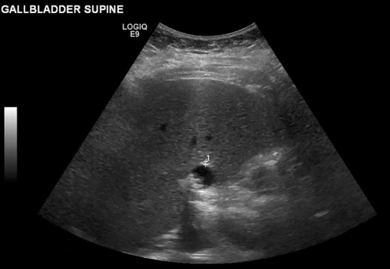
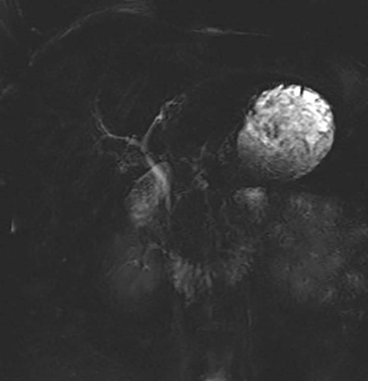
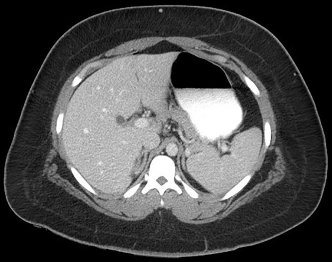
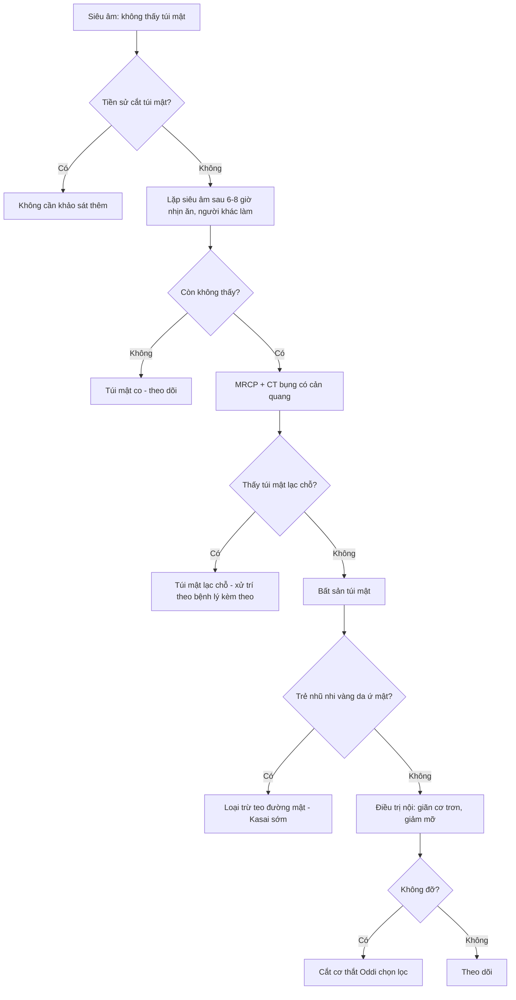
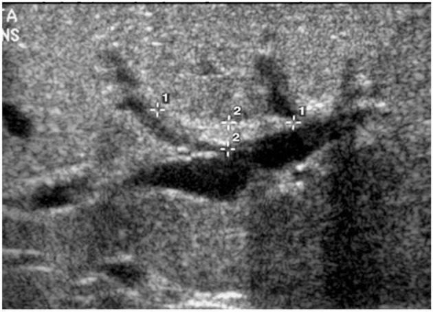
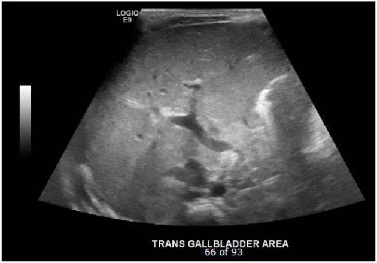

# 6203 — Bất sản túi mật bẩm sinh: "không thấy túi mật" trên siêu âm / Congenital gallbladder agenesis (GA)

**Tags:** `pattern:khong-thay-tui-mat` `pattern:khong-thay-co-quan` `pattern:gia-sot` `vung:tui-mat` `vung:gan-mat` `vung:bung` `protocol:MRCP` `protocol:SAT-bung` `incidentaloma:tui-mat`

**Mức chắc chắn (certainty):** tổng hợp y văn (literature synthesis) — số liệu từ **tổng quan hệ thống 151 ca** (PMC13236144), **tổng quan 206 ca túi mật lạc chỗ** (PMC12825902), **đoàn hệ 55 thai nhi không thấy túi mật** (PMC13706336), **đoàn hệ 61 trẻ ứ mật** (PMC8275825) và **5 báo cáo ca** có ảnh (PMC6114116, PMC13173388, PMC12738374, PMC12892802, PMC12421460). Nhóm **không có bệnh nhân của mình**.

> **Câu chốt:** "không thấy túi mật" trên siêu âm là **một triệu chứng hình ảnh, không phải một chẩn đoán**. Có **bốn khả năng** phải loại trừ theo thứ tự: **(1) đã cắt túi mật** (hỏi bệnh/sẹo/clip); **(2) túi mật co sau ăn hoặc teo xơ** (lặp siêu âm sau nhịn ăn, người khác làm); **(3) túi mật lạc chỗ** — **54,9%** nằm bên trái, chỉ **41,2%** chẩn đoán được trước mổ; **(4) bất sản thật**. Chỉ **MRCP** mới phân biệt được (3) với (4), và **mổ nội soi "thăm dò" khi chưa chắc là sai lầm nguy hiểm nhất**: **73%** ca bất sản trong y văn chỉ được chẩn đoán **trong mổ**, **22%** vẫn bị mổ dù đã có chẩn đoán trước.

## 1. Tổng quan bệnh học – cơ chế hình ảnh

### 1.1 Phôi thai: mầm túi mật "không mọc" hoặc "mọc mà không rỗng"

- Túi mật và ống túi mật hình thành từ **mầm túi (cystic bud)** — phần đuôi của **túi gan–ruột (hepatic diverticulum)** ở **tuần 4–7** thai kỳ. Mầm này đầu tiên là **dây biểu mô đặc**, sau đó **rỗng hóa (recanalization)** để tạo lòng.
- Bất sản xảy ra khi: **(a) mầm túi không hình thành** (không có túi mật *và* không có ống túi mật), hoặc **(b) mầm hình thành nhưng rỗng hóa thất bại** → thể **giảm sản/dị sản dạng xơ** (có mô túi mật teo nhỏ, thường dính và xơ). Hai cơ chế này khác nhau trên hình ảnh: (a) **hố túi mật trống hoàn toàn**, (b) còn **cấu trúc nhỏ 6–9 mm** hoặc di tích ống túi mật.
- Vì cùng nguồn phôi thai với **đường mật**, bất sản hay đi kèm **bất thường ống mật**: trong 151 ca hệ thống có **hẹp/teo đường mật, nang ống mật chủ, hậu môn không lỗ, bất sản thận, dị tật tim (TOF, HLHS), hở môi–vòm miệng** (PMC13236144). Ở trẻ, bất sản **đơn độc** hiếm hơn nhiều so với **bất sản trong bệnh cảnh đa dị tật**.

### 1.2 Ba nhóm lâm sàng — ba cách đến với chẩn đoán

| Nhóm | Cách phát hiện | Ý nghĩa thực hành |
|---|---|---|
| **Không triệu chứng** | Tình cờ trên siêu âm/CT vì lý do khác | Không can thiệp; tư vấn |
| **Có triệu chứng kiểu sỏi mật** | Đau hạ sườn phải, buồn nôn; **66%** đau HSP, **23%** vàng da trong 151 ca | Cơ chế: **rối loạn cơ thắt Oddi, rối loạn vận động đường mật, tăng áp lực trong OMC** do mất túi dự trữ (PMC13335320) |
| **Trẻ sơ sinh/nhũ nhi đa dị tật** | Vàng da ứ mật, phát hiện sớm | Phải loại trừ **teo đường mật** trước khi gọi là bất sản |

- **TẠI SAO mất túi mật lại đau?** Mất bể dự trữ → áp lực và thể tích mật trong OMC dao động mạnh theo bữa ăn; cộng với **tăng trương lực cơ thắt Oddi** ở một số bệnh nhân, tạo cơn đau kiểu sỏi dù **không có sỏi**. Đây là lý do **không được cắt túi mật** (không có gì để cắt) mà điều trị **giãn cơ trơn/giảm mỡ, chọn lọc cắt cơ thắt qua nội soi**.

### 1.3 Vì sao từng modality "không thấy" — vật lý quyết định

- **Siêu âm:** túi mật chỉ hiện hình khi **có lòng chứa dịch mật**. Không có túi → hố túi mật chứa **mỡ, đại tràng, quai ruột non**, tạo **ổ tăng âm + bóng lưng** rất dễ đọc thành **sỏi** (đúng như ca PMC6114116: "2-mm wall + echogenic gallstones"). Thêm nữa, **co sau ăn** làm lòng rỗng, thành áp sát → giả "teo".
- **CT:** túi mật là cấu trúc **dịch 0–20 HU** ở hố túi mật; khi bất sản chỉ còn **cấu trúc nhỏ 6–9 mm** (di tích ống túi mật/mô xơ) — **rất dễ bị bỏ qua** nếu chỉ đọc "không có túi mật to".
- **MRCP:** dùng chuỗi **T2 nặng (SSFSE/HASTE)** — mật là **chất lỏng tĩnh** nên **tăng tín hiệu rất mạnh**, không cần cản quang. Bất sản cho hình **cây mật trong gan + OMC hiện rõ nhưng không có túi mật**, kèm **di tích ống túi mật 6–7 mm** ở rốn gan (PMC6114116, PMC13335320). Đây là lý do MRCP **là chuẩn xác định giải phẫu**, không phải siêu âm.
- **HIDA (xạ hình gan–mật):** không dùng để **xác nhận** bất sản. Khi không có túi mật, mật vẫn **chảy tự do xuống ruột**, và hoạt độ trong **quai ruột cạnh hố túi mật** có thể bị đọc thành "túi mật còn chức năng" — đã có ca **HIDA + siêu âm nội soi nói có túi mật chức năng tốt**, mổ ra **không có túi mật** (PMC12892802).

### 1.4 Các con số quyết định

- **Tần suất: các nguồn lệch gần 30 lần** — tổng quan hệ thống ghi **0,0027–0,007%** dân số (≈ **2,7–7/100.000**; PMC13236144); báo cáo ca và tổng quan kinh điển ghi **10–65/100.000**, loạt tử thiết **~90/100.000**, loạt lâm sàng chung **0,03%** (≈ 30/100.000) (PMC13335320, PMC12738374). Tỷ lệ **nữ:nam ≈ 3:1**.
- **151 ca hệ thống:** nữ **66%**, tuổi trung vị **45**; **73% chẩn đoán trong mổ**; **79% bị can thiệp mổ** (49,6% nội soi, 50,4% mở); **22% (9/41) vẫn mổ dù đã có chẩn đoán trước**; biến chứng **8,6%**; chẩn đoán trước mổ làm **giảm can thiệp mổ (OR 0,06; P = 0,044)**.
- **HIDA trong 151 ca:** dùng HIDA gắn với **biến chứng nhiều hơn (OR 8,53; KTC 95% 1,21–59,1)** — tác giả tự ghi đây là **confounding by indication**, nhưng đủ để thấy HIDA **không phải con đường chẩn đoán an toàn**.
- **Túi mật lạc chỗ (206 ca):** **54,9%** bên trái; **81,6%** có triệu chứng; chẩn đoán **trước mổ 41,2%**, **trong mổ 48,6%**; siêu âm **độ nhạy thấp**, CT có cản quang/MRCP là lựa chọn (PMC12825902).
- **Thai nhi không thấy túi mật (55 ca):** thể **đơn độc** có tiên lượng tốt **100%**, không ca nào teo đường mật; thể **kèm bất thường khác** có **32,1%** biến cố xấu và **10,7%** teo đường mật; **MRI trước sinh chỉ thấy túi mật ở 3/6 ca (50%)** (PMC13706336).
- **Trẻ ứ mật (61 ca, 43 teo đường mật):** "không thấy túi mật" dự báo **teo đường mật** với **độ đặc hiệu 94%, PPV 96%** nhưng **độ nhạy chỉ 53%**; ngược lại nó dự báo **túi mật thật sự vắng** với **Se 92%, Sp 73%, PPV 43%, NPV 97%** (PMC8275825).

## 2. Mẫu hình + chẩn đoán phân biệt theo bối cảnh (gamut)

**Mẫu hình chung:** *hố túi mật không có túi dịch* → gamut chia theo **tuổi/bối cảnh**, không theo hình thái.

- **Người lớn đau hạ sườn phải, siêu âm không thấy túi mật:**
  1. **Đã cắt túi mật** (tiền sử, clip, sẹo).
  2. **Túi mật co sau ăn** — lặp siêu âm sau 6–8 giờ nhịn ăn.
  3. **Teo xơ sau viêm túi mật mạn** — túi nhỏ, thành dày, sỏi, dính.
  4. **Túi mật lạc chỗ** — trong gan (thùy trái), sau gan, cạnh dây chằng liềm, sau phúc mạc, "túi mật nổi".
  5. **Bất sản thật** (đơn độc hay kèm dị tật).
  6. **Giảm sản túi mật** (mô xơ rất nhỏ — thể riêng, mổ rất khó vì xơ).
- **Trẻ nhũ nhi vàng da ứ mật:** **teo đường mật** (không thấy túi mật + **dấu dây tam giác**) » bất sản đơn độc » nang ống mật chủ » viêm gan sơ sinh/CMV » thiếu alpha-1 antitrypsin » xơ nang.
- **Thai nhi:** **không thấy túi mật đơn độc** (thường tốt) vs **kèm bất thường khác** (teo đường mật, đa dị tật) — tiên lượng khác hẳn.
- **Bất sản + đa dị tật:** teo đường mật, nang OMC, hậu môn không lỗ, bất sản thận, dị tật tim, hở môi–vòm miệng (PMC13236144) — hễ thấy một cái, phải **siêu âm tim/thận** và hỏi **hội chứng**.

## 3. Bảng so sánh phân biệt (ma trận đối chiếu)

| Thực thể (entity) | Hình ảnh điển hình | Chốt vào (rule-in) | Chốt loại (rule-out) | Gợi ý xác nhận |
|---|---|---|---|---|
| **Bất sản túi mật đơn độc** | US: không thấy túi mật dù nhịn ăn; CT: cấu trúc **6–9 mm** ở hố túi mật; MRCP: **không có túi mật**, cây mật trong gan + OMC bình thường hoặc **giãn bù** | **MRCP: không túi mật + không thấy túi mật ở mọi vị trí lạc + cây mật bình thường** | **Thấy túi mật ở thùy trái/sau gan/trong gan → không phải bất sản**; **có ống túi mật đổ vào OMC + túi teo → teo xơ, không phải bất sản** | MRCP; **không mổ thăm dò** |
| **Túi mật lạc chỗ** | Túi mật ngoài hố; **54,9% bên trái**; US dễ bỏ sót; CT 2 thì/MRCP thấy rõ | **Thấy túi mật + ống túi mật ở vị trí ngoài hố** | Hố túi mật trống + không thấy ở 6 vị trí kinh điển | CT có cản quang / MRCP (PMC12825902) |
| **Túi mật co sau ăn** | Túi nhỏ, lòng ít dịch, thành áp sát | **Lặp siêu âm sau nhịn ăn thấy túi giãn lại** | Vẫn không thấy sau nhịn ăn đủ và **người khác làm lại** | Siêu âm lặp (PMC13335320) |
| **Teo xơ sau viêm mạn** | Túi nhỏ, **thành dày**, sỏi, dính mô quanh | **Sỏi + thành dày + co kéo hố túi mật** | Không sỏi, không thành dày, không co kéo | CT/MRCP; mô bệnh sau mổ |
| **Đã cắt túi mật** | Hố trống + **clip kim loại**, sẹo | **Tiền sử mổ + clip** | Không tiền sử, không clip | Bệnh sử, phim cũ |
| **Giảm sản túi mật** | Túi rất nhỏ, mô xơ, dính; thường kèm dị tật khác | **Thấy mô túi mật nhỏ + ống túi mật** | Không thấy mô túi mật nào | Mổ/mô bệnh — **nguy cơ cao vì xơ** (PMC13589193) |
| **Teo đường mật ở trẻ ứ mật** | **Không thấy túi mật + dấu dây tam giác** ở rốn gan | **Dây tam giác + túi mật rỗng/không thấy** (PPV **96%**) | Không dây tam giác + MRCP bình thường | US → MRCP/sinh thiết; **Kasai sớm** (PMC8275825) |
| **Nang ống mật chủ** | Cấu trúc dịch quanh OMC, **thông với cây mật** | **Nang thông với OMC** | Không thông, cây mật bình thường | MRCP (bài `107`) |

*Ca 1 (23 tuổi, đau HSP từng cơn): siêu âm đọc là "thành túi mật 2 mm + sỏi tăng âm", nhưng túi mật **không hiện rõ**. Ảnh nguyên bản, không chỉnh sửa. Nguồn: Moon AM, Howe JH, McGinty KA, Gerber DA. *Radiol Case Rep* 2018. Fig. 1. PMCID: PMC6114116 — **CC BY-NC-ND**.*

*Cùng ca 1: MRCP xác nhận **không có túi mật**, OMC **6 mm** "hơi rộng", **di tích ống túi mật 6 mm** ở rốn gan. Cấu trúc tăng tín hiệu lớn phía trái bụng là **dịch dạ dày** — bẫy "túi mật giả". Ảnh nguyên bản, không chỉnh sửa. Nguồn: Moon AM và cs, *Radiol Case Rep* 2018. Fig. 4. PMCID: PMC6114116 — **CC BY-NC-ND**.*

### 3.1 Đọc MRCP cho đúng: ba câu hỏi

1. **Có túi mật ở vị trí nào không?** Quét đủ **thùy trái, sau gan, cạnh dây chằng liềm, sau phúc mạc** — không chỉ hố túi mật.
2. **Có ống túi mật đổ vào OMC?** Di tích **6–7 mm** hình ống ở rốn gan ủng hộ **bất sản** (mầm hình thành một phần); ống túi mật dài + túi mật nhỏ = **teo/giảm sản**.
3. **Cây mật có bất thường?** OMC giãn **bù** (không tắc), nang OMC, hẹp đường mật — quyết định điều trị.

## 4. Protocol chụp + xử trí (không có hệ điểm riêng)

### 4.1 Siêu âm — đầu tay, nhưng phải làm đúng

- **Nhịn ăn 6–8 giờ** trước khảo sát (thông lệ siêu âm bụng); đầu dò convex 3,5–5 MHz, quét dưới sườn + liên sườn, tư thế nằm ngửa và nghiêng trái.
- Nếu không thấy: **lặp lại sau nhịn ăn đủ, tốt nhất do người khác làm** — tổng quan BMC nhấn mạnh bước này để loại "co/scleroatrophic" (PMC13335320).
- Ghi rõ: thành bao nhiêu mm, có sỏi/bóng lưng, **OMC bao nhiêu mm**, có dịch quanh túi mật, dấu Murphy.

### 4.2 MRCP — chuẩn xác định giải phẫu

- **1,5T hoặc 3T**, T2 nặng **SSFSE/HASTE** nhịn thở, **thick-slab 3D** + lát mỏng 3–4 mm; **không cần cản quang**; thêm T1/T2 axial để tìm mô xơ/di tích.
- Mục tiêu: **loại trừ túi mật lạc chỗ** trước khi kết luận bất sản; đo OMC và tìm sỏi OMC (bất sản **không bảo vệ** khỏi sỏi mật — đã có ca **sỏi OMC 20 mm** gây viêm đường mật cấp, ERCP không kết luận vì sỏi lớn, phải mổ lấy sỏi và xác nhận bất sản; PMC12421460).

### 4.3 CT và HIDA — vai trò hẹp

- **CT bụng có cản quang thì cửa**: khi MRCP không làm được/chống chỉ định; tìm **cấu trúc 6–9 mm** ở hố túi mật, loại nang/khối.

*Ca 1, lát trục: hố túi mật **không có túi dịch**; cấu trúc nhỏ **9 mm** ở hố túi mật là di tích/mô xơ — không tắc mật, gan bình thường. Ảnh nguyên bản, không chỉnh sửa. Nguồn: Moon AM và cs, *Radiol Case Rep* 2018. Fig. 2. PMCID: PMC6114116 — **CC BY-NC-ND**.*
- **HIDA: không dùng để xác nhận bất sản.** Có thể **dương tính giả "túi mật còn chức năng"** do mật xuống ruột tự do; dùng HIDA gắn với nhiều biến chứng hơn trong 151 ca (OR 8,53) (PMC12892802, PMC13236144).

### 4.4 Quy tắc trong mổ — phần quan trọng nhất cho an toàn

- **Không tìm thấy túi mật khi mổ nội soi** → **dừng**, không bóc tách rốn gan "để tìm", không đặt catheter vào ống giả; **siêu âm trong mổ** để chắc chắn không có túi mật trong gan; rồi **kết thúc mổ + MRCP hậu phẫu**.
- Nếu tiếp tục bóc tách trong hố trống, nguy cơ **tổn thương OMC** rất cao — đã có ca **HIDA không kết luận → bóc tách rộng → tổn thương OMC, chuyển mổ mở, nối gan–ruột Roux-en-Y** (PMC13335320 dẫn ca Bahraini).

### 4.5 Điều trị bất sản

- **Nội khoa trước**: giảm mỡ trong bữa ăn, **thuốc giãn cơ trơn/kháng cholinergic**; nhiều ca hết đau và không cần can thiệp (PMC13173388, PMC12738374, PMC13335320).
- **Cắt cơ thắt Oddi qua nội soi** cho ca dai dẳng, chọn lọc (PMC13335320).
- **Sỏi OMC**: ERCP lấy sỏi; nếu thất bại (sỏi lớn, không có túi mật để định hướng) → mổ lấy sỏi đường mật (PMC12421460).
- **Trẻ**: nếu là **teo đường mật**, điều trị là **Kasai sớm**, không phải theo dõi bất sản.

## 5. Biến thể bình thường và cạm bẫy

- **Biến thể vị trí (không phải bệnh):** túi mật **trong gan**, **sau gan**, **cạnh dây chằng liềm**, **sau phúc mạc**, **"túi mật nổi"** (floating), **túi mật đôi/hình đồng hồ cát**. Tất cả **loại trừ bất sản** — nếu chỉ khảo sát hố túi mật sẽ gọi sai.
- **Cạm bẫy 1 — "sỏi giả":** quai ruột/gas trong hố túi mật tạo **tăng âm + bóng lưng**; ca PMC6114116 có "sỏi" trên siêu âm nhưng MRCP sạch, và bệnh nhân khỏi khi điều trị nội. Không chẩn đoán sỏi chỉ dựa vào ổ tăng âm khi **không thấy lòng túi mật**.
- **Cạm bẫy 2 — MRCP âm tính giả:** túi mật **teo rất nhỏ + đầy sỏi** có thể không cho tín hiệu dịch → MRCP "không thấy túi mật". Ca 47 tuổi ở PMC12738374: siêu âm nói "túi mật đầy sỏi", MRCP cũng không thấy → mổ nội soi, hố túi mật **trống hoàn toàn**, siêu âm trong mổ cũng không có túi mật. Bài học: MRCP + lâm sàng + **không mổ thăm dò**.
- **Cạm bẫy 3 — HIDA dương tính giả:** như mục 1.3/4.3; **không dùng HIDA để "cứu" chẩn đoán**.
- **Cạm bẫy 4 — trẻ ứ mật:** "không thấy túi mật" ở trẻ **không phải bất sản cho đến khi loại trừ teo đường mật**; **PPV 96%** cho teo đường mật, trong khi PPV cho "túi mật thật sự vắng" chỉ **43%** (PMC8275825). Thêm **dấu dây tam giác** (mô tăng âm hình tam giác trước tĩnh mạch cửa phải) là chốt.
- **Cạm bẫy 5 — thai nhi:** không thấy túi mật **đơn độc** có tiên lượng tốt (0% teo mật trong 27 ca), nhưng **MRI trước sinh chỉ thấy túi mật 3/6 ca** → đừng hứa "chắc chắn bình thường", hẹn siêu âm sau sinh (PMC13706336).
- **Cạm bẫy 6 — giảm sản ≠ bất sản:** giảm sản có **mô túi mật xơ dính**, mổ rất khó, dễ tổn thương đường mật; ưu tiên nội khoa trước (ca Apert 20 tuổi, PMC13589193).

*Dấu dây tam giác (triangular cord sign) trên siêu âm trẻ ứ mật — chốt gợi ý teo đường mật, không phải bất sản. Ảnh nguyên bản. Nguồn: Ho A, Sacks MA, Sapra A, Khan FA. *Front Pediatr* 2021;9:685268. Figure 1. PMCID: PMC8275825 — **CC BY 4.0**.*

*Cùng đoàn hệ: mặt cắt ngang "trans gallbladder area" **không thấy túi mật**. Trong 61 trẻ ứ mật, hình ảnh này dự báo teo đường mật với **PPV 96%** và **độ nhạy 53%**. Ảnh nguyên bản. Nguồn: Ho A và cs, *Front Pediatr* 2021. Figure 2. PMCID: PMC8275825 — **CC BY 4.0**.*

## 6. Tự lượng giá — Blind Quiz

**Ca 1 — Nữ 23 tuổi, đau hạ sườn phải tái diễn sau bữa ăn, không sốt, men gan bình thường. Siêu âm đọc là "sỏi".**

- Câu hỏi: (1) Dấu hiệu nào **không** đáng tin trong ảnh này? (2) Ba chẩn đoán phân biệt? (3) Bước tiếp theo **trước khi** đặt lịch mổ?

<b>Bấm để hiện đáp án (findings + chẩn đoán)</b>

- **Findings:** hố túi mật có cấu trúc giảm âm không rõ thành, kèm **ổ tăng âm + bóng lưng**; thước đo thành **2 mm**. Không thấy **lòng túi mật chứa dịch** điển hình.
- **Không đáng tin:** "sỏi" khi **không xác định được lòng túi mật** — ổ tăng âm có thể là **gas/quai ruột/mặt phân cách mô**.
- **DDx:** túi mật co sau ăn · teo xơ mạn · **túi mật lạc chỗ** · bất sản; sỏi thật ít khả năng vì không thấy lòng túi mật.
- **Bước tiếp theo:** **lặp siêu âm sau nhịn ăn**, rồi **MRCP** — không mổ khi chưa xác định giải phẫu.
- Nguồn: Moon AM và cs, *Radiol Case Rep* 2018, PMCID PMC6114116 (CC BY-NC-ND).

**Ca 2 — Vẫn ca 1: MRCP được làm.**

- Câu hỏi: (1) Túi mật ở đâu? (2) Cấu trúc sáng lớn bên trái ảnh là gì? (3) Kết luận và thái độ điều trị?

<b>Bấm để hiện đáp án (findings + chẩn đoán)</b>

- **Findings:** cây mật trong gan mảnh, **OMC 6 mm**, **không có túi mật** ở hố túi mật hay vị trí lạc; **cấu trúc hình ống 6 mm** ở rốn gan = **di tích ống túi mật**.
- **Cấu trúc sáng lớn bên trái bệnh nhân = dịch trong dạ dày/tá tràng** — không phải túi mật; đây là bẫy "túi mật giả" hay gặp trên MRCP.
- **Chẩn đoán:** **bất sản túi mật bẩm sinh**, không sỏi, không tắc mật.
- **Điều trị:** nội khoa (giảm mỡ, giãn cơ trơn); bệnh nhân hết đau, **không mổ**.
- Nguồn: Moon AM và cs, *Radiol Case Rep* 2018, PMCID PMC6114116 (CC BY-NC-ND).

**Ca 3 — Bé 2 tháng, vàng da ứ mật, phân bạc màu. Siêu âm vùng túi mật và rốn gan.**

- Câu hỏi: (1) Hai dấu hiệu trên ảnh? (2) Chẩn đoán khả năng nhất? (3) Vì sao **không** được gọi là "bất sản túi mật" rồi theo dõi?

<b>Bấm để hiện đáp án (findings + chẩn đoán)</b>

- **Findings:** **dấu dây tam giác** — mô tăng âm hình tam giác ở rốn gan, trước tĩnh mạch cửa phải; kèm **không thấy túi mật** ở mặt cắt ngang vùng túi mật.
- **Chẩn đoán:** **teo đường mật (biliary atresia)** cho đến khi loại trừ — trong 61 trẻ ứ mật, "không thấy túi mật" có **PPV 96%** và **độ đặc hiệu 94%** cho teo đường mật, trong khi PPV cho "túi mật thật sự vắng" chỉ **43%**.
- **Vì sao không theo dõi:** teo đường mật **mất cửa sổ Kasai** nếu chậm; bất sản đơn độc ở trẻ là **chẩn đoán loại trừ**, không phải chẩn đoán mặc định.
- Nguồn: Ho A và cs, *Front Pediatr* 2021, PMCID PMC8275825 (CC BY 4.0).

## 7. Câu hỏi nghiên cứu & điểm chưa đồng thuận (tính đến 11/2026)

1. **[Tranh cãi] Tần suất thật của bất sản túi mật là bao nhiêu: 2,7–7/100.000 dân số, 10–65/100.000, hay ~90/100.000 trên loạt tử thiết — và con số nào nên dùng để quyết định có khảo sát MRCP cho mọi ca "không thấy túi mật"?**
   - **Đã biết:** tổng quan hệ thống 151 ca ghi **0,0027–0,007%** (PMC13236144), trong khi tổng quan BMC và loạt ca dẫn lại **10–65/100.000** và **~90/100.000** trên tử thiết (PMC13335320).
   - **Chưa rõ:** khác biệt do **quần thể** (tử thiết, mổ nội soi, dân số chung) hay do **định nghĩa** (bất sản toàn bộ so với giảm sản/di tích ống túi mật).
   - **Hướng nghiên cứu:** registry đa trung tâm dùng **cùng tiêu chuẩn MRCP** và phân loại rõ bất sản/giảm sản, báo cáo mẫu số dân số.
   - **Nguồn:** PMC13236144 (2026); PMC13335320 (2026).

2. **[Khác biệt thực hành] Ở người lớn đau kiểu mật và siêu âm không thấy túi mật, MRCP trước mọi can thiệp có giảm mổ không cần thiết và tổn thương đường mật so với mổ nội soi "thăm dò rồi dừng"?**
   - **Đã biết:** chẩn đoán trước mổ giảm can thiệp mổ (**OR 0,06**) và biến chứng, nhưng **22%** vẫn bị mổ dù đã chẩn đoán; có ca MRCP đúng nhưng HIDA lại "thấy túi mật" và bệnh nhân vẫn được mổ (PMC12892802).
   - **Chưa rõ:** tỷ lệ tổn thương OMC thật sự khi **dừng mổ + MRCP hậu phẫu** so với **mổ tiếp** — chưa có so sánh trực tiếp.
   - **Hướng nghiên cứu:** cohort tiến cứu theo **quy trình MRCP-trước**, outcome là tỷ lệ mổ không cần thiết và tổn thương đường mật.
   - **Nguồn:** PMC13236144 (2026); PMC12892802 (2026); PMC13335320 (2026).

3. **[Khoảng trống] Ở trẻ ứ mật không thấy túi mật, bộ ba siêu âm (dây tam giác + kích thước túi mật) + MRCP có đủ phân biệt teo đường mật với bất sản thật để tránh cả Kasai muộn và mổ oan không?**
   - **Đã biết:** "không thấy túi mật" có **PPV 96%, độ nhạy 53%** cho teo đường mật, và **NPV 97%** cho "túi mật thật sự vắng" trong 61 trẻ (PMC8275825); thể thai nhi **đơn độc** không ca nào teo mật, thể **kèm bất thường** có **10,7%** (PMC13706336).
   - **Chưa rõ:** giá trị của **MRCP ở nhũ nhi** (không hợp tác, ống mật rất nhỏ) và ngưỡng kích thước túi mật/dây tam giác nào đủ để bỏ sinh thiết.
   - **Hướng nghiên cứu:** nghiên cứu độ chính xác chẩn đoán tiến cứu, so **siêu âm + MRCP** với **sinh thiết/mổ** làm chuẩn.
   - **Nguồn:** PMC8275825 (2021); PMC13706336 (2026).

## Bài liên quan chéo
- [100 – Tổng quan hệ Bụng](../100-tong-quan-he-bung/lesson.md)
- [107 – MRCP & gadoxetic acid thì gan–mật](../107-mrcp-gadoxetic-acid-hbp/lesson.md) (kỹ thuật MRCP, ngưỡng)
- [108 – Tổn thương đường mật sau cắt túi mật](../108-ton-thuong-duong-mat-sau-cat-tui-mat/lesson.md) (hậu quả của mổ thăm dò sai)
- [1940 – Sỏi sót, sỏi tái phát và sỏi rơi sau cắt túi mật](../1940-soi-mat-sot-tai-phat-sau-cat-tui-mat/lesson.md)
- [102 – Viêm túi mật cấp & viêm tụy cấp sau ERCP](../102-viem-tui-mat-va-viem-tuy-sau-stent-mat-ercp/lesson.md)
- [6172 – Bất sản/giảm sản tụy bẩm sinh](../6172-bat-san-tuy-bam-sinh-thieu-lipase/lesson.md) (cùng nguyên lý "không thấy cơ quan")

## Ảnh
- 5 ảnh, tải nguyên bản từ PMC (không crop, không ghép), ghi nguồn + giấy phép từng ảnh trong `images/CREDITS.md`.
- Ba ảnh của PMC6114116 là **CC BY-NC-ND** → **không chỉnh sửa, không ghép composite**; hai ảnh của PMC8275825 là **CC BY 4.0**.

> Không dùng để chẩn đoán độc lập khi chưa có người hướng dẫn.
