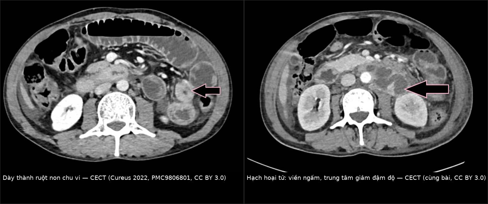
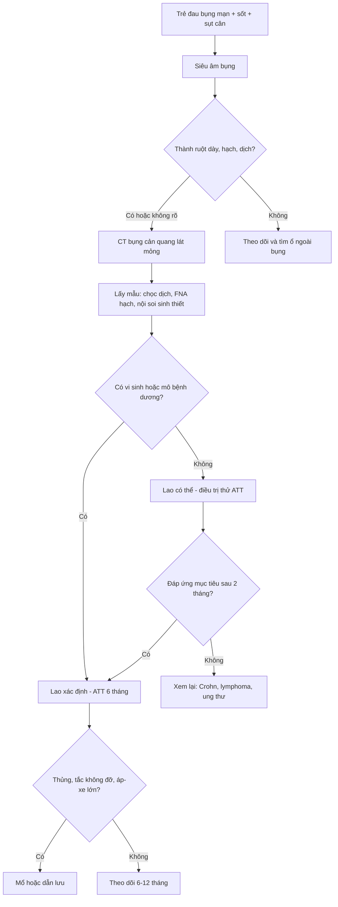
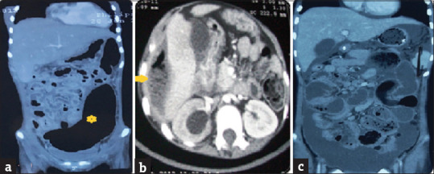
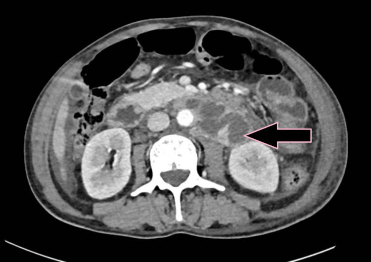
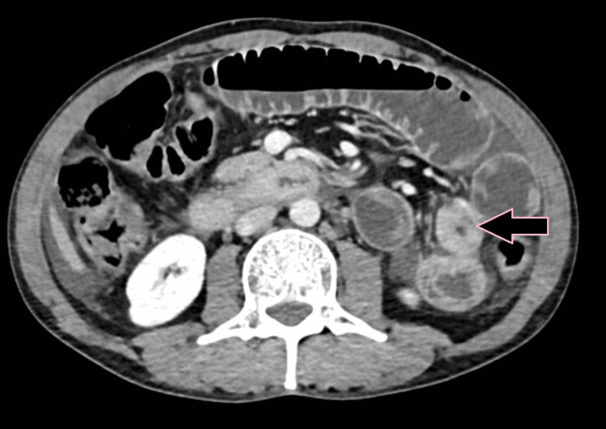

# 6205 — Lao ruột và lao phúc mạc ở trẻ: dày manh tràng, hạch hoại tử–vôi hóa & dịch bụng vách hóa / Intestinal and peritoneal tuberculosis in children

**Tags:** `pattern:day-thanh-ruot` `pattern:hach-hoai-tu` `pattern:hach-voi-hoa` `pattern:dich-bung-vach-hoa` `pattern:day-manh-trang` `vung:ruot` `vung:manh-trang` `vung:hau-phuc-mac` `vung:phuc-mac` `protocol:CT-bung-co-can-quang` `protocol:sieu-am-bung` `score:ADA` `incidentaloma:hach-mac-treo-voi-hoa`

**Mức chắc chắn (certainty):** tổng hợp y văn (literature synthesis) — số liệu lấy **trực tiếp** từ các bài toàn văn mở: đoàn hệ **218 trẻ** tại Ấn Độ (**PMC7144780**), **77 trẻ** được mổ (**PMC9997595**), **34 trẻ** tiến cứu (**PMC12446891**), **96 trẻ** đa trung tâm Pakistan (**PMC13170074**), **60 trẻ** tiến cứu Bangladesh (**PMC13782805**), phân tích gộp **7 nghiên cứu/60 ca** về chẩn đoán nhầm (**PMC12439471**), tổng quan thực hành **PMC10005918**, cùng các nghiên cứu CT người lớn dùng làm **ngưỡng định lượng** (**PMC13290316**, **PMC11614315**). Ảnh minh họa lấy từ **PMC9997595** (CC BY-NC-SA 4.0) và **PMC9806801** (CC BY 3.0). Không có thử nghiệm ngẫu nhiên nào riêng cho trẻ — chỗ suy luận được ghi rõ.

> **Câu chốt:** ở trẻ, lao ruột/phúc mạc gần như **luôn là chẩn đoán "ghép hình ảnh + dịch tễ + đáp ứng điều trị"**, vì vi sinh rất kém: **GeneXpert dương 29%** và **CBNAAT 35,5%**, cấy chỉ **3%** (PMC9997595, PMC12446891, PMC7144780). Ba điểm khác người lớn và khác Crohn: **(1)** hạch **hoại tử trung tâm** có **độ đặc hiệu 100% nhưng độ nhạy chỉ 23%** khi phân biệt với Crohn — thấy được là chốt, **không thấy không loại trừ** (PMC10005918); **(2)** ở trẻ, hạch **> 15 mm chỉ 9,1%** — chờ hạch "to" mới nghĩ lao là bỏ sót (PMC9997595); **(3)** **dịch bụng dịch tiết (SAAG 0,66 ± 0,19 g/dL)** + **ADA ≥ 39 U/L** mới là cửa vào rẻ và nhanh nhất (PMC12446891, PMC10005918).

## 1. Tổng quan bệnh học – cơ chế hình ảnh (TẠI SAO lao để lại đúng những dấu hiệu đó)

### 1.1 Dịch tễ và độ trễ chẩn đoán

- **Gánh nặng:** WHO 2023 ước **1,3 triệu ca lao mới ở trẻ < 15 tuổi**, khoảng **12% tổng gánh nặng lao**; lao ngoài phổi (extrapulmonary TB — EPTB) chiếm **15–20%** lao trẻ em (PMC12439471).
- **Lao bụng (abdominal TB — ATB)** chiếm khoảng **1–3% tổng ca lao** và **~12% EPTB ở trẻ < 15 tuổi**; là **vị trí ngoài phổi phổ biến thứ 6** (PMC12439471, PMC10005918). Con số dao động mạnh theo tuyến: một cohort tiêu hóa nhi Ấn Độ chỉ ghi nhận **0,3% ca lao trẻ** là lao bụng (PMC7144780) — **không dùng một tỷ lệ đơn lẻ để loại trừ**.
- **Trễ chẩn đoán là quy luật, không phải ngoại lệ:** trung vị **4 tháng (0,5–36)** từ khởi phát đến chẩn đoán trong 218 trẻ (PMC7144780); trung vị **3 tháng (IQR 1–5)** trong 34 trẻ tiến cứu (PMC12446891); **40% (24/60) ca** trong phân tích gộp bị **chẩn đoán nhầm hoặc chẩn đoán muộn** (PMC12439471).
- **Tuổi:** hai cực cùng tồn tại — cohort 218 trẻ có trung vị **10 tuổi (0,25–12)** (PMC7144780); cohort mổ có **9,5 ± 3,6 tuổi**, **15% ≤ 2 tuổi**, và **nữ : nam = 1,8 : 1** (PMC9997595); cohort Pakistan **11,8 ± 3,8 tuổi**, **73% nữ** (PMC13170074). Vì vậy **không loại trừ lao bụng chỉ vì trẻ nhỏ hay vì giới**.

### 1.2 Bốn mô hình tổn thương và lý do vật lý của từng dấu hiệu

| Mô hình | Cơ chế mô bệnh | Vì sao ra đúng dấu hiệu đó trên hình ảnh |
|---|---|---|
| **Viêm–loét ruột** | U hạt lao (caseating granuloma) ở **lớp dưới niêm mạc**, loét **ngang chu vi** rồi xơ hóa | Loét ngang + phù niêm mạc → **dày thành ruột đối xứng, mất phân lớp**, hẹp lòng; tổn thương hay gặp **hồi tràng – manh tràng** vì mô lympho dồi dào |
| **Hạch lao** | Hoại tử bã đậu trung tâm lan rộng, vỏ xơ ngấm thuốc; canxi hóa **loạn dưỡng** khi lành | Trung tâm hoại tử **giảm đậm độ (< 30 HU)** + **viền ngấm thuốc**; canxi hóa **rất đậm (> 200 HU)** — hai thì của cùng một quá trình |
| **Lao phúc mạc** | Hạt lao rải trên phúc mạc + mạch bạch huyết bị tắc → dịch tiết giàu protein, fibrin | Dịch **giảm đậm độ nhưng đậm hơn nước (dịch tiết)**, **vách/tua fibrin**, **dày phúc mạc nhẵn**, **dày mạc treo – mạc nối**; SAAG thấp |
| **Xơ hóa – dính (thể khô/cuộn)** | Xơ hóa mạc treo + dính ruột thành **"kén" (abdominal cocoon)** | Các quai ruột **dính thành khối, mạch mạc treo xếp tia, không di động khi đổi tư thế**; nguy cơ **tắc ruột** |

- **TẠI SAO hạch lại là chìa khóa:** nang hoại tử trung tâm chứa **caseum** (mỡ + protein + tế bào chết) nên **giảm đậm độ trên CT**, **tăng tín hiệu T2 nhưng không sáng bằng dịch** trên MRI, và **không ngấm thuốc** ở thì muộn trong khi vỏ xơ giàu mao mạch **ngấm mạnh** → hình **"viền"**. Ung thư di căn hạch cũng hoại tử, nhưng **không canxi hóa kiểu vỏ trứng** và thường kèm khối nguyên phát.
- **TẠI SAO dịch bụng lao có vách:** phản ứng fibrin trên phúc mạc tạo **dải fibrin**, sau đó **vách hóa**; trên siêu âm là **tua/màng trong dịch**, trên CT là **dịch khu trú nhiều ổ** — dấu này giúp phân biệt với **cổ trướng trong xơ gan** (dịch trong, SAAG ≥ 1,1 g/dL).
- **TẠI SAO "kén" xuất hiện:** viêm phúc mạc lao mạn → xơ hóa mạc treo và phúc mạc tạng, ruột **bị bọc trong vỏ xơ**; trên CT là **khối quai ruột tụ tập + vỏ bao mỏng ngấm thuốc**, dễ đọc nhầm thành **khối u** hoặc **xơ hóa phúc mạc do thẩm phân (EPS)**.

### 1.3 Ngưỡng định lượng phải nhớ

- **Dày thành ruột non:** **> 5 mm** là ngưỡng bất thường trên CT (ngưỡng nhập của nghiên cứu dày thành ruột); trong dữ liệu người lớn, **< 10 mm** nghiêng viêm/infective, **> 10 mm** nghiêng u (PMC11614315) — **ở trẻ lao, thành thường dày lan tỏa đối xứng và không có khối** nên không được dùng ngưỡng > 10 mm để loại lao.
- **Hạch:** hoại tử trung tâm giúp phân biệt lao ruột với Crohn với **độ đặc hiệu 100%, độ nhạy 23%**; **tổn thương hồi manh tràng** có **Se 64% / Sp 77%** cho lao ruột (gộp 6 nghiên cứu, 612 bệnh nhân — PMC10005918). Ở trẻ mổ, **hạch > 15 mm chỉ 9,1%** (PMC9997595).
- **Lao phúc mạc so với ung thư phúc mạc:** **dày phúc mạc nhẵn** có **AUC 0,83, Se 59%, Sp 84%**; **hoại tử hạch** **Sp 95%, Se 10%**; **canxi hóa hạch** **Sp 100%, Se 12%**; vị trí/lượng dịch **AUC chỉ 0,63** (PMC10005918).
- **Dịch bụng:** **ADA ≥ 39 U/L** là ngưỡng của INDEX-TB; gộp **24 nghiên cứu / 3.044 mẫu** cho **Se 93% / Sp 95%** (PMC10005918). Trong 34 trẻ tiến cứu, **SAAG 0,66 ± 0,19 g/dL** (dịch tiết) (PMC12446891).
- **Vi sinh trên dịch:** AFB nhuộm **< 5%**, cấy **~35%**; **Xpert MTB/RIF** trên dịch bụng **Se 64% / Sp 97%** so với cấy, nhưng chỉ **30% / 100%** so với chuẩn tham chiếu tổng hợp (PMC10005918).
- **Ở trẻ, khoảng trống vi sinh rõ hơn người lớn:** **GeneXpert 29%** (dịch dạ dày/dịch bụng — PMC9997595), **CBNAAT 35,5%** (PMC12446891), **PCR 14,5%** và **cấy 3%** (PMC7144780); mô bệnh **75,3%** nhưng **AFB chỉ 27,3%** (PMC9997595).

## 2. Mẫu hình + chẩn đoán phân biệt theo vị trí (gamut)

**Phân bố theo vị trí — lấy từ 218 trẻ (PMC7144780):** **54% có nhiều vị trí** cùng lúc; khi chỉ một vị trí, **hạch là 39%**, **ruột 35%**. Trong nhóm có tổn thương ruột (n = 119): **hồi manh tràng 75,6%**, **ruột non đơn thuần 16,8%**, **đại tràng đơn thuần 7,5%**. Lao phúc mạc (n = 77): **thể ướt 55,5%**, **thể khô/xơ 15,5%**, **hỗn hợp 31,1%**. Tạng đặc: gan **55,5%**, lách **5,5%**, gan–lách **38,8%**.

**Gamut theo vùng:**

- **Hố chậu phải – hồi manh tràng (khối/dày):** **lao hồi manh tràng** · **bệnh Crohn** · **lymphoma đường tiêu hóa** · **áp-xe ruột thừa/đám quánh ruột thừa** · **viêm hồi tràng do Yersinia/Campylobacter** · **lồng ruột** (xem 6178) · **u carcinoid/adenocarcinoma** (rất hiếm ở trẻ).
- **Dịch bụng + dày phúc mạc:** **lao phúc mạc** · **ung thư phúc mạc (carcinomatosis)** · **u buồng trứng** · **xơ gan/cổ trướng** · **hội chứng thận hư** · **viêm phúc mạc vi khuẩn** · **viêm phúc mạc xơ hóa (EPS)**.
- **Hạch mạc treo hoại tử:** **lao** · **lymphoma** · **di căn** · **bệnh Whipple** · **Yersinia** · **histoplasmosis**.
- **Hạch mạc treo vôi hóa:** **lao lành** · **histoplasmosis** · **lymphoma sau điều trị** · **di căn vôi hóa (giáp nhú, osteosarcoma)**.
- **Hẹp ruột non nhiều đoạn:** **lao** · **Crohn** · **viêm ruột non do NSAID (diaphragm disease)** · **xạ trị** · **bệnh mô liên kết**.
- **Khối quai ruột dính ("kén"):** **lao phúc mạc xơ hóa** · **EPS** · **dính sau mổ** · **thoát vị nội** (xem 3135/162).

**Mnemonic "MANY SITES" cho lao bụng ở trẻ:** **M**esenteric nodes (hạch mạc treo hoại tử/vôi hóa) · **A**scites có vách · **N**arrowing/stricture nhiều đoạn · **Y**oung child with weight loss (trẻ sụt cân) · **S**mooth peritoneal thickening · **I**leocecal thickening · **T**hin/calcified nodes · **E**xtra-abdominal TB (phổi 15–25%) · **S**urgical presentation (thủng/tắc).

## 3. Bảng so sánh phân biệt (ma trận đối chiếu)

| Thực thể (entity) | Hình ảnh điển hình | Chốt vào (rule-in) | Chốt loại (rule-out) | Gợi ý xác nhận |
|---|---|---|---|---|
| **Lao ruột (intestinal TB)** | Dày thành **hồi tràng – manh tràng đối xứng, mất phân lớp**, hẹp nhiều đoạn ngắn, **hạch hoại tử trung tâm** hoặc **vôi hóa**, dịch bụng vách hóa | **Hạch hoại tử trung tâm** (Sp 100% so với Crohn) + **tổn thương hồi manh tràng** (Se 64%/Sp 77%) + dịch tễ lao | **Không có hạch hoại tử, không canxi hóa, tổn thương nhảy cách + dấu comb** → nghiêng Crohn | Nội soi sinh thiết **≥ 8 mảnh** (cấy MGIT 40% → 52,8%), Xpert trên mô/dịch, ADA dịch bụng |
| **Bệnh Crohn** | **Tổn thương nhảy cách (skip lesions)**, **dấu comb (mạch thẳng)**, **tăng sinh mỡ (creeping fat)**, loét dọc, dày không đối xứng, **áp-xe/đường rò hậu môn** | **Skip lesions + comb sign + loét dọc + tổn thương hậu môn** | **Hạch hoại tử trung tâm + canxi hóa + tổn thương liên tục hồi manh tràng** → nghiêng lao | Calprotectin phân, MRI ruột, mô bệnh (u hạt không bã đậu), IGRA hỗ trợ |
| **Lymphoma đường tiêu hóa** | Khối **đặc lớn**, hạch **rất lớn/thành khối**, **giãn lòng kiểu phình (aneurysmal dilatation)** dù khối to, **ít gây tắc** | **Khối lớn + giãn lòng + hạch thành khối + LDH tăng** | **Dày thành đều, hẹp lòng, hạch nhỏ có hoại tử trung tâm** → nghiêng lao | Sinh thiết, hóa mô miễn dịch, PET-CT |
| **Lao phúc mạc (ướt)** | **Dịch tự do/khu trú + vách fibrin**, **dày phúc mạc nhẵn**, dày mạc nối, hạch hoại tử | **Dày phúc mạc nhẵn (AUC 0,83) + ADA ≥ 39 U/L + SAAG thấp** | **Nốt phúc mạc rải rác + dày không đều + hạch không hoại tử** → nghiêng carcinomatosis | Chọc dịch: ADA, tế bào học, Xpert; nội soi ổ bụng sinh thiết |
| **Ung thư phúc mạc (carcinomatosis)** | **Nốt/khối phúc mạc**, dày phúc mạc **không đều**, **bướu nguyên phát buồng trứng/tụy/dạ dày**, hạch không hoại tử | **Nốt phúc mạc + khối nguyên phát + tế bào học ác tính** | **Dày nhẵn đều + ADA cao + hạch hoại tử** → nghiêng lao | CT/MRI bụng–chậu, CA-125, sinh thiết |
| **Áp-xe/viêm hồi tràng do vi khuẩn (Yersinia, actinomycosis)** | Dày thành **khu trú**, **hạch to phản ứng**, có thể **áp-xe**; actinomycosis xâm lấn **không tôn trọng ranh giới** | **Sốt cấp + hạch phản ứng không hoại tử + đáp ứng kháng sinh** | **Bệnh cảnh mạn nhiều tuần + hạch hoại tử/vôi hóa** → nghiêng lao | Cấy máu/phân, huyết thanh, mô bệnh |
| **Hạch mạc treo vôi hóa (lành tính)** | Hạch **vôi hóa vỏ trứng**, không dày ruột, không dịch | **Vôi hóa đơn thuần + không tổn thương ruột/phúc mạc** | **Vôi hóa + dày ruột + dịch + hạch hoại tử mới** → lao hoạt động | So phim cũ, CT ngực, xét nghiệm lao |
| **"Kén" lao (abdominal cocoon)** | **Quai ruột tụ tập + vỏ xơ bao quanh + mạch mạc treo xếp tia**, không di động | **Vỏ bao + quai ruột dính + tiền sử lao/dịch tễ** | **Không vỏ bao, quai ruột di động bình thường** → không phải kén | CT có/không cản quang, MRI, mổ thăm dò |

*Trái: dày thành chu vi một quãng hỗng tràng, lòng hẹp, quai lành kế bên để so sánh. Phải: hạch có viền ngấm thuốc và trung tâm giảm đậm độ (hoại tử bã đậu). Nguồn: Cureus 2022, PMC9806801, CC BY 3.0; ảnh ghép letterbox giữ nguyên tỷ lệ, không crop.*

## 4. Protocol chụp + hệ phân loại/ngưỡng xử trí

### 4.1 Trình tự hình ảnh ở trẻ

1. **Siêu âm bụng là đầu tay** (không bức xạ, trẻ hợp tác kém vẫn làm được): đo thành ruột, tìm hạch, dịch, vách fibrin, dày mạc nối; siêu âm còn **lấy được dịch/hạch để xét nghiệm**. Lưu ý: trên bệnh nhân HIV, siêu âm chỉ **Se 63% / Sp 68%** so với chuẩn vi sinh — **siêu âm âm không loại trừ** (PMC10005918).
2. **CT bụng–chậu có cản quang (portal phase), lát ≤ 1–2 mm** khi siêu âm không kết luận hoặc nghi biến chứng (thủng, tắc, áp-xe). Ở trẻ, dùng **CT liều thấp theo cân nặng**; **không cần** chụp lại nhiều lần nếu chỉ theo dõi đáp ứng.
3. **MRI ruột (MRE) khi cần theo dõi dọc** hoặc trẻ cần nhiều lần chụp: đánh giá hẹp, dấu viêm, **DWI/ADC**; **DECT định lượng mức ngấm iod tương đối** tương quan tốt với độ hoạt động mô bệnh (**Spearman ρ = 0,895**) và giảm sau điều trị (PMC13290316).
4. **CT ngực** (hoặc X-quang ngực) ở **mọi trẻ** nghi lao bụng: **15–25%** có lao phổi đồng thời, một phần **không triệu chứng** (PMC10005918, PMC7144780).

### 4.2 Hệ phân loại & ngưỡng xử trí

- **Theo mức chắc chắn (dùng trong thực hành nhi):** **lao xác định (definite)** = vi sinh hoặc mô bệnh dương; **lao có thể (probable)** = lâm sàng + hình ảnh gợi ý + loại trừ nguyên nhân khác + đáp ứng ATT (PMC12446891, PMC13782805). Trong 34 trẻ, **52,94% xác định / 47,06% có thể** (PMC12446891).
- **Theo hình thái:** lao ruột **loét / phì đại / loét–phì đại**; lao phúc mạc **ướt / khô / xơ**. Tổng quan hệ thống lưu ý ba thể phúc mạc **chồng lấp nhiều**, nên **ưu tiên phân loại theo mức chắc chắn** thay vì ép thể (PMC10005918).
- **Ngưỡng điều trị:** **ATT 6 tháng** (2 tháng HRZE + 4 tháng HR) đủ cho phần lớn thể lao bụng (PMC10005918); các đoàn hệ nhi thực tế dùng **12 tháng (9–18)** (PMC7144780) — xem mục 7.
- **Chỉ định mổ:** **thủng ruột, tắc ruột không đỡ sau điều trị nội, áp-xe lớn, chảy máu ồ ạt**; hẹp lành tính có thể **nong bóng qua nội soi** trước (PMC10005918). Trong 96 trẻ Pakistan, **41/96 (42,7%) phải mổ**, chủ yếu vì tắc/thủng (PMC13170074); trong 77 trẻ mổ, **thủng 33,8%**, **tắc 66,2%**, tử vong **9,1%** (PMC9997595).
- **Sinh thiết nội soi:** lấy **≥ 8 mảnh** thay vì 4 giúp cấy MGIT tăng từ **40% lên 52,8%** (PMC10005918).

## 5. Biến thể bình thường và cạm bẫy

- **Ruột không đủ căng giả dày thành:** quai ruột xẹp làm thành **dày giả > 5 mm**; luôn đánh giá trên **quai đã căng dịch/dịch cản quang**, và so với quai lành kế cận (ảnh composite bên trên dùng đúng cách này).
- **Hạch to đơn thuần không phải lao:** ở trẻ, hạch mạc treo **bình thường đến 10 mm**; hạch **> 15 mm chỉ 9,1%** trong lao mổ được (PMC9997595) — **đừng chờ hạch "to"**, hãy tìm **hoại tử trung tâm/vôi hóa**.
- **Vôi hóa hạch = lao cũ, không phải lao hoạt động:** canxi hóa là dấu **đã lành**; nếu không có dày ruột/dịch/hạch hoại tử mới, **không khởi trị ATT** chỉ vì hạch vôi (PMC10005918).
- **Dịch bụng "dịch tiết" không đồng nghĩa lao:** xơ gan trẻ em có thể cho SAAG cao; ngược lại **lao trên nền xơ gan** có thể SAAG cao. **ADA ≥ 39 U/L** có dương tính giả trong **ung thư phúc mạc, lymphoma, dịch máu/mủ** (PMC10005918).
- **Dấu "skip lesions" không loại lao:** lao ruột có thể **nhiều đoạn ngắn rời rạc**; ngược lại Crohn có thể **liên tục** sau điều trị. Không dùng một dấu hình thái để chốt.
- **Bỏ sót ổ ngoài bụng (satisfaction of search):** **33%** trẻ trong cohort 218 có lao ngoài bụng, **phổi ~1/4**, một phần **không triệu chứng** (PMC7144780) — luôn đọc **phim ngực** và hỏi tiếp xúc lao.
- **"Kén" lao bị đọc thành khối u:** vỏ bao mỏng + quai ruột dính + mạch xếp tia là chốt; **không chọc sinh thiết mù** vì nguy cơ thủng ruột.
- **X-quang bụng bình thường không loại trừ:** X-quang chỉ thấy mức khí–dịch/thủng muộn; **chẩn đoán dựa trên CT/siêu âm + xét nghiệm**.

## 6. Tự lượng giá — Blind Quiz ngay trên trang tĩnh

**Ca 1 — Trẻ 9 tuổi, sốt kéo dài, khối hố chậu trái, đau bụng tăng dần. Nhìn 3 mặt cắt trước khi đọc đáp án.**

- Gợi ý lâm sàng: khối vùng chậu, sốt, sụt cân; không có tiền sử mổ.
- Câu hỏi: Có **dịch khu trú** không? Có **hơi trong ổ dịch** không? Quai ruột có **dày và dãn** không? Chẩn đoán và biến chứng?

<b>Bấm để hiện đáp án (findings + chẩn đoán)</b>

- **Dấu hiệu:** (a) **ổ dịch khu trú (LC) có mảnh vụn**, **điểm hơi**, các quai ruột **dày và dãn**; (b) ổ dịch khu trú có hơi (mũi tên) cùng **dính dày đặc và quai ruột dính thành khối**; (c) **dịch bụng + quai ruột dày, dãn**.
- **Chẩn đoán:** **lao ruột thủng vào ổ áp-xe khu trú** — hơi trong ổ dịch là bằng chứng **thủng**, không phải "dịch bụng đơn thuần".
- **Vì sao không phải áp-xe ruột thừa đơn thuần:** bệnh cảnh **kéo dài, sụt cân**, nhiều quai dày + hạch; nhưng điểm chốt là **mổ/mô bệnh** — hình ảnh chỉ định hướng.
- Nguồn ảnh: *J Indian Assoc Pediatr Surg* 2023, **PMC9997595**, Hình 2, CC BY-NC-SA 4.0 (nguyên bản, không crop).

**Ca 2 — Trẻ 12 tuổi, đau hố chậu phải 2 tháng, CT có hạch cạnh động mạch chủ. Nhìn ảnh, mô tả trước.**

- Câu hỏi: Trung tâm hạch **ngấm thuốc hay không**? Viền hạch ra sao? Ba chẩn đoán phân biệt và dấu nào **chốt loại** lymphoma?

<b>Bấm để hiện đáp án</b>

- **Dấu hiệu:** hạch có **viền ngấm thuốc** và **trung tâm giảm đậm độ** (hoại tử bã đậu) — mũi tên.
- **Chẩn đoán:** **hạch lao hoại tử** — trung tâm caseum không ngấm, vỏ xơ ngấm.
- **Phân biệt:** lymphoma (hạch **đồng nhất** hoặc hoại tử **không viền rõ**, thường rất lớn), di căn (có khối nguyên phát), Yersinia (hạch phản ứng nhỏ, không hoại tử).
- **Chốt loại:** hạch **hoại tử trung tâm** có **Sp 100%** cho lao so với Crohn (PMC10005918) — nhưng **Se chỉ 23%**, nên **không thấy không loại trừ**.
- Nguồn ảnh: *Cureus* 2022, **PMC9806801**, Hình 11, CC BY 3.0.

**Ca 3 — Trẻ 14 tuổi, đau bụng âm ỉ, không tiêu chảy máu. Ảnh dưới là một mặt cắt CT.**

<b>Bấm để hiện đáp án</b>

- **Dấu hiệu:** **dày thành chu vi** một đoạn hỗng tràng, **lòng hẹp**, quai lành kế bên **thành mỏng** để so sánh — mũi tên.
- **Chẩn đoán:** **viêm ruột lao (hypertrophic)**; phân biệt Crohn (dày **không đối xứng**, dấu comb), lymphoma (khối lớn, giãn lòng).
- **Cạm bẫy:** nếu quai không đủ căng, thành có thể **dày giả**; luôn so với quai lành.
- Nguồn ảnh: *Cureus* 2022, **PMC9806801**, Hình 4, CC BY 3.0.

## 7. Câu hỏi nghiên cứu & điểm chưa đồng thuận (tính đến 11/2026)

1. **[Tranh cãi] Ở trẻ nghi lao bụng mà mọi xét nghiệm vi sinh/mô bệnh đều âm, "điều trị thử ATT" có ít biến chứng hơn sinh thiết/laparoscopy sớm để chốt chẩn đoán không?**
   - **Đã biết:** tổng quan thực hành khuyến nghị **điều trị thử ATT** khi mọi phương tiện thất bại, với **mục tiêu khách quan 2 tháng** (lành loét, hết dịch bụng) (PMC10005918); nhưng chỉ **43,1%** trẻ trong cohort 218 ca được xác định vi sinh/mô học (PMC7144780).
   - **Chưa rõ:** thời gian thử tối ưu, tiêu chí "không đáp ứng", và nguy cơ **thủng/tắc** trong lúc chờ — chưa có RCT ở trẻ.
   - **Hướng nghiên cứu:** thử nghiệm chẩn đoán–điều trị tiến cứu, so sánh **ATT trial 8 tuần** với **laparoscopy sớm**, outcome = biến chứng + thời gian tới chẩn đoán.
   - **Nguồn:** PMC10005918 (2023); PMC7144780 (2020).

2. **[Khoảng trống] Có tiêu chuẩn CT riêng cho trẻ để phân biệt lao ruột với Crohn/lymphoma không, hay mọi ngưỡng đang mượn từ người lớn?**
   - **Đã biết:** các ngưỡng đang dùng (hạch hoại tử Se 23%/Sp 100%; hồi manh tràng Se 64%/Sp 77%) lấy từ **gộp 6 nghiên cứu người lớn, 612 bệnh nhân** (PMC10005918); chưa có score CT nhi được thẩm định.
   - **Chưa rõ:** giá trị của các dấu hiệu này ở trẻ, nơi **hạch > 15 mm chỉ 9,1%** và tổn thương thường lan tỏa (PMC9997595).
   - **Hướng nghiên cứu:** nghiên cứu chẩn đoán tiến cứu đa trung tâm ở trẻ, chuẩn tham chiếu là **mô bệnh + đáp ứng ATT**, xây score CT/MRI nhi.
   - **Nguồn:** PMC10005918 (2023); PMC9997595 (2023); PMC12439471 (2025).

3. **[Khác biệt thực hành] Thời gian ATT cho lao bụng ở trẻ nên là 6 tháng hay 12 tháng?**
   - **Đã biết:** khuyến cáo tổng quan là **6 tháng** đủ cho phần lớn thể lao bụng (PMC10005918); đoàn hệ nhi 218 ca thực tế dùng **trung vị 12 tháng (9–18)**, với **6,8% viêm gan do ATT** (PMC7144780).
   - **Chưa rõ:** lợi ích của 12 tháng trên **tái phát/hẹp tồn dư** so với giá trị của **giảm độc gan** và tuân thủ — chưa có so sánh trực tiếp ở trẻ.
   - **Hướng nghiên cứu:** registry đa trung tâm ghi nhận thời gian điều trị thực tế + tái phát; tiến tới RCT **6 vs 9–12 tháng**.
   - **Nguồn:** PMC10005918 (2023); PMC7144780 (2020).

## Bài liên quan chéo

- [3109 – Lao cột sống (Pott) với áp-xe cơ chậu lạnh ở trẻ](../3109-ap-xe-co-chau-lao-tre/lesson.md) (cùng bệnh lao lan, khác khoang)
- [163 – Pylephlebitis & huyết khối tĩnh mạch mạc treo](../163-pylephlebitis-huyet-khoi-tm-mac-treo/lesson.md) (đau bụng + sốt + hạch mạc treo)
- [162 – Tắc ruột non/già, quai kín & thiếu máu mạc treo](../162-tac-ruot/lesson.md) (biến chứng tắc ruột)
- [160 – Bụng cấp hố chậu & tắc ruột](../160-bung-cap-GI/lesson.md) (khối hố chậu phải)
- [1762 – Hội chứng ruột ngắn ở người lớn](../1762-hoi-chung-ruot-ngan-nguoi-lon/lesson.md) (hậu quả sau cắt ruột nhiều đoạn)
- [600 – Tổng quan Nhi khoa](../600-tong-quan-nhi-khoa/lesson.md) (bảng DDx hệ Nhi)

## Ảnh

- `images/6205_lao-ruot_CT_PMC9997595-Fig2.jpg` — CT bụng trẻ: ổ dịch khu trú có hơi + quai ruột dày (Hình 2).
- `images/6205_lao-ruot_CT_PMC9806801-Fig4.jpg` — dày thành hỗng tràng chu vi (Hình 4).
- `images/6205_lao-ruot_CT_PMC9806801-Fig11.jpg` — hạch hoại tử viền ngấm (Hình 11).
- `images/composite_day-thanh-ruot-va-hach-hoai-tu.jpg` — ảnh ghép đối chiếu hai dấu hiệu chốt.

> Không dùng để chẩn đoán độc lập khi chưa có người hướng dẫn.
