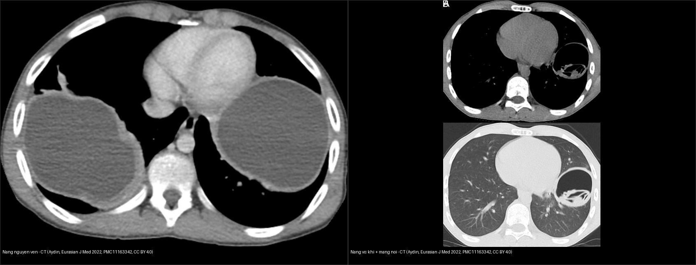
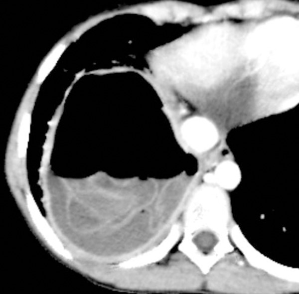
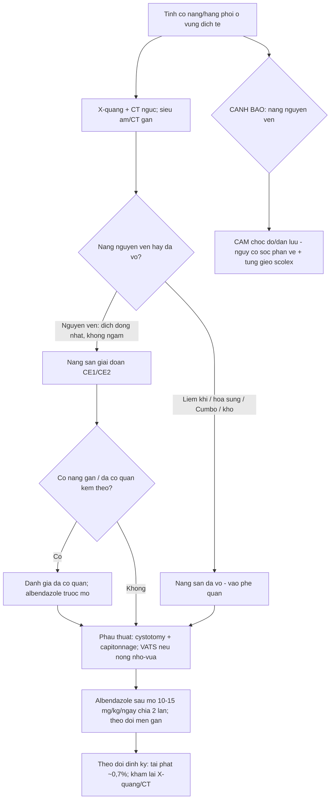
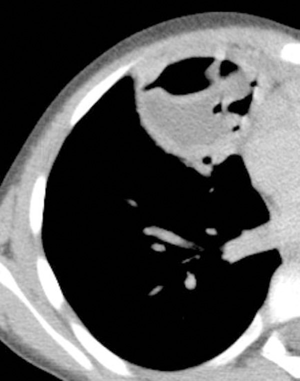
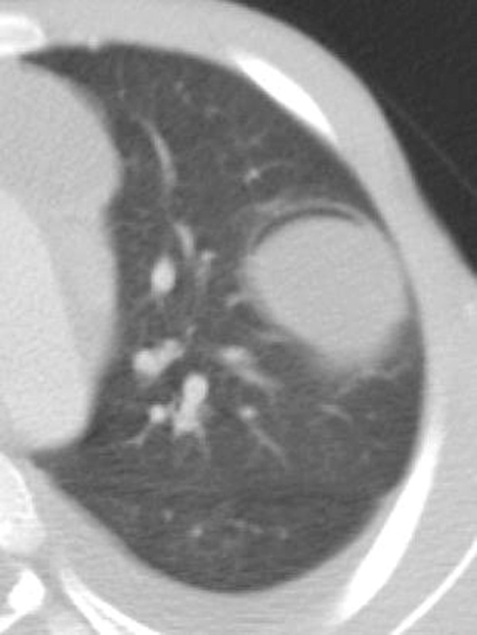
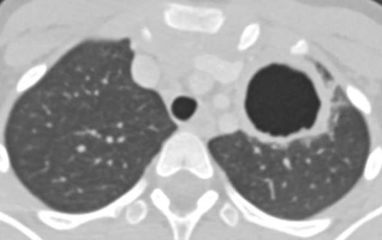
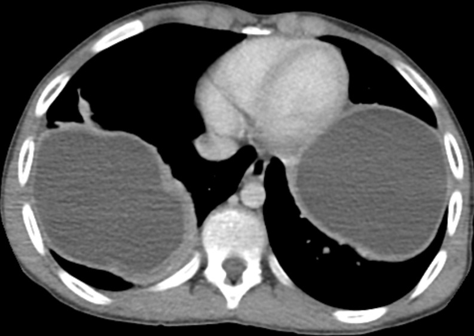
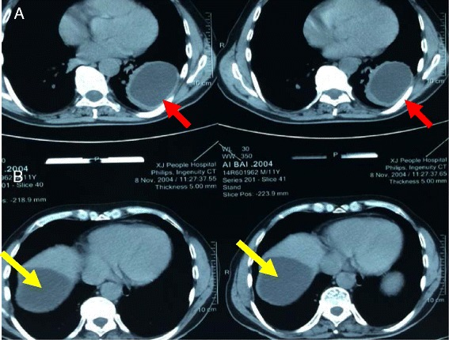

# 621 — Nang sán lá phổi (hydatid) ở trẻ: dấu hoa súng, Cumbo & phân biệt với áp-xe / Pulmonary hydatid cyst in children: water lily sign, Cumbo sign & differential

**Tags:** `pattern:nang` `pattern:hoa-sung` `pattern:liem-khi` `vung:phoi` `protocol:CT-nguc` `protocol:MRI-nguc` `score:WHO-IWGE-CE`
**Mức chắc chắn (certainty):** tổng hợp y văn (literature synthesis) — nhóm tự biên từ y văn mở (CC BY 4.0, CC BY-NC-ND 4.0); các ca minh họa là **ca nguyên văn** (giữ đúng tuổi/mô tả gốc).

> Nối tiếp **[616 – Biến chứng viêm phổi nhi: empyema & hoại tử](../616-bien-chung-viem-phoi-nhi-empyema-hoai-tu/lesson.md)** (nang sán là một hàng trong gamut "hang phổi") và **[610 – Dị dạng phổi bẩm sinh](../610-suy-ho-hap-so-sinh-va-di-dang-phoi/lesson.md)**: đây là **nguyên nhân nang/hang phổi hay gặp ở vùng dịch tễ (Việt Nam)**, xử trí đặc thù (**mổ + albendazole**) và **cấm chọc dò nang nguyên vẹn**.

## 1. Tổng quan bệnh học – cơ chế hình ảnh

- **Tác nhân:** ấu trùng sán dây ***Echinococcus granulosus*** (bệnh nang sán — cystic echinococcosis); chu kỳ **chó (vật chủ chính) – cừu/gia súc (vật chủ trung gian)**, người nhiễm qua trứng (rau sống, tay bẩn, nước).
- **Phổi là cơ quan đứng thứ 2 sau gan**; **trẻ nhiều hơn người lớn và nang mọc nhanh hơn ở trẻ**. **~60% liên quan phổi phải**, **50–60% ở thùy dưới**; phân bố **thùy dưới phải 36,04%** > dưới trái 24,86% > trên phải 16,32% > trên trái 15,99% > giữa phải 6,79% [Eurasian J Med 2022, PMC11163342].
- **Cấu trúc nang = 3 lớp → TẠI SAO hình ảnh đặc trưng:**
  - **Ngoại bì (pericyst)** = **vỏ xơ do vật chủ tạo** (không phải mô sán) — mỏng, có thể **vôi hóa** về sau.
  - **Màng ngoài/trong (ectocyst/endocyst)** = **màng sán sinh sản** (chứa dịch trong, scolex, **nang con — daughter cysts**).
  - Dịch nang là **dịch nước trong** → trên MRI **T2 rất sáng, T1 tối**, **không ngấm cản quang**; thành mỏng.
- **TẠI SAO có các "dấu vỡ" (giải thích vật lý):** khi nang **vỡ vào phế quản** →
  1. **Khí lọt giữa pericyst và endocyst** → **dấu liềm khí (air crescent sign)** — vỡ được "khu trú" (contained rupture).
  2. Khí + dịch **trong lòng endocyst** → **dấu Cumbo** (mức khí–dịch **bên trong endocyst**).
  3. Áp lực + trọng lực làm **màng sán nổi trên mặt dịch** → **dấu hoa súng (water lily sign)** — dấu đặc trưng nhất.
  4. Sau khi bệnh nhân **khạc hết dịch/màng** → nang rỗng chứa khí → **dấu nang khô (dry cyst sign)**.
- **Ngưỡng định lượng (145 nang / 102 trẻ ≤ 17 tuổi, MDCT)** [Med Sci Monit 2017, PMC5546193]:
  - Đường kính nang trung bình **5,45 ± 3,03 cm**; **nang đơn độc 70,6%**; **thùy dưới 58,6%**; **nang ngoại vi nhiều hơn trung tâm**.
  - **Nang vỡ 47,5%**; dấu thường gặp nhất là **hoa súng 24,6%**.
  - (Bỏ nang ≤ 1 cm) nang **không vỡ 6,23 ± 2,83 cm** vs **vỡ hoàn toàn 5,02 ± 2,80 cm** (**p = 0,020**).
  - Nang **trung tâm 6,38 ± 3,11 cm** vs **ngoại vi 4,31 ± 2,37 cm** (**p < 0,0001**) → nang càng lớn càng ở trung tâm.
- **Phân loại WHO-IWGE (CE):** nhóm **hoạt động** — **CE1** nang đơn thùy (unilocular), **CE2** đa thùy có nang con; nhóm **chuyển tiếp** — **CE3a** màng trong bong, **CE3b** đặc chủ yếu + nang con; nhóm **không hoạt động** — **CE4** đặc, **CE5** vôi hóa. Phân loại quyết định phác đồ & theo dõi [Diagnostics 2023, PMC10047450].

*Trái: **nang nguyên vẹn** — CT ngực cửa sổ trung thất, nang khổng lồ đồng nhất ở thùy dưới phải và trái, thành mỏng, không ngấm (Aydin Y et al., Eurasian J Med 2022, PMC11163342, ca **trẻ 13 tuổi**, CC BY 4.0). Phải: **nang đã vỡ** — CT của **trẻ 14 tuổi**, thấy **khí trong lòng nang + màng sán (màng nội bì) nổi** ở thùy dưới trái (Aydin Y et al., cùng bài, CC BY 4.0). Ảnh ghép letterbox giữ nguyên tỷ lệ.*

## 2. Mẫu hình + chẩn đoán phân biệt theo tình trạng nang (Gamut)

- **Theo TÌNH TRẠNG nang:**
  - **Nguyên vẹn (uncomplicated):** nang **đồng nhất, giới hạn rõ, dịch đơn thuần, không ngấm**, ± vôi hóa vỏ.
  - **Vỡ khu trú (contained):** **liềm khí** giữa pericyst và endocyst, **liềm khí nghịch đảo (inverse air crescent)**.
  - **Vỡ thông phế quản (communicating):** **hoa súng**, **Cumbo**, **khô** (rỗng khí).
- **Theo VỊ TRÍ:** thùy dưới (đặc biệt **dưới phải**) → nang sán; tổn thương **kèm nang gan** (đồng thời) củng cố chẩn đoán — **luôn quét gan và các cơ quan khác**.
- **DDx "hang/nang có mức khí–dịch" ở trẻ:** **áp-xe phổi** (thành dày, ngấm, đông đặc quanh), **mủ màng phổi** (split pleura, góc tù), **hang lao** (thùy trên + nốt vệ tinh + tree-in-bud), **nang phổi bẩm sinh/CPAM** (nhiều nang thông khí, vách mỏng, hay một thùy), **nang phế quản (bronchogenic cyst)**, **u/K phổi hoại tử** (thành dày gồ ghề), **thuyên tắc nhiễm khuẩn (septic emboli)**.
- **4 câu hỏi khi đọc hình:** (1) nang **nguyên vẹn hay đã vỡ**? (2) có **màng sán/nang con** không? (3) thành **mỏng đều hay dày ngấm** (nghi áp-xe/u)? (4) có **nang ở gan/cơ quan khác** không?

## 3. Bảng so sánh phân biệt (ma trận đối chiếu)

| Thực thể (entity) | Hình ảnh điển hình | Chốt vào (rule-in) | Chốt loại (rule-out) | Gợi ý xác nhận |
|---|---|---|---|---|
| **Nang sán phổi NGUYÊN VẸN** | Nang **đồng nhất, dịch trong, giới hạn rõ, thành mỏng không ngấm**, thùy dưới, ± vôi hóa vỏ | **Nang dịch đơn thuần + tiền sử/dịch tễ + ± nang gan** | Thành **dày, ngấm thuốc, đông đặc quanh** → áp-xe/u | CT ngực; ELISA/huyết thanh; siêu âm gan |
| **Nang sán VỠ (hoa súng/Cumbo)** | **Màng sán nổi trên mức khí–dịch** (hoa súng); **khí giữa pericyst–endocyst + mức khí–dịch trong endocyst** (Cumbo) | **Màng sán nổi + mức khí–dịch** (dấu hoa súng/Cumbo) | Chỉ có **mức khí–dịch thuần** không màng → nghĩ áp-xe | CT ngực lát mỏng; mô tả vị trí khí (giữa 2 màng) |
| **Áp-xe phổi** | Ổ **mức khí–dịch**, **thành dày ngấm**, đông đặc–hoại tử quanh | **Sốt cao + thành dày ngấm + góc nhọn với màng phổi** | **Thành mỏng không ngấm + màng nổi** → nang sán | Kháng sinh ± dẫn lưu; cấy dịch |
| **Mủ màng phổi (empyema)** | Dịch khu trú **split pleura**, góc tù, ôm phổi | **Hai lá màng phổi dày ngấm tách nhau (split pleura)** | **Nang trong nhu mô phổi** → không phải màng phổi | Siêu âm/CT; chọc hút |
| **Hang lao** | Thùy **trên/đỉnh–sau**, thành mỏng đều, **nốt vệ tinh + tree-in-bud** | **Tree-in-bud + nốt vệ tinh + vị trí trên** | Vị trí **thùy dưới + màng nổi** → nang sán | AFB/PCR đờm; IGRA |
| **Nang phổi bẩm sinh / CPAM / nang phế quản** | **Nhiều nang** một thùy thông khí, vách mỏng; nang phế quản đơn độc trung thất | **Nhiều nang một thùy từ nhỏ + không nang gan** | Nang **đơn độc thùy dưới + dịch đồng nhất + nang gan** → nang sán | CT/MRI; tiền sử; theo dõi |
| **K phổi hoại tử / thuyên tắc nhiễm khuẩn** | **Thành dày gồ ghề lệch tâm**, nốt ngoại vi đa dạng + mạch nuôi (septic emboli) | **Thành > 15 mm gồ ghề + bệnh cảnh ung thư/nhiễm khuẩn huyết** | **Màng nổi/mức khí–dịch trong endocyst** → nang sán | Sinh thiết; PET-CT |

### Dấu hiệu chốt trên từng ảnh minh họa

*Dấu **hoa súng (water lily sign)** — nang sán phổi vỡ ở **bé gái 8 tuổi**: mức khí–dịch do vỡ vào phế quản + **màng sinh sản nổi trên mặt dịch**, tạo hình "hoa súng". Akgul Ozmen C & Onat S, Med Sci Monit 2017 (PMC5546193), CC BY-NC-ND 4.0 (nguyên bản).*

## 4. Protocol + phân loại WHO-IWGE + xử trí + flowchart

- **Hình ảnh:** **X-quang ngực** (phát hiện nang/mức khí–dịch) → **CT ngực** (đánh giá vỡ, màng sán, vôi hóa, đa ổ). **MRI** khi cần phân biệt dịch (T2 sáng/T1 tối, không ngấm). **Siêu âm bụng ± CT bụng** để tìm **nang gan kèm theo**; CT/MRI não khi nghi đa cơ quan.
- **Cảnh báo thủ thuật:** **CẤM chọc dò/dẫn lưu nang nguyên vẹn** (nguy cơ **sốc phản vệ do rò dịch nang** + **tung gieo scolex**).
- **Huyết thanh:** ELISA/IHA dương tính hỗ trợ; **âm tính không loại trừ**.
- **Nguyên tắc điều trị:**
  - **Phẫu thuật là chính** (nang phổi). Kỹ thuật hay dùng: **cystotomy + capitonnage (phương pháp Barrett)** — mở nang lấy màng, khâu đóng các lỗ phế quản rồi **xóa khoang (capitonnage)** để giảm **rò khí, nhiễm trùng khoang tồn dư, empyema**; **Posadas** (đóng lỗ phế quản trước rồi capitonnage); **cystotomy không capitonnage** — ít biến dạng nhu mô nhưng dễ rò khí. **Hạn chế cắt nhu mô phổi, nhất là ở trẻ** [EOJM 2022, PMC11163342; J Family Med Prim Care 2019, PMC6820383].
  - **Nang nông, nhỏ–vừa:** có thể **mổ nội soi qua lồng ngực (VATS)**.
  - **PAIR** (chọc hút – bơm dung dịch diệt sán – hút lại) là phác đồ chuẩn cho **nang GAN**, **không phải chuẩn** cho nang phổi.
- **Thuốc:** **albendazole 10–15 mg/kg/ngày chia 2 lần**, dùng **trước và sau mổ** để giảm tái phát; **tăng men gan 10–20%** (cần theo dõi), thường dung nạp tốt [Interact Cardiovasc Thorac Surg 2022, PMC8766210].
- **Theo dõi:** khám + X-quang/CT định kỳ; **tái phát ~1/153 (0,7%)** trong loạt sau mổ + albendazole 15 mg/kg/ngày 2 chu kỳ 15 ngày.

## 5. Biến thể bình thường và cạm bẫy

- **Không chọc mù nang nguyên vẹn:** sốc phản vệ + gieo rắc là biến chứng chết người — luôn nghĩ nang sán trước khi can thiệp "nang dịch đơn thuần" ở vùng dịch tễ.
- **Nang vỡ dễ bị nhầm áp-xe/K phổi:** dấu chốt là **màng sinh sản nổi** và **vị trí khí (giữa pericyst–endocyst)**; đừng vội kết luận áp-xe rồi dẫn lưu.
- **Nang có thể ở nhiều cơ quan:** ~**60% liên quan phổi phải** + nang gan đồng thời → **luôn quét gan** (và não/thận khi nghi).
- **Đừng nhầm nang sán "khô"** (rỗng khí) với nang phổi bẩm sinh — bối cảnh dịch tễ + dấu vỡ trước đó + huyết thanh giúp phân biệt.
- **Nang lớn ở trung tâm** (6,38 cm) khác **nang ngoại vi nhỏ** (4,31 cm) — vị trí ảnh hưởng kỹ thuật mổ (trung tâm dễ dính mạch–phế quản).
- **Cạm bẫy mặt cắt:** phân biệt **ổ dịch–khí trong nhu mô** với **dịch–khí khoang màng phổi** — vị trí (đẩy phổi/đổi theo tư thế) và **góc với màng phổi** quyết định.

## 6. Tự lượng giá — Blind Quiz

**Ca 1 — Bé gái 8 tuổi, ho, sốt, đau ngực; CT ngực có nang vỡ ở thùy dưới. Nhìn ảnh, mô tả trước.**

- Hỏi: dấu hiệu chính gọi tên là gì? Cơ chế tạo dấu? Chẩn đoán?

<b>Bấm để hiện đáp án (findings + chẩn đoán)</b>

- **Dấu hiệu:** **mức khí–dịch** trong nang + **màng sinh sản nổi trên mặt dịch** = **dấu hoa súng (water lily sign)**.
- **Cơ chế:** nang vỡ vào phế quản → khí + dịch trong lòng nang, màng sán nổi theo trọng lực. **Chẩn đoán: nang sán phổi đã vỡ** (bé gái 8 tuổi). Nguồn: Akgul Ozmen C & Onat S, Med Sci Monit 2017 (PMC5546193), CC BY-NC-ND 4.0.

**Ca 2 — Bé gái 8 tuổi, nang vỡ thùy giữa phải, CT ngực:**

- Hỏi: khí nằm ở đâu (kể tên 2 khoang)? Đây là chốt gì?

<b>Bấm để hiện đáp án (findings + chẩn đoán)</b>

- **Dấu hiệu:** **liềm khí tách pericyst khỏi endocyst** + **mức khí–dịch bên trong endocyst** = **dấu Cumbo**.
- **Chốt:** khí nằm **giữa 2 màng** của nang (khác mức khí–dịch thuần của áp-xe). Chẩn đoán: **nang sán phổi vỡ**. Nguồn: Akgul Ozmen C & Onat S, Med Sci Monit 2017 (PMC5546193), CC BY-NC-ND 4.0.

**Ca 3 — Bé trai 9 tuổi, nang đã vỡ khu trú thùy trên trái:**

- Hỏi: mô tả dấu liềm khí? Vì sao gọi là vỡ "khu trú"?

<b>Bấm để hiện đáp án (findings + chẩn đoán)</b>

- **Dấu hiệu:** **khí nằm giữa pericyst và endocyst** (liềm khí) — **dấu liềm khí (air crescent sign)**.
- **Chẩn đoán:** **vỡ khu trú (contained rupture)** của nang sán phổi — màng trong chưa vỡ hoàn toàn, khí mới len vào giữa 2 lớp. Nguồn: Akgul Ozmen C & Onat S, Med Sci Monit 2017 (PMC5546193), CC BY-NC-ND 4.0.

**Ca 4 — Bé gái 9 tuổi sau khạc ra màng sán, CT ngực còn lại:**

- Hỏi: nang còn chứa gì? Tên dấu? Tiên lượng?

<b>Bấm để hiện đáp án (findings + chẩn đoán)</b>

- **Dấu hiệu:** **nang rỗng, chỉ còn khí** sau khi bệnh nhân **khạc hết dịch/màng** = **dấu nang khô (dry cyst sign)**.
- **Chẩn đoán:** nang sán phổi vỡ đã tháo dịch qua đường thở; cần theo dõi và điều trị ký sinh trùng/ổ tồn dư. Nguồn: Akgul Ozmen C & Onat S, Med Sci Monit 2017 (PMC5546193), CC BY-NC-ND 4.0.

**Ca 5 — Bé trai 13 tuổi, khó thở; CT ngực cửa sổ trung thất:**

- Hỏi: nang nguyên vẹn hay vỡ? Cần làm gì thêm trước can thiệp?

<b>Bấm để hiện đáp án (findings + chẩn đoán)</b>

- **Dấu hiệu:** **nang khổng lồ đồng nhất, thành mỏng, không ngấm** ở thùy dưới hai bên = **nang sán phổi nguyên vẹn**.
- **Cần làm thêm:** siêu âm/CT **gan** tìm nang đồng thời; huyết thanh; **CẤM chọc dò** (sốc phản vệ/tung gieo) → chuyển **mổ (cystotomy + capitonnage) ± albendazole**. Nguồn: Aydin Y et al., Eurasian J Med 2022 (PMC11163342), ca **trẻ 13 tuổi**, CC BY 4.0.

**Ca 6 — Bé trai, CT ngực + bụng phát hiện nang:**

- Hỏi: có mấy cơ quan bị nang? Vì sao phải quét thêm gan?

<b>Bấm để hiện đáp án (findings + chẩn đoán)</b>

- **Dấu hiệu:** CT cho thấy **nang ở thùy dưới phổi trái (mũi tên đỏ)** và **nang ở gan phải (mũi tên vàng)** — **bệnh nang sán đa cơ quan**.
- **Vì sao quét gan:** ấu trùng tới phổi qua gan (~60% liên quan phổi phải), nên nang gan đồng thời rất thường gặp và quyết định phác đồ (PAIR cho gan, mổ cho phổi). Nguồn: Ma J et al., J Cardiothorac Surg 2016 (PMC4974716), CC BY 4.0.

## Bài liên quan chéo
- [600 – Tổng quan Hệ Nhi khoa](../600-tong-quan-nhi-khoa/lesson.md)
- [616 – Biến chứng viêm phổi nhi: empyema & hoại tử phổi](../616-bien-chung-viem-phoi-nhi-empyema-hoai-tu/lesson.md) (nang sán trong gamut hang)
- [610 – Suy hô hấp sơ sinh & dị dạng phổi bẩm sinh](../610-suy-ho-hap-so-sinh-va-di-dang-phoi/lesson.md) (CPAM/nang phổi bẩm sinh)
- [025 – Hang & nấm phổi: dấu liềm khí](../025-ton-thuong-phoi-tao-hang/lesson.md) (hang/mức khí–dịch)
- [040 – Tràn dịch màng phổi](../040-tran-dich-mang-phoi/lesson.md) (phân biệt ổ dịch nhu mô vs khoang màng phổi)
- [123 – Nang gan & bệnh gan đa nang](../123-nang-gan-va-benh-gan-da-nang/lesson.md) (nang gan đơn thuần vs nang sán)

## Ảnh
- Xem `images/CREDITS.md`. Ảnh **CC BY 4.0** được phép ghép letterbox (composite); ảnh **CC BY-NC-ND 4.0** giữ nguyên bản, không crop/ghép.

> Không dùng để chẩn đoán độc lập khi chưa có người hướng dẫn.
