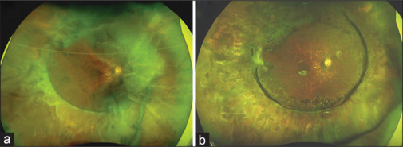
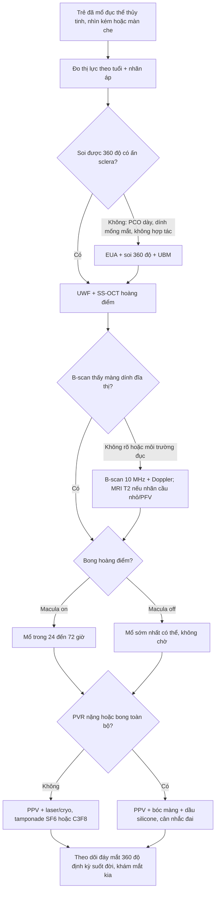
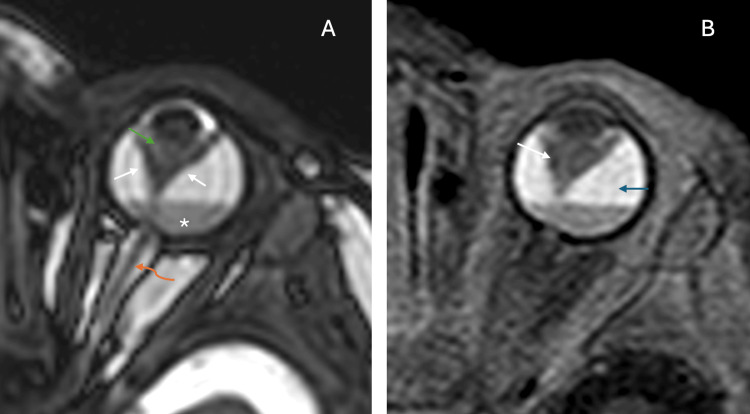
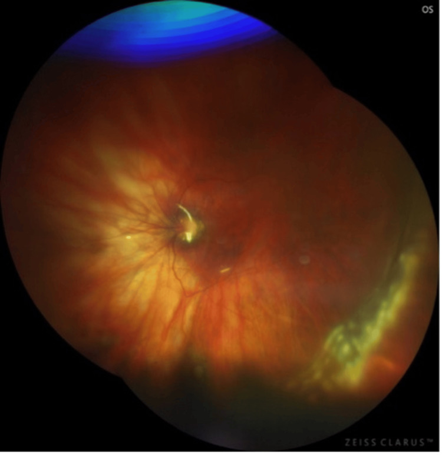

# 6210 — Bong võng mạc ở trẻ sau mổ đục thể thủy tinh bẩm sinh / Rhegmatogenous retinal detachment after pediatric cataract surgery

**Tags:** `pattern:bong-vong-mac` `pattern:lo-rach-ngoai-vi` `pattern:lo-sat-ora` `pattern:co-keo-pvr` `pattern:aphakia` `pattern:gia-the-thuy-tinh` `pattern:mo-duc-bao-sau` `pattern:teo-thi` `vung:vong-mac` `vung:ora-serrata` `vung:hoang-diem` `vung:the-thuy-tinh` `vung:mat` `score:nguy-co` `protocol:UWF` `protocol:soi-day-mat-an-sclera` `protocol:sieu-am-B-scan` `protocol:UBM` `protocol:OCT` `protocol:PPV` `protocol:EUA` `incidentaloma:khong`

**Mức chắc chắn (certainty):** tổng hợp y văn (literature synthesis) — dựng từ **phân tích gộp 9 nghiên cứu/5.922 mắt** (Acta Ophthalmol 2025, **PMC12531611**, CC BY 4.0), **đoàn hệ bảo hiểm Mỹ 3.289 trẻ** (Ophthalmol Sci 2022, **PMC9754963**, CC BY-NC-ND), **sổ bộ quốc gia Thụy Điển 1.073 mắt** (Acta Ophthalmol 2025, **PMC12235676**, CC BY 4.0), **đoàn hệ 132 mắt/84 trẻ** (Clin Ophthalmol 2024, **PMC11162630**, CC BY-NC 3.0), **loạt 348 mắt bong võng mạc nhi** (Indian J Ophthalmol 2025, **PMC12659836**, CC BY-NC-SA 4.0), **tổng quan phẫu thuật đục thể thủy tinh nhi** (Asia Pac J Ophthalmol 2025, **PMC12399275**, CC BY-NC-ND) và **khuyến cáo khám dưới mê** (Indian J Ophthalmol 2023, **PMC10752321**, CC BY-NC-SA). Nhóm **không có bệnh nhân của mình**; chỗ chưa đủ chắc ghi "chưa rõ". **Không ghi tên tác giả** — attribution dùng tạp chí + năm + PMCID.

> **Câu chốt:** Bong võng mạc (retinal detachment, **RD**) sau mổ đục thể thủy tinh bẩm sinh (congenital cataract surgery) là biến chứng **hiếm nhưng không bao giờ "hết nguy cơ"**. Năm con số phải thuộc: **(1)** nguy cơ gộp **2,4% (0,7–5,0%)** trên **5.922 mắt/9 nghiên cứu**, theo dõi trung bình **4,0 năm**; **(2)** nguy cơ **không cấy IOL sơ phát 6,1%** so với **có IOL 1,9%** — *p = 0,267, chưa đủ để thành chỉ định*; **(3)** **chậm phát triển trí tuệ 11,0% (6,6–16,4%)** — gấp **~5 lần** mức chung; **(4)** thời điểm **trung vị 7–9 năm** sau mổ (IQR **1–13 năm**), **một nửa số trẻ còn nguy cơ ở năm thứ 8**; **(5)** bong võng mạc nhi nói chung: **66% đã bong toàn bộ**, **75% đã bong hoàng điểm**, thành công giải phẫu **88,5%** nhưng thành công **chức năng chỉ ~50–60%**, và **PVR D3 chỉ 50%**.

## 1. Tổng quan bệnh học – cơ chế hình ảnh

### 1.1 TẠI SAO mắt trẻ đã mổ đục thể thủy tinh lại bong võng mạc nhiều năm sau

- **Mất "nắp chặn" phía trước và mất ổn định dịch kính:** thể thủy tinh dày **~4,5 mm**, đường kính **9–10 mm**; ở trẻ mổ đục thể thủy tinh bẩm sinh, phẫu thuật thường là **lấy thể thủy tinh + mở bao sau + cắt dịch kính trước (anterior vitrectomy)**. Ba hàng rào cơ học bị mở cùng lúc: bao sau, màng hyaloid trước, và thể tích thể thủy tinh. Dịch kính trở nên **di động**, hóa lỏng nhanh, và **bong dịch kính sau (posterior vitreous detachment, PVD)** xảy ra sớm.
- **TẠI SAO lỗ rách lại nằm sát ora:** chỗ dính chắc nhất giữa dịch kính và võng mạc là **đáy dịch kính (vitreous base)** — dải **360°** bám qua **ora serrata**, rộng **~2–4 mm** phía sau và **~1–2 mm** phía trước ora. Khi dịch kính co, toàn bộ lực kéo dồn vào vòng dính này → sinh **dialysis (rách dọc ora)** hoặc **lỗ có nắp sát ora**. Đây là lý do hình thái "kinh điển" của bong võng mạc sau mổ đục thể thủy tinh nhi khác bong võng mạc người lớn (lỗ thường ở xích đạo, có nắp rõ).
- **TẠI SAO trẻ em lại càng dễ:** nhãn cầu sơ sinh có **trục (axial length, AL) ~16,5–17 mm**, tăng lên **~23 mm** ở tuổi 13–15. Vùng ora–đáy dịch kính bị **kéo giãn theo sự lớn của nhãn cầu** suốt thời thơ ấu; cộng thêm **củng mạc–hắc mạc mỏng** và võng mạc ngoại vi **mỏng, chưa biệt hóa hoàn toàn** ở trẻ nhỏ. Đó là lý do nguy cơ **không giảm sau vài năm** mà **kéo dài hàng thập kỷ**: trong đoàn hệ 132 mắt, **một nửa số trẻ còn nguy cơ ở năm thứ 8** sau mổ.
- **TẠI SAO nguy cơ tích lũy theo "số lần can thiệp":** mỗi lần mổ nội nhãn (đặt IOL thứ phát, mổ glôcôm, cắt màng đồng tử, YAG) đều tạo **phản ứng viêm – phá vỡ hàng rào – thay đổi động học dịch kính**. Trong đoàn hệ 132 mắt, **glôcôm sau mổ làm tăng nguy cơ HR 49,01 (p < 0,001)** và **màng viêm OR 6,75 (p = 0,02)**; ở sổ Thụy Điển, nhóm bong võng mạc có **57,1% bị glôcôm thứ phát** (so với 19,5%, **p = 0,032**) và **42,9% đã mổ glôcôm** (so với 13,2%).
- **TẠI SAO "không cấy IOL" là tín hiệu chứ chưa phải chỉ định:** IOL nằm trong bao/dịch kính tạo **vật cản cơ học** làm dịch kính ít di động hơn (HR **0,44**, 95% CI 0,21–0,91 ở đoàn hệ bảo hiểm Mỹ). Nhưng trong phân tích gộp, khác biệt **6,1% vs 1,9% không có ý nghĩa (p = 0,267)** vì **chọn lọc**: trẻ nhỏ, PFV, nhãn cầu nhỏ thường được để **aphakia** — chính là nhóm nguy cơ cao. Ghi nhớ: **"aphakia là dấu chỉ nguy cơ, không phải nguyên nhân"**.
- **TẠI SAO trẻ không "kêu":** (1) **nhược thị (amblyopia)** — mắt kia bù trừ; (2) trẻ nhỏ **không mô tả** được "màn che"/nhá đèn; (3) **rung giật nhãn cầu (nystagmus)** và **lác** làm mất dấu hiệu định hướng; (4) **đục bao sau (posterior capsule opacification, PCO)** và **màng đồng tử** che trục quang, che luôn tầm nhìn ngoại vi khi khám; (5) mắt **aphakia công suất cao** hoặc **IOL đặt sớm** làm ảnh hưởng khúc xạ nên "mờ" bị quy cho **lệch khúc xạ** thay vì bong võng mạc. Vì vậy RD ở trẻ thường đến **muộn, bong hoàng điểm, PVR nặng** — đúng như loạt 348 mắt: **75% đã bong hoàng điểm**, **66% bong toàn bộ**.

### 1.2 TẠI SAO hình ảnh trông như vậy (B-scan – UBM – OCT – MRI)

- **Siêu âm B-scan 10 MHz:** bước sóng trong mô **λ ≈ 1.540 m/s ÷ 10 MHz ≈ 0,15 mm**; độ phân giải trục **~0,1 mm**, đủ tách võng mạc dày **0,25–0,3 mm** khỏi dịch kính. Võng mạc nhiều lớp tế bào đặc + sắc tố **trở kháng âm cao** → **màng tăng âm dày, sáng**; **dịch dưới võng mạc là nước trong → giảm âm (anechoic)**.
- **Ba quy tắc định danh màng:** **(1)** võng mạc **luôn dính vào đĩa thị** (cố định ở bờ đĩa) — bong toàn bộ tạo hình **"V" hoặc "Y"** với đỉnh ở đĩa; **(2)** màng dịch kính **mỏng, tăng âm kém, không dính đĩa, di động mạnh** khi đảo mắt; **(3)** bong hắc mạc **vòm dày, không dính đĩa, lan tới thể mi**, có thể "hôn nhau" giữa nhãn cầu.
- **TẠI SAO Doppler hữu ích:** màng dịch kính **không có mạch**, võng mạc bong **còn tuần hoàn**; đặt cửa sổ Doppler màu lên màng nghi ngờ thấy **dòng chảy trong màng = võng mạc**. Đây là mẹo phân biệt **PVD không hoàn toàn vs bong võng mạc** khi môi trường đục.
- **TẠI SAO B-scan không thấy lỗ:** độ phân giải ngang **~0,3–0,5 mm** và lớp cắt dày; **lỗ/dialysis ngoại vi 0,2–0,5 mm gần như vô hình**. B-scan chỉ trả lời **"có bong không, bong bao nhiêu, có co kéo/PVR không, hướng về đâu"** — **không thay thế** soi đáy mắt 360° có ấn sclera.
- **UBM (ultrasound biomicroscopy, 35–50 MHz):** độ phân giải **~20–50 µm**, xuyên qua **mống mắt, thể mi, bờ IOL** để thấy **ora serrata, dialysis, chu vi thể mi** — là cửa sổ duy nhất khi **đồng tử nhỏ/dính mống mắt** hoặc **PCO dày** che ngoại vi.
- **SS-OCT hoàng điểm:** dịch dưới võng mạc **giảm phản xạ**; võng mạc bong **gấp nếp lớp ngoài**, **dải ellipsoid zone (EZ)/màng giới hạn ngoài (ELM) mất liên tục** = tổn thương tế bào cảm quang. Câu hỏi OCT phải trả lời trong **mọi ca**: **macula-on hay macula-off** — quyết định mức khẩn và tiên lượng thị lực.
- **Ảnh đáy mắt siêu rộng (ultra-widefield, UWF):** vùng bong **mất ánh hồng cam**, bề mặt **gấp nếp**, bờ bong có **đường phân giới** với vùng còn dính; UWF cho **bản đồ toàn cảnh** để chọn đường vào mổ và theo dõi. Ở trẻ nhỏ vẫn phải **ấn sclera** (thường dưới mê) vì UWF không lấy được ora.
- **MRI:** trên **T2 nặng** (như ảnh MRI ở mục 6 – Ca 2), võng mạc bong là **dải giảm tín hiệu mảnh hình chữ V**, đỉnh hội tụ về **đĩa thị**; **dịch dưới võng mạc giàu protein/máu → T1 tăng tín hiệu**, không ngấm thuốc. MRI dùng khi **môi trường đục hoàn toàn, nhãn cầu nhỏ, nghi PFV/khối nội nhãn**, hoặc cần phân biệt với **retinoblastoma** — **không dùng thay B-scan**.

### 1.3 Ngưỡng định lượng nằm lòng

| Chỉ số | Ngưỡng / giá trị | Nguồn |
|---|---|---|
| Nguy cơ gộp sau mổ đục thể thủy tinh nhi | **2,4% (0,7–5,0)**, 9 nghiên cứu/**5.922 mắt**, I² **85,8%**, GRADE **thấp** | PMC12531611 |
| Không cấy IOL sơ phát | **6,1% (0,6–15,9)** — 2.572 mắt | PMC12531611 |
| Có IOL sơ phát | **1,9% (0,0–6,7)** — 3.517 mắt; **p = 0,267** | PMC12531611 |
| Một mắt được mổ / hai mắt | **1,0% (0,3–2,2)** / **2,1% (1,0–3,6)**; **p = 0,256** | PMC12531611 |
| Chậm phát triển trí tuệ | **11,0% (6,6–16,4)** — 173 mắt; **HR 9,59** trong một sổ bộ | PMC12531611 |
| Biến cố bong theo thời gian | **trung vị 7 năm (IQR 1–13)**; **một nửa còn nguy cơ ở năm 8** | PMC12531611, PMC11162630 |
| Nguy cơ 5 năm theo bảo hiểm Mỹ | **2,0% (1,3–2,6)** — 47/3.289 trẻ | PMC9754963 |
| Sinh non | **HR 6,89 (3,26–14,56)** | PMC9754963 |
| PFV (persistent fetal vasculature) | **HR 8,20 (4,11–16,37)**; ở sổ Thụy Điển **57,1%** ca bong có PFV | PMC9754963, PMC12235676 |
| Cấy IOL (bảo vệ) | **HR 0,44 (0,21–0,91)** | PMC9754963 |
| Aphakia | **71,4% vs 19,3%** ca bong (p = 0,042) | PMC12235676 |
| Glôcôm thứ phát | **HR 49,01**; **57,1% vs 19,5%** (p = 0,032) | PMC11162630, PMC12235676 |
| Trục nhãn cầu | **≤ 23,4 mm: OR 0,55** (giảm nguy cơ); trung vị **23,6 mm** ở nhóm bong vs **21,6 mm** | PMC11162630 |
| Bong võng mạc nhi: bong toàn bộ / bong hoàng điểm | **66,1%** / **75%** | PMC12659836 |
| Thành công giải phẫu / chức năng (bong nhi) | **88,5%** / **~50–60%** | PMC12659836 |
| PVR D3 / D2 / A (thành công giải phẫu) | **50,0% / 66,7% / 73,9%** | PMC12659836 |
| Dialysis ora (thành công giải phẫu) | **90,0%** (50 mắt) | PMC12659836 |

## 2. Mẫu hình + chẩn đoán phân biệt theo vị trí (gamut)

- **Mẫu hình (pattern):** trẻ **đã mổ đục thể thủy tinh** (aphakia hoặc pseudophakia), **nhiều tháng đến nhiều năm** sau mổ, **không đau**, **nhìn kém dần hoặc "màn che"**, có thể kèm **lác/rung giật mới**; khám thấy **võng mạc bong** với **một hoặc nhiều lỗ/dialysis ở ngoại vi – sát ora**, dịch lan về hoàng điểm. Mắt thường có **PCO/màng đồng tử**, **IOL nhỏ/lệch**, hoặc **bong bao sau** — chính là những thứ **che lỗ**.
- **Gamut theo vị trí (location):**
  - **Ora serrata / dialysis 360°:** do **lực kéo đáy dịch kính + nhãn cầu lớn dần**, hay gặp ở trẻ **cận thị, chấn thương nhẹ, aphakia**; chỉ thấy khi **ấn sclera** hoặc **UBM**.
  - **Ngoại vi sát xích đạo (12h/6h):** lỗ có nắp sau PVD; **bị bờ IOL/đồng tử nhỏ che**.
  - **Vùng dưới (5h–7h):** dịch tích theo trọng lực, **khó tamponade**, dễ tái bong.
  - **Cực sau/hoàng điểm:** lỗ hoàng điểm trên mắt **cận thị nặng** hoặc **sau cắt dịch kính** — thực thể riêng, xử trí **PPV + bóc màng + chèn ép**, không phải laser ngoại vi.
  - **Toàn bộ ("V"/"Y" trên B-scan/MRI):** thường là **bong muộn**, đã có **PVR**; đây là hình thái hay gặp ở trẻ vì **phát hiện muộn**.
- **Gamut theo cơ chế (mechanism):** **(1)** lỗ/dialysis do thay đổi dịch kính sau mổ (phần lớn); **(2)** **co kéo** do **PFV** (HR 8,20) hoặc **ROP** (HR 6,89) — bong **không có lỗ** hoặc lỗ + co kéo; **(3)** **chấn thương** (dialysis, lỗ hoại tử) — chiếm **44,8%** bong võng mạc nhi trong loạt 348 mắt, nên **luôn hỏi lại tiền sử chấn thương**; **(4)** **di truyền/loạn dưỡng dịch kính** (Stickler, Marfan, X-linked retinoschisis) — **16–50%** bong nhi có bất thường bẩm sinh kèm theo; **(5)** sau **viêm nội nhãn** (lỗ hoại tử) hoặc **sau YAG bao sau** ở mắt cận thị.
- **Bốn câu hỏi phải trả lời trước khi mổ:** **(1)** có lỗ/dialysis không, ở đâu, mấy cái? **(2)** **hoàng điểm còn dính không?** **(3)** có **PVR/co kéo** không, độ nào? **(4)** mắt kia thế nào (nguy cơ hai bên **8,6%** trong loạt 348 mắt)?

## 3. Bảng so sánh phân biệt (ma trận đối chiếu)

| Thực thể (entity) | Hình ảnh điển hình | Chốt vào (rule-in) | Chốt loại (rule-out) | Gợi ý xác nhận |
|---|---|---|---|---|
| **Bong võng mạc sau mổ đục thể thủy tinh bẩm sinh (PRD nhi)** | Màng **tăng âm dày, dính đĩa thị**, di động; **lỗ/dialysis sát ora**; có **aphakia/IOL + PCO**; nhiều năm sau mổ | **Màng dính đĩa thị + lỗ thấy khi soi 360° ấn sclera/UBM + tiền sử mổ TTT** | Không có lỗ + màng dày cứng hình phễu + **PFV/ROP** → nghĩ bong co kéo | UWF + ấn sclera (EUA), B-scan Doppler, UBM, SS-OCT |
| **Bong co kéo (TRD) do PFV/ROP/PVR** | Màng **dày, cứng, hình phễu kín**, dính từng điểm, **không di động**; có **dây xơ từ đĩa tới bao sau** (PFV) | **Phễu kín + màng xơ + không di động + PFV/ROP/PVR** | Bong **bóng nước, di động, dính đĩa** → RRD | B-scan động, MRI (dây xơ), OCT |
| **Bong thanh dịch (exudative)** | Dịch **lan rộng, không lỗ, không theo trọng lực**; có **khối/viêm** bên dưới (Coats, PHPV, u, VKH) | **Không lỗ + khối hắc mạc/viêm + dịch đổi theo bệnh nền** | Có lỗ + bờ bong theo trọng lực → RRD | B-scan, OCT, FAF, MRI; **không laser/mổ vội** |
| **Bong hắc mạc (choroidal detachment)** | **Vòm dày, trơn, KHÔNG dính đĩa**, lan tới thể mi; có thể "kissing"; **nhãn áp thấp** | **Không dính đĩa + hình vòm + hạ nhãn áp + sau mổ** | Dính đĩa thị + gấp nếp → võng mạc | B-scan (bờ sau), nhãn áp |
| **Tách lớp võng mạc (retinoschisis)** | Vòm **mỏng, nhẵn**, **không di động**, thường **thái dương dưới**; **không lỗ**; có thể có **lõi nan hoa** (X-linked) | **Vòm mỏng + bờ nhẵn + không lỗ + thị trường tương ứng** | Có lỗ + dịch lan tới hoàng điểm → RRD | OCT (tách trong võng mạc), B-scan |
| **Bong sau viêm nội nhãn** | Màng dính đĩa + **aftermovement**; **lỗ hoại tử đúng ổ chorioretinitis cũ**, bong **trong ngày** | **Tiền sử viêm nội nhãn + lỗ ở ổ viêm + bong nhanh** | Bong muộn nhiều năm, lỗ ngoại vi → PRD | Soi đáy mắt, B-scan, hồ sơ mổ |
| **Chấn thương (dialysis/lỗ hoại tử)** | Dialysis **rộng**, có thể **360°**; kèm **lún xương, rách mống mắt, đục thể thủy tinh** | **Tiền sử chấn thương + dialysis + tổn thương phối hợp** | Không chấn thương, dialysis nhỏ sau mổ → PRD | CT hốc mắt (khuyết xương), soi 360°, UBM |
| **Bong võng mạc do lỗ hoàng điểm (MHRD)** | Lỗ **toàn bộ hoàng điểm**, **SRF khu trú trong lõm hắc mạc**; **AL > 26,5 mm** | **Lỗ hoàng điểm + cận thị nặng + SRF khu trú** | Lỗ ngoại vi + dịch lan rộng → PRD | SS-OCT, AL, B-scan |
| **"Bong giả" do mặt khí–dịch (nếu mắt còn khí/dầu)** | **Đường tăng âm phẳng, đổi theo tư thế**, không gấp nếp, không dính đĩa | **Tiền sử bơm khí/dầu + đường phẳng + đổi tư thế** | Màng **dính đĩa + gấp nếp** → võng mạc | B-scan 2 tư thế, OCT qua khí/dầu |

*(a) Trẻ **12 tuổi**, mắt phải: **bong võng mạc tồn tại sau mổ đai củng mạc (post-buckle persistent RD)** — võng mạc gấp nếp, màu xanh nhạt, bờ phân giới rõ; (b) **võng mạc áp** sau **cắt dịch kính + dầu silicone** — thấy rõ **vòng phản quang của đai** và võng mạc phẳng. Đây là **bong võng mạc nhi** (không phải ca sau mổ đục thể thủy tinh) — dùng để minh họa **hình thái và kết cục điều trị**, đã ghi rõ trong chú thích để không gán sai bệnh nhân. Nguồn: Indian J Ophthalmol 2025 (PMC12659836), CC BY-NC-SA 4.0, nguyên bản.*

### Dấu hiệu "lỗ giấu mặt" ở mắt trẻ đã mổ đục thể thủy tinh

- **Dialysis sát ora bị PCO che:** PCO dày + **dính mống mắt sau** (posterior synechiae) làm **không thấy 2–4 mm ngoại vi** — nơi hay có lỗ nhất. Không được kết luận "không có lỗ" khi chưa soi **360° có ấn sclera** (thường phải **khám dưới mê, EUA**) và chưa **UBM**.
- **Lỗ "vô hình" trên siêu âm:** lỗ **0,2–0,5 mm** dưới độ phân giải ngang của B-scan; chỉ **hướng bong** gợi ý (dịch nhiều ở góc phần tư nào thì lỗ thường ở đó).
- **Bong hoàng điểm "im lặng":** **75%** bong võng mạc nhi đã bong hoàng điểm lúc chẩn đoán — trẻ **không kêu** vì **nhược thị** và vì bong **tiến triển chậm**.
- **Mắt kia:** **8,6%** bong hai bên trong loạt 348 mắt; ở trẻ có bệnh nền (Stickler, PFV, sinh non) tỉ lệ cao hơn — **luôn khám mắt còn lại** trong cùng lần.

## 4. Protocol + hệ phân độ/điểm chuẩn hóa

### 4.1 Quy trình hình ảnh khi trẻ đã mổ đục thể thủy tinh có dấu hiệu bất thường

1. **Đo thị lực theo tuổi** (Teller/Snellen, ưu tiên mắt từng bên) + **khúc xạ** + **nhãn áp** — nhưng **thị lực kém không định lượng được nguyên nhân**: **luôn soi đáy mắt**.
2. **Soi đáy mắt 360° có ấn sclera** (đèn khe + lens 20 D/28 D); trẻ không hợp tác → **khám dưới mê (examination under anesthesia, EUA)** — chỉ định chuẩn gồm **theo dõi sau mổ nội nhãn ở trẻ** và **trẻ aphakia nhỏ tuổi**.
3. **UWF (ultra-widefield) ảnh màu ± autofluorescence** — bản đồ bong, bờ phân giới, so sánh các lần.
4. **B-scan 10 MHz ± Doppler** — khi **PCO dày, xuất huyết dịch kính, đồng tử nhỏ**, hoặc mắt không soi được: trả lời **có bong? bong bao nhiêu? PVR?**.
5. **UBM 35–50 MHz** — nghi **dialysis sát ora**, **dính mống mắt**, **bờ IOL che lỗ**.
6. **SS-OCT hoàng điểm** — **macula-on/off**, chiều cao dịch dưới võng mạc (µm), tổn thương lớp ngoài.
7. **MRI hốc mắt (T2 nặng + T1 sau tiêm)** — khi **môi trường đục hoàn toàn/nhãn cầu nhỏ/nghi PFV/khối**, hoặc cần loại trừ **retinoblastoma** trước mổ (xem ảnh MRI ở mục 6 – Ca 2).
8. **Chụp lại 2–4 tuần** nếu **chưa thấy lỗ** mà bong **khu trú, chưa đe dọa hoàng điểm** — bong có thể **tiến triển rất chậm** ở trẻ.

### 4.2 Ngưỡng thời gian và lựa chọn phẫu thuật

- **Macula-on = mổ sớm (trong 24–72 giờ)** — bằng chứng mạnh ở người lớn; ở trẻ, **mổ ngay khi huy động được ekip** vì gây mê và **bong tiến triển nhanh khi đã có PVR**.
- **Macula-off vẫn là cấp cứu:** không chờ "trẻ còn nhỏ"; trong loạt 348 mắt, **bong toàn bộ thành công giải phẫu 83,9%** so với **bong bán phần 96,6% (p = 0,0023)**.
- **Chọn phẫu thuật theo hình thái (loạt 348 mắt):** **đai + PPV** thành công sơ phát **66,0%**, **PPV đơn thuần 63,1%**, **đai đơn thuần 59,4%**. Ở trẻ, **PPV** cho phép **giải phóng co kéo, tìm lỗ sát ora, lấy dịch kính đục**; **đai** giữ vai trò khi **dialysis lớn/360°, lỗ dưới, PVR nhẹ**.
- **Tamponade:** **SF6** cho lỗ trên nhỏ; **C3F8** khi **lỗ dưới** hoặc cần chèn ép lâu; **dầu silicone** khi **PVR nặng, bong tái phát, bong toàn bộ có phễu**. Trẻ **không nằm yên theo tư thế** — đây là lý do thực dụng để chọn **tamponade dài** ở ca phức tạp.
- **PVR là yếu tố tiên lượng mạnh nhất trong loạt này:** thành công giải phẫu **D3 50,0%**, **D2 66,7%**, **C3 73,7%**, **A 73,9%** — **mổ muộn = PVR = mất mắt**.
- **Bong sau YAG bao sau:** báo cáo ca cho thấy bong **6 ngày** sau YAG ở mắt **cận thị cao + đục thể thủy tinh bẩm sinh** (ảnh 3) — cần **khám đáy mắt sau YAG**, đặc biệt **năm đầu** và ở mắt **cận thị/PCR cũ**.
- **Dự phòng:** **không có RCT** cho **laser/cryo 360° dự phòng sau mổ đục thể thủy tinh nhi** → **không làm thường quy**. Dự phòng **chỉ đặt ra ở nhóm có bệnh lý dịch kính–võng mạc nền** (Stickler, Marfan, X-linked retinoschisis) — nơi **cryo/laser dự phòng** đã được dùng và **nguy cơ bong trọn đời 40–80%** (Stickler).

### 4.3 Lịch theo dõi sau mổ đục thể thủy tinh nhi (thực dụng, chưa có chuẩn hóa)

- **Y văn chưa có lịch chuẩn hoá** (không RCT): nguy cơ **kéo dài ≥ 8 năm**, trung vị **7–9 năm** → **theo dõi dài hạn, không "xuất viện" ở tuổi đi học**.
- **Đề xuất thực dụng dựa trên dữ liệu trên:** khám **1 tuần – 1 tháng – 3 tháng – 6 tháng** trong năm đầu; sau đó **mỗi 6–12 tháng** tới hết tuổi thiếu niên, **kèm soi đáy mắt 360° mỗi lần**; **EUA khi không soi được ngoại vi**; **dặn gia đình**: nhá đèn/ruồi bay/màn che/lác mới = **cấp cứu**, kể cả **nhiều năm sau mổ**.
- **Nhóm cần theo dõi dày hơn:** **aphakia**, **PFV**, **sinh non/ROP**, **cận thị/AL > 23,4 mm**, **glôcôm thứ phát hoặc đã mổ glôcôm**, **chậm phát triển trí tuệ** (11,0%), **mắt kia đã bong**.

## 5. Biến thể bình thường và cạm bẫy

- **"PCO che lỗ" — cạm bẫy số 1:** PCO dày + dính mống mắt làm mờ 2–4 mm ngoại vi; **không kết luận "không có lỗ"** khi chưa soi 360° ấn sclera, chưa **UBM**, chưa **B-scan**. Nếu vẫn không thấy lỗ mà võng mạc bong → **mổ thăm dò + soi nội nhãn toàn bộ**.
- **"Trẻ không kêu" không phải "trẻ không bong":** trẻ **aphakia/IOL sớm** thường **nhược thị nặng**, mắt kia bù trừ; **thay đổi hành vi** (dụi mắt, không theo đồ vật, lác mới) là dấu hiệu **thay thị lực**.
- **Mọi "mờ" sau mổ không phải PCO:** PCO, **lệch/ra trước IOL**, **phù hoàng điểm**, **bong võng mạc**, **teo thị** đều gây mờ. **Không YAG khi chưa soi đáy mắt**: YAG trên mắt **đang bong** làm **bong nặng thêm** và **không cải thiện thị lực**.
- **Bong sau YAG:** ở mắt **cận thị cao**, **PCR cũ**, **YAG trong năm đầu** — **khám đáy mắt sau laser**; bong có thể xuất hiện **vài ngày đến vài tuần** (ca minh họa: **6 ngày**).
- **Đừng gán mọi bong nhi cho "mổ đục thể thủy tinh":** **chấn thương 44,8%**, **cận thị 17%**, **coloboma 10,6%** trong loạt 348 mắt; **16–50%** bong nhi có **bất thường bẩm sinh** kèm theo. Luôn **hỏi tiền sử chấn thương, khám mắt kia, tìm dấu hiệu Stickler/Marfan/PFV**.
- **Bong co kéo ≠ bong có lỗ:** ở **PFV/ROP**, "bong" thường **không có lỗ**; **laser/mổ như RRD** sẽ **thất bại** — cần **B-scan động + MRI** để thấy **dây xơ/PFV** (ảnh MRI ở mục 6 – Ca 2).
- **MRI "V-shape" không đồng nghĩa RRD:** hình chữ V cũng gặp trong **bong co kéo do PFV** và **bong thanh dịch**; **dấu chốt là có lỗ hay không**, và lỗ **chỉ thấy khi soi 360°/UBM**.
- **Bong hắc mạc sau mổ:** **hạ nhãn áp + vòm không dính đĩa** — **không mổ như bong võng mạc**; xử trí **hạ nhãn áp/viêm** trước.
- **Bong dưới dầu silicone:** khó thấy vì **dầu trong suốt + phản xạ**; dùng **OCT qua dầu** và **soi ấn sclera**, đừng tin "đáy mắt bình thường" trên UWF.
- **Mắt còn khí/dầu:** **mặt khí–dịch** tạo **đường tăng âm phẳng đổi theo tư thế** — dễ đọc thành "bong"; chụp **2 tư thế** và tìm **gấp nếp/dính đĩa**.

## 6. Tự lượng giá — Blind Quiz

**Ca 1 — Trẻ 12 tuổi, đã mổ bong võng mạc bằng đai củng mạc 3 tháng trước, nay vẫn "không thấy rõ".**

- Gợi ý: ảnh (a) và (b) là **cùng một mắt, hai thời điểm**; (b) có **vòng phản quang** của vật liệu đai.
- Câu hỏi: mô tả **(a)**? Vì sao **đai đơn thuần thất bại** ở ca này? **(b)** đã làm gì?

<b>Bấm để hiện đáp án (findings + chẩn đoán)</b>

- **Dấu hiệu (a):** võng mạc **bong, gấp nếp**, màu **xanh lục nhạt**, bờ **phân giới** với vùng còn dính — **bong tồn tại sau đai (persistent RD)**; đai **không bịt được lỗ/không giải phóng được co kéo**.
- **Chẩn đoán:** **bong võng mạc có lỗ rách tồn tại sau mổ đai** ở trẻ.
- **Vì sao đai thất bại:** đai chỉ **ép thành nhãn cầu**, không **giải phóng co kéo đáy dịch kính**; ở trẻ, **dialysis sát ora** và **PVR** cần **cắt dịch kính + bóc màng + tamponade**.
- **(b):** **PPV + dầu silicone** → võng mạc **áp hoàn toàn**, vẫn thấy **vòng đai** phía ngoài.
- **Bài học:** ở trẻ, **đai đơn thuần** có tỉ lệ thành công sơ phát thấp nhất (**59,4%** trong loạt 348 mắt); **PPV ± đai** là hướng chính.
- **Nguồn ảnh:** Indian J Ophthalmol 2025 (PMC12659836), CC BY-NC-SA 4.0.

**Ca 2 — Bé 1 tháng tuổi, nhãn cầu trái nhỏ, đồng tử trắng, không thấy đáy mắt.**

- Câu hỏi: cấu trúc **hình chữ V** trong dịch kính là gì? Vì sao **không được** vội kết luận retinoblastoma? Cần thêm gì trước mổ?

<b>Bấm để hiện đáp án (findings + chẩn đoán)</b>

- **Dấu hiệu:** **T2 nặng** — nhãn cầu trái **nhỏ (microphthalmos)**, **dải giảm tín hiệu hình chữ V** (mũi tên trắng) đỉnh hội tụ về **đĩa thị** = **võng mạc bong toàn bộ**; **cấu trúc giảm tín hiệu từ mặt sau thể thủy tinh tới đĩa thị** (PFV/dây hyaloid tồn tại); **dịch dưới võng mạc T1 tăng tín hiệu** (dịch giàu protein/máu).
- **Chẩn đoán:** **PFV (persistent fetal vasculature) với bong võng mạc toàn bộ** — **bong co kéo/thanh dịch**, **không phải bong có lỗ**.
- **Vì sao không vội kết luận RB:** **RB có khối đặc + vôi hóa thô** (CT nhạy hơn), **không có dây xơ từ đĩa tới bao sau**; ca này **không vôi hóa**, có **dây xơ + nhãn cầu nhỏ**.
- **Trước mổ:** **B-scan 10 MHz** (đánh giá dịch kính, dây xơ), **CT** nếu cần loại trừ vôi hóa, **đo AL** (chọn kỹ thuật), tư vấn **tiên lượng thị lực kém** (nhãn cầu nhỏ + bong toàn bộ).
- **Nguồn ảnh:** Cureus 2025 (PMC12687664), CC BY 4.0.

**Ca 3 — Nữ 27 tuổi, đục thể thủy tinh bẩm sinh hai bên, cận thị cao, phaco + IOL; 4 tháng sau YAG bao sau; 6 ngày sau YAG thấy "màn che" một mắt.**

- Câu hỏi: mô tả tổn thương? Nghi ngờ gì sau YAG? Xử trí?

<b>Bấm để hiện đáp án (findings + chẩn đoán)</b>

- **Dấu hiệu:** vùng **võng mạc bong bóng nước, gấp nếp**, màu **xanh lục nhạt**, bờ **phân giới** rõ với võng mạc còn dính; **đĩa thị** nằm trong vùng võng mạc còn dính; mắt **giả thể thủy tinh**.
- **Chẩn đoán:** **bong võng mạc có lỗ rách sau YAG bao sau** ở mắt **cận thị cao + đục thể thủy tinh bẩm sinh**.
- **Vì sao YAG là nghi phạm:** sóng xung kích làm **đứt màng hyaloid trước**, kéo **PVD đột ngột**; nguy cơ tăng ở **cận thị cao, PCR cũ, YAG trong năm đầu**.
- **Xử trí:** **PPV + laser/cryo + tamponade** ngay; **khám đáy mắt 360°** trước và sau YAG ở mọi mắt nguy cơ.
- **Nguồn ảnh:** Cureus 2025 (PMC12481467), CC BY 4.0 — bệnh nhân **người lớn có đục thể thủy tinh bẩm sinh**, không phải trẻ nhỏ; dùng để minh họa **cơ chế sau YAG**.

## Bài liên quan chéo

- [400 – Tổng quan Mắt & thị giác](../400-tong-quan-mat-thi-giac/lesson.md)
- [1487 – Bong võng mạc ở mắt giả thể thủy tinh sau phaco](../1487-bong-vong-mac-gia-the-thuy-tinh/lesson.md)
- [1481 – Lỗ rách võng mạc cấp chưa bong: laser dự phòng hay theo dõi](../1481-lo-rach-vong-mac-laser-du-phong/lesson.md)
- [1480 – Đục thể thủy tinh sau bóc màng trước võng mạc (ERM)](../1480-duc-the-thuy-tinh-sau-boc-mang-erm/lesson.md)
- [1643 – Glôcôm sau mổ đục thể thủy tinh bẩm sinh](../1643-glaucoma-sau-mo-duc-thuy-tinh-the-bam-sinh/lesson.md)
- [413 – PFV/PHPV: dây xơ thể thủy tinh](../413-PFV-PHPV-day-xo-the-thuy-tinh/lesson.md)
- [445 – Bong võng mạc](../445-bong-vong-mac/lesson.md)
- [457 – Bệnh "giả ROP" ở trẻ đủ tháng](../457-benh-gia-rop-tre-du-thang/lesson.md)

## Ảnh

- Tên file theo quy ước `6210_..._Modality_SourceID.jpg`; nguồn + giấy phép từng ảnh ở `images/CREDITS.md`.
- **Cả 3 ảnh là ảnh minh họa hình thái/tình huống**, không phải ca "bong võng mạc sau mổ đục thể thủy tinh ở trẻ nhỏ": ảnh (a)/(b) là **bong võng mạc nhi sau đai**, ảnh MRI là **PFV + bong toàn bộ ở sơ sinh**, ảnh fundus là **người lớn có đục thể thủy tinh bẩm sinh bong sau YAG** — đã ghi rõ trong từng chú thích.
- Không crop/ghép ảnh CC BY-NC-SA; ảnh CC BY giữ nguyên khung và nhãn của tác giả.

> Không dùng để chẩn đoán độc lập khi chưa có người hướng dẫn.
