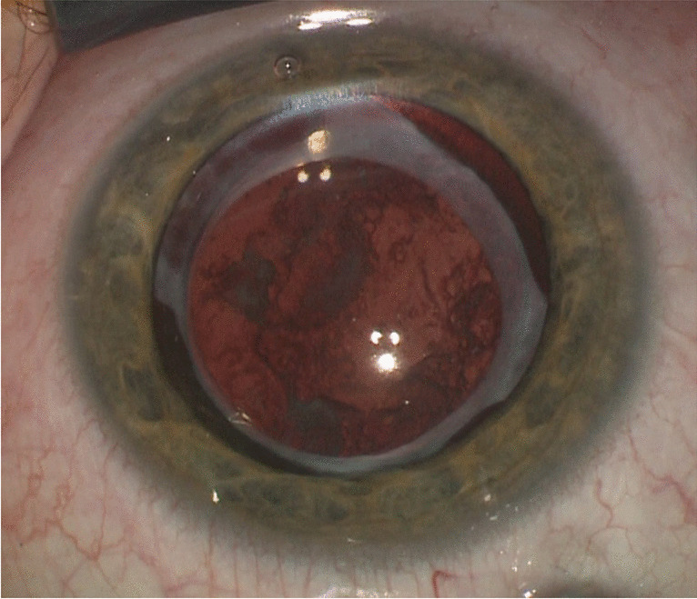
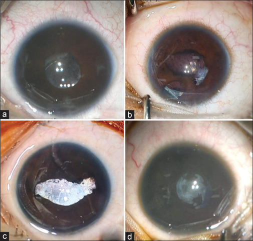
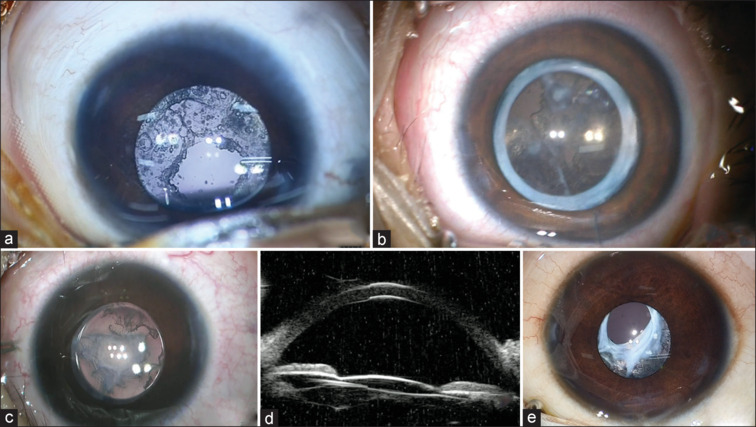
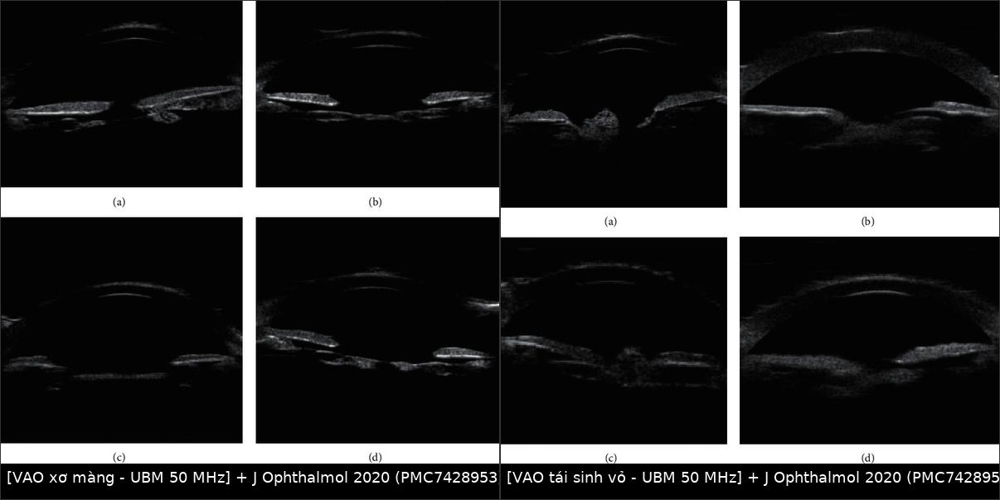
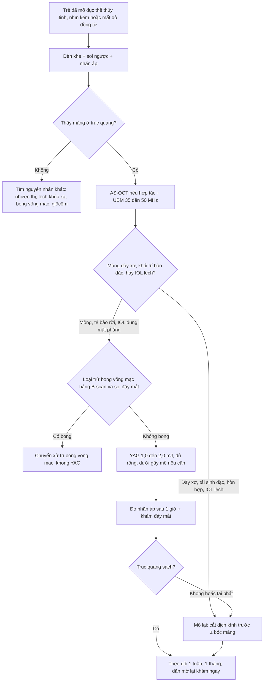
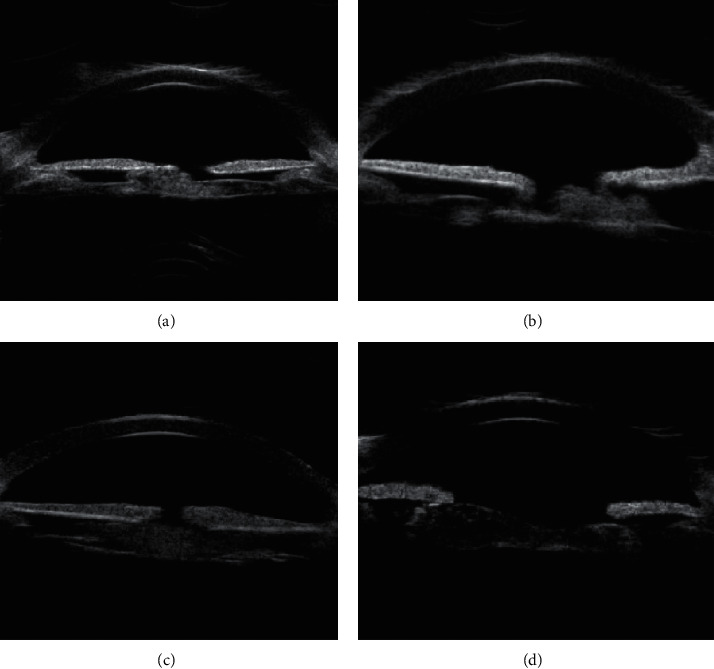
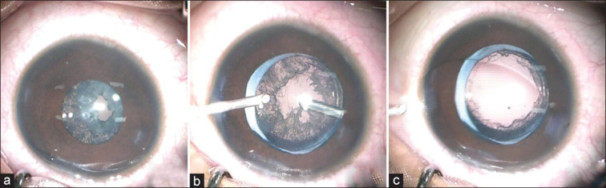
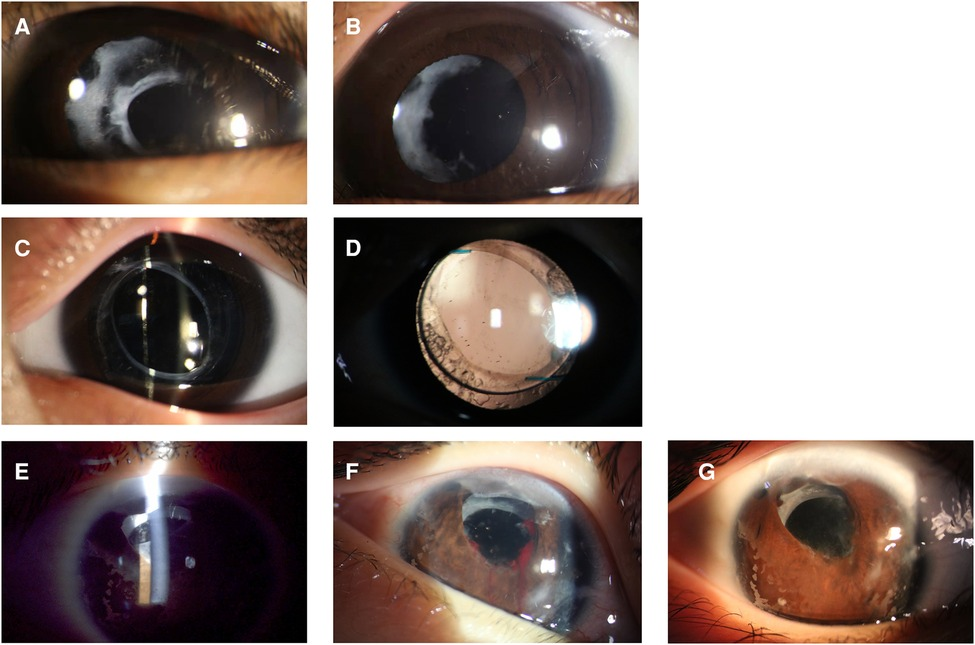

# 6211 — Đục trục quang (VAO) sau mổ đục thể thủy tinh bẩm sinh: màng xơ, tăng sinh và quyết định YAG hay mổ lại / Visual axis opacification after pediatric cataract surgery

**Tags:** `pattern:duc-truc-quang` `pattern:manh-xo-dong-tu` `pattern:elschnig-pearls` `pattern:phimosis-bao` `pattern:tang-sinh-te-bao-bieu-mo` `vung:the-thuy-tinh` `vung:truc-quang` `vung:dong-tu` `vung:tien-phong` `vung:mat` `score:phan-loai-hinh-thai` `protocol:AS-OCT` `protocol:UBM` `protocol:YAG` `protocol:EUA` `protocol:cat-dich-kinh` `incidentaloma:khong`

**Mức chắc chắn (certainty):** tổng hợp y văn (literature synthesis) — dựng từ **loạt 33 mắt/28 trẻ có VAO được mổ bóc màng** (Indian J Ophthalmol 2024, **PMC11338403**, CC BY-NC-SA 4.0), **144 mắt/101 nhũ nhi mổ trong 4 tháng đầu đời** (Graefes Arch Clin Exp Ophthalmol 2023, **PMC10667373**, CC BY 4.0), **55 mắt/38 trẻ VAO phân loại bằng UBM** (J Ophthalmol 2020, **PMC7428953**, CC BY), **20 mắt/17 trẻ YAG dưới an thần** (Front Pediatr 2023, **PMC10130455**, CC BY), **13 mắt/9 trẻ YAG tư thế nằm ngửa dưới gây mê** (Lasers Surg Med 2026, **PMC13649103**, CC BY-NC-ND), **tổng quan phẫu thuật đục thể thủy tinh nhi** (Asia Pac J Ophthalmol 2025, **PMC12399275**, CC BY-NC-ND), **tổng quan bag-in-the-lens** (Front Ophthalmol 2026, **PMC13193927**, CC BY) và **so sánh đường vào mổ** (Clinics 2019, **PMC6644500**, CC BY). Nhóm **không có bệnh nhân của mình**; chỗ chưa đủ chắc ghi "chưa rõ". **Không ghi tên tác giả** — attribution dùng tạp chí + năm + PMCID.

> **Câu chốt:** VAO là biến chứng **muộn phổ biến nhất** của mổ đục thể thủy tinh ở trẻ, và là **nguyên nhân mù lần hai hoàn toàn phòng được một phần**. Sáu con số phải thuộc: **(1)** nếu **để nguyên bao sau**, đục trục quang xuất hiện ở **gần như tất cả** trẻ nhỏ; **cắt bao sau mà không cắt dịch kính trước** vẫn đục tới **60%**; **(2)** cấy IOL ở trẻ **< 2 tuổi**: **~40%** phải mổ lại vì VAO, **hơn gấp đôi** nhóm để aphakia; **(3)** nhũ nhi mổ **trong 4 tháng đầu**: mổ lại vì đục trục quang sau IOL **72%** so với **16%** khi không cấy IOL, màng đồng tử **40% vs 7%**; **(4)** thời điểm: trung vị **6 tháng (1–22 tháng)** sau mổ, trẻ càng nhỏ càng sớm; **(5)** hình thái: **tăng sinh 54,5%**, **xơ 33,3%**, **hỗn hợp 12,1%** — hình thái quyết định **YAG hay mổ lại**; **(6)** YAG ở trẻ có **tái phát 23–30%**, cần **~78 xung × 1,0–2,0 mJ (tổng ~115 mJ)**, và **tăng nhãn áp thoáng qua 15%**.

## 1. Tổng quan bệnh học – cơ chế hình ảnh

### 1.1 TẠI SAO gọi là "đục trục quang" chứ không phải "đục bao sau"

- **Đục bao sau (posterior capsular opacification, PCO)** là thuật ngữ của người lớn: màng mỏng trên **bao sau còn nguyên**. Ở trẻ, mờ trục quang vẫn xuất hiện **dù đã mở bao sau** — vì tế bào biểu mô thể thủy tinh (lens epithelial cells, **LEC**) còn lại ở **xích đạo** di chuyển theo **màng hyaloid trước** (khi không cắt dịch kính trước) hoặc theo **bề mặt IOL**, nên tài liệu nhi khoa dùng **VAO** làm tên gọi chung.
- **Hai cơ chế, thường chồng lấp:**
  - **Tăng sinh (proliferative):** LEC xích đạo còn lại **nguyên phân rất mạnh** ở trẻ → di chuyển ra trục quang, tạo **ngọc Elschnig (Elschnig pearls)**, **vòng Soemmerring**, hoặc **tái sinh vỏ** trong bao; hình thái này **không phải màng xơ dày** mà là **khối tế bào bán trong suốt**.
  - **Xơ (fibrotic):** LEC **chuyển dạng trung mô – biểu mô (epithelial–mesenchymal transition, EMT)** thành nguyên bào sợi, tiết **collagen + protein co rút** → **màng trắng đục, co kéo**, dính mống mắt, **phimosis bao trước**, co đồng tử.
  - **Màng đồng tử do viêm:** hàng rào máu – thuỷ dịch vỡ sau mổ → **fibrin, collagen lắng quanh đồng tử** → màng + dính mống mắt sau (posterior synechiae). Đây là lý do **kiểm soát viêm sau mổ là một phần của dự phòng**, không phải "chuyện phụ".
- **TẠI SAO trẻ nhỏ nguy cơ cao gấp nhiều lần người lớn:** (1) **hoạt tính nguyên phân của LEC** cao nhất trong năm đầu đời; (2) **bao sau + màng hyaloid trước là giàn giáo (scaffold)** — còn giàn giáo là còn đường di chuyển; (3) **phản ứng viêm sau mổ** mạnh hơn; (4) **mắt nhỏ, tiền phòng nông**, khó bóc sạch vỏ xích đạo; (5) dị tật phối hợp (PFV, u nhau thai tồn tại, loạn sản tiền phòng) làm nguy cơ cao hơn.
- **TẠI SAO "không cấy IOL" lại ít VAO hơn ở nhũ nhi:** IOL **ép mặt sau bao/IOL vào bao** tạo **hàng rào cơ học** (bờ sau IOL sắc) chặn LEC, nhưng đồng thời **bề mặt IOL là giàn giáo thứ hai** và **IOL nhỏ đặt lệch/lệch bao** lại mở đường cho LEC. Vì vậy **aphakia thấp hơn nhưng không bằng 0**, và **kỹ thuật đặt IOL (trong bao, capture, bag-in-the-lens)** quan trọng hơn việc "có IOL hay không".

### 1.2 Số liệu nằm lòng (thời điểm, tỉ lệ, yếu tố nguy cơ)

| Chỉ số | Giá trị | Nguồn |
|---|---|---|
| Tuổi mổ thì đầu (loạt VAO) | trung vị **7 tháng (2–96)** | PMC11338403 |
| Khoảng cách mổ → phát hiện VAO | trung vị **6 tháng (1–22)**; trẻ nhỏ **sớm hơn** | PMC11338403 |
| Thời điểm chẩn đoán VAO (đoàn hệ 10 năm) | **13,34 ± 14,63 tháng** | PMC6644500 |
| Hình thái VAO (33 mắt) | **tăng sinh 18 (54,5%)** · **xơ 11 (33,3%)** · **hỗn hợp 4 (12,1%)** | PMC11338403 |
| Nhũ nhi mổ < 4 tháng: màng đồng tử | **40%** (có IOL) vs **7%** (aphakia) | PMC10667373 |
| Nhũ nhi mổ < 4 tháng: mổ lại vì VAO | **72%** (có IOL) vs **16%** (aphakia) | PMC10667373 |
| Cấy IOL khi < 2 tuổi | **~40%** cần mổ lại vì VAO, **> 2 lần** nhóm aphakia | PMC12399275 |
| Để bao sau nguyên ở nhũ nhi | VAO **gần như chắc chắn**; cắt bao sau **không cắt dịch kính trước**: tới **60%** | PMC12399275, PMC13193927 |
| Bag-in-the-lens (BIL) so với IOL trong bao | mổ lại **17,1% vs 38%** (64 vs 50 mắt); VAO ở nhũ nhi **5,6–8,7%** | PMC13193927 |
| Đường vào mổ (giác mạc vs pars plicata) | mổ bổ sung **51,9% vs 27,6%** (p = 0,113); VAO trong số mổ lại **46,2% vs 12,5%** | PMC6644500 |
| Phân loại UBM (55 mắt) | **xơ màng 28 mắt** · **tái sinh vỏ 20 mắt** · **hỗn hợp 7 mắt** | PMC7428953 |
| YAG ở trẻ: tái phát | **30%** (20 mắt, an thần) · **23%** (13 mắt, gây mê) | PMC10130455, PMC13649103 |
| YAG ở trẻ: thông số | **77,8 ± 41,8 xung**, **1,0–2,0 mJ/xung**, tổng **115,3 ± 65,6 mJ (56–276)** | PMC13649103 |
| YAG ở trẻ: kết quả | thị lực **0,85 ± 0,60 → 0,64 ± 0,73 logMAR** (p = 0,002); tăng nhãn áp thoáng qua **15%** | PMC13649103 |
| Mổ bóc màng chọn theo UBM | tái phát chung **3,46%** | PMC7428953 |

*Mắt giả thể thủy tinh của nhũ nhi: **khối tế bào thủy tinh thể tăng sinh** lan vào khoang đồng tử **phía sau IOL** — đúng cơ chế "IOL là giàn giáo thứ hai". Ảnh chụp đèn khe, nguyên bản. Nguồn: Graefes Arch Clin Exp Ophthalmol 2023 (PMC10667373), CC BY 4.0.*

### 1.3 TẠI SAO hình ảnh trông như vậy (đèn khe – UBM – AS-OCT – B-scan)

- **Đèn khe + ánh sáng ngược (retroillumination):** màng xơ gồm **collagen/fibrin** có **chiết suất khác thuỷ dịch** → **tán xạ ánh sáng trắng**, nên soi ngược thấy **mất vùng đỏ đồng tử (red reflex)** đúng chỗ màng. Đây là **dấu rẻ tiền nhất** và là lý do phải **soi ngược ở mọi lần khám sau mổ**, kể cả khi trẻ "vẫn nhìn".
- **UBM 35–50 MHz:** độ phân giải trục **~20–50 µm**, xuyên qua **mống mắt, bờ IOL, bao** để đo **màng sau đồng tử** mà đèn khe không thấy khi đồng tử nhỏ/dính. Hình thái UBM tương ứng hình thái lâm sàng:
  - **Xơ màng:** **đường tăng âm liên tục, mảnh hoặc hình thoi** dưới mống mắt (màng collagen).
  - **Tái sinh vỏ:** **echo không đều, xen kẽ giảm âm** trong bao/quanh bao (khối tế bào, "ngọc").
  - **Hỗn hợp:** **bề mặt bao trước–sau dày không đều + echo tăng** + **phiến/khối không đều** trong bao, kèm **đường tăng âm liên tục** ở mặt sau bao.
- **AS-OCT tiền phòng:** cho **lát cắt màng** và tương quan với **mặt IOL** — đo được **độ dày màng (µm)**, phát hiện **dính mống mắt**, **phimosis**, **khoảng hở giữa màng và IOL**; hạn chế: **không xuyên qua màng xơ dày đặc** (bóng), và trẻ phải ngồi yên.
- **B-scan 10 MHz:** **không dùng để chẩn đoán màng** (độ phân giải ngang 0,3–0,5 mm, kém hơn UBM nhiều) — chỉ dùng để **loại trừ bong võng mạc/dịch kính đục** khi không soi được đáy mắt (xem bài 6210).
- **TẠI SAO YAG khó hơn ở trẻ:** màng **dày, nhiều collagen và tế bào**, mỗi xung chỉ **1,0–2,0 mJ** nhưng phải bắn **~78 xung** (tổng **~115 mJ**) để mở đủ rộng; mảnh vụn còn lại **tái tăng sinh** → **tái phát 23–30%**; năng lượng cao trên **IOL ưa nước** gây **rỗ (pitting) IOL**, và cú sốc âm làm **tăng nhãn áp thoáng qua 15%**.

## 2. Mẫu hình + chẩn đoán phân biệt theo vị trí (gamut)

- **Mẫu hình (pattern):** trẻ **đã mổ đục thể thủy tinh** (aphakia hoặc pseudophakia), **1–22 tháng** sau mổ (có thể muộn hơn nhiều năm), **không đau**, **nhìn kém dần**, **mất đỏ đồng tử**, có thể kèm **lác mới**, **rung giật nhãn cầu**, **dính mống mắt**, **đồng tử co nhỏ (phimosis)**. Khám: **màng trắng/bán trong suốt ngay sau đồng tử**, có thể **dày đặc, co kéo**, hoặc **lấm tấm ngọc Elschnig**.
- **Gamut theo hình thái (morphology — PMC11338403):**
  - **Xơ (fibrotic, 33,3%):** màng **trắng đục, dày, co kéo**, thường **dính mống mắt sau**, **phimosis bao trước**, IOL có thể **lệch/ra trước**. YAG **kém hiệu quả** (màng dày), dễ **tái phát**; ưu tiên **mổ bóc màng**.
  - **Tăng sinh (proliferative, 54,5%):** **ngọc Elschnig**, **vòng Soemmerring**, **tái sinh vỏ** lan qua **lỗ mở bao sau nhỏ** hoặc **quanh bờ IOL**. Nếu **màng mỏng, tế bào rời** → **YAG hiệu quả**; nếu **khối đặc, lan sau IOL** → **cắt dịch kính trước + bóc**.
  - **Hỗn hợp (combined, 12,1%):** cả hai; **quyết định theo phần chiếm ưu thế** và theo **vị trí so với IOL**.
- **Gamut theo vị trí so với IOL:**
  - **Trước IOL:** màng đồng tử/fibrin, phimosis bao trước, **dính mống mắt** — hay gặp sau **mổ có biến chứng/inflammation**.
  - **Sau IOL – trong bao:** VAO "kinh điển" sau **mở bao sau nhỏ (PCCC 2 mm)**; UBM thấy **IOL không nằm trong rãnh bao** → LEC lách qua.
  - **Sau IOL – sau bao:** tái sinh vỏ, màng hyaloid trước dày (khi **không cắt dịch kính trước**).
  - **Tại IOL:** **đục/calci hoá IOL** (thường IOL ưa nước) — **không phải VAO**, YAG **không có ích**.
- **Bốn câu hỏi trước khi quyết định:** **(1)** màng **dày hay mỏng**, **xơ hay tế bào**? **(2)** màng **trước hay sau IOL**, IOL có **trong bao/rãnh bao**? **(3)** **đồng tử có dãn được** và **dính mống mắt** không? **(4)** **đáy mắt có bong võng mạc** không (bài 6210) và **nhãn áp** thế nào?

*(a) Viêm kèm VAO xơ ở mắt **IOL lệch, mống mắt bắt inferior**; (b) VAO xơ + **dính mống mắt sau**; (c) VAO xơ đặc ở mắt **giả thể thủy tinh**; (d) VAO xơ ở mắt **aphakia**. Đây là 4 hình thái **xơ** — nhóm YAG kém hiệu quả nhất. Nguồn: Indian J Ophthalmol 2024 (PMC11338403), CC BY-NC-SA 4.0, nguyên bản (giữ nhãn a–d).*

*(a) Khối tăng sinh **lấn vào trục quang**; (b) VAO tăng sinh **sau IOL đặt tốt trong bao**; (c) VAO hỗn hợp ở mắt **IOL một mảnh đặt rãnh bao**; (d) **UBM cùng mắt (c)**: **IOL nghiêng**, mép quang học **không nằm trong rãnh bao** → LEC lách qua trục quang; (e) **phimosis bao trước + ngọc Elschnig** che trục quang. Nguồn: Indian J Ophthalmol 2024 (PMC11338403), CC BY-NC-SA 4.0, nguyên bản.*

## 3. Bảng so sánh phân biệt (ma trận đối chiếu)

| Thực thể (entity) | Hình ảnh điển hình | Chốt vào (rule-in) | Chốt loại (rule-out) | Gợi ý xác nhận |
|---|---|---|---|---|
| **VAO xơ (fibrotic) sau mổ TTT nhi** | Màng **trắng đục, dày, co kéo**, dính mống mắt sau, phimosis bao trước; UBM: **đường tăng âm liên tục/hình thoi** dưới mống mắt | **Màng đục co kéo + dính mống mắt + UBM đường tăng âm liên tục** | Màng **lấm tấm ngọc**, rời rạc, không co kéo → thể tăng sinh | Đèn khe + soi ngược, UBM 50 MHz, AS-OCT |
| **VAO tăng sinh (proliferative)** | **Ngọc Elschnig**, vòng Soemmerring, tái sinh vỏ **quanh bờ IOL/lỗ PCCC nhỏ**; UBM: **echo không đều, xen giảm âm** | **Ngọc/khối tế bào + lỗ mở bao sau nhỏ + UBM echo hỗn hợp** | Màng trắng đặc co kéo → thể xơ | UBM, đèn khe sau dãn đồng tử |
| **Màng đồng tử do viêm (fibrin)** | Màng **mỏng, dính, hình mạng** trên đồng tử, **dính mống mắt 360°**, tiền phòng có **tơ fibrin**, xuất hiện **sớm 1–4 tuần** | **Xuất hiện sớm + tơ fibrin + dính mống mắt lan rộng** | Màng muộn, khu trú sau IOL → VAO | Đèn khe, đáp ứng corticoid tại chỗ |
| **Phimosis bao trước (ACCC)** | **Lỗ mở bao trước co nhỏ**, bờ **dày trắng**, đồng tử **bị kéo**, có thể **IOL lệch** | **Bờ lỗ bao trước dày, co nhỏ + đồng tử méo** | Màng sau IOL → VAO | Đèn khe, AS-OCT (độ dày bờ bao) |
| **Đục/calci hoá IOL** | **Đốm trắng trong thân IOL**, bờ rõ, **không co kéo**, thường IOL **ưa nước** | **Tổn thương nằm TRONG quang học IOL, bờ sắc** | Màng **trước/sau** IOL → VAO | Đèn khe, AS-OCT; **YAG không có ích** |
| **Sót chất nhân/thể thủy tinh** | **Mảnh trắng đục** trong bao/tiền phòng, bờ **góc cạnh**, có thể **viêm màng bồ đào** | **Mảnh có góc cạnh + viêm + tiền sử mổ phức tạp** | Màng lan toả mỏng → VAO | Đèn khe, UBM; cần **lấy bỏ**, không YAG |
| **Màng hyaloid trước dày (không cắt dịch kính trước)** | Màng **mỏng, trong**, căng ngang sau đồng tử, **di động** nhẹ; UBM: **màng mảnh tách khỏi bao** | **Màng mỏng căng ngang + tiền sử không cắt dịch kính trước** | Màng dày dính bao → VAO xơ | UBM động, đèn khe |
| **Viêm nội nhãn mạn/giả viêm nội nhãn** | **Mủ tiền phòng, fibrin, dính đồng tử**, đau, **nhãn áp thấp**, đục dịch kính | **Đau + mủ tiền phòng + đục dịch kính** | Chỉ màng trục quang, tiền phòng trong → VAO | B-scan, cấy thuỷ dịch/dịch kính |
| **Bong võng mạc che trục quang** | **Đỏ đồng tử mất nhưng màng nằm SAU**, di động; B-scan **màng dính đĩa thị** | **B-scan màng dính đĩa thị + bong** | Màng **ngay sau đồng tử, cố định** → VAO | B-scan, soi đáy mắt 360° (bài 6210) |

*Trái — **VAO xơ màng**: đường **tăng âm liên tục, mảnh** ngay dưới mống mắt. Phải — **VAO tái sinh vỏ**: **echo không đều, xen giảm âm** trong vùng bao. Khác biệt này quyết định **YAG (trái, nếu mỏng)** hay **cắt dịch kính trước + bóc (phải)**. Ảnh ghép letterbox, nguyên tỷ lệ. Nguồn: J Ophthalmol 2020 (PMC7428953), CC BY 4.0.*

### Dấu hiệu "màng giả" và "màng thật"

- **Màng thật (VAO):** **cố định**, dính vào bao/IOL, **mất đỏ đồng tử đúng vùng**, **không đổi khi đảo mắt mạnh**, có **co kéo/dính mống mắt**.
- **Màng giả:** **fibrin mỏng** (tan sau 1–2 tuần khi kiểm soát viêm), **màng hyaloid** (mỏng, di động), **phản xạ ánh sáng trên IOL** (đổi theo góc chiếu) — **không được YAG** vì không phải nguyên nhân mờ thực thể.
- **"Màng trắng" có thể là IOL:** trước khi YAG, **bắt buộc xác định mặt phẳng IOL** (đèn khe khe sáng hẹp + AS-OCT) — YAG vào **thân IOL** làm **rỗ quang học** và **giảm thị lực vĩnh viễn**.

## 4. Protocol + phân loại hình thái và ngưỡng xử trí

### 4.1 Quy trình khám khi trẻ "nhìn kém sau mổ đục thể thủy tinh"

1. **Thị lực theo tuổi** (preferential looking/Lea/Snellen) + **khúc xạ** + **nhãn áp** — nhưng **thị lực kém không định vị được nguyên nhân**: luôn **soi đèn khe + soi ngược**.
2. **Đèn khe: dãn đồng tử tối đa**; đánh giá **màng trước/sau IOL**, **dính mống mắt**, **phimosis**, **ngọc Elschnig**, **vị trí IOL** (trong bao/rãnh bao/lệch).
3. **Soi ngược (retroillumination)** để **bản đồ vùng mất đỏ đồng tử** — ghi **% trục quang bị che** (ước lượng theo đường kính đồng tử) và **vị trí**.
4. **AS-OCT tiền phòng** (nếu hợp tác): **độ dày màng (µm)**, khoảng cách màng–IOL, dính mống mắt.
5. **UBM 35–50 MHz**: khi **đồng tử nhỏ/dính**, **PCO dày**, **IOL nghiêng**, **aphakia** — phân loại **xơ / tái sinh / hỗn hợp** và xác định **IOL có trong rãnh bao hay không**.
6. **B-scan 10 MHz**: chỉ khi **không soi được đáy mắt** — loại trừ **bong võng mạc** (bài 6210), **đục dịch kính**, **sót chất nhân**.
7. **Khám dưới mê (examination under anesthesia, EUA)**: trẻ **không hợp tác**, **chậm phát triển**, hoặc cần **đo nhãn áp/soi 360°** trước quyết định.
8. **Ghi lại ảnh** (đèn khe/AS-OCT/UBM) ở mỗi lần khám — vì VAO **tiến triển theo tháng**, so ảnh quan trọng hơn một lần đo.

### 4.2 Ngưỡng quyết định: YAG hay mổ lại

- **YAG khi:** màng **mỏng – tế bào**, **nhìn rõ mặt phẳng IOL**, **đồng tử dãn đủ**, **trẻ hợp tác hoặc gây mê/an thần được**, và **không có bong võng mạc**. Thông số thực tế ở trẻ: **1,0–2,0 mJ/xung**, **trung bình 78 xung**, tổng **~115 mJ**; mở **rộng hơn lỗ tối thiểu** để tránh tái phát.
- **Mổ lại (anterior segment revision: cắt dịch kính trước ± bóc màng, đường limbus hoặc pars plana) khi:** màng **dày xơ**, **tái sinh vỏ khối đặc**, **hỗn hợp**, **IOL lệch/rãnh bao**, **dính mống mắt nhiều**, **YAG thất bại ≥ 1 lần**, hoặc **không thể cố định mắt để YAG**.
- **Chọn theo UBM (55 mắt — PMC7428953):** **xơ màng → YAG bao sau**; **tái sinh vỏ → cắt dịch kính trước**; **hỗn hợp → cắt dịch kính trước + đầu capsulotomy RF**; tái phát chung **3,46%**.
- **Không YAG khi chưa loại trừ bong võng mạc:** YAG trên mắt đang bong làm **bong nặng thêm** và **không cải thiện thị lực** (bài 6210).
- **Sau YAG:** đo **nhãn áp sau 1 giờ** (tăng thoáng qua **15%**), khám **đáy mắt**, hẹn **1 tuần – 1 tháng**; dặn gia đình **tái phát 23–30%** nên **mờ lại = khám ngay**, không chờ lịch.
- **Kiểm soát viêm là điều trị, không phải hỗ trợ:** corticoid tại chỗ **đủ liều, giảm liều chậm**; **cycloplegic** để phá giàn giáo dính mống mắt.

### 4.3 Dự phòng (khi mổ thì đầu) — bằng số

- **Cắt bao sau (posterior capsulorhexis/capsulectomy) + cắt dịch kính trước** ở **mọi trẻ < 5–7 tuổi** (kể cả khi cấy IOL): **để bao sau nguyên = VAO gần như chắc chắn**; **cắt bao sau không cắt dịch kính trước = tới 60%** vẫn đục.
- **Kỹ thuật "giữ tế bào trong bao":** **optic capture** (kẹp quang học IOL qua lỗ bao sau) và **bag-in-the-lens (BIL)** — BIL cho **mổ lại 17,1% vs 38%** so với IOL trong bao, VAO ở nhũ nhi **5,6–8,7%**.
- **Tránh IOL ở trẻ < 2 tuổi khi không có lý do mạnh:** **~40%** phải mổ lại vì VAO (gấp **> 2 lần** aphakia); nhiều phẫu thuật viên **không cấy IOL dưới 2 tuổi**.
- **Đường vào:** **pars plicata/pars plana** cho **cắt bao sau + cắt dịch kính** có **mổ bổ sung 27,6% vs 51,9%** (đường giác mạc) — khác biệt **chưa có ý nghĩa** (p = 0,113) nhưng **VAO trong số mổ lại thấp hơn rõ** (12,5% vs 46,2%).
- **Theo dõi:** vì trung vị phát hiện **6 tháng** và có ca tới **22 tháng**, lịch thực dụng: **1 tuần – 1 tháng – 3 tháng – 6 tháng – 12 tháng**, sau đó **mỗi 3–6 tháng tới hết tuổi mẫu giáo** (khi trẻ bắt đầu **hợp tác đo thị lực**), rồi **mỗi 6–12 tháng tới hết thiếu niên**; **luôn soi ngược + soi 360°**; **EUA** khi không soi được.

## 5. Biến thể bình thường và cạm bẫy

- **"Mờ sau mổ = nhược thị"** — cạm bẫy số 1: nhược thị **không làm mất đỏ đồng tử**. Mọi trẻ **chậm tiến bộ thị lực** phải **soi ngược**; bỏ sót VAO = **mất cửa sổ nhạy cảm** của nhược thị.
- **YAG "bắn cho xong" trên màng dày:** màng xơ cần năng lượng cao, dễ **rỗ IOL**, **tăng nhãn áp**, **viêm**, và **vẫn đục** → **tái phát 23–30%**. Nếu UBM nói **xơ/hỗn hợp**, chọn **mổ lại** ngay từ đầu.
- **Nhầm IOL đục với VAO:** đốm trắng **trong thân IOL** không đáp ứng YAG; bắn YAG chỉ làm **hỏng quang học**. Xác định mặt phẳng IOL trước.
- **Bỏ sót bong võng mạc "ẩn" sau màng:** trẻ **không kêu**, màng che **cả trục quang**; **B-scan + soi 360°** trước YAG/mổ lại. Đây là lý do bài 6210 và 6211 phải đọc cùng nhau.
- **Không dãn được đồng tử ≠ không có VAO:** dính mống mắt sau che **2–4 mm ngoại vi**; UBM là cửa sổ duy nhất — **không kết luận "sạch" khi chưa UBM**.
- **Màng fibrin sớm bị YAG oan:** trong **1–4 tuần đầu**, màng mỏng + tơ fibrin đáp ứng **corticoid**; YAG lúc này **gây viêm thêm** và không giải quyết nguyên nhân.
- **Phimosis bao trước tiến triển âm thầm:** bờ bao trước dày dần, **kéo lệch IOL**, **đồng tử méo**; cần **theo dõi ảnh** và mổ **trước khi IOL lệch nhiều**.
- **Tái phát sau YAG không phải "thất bại của YAG"** mà là **sinh học của trẻ**: LEC còn ở xích đạo. Vì vậy **mổ lại lần hai thường phải kèm cắt dịch kính trước** để **loại giàn giáo**, không chỉ bóc màng.
- **Đừng quên mắt còn lại:** VAO thường **hai bên** ở đục thể thủy tinh bẩm sinh hai bên; khám **cả hai mắt** cùng lần, kể cả mắt "tốt".

## 6. Tự lượng giá — Blind Quiz

**Ca 1 — Bé 14 tháng, mổ đục thể thủy tinh bẩm sinh hai bên lúc 2 tháng (có IOL), nay mất đỏ đồng tử mắt phải. UBM dưới đây.**

- Câu hỏi: mô tả **echo trong bao**? Thuộc **thể nào** trong phân loại UBM? **YAG hay mổ lại**?

<b>Bấm để hiện đáp án (findings + chẩn đoán)</b>

- **Dấu hiệu:** **bề mặt bao trước–sau dày không đều, echo tăng**; **phiến/khối không đều xen giảm âm** trong bao; **đường tăng âm liên tục** ở mặt sau bao → **VAO hỗn hợp (mixed)**.
- **Vì sao không chỉ YAG:** thành phần **khối tế bào đặc** sẽ **tái phát**; phần **màng xơ** cần năng lượng cao, dễ rỗ IOL.
- **Xử trí:** **cắt dịch kính trước + bóc màng** (đường limbus/pars plana), bóc sạch **vỏ xích đạo**; YAG chỉ dùng cho **phần màng mỏng còn lại** sau mổ.
- **Nguồn ảnh:** J Ophthalmol 2020 (PMC7428953), CC BY 4.0 — ảnh UBM của **VAO hỗn hợp**, không phải ca lâm sàng cụ thể.

**Ca 2 — Bé 3 tuổi, mổ đục thể thủy tinh + IOL 8 tháng trước, nay "nhìn kém". Đèn khe: đồng tử dãn 6 mm, có khối trắng lấm tấm sau IOL.**

- Câu hỏi: mô tả **(a)** và **(b)**? Vì sao khối này **lách được** ra trục quang? Cần đo gì trước YAG?

<b>Bấm để hiện đáp án (findings + chẩn đoán)</b>

- **Dấu hiệu:** (a) **ngọc Elschnig tăng sinh** che trục quang; (b) sau khi **hút ngọc**, lộ **lỗ mở bao sau nhỏ ~2 mm (PCCC)**; bờ **mở bao trước rất rộng (ACCC lớn)**.
- **Cơ chế:** lỗ PCCC **quá nhỏ** không đủ để **IOL ép sát bao** → **khe hở** cho LEC di chuyển ra trục quang. Đây là **VAO tăng sinh** điển hình.
- **Trước YAG:** xác định **mặt phẳng IOL** (AS-OCT/đèn khe khe hẹp), **loại trừ bong võng mạc** (B-scan), **đo nhãn áp**, và **đánh giá đồng tử có dãn đủ**.
- **Xử trí:** YAG **mở rộng** vùng trục quang (**1,0–2,0 mJ/xung**, tổng có thể **> 100 mJ**), theo dõi **tái phát 23–30%**; nếu ngọc tái sinh nhanh → **mổ lại + cắt dịch kính trước**.
- **Nguồn ảnh:** Indian J Ophthalmol 2024 (PMC11338403), CC BY-NC-SA 4.0, nguyên bản (giữ nhãn a/b).

**Ca 3 — Bé 5 tuổi, mổ đục thể thủy tinh bẩm sinh + IOL, màng trắng mỏng sau IOL, hợp tác kém. Ảnh trước và sau can thiệp.**

- Câu hỏi: (A) so với (B) thay đổi gì? Vì sao phải **gây mê/an thần**? Nguy cơ nào phải đo ngay sau thủ thuật?

<b>Bấm để hiện đáp án (findings + chẩn đoán)</b>

- **Dấu hiệu:** (A) **màng trắng mỏng kèm di tích bao trước** che một phần trục quang; (B) **trục quang thông thoáng** sau **YAG mở màng**; các cặp (C,D) và (E,F,G) là **màng sau IOL** và **co bao trước** trước/sau YAG.
- **Chẩn đoán:** **VAO thể màng mỏng/tăng sinh** — phù hợp **YAG** hơn mổ lại.
- **Vì sao gây mê/an thần:** trẻ **5 tuổi hợp tác kém**, cần **cố định mắt tuyệt đối**; nghiên cứu dùng **dexmedetomidine 3 µg/kg đường mũi**, trẻ **ngồi** tựa cằm vào đèn khe laser (tuổi nhỏ nhất **5 tháng**).
- **Theo dõi ngay:** **nhãn áp sau 1 giờ** (tăng thoáng qua **15%**), **đáy mắt** (loại trừ bong/lỗ rách), rồi **1 tuần – 1 tháng**; dặn **mờ lại = khám ngay** vì **tái phát 30%**.
- **Nguồn ảnh:** Front Pediatr 2023 (PMC10130455), CC BY 4.0, nguyên bản (giữ nhãn A–G).

## Bài liên quan chéo

- [400 – Tổng quan Mắt & thị giác](../400-tong-quan-mat-thi-giac/lesson.md)
- [6210 – Bong võng mạc sau mổ đục thể thủy tinh bẩm sinh](../6210-bong-vong-mac-sau-mo-duc-thuy-tinh-bam-sinh/lesson.md) (phải loại trừ trước khi YAG)
- [1643 – Glôcôm sau mổ đục thể thủy tinh bẩm sinh](../1643-glaucoma-sau-mo-duc-thuy-tinh-the-bam-sinh/lesson.md) (cùng nhóm biến chứng muộn)
- [413 – PFV/PHPV: dây xơ thể thủy tinh](../413-PFV-PHPV-day-xo-the-thuy-tinh/lesson.md) (nguy cơ VAO cao hơn)
- [1487 – Bong võng mạc ở mắt giả thể thủy tinh sau phaco](../1487-bong-vong-mac-gia-the-thuy-tinh/lesson.md)
- [1480 – Đục thể thủy tinh sau bóc màng trước võng mạc (ERM)](../1480-duc-the-thuy-tinh-sau-boc-mang-erm/lesson.md)
- [1467 – Màng trước võng mạc (ERM)](../1467-mang-truoc-vong-mac-erm/lesson.md) (phân biệt màng *sau* IOL với màng võng mạc)
- [1443 – Viêm màng bồ đào do thấu kính](../1443-viem-mang-bo-dao-do-thau-kinh/lesson.md) (màng fibrin do viêm)
- [1451 – Keratoconus & CXL](../1451-vkc-keratoconus-cxl/lesson.md) (khúc xạ sau mổ ở trẻ)

## Ảnh

- Tên file theo quy ước `6211_..._Modality_SourceID.jpg`; nguồn + giấy phép từng ảnh ở `images/CREDITS.md`.
- **Không ảnh nào là "ca VAO của nhóm"**: ảnh IJO là **các hình thái VAO** trong loạt 33 mắt; ảnh UBM là **3 thể UBM**; ảnh Graefes là **tăng sinh tế bào sau IOL ở nhũ nhi**; ảnh Frontiers là **trước/sau YAG** ở trẻ — đã ghi rõ trong chú thích.
- **1 composite** (`composite_vao_ubm.jpg`) ghép **2 ảnh CC BY** bằng `tools/make_composite.py` (letterbox nền đen, giữ tỷ lệ, dải attribution).

> Không dùng để chẩn đoán độc lập khi chưa có người hướng dẫn.
