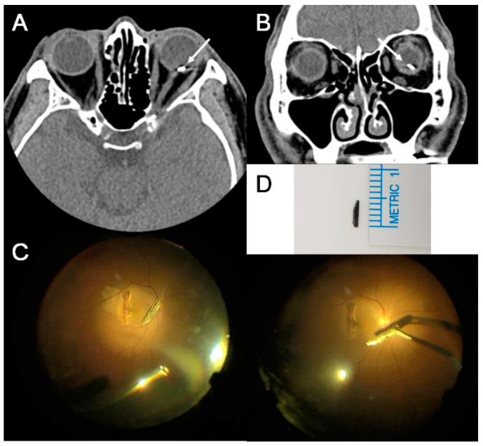
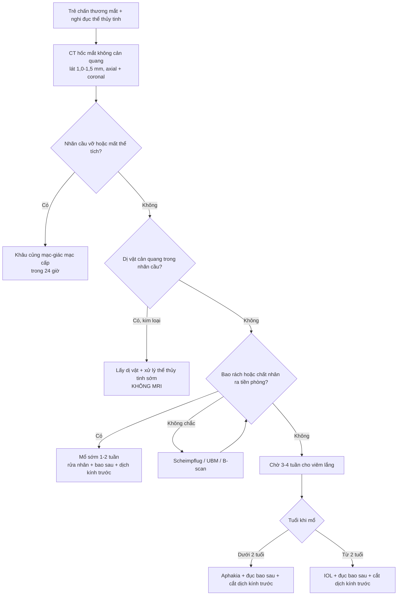
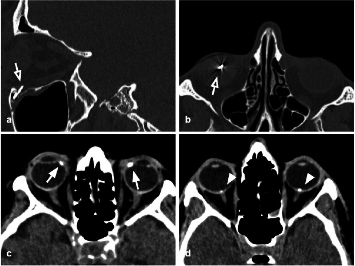
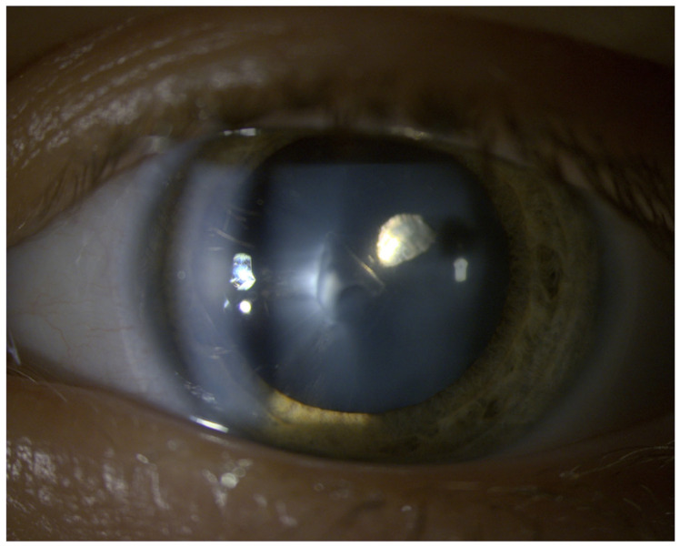
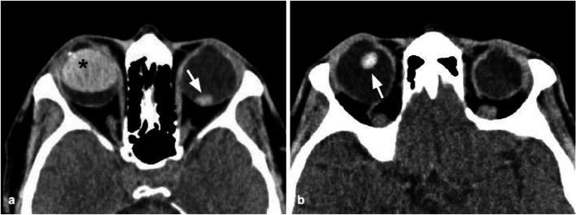
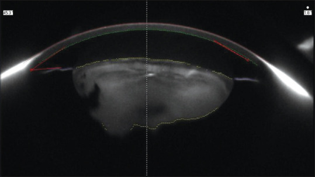

# 6213 — Đục thể thủy tinh do chấn thương ở trẻ / Pediatric traumatic cataract

**Tags:** `pattern:duc-the-thuy-tinh` `pattern:vo-bao-the-thuy-tinh` `pattern:truat-the-thuy-tinh` `pattern:di-vat-noi-nhan` `pattern:vet-thuong-xuyen-thuong` `pattern:danh-gia-truoc-mo` `vung:the-thuy-tinh` `vung:tien-phong` `vung:dich-kinh` `vung:mat` `score:BETT` `score:OTS` `protocol:CT-hoc-mat` `protocol:sieu-am-B-scan` `protocol:UBM` `protocol:Scheimpflug` `protocol:AS-OCT` `protocol:phaco` `protocol:EUA` `incidentaloma:khong`

**Mức chắc chắn (certainty):** tổng hợp y văn (literature synthesis) — dựng từ **tổng quan 2025 của hội đồng chuyên gia về phẫu thuật đục thể thủy tinh nhi** (Asia Pac J Ophthalmol 2025, **PMC12399275**, CC BY-NC-ND), **đoàn hệ 321 mắt Thượng Hải** (Sci Rep 2018, **PMC5803188**, CC BY), **79 mắt Ibadan** (Ther Adv Ophthalmol 2021, **PMC8855383**, CC BY-NC), **34 mắt Ai Cập** (Clin Ophthalmol 2021, **PMC8057834**, CC BY-NC), **47 mắt Scheimpflug** (Indian J Ophthalmol 2021, **PMC8837344**, CC BY-NC-SA), **phân tích gộp CT 917 mắt** (J Med Life 2025, **PMC11891614**, CC BY), **30 mắt CT xuyên thấu** (Diagnostics 2025, **PMC11988872**, CC BY), **52 mắt dị vật nội nhãn** (J Clin Med 2021, **PMC8123265**, CC BY), **198 mắt đo độ đậm thể thủy tinh bằng DECT** (Diagnostics 2022, **PMC9689271**, CC BY), **ca trẻ 9 tuổi dị vật kim loại trong thể thủy tinh** (Diagnostics 2026, **PMC13298824**, CC BY) và **RCT sớm so với muộn** (Eye 2017, **PMC5558225**). Nhóm **không có bệnh nhân của mình**; chỗ chưa đủ chắc ghi "chưa rõ". **Không ghi tên tác giả** — attribution dùng tạp chí + năm + PMCID.

> **Câu chốt:** Đục thể thủy tinh do chấn thương (traumatic cataract) chiếm **~30% đục thể thủy tinh ở trẻ** (14,7% trong một trung tâm châu Phi), là **nguyên nhân khiếm thị một mắt phòng được**. Năm con số phải thuộc: **(1)** đỉnh tuổi **2–8 tuổi**, nam **74,1%**, xuyên thấu **76,6%** ở đoàn hệ Thượng Hải; **(2)** **21,3%** mắt đục do chấn thương kín đã có **rách bao sau từ trước** — Scheimpflug phát hiện với **Se 70% / Sp 89,18% / độ chính xác 85,11%**; **(3)** CT hốc mắt phát hiện **vỡ nhãn cầu** với **Se 77% / Sp 94% / AUC 0,91** trên **917 mắt**, nhưng **33,3%** mắt xuyên thấu có CT **hoàn toàn bình thường**; **(4)** dị vật nội nhãn: **61,5%** kèm tổn thương thể thủy tinh, dị vật **hậu đoạn** làm thị lực xấu **OR 11,556**; **(5)** phẫu thuật đục thể thủy tinh **không biến chứng nên chờ 3–4 tuần**, nhưng **IOL dưới 2 tuổi → ~40% phải mổ lại vì đục trục quang**, còn **để bao sau nguyên → gần như chắc chắn đục**.

## 1. Tổng quan bệnh học – cơ chế hình ảnh

### 1.1 TẠI SAO thể thủy tinh đục sau chấn thương

- **Chấn thương kín (blunt trauma) — cơ chế coup–contrecoup:** lực ép lên nhãn cầu làm **xích đạo phình ra**, thể thủy tinh bị **sóng xung kích** truyền qua và **xê dịch trong bao**. Sợi thủy tinh thể bị đứt, protein kết tụ, nước vào gian bào → đục dạng **hoa thị (rosette)** ở vùng vỏ sau hoặc vỏ trước, thường **không đục toàn bộ** và có thể tiến triển **nhiều tuần sau chấn thương**. Đây là lý do **khám lúc cấp cứu có thể chỉ thấy một vùng mờ nhỏ** rồi 2–4 tuần sau mới đục rõ.
- **Chấn thương xuyên thấu (penetrating):** bao bị rách → **dịch tiền phòng vào thể thủy tinh** → **sốc thẩm thấu**, sợi thủy tinh thể trương nước, đục nhanh và **lan toàn bộ** (đục "chín trắng"). Trong đoàn hệ Thượng Hải **76,6%** là xuyên thấu và **65%** trẻ được mổ lần đầu **ngay ngày chấn thương** — nghĩa là phần lớn ca là **mổ cấp cứu vết thương**, không phải "đục thể thủy tinh đơn thuần".
- **TẠI SAO mắt trẻ khác mắt người lớn:** nhãn cầu trẻ **củng mạc mỏng, thể tích nhỏ (AL ~16,5–17 mm ở sơ sinh, ~23 mm ở 13–15 tuổi)** nên cùng một lực sẽ **vỡ ở rìa** nhiều hơn; bao thể thủy tinh **đàn hồi cao**, dễ **tự bít lỗ rách nhỏ** (nít kín) nhưng cũng dễ **phình giãn** khi chất nhân trương nước; phản ứng viêm nội nhãn **mạnh hơn**, tạo **màng fibrin** và **đục trục quang** về sau.
- **TẠI SAO trẻ "im lặng":** trẻ nhỏ **không kêu mờ một bên**, mắt kia bù trừ; **đục nhẹ chưa cản trục quang** vẫn cho thị lực "đủ dùng"; và **đục hoa thị không đều** làm trẻ chỉ than **chói/nhìn đôi** — dễ bị bỏ qua cho tới khi **lác hoặc nhược thị** xuất hiện.

### 1.2 Những con số dịch tễ quyết định cách khám

- **Tuổi và giới:** trung bình **6,3 ± 3,7 tuổi**, đỉnh **2–8 tuổi**, nam **74,1%** (321 mắt/321 trẻ, Thượng Hải); đoàn hệ Ibadan **10,11 ± 3,39 tuổi**, nam **70,9%**; đoàn hệ Ai Cập **10 ± 3,97 tuổi**, nam **68%**.
- **Cơ chế:** Thượng Hải **xuyên thấu 76,6%** (kim loại sắc, đồ chơi, que gỗ; **kéo** đứng đầu ở hầu hết nhóm tuổi); Ibadan **kín 88,8%**; Ai Cập **hở 62% / kín 38%** — khác biệt theo **cách chọn ca** (trung tâm mổ chấn thương so với trung tâm nhi).
- **Tỉ lệ trong đục thể thủy tinh nhi:** **~30%** theo tổng quan 2025; **14,7% (87/593 mắt)** tại Ibadan.
- **Kết cục thị lực:** Ibadan — **40,5%** đạt **≥ 6/18** lúc 3 tháng; Ai Cập — **2,63 ± 0,66 → 0,41 ± 0,38 logMAR**, tất cả **34/34** cấy IOL hậu phòng (33 ca thì đầu); tổng quan 2025 — **50–75%** trẻ chấn thương mắt đạt **20/60 hoặc tốt hơn**, kết cục xấu gắn với **sẹo giác mạc, tổn thương hậu đoạn, điều trị muộn**.

### 1.3 TẠI SAO hình ảnh trông như vậy (CT – siêu âm – Scheimpflug)

- **Thể thủy tinh là cấu trúc "đậm" nhất trong nhãn cầu trên CT:** đo trên **198 mắt bằng DECT**, thể thủy tinh tự nhiên có độ đậm **~74–79 HU ở 70 keV** (nhóm có đục rõ: **79,05 ± 7,58 HU**), trong khi **dịch kính ~0 HU**. Vì vậy trên CT, **mất "hạt đậm" ở vị trí sau mống mắt = thể thủy tinh đã ra khỏi ổ** hoặc **bị cắt**; một **nốt đậm hình thấu kính trong dịch kính = thể thủy tinh trật**.
- **Đục thể thủy tinh do chấn thương lại làm thể thủy tinh "nhạt" hơn, không đậm hơn:** nước vào trong sợi thủy tinh thể làm **giảm độ đậm (hypoattenuating)** — đúng như tổng quan DECT nêu: *"CT hữu ích trong chẩn đoán đục thể thủy tinh do chấn thương, khi thể thủy tinh trở nên giảm đậm do tăng hàm lượng nước"*. Đây là lý do **CT không dùng để "chẩn đoán đục"** — nó dùng để trả lời **vỡ nhãn cầu, dị vật, trật thể thủy tinh**.
- **Kim loại và thủy tinh (glass) rất đậm:** dị vật kim loại tạo **nốt > 1.000 HU kèm vệt giả ảnh dạng tia (beam-hardening)**, dễ thấy nhưng **vệt tia có thể che dị vật thứ hai**. **Gỗ, nhựa, gốm** có thể **bỏ sót** trên CT.
- **Siêu âm B-scan 10 MHz:** đầu dò **10 MHz → bước sóng trong dịch kính ~0,15 mm**, phân giải trục **~0,1 mm**; dị vật trong thể thủy tinh cho **echo dày trong vùng thể thủy tinh**, hậu đoạn bình thường thì **võng mạc áp, đĩa thị đều** (ca 9 tuổi). B-scan **chỉ làm sau khi nhãn cầu đã kín** vì ấn đầu dò có thể **đẩy nội nhãn ra ngoài**.
- **Scheimpflug (Pentacam) và AS-OCT:** dựng **mặt cắt quang học bao sau**; rách bao sau cho **bờ bao tăng đậm** và **chất nhân "phồng" qua lỗ rách (dấu sinking lens-matter)** — dấu này **quyết định không bơm căng bao (hydrodissection)** khi mổ.
- **UBM 35–50 MHz:** xuyên qua **mống mắt, thể mi, bờ IOL** để thấy **dây chằng Zinn, chu vi thể mi, bao sau** khi **đồng tử nhỏ hoặc tiền phòng nông**.

## 2. Mẫu hình + chẩn đoán phân biệt theo vị trí (gamut)

**Mẫu hình trung tâm:** *"Mắt trẻ sau chấn thương + một vùng/ toàn bộ thể thủy tinh mờ + có thể mất hạt đậm thể thủy tinh trên CT"*. Từ mẫu hình này, gamut chia theo **vị trí tổn thương** và **cơ chế**:

| Vị trí / cơ chế | Gamut chính | Câu hỏi hình ảnh phải trả lời |
|---|---|---|
| **Thể thủy tinh tại chỗ, bao còn** | Đục hoa thị do chấn thương kín · đục bẩm sinh/phát triển phát hiện muộn · đục do corticoid · đục sau viêm màng bồ đào | Có **rách bao** không? Có **dị vật** không? Có **trật** không? |
| **Thể thủy tinh tại chỗ, bao rách** | Rách bao trước do vật xuyên · rách bao sau do chấn thương kín · vỡ bao + thoát chất nhân vào tiền phòng | Rách **trước hay sau**? Chất nhân có **chặn góc** không? |
| **Thể thủy tinh lệch khỏi ổ** | Trật một phần (subluxation) · trật hoàn toàn vào dịch kính · sa vào tiền phòng · sa vào khoang trên hắc mạc | Còn **dây chằng** không? Có **máu dịch kính** không? |
| **Dị vật nội nhãn** | Dị vật **trong thể thủy tinh** (~2% dị vật nội nhãn) · dị vật hậu đoạn · dị vật hốc mắt | **Kim loại hay không** (quyết định MRI)? Có **nhiều mảnh** không? |
| **Nhãn cầu vỡ** | Vỡ nhãn cầu (rupture) · vết thương xuyên thấu có lỗ vào · vết thương xuyên qua (perforating) | **Mất thể tích, méo bờ, tiền phòng nông**? |
| **"Đục" không phải thể thủy tinh** | Màng đồng tử sau viêm · màng fibrin · xuất huyết dịch kính · bong võng mạc · dầu/PFCL tồn lưu | Trục quang bị che bởi **màng** hay **thể thủy tinh**? |

**Phân biệt theo tuổi — điểm hay sai:** ở trẻ **< 3 tuổi**, "đục thể thủy tinh một bên" **không có tiền sử chấn thương rõ** phải nghĩ **đục bẩm sinh/PFV** (bài 413, 466); ở trẻ **> 6 tuổi** có **tiền sử đập vào mắt** thì đục hoa thị do chấn thương là hàng đầu. Hình ảnh **không phân biệt được nguyên nhân** — **tiền sử + tuổi + một bên** mới là chốt.

## 3. Bảng so sánh phân biệt (ma trận đối chiếu)

| Thực thể (entity) | Hình ảnh điển hình (CT / siêu âm / Scheimpflug) | Chốt vào (rule-in) | Chốt loại (rule-out) | Gợi ý xác nhận |
|---|---|---|---|---|
| **Đục thể thủy tinh do chấn thương kín, bao nguyên** | CT: thể thủy tinh **còn đúng vị trí, có thể giảm đậm**; B-scan: thể thủy tinh còn, hậu đoạn trống | **Tiền sử đập vào mắt + một bên + đục hoa thị/vỏ sau** | **Không có dị vật, không mất hạt thể thủy tinh, bao liên tục trên Scheimpflug** | Khám đèn khe; Scheimpflug nếu nghi bao sau |
| **Rách bao sau + chất nhân phồng ra** | Scheimpflug: **bờ bao sau tăng đậm + chất nhân "sinking"**; CT: **tiền phòng nông bất đối xứng**, thể thủy tinh **mất thể tích** | **Dấu sinking lens-matter**; Scheimpflug **Se 70% / Sp 89,18%** trong 47 mắt | **Bao sau liên tục 360°** trên Scheimpflug và **không có chất nhân trong dịch kính** | Scheimpflug/AS-OCT + UBM; xác nhận trong mổ |
| **Trật/lệch thể thủy tinh** | CT: **không thấy thể thủy tinh ở ổ** + **nốt đậm hình thấu kính ở dịch kính**; B-scan: **nốt echo dày di động** | **Mất hạt đậm sau mống mắt + nốt đậm lạc chỗ** trên CT | **Thể thủy tinh vẫn đúng vị trí** trên mọi lát cắt; không có nốt lạc chỗ | CT lát mỏng + B-scan; UBM cho dây chằng |
| **Dị vật nội nhãn trong thể thủy tinh** | CT: **nốt cực đậm trong thể thủy tinh + vệt tia**; B-scan: echo dày trong thể thủy tinh | **Nốt cản quang trong thể thủy tinh + vết vào ở giác mạc/củng mạc** | **Không có nốt cản quang** trên CT lát mỏng **và** không có echo lạ trên B-scan | CT **1,0–1,5 mm** axial + coronal; **không MRI khi chưa loại kim loại** |
| **Dị vật hậu đoạn** | CT: nốt đậm trong dịch kính/võng mạc; B-scan: echo dày sau thể thủy tinh | **Dị vật sau xích đạo** — tiên lượng xấu **OR 11,556** | Dị vật **chỉ ở tiền đoạn** (tiên lượng tốt hơn) | CT + B-scan; đếm **nhiều mảnh** trước mổ |
| **Vỡ nhãn cầu** | CT: **mất thể tích, bờ méo/không liên tục, mặt trước dẹt, tăng đậm dịch kính** | **Bờ nhãn cầu không liên tục + mất thể tích** (Se **77%**, Sp **94%**) | **CT bình thường không loại trừ** — 33,3% ca xuyên thấu CT âm | Khám dưới mê + CT; mổ khâu **< 24 giờ** |
| **Vật giả cản quang** | CT: **mảng củng mạc canxi**, **IOL** (mỏng, ít đậm hơn thể thủy tinh), **drusen đĩa thị**, **dầu silicone > 100 HU**, **bọt khí** | **Đối xứng hai bên + đúng vị trí giải phẫu + tiền sử mổ** | **Một bên, lệch vị trí, kèm vệt tia** = thật | Đối chiếu tiền sử; so sánh mắt bên kia |

*Hình 1 — CT trật thể thủy tinh (2 ca, 2 bệnh nhân). Nguồn: Insights Imaging 2022, PMC8755868, Fig. 16, CC BY 4.0.*

*Hình 2 — CT định vị dị vật nội nhãn hậu đoạn. Nguồn: J Clin Med 2021, PMC8123265, Fig. 5, CC BY 4.0.*

## 4. Protocol chụp + hệ phân độ/điểm chuẩn hóa

### 4.1 Chụp gì, theo thứ tự nào

| Bước | Modality | Thông số / nguyên tắc | Trả lời câu hỏi |
|---|---|---|---|
| 1 | **CT hốc mắt không cản quang** | Lát **1,0–1,5 mm**, **axial + coronal** (± sagittal), cửa sổ xương + mô mềm; **không cản quang** | Vỡ nhãn cầu? Dị vật cản quang? Trật thể thủy tinh? Máu dịch kính? |
| 2 | **Siêu âm B-scan 10 MHz** | **Chỉ sau khi nhãn cầu kín**; đầu dò đặt qua mi, không ấn | Dị vật không cản quang? Bong võng mạc? Máu dịch kính? |
| 3 | **UBM 35–50 MHz** | Khi **đồng tử nhỏ, tiền phòng nông, nghi đứt dây chằng** | Bao sau, chu vi thể mi, dây chằng Zinn |
| 4 | **Scheimpflug / AS-OCT** | Trước mổ, khi **nghi rách bao sau** | Bờ bao sau, dấu sinking lens-matter (**Se 70%, Sp 89,18%**) |
| 5 | **MRI hốc mắt** | **CHỈ khi đã loại trừ dị vật kim loại** (CT ± X-quang) | Tổn thương hậu đoạn, dây thị giác — **không dùng để tìm dị vật** |

**Ba cấm kỵ:** (1) **MRI khi chưa loại trừ dị vật kim loại** — lực từ có thể làm dị vật di chuyển và gây mù thêm; (2) **siêu âm/ấn nhãn cầu khi nhãn cầu chưa khâu kín**; (3) **bơm căng bao (hydrodissection) khi nghi rách bao sau** — dễ đẩy chất nhân vào dịch kính.

### 4.2 Phân độ và điểm chuẩn hóa

- **BETT (Birmingham Eye Trauma Terminology):** chia **kín (closed globe)** / **hở (open globe)** → **vỡ (rupture)** / **xuyên thấu (penetrating)** / **xuyên qua (perforating)** / **dị vật nội nhãn (IOFB)**. Đây là ngôn ngữ bắt buộc khi đọc CT: **cùng "mất thể tích" nhưng "vỡ" và "xuyên thấu" khác nhau về tiên lượng và cách mổ**.
- **OTS (Ocular Trauma Score):** thị lực ban đầu + **vỡ nhãn cầu + viêm nội nhãn + vỡ xương + tổn thương hậu đoạn** → 5 nhóm; trong **30 mắt xuyên thấu**, **số dấu hiệu CT càng nhiều thì OTS càng thấp** (**r = −0,644, p < 0,001**), và **mọi ca có mất thể tích/trật thể thủy tinh/tăng đậm dịch kính/≥ 3 dấu CT đều nằm ở OTS II**.
- **Đục thể thủy tinh nhi không có RADS riêng.** Ngưỡng xử trí thực hành (theo tổng quan 2025):
  - **Phẫu thuật đục thể thủy tinh không biến chứng: lý tưởng 3–4 tuần sau chấn thương** để viêm lắng xuống;
  - **Mổ ngay** khi: **rách giác mạc/củng mạc, nhãn áp không kiểm soát, phản ứng tiền phòng nặng**;
  - **RCT (30 mắt sớm < 1 tuần vs 30 mắt muộn 1–2 tháng, > 12 tuổi):** thị lực 6 tháng **không khác**; **đứt dây chằng nhiều hơn ở nhóm muộn (p = 0,039)**; rách bao sau **không cao hơn** ở nhóm sớm (p = 0,069) — nghĩa là **"chờ cho lành" không làm mổ an toàn hơn**;
  - **Đục bao sau + cắt dịch kính trước** cho **mọi trẻ dưới 5–7 tuổi**; **IOL dưới 2 tuổi → ~40% mổ lại vì đục trục quang**, gấp **> 2 lần** để aphakia → **nhiều phẫu thuật viên không cấy IOL dưới 2 tuổi**;
  - **Để bao sau nguyên ở trẻ nhỏ → gần như chắc chắn đục trục quang**; cắt bao sau **không** cắt dịch kính trước → tới **60%** đục lại.

### 4.3 Những ngưỡng phải nhớ khi tư vấn

- **Nhược thị do che lấp (deprivation amblyopia):** giai đoạn **tiềm tàng 4–8 tuần** sau sinh; **trì hoãn mổ đục hai bên quá 10 tuần tuổi** thường dẫn tới **rung giật nhãn cầu**; ở trẻ lớn, **đục cản trục quang kéo dài vài tuần** đã đủ gây nhược thị một mắt.
- **Glôcôm sau mổ đục thể thủy tinh nhi: 6,0–58,7%**, có thể xuất hiện **vài tháng đến vài chục năm** sau mổ → **đo nhãn áp mỗi lần tái khám**.
- **Dị vật kim loại trong thể thủy tinh: gần như luôn phải lấy** vì gây **đục tiến triển + siderosis**; **thủy tinh/nhựa trơ** đôi khi theo dõi được nếu **bao đã tự bít và thể thủy tinh còn trong**.

## 5. Biến thể bình thường và cạm bẫy

**Biến thể bình thường / dễ gọi nhầm:**

- **Mảng củng mạc (scleral plaque)** ở chỗ bám cơ trực — **canxi hóa đối xứng hai bên**, sát củng mạc, **không di động**; đừng gọi là dị vật.
- **IOL** — trên CT **mỏng, ít đậm hơn thể thủy tinh tự nhiên**, đúng vị trí sau mống mắt; **không có vệt tia**.
- **Drusen đĩa thị** — **chấm canxi nhỏ ở đầu dây thị giác**, hai bên; khác dị vật ở chỗ **đúng giải phẫu và đối xứng**.
- **Dầu silicone (> 100 HU)** và **bọt khí (PFCL/gas)** sau mổ võng mạc — **đậm hơn dịch kính**, có thể **giả "dị vật"** hoặc **che thể thủy tinh**.

**Cạm bẫy (pitfall):**

1. **"CT bình thường = mắt lành" là sai:** trong **30 mắt xuyên thấu**, **33,3%** không có dấu hiệu nào trên CT; độ nhạy gộp cho vỡ nhãn cầu chỉ **77%**. **CT âm không loại trừ vỡ nhãn cầu** — khám dưới mê vẫn là chuẩn.
2. **Bỏ sót dị vật không cản quang:** **gỗ, nhựa, gốm** có thể không thấy trên CT; phải **B-scan** và **hỏi kỹ cơ chế** (que, bút, đồ chơi).
3. **Thỏa mãn tìm kiếm (satisfaction of search):** thấy **vết rách giác mạc** rồi dừng lại, không đọc **thể thủy tinh/bao sau/hậu đoạn** — trong 52 mắt dị vật nội nhãn, **61,5%** có tổn thương thể thủy tinh, **61,5%** có rách võng mạc, **40,4%** bong võng mạc.
4. **Lát cắt quá dày:** thể thủy tinh đường kính **9–10 mm**, nằm trong **một vài lát 5 mm**; lát **> 3 mm** có thể **bỏ toàn bộ thể thủy tinh ra khỏi mặt cắt** → tưởng "không có thể thủy tinh". Luôn dùng **1,0–1,5 mm**.
5. **Nhầm "đục" với "mất thể thủy tinh":** trên CT, **đục do nước = nhạt hơn**, còn **đục do canxi (hiếm ở trẻ) = đậm hơn**; **không dùng độ đậm để chẩn đoán đục**.
6. **Vệt tia che dị vật thứ hai:** dị vật kim loại tạo **beam-hardening**; phải **đổi cửa sổ, xem đa mặt phẳng** và **đếm mảnh** trước mổ.
7. **Bỏ sót rách bao sau trước mổ:** **21,3%** mắt đục do chấn thương kín đã có rách bao sau; Scheimpflug bỏ sót **3/47** (âm tính giả) và gọi nhầm **4/47** (dương tính giả) — **luôn chuẩn bị phương án cắt dịch kính trước**.

*Hình 3 — Dị vật thật và vật giả trên CT. Nguồn: Insights Imaging 2022, PMC8755868, Fig. 21, CC BY 4.0.*

## 6. Tự lượng giá — Blind Quiz ngay trên trang tĩnh

**Ca 1 — Bé trai 9 tuổi, đau và chảy nước mắt mắt trái sau khi đập búa vào khung xe đạp**

- Gợi ý lâm sàng: thị lực **0,4**, nhãn áp **17 mmHg**, có **vạt rách giác mạc xuyên toàn bộ**, đồng tử còn phản xạ.
- Câu hỏi: (1) Mô tả tổn thương thể thủy tinh? (2) Cần chụp gì trước mổ và **vì sao không được MRI**? (3) Nếu CT thấy dị vật **nằm trong thể thủy tinh**, thái độ xử trí?

<b>Bấm để hiện đáp án (findings + chẩn đoán)</b>

- Dấu hiệu: **vết thương vạt giác mạc xuyên toàn bộ** + **đục thể thủy tinh khu trú** + **một nốt kim loại nằm giữa thể thủy tinh**; các sợi thủy tinh thể xung quanh nốt đục trắng.
- Chẩn đoán: **dị vật kim loại trong thể thủy tinh + đục thể thủy tinh do chấn thương xuyên thấu**. Dị vật trong thể thủy tinh chỉ chiếm **~2%** tổng số dị vật nội nhãn nhưng **kim loại gần như luôn phải lấy** vì đục tiến triển và **siderosis**.
- Xử trí trong ca này: **CT hốc mắt trước mổ** xác nhận dị vật và **loại mảnh ở hậu đoạn**; **B-scan** cho thấy võng mạc áp, hậu đoạn bình thường; **phaco hút nhân + lấy dị vật + cấy IOL thì đầu**. Ra viện thị lực **1,0**, nhãn áp **17 mmHg**.
- Vì sao **không MRI**: chưa loại trừ dị vật kim loại — từ trường có thể làm dị vật di chuyển, gây thêm tổn thương nội nhãn.
- Nguồn ảnh: Diagnostics 2026, **PMC13298824**, Fig. 1, **CC BY 4.0** (ca bệnh nhi 9 tuổi).

**Ca 2 — Trẻ 7 tuổi, đập mắt phải vào cánh cửa, 3 tuần sau nhìn mờ và "thấy đốm đen di động"**

- Gợi ý lâm sàng: không đau, không chảy máu, **tiền phòng sâu bất đối xứng**, không thấy rõ thể thủy tinh sau đồng tử.
- Câu hỏi: (1) Dấu hiệu trên CT? (2) Vì sao **không thấy thể thủy tinh ở ổ** mà vẫn có **nốt đậm trong dịch kính**? (3) Ba chẩn đoán phân biệt của nốt đậm đó?

<b>Bấm để hiện đáp án (findings + chẩn đoán)</b>

- Dấu hiệu: **thể thủy tinh không còn ở vị trí sau mống mắt**; **nốt đậm hình thấu kính nằm trong dịch kính** (mũi tên). Ở mắt đối diện có **dầu silicone** (dấu hoa thị) từ mổ bong võng mạc trước đó.
- Chẩn đoán: **trật thể thủy tinh ra sau (posterior lens dislocation)** sau chấn thương kín. Thể thủy tinh **~74–79 HU** nên vẫn **đậm hơn dịch kính (~0 HU)** dù đã ra khỏi ổ — đây là lý do nốt lạc chỗ **vẫn nhìn thấy**.
- Phân biệt nốt đậm trong dịch kính: **thể thủy tinh trật · dị vật kim loại · dầu silicone/PFCL tồn lưu · máu tụ đậm** (và **IOL** nếu đã mổ). **Dầu silicone > 100 HU**, **kim loại có vệt tia**, **thể thủy tinh hình thấu kính, bờ đều**.
- Xử trí: **B-scan** đánh giá võng mạc; nếu **bao còn nguyên, không viêm, nhãn áp bình thường** có thể **theo dõi**; nếu **đục/viêm/tăng nhãn áp** → **lấy thể thủy tinh + cắt dịch kính trước**; **không MRI** khi chưa loại dị vật.
- Nguồn ảnh: Insights Imaging 2022, **PMC8755868**, Fig. 16, **CC BY 4.0** (bệnh nhân người lớn — dấu hiệu hình ảnh giống hệt ở trẻ).

**Ca 3 — Bé gái 8 tuổi, đục thể thủy tinh sau chấn thương kín, chuẩn bị mổ**

- Gợi ý lâm sàng: không có dị vật trên CT; đồng tử giãn tốt; bác sĩ cân nhắc **bơm căng bao (hydrodissection)** trước khi hút nhân.
- Câu hỏi: (1) Dấu hiệu ở bờ bao sau? (2) Dấu này đổi kế hoạch mổ thế nào? (3) Nếu bỏ qua, biến chứng gì?

<b>Bấm để hiện đáp án (findings + chẩn đoán)</b>

- Dấu hiệu: **chất nhân "phồng" ra qua một lỗ ở bao sau** — **dấu sinking lens-matter** (chất nhân chảy xuống qua lỗ rách); bờ bao quanh lỗ **tăng đậm**.
- Chẩn đoán: **rách bao sau từ trước** — gặp ở **21,3% (10/47)** mắt đục do chấn thương kín; Scheimpflug phát hiện với **Se 70%, Sp 89,18%, độ chính xác 85,11%**.
- Đổi kế hoạch: **KHÔNG hydrodissection** (dễ đẩy nhân vào dịch kính) → **hút nhân nhẹ nhàng**, **đục bao sau + cắt dịch kính trước**, đặt **IOL rãnh thể mi có bắt giữ đồng tử (optic capture)** nếu bao không còn vững; chuẩn bị **máy cắt dịch kính** ngay từ đầu.
- Nếu bỏ qua: nhân rơi vào dịch kính, viêm, tăng nhãn áp, phải **cắt dịch kính + lấy nhân** thì hai — và ở trẻ nhỏ còn thêm **nhược thị do trục quang bị che**.
- Nguồn ảnh: Indian J Ophthalmol 2021, **PMC8837344**, Fig. 2, **CC BY-NC-SA 4.0** (nguyên bản, không crop).

## Bài liên quan chéo

- [6210 – Bong võng mạc ở trẻ sau mổ đục thể thủy tinh bẩm sinh](../6210-bong-vong-mac-sau-mo-duc-thuy-tinh-bam-sinh/lesson.md)
- [6211 – Đục trục quang (VAO) sau mổ đục thể thủy tinh bẩm sinh](../6211-duc-truc-quang-vao-sau-mo-duc-thuy-tinh-bam-sinh/lesson.md)
- [449 – Chấn thương mắt & dị vật trên CT](../449-chan-thuong-mat-dich-vat/lesson.md)
- [411 – Siêu âm nhãn cầu (B-scan)](../411-sieu-am-nhan-cau/lesson.md)
- [413 – PFV/PHPV và dây xơ thể thủy tinh](../413-PFV-PHPV-day-xo-the-thuy-tinh/lesson.md)
- [1444 – Viêm màng bồ đào sau chấn thương mắt cấp](../1444-viem-mang-bo-dao-sau-chan-thuong/lesson.md)
- [1962 – Rách thể mi chấn thương & góc rẽ](../1962-rach-the-mi-goc-re/lesson.md)

## Ảnh

- 5 ảnh, tải từ **PMC CDN** (file figure gốc), giấy phép từng ảnh trong `images/CREDITS.md`.
- **4 ảnh CC BY 4.0** (PMC8755868 ×2, PMC8123265, PMC13298824), **1 ảnh CC BY-NC-SA 4.0** (PMC8837344) — ảnh NC-SA dùng **nguyên bản, không crop/ghép**.
- **Không tạo ảnh ghép**: các ảnh khác bệnh nhân, khác modality và có nhãn panel (A–D, a–d) riêng; ghép sẽ làm mất chú giải.

> Không dùng để chẩn đoán độc lập khi chưa có người hướng dẫn.
