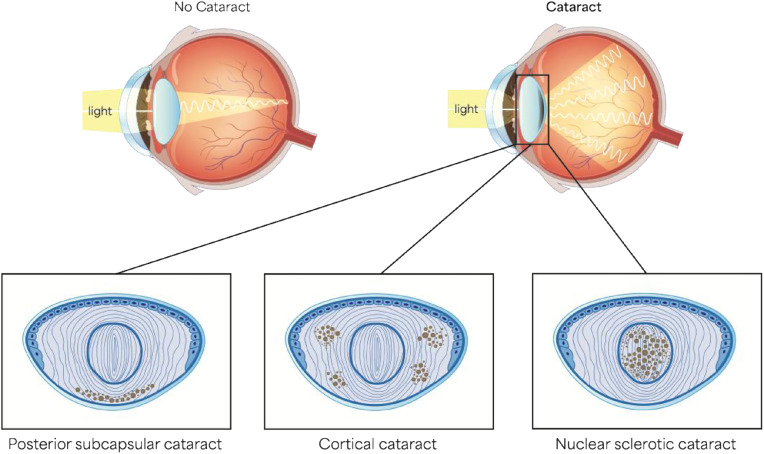
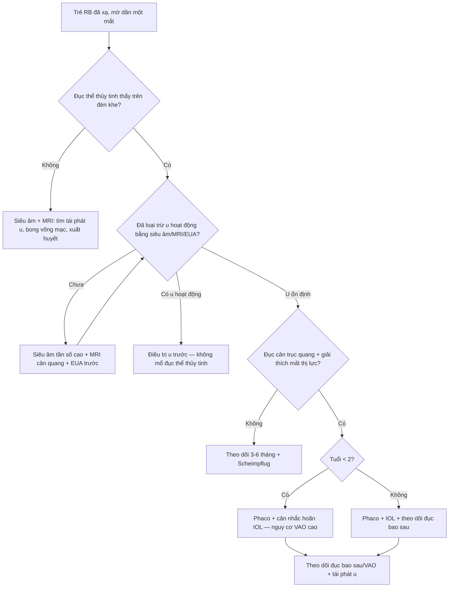
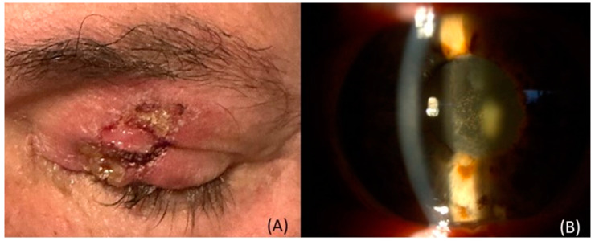
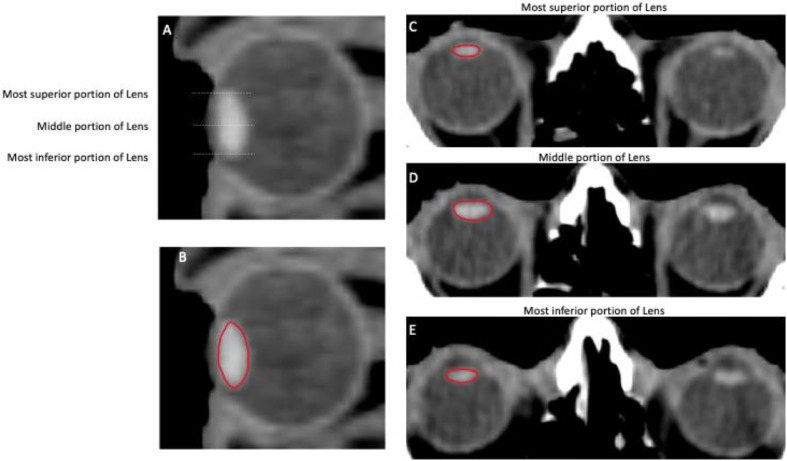
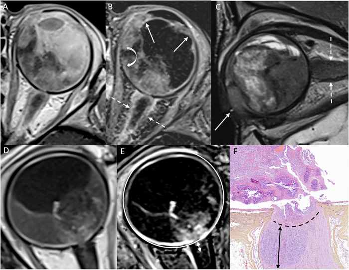

# 6214 — Đục thể thủy tinh do xạ trị u nguyên bào võng mạc ở trẻ / Radiation-induced cataract after retinoblastoma radiotherapy

**Tags:** `pattern:duc-the-thuy-tinh` `pattern:duc-duoi-bao-sau` `pattern:che-truc-quang` `pattern:leukocoria` `pattern:manh-xo-dong-tu` `vung:the-thuy-tinh` `vung:mat` `vung:retinoblastoma` `score:LOCS-III` `protocol:MRI-hoc-mat` `protocol:sieu-am-B-scan` `protocol:Scheimpflug` `protocol:EUA` `protocol:lens-contouring` `incidentaloma:khong`

**Mức chắc chắn (certainty):** tổng hợp y văn (literature synthesis) — dựng từ **tổng quan hệ thống 2026 về sinh đục thể thủy tinh do xạ và contour thấu kính** (Adv Radiat Oncol 2026, **PMC13315199**, CC BY 4.0), **hướng dẫn hình ảnh RB 2025 của mạng lưới châu Âu** (Eur Radiol 2026, **PMC12953368**, CC BY 4.0), **đoàn hệ 184 mắt RB điều trị bảo tồn** (Br J Ophthalmol 2024, **PMC10958276**, CC BY-NC), **6 mắt RB mổ đục thể thủy tinh sau xạ** (Turk J Ophthalmol 2018, **PMC6032962**, CC BY 4.0), **198 mắt đo thể thủy tinh bằng DECT** (Diagnostics 2022, **PMC9689271**, CC BY 4.0), **tổng quan biến chứng xạ u hắc mạc** (Curr Oncol 2023, **PMC10378371**, CC BY 4.0) và **tổng quan phẫu thuật đục thể thủy tinh nhi 2025** (Asia Pac J Ophthalmol 2025, **PMC12399275**, CC BY-NC-ND). Nhóm **không có bệnh nhân của mình**; chỗ chưa đủ chắc ghi "chưa rõ". **Không ghi tên tác giả** — attribution dùng tạp chí + năm + PMCID.

> **Câu chốt:** Trên mắt RB đã xạ, đục thể thủy tinh là **di chứng muộn, gần như không tránh được ở liều cao**: xạ **toàn nhãn cầu 71,1%** so với **xạ chừa thấu kính 35,3%**, **trung bình 51,8 tháng** sau xạ (liều thấu kính trung vị **37,53 Gy** so với **9,93 Gy**). Năm con số phải thuộc: **(1)** ICRP lấy **0,5 Gy** làm ngưỡng đục thấu kính phát hiện được, nhưng **phân liều và suất liều làm thay đổi ngưỡng** và **chưa có ngưỡng phân liều đồng thuận**; **(2)** đục do xạ điển hình là **dưới bao sau (PSC)**, tiềm tàng **2–5 năm** ở liều cao và **5–10 năm hoặc hơn** ở liều thấp — nên "mắt RB sạch u 3 năm" **không** loại trừ đục; **(3)** 5 năm sau xạ, **20–25%** đục khi liều thấu kính trung bình **7 Gy**; **(4)** sau xạ trị RB, **đục thể thủy tinh che mất tầm nhìn đáy mắt** — phải **loại trừ tái phát u bằng siêu âm/MRI trước khi gọi là "chỉ đục thể thủy tinh"**; **(5)** mổ đục thể thủy tinh sau xạ RB **có thể làm, cấy IOL được**, nhưng **đục bao sau 100%**, viêm màng bồ đào **2/6 mắt**, và ca mổ trung vị **96,3 tháng** sau chẩn đoán RB (**67,2 tháng** sau lần điều trị RB cuối).

## 1. Tổng quan bệnh học – cơ chế hình ảnh

### 1.1 TẠI SAO thể thủy tinh "chết dần" sau xạ

- **Thể thủy tinh là mô không mạch, không có khả năng thay thế tế bào:** sợi thủy tinh thể (lens fibers) được sản xuất một lần rồi tồn tại suốt đời; tế bào biểu mô (lens epithelium) nằm dưới bao trước, **phân chia mạnh nhất ở vùng mầm (germinative zone) sát xích đạo**. Vì không có mạch máu, **không có dòng bạch cầu đến dọn tế bào hỏng** và **không có cơ chế sửa chữa tại chỗ** — tổn thương DNA tích lũy và chỉ biểu hiện khi số sợi dị dạng đủ nhiều để tán xạ ánh sáng.
- **Cơ chế phân tử:** tia ion hóa gây **đứt sợi kép DNA** ở tế bào biểu mô vùng mầm; tế bào còn sống nhưng **biệt hóa lệch** — thay vì tạo sợi trong suốt, chúng **di chuyển ra sau dọc bao** và tích tụ **sợi thủy tinh thể phồng, giàu protein bất thường** ở **cực sau**. Protein crystallin bị oxy hóa/kết tụ tạo **phức hợp phân tử lớn**; chỉ số khúc xạ không đồng nhất → **tán xạ ánh sáng (light scattering)** thay vì truyền qua.
- **TẠI SAO lại là "dưới bao sau" (PSC):** bao sau **mỏng nhất ở cực sau** (dày nhất ở xích đạo), nên đây là nơi **sợi dị dạng dễ tích tụ và dễ nhìn thấy nhất**; đồng thời PSC nằm **đúng trục quang**, nên **chỉ một đám mờ nhỏ cũng làm chói và giảm thị lực gần** nhiều hơn một đục vỏ ngoại vi cùng kích thước. Đục do xạ có thể gặp cả **vỏ (cortical)** và **nhân (nuclear sclerotic)**, nhưng **PSC là hình thái đặc trưng nhất**.
- **TẠI SAO có "thời gian tiềm tàng" dài:** đây là **phản ứng mô xác định (deterministic)**, không phải hiệu ứng ngẫu nhiên tức thì; tổn thương phải **tích lũy qua nhiều chu kỳ tế bào** và **mất dần khả năng bù trừ** của biểu mô. Vì vậy **liều càng cao, tiềm tàng càng ngắn**, và **phân liều làm giảm cả tần suất lẫn tốc độ** (tế bào có thời gian sửa chữa giữa các phân liều).

### 1.2 Những con số quyết định cách theo dõi

| Bối cảnh | Liều thấu kính | Đục thể thủy tinh | Tiềm tàng |
|---|---|---|---|
| **RB – xạ toàn nhãn cầu** | trung vị **37,53 Gy** | **71,1%** số mắt | trung bình **51,8 tháng** |
| **RB – xạ chừa thấu kính** | trung vị **9,93 Gy** | **35,3%** số mắt | trung bình **51,8 tháng** |
| Người sống sót RB trưởng thành | **5–22 Gy** so với **< 2,5 Gy** | mổ đục **gấp 6 lần** | — |
| Xạ bản mạch hắc mạc (COMS) | trung bình **7 Gy** | **20–25%** trong 5 năm | ngắn hơn khi liều cao |
| Proton liều cao, phân liều ít | — | **15%** đục, **9%** phải mổ | trung vị **1,6–2,3 năm** |
| Xạ toàn thân ở trẻ | **6–12 Gy** | **50–90%** trong 10 năm | giảm **3 lần** nếu che mắt |

- **Ngưỡng:** ICRP đề xuất **~0,5 Gy** cho **đục thấu kính phát hiện được**, nhưng nhiều nghiên cứu dịch tễ cho thấy **có thể thấp hơn**; **chưa có ngưỡng phân liều được đồng thuận** — đây là lý do các tác giả 2026 kêu gọi **ghi liều thấu kính chuẩn hóa** thay vì chỉ nói "có xạ vào mắt".
- **Tuổi là yếu tố nhạy cảm:** phơi nhiễm **trước 20 tuổi** có quan hệ liều–đáp ứng mạnh hơn; trẻ **< 3 tuổi** có thể đục **sớm và nặng hơn** vì thể tích nhãn cầu nhỏ, thấu kính **gần trường chiếu hơn**, và **còn nhiều năm sống để biểu hiện**.
- **Phân liều/suất liều:** cùng tổng liều, **chia nhiều phân liều nhỏ** làm giảm tổn thương thấu kính; **suất liều cao** (xạ bản mạch, proton liều cao mỗi phân) rút ngắn tiềm tàng.
- **Không phải mọi đục trên mắt RB là do xạ:** đoàn hệ **184 mắt** điều trị bảo tồn (chủ yếu **hóa trị nội động mạch – IAC** và **nội nhãn – IvitC**) có **16,8% đục** sau trung bình **27,6 tháng**; yếu tố độc lập là **nhãn áp cao (p = 0,003)**, **liều melphalan mỗi chu kỳ IAC (p = 0,001)** và **số chu kỳ IvitC (p = 0,04)**. Vì vậy khi đọc "đục sau điều trị RB", phải **tách phần xạ và phần thuốc**.

### 1.3 TẠI SAO hình ảnh trông như vậy (CT – MRI – siêu âm – Scheimpflug)

- **CT:** thể thủy tinh là cấu trúc **đậm nhất trong nhãn cầu bình thường** — đo trên **198 mắt bằng DECT**, thể thủy tinh tự nhiên **~74–79 HU ở 70 keV**, trong khi **dịch kính ~0 HU**. Khi đục do **nước vào sợi thủy tinh thể**, độ đậm **giảm (hypoattenuating)**. Hệ quả kép: **(a)** trên CT vẫn thấy **vị trí** thể thủy tinh nên phát hiện **trật/cắt thể thủy tinh**, nhưng **(b)** CT **không dùng để chẩn đoán hoặc phân độ đục** — và với RB, **CT không còn được khuyến cáo** vì **độ nhạy/phân giải mô mềm thấp** và **chính nó thêm liều xạ cho trẻ có đột biến RB1**.
- **CT trong lập kế hoạch xạ (không phải trong chẩn đoán RB):** thấu kính được **contour toàn bộ** trên lát **1–2 mm**, ghi **Dmax và Dmean**, kèm **số phân liều và suất liều**; đây là dữ liệu để so sánh các nghiên cứu về ngưỡng đục.
- **MRI:** thấu kính **giảm tín hiệu mạnh trên T2** (protein đậm đặc, ít nước tự do) và **trung gian trên T1**, nên **không dùng MRI để phân độ đục**. Giá trị thật của MRI trong RB là **khối u**: xâm lấn **màng bồ đào, củng mạc, tiền đoạn/thể mi, thần kinh thị sau lá sàng**. Hướng dẫn 2025: **CT không còn khuyến cáo**; MRI **T1 sau tiêm oblique axial ≤ 2 mm, ≤ 0,3 × 0,3 mm**, **DWI hốc mắt ≤ 4 mm**, **3D T1 sau tiêm toàn não 1 mm**, **trục sống ≤ 3 mm** khi nghi lan thần kinh.
- **Siêu âm:** đầu dò **tần số cao tới 22 MHz** cho thấy **khối tăng hồi âm từ võng mạc + bóng lưng do vôi hóa vi thể** — gần như **đặc hiệu cho RB**. Khi **phương tiện trong suốt bị đục** (đục thể thủy tinh, xuất huyết dịch kính), siêu âm là **cửa sổ thay thế** để tìm khối u và loại trừ tái phát.
- **Scheimpflug (Pentacam):** chụp cắt quang học tiền đoạn, cho **bản đồ mật độ thấu kính định lượng**, **giảm dao động giữa người đọc** so với **LOCS III** trên đèn khe; hữu ích để **theo dõi tiến triển** và **so sánh chuỗi ảnh** trong nghiên cứu.
- **Đèn khe + LOCS III:** phân độ **NO1–NO6** (nhân), **NC1–NC6** (màu nhân), **C1–C5** (vỏ), **P1–P5** (dưới bao sau). Ba hình thái cần phân biệt trên đèn khe — **dưới bao sau (PSC)**, **vỏ (cortical)** và **nhân (nuclear)** — được vẽ ở hình dưới; **đục do xạ hay gặp PSC nhất**:

- **PSC độ 2–3** ở trục quang **có thể** là ngưỡng chức năng để cân nhắc mổ ở trẻ còn cửa sổ nhược thị (**suy luận** — LOCS III không có ngưỡng mổ chính thức). **Phân độ không quyết định mổ một mình** — quyết định dựa trên **chức năng thị giác, tuổi (nguy cơ nhược thị) và tình trạng u**.

## 2. Mẫu hình + chẩn đoán phân biệt theo vị trí (gamut)

**Mẫu hình trung tâm:** *"Trẻ đã điều trị RB (xạ ± hóa trị) nhiều tháng–nhiều năm, đến với **mờ dần một mắt**, **chói**, **lác mới**, hoặc **mất đỏ đồng tử**; đèn khe thấy **đục dưới bao sau**; đáy mắt nhìn kém."* Từ mẫu hình này, gamut chia theo **cấu trúc đang che trục quang** — không phải theo tên bệnh:

| Cấu trúc che trục quang | Gamut chính | Câu hỏi hình ảnh phải trả lời |
|---|---|---|
| **Thể thủy tinh (do xạ)** | PSC do xạ · đục vỏ/nhân do xạ · đục tiến triển sau xạ bản mạch/proton | Có **tiền sử liều thấu kính** không? Đục có **đúng vùng chiếu** không? |
| **Thể thủy tinh (không do xạ)** | Đục do **melphalan IAC/IvitC** · đục do **corticoid** · đục bẩm sinh/phát triển · đục do chấn thương · đục do viêm màng bồ đào | Đục **một hay hai bên**? Có **dùng corticoid toàn thân/tiêm**? Có **chấn thương**? |
| **Màng đồng tử / tiền phòng** | Màng fibrin sau viêm · màng đồng tử (pupillary membrane) · dính mống mắt sau · **màng co thắt bao trước (phimosis)** | Màng có **mạch máu** không? Có **đồng tử dính** không? |
| **Dịch kính** | Xuất huyết dịch kính · **hạt giống dịch kính (vitreous seeds)** · viêm nội nhãn · dầu silicon/PFCL | Siêu âm/MRI có **khối hoặc hạt** không? |
| **Võng mạc/hắc mạc** | **Tái phát RB** · bong võng mạc · bong hắc mạc · xơ hắc mạc sau xạ | Có **khối ngấm thuốc, vôi hóa, xâm lấn** không? |
| **Mắt giả / IOL** | Đục trục quang sau mổ (VAO) · đục/calci hóa IOL · màng sau IOL | Có **tiền sử mổ đục thể thủy tinh**? |

**Phân biệt theo thời điểm — điểm hay sai:**

- **Trong 6 tháng đầu sau xạ:** đục thể thủy tinh **hiếm khi đã là nguyên nhân**; mờ đục lúc này thường do **viêm, xuất huyết, bong võng mạc, hoặc u tiến triển**.
- **1–5 năm:** cửa sổ điển hình của **đục do xạ liều cao** và cũng là lúc **tái phát u muộn** có thể xuất hiện — hai thứ **cùng gây mờ**.
- **> 5–10 năm:** đục do xạ liều thấp vẫn có thể mới biểu hiện; đồng thời **biến chứng xạ khác** (bệnh võng mạc do xạ, teo thị) có thể là nguyên nhân chính chứ không phải thể thủy tinh.

## 3. Bảng so sánh phân biệt (ma trận đối chiếu)

| Thực thể (entity) | Hình ảnh điển hình (đèn khe / siêu âm / MRI) | Chốt vào (rule-in) | Chốt loại (rule-out) | Gợi ý xác nhận |
|---|---|---|---|---|
| **Đục thể thủy tinh do xạ** | Đục **dưới bao sau** (hạt mịn, dạng đĩa, ánh đa sắc) ở **trục quang**; vỏ/nhân có thể kèm | **Tiền sử xạ có liều thấu kính** + **PSC đúng vùng chiếu** + **tiến triển nhiều tháng–năm**, không đau | **Khối u/vôi hóa trên siêu âm** · đục **không tiến triển** · đục **một vùng ngoại vi** không đúng trường chiếu | Đèn khe + **Scheimpflug** (bản đồ mật độ); đối chiếu **lịch sử liều** |
| **Đục do melphalan (IAC/IvitC)** | Đục **lan tỏa hoặc PSC**, thường **sau nhiều chu kỳ**; kèm **teo hắc mạc, hẹp động mạch** | **Số chu kỳ IAC/IvitC** + **liều melphalan** + **nhãn áp cao**; **không có xạ** | Liều xạ thấu kính **cao và đúng trường** (khi đó xạ là nguyên nhân chính) | Đối chiếu **hồ sơ điều trị**; không phân biệt được bằng hình thái đục |
| **Đục do corticoid** | **PSC hai bên**, đục **trung tâm**, tiến triển **nhanh trong vài tháng** khi liều cao | **Dùng corticoid toàn thân/tiêm kéo dài** + **hai bên** + **giảm khi giảm liều** | **Một bên**, có **xạ một bên**, không dùng corticoid | Ngừng/giảm corticoid nếu an toàn; theo dõi 1–3 tháng |
| **Tái phát RB che trục quang** | **Leukocoria**; siêu âm: khối **tăng hồi âm + vôi hóa**; MRI: khối **ngấm thuốc**, xâm lấn **màng bồ đào/củng mạc/thần kinh thị** | **Khối đặc, vôi hóa, ngấm thuốc**; **đục thể thủy tinh không giải thích hết mờ**; **đáy mắt không thấy u nhưng siêu âm/MRI thấy** | **Thể thủy tinh đục đơn thuần**, **không khối**, **không vôi hóa**, **không ngấm thuốc** | **Siêu âm tần số cao + MRI có cản quang**; **EUA** nếu còn nghi |
| **Màng đồng tử/fibrin sau viêm** | Màng **trắng xám** trước thể thủy tinh, có thể **dính đồng tử**, **co kéo**; thể thủy tinh phía sau **có thể trong** | **Tiền sử viêm/tiền phòng có fibrin**; **màng nằm trước bao trước**; **đồng tử dính** | **Đục nằm trong thể thủy tinh** (sau bao trước), **không dính đồng tử** | Đèn khe **khe sáng hẹp**; **AS-OCT/UBM** phân biệt màng với bao |
| **Đục trục quang (VAO) sau mổ** | Màng xơ/ngọc Elschnig **sau IOL**, ở **trục quang**; tiền sử **mổ đục thể thủy tinh** | **Tiền sử phaco + IOL**, mờ **sau IOL**, đồng tử **còn trong** | **Không mổ**, **không IOL**, **đục nằm trong thể thủy tinh tự nhiên** | Đèn khe + **AS-OCT**; YAG/mổ lại (bài 6211) |
| **Đục bẩm sinh/phát triển muộn** | Đục **khu trú hoặc toàn bộ**, **một bên**, không tiến triển theo kiểu PSC | **Không tiền sử xạ/điều trị RB**, phát hiện ở tuổi nhỏ, **không thay đổi nhiều theo thời gian** | **Tiền sử xạ rõ**, **PSC mới xuất hiện sau xạ**, **tiến triển** | So sánh ảnh **cũ – mới**; hỏi tiền sử |

- **Ảnh đối chiếu:** bài không tạo composite vì 4 ảnh thuộc **4 bài, 3 bệnh nhân khác nhau, 3 modality** (sơ đồ, đèn khe, CT, MRI) và có **nhãn panel riêng**; ghép sẽ làm mất chú giải và dễ gán sai tổn thương.

## 4. Protocol chụp + hệ phân độ/điểm chuẩn hóa

### 4.1 Theo dõi mắt RB sau xạ — "đục thể thủy tinh" không bao giờ là câu hỏi đơn lẻ

- **Trước và ngay sau xạ:** khám **đèn khe** làm **mốc nền** (LOCS III hoặc ảnh Scheimpflug), đo **nhãn áp**, **đáy mắt giãn đồng tử**, và **siêu âm/MRI** theo lịch của bệnh u — không có lịch nhãn khoa đồng thuận riêng cho đục do xạ, nên **mỗi trung tâm phải tự đặt mốc** (suy luận từ khoảng tiềm tàng 2–10 năm).
- **Lịch gợi ý (suy luận, không phải guideline):** khám mắt **mỗi 6–12 tháng trong 5 năm đầu**, sau đó **hằng năm**; **chụp ảnh/Scheimpflug** khi có bất kỳ thay đổi thị lực hoặc đèn khe.
- **Khi phương tiện bị đục:** **siêu âm tần số cao** trước, **MRI hốc mắt có cản quang** khi siêu âm không kết luận hoặc nghi xâm lấn; **EUA** khi cần đánh giá dưới mê. **Không chọc dò/không mổ "thăm dò"** trước khi loại trừ u hoạt động.
- **Lập kế hoạch xạ (nếu còn chỉ định):** contour **toàn bộ thấu kính** trên CT lát **1–2 mm**, ghi **Dmax, Dmean, số phân liều, suất liều**; kỹ thuật **chừa thấu kính** làm giảm đục từ **71,1% xuống 35,3%** nhưng **không về 0**.

### 4.2 Phân độ và ngưỡng xử trí

- **LOCS III:** **P1–P5** cho đục dưới bao sau; **PSC độ 2–3** ở trục quang đã có thể là **ngưỡng chức năng** để cân nhắc mổ ở trẻ **còn cửa sổ nhược thị**, nhưng **quyết định cuối dựa trên thị lực, tuổi và tình trạng u**.
- **Mổ khi:** (a) **u đã ổn định/không hoạt động** (thường **≥ 6 tháng–nhiều năm** sau điều trị cuối; ca-series RB có **67,2 tháng** trung bình từ lần điều trị cuối đến mổ), (b) đục **thực sự cản trục quang** và **giải thích được mất thị lực**, (c) **đã loại trừ tái phát** bằng siêu âm/MRI/EUA, (d) **nhãn áp và tình trạng võng mạc/hắc mạc** cho phép phẫu thuật.
- **IOL ở mắt RB đã xạ:** **có thể cấy** (6/6 mắt trong ca-series có IOL), nhưng **đục bao sau 100%**, **viêm màng bồ đào 2/6**, và **thị lực cuối bị giới hạn bởi u hoàng điểm nguyên phát** — phải tư vấn trước mổ. Ở trẻ **< 2 tuổi**, cấy IOL làm **~40% phải mổ lại vì đục trục quang** (tổng quan phẫu thuật đục thể thủy tinh nhi 2025).

## 5. Biến thể bình thường và cạm bẫy

- **Biến thể bình thường dễ gọi nhầm là đục:**
  - **Đục đường khâu (sutural opacities)** và **đục điểm rải rác** ở trẻ — thường **mờ nhẹ, không tiến triển**, không cản trục quang.
  - **Chấm Mittendorf (Mittendorf dot)** — di tích động mạch hyaloid **ở cực sau thể thủy tinh**, là **đốm trắng nhỏ**, không phải đục lan tỏa.
  - **Vòng Weiger/đường nối bao – màng hyaloid** — bờ tròn rõ, không thay đổi.
- **Cạm bẫy 1 — "đục thể thủy tinh" che tái phát:** đục thể thủy tinh làm **đáy mắt không nhìn được**; nếu chỉ khám đèn khe rồi hẹn mổ, có thể **bỏ sót khối u sau thể thủy tinh**. Luôn **siêu âm/MRI trước khi quyết định mổ** ở mắt RB đã xạ. Chính vì vậy hướng dẫn 2025 nhấn mạnh **siêu âm bổ trợ soi đáy mắt khi có biến chứng như đục thể thủy tinh, xuất huyết, bong võng mạc**.
- **Cạm bẫy 2 — quy mọi đục cho xạ:** ở trẻ RB hiện đại, **melphalan IAC/IvitC** là nguyên nhân thường gặp (**16,8%**), và **corticoid** sau điều trị cũng gây PSC. Hỏi **số chu kỳ, liều, nhãn áp** trước khi kết luận.
- **Cạm bẫy 3 — đo liều sai vị trí:** thấu kính **di động theo hướng nhìn** (gaze) và **co giãn theo tuổi**; contour trên CT không cản quang có thể **lệch** nếu bệnh nhi nhìn lệch. Luôn contour trên **lát mỏng, đúng thì**, và ghi **Dmax** thay vì chỉ **Dmean**.
- **Cạm bẫy 4 — MRI/CT "bình thường" không loại trừ đục:** đục thể thủy tinh **không phải** chẩn đoán hình ảnh; **đèn khe** là chuẩn. CT còn **không được khuyến cáo** cho RB vì **liều và độ phân giải**.
- **Cạm bẫy 5 — nhầm đục trục quang sau mổ với tái phát:** sau phaco, màng xơ/ngọc Elschnig có thể **trắng ở trục quang**; phân biệt bằng **tiền sử mổ, vị trí sau IOL, AS-OCT**, và **siêu âm không có khối** (bài 6211).

## 6. Tự lượng giá — Blind Quiz ngay trên trang tĩnh

**Ca 1 — Người lớn sau xạ trị u hắc mạc, mờ dần**

- **Gợi ý lâm sàng:** bệnh nhân **người lớn** có tiền sử **xạ trị u hắc mạc**, nhiều tháng–năm sau xạ **mờ dần một mắt**, không đau. (Ảnh A là viêm da sau xạ; ảnh B là thể thủy tinh.)
- **Câu hỏi:** (1) Mô tả hình thái đục và vị trí? (2) Vì sao đục do xạ hay nằm **dưới bao sau**? (3) Cần loại trừ gì trước khi mổ?

<b>Bấm để hiện đáp án (findings + chẩn đoán)</b>

- **Dấu hiệu:** (B) **thể thủy tinh trắng đục**, mất trong suốt vùng trục quang; (A) **viêm da/loét sau xạ** ở mi — dấu chứng của **liều xạ cao vào vùng mắt**.
- **Chẩn đoán:** **đục thể thủy tinh do xạ** — tia ion hóa làm tổn thương **tế bào biểu mô vùng mầm**, sợi dị dạng **tích tụ ở cực sau** nơi **bao mỏng nhất** và **đúng trục quang**.
- **Trước khi mổ:** **siêu âm/MRI** loại trừ **tái phát u hắc mạc** và **bong võng mạc**; đánh giá **hoàng điểm** vì thị lực sau mổ phụ thuộc vào tổn thương võng mạc do xạ.
- **Nguồn ảnh:** *Curr Oncol* 2023, **PMC10378371**, Fig. 1 (A–B), **CC BY 4.0** — bệnh nhân **người lớn sau xạ trị u hắc mạc**, **không phải** ca RB; dùng để dạy **hình thái đục do xạ**.

**Ca 2 — Trẻ RB đã xạ, cần ghi liều thấu kính**

- **Gợi ý lâm sàng:** bé gái **4 tuổi**, RB một bên đã xạ **toàn nhãn cầu** 3 năm trước; nay **mờ dần**, đèn khe thấy **đục dưới bao sau**. Trước khi kết luận "đục do xạ", cần **định lượng liều thấu kính**.
- **Câu hỏi:** (1) Thấu kính nằm ở đâu trên các lát A–E? (2) Vì sao phải contour **toàn bộ** thấu kính thay vì đo một điểm? (3) Vì sao **không dùng CT để chẩn đoán đục** ở trẻ RB?

<b>Bấm để hiện đáp án (findings + chẩn đoán)</b>

- **Dấu hiệu:** (A) lát sagittal giữa nhãn cầu — **thấu kính là cấu trúc tăng đậm hình thấu kính** ở **phần trước nhãn cầu**, từ **phần trên (C) → giữa (D) → dưới (E)**; vòng đỏ là **contour thấu kính**.
- **Vì sao contour toàn bộ:** thấu kính **không phải hình cầu đối xứng**; **Dmax** có thể nằm ở **mép trên/dưới** mà một lát giữa bỏ sót; ghi **Dmax + Dmean + phân liều + suất liều** mới so sánh được với ngưỡng **0,5 Gy (ICRP)**.
- **Vì sao CT không chẩn đoán đục:** đục làm thể thủy tinh **giảm đậm do tăng nước**, không có **ngưỡng HU** phân độ; CT còn **không được khuyến cáo cho RB** vì **liều xạ** và **độ phân giải mô mềm**. Đèn khe/Scheimpflug là chuẩn.
- **Nguồn ảnh:** *Adv Radiat Oncol* 2026, **PMC13315199**, Fig. 5, **CC BY 4.0** — minh họa **contour thấu kính trên CT**, không phải ca bệnh nhi cụ thể.

**Ca 3 — Mờ trục quang sau xạ: đục hay tái phát?**

- **Gợi ý lâm sàng:** bé trai **3 tuổi**, RB đã điều trị, **mờ trục quang**; đèn khe chỉ thấy **đục thể thủy tinh**, **không thấy đáy mắt**. Siêu âm không kết luận; MRI được chỉ định.
- **Câu hỏi:** (1) Panels A–E cho thấy gì ngoài "đục thể thủy tinh"? (2) Dấu hiệu nào trên MRI chứng minh **u còn hoạt động/xâm lấn**? (3) Vì sao **không được mổ đục thể thủy tinh ngay**?

<b>Bấm để hiện đáp án (findings + chẩn đoán)</b>

- **Dấu hiệu:** (A) T1 sau tiêm — **khối trong nhãn cầu**; (B) ảnh **trừ** — **ngấm thuốc ở tiền đoạn/thể mi (mũi tên)** kèm **xâm lấn màng bồ đào lớn (mũi tên cong)** và **bất thường thần kinh thị sau lá sàng (mũi tên đứt)**; (C–E) các lát khác xác nhận **xâm lấn ngoài nhãn cầu/thần kinh thị**.
- **Chẩn đoán:** **RB xâm lấn tiền đoạn và thần kinh thị** — đục thể thủy tinh chỉ là **lớp che**, không phải chẩn đoán chính. Trên MRI, **ngấm thuốc bất đối xứng và dày thần kinh thị** là **chốt vào**; **không có khối/không ngấm thuốc** mới là **chốt loại**.
- **Vì sao không mổ ngay:** mổ sẽ **không cải thiện thị lực** và có thể **làm chậm điều trị u**; ưu tiên **điều trị u**, sau đó mới xét đục thể thủy tinh khi u ổn định. Đây là lý do **mọi đục trên mắt RB phải được "nhìn xuyên" bằng siêu âm/MRI trước**.
- **Nguồn ảnh:** *Eur Radiol* 2026, **PMC12953368**, Fig. 5 (A–F), **CC BY 4.0** — minh họa **xâm lấn tiền đoạn/thần kinh thị**, không phải ca đục thể thủy tinh đơn thuần.

## Bài liên quan chéo
- [6213 – Đục thể thủy tinh do chấn thương ở trẻ](../6213-duc-thuy-tinh-chan-thuong-tre/lesson.md)
- [6211 – Đục trục quang (VAO) sau mổ đục thể thủy tinh bẩm sinh](../6211-duc-truc-quang-vao-sau-mo-duc-thuy-tinh-bam-sinh/lesson.md)
- [6210 – Bong võng mạc sau mổ đục thể thủy tinh bẩm sinh](../6210-bong-vong-mac-sau-mo-duc-thuy-tinh-bam-sinh/lesson.md)
- [466 – Toxocariasis nội nhãn: u hạt + dây co kéo (gamut leukocoria)](../466-toxocariasis-noi-nhan/lesson.md)
- [413 – PFV/PHPV: dây xơ dịch kính + nhãn cầu nhỏ](../413-PFV-PHPV-day-xo-the-thuy-tinh/lesson.md)
- [1497 – Tái phát bờ sau xạ bản mạch melanoma hắc mạc](../1497-tai-phat-bo-sau-xa-ban-mach-melanoma-hac-mac/lesson.md)
- [1503 – Di căn gan của melanoma hắc mạc](../1503-di-can-gan-melanoma-hac-mac/lesson.md)

## Ảnh
- 4 ảnh: **sơ đồ 3 loại đục**, **CT contour thấu kính**, **đèn khe đục sau xạ**, **MRI xâm lấn tiền đoạn/thần kinh thị**. Tên file theo `6214_duc-the-thuy-tinh-xa-tri_Modality_SourceID.jpg`; nguồn + giấy phép từng ảnh trong `images/CREDITS.md`.
- **Không tải ảnh nào từ bài không OA**; **không dùng ảnh ca RB cụ thể nào cho hình thái đục** vì bài gốc RB không có hình đèn khe OA phù hợp — ảnh đèn khe là **ca người lớn sau xạ u hắc mạc**, đã ghi rõ trong chú thích và CREDITS.

> Không dùng để chẩn đoán độc lập khi chưa có người hướng dẫn.
