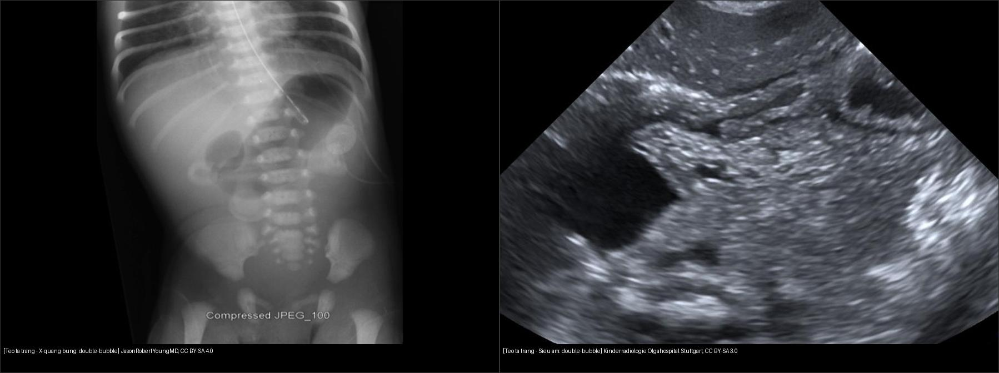
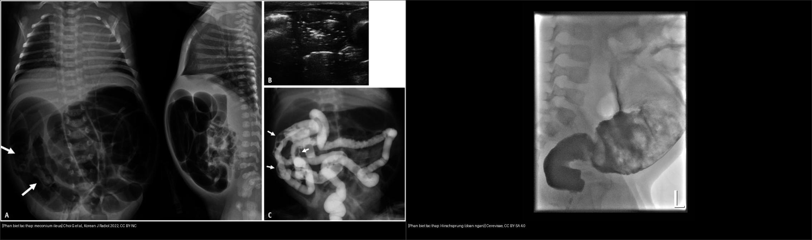
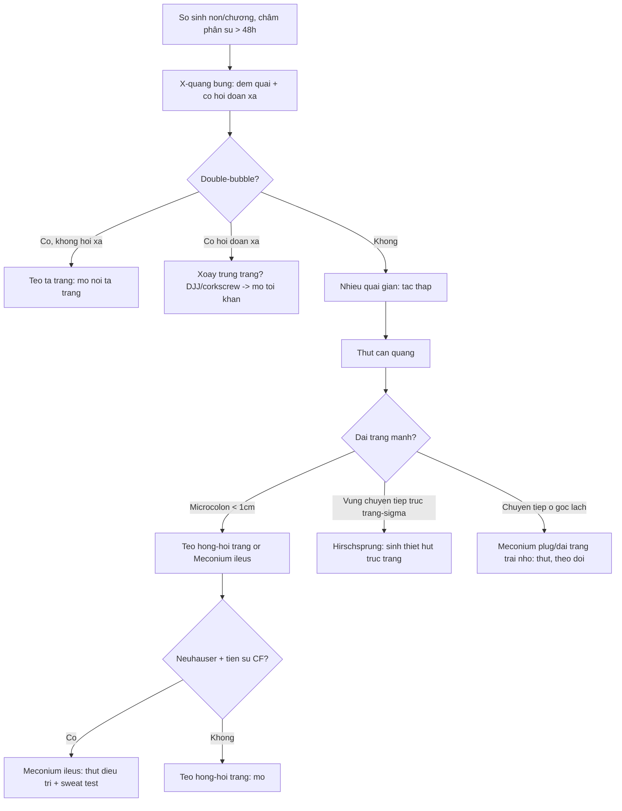
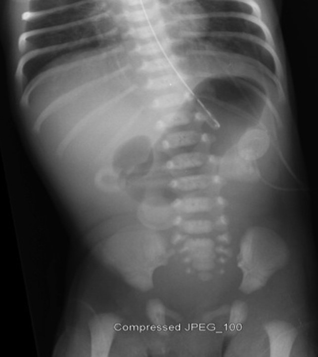
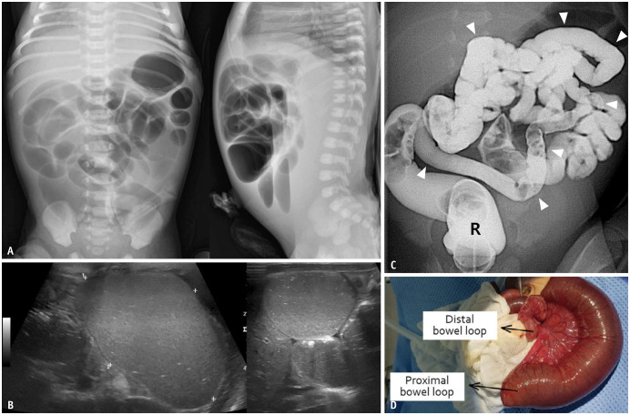
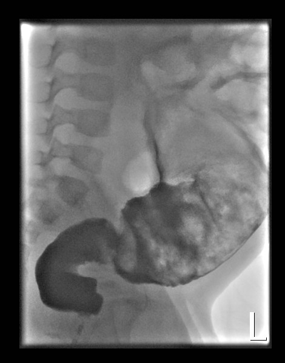
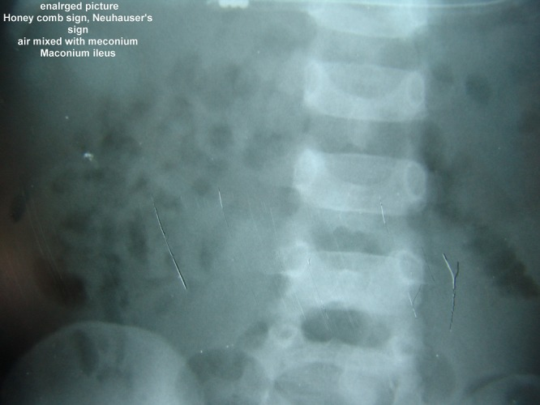

# 622 — Tắc ruột sơ sinh: double-bubble, microcolon, Hirschsprung / Neonatal bowel obstruction

**Tags:** `pattern:tac-ruot-so-sinh` `pattern:double-bubble` `pattern:microcolon` `pattern:transition-zone` `vung:bung-nhi` `score:Neuhauser` `protocol:XR-contrast-enema`
**Mức chắc chắn (certainty):** tổng hợp y văn (literature synthesis) — nhóm tự biên từ y văn mở (J Neonatal Surg 2017, Korean J Radiol 2022, Diagnostics 2024), chưa gắn ca nguyên văn đơn lẻ.

## 1. Tổng quan bệnh học – cơ chế hình ảnh

- Tắc ruột sơ sinh chia **theo mức**: **tắc cao (proximal)** — tá tràng/hỗng tràng đoạn gần (nôn mật sớm, ít quai giãn); **tắc thấp (distal)** — hồi tràng/đại tràng (chướng bụng rõ, nôn muộn). Quy tắc đọc: **càng tắc thấp càng nhiều quai giãn**.
- **TẠI SAO double-bubble (teo tá tràng):** tắc hoàn toàn ở D2 → dạ dày + tá tràng đoạn gần căng đầy khí/dịch (2 bóng hơi có mức dịch), **không khí không qua được** nên **KHÔNG có hơi ở đoạn xa** (đại tràng "câm"). Teo tá tràng **~1/5.000–1/10.000** trẻ sinh, **~30% kèm Trisomy 21**, hay phối hợp **VACTERL** (lỗ hậu môn, thực quản, tim, thận).
- **TẠI SAO microcolon (teo hỗng-hồi tràng):** đại tràng chưa bao giờ nhận phân su nên **không bao giờ giãn**; trên thụt cản quang thấy đại tràng **mảnh < 1 cm ("microcolon")** + quai ruột non **giãn nhiều bên trên** + vùng chuyển tiếp. Microcolon = "đại tràng chưa dùng" → tắc **ở phía trên đại tràng** (teo hỗng-hồi tràng), trừ khi bản thân đại tràng bệnh (teo đại tràng, Hirschsprung đoạn dài).
- **TẠI SAO dấu Neuhauser (meconium ileus):** phân su quánh đặc (inspissated) trộn khí → hình **"bọt xà phòng/honeycomb" (bọt khí nham nhở giữa phân su)**, **không mức khí-dịch** vì phân su dính; bụng "hạt kính" (ground glass) + khối mềm. Meconium ileus chiếm **~10–20% trẻ xơ nang (cystic fibrosis — CF)**; ngược lại **~80–85% meconium ileus có CF**.
- **TẠI SAO Hirschsprung (vô hạch đại tràng):** đoạn **thiếu tế bào hạch (aganglionic)** không giãn được → tắc chức năng; **~90% đoạn ngắn ở trực tràng - sigma**, **1/5.000**, tỉ lệ nam:nữ **~4:1**, **chậm thải phân su > 48 giờ** (bình thường 99% trẻ đủ tháng thải trong 48 giờ). Hình: **vùng chuyển tiếp (transition zone)** trực tràng hẹp → đại tràng trên giãn; **chỉ số trực-tràng-sigma (rectosigmoid index) < 1** là bất thường (bình thường trực tràng ≥ sigma).
- **TẠI SAO meconium plug / đại tràng trái nhỏ (small left colon):** nút phân su/nhu động chậm → đại tràng trái hẹp; gặp ở **con mẹ đái tháo đường**, hay tự khỏi sau thụt.

## 2. Mẫu hình + chẩn đoán phân biệt theo mức tắc (Gamut)

- **Tắc cao — "double-bubble đến đâu là tắc đến đó":** teo tá tràng (D2, 2 bóng, không hơi xa), **pancreas anulare** (vòng tụy quấn D2, hình y hệt), **hội chứng Ladd/ xoắn trung tràng** (tá tràng thay vì tắc thì "corkscrew/whirlpool", DJJ bất thường — cấp cứu gấp), teo hỗng tràng đoạn gần.
- **Tắc thấp — "nhiều quai giãn + đại tràng câm":** teo hỗng-hồi tràng (microcolon + giãn trên), **meconium ileus** (Neuhauser + CF), **Hirschsprung** (transition zone + trễ phân su), **meconium plug/đại tràng trái nhỏ** (nút phân su, con mẹ ĐTĐ), teo đại tràng, **dị tật hậu môn - trực tràng**.
- **Mnemonic tắc ruột sơ sinh "DIME":** **D**uodenal atresia (double bubble), **I**leal/jejunal atresia (microcolon), **M**econium ileus (Neuhauser, CF), **E**nteric/malrotation (volvulus)… cộng thêm **Hirschsprung** (transition + trễ phân su) và **meconium plug** (con mẹ ĐTĐ).
- Nói cách khác: **teo = tắc hoàn toàn (không hơi xa); meconium = tắc trong lòng ruột; Hirschsprung = tắc chức năng (thành ruột).**

## 3. Bảng so sánh phân biệt (ma trận đối chiếu)

| Thực thể (entity) | Hình ảnh điển hình | Chốt vào (rule-in) | Chốt loại (rule-out) | Gợi ý xác nhận |
|---|---|---|---|---|
| **Teo tá tràng** (duodenal atresia) | **Double-bubble dạ dày + D2**, **không hơi đoạn xa**, ~30% Trisomy 21 | **Double-bubble + đại tràng câm hẳn** | Có hơi đoạn xa → không phải teo hoàn toàn (stenosis/pancreas anulare/windsock) | X-quang + siêu âm; mổ (nối tá tràng) |
| **Teo hỗng-hồi tràng** (jejunoileal atresia) | Nhiều quai giãn nhỏ, **microcolon < 1 cm**, quai ruột non **không phân biệt được** với đại tràng | **Microcolon + quai giãn trên + không phân su đầu xa** | Đại tràng **không** mảnh → nghĩ meconium ileus/Hirschsprung | Thụt cản quang (microcolon) rồi mổ |
| **Meconium ileus** (xơ nang) | Bụng hạt kính + **dấu Neuhauser (bọt xà phòng)**, **không mức khí-dịch**, microcolon, đôi khi vôi hóa | **Neuhauser + tiền sử CF/gia đình CF + microcolon** | Thấy rõ mức khí-dịch + quai giãn đều → nghĩ teo/ tắc cơ học khác | Thụt cản quang **điều trị** (water-soluble/N-acetylcysteine), sweat test, gen CFTR |
| **Hirschsprung** (vô hạch) | **Vùng chuyển tiếp trực tràng-sigma**, đại tràng trên giãn, **không hơi trực tràng**, **trễ phân su > 48 giờ** | **Transition zone + rectosigmoid index < 1 + trễ phân su** | Trực tràng giãn bình thường khi thụt → **loại Hirschsprung** (độ nhạy thụt ~70%) | **Sinh thiết hút trực tràng** (vàng chuẩn: mất tế bào hạch) |
| **Meconium plug / đại tràng trái nhỏ** | **Vùng chuyển tiếp rõ ở góc lách (đại tràng trái hẹp)**, nút phân su (khuyết thuốc), con mẹ **ĐTĐ** | **ĐTĐ mẹ + chuyển tiếp ở lách + tự khỏi sau thụt** | Chuyển tiếp ở **trực tràng-sigma** → nghĩ Hirschsprung | Thụt cản quang (điều trị), theo dõi |
| **Xoắn trung tràng** (malrotation/volvulus) | **DJJ bất thường (không qua trái cột sống)**, tá tràng hình **"corkscrew"/"whirlpool"**, SMV trái SMA | **Whirlpool/corkscrew = mổ tối khẩn** | Nôn không mật + DJJ bình thường → nghĩ teo tá tràng | Upper GI (vàng chuẩn), siêu âm Doppler |

- Ảnh ghép đối chiếu — cùng một trục bệnh (tắc cao vs tắc thấp):

*Trái: X-quang bụng — dạ dày + tá tràng căng thành 2 bóng, không hơi đoạn xa. Nguồn: JasonRobertYoungMD, CC BY-SA 4.0. Phải: siêu âm — hai cấu trúc echo trống cạnh nhau (double-bubble). Nguồn: Kinderradiologie Olgahospital Stuttgart, CC BY-SA 3.0. Ảnh ghép letterbox.*

*Trái: meconium ileus — A) bụng hạt kính nhiều quai, B) siêu âm phân su, C) thụt cản quang khối phân su. Nguồn: Choi G et al., Korean J Radiol 2022, CC BY-NC. Phải: Hirschsprung đoạn ngắn — thụt cản quang trực tràng hẹp hơn sigma (transition zone). Nguồn: Cerevisae, CC BY-SA 4.0. Ảnh ghép letterbox.*

### Dấu hiệu chốt cần nhớ
- **Double-bubble:** dạ dày + D2; **hơi đoạn xa = mấu chốt** (không có → teo hoàn toàn; có → hẹp/vòng tụy/windsock).
- **Microcolon:** "đại tràng chưa dùng" — mảnh < 1 cm khi thụt; kèm quai giãn trên → teo hỗng-hồi tràng hoặc meconium ileus.
- **Neuhauser:** bọt xà phòng/honeycomb + không mức khí-dịch trong lòng ruột (phân su trộn khí).
- **Transition zone:** điểm đổi cỡ đột ngột hẹp→giãn; ở Hirschsprung **trực tràng hẹp hơn sigma** (rectosigmoid index < 1).

## 4. Protocol chụp + hệ phân độ/điểm chuẩn hóa

- **Bước 1 — X-quang bụng đầu tay:** phim **thẳng (supine)** + **nghiêng cross-table/decubitus**, đếm số quai giãn, **xem có hơi ở trực tràng/đoạn xa không**, tìm **vôi hóa** (meconium peritonitis) và **hình hạt kính**.
- **Bước 2 — Siêu âm** (không ion hóa, ALARA nhi): double-bubble tá tràng, quai giãn + bia lồng, whirlpool xoắn, phân su.
- **Bước 3 — Thụt cản quang (contrast enema)**: cản quang **tan nước đẳng trương** (không hyperosmolar) — đánh giá **cỡ đại tràng (microcolon?)**, **vùng chuyển tiếp**, nút phân su; **vừa chẩn đoán vừa điều trị** meconium ileus/meconium plug (**thành công ~50–60%** với thụt tan nước). **Cấm thụt khi nghi thủng/viêm phúc mạc.**
- **Bước 4 — Upper GI** là vàng chuẩn cho **xoắn trung tràng** (DJJ + corkscrew); Hirschsprung xác nhận bằng **sinh thiết hút trực tràng**, không bằng hình ảnh.

**Hệ phân độ/điểm chuẩn hóa:** không có RADS riêng; dùng các **mốc định lượng**: double-bubble (có/không hơi xa), **microcolon < 1 cm**, **rectosigmoid index < 1**, **trễ phân su > 48 giờ**, dấu **Neuhauser**.

## 5. Biến thể bình thường và cạm bẫy

- **Có hơi đoạn xa trong nghi teo tá tràng** → teo **không hoàn toàn**: hẹp tá tràng, **pancreas anulare**, **"windsock" web** (màng niêm mạc lồi xuống) — đừng vội kết luận teo.
- **Hirschsprung có thụt cản quang bình thường trong 2–4 tuần đầu** (vùng chuyển tiếp chưa rõ) → **không loại trừ bằng thụt**; phải **sinh thiết trực tràng**.
- **Rối loạn phân su tạm thời của trẻ non tháng** (nhiều quai giãn nhẹ) dễ bị overcall thành tắc — đối chiếu bối cảnh + theo dõi.
- **Meconium ileus vs teo hỗng-hồi tràng** đều **microcolon** — phân biệt bằng **Neuhauser + tiền sử CF** (đảo ngược: không có CF thì nghiêng về teo).
- **Small left colon syndrome ở con mẹ ĐTĐ** giống Hirschsprung trên hình — nhưng **chuyển tiếp cao (góc lách)** và **tự khỏi**; nhớ sinh thiết nếu không tự hết.
- **Satisfaction of search:** thấy double-bubble rồi **dừng lại** → bỏ sót **hội chứng Down/VACTERL** (tim, thận, cột sống). Luôn quét phối hợp.
- **Nhiễm trùng:** luôn loại **nhiễm trùng huyết sơ sinh/NEC** trước khi quy hệ tiêu hóa thuần (bụng chướng + ly bì).

## 6. Tự lượng giá — Blind Quiz

**Ca 1 — Sơ sinh nôn mật xanh sớm, bụng trên chướng nhẹ. Đọc trước, đừng lộ đáp án.**

- Gợi ý lâm sàng (clinical context): nôn mật sớm ngày đầu, bụng dưới xẹp.
- Câu hỏi: Bạn thấy bao nhiêu bóng hơi? Có hơi ở đoạn xa/trực tràng không? 3 chẩn đoán phân biệt + cấu trúc cần kiểm tra kèm?

<b>Bấm để hiện đáp án (findings + chẩn đoán)</b>

- Dấu hiệu (findings): **2 bóng hơi (dạ dày trái lớn + tá tràng phải)** = **double-bubble**; **không hơi đại tràng/trực tràng** phía dưới.
- Chẩn đoán (diagnosis): **teo tá tràng** — vì tắc hoàn toàn ở D2 nên khí không qua được "đại tràng câm". Kiểm tra kèm: siêu âm tim, cột sống, thận, NST (Trisomy 21 ~30%).
- Phân biệt: **pancreas anulare** (hình y hệt, có thể còn ít hơi xa), **windsock web** (thường còn hơi xa), **xoắn trung tràng** (corkscrew, mổ tối khẩn).
- Nguồn ảnh: JasonRobertYoungMD, Wikimedia Commons, CC BY-SA 4.0.

**Ca 2 — Sơ sinh chướng bụng, không thải phân su. Thụt cản quang dưới đây.**

- Câu hỏi: Đại tràng (C) có cỡ thế nào? Điều đó gợi tắc ở đâu? 2 phân biệt chính + xét nghiệm kèm?

<b>Bấm để hiện đáp án (findings + chẩn đoán)</b>

- Dấu hiệu (findings): quai ruột non giãn nhiều (A), **microcolon** (C) — đại tràng mảnh, không dãn; siêu âm (B) quai giãn.
- Chẩn đoán (diagnosis): **teo hỗng-hồi tràng** — "đại tràng chưa dùng" vì phân su không bao giờ xuống tới.
- Phân biệt: **meconium ileus** (cần Neuhauser + tiền sử CF), **Hirschsprung đoạn dài** (transition rõ hơn). Xét nghiệm: sweat test/gen CFTR nếu nghi CF; mổ nối ruột.
- Nguồn ảnh: Choi G, Je BK, Kim YJ. Korean J Radiol 2022;23:124-138, CC BY-NC.

**Ca 3 — Trẻ chậm thải phân su > 48 giờ, chướng bụng. Đọc phim trước.**

- Câu hỏi: So sánh cỡ trực tràng với sigma? Đây là hiện tượng gì? Xác nhận bằng gì?

<b>Bấm để hiện đáp án (findings + chẩn đoán)</b>

- Dấu hiệu (findings): **trực tràng hẹp hơn sigma** ngay trên nó (rectosigmoid index < 1) — **vùng chuyển tiếp** trên thụt cản quang; đoạn trên giãn.
- Chẩn đoán (diagnosis): **Hirschsprung (bệnh vô hạch, đoạn ngắn)** — đoạn thiếu tế bào hạch không giãn được → tắc chức năng.
- Lưu ý phản biện: **thụt cản quang bình thường không loại trừ Hirschsprung** (đặc biệt 2–4 tuần đầu); xác nhận bằng **sinh thiết hút trực tràng** (mất tế bào hạch).
- Nguồn ảnh: Cerevisae, Wikimedia Commons, CC BY-SA 4.0.

**Ca 4 — Sơ sinh xơ nang (CF), bụng chướng, X-quang "hạt kính". Bạn tìm dấu gì?**

<b>Bấm để hiện đáp án (findings + chẩn đoán)</b>

- Dấu hiệu (findings): **bọt khí nham nhở trộn phân su (honeycomb/soap-bubble) = dấu Neuhauser**, **không mức khí-dịch**, bụng "hạt kính".
- Chẩn đoán (diagnosis): **meconium ileus** (phân su quánh bít hồi tràng) — gắn với CF (~80–85% có CF).
- Xử trí: **thụt cản quang tan nước đẳng trương/N-acetylcysteine vừa chẩn đoán vừa điều trị**; nếu thất bại/mẹo complication → mổ (Santulli, Bishop-Koop). Cấm thụt nếu nghi thủng.
- Nguồn ảnh: Prasad GR, Aziz A. J Neonatal Surg 2017;6(1):6, CC BY 3.0.

## Bài liên quan chéo
- [600 – Tổng quan Nhi](../600-tong-quan-nhi-khoa/lesson.md)
- [610 – Suy hô hấp sơ sinh & dị dạng phổi](../610-suy-ho-hap-so-sinh-va-di-dang-phoi/lesson.md)
- [620 – Cấp cứu tiêu hóa nhi (HPS, xoắn, lồng, NEC)](../620-cap-cuu-tieu-hoa-so-sinh-nhu-nhi/lesson.md)
- [625 – Teo đường mật & vàng da sơ sinh](../625-vang-da-tac-mat-so-sinh-teo-duong-mat/lesson.md)
- [162 – Tắc ruột (người lớn)](../162-tac-ruot/lesson.md)
- [640 – Háng nhi & NAT](../640-khop-hang-nhi-DDH-Perthes-SCFE-va-NAT/lesson.md)

## Ảnh
- Tên file `622_tac-ruot-so-sinh_*`; nguồn + giấy phép từng ảnh trong `images/CREDITS.md`.
- Ảnh ghép đối chiếu tạo bằng `tools/make_composite.py` (letterbox nền đen, giữ aspect).

> Không dùng để chẩn đoán độc lập khi chưa có người hướng dẫn.
