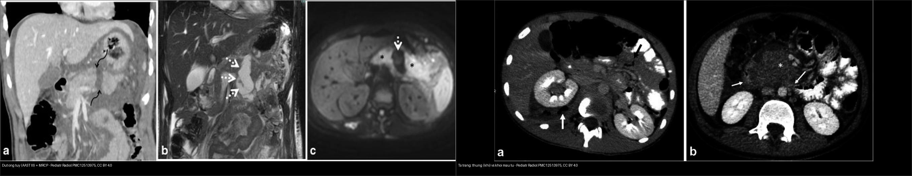
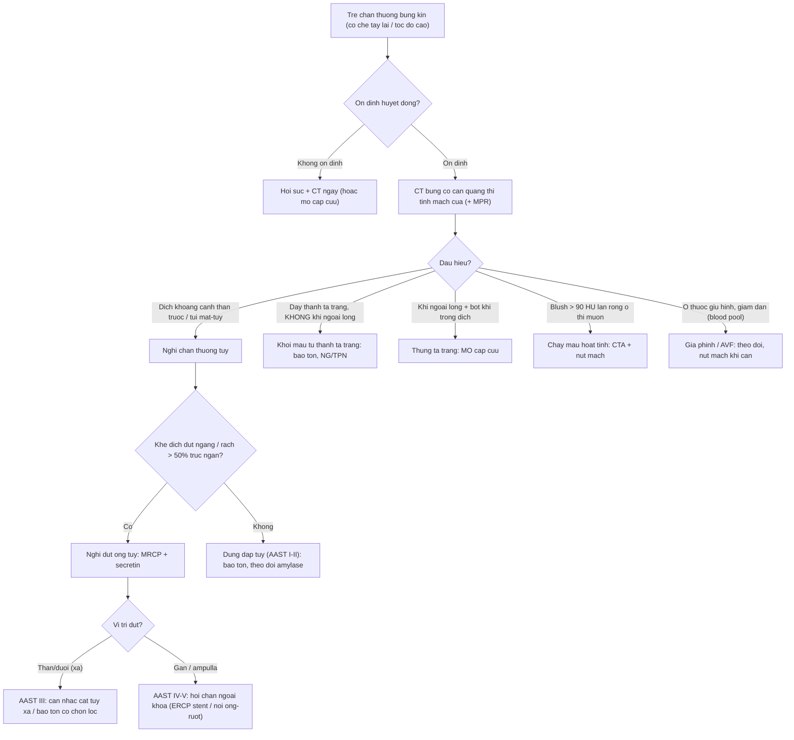
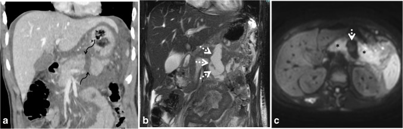
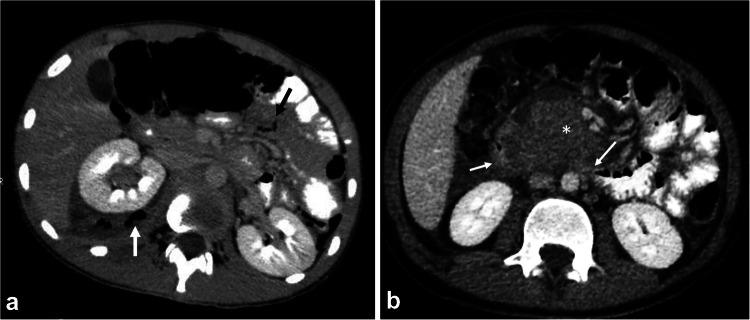
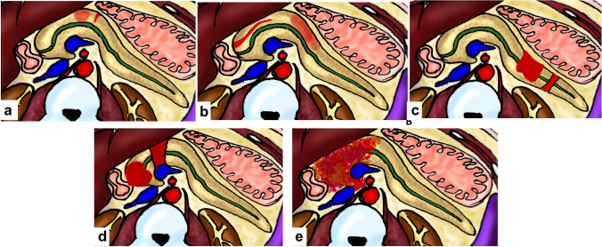
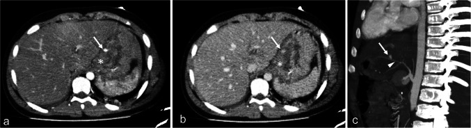

# 623 — Chấn thương tụy–tá tràng ở trẻ: AAST tụy I–V, đứt ống tụy (khe 10 mm) & khối máu tụ thành tá tràng

**Tags:** `pattern:chan-thuong-bung` `pattern:dut-ong-tuy` `vung:tuy-ta-trang` `score:AAST` `protocol:CT-bung-chant-thuong`
**Mức chắc chắn (certainty):** tổng hợp y văn (literature synthesis) — nhóm tự biên từ bài tổng quan CT chấn thương bụng nhi có số (Pediatric Radiology 2025, CC BY 4.0) + AAST-OIS 2018; **các ca trong quiz là ca nguyên văn (verbatim case)** chép đúng tuổi – cơ chế – chú thích gốc.

## 1. Tổng quan bệnh học – cơ chế hình ảnh

Chấn thương bụng kín ở trẻ (ngã xe đạp, tay lái đâm vào bụng — *handlebar injury*, tai nạn xe) có thể làm tổn thương **tụy và tá tràng** — một **cặp "ẩn" nhất của chấn thương bụng** vì cả hai nằm **sau phúc mạc**.

- **Cơ chế:** tụy và **đoạn D2–D3 tá tràng** bị **kẹp giữa vật đâm (tay lái/cột lái) và cột sống** → **đụng dập/đứt tụy** và **khối máu tụ thành tá tràng** (nếu rách một phần) hoặc **thủng tá tràng** (nếu rách toàn bộ chiều dày).
- **TẠI SAO khó phát hiện sớm:** tụy **sau phúc mạc**, vỡ nhỏ không chảy máu ồ ạt → dấu hiệu **xuất hiện muộn và không đặc hiệu** (đau bụng, nôn, sốt); **amylase/lipase** có thể **bình thường** vài giờ đầu. Trên CT, dấu hiệu **gián tiếp** hay gặp nhất là **dịch ở khoang cạnh thận trước (anterior pararenal space) / túi mật–tụy (lesser sac)** — *"dịch bất thường ở khoang cạnh thận trước là chỉ báo tốt nhất của chấn thương tụy"*; kèm **tụy to, thâm nhiễm mỡ quanh tụy, dịch tự do, rồi nang giả** (do viêm tụy sau chấn thương).
- **TẠI SAO "ống tụy" là chìa khóa:** **đứt ống tụy chính** → dịch tụy rò ra → **nang giả, rò tụy, hẹp ống** và quyết định **mổ (cắt tụy xa)** vs **điều trị bảo tồn**. Trên CT, **tổn thương ống tụy có thể dự đoán** khi **đường rách kéo dài > 50% trục ngắn**, **dịch tự do ổ bụng**, hoặc **dịch khu trú quanh tụy** (điển hình: **khe rách chứa dịch rộng ~10 mm** giữa hai đầu tụy = dấu đứt ống).
- **TẠI SAO MRI/MRCP:** **MRI + MRCP (có thể tiêm secretin)** thể hiện **độ liên tục của ống tụy** — đứt ống = **không thấy ống ở vị trí tổn thương**; MRI cũng **theo dõi biến chứng muộn** (nang giả, rò, hẹp). Ở trẻ, ưu tiên MRI thay CT theo dõi để **giảm phơi nhiễm tia**.
- **Hệ phân độ AAST-OIS tụy (2018) — theo ống tụy:**
  - **I:** đụng dập nhỏ / rách nông, **không tổn thương ống**.
  - **II:** đụng dập lớn / rách, **không tổn thương ống**, không mất mô.
  - **III:** **đứt tụy xa hoặc rách sâu có tổn thương ống tụy xa**.
  - **IV:** **đứt tụy gần (proximal) hoặc tổn thương nặng ảnh hưởng bóng Vater / ống mật chủ trong tụy**.
  - **V:** **vỡ nát đầu tụy (shattered pancreas)**.
- **Điều trị theo huyết động:** đa số chấn thương tụy ở trẻ **điều trị bảo tồn** (ổn định huyết động); **đứt ống tụy xa (grade III)** có thể là chỉ định **cắt tụy xa**; **grade IV** (tổn thương gần/ampulla) phức tạp hơn (nối ống–ruột / dẫn lưu / ERCP đặt stent tùy ca).

## 2. Mẫu hình + chẩn đoán phân biệt theo vị trí (gamut)

**Gamut theo vị trí – cơ chế:**

- **Tụy thân/đuôi (distal):** đứt ngang / rách sâu có **tổn thương ống tụy xa** → **AAST III** (thường gặp nhất khi có tổn thương ống; cand. cắt tụy xa).
- **Tụy đầu/cổ (proximal) + quanh bóng Vater:** đứt gần, tổn thương **ampulla/ống mật chủ trong tụy** → **AAST IV**; vỡ nát đầu tụy → **AAST V**.
- **Tá tràng D2–D3 (sau phúc mạc, cạnh đầu tụy):** **khối máu tụ thành tá tràng** (rách một phần, *không có khí ngoài lòng*) vs **thủng tá tràng** (rách toàn bộ, **khí ngoài lòng + dịch quanh thận chứa bọt khí**).
- **Hệ quả mạch máu:** **giả phình / rò động–tĩnh mạch (AVF)** trong nhu mô tạng (contained vascular injury) — đòi hỏi theo dõi/nút mạch.

**Gamut theo dấu hiệu CT (cùng tạng, khác mức độ):**
- *Đụng dập (contusion):* vùng giảm đậm độ ở thì tĩnh mạch cửa → **trở về đậm độ bình thường ở thì muộn**.
- *Mất mạch/nhồi máu (devascularization/infarction):* vùng **không ngấm thuốc ở MỌI thì**, đậm độ không đổi.
- *Chảy máu hoạt tính (active bleeding):* **blush > 90 HU, lan rộng/tăng ở thì muộn**.
- *Giả phình/AVF (pseudoaneurysm):* **ổ thuốc hình tròn, giữ hình và đậm độ giảm dần theo dòng máu** (theo blood pool).
- *Cục máu cục trấn (sentinel clot):* khối máu tụ **> 60 HU** chỉ điểm cơ quan bị tổn thương gần đó.

## 3. Bảng so sánh phân biệt (ma trận đối chiếu)

| Thực thể (entity) | Hình ảnh điển hình (CT/MRI) | Chốt vào (rule-in) | Chốt loại (rule-out) | Gợi ý xác nhận |
|---|---|---|---|---|
| Đứt ống tụy (AAST III–IV) | **Khe rách chứa dịch giữa hai đầu tụy (~10 mm)** ở thân/đuôi (III) hoặc gần/ampulla (IV); dịch khoang cạnh thận trước/túi mật–tụy | **Khe dịch đứt ngang + đường rách > 50% trục ngắn / dịch khu trú quanh tụy** | Đụng dập/đụng nhập không tổn thương ống (AAST I–II) → bảo tồn | **MRCP + secretin** (mất liên tục ống), MRI theo dõi |
| Đụng dập tụy (AAST I–II) | Vùng giảm đậm độ khu trú thì tĩnh mạch cửa, **ngấm lại ở thì muộn** | **Ngấm lại đồng đậm ở thì muộn** + amylase tăng | Vùng không ngấm mọi thì → mất mạch; khe dịch → đứt ống | Theo dõi amylase/lipase, CT/MRI lại |
| Khối máu tụ thành tá tràng | Dày thành **D2–D3 khu trú**, **KHÔNG khí ngoài lòng**, không thoát thuốc | **Dày thành không có khí ngoài lòng** + cơ chế tay lái | **Có khí ngoài lòng/bọt khí** → thủng, cần mổ | Nội soi/ống mềm khi nghi; theo dõi bảo tồn |
| Thủng tá tràng | **Khí ngoài lòng** + dịch quanh thận **chứa bọt khí**, dịch tự do | **Khí ngoài lòng + bọt khí trong dịch** | Không khí ngoài lòng → chỉ khối máu tụ | Mổ cấp cứu, khám lại bụng liên tục |
| Giả phình / AVF trong tạng | Ổ thuốc **giữ hình, đậm độ giảm ở thì muộn**, có khi ngấm sớm TM lân cận | **Theo blood pool (giảm dần)** — khác chảy máu hoạt tính | Blush lan rộng/tăng ở thì muộn → chảy máu hoạt tính, can thiệp | CTA/can thiệp nút mạch |

*Trái: (a) CT thì tĩnh mạch cửa — đứt thân tụy với **khe dịch 10 mm** (đứt ống tụy, AAST III); (b,c) MRI T2/DWI theo dõi dịch tụ. Phải: (a) thủng tá tràng (khí/bọt khí quanh thận); (b) **khối máu tụ thành D2–D3 tá tràng**. Nguồn: Mohammad SA et al., Pediatr Radiol 2025 (PMC12513975), CC BY 4.0. Ảnh ghép letterbox, giữ tỉ lệ.*

## 4. Protocol chụp + hệ phân độ/điểm chuẩn hóa

- **CT bụng có cản quang (không cần thì động mạch thường quy ở trẻ):**
  - **Thì tĩnh mạch cửa (portal venous phase)** là thì **chính** để đánh giá tạng đặc (gan, lách, tụy). Ở trẻ **KHÔNG chụp thì động mạch thường quy** để giảm tia — chỉ thêm thì động mạch khi **cơ chế tốc độ cao/xuyên thấu** hoặc **nghi chảy máu hoạt tính/chấn thương mạch**.
  - **Thì muộn (5–10 phút)** để **phân biệt chảy máu hoạt tính** (blush lan rộng/tăng) vs **giả phình/AVF** (giữ hình, giảm dần theo blood pool).
  - **Tái tạo MPR (coronal/sagittal)** vì các tổn thương tụy–tá tràng nằm ngang khó thấy trên lát cắt ngang; dùng **cửa sổ xương** tìm gãy xương.
- **Chỉ số định lượng cần nhớ:** **sentinel clot > 60 HU**; **blush chảy máu hoạt tính > 90 HU**; **khe dịch đứt ống ~10 mm**; **đường rách > 50% trục ngắn** gợi ý tổn thương ống.
- **Đánh giá ống tụy:** **MRCP (có thể tiêm secretin)** là chìa khóa khi nghi tổn thương ống; **MRI** theo dõi biến chứng muộn (nang giả, rò, hẹp) và hạn chế tia.
- **AAST-OIS 2018 (tụy):** I–II (không tổn thương ống) → bảo tồn; **III** (đứt ống xa) → cân nhắc cắt tụy xa; **IV** (đứt gần/ampulla/ống mật chủ trong tụy); **V** (vỡ nát đầu tụy).
- **Xét nghiệm hỗ trợ:** **amylase/lipase** (có thể bình thường sớm → lặp lại), công thức máu/hematocrit, AST/ALT (gan), siêu âm FAST đầu tay; phác đồ BATiC/khác dùng đường cắt điểm để quyết định CT (ổn định huyết động là yếu tố quyết định điều trị ở trẻ).

## 5. Biến thể bình thường và cạm bẫy

- **Chấn thương tụy đến muộn:** trẻ đau bụng âm ỉ, **amylase có thể bình thường vài giờ đầu** → **đừng loại trừ tụy chỉ vì men tụy bình thường**; nếu bụng xấu đi, **chụp/đo lại**.
- **Bỏ sót dịch khoang cạnh thận trước/túi mật–tụy** — đây là **dấu hiệu gián tiếp quan trọng nhất**; phải chủ động tìm trên từng lát.
- **Phân biệt "đụng dập" với "mất mạch":** đụng dập **ngấm lại ở thì muộn**; vùng **không ngấm ở mọi thì** là **mất mạch/nhồi máu** (tiên lượng khác).
- **Khối máu tụ thành tá tràng vs thủng:** chìa khóa là **khí ngoài lòng**; **khối máu tụ không khí ngoài lòng** thường **bảo tồn** được (nhịn ăn + hút dạ dày + nuôi dưỡng tĩnh mạch), nhưng cần theo dõi vì có thể hoại tử/thủng muộn.
- **Giả ảnh làm cứng tia (beam hardening)** do ống thông dạ dày/xương sườn → **giả đụng dập/rách** ở tạng lân cận; đọc lại đối chiếu cửa sổ khác và **MPR**.
- **Tĩnh mạch sinh dục bị nhầm là niệu quản** → theo dõi đường đi + **thì muộn** để phân biệt.
- **Không chụp thì động mạch thường quy ở trẻ** — tránh tăng liều tia không cần thiết; chỉ thêm khi nghi tổn thương mạch/chảy máu hoạt tính.

## 6. Tự lượng giá — Blind Quiz (ảnh trơn ngoài, đáp án ẩn trong khối chi tiết)

**Ca 1 — Bé trai 16 tuổi, chấn thương bụng. CT thì tĩnh mạch cửa + MRI theo dõi. Mô tả thân tụy trước khi mở đáp án.**

- Gợi ý lâm sàng: đau bụng/tăng men tụy sau chấn thương; chưa có biến chứng.
- Câu hỏi: Dấu hiệu ở thân tụy? Khe rộng bao nhiêu và nghĩa là gì? Phân độ AAST và hướng xử trí?

<b>Bấm để hiện đáp án (findings + chẩn đoán)</b>

- **Dấu hiệu:** (a) CT coronal thì tĩnh mạch cửa — **rách giảm đậm độ đứt ngang thân tụy (distal) với khe chứa dịch rộng 10 mm** = **đứt ống tụy**; (b) MRI T2 — ổ dịch khu trú; (c) DWI — dịch khuếch tán tự do.
- **Chẩn đoán:** **đứt tụy xa có tổn thương ống = AAST grade III**. Khe dịch ~10 mm giữa hai đầu tụy là dấu chốt đứt ống; trên CT còn gợi ý bằng **dịch khu trú quanh tụy + đường rách > 50% trục ngắn**.
- **Xử trí:** xác nhận ống bằng **MRCP + secretin**; grade III (ống xa) có thể **cắt tụy xa** hoặc bảo tồn chọn lọc; theo dõi biến chứng muộn (nang giả, rò) bằng MRI.
- Nguồn ảnh: Mohammad SA et al., Pediatr Radiol 2025 (PMC12513975), Fig 18, CC BY 4.0.

**Ca 2 — Hai trẻ chấn thương bụng. Một ca có khí ngoài lòng, một ca không. Phân biệt và xử trí?**

<b>Bấm để hiện đáp án (findings + chẩn đoán)</b>

- **Dấu hiệu:** (a) Bé trai 14 tuổi — **thủng tá tràng**: dịch quanh thận **chứa bọt khí** + **khí tự do** giữa các quai ruột. (b) Bé trai 10 tuổi — **khối máu tụ thành D2–D3 tá tràng** (dày thành khu trú, lan vào mạc treo), **KHÔNG khí ngoài lòng**.
- **Chẩn đoán – xử trí:** **khí ngoài lòng = rách toàn bộ chiều dày → mổ cấp cứu**. **Không khí ngoài lòng (chỉ khối máu tụ)** → thường **bảo tồn** (nhịn ăn, hút dạ dày, nuôi dưỡng tĩnh mạch), theo dõi vì có thể thủng/hoại tử muộn.
- Nguồn ảnh: Mohammad SA et al., Pediatr Radiol 2025 (PMC12513975), Fig 19, CC BY 4.0.

**Ca 3 — Sơ đồ phân độ chấn thương tụy. Ghép mỗi hình với phân độ và tiêu chí ống tụy.**

<b>Bấm để hiện đáp án (findings + chẩn đoán)</b>

- **a = AAST I:** đụng dập nhỏ / rách nông, **không tổn thương ống**. **b = AAST II:** đụng dập lớn / rách **không tổn thương ống**.
- **c = AAST III:** **đứt tụy xa hoặc rách sâu có tổn thương ống tụy xa**. **d = AAST IV:** **đứt gần / tổn thương ampulla & ống mật chủ trong tụy**. **e = AAST V:** **vỡ nát đầu tụy (shattered pancreas)**.
- Chốt: **phân độ dựa trên có/không tổn thương ống tụy chính** — I–II không ống → bảo tồn; III trở lên liên quan ống → nguy cơ nang giả/rò, cần đánh giá ống (MRCP) và hội chẩn ngoại.
- Nguồn ảnh: Mohammad SA et al., Pediatr Radiol 2025 (PMC12513975), Fig 17, CC BY 4.0.

**Ca 4 — Bé trai 15 tuổi sau tai nạn. CT thì động mạch và tĩnh mạch.**

<b>Bấm để hiện đáp án (findings + chẩn đoán)</b>

- **Dấu hiệu:** (a–c) CT thì động mạch/tĩnh mạch + MIP — **khối máu tụ thành dạ dày** (*) kèm **ổ thuốc cản quang đi theo dòng máu (contained vascular injury)** gần động mạch vị trái (đầu mũi tên).
- **Chẩn đoán – xử trí:** **khối máu tụ thành dạ dày + tổn thương mạch kín (giả phình/contained injury)**. Ổ thuốc **giữ hình và giảm đậm độ theo thì** = theo blood pool (giả phình), khác **chảy máu hoạt tính** (blush lan rộng/tăng). Theo dõi sát; **nút mạch** khi chảy máu/giả phình không tự cầm.
- Nguồn ảnh: Mohammad SA et al., Pediatr Radiol 2025 (PMC12513975), Fig 20, CC BY 4.0.

## Bài liên quan chéo
- [600 – Tổng quan Hệ Nhi khoa](../600-tong-quan-nhi-khoa/lesson.md)
- [620 – Cấp cứu tiêu hóa sơ sinh & nhũ nhi](../620-cap-cuu-tieu-hoa-so-sinh-nhu-nhi/lesson.md)
- [622 – Tắc ruột sơ sinh](../622-tac-ruot-so-sinh/lesson.md)
- [636 – Cấp cứu niệu–sinh dục nhi (chấn thương thận AAST & xoắn)](../636-cap-cuu-nieu-sinh-duc-nhi/lesson.md)
- [140 – Lách & chấn thương tạng đặc](../140-lach-tang-dac/lesson.md)
- [135 – Viêm tụy cấp (Atlanta)](../135-viem-tuy-Atlanta/lesson.md)
- [136 – U nang tụy](../136-u-nang-tuy/lesson.md)

## Ảnh
- Tên file: `NNN_slug_Modality_SourceID.jpg`. Chi tiết nguồn + giấy phép từng ảnh: `images/CREDITS.md` và `sources.md`.
- Toàn bộ ảnh nguồn **CC BY 4.0** (ghi nguồn đầy đủ); ảnh ghép đối chiếu tạo bằng `tools/make_composite.py` (letterbox, không crop/kéo giãn).

> Không dùng để chẩn đoán độc lập khi chưa có người hướng dẫn.
