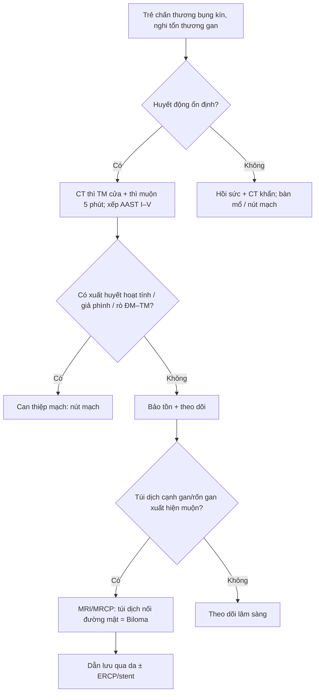
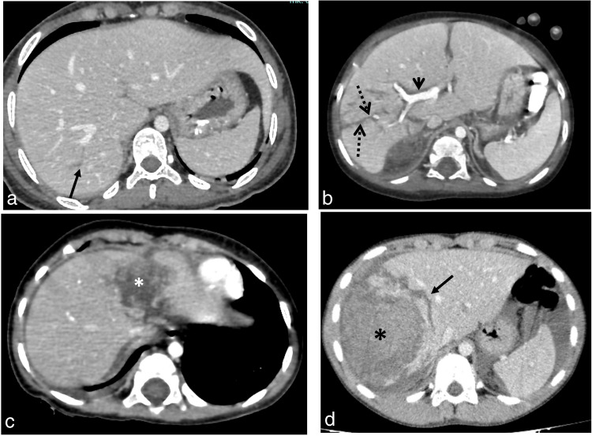
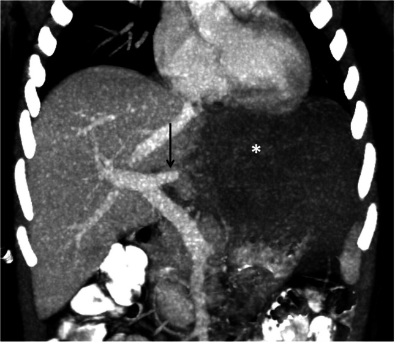
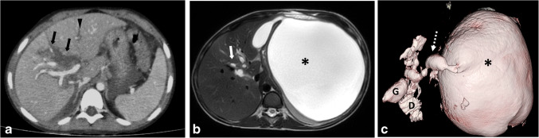
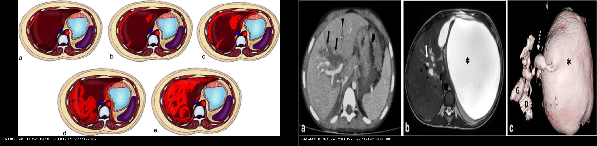

# 624 — Chấn thương gan & đường mật ở trẻ (AAST gan I–V, biloma & tổn thương đường mật muộn) / Pediatric hepatic & biliary trauma

**Tags:** `pattern:chan-thuong-gan-nhi` `pattern:biloma` `pattern:tui-mat-gia` `vung:gan` `vung:duong-mat` `score:AAST` `protocol:CT-bung-can-quang` `protocol:MRCP`
**Mức chắc chắn (certainty):** tổng hợp y văn (literature synthesis) + ca nguyên văn (verbatim case) cho các ca ảnh — số liệu lấy từ bài gốc có PMCID, ảnh CC BY 4.0.

## 1. Tổng quan bệnh học – cơ chế hình ảnh

- Ở trẻ, chấn thương bụng kín (blunt abdominal trauma) là nguyên nhân hàng đầu của **chấn thương tạng đặc**; gan là tạng đặc đứng thứ hai sau lách về tần suất tổn thương. Cơ chế điển hình: tay lái xe đạp/xe máy hoặc ngã đập vùng hạ sườn phải → **nén – cắt** (compression–shear) tại nơi gan tựa vào khung sườn/cột sống tạo đường vỡ (laceration), hoặc lực gây **bóc vỏ dưới bao** (subcapsular) khi nhu mô dịch chuyển trên bao Glisson cố định.
- **Gan cấp máu kép** (dual supply): ~75% từ tĩnh mạch cửa (portal vein), ~25% từ động mạch gan (hepatic artery). Vì vậy mô gan **ngấm mạnh ở thì tĩnh mạch cửa** (portal venous phase, ~70–80 giây). Máu/đường vỡ **không ngấm thuốc** → xuất hiện dưới dạng **dải/vùng giảm đậm độ** (hypodense) tương phản rõ nhất với nhu mô gan sáng ở thì này. Đây là lý do CT phải **có cản quang + đúng thì**; CT không cản quang gần như không thấy đường vỡ ở gan còn mạch.
- **Xuất huyết hoạt tính (active hemorrhage)** = đám máu có đậm độ **tương đương động mạch đang ngấm (~>90 HU)**, **giữ nguyên/lan ra ở thì muộn (5 phút)** và **không đi theo bể máu lưu hành** — khác cục máu đông "lính gác" (sentinel clot, ~45–70 HU) là máu đã đông, bám sát tổn thương, không đổi ở thì muộn. **Giả phình mạch (pseudoaneurysm)** = túi tròn ngấm thuốc **giữ nguyên hình dạng** giữa các thì; **rò động–tĩnh mạch (AV fistula)** = động mạch gan và nhánh tĩnh mạch cửa **ngấm đồng thời ở thì động mạch** (xem ca Fig 6).
- **Biloma – tổn thương đường mật MUỘN:** dịch mật rò ra (bile leak) gây **viêm hóa học phúc mạc/mô quanh gan** → tập trung thành **túi dịch có vách, đậm độ dịch (~0–20 HU trên CT), không ngấm thuốc**, thường xuất hiện **sau nhiều ngày – nhiều tuần** (ca minh họa: túi mật giả phát hiện **sau 1 tháng**). Trên MRI, mật là dịch **rất sáng trên T2W** và **không mất tín hiệu trên ảnh fat-sat** (khác mỡ); **MRCP 3D** thấy túi dịch **nối với các nhánh đường mật giãn qua một đường hầm nhỏ** (dấu hiệu "có đường mật giãn" chốt lại nguyên nhân). Vì mật không đậm độ đặc hiệu trên CT, một túi dịch cạnh gan sau chấn thương **phải nghĩ biloma**, không được coi là "báng khu trú" hay "nang đơn thuần".
- **Thang định lượng phải có:** phân độ AAST-OIS gan **I–V (bản 2018)** — đã **bỏ grade VI (avulsion) và bỏ mô tả theo phân thùy Couinaud** vì không ảnh hưởng xử trí; tổn thương **đường mật ngoài gan/túi mật hiếm, 0,9–3,7%** các ca chấn thương gan kín ở trẻ; **rò rỉ máu hoạt tính > 90 HU**, **sentinel clot 45–70 HU**, dịch mật **~0–20 HU**.

## 2. Mẫu hình + chẩn đoán phân biệt theo vị trí (gamut)

**Mẫu hình chính:** vùng **giảm đậm độ** (hypodense) trong nhu mô gan trên CT có cản quang thì tĩnh mạch cửa → gamut theo vị trí và cơ chế:

- **Dưới bao (subcapsular):** khối máu tụ dưới bao ép lõm nhu mô (trị số AAST theo % diện tích bề mặt < 10% / 10–50% / > 50%).
- **Trong nhu mô (intraparenchymal):** đường vỡ (laceration ≤ 1 cm, 1–3 cm, > 3 cm) và khối máu tụ (diameter < 10 cm / > 10 cm).
- **Mạch máu (vascular):** xuất huyết hoạt tính, giả phình mạch, rò động–tĩnh mạch, **mất tưới máu phân thùy/thùy (devascularization)** = phân độ V.
- **Rốn gan – đường mật:** tổn thương túi mật (máu tụ thành túi mật → grade I) đến **đứt > 50% ống mật chủ / tổn thương đường mật trong tá tràng–tụy (grade V)**; **biloma** là biểu hiện muộn.
- **Tĩnh mạch gan/IVC sau gan:** tổn thương mạch gan chính = **grade V**, thường chảy máu ồ ạt, khó bảo tồn.

Gamut "vùng giảm đậm độ gan" cần phân biệt (xem mục 3): **đường vỡ chấn thương** vs **thâm nhiễm mỡ khu trú** vs **giả tổn thương do bóng mạch (periportal tracking / transient hepatic attenuation difference)** vs **nang/biloma**.

## 3. Bảng so sánh phân biệt (ma trận đối chiếu)

| Thực thể (entity) | Hình ảnh điển hình | Chốt vào (rule-in) | Chốt loại (rule-out) | Gợi ý xác nhận |
|---|---|---|---|---|
| **Đường vỡ nhu mô (laceration)** AAST I–III | Dải giảm đậm độ tuyến tính/phân nhánh ở thì tĩnh mạch cửa, có thể tới rốn gan | **Dải giảm đậm độ có bờ nham nhở, cắt qua mạch máu, tương phản với nhu mô ngấm xung quanh** | Mờ khu trú **bờ đều, không cắt qua mạch, đổi theo thì** = thâm nhiễm mỡ, không phải vỡ | Thì tĩnh mạch cửa; đo độ dài/độ sâu (≤ 1 / 1–3 / > 3 cm) để xếp độ |
| **Máu tụ dưới bao / trong nhu mô** | Khối hình thấu kính (dưới bao) hoặc ổ tròn (trong nhu mô) giảm đậm độ | **Khối giảm đậm độ ép lõm nhu mô, không ngấm, kích thước theo % bề mặt hoặc đường kính** | Ngấm thuốc kiểu nốt/viền = u, không phải máu tụ | Đo đường kính (ngưỡng 10 cm) và % diện tích bề mặt (10%, 50%) |
| **Xuất huyết hoạt tính (active hemorrhage)** | Đám đậm độ cao trong/dưới bao | **Đậm độ > 90 HU, tương đương ĐM đang ngấm, TO RA/LAN ở thì muộn 5 phút, không theo bể máu** | Đám đậm độ cao **không đổi ở thì muộn, bám sát tổn thương** = sentinel clot (45–70 HU), không phải chảy máu | Bắt buộc **thì muộn 5 phút**; window mô mềm |
| **Mất tưới máu phân thùy (devascularization)** – grade V | Thùy gan **không ngấm** ở mọi thì, mạch cấp máu đứt đột ngột | **Một thùy không ngấm hoàn toàn + đầu mạch cửa/gan cắt cụt đột ngột** | Vùng giảm ngấm **một phần, có ngấm lại ở thì muộn** = đụng dập, không mất mạch | MIP coronal + thì muộn |
| **Rò ĐM–TM / giả phình mạch** | Ngấm sớm bất thường | **ĐM gan và TM cửa ngấm ĐỒNG THỜI ở thì động mạch** (AVF); túi tròn **giữ hình** các thì (pseudoaneurysm) | Ngấm đồng thời **không lặp lại giữa các thì** = nhiễu do tiêm thuốc | Thì động mạch + MIP |
| **Biloma (tổn thương đường mật MUỘN)** | Túi dịch cạnh gan/rốn gan, có vách | **Túi dịch 0–20 HU, không ngấm, trên MRCP nối nhánh đường mật giãn qua đường hầm nhỏ** — xuất hiện ngày–tuần sau chấn thương | Túi dịch **không nối đường mật, T2 không đồng nhất** = nang/báng khu trú khác | **MRI/MRCP** (hoặc HIDA nếu đường mật không giãn) |
| **Tổn thương túi mật – đường mật** (0,9–3,7%) | Máu tụ thành túi mật / mất liên tục thành túi mật / đứt OMC | **Thành túi mật không liên tục + máu tụ quanh túi mật**; đứt > 50% OMC = grade V | Vách túi mật dày/ngấm **liên tục** = viêm túi mật, không vỡ | CT thì cửa; ERCP/MRCP nếu nghi đứt ống mật |

- Ảnh ghép đối chiếu: `` — chấn thương gan **cấp** (sơ đồ phân độ AAST I–V) đặt cạnh di chứng **muộn** (biloma + MRCP), cùng bài gốc.

## 4. Protocol chụp + hệ phân độ/điểm chuẩn hóa

- **Chỉ định:** trẻ chấn thương bụng kín có đau/bảo vệ thành bụng, tụt huyết áp, hồng cầu giảm, hoặc X-quang/siêu âm nghi dịch máu — nhưng lựa chọn mức chụp theo **ALARA** (siêu âm FAST đầu tay; CT khi cần).
- **CT bụng–chậu có cản quang tĩnh mạch**, **thì tĩnh mạch cửa (~70 giây)** là thì chính để xếp độ tổn thương tạng đặc; thêm **thì động mạch** nếu nghi tổn thương mạch (rò ĐM–TM, giả phình) và **thì muộn 5 phút** để phân biệt xuất huyết hoạt tính với cục máu đông. Dùng **cửa sổ gan** cho nhu mô gan, **cửa sổ mô mềm** cho máu/ổ bụng, **cửa sổ phổi** cho khí, cộng **tái tạo MPR (coronal/sagittal) và MIP** — thuật toán đọc nhanh **"ASU+"** (Air/Active hemorrhage – Solid organ – Urological + các cấu trúc khác).
- Xếp độ bằng **AAST-OIS 2018**: grade VI (avulsion) đã bỏ; đơn vị mô tả **không còn dùng phân thùy Couinaud**.
- **Xử trí ở trẻ KHÁC người lớn:** quyết định **theo huyết động** — trẻ **ổn định huyết động thì điều trị bảo tồn (non-operative management) bất kể độ CT**, nhập viện theo dõi; độ AAST giúp **dự đoán khả năng thất bại bảo tồn** và chọn BN cần **can thiệp mạch (nút mạch)** chứ không phải chỉ định mổ ngay. Tổn thương đường mật **biểu hiện muộn** → sau giai đoạn cấp, nếu túi dịch cạnh gan/rốn gan, phải chụp **MRI/MRCP theo dõi** (ưu tiên MRI để **giảm liều xạ** ở trẻ).

## 5. Biến thể bình thường và cạm bẫy

- **Giả tổn thương "periportal tracking":** vùng **giảm đậm độ bao quanh nhánh tĩnh mạch cửa** do phù/dịch theo khoang mạch (gặp sau chấn thương, sốc, truyền dịch) — **không phải đường vỡ**; đặc điểm giúp loại: **mờ, bờ đều, chạy dọc mạch, không cắt ngang nhu mô**.
- **Thâm nhiễm mỡ khu trú** (focal fat): cũng giảm đậm độ nhưng **không có bờ nham nhở, không thay đổi giữa các thì, không đi kèm máu tụ/dịch**.
- **Sentinel clot vs xuất huyết hoạt tính:** cả hai đều sáng; chốt bằng **thì muộn** — chảy máu hoạt tính **to ra/lan**, cục máu đông **bất động**.
- **Cạm bẫy dịch bụng (ascites) vs máu:** trên CT ngang, dịch/máu ở **khoang quanh gan và túi cùng Douglas** lan theo khoang; phân biệt với **báng** bằng đậm độ (máu mới ~30–45 HU, báng ~0–15 HU) — không quyết định vị trí chỉ dựa vào một lát cắt.
- **Bỏ sót biloma:** đường vỡ **sâu tới rốn gan** hoặc tổn thương **vùng rốn gan/túi mật** là yếu tố nguy cơ; tổn thương đường mật **âm tính trên CT cấp** vẫn có thể xuất hiện muộn → **chụp lại/MRCP nếu trẻ đau tăng, sốt, hoặc dịch cạnh gan tồn dư**.
- **Nhầm lẫn về xử trí:** trong ảnh chấn thương ở trẻ, **độ AAST cao KHÔNG đồng nghĩa phải mổ** — tránh "đọc độ rồi mổ oan".

## 6. Tự lượng giá — Blind Quiz

**Ca 1 — Bé trai, chấn thương bụng kín, CT thì tĩnh mạch cửa.**

- Gợi ý lâm sàng (clinical context): trẻ bị tay lái/ngã, đau hạ sườn phải.
- Câu hỏi: Mô tả tổn thương gan trên CT? Chúng tương ứng **độ AAST** nào?

<b>Bấm để hiện đáp án (findings + chẩn đoán)</b>

- Dấu hiệu (findings): **(a)** đường vỡ vỏ mỏng tuyến tính, sâu 1–3 cm = **grade II**; **(b)** đường vỡ sâu phân nhánh > 3 cm, kèm giảm đậm độ quanh rốn gan = **grade III**; **(c)** máu tụ trong nhu mô < 10 cm = **grade III**; **(d)** máu tụ trong nhu mô **> 10 cm** phá hủy **> 75%** thùy phải + đường vỡ sâu cạnh đó = **grade V**.
- Chẩn đoán (diagnosis): chấn thương gan các độ II/III/V — chốt độ bằng **độ sâu đường vỡ (1/3 cm), đường kính máu tụ (10 cm) và % phá hủy nhu mô**; đường vỡ giảm đậm độ vì **máu không ngấm thuốc** trên nền gan ngấm mạnh thì tĩnh mạch cửa.
- Nguồn ảnh: Fig 4, Mohammad SA et al., *Pediatr Radiol* 2025 (**PMC12513975**), CC BY 4.0.

**Ca 2 — Bé trai 5 tuổi, CT thì tĩnh mạch cửa, MIP coronal.**

- Gợi ý lâm sàng: chấn thương kín, tổn thương gan nặng.
- Câu hỏi: Dấu hiệu chính? Vì sao đây là tổn thương nặng (độ nào)? Cần làm gì tiếp?

<b>Bấm để hiện đáp án (findings + chẩn đoán)</b>

- Dấu hiệu: **thùy trái gan hoàn toàn KHÔNG ngấm thuốc** (dấu hoa thị), kèm **cắt cụt đột ngột nhánh trái tĩnh mạch cửa** (mũi tên) → **mất tưới máu thùy (devascularization), grade V**.
- Chẩn đoán: **đứt/tắc nhánh mạch cấp máu thùy gan** — cần **đánh giá mạch (CTA/MIP)** và cân nhắc **can thiệp mạch**; theo dõi huyết động sát vì nguy cơ thất bại bảo tồn cao.
- Nguồn ảnh: Fig 5, Mohammad SA et al., *Pediatr Radiol* 2025 (**PMC12513975**), CC BY 4.0.

**Ca 3 — Bé trai 6 tuổi, CT lúc chấn thương và MRI chụp lại sau 1 tháng.**

- Gợi ý lâm sàng: đường vỡ sâu vùng rốn gan (grade III); sau 1 tháng xuất hiện tổn thương dạng nang.
- Câu hỏi: (1) Tổn thương muộn là gì? (2) Dấu hiệu nào trên MRCP chốt nguyên nhân? (3) Xử trí?

<b>Bấm để hiện đáp án (findings + chẩn đoán)</b>

- Dấu hiệu: **(a)** CT lúc chấn thương: đường vỡ sâu thùy phải tới **rốn gan + giãn nhánh đường mật trong gan** (đầu mũi tên); **(b, c)** MRI sau 1 tháng: **túi dịch lớn** vùng hạ sườn trái **nối với nhánh đường mật giãn qua một đường hầm nhỏ** → **biloma do rò mật chấn thương (traumatic biloma)**.
- Chẩn đoán: **biloma** (túi mật giả) — rò mật ra nhu mô/mặt gan tạo túi dịch có vách; chốt bằng **MRCP thấy đường nối đường mật**. Xử trí: **dẫn lưu qua da ± ERCP/stent** đường mật.
- Nguồn ảnh: Fig 7, Mohammad SA et al., *Pediatr Radiol* 2025 (**PMC12513975**), CC BY 4.0.

**Ca 4 — Ảnh tổng hợp phân độ AAST gan I–V + di chứng biloma.**

- Câu hỏi: Kể tên 3 ngưỡng định lượng phân biệt độ AAST gan I–III và cho biết thứ tự xuất hiện theo thời gian của biloma so với tổn thương cấp.

<b>Bấm để hiện đáp án (findings + chẩn đoán)</b>

- Đáp án: (1) **máu tụ dưới bao** < 10% bề mặt = I, 10–50% = II, > 50% = III; (2) **đường vỡ** ≤ 1 cm = I, 1–3 cm = II, > 3 cm = III; (3) **máu tụ trong nhu mô** < 10 cm = (III), > 10 cm = nâng độ. Biloma là biến chứng **MUỘN (ngày–tuần)**, xuất hiện sau giai đoạn cấp.
- Nguồn ảnh: ghép từ Fig 3 + Fig 7, Mohammad SA et al., *Pediatr Radiol* 2025 (**PMC12513975**), CC BY 4.0; ghép bằng `tools/make_composite.py`.

## Bài liên quan chéo
- [623 – Chấn thương tụy–tá tràng ở trẻ (AAST tụy I–V)](../623-chan-thuong-tuy-ta-trang-nhi/lesson.md)
- [637 – Chấn thương bàng quang & niệu đạo nhi](../637-chan-thuong-bang-quang-nieu-dao-nhi/lesson.md)
- [636 – Cấp cứu niệu–sinh dục nhi (chấn thương thận AAST)](../636-cap-cuu-nieu-sinh-duc-nhi/lesson.md)
- [140 – Lách & chấn thương tạng đặc (AAST lách)](../140-lach-tang-dac/lesson.md)
- [665 – Khối u gan ở trẻ em](../665-khoi-u-gan-nhi/lesson.md)

## Ảnh
- Tên file: `624_gan-chant-huong_*`. Nguồn + giấy phép từng ảnh trong `images/CREDITS.md` (toàn bộ **CC BY 4.0**).
- Ảnh ghép: `images/composite_AAST-gan-vs-biloma.jpg` (Pillow letterbox, giữ aspect, không crop/kéo giãn).

> Không dùng để chẩn đoán độc lập khi chưa có người hướng dẫn.
