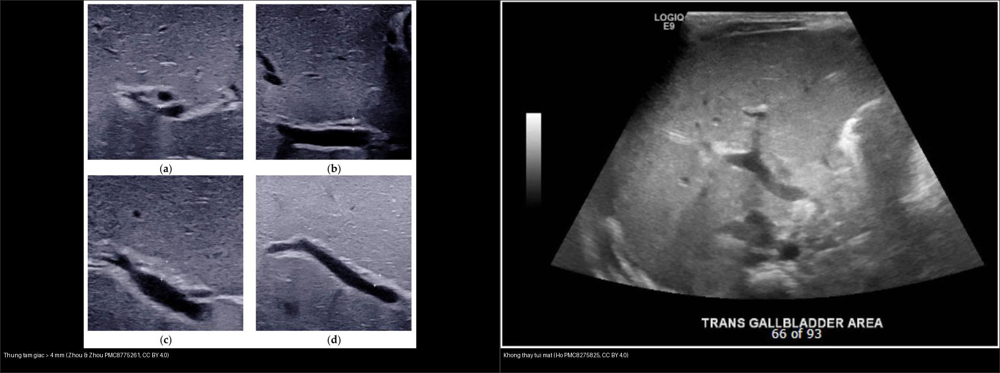
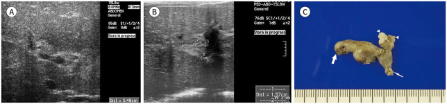
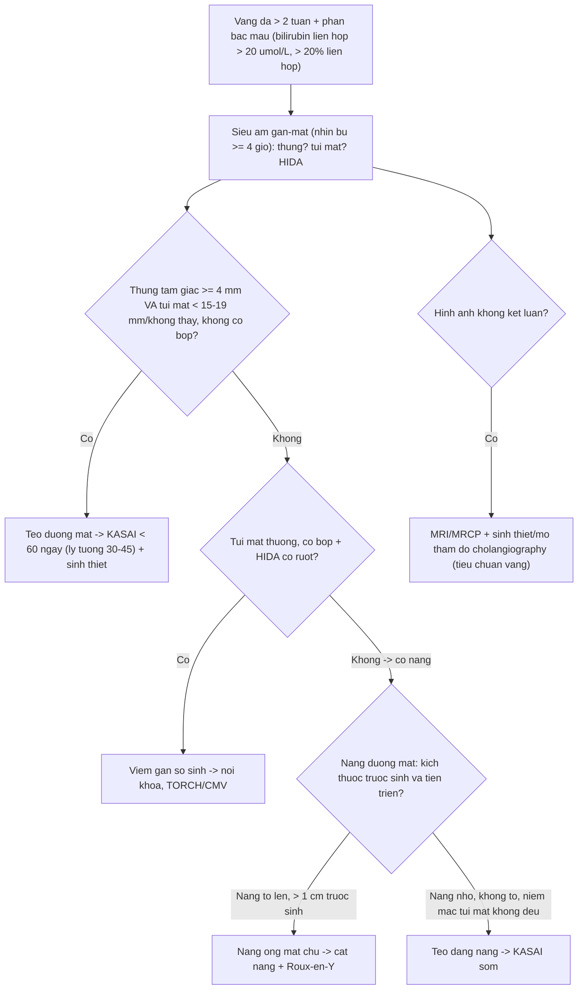
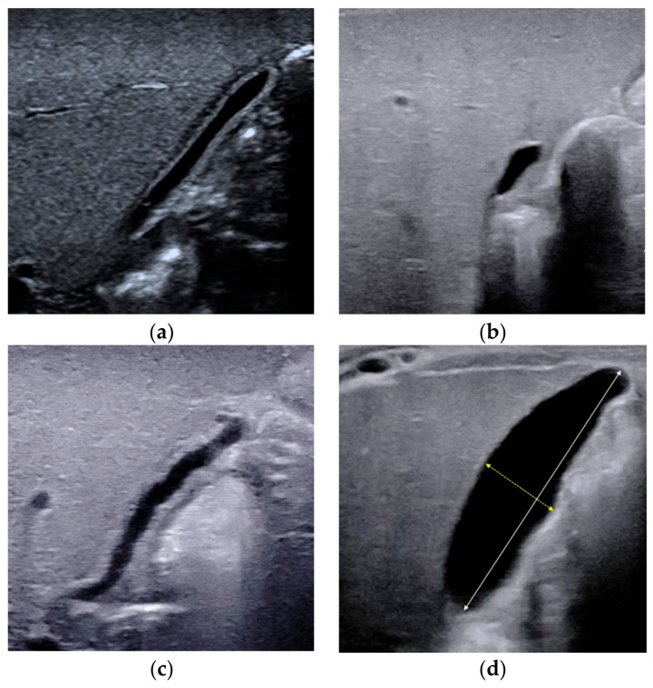
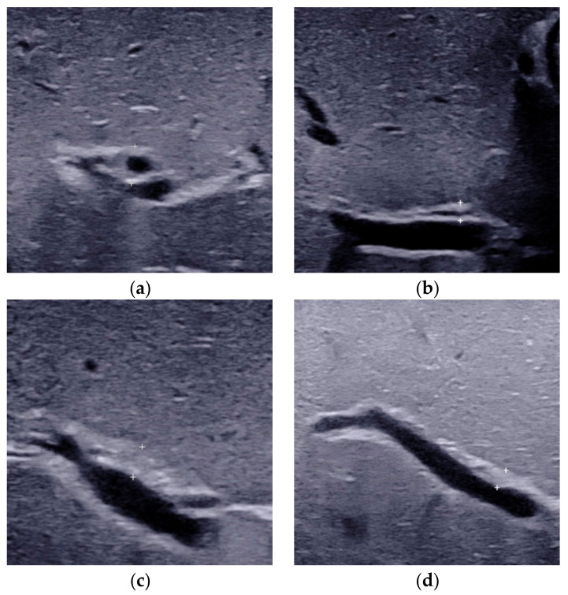
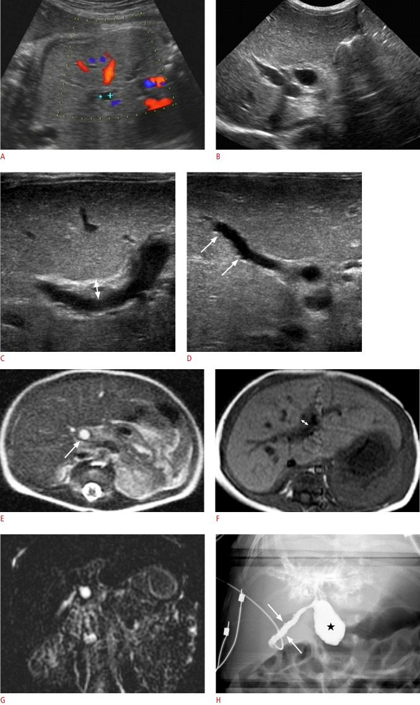
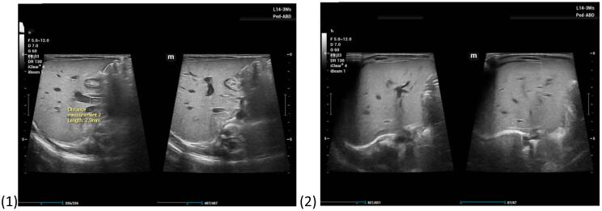
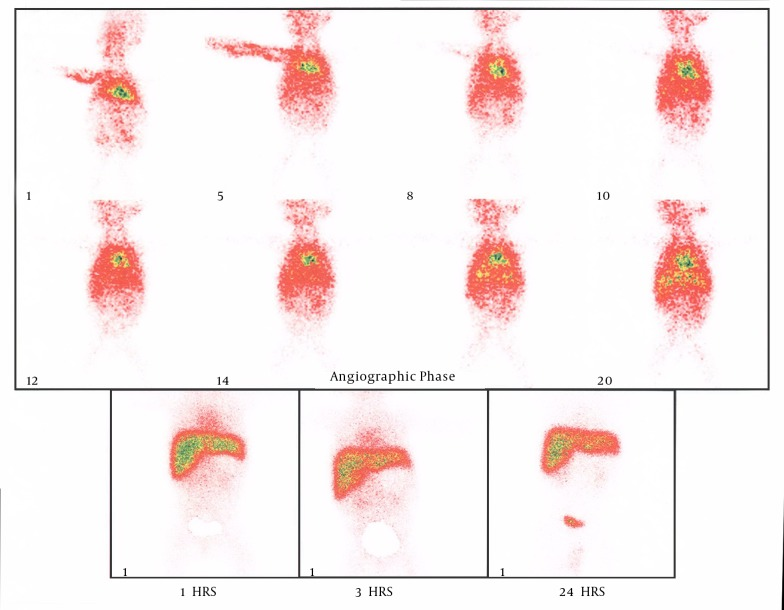

# 625 — Vàng da tắc mật: teo đường mật vs viêm gan / Biliary atresia

**Tags:** `pattern:vang-da-so-sinh` `vung:gan-mat-nhi` `protocol:sieu-am-gan-mat-nhi`
**Mức chắc chắn (certainty):** tổng hợp y văn (literature synthesis) — nhóm tự biên từ y văn mở (J Korean Soc Radiol 2022; Diagnostics 2021; Front Pediatr 2021; Ultrasonography 2021; Int J Surg Case Rep 2024) + **các ca trong quiz là ca nguyên văn (verbatim case)** chép đúng tuổi – chú thích gốc.

## 1. Tổng quan — xơ hóa đường mật ngoài gan + Kasai càng sớm càng cứu gan

Vàng da **ứ mật (cholestasis)** ở nhũ nhi là vàng da **liên hợp (conjugated)** — định lượng: **bilirubin toàn phần > 20 µmol/L với > 20% là liên hợp**. Kéo dài **> 2 tuần** là bất thường và phải tìm nguyên nhân (teo đường mật, viêm gan sơ sinh, nang ống mật chủ...).

- **Teo đường mật (biliary atresia, BA):** viêm–xơ **tắc đường mật ngoài gan** tiến triển, để lại **"thừng" xơ (fibrous ductal remnant)** ở rốn gan. TẠI SAO **thừng tam giác (triangular cord, TC) ≥ 4 mm** đặc hiệu: đây là **di tích ống mật xơ hóa trước chạc ba tĩnh mạch cửa** — tổ chức xơ phản âm dày lên tạo **dải tăng âm hình tam giác** giữa hai nhánh tĩnh mạch cửa phải. Ngưỡng **≥ 4 mm**: **Se 100% / Sp 90,9%, AUC 0,964** (Ultrasonography 2021); **≤ 4 mm loại trừ BA tốt nhất**.
- **TẠI SAO túi mật teo/không co bóp:** không có mật xuống túi mật → túi **nhỏ (thường < 15–19 mm)**, thành không đều và **không co sau bú**. **Không thấy túi mật** trên siêu âm: **Se 92%, Sp 73%, PPV 43%, NPV 97%** (Front Pediatr 2021) — **độ đặc hiệu thấp**, chỉ có giá trị **khi dương tính kèm dấu hiệu khác**, không loại trừ BA khi âm tính.
- **TẠI SAO HIDA:** ở BA, gan hấp thu nhưng **không thấy chất đánh dấu trong ruột non sau 24 giờ** (tắc hoàn toàn) — **Se ~97–100% để loại trừ** BA khi thấy tracer xuống ruột (Diagnostics 2016); ngược lại, **không thấy ruột 24h không đặc hiệu** vì viêm gan nặng/ứ mật kéo dài cũng ứ (cạm bẫy).
- **Thời điểm sống còn:** **Kasai (nối rốn gan–hỗng tràng) trước 60 ngày tuổi**, tốt nhất **30–45 ngày** (JPGN Rep 2026) — TẠI SAO phải sớm: sau **90–120 ngày** xơ gan **F4** không hồi phục; **cửa sổ vàng rất hẹp**.
- **Dịch tễ:** BA gặp **~1/10.000–1/14.000 trẻ sinh**; **teo đường mật dạng nang (cystic BA) chiếm ~5,5%** ca BA và dễ **nhầm với nang ống mật chủ (choledochal cyst)**.

## 2. Gamut vàng da ứ mật > 2 tuần (Gamut)

- **Thừng ≥ 4 mm + túi mật teo/không thấy + HIDA không thải 24 giờ:** **teo đường mật** → **Kasai < 60 ngày** + sinh thiết gan xác nhận.
- **Túi mật thường + co bóp + thải HIDA (muộn nhưng có):** **viêm gan sơ sinh** (do CMV, TORCH, chuyển hóa) → điều trị nội khoa + theo dõi.
- **Nang + vàng da + viêm tụy:** **nang ống mật chủ (Todani I–V)** → cắt nang + nối mật–ruột (nguy cơ ung thư đường mật).
- **Nang nhỏ (< 1 cm trước sinh) → không to lên sau sinh + thừng ≥ 4 mm + niêm mạc túi mật không đều:** **teo đường mật dạng nang** — khác nang ống mật chủ (nang trước sinh **> 1 cm** và **to lên sau sinh**).
- **Hạch rốn gan chèn ép ống mật chủ:** nguyên nhân **giả teo đường mật** rất hiếm nhưng có — hình ảnh hạch rốn gan + mô bệnh học là chốt (Int J Surg Case Rep 2024).
- **Thiểu sản đường mật trong gan (Alagille):** vàng da ứ mật + hẹp động mạch phổi + đốt sống hình bướm — **không phải BA** (thăm dò di truyền JAG1/NOTCH2).

## 3. Bảng so sánh phân biệt (ma trận đối chiếu)

| Thực thể (entity) | Hình ảnh điển hình | Chốt vào (rule-in) | Chốt loại (rule-out) | Gợi ý xác nhận |
|---|---|---|---|---|
| Teo đường mật (BA) | **Thừng tam giác ≥ 4 mm** trước chạc ba TM cửa + túi mật **< 15–19 mm/không thấy, không co bóp** + HIDA **không thải 24h** | **Thừng ≥ 4 mm (Se 100%/Sp 90,9%; AUC 0,964) + ghost triad** | Túi mật co bóp được + HIDA có ruột → viêm gan | **Kasai < 60 ngày** (lý tưởng 30–45) + sinh thiết gan |
| Viêm gan sơ sinh | Túi mật thường, **co bóp sau bú**, HIDA thải **chậm nhưng có** | **Túi co bóp + HIDA có ruột + CMV/TORCH** | Thừng ≥ 4 mm + túi teo → BA | Nội khoa + GGT + TORCH/CMV PCR |
| Nang ống mật chủ | Nang đường mật **to lên sau sinh**, giãn đường mật trong–ngoài gan, MRCP thấy nang | **Nang > 1 cm trước sinh + to lên + hợp lưu tụy-mật bất thường** | Nang nhỏ < 1 cm không to + thừng ≥ 4 mm → teo dạng nang | Cắt nang + nối mật–ruột Roux-en-Y |
| Teo dạng nang (cystic BA) | Nang nhỏ **< 1 cm trước sinh, không to**, **niêm mạc túi mật không đều**, **không thấy OMC xa trên MRI** | **Nang MRI ≤ 2,2 cm (Se 70%/Sp 100%) + niêm mạc không đều + không thấy OMC xa** | Nang to lên + không thừng → nang OMC | Kasai sớm; theo dõi xơ gan |
| Hạch rốn gan giả BA | Hạch **rốn gan chèn ép OMC**, hình ảnh giống tắc đường mật | **Hạch rốn gan + mô bệnh hạch lành** | Thừng ≥ 4 mm + HIDA không thải → BA thật | Sinh thiết/mổ thăm dò xác định |
| Đến muộn F4 | Xơ gan, lách to, cổ trướng, thừng dày | **F4 + > 90 ngày** (cửa sổ Kasai đã qua) | Sớm + đồng ý mổ → Kasai | Ghép gan |

*Dày xơ trước cửa + gan to giữa + túi nhỏ, HIDA không thải 24h. Nguồn: Khan M et al., Clin Med Insights Case Rep 2026 (PMC13241611), Fig. 1, CC BY-NC 4.0.*

*Trái: đo **thừng tam giác trên nhánh trước TM cửa** (dấu +). Phải: **không thấy túi mật** ở trẻ teo đường mật. Nguồn: Zhou W & Zhou L, Diagnostics 2021 (PMC8775261), CC BY 4.0 + Ho A et al., Front Pediatr 2021 (PMC8275825), CC BY 4.0. Ảnh ghép letterbox, giữ tỉ lệ.*

### Đọc thừng tam giác cho chuẩn (định lượng)
- Đo **trên lát dọc**, ngay **trước nhánh trước tĩnh mạch cửa phải**, **trừ đi thành trước động mạch gan phải** nếu nằm trong dải tăng âm; **ngưỡng ≥ 4 mm** (có nghiên cứu đề xuất đo **bề dày thành trước động mạch gan phải, cut-off 2 mm**, cho độ nhạy cao với thay đổi xơ nhẹ).

*Bé gái 53 ngày teo đường mật — siêu âm dọc thấy **thừng tam giác** (dải tăng âm dày, hình ống) ở rốn gan. Nguồn: Lee HJ et al., J Korean Soc Radiol 2022 (PMC9574273), Fig. 2, CC BY-NC 4.0 (giữ nguyên bản).*
- Dùng **đầu dò tần số cao** (trẻ nhỏ) mới thấy rõ; đầu dò thấp có thể **bỏ sót** (J Korean Soc Radiol 2022) — ca **không thấy thừng** không loại trừ BA.

## 4. Protocol chụp + hệ phân độ/điểm chuẩn hóa

- **Siêu âm gan-mật đầu tay (nhịn bú ≥ 4 giờ):** đo **bề dày thừng (mm)**, **kích thước + co bóp túi mật sau bú**, tìm **nang rốn gan**, hạch rốn gan, giãn đường mật trong gan, **dấu hiệu tăng áp cửa** (lách to, cổ trướng).
- **HIDA (99mTc-mebrofenin):** **thấy tracer xuống ruột = loại trừ BA** (Se ~97–100%); **không thấy ruột 24h** chỉ gợi ý (không đặc hiệu) — đọc kèm lâm sàng và hình ảnh khác.
- **MRI/MRCP:** khi **nghi nang ống mật chủ hoặc teo dạng nang**; giúp phân biệt **nang nhỏ (teo dạng nang) vs nang ống mật chủ** (nang ≤ 2,2 cm + không thấy OMC xa → teo dạng nang).
- **Sinh thiết gan / mổ thăm dò + cholangiography:** **tiêu chuẩn vàng** khi hình ảnh không kết luận — thấy **di tích đường mật xơ** hoặc **hạch chèn ép** sẽ chốt.
- **Điểm chuẩn hóa — bộ dấu hiệu siêu âm (Zhou 2021):** ① phân loại túi mật; ② thừng ≥ 4 mm; ③ nang rốn gan; ④ hạch rốn gan to; ⑤ **động mạch gan phải giãn (≥ 1,5 mm)**; ⑥ **tăng tưới máu dưới bao gan**; ⑦ **độ cứng gan (elastography)**; ⑧ bơm cản quang qua túi mật (cholecystocholangiography) — tổ hợp nhiều dấu cho độ chính xác cao hơn một dấu.

## 5. Biến thể bình thường và cạm bẫy

- **Không thấy túi mật KHÔNG đồng nghĩa BA** — độ đặc hiệu 73% (PPV chỉ 43%); phải **kết hợp thừng + HIDA + lâm sàng**.
- **HIDA không thấy ruột 24 giờ** cũng gặp trong **viêm gan nặng/ứ mật nặng** → không một mình chốt BA (cạm bẫy hay gặp).
- **Hạch rốn gan** có thể **chèn ép OMC** giả teo đường mật — nếu không có thừng điển hình, **sinh thiết/mổ** để xác định.
- **CMV (+) không loại trừ BA:** trẻ vừa viêm gan CMV vừa teo đường mật vẫn cần **Kasai dựa trên thừng + túi teo**.
- **Teo dạng nang bị nhầm nang ống mật chủ:** điểm khác là **kích thước nang không to lên** + **niêm mạc túi mật không đều** + **không thấy OMC xa**; nhầm hướng xử trí (Kasai thay vì cắt nang).
- **Quang trị liệu/chờ tự hết quá 60 ngày** làm mất cửa sổ Kasai — theo dõi sát và **chuyển sớm** khi vàng da liên hợp kéo dài.
- **Phân bạc màu bố mẹ không nhận ra** — thẻ màu phân là công cụ tầm soát rẻ tiền quan trọng.

## 6. Tự lượng giá — Blind Quiz (ảnh trơn ngoài, đáp án ẩn trong khối chi tiết)

**Ca 1 — Trẻ 3 tháng vàng da từ sinh + situs inversus + VSD. Đọc siêu âm.**

- Gợi ý lâm sàng: vàng da ứ mật từ sinh, hội chứng kèm (situs inversus, VSD).
- Câu hỏi: Thừng dày bao nhiêu mm? Ngưỡng là bao nhiêu? Còn Kasai được không?

<b>Bấm để hiện đáp án (findings + chẩn đoán)</b>

- **Dấu hiệu:** thừng tam giác **4,5 mm (≥ 4)** trước chạc cửa + **túi mật nhỏ** + **HIDA không thải 24h** + **F4** (xơ gan).
- **Chẩn đoán:** **teo đường mật hội chứng (situs inversus + VSD)** — đã **90 ngày** + **F4** + từ chối mổ → tử vong. Bài học: **Kasai < 60 ngày (lý tưởng 30–45)** mới cứu được gan.
- Nguồn ảnh: Khan M et al., Clin Med Insights Case Rep 2026 (PMC13241611), Fig. 1, CC BY-NC 4.0.

**Ca 2 — Trẻ vàng da ứ mật. Siêu âm: đo thừng và tìm túi mật. Hai dấu hiệu nói gì?**

- Câu hỏi: Dấu hiệu bên trái (dấu +) là gì, ngưỡng bao nhiêu? Bên phải vì sao gợi ý teo đường mật? Còn cần gì để chốt?

<b>Bấm để hiện đáp án (findings + chẩn đoán)</b>

- **Trái:** đo **thừng tam giác ≥ 4 mm** trước nhánh trước TM cửa (Se 100%/Sp 90,9%, AUC 0,964).
- **Phải:** **không thấy túi mật** — Se 92% nhưng Sp 73%, PPV 43%, NPV 97% → **chỉ có giá trị dương tính**, không loại trừ BA.
- **Chốt:** kết hợp **thừng + túi mật + HIDA 24h + sinh thiết**, không dựa một dấu hiệu.
- Nguồn ảnh: Zhou W & Zhou L, Diagnostics 2021 (PMC8775261), CC BY 4.0 + Ho A et al., Front Pediatr 2021 (PMC8275825), CC BY 4.0 (ảnh ghép letterbox).

**Ca 3 — Siêu âm túi mật ở 4 trẻ vàng da. Phân loại túi mật (a–d) và nêu loại gợi ý teo đường mật.**

- Câu hỏi: (a)–(d) khác nhau thế nào? Loại nào gợi ý BA? Vì sao đánh giá co bóp sau bú?

<b>Bấm để hiện đáp án (findings + chẩn đoán)</b>

- **Dấu hiệu:** (a) túi mật **bình thường**; (b) túi **teo nhỏ/co**; (c) túi **hình dạng bất thường/không đều**; (d) **túi nhỏ có đo kích thước** — teo đường mật điển hình là **túi mật nhỏ/không đều/không thấy**.
- **Đánh giá co bóp:** so sánh **trước và sau bú** — BA **không co bóp** vì không có mật xuống; viêm gan thường **co bóp được** (dù có thể chậm).
- Nguồn ảnh: Zhou W & Zhou L, Diagnostics 2021 (PMC8775261), Fig. 1, CC BY 4.0.

**Ca 4 — Đo thừng tam giác ở 4 trẻ (a–d). Panel nào là teo đường mật?**

- Câu hỏi: Đo ở đâu? Ngưỡng bao nhiêu? Vì sao phải dùng đầu dò tần số cao?

<b>Bấm để hiện đáp án (findings + chẩn đoán)</b>

- **Dấu hiệu:** các panel đo **bề dày dải tăng âm trước nhánh trước TM cửa** (thước đo/caliper); panel **> 4 mm** (= 4,4 mm trong minh họa) gợi ý **teo đường mật**; panel ≤ 4 mm thường là **không BA** (viêm gan/bình thường).
- **Kỹ thuật:** đo **lát dọc**, **trừ thành trước động mạch gan phải**; dùng **đầu dò tần số cao** để không bỏ sót dải xơ mỏng.
- Nguồn ảnh: Zhou W & Zhou L, Diagnostics 2021 (PMC8775261), Fig. 2, CC BY 4.0.

**Ca 5 — Trẻ vàng da có nang rốn gan nhỏ. Siêu âm trước sinh + sau sinh + MRI: teo dạng nang hay nang ống mật chủ?**

- Gợi ý lâm sàng: nang quanh rốn gan phát hiện trước sinh.
- Câu hỏi: Kích thước nang và tiến triển? Dấu hiệu nào phân biệt với nang ống mật chủ?

<b>Bấm để hiện đáp án (findings + chẩn đoán)</b>

- **Dấu hiệu:** (A) siêu âm **thai 35 tuần** — nang **0,6 cm** quanh rốn gan; sau sinh nang **không to lên** + **niêm mạc túi mật không đều** + **không thấy OMC xa** trên MRI.
- **Chẩn đoán:** **teo đường mật dạng nang (cystic biliary atresia)** — khác **nang ống mật chủ** (nang trước sinh **> 1 cm** và **to lên sau sinh**). Ngưỡng MRI: **nang ≤ 2,2 cm** gợi ý teo dạng nang (Se 70%/Sp 100%); thừng ≥ 4 mm (Se 100%/Sp 90,9%). Xử trí: **Kasai sớm**, theo dõi xơ gan/ghép.
- Nguồn ảnh: Shin HJ et al., Ultrasonography 2021 (PMC7994739), Fig. 1, CC BY-NC 4.0 (giữ nguyên bản).

**Ca 6 — Trẻ 3 tuần vàng da tăng dần, hình ảnh ban đầu giống teo đường mật. Siêu âm rốn gan.**

- Gợi ý lâm sàng: vàng da tăng dần, xét nghiệm gợi ý tắc mật; mổ thăm dò sau đó.
- Câu hỏi: Dấu hiệu siêu âm? Chẩn đoán thay thế? Xác nhận bằng gì?

<b>Bấm để hiện đáp án (findings + chẩn đoán)</b>

- **Dấu hiệu:** siêu âm rốn gan cho hình ảnh **khối/hạch vùng rốn gan** gợi ý tắc đường mật — **giống teo đường mật**.
- **Chẩn đoán:** **hạch rốn gan chèn ép ống mật chủ** (mô bệnh học hạch lành, đường mật giải phẫu bình thường) — nguyên nhân hiếm **giả teo đường mật**; **mô bệnh/mổ thăm dò** là chốt.
- Nguồn ảnh: Ngowi E et al., Int J Surg Case Rep 2024 (PMC11320468), Fig. 1, CC BY 4.0.

**Ca 7 — Trẻ vàng da ứ mật, siêu âm không kết luận. HIDA 99mTc-mebrofenin.**

- Câu hỏi: Gan có hấp thu không? Có thấy chất đánh dấu trong ruột không? Giá trị và hạn chế của HIDA?

<b>Bấm để hiện đáp án (findings + chẩn đoán)</b>

- **Dấu hiệu:** gan **hấp thu tốt** chất phóng xạ nhưng **KHÔNG thấy tracer trong ruột non sau 24 giờ** = **ứ mật hoàn toàn**, phù hợp **teo đường mật** (ở ca gốc).
- **Giá trị:** thấy ruột → **loại trừ BA** (Se ~97–100%); **không thấy ruột 24h không đặc hiệu** (viêm gan nặng cũng ứ) → luôn kết hợp siêu âm (thừng ≥ 4 mm) + sinh thiết.
- Nguồn ảnh: Motamed F et al., Iran J Radiol 2014 (PMC4347753), Fig. 1, CC BY-NC 4.0 (giữ nguyên bản).

## Bài liên quan chéo
- [600 – Tổng quan Hệ Nhi khoa](../600-tong-quan-nhi-khoa/lesson.md)
- [620 – Cấp cứu tiêu hóa sơ sinh & nhũ nhi](../620-cap-cuu-tieu-hoa-so-sinh-nhu-nhi/lesson.md)
- [626 – Viêm tụy cấp ở trẻ (Atlanta nhi, nang ống mật chủ, tụy divisum)](../626-viem-tuy-cap-nhi/lesson.md)
- [131 – Tắc mật](../131-tac-mat/lesson.md)
- [123 – Nang gan & bệnh gan đa nang (Caroli, von Meyenburg)](../123-nang-gan-va-benh-gan-da-nang/lesson.md)

## Ảnh
- Tên file: `NNN_slug_Modality_SourceID.jpg`. Nguồn + giấy phép từng ảnh: `images/CREDITS.md` và `sources.md`.
- Ảnh **CC BY 4.0** dùng cho ảnh ghép; ảnh **CC BY-NC**/**CC BY-NC-ND** giữ nguyên bản, **không crop/ghép**.

> Không dùng để chẩn đoán độc lập khi chưa có người hướng dẫn.
