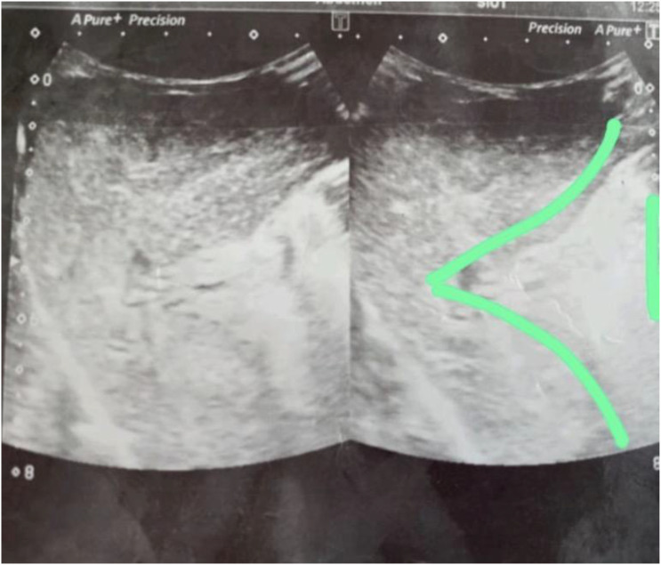
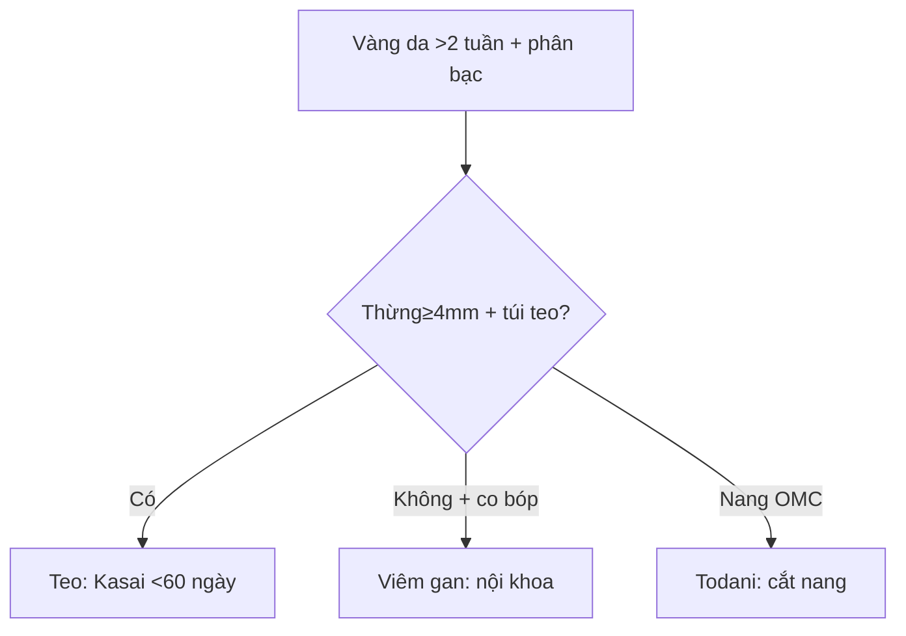

# 625 — Vàng da tắc mật: teo đường mật vs viêm gan / Biliary atresia

**Tags:** `pattern:vang-da-so-sinh` `vung:gan-mat-nhi` `protocol:sieu-am-gan-mat-nhi`
**Mức chắc chắn (certainty):** tổng hợp y văn (literature synthesis) — nhóm tự biên từ y văn mở, chưa gắn ca nguyên văn đơn lẻ.

## 1. Tổng quan — xơ hóa đường mật ngoài gan + Kasai càng sớm càng cứu gan

- Teo đường mật (biliary atresia): viêm-xơ tắc đường mật ngoài gan tiến triển — TẠI SAO **thừng tam giác ≥ 4 mm** đặc hiệu > 95%: di tích xơ rốn gan trước chạc cửa; túi mật teo < 15–19 mm + không co sau bú (ghost triad) vì không có mật xuống.
- Kasai (nối rốn gan-hỗng tràng) **trước 60 ngày tuổi** thoát mật tốt nhất — TẠI SAO: sau 90–120 ngày xơ gan F4 không hồi phục (ca dưới đến 90 ngày đã F4!).
- Viêm gan sơ sinh: tế bào gan viêm, đường mật còn — túi mật thường + co bóp được + HIDA thải chậm nhưng có.

## 2. Gamut vàng da ứ mật > 2 tuần (Gamut)

- **Thừng ≥ 4 mm + túi teo + HHA ≥ 1,5 mm:** teo đường mật — Kasai < 60 ngày + sinh thiết.
- **Túi thường + co bóp + thải HIDA:** viêm gan — nội khoa + theo dõi.
- **Nang OMC + vàng da:** Todani I–V — mổ cắt nang + nối mật-ruột.
- **Đến muộn + F4 + từ chối mổ:** ghép gan (hoặc tử vong như ca dưới!).

## 3. Bảng so sánh phân biệt (ma trận đối chiếu)

| Thực thể (entity) | Hình ảnh điển hình | Chốt vào (rule-in) | Chốt loại (rule-out) | Gợi ý xác nhận |
|---|---|---|---|---|
| Teo đường mật | **Thừng ≥ 4 mm + túi < 15–19 mm + HHA ≥ 1,5 mm** | **Thừng + ghost + HIDA không thải 24h** | Túi co bóp → viêm gan | Kasai < 60 ngày + sinh thiết |
| Viêm gan sơ sinh | **Túi thường + co bóp + thải chậm** | **Co bóp được + CMV (+)** | Thừng ≥ 4 mm → teo | Nội khoa + GGT + TORCH |
| Nang OMC | **Nang + vàng da + viêm tụy** | **Todani I–V + nang** | Không nang → teo/viêm | Cắt nang + Y-Roux |
| Đến muộn F4 | **Xơ + lách to + từ chối mổ** | **F4 + > 90 ngày** | Sớm + đồng ý → Kasai | Ghép gan |

*Dày xơ trước cửa + gan to giữa + túi nhỏ, HIDA không thải 24h. Nguồn: Khan et al., Clin Med Insights 2026 Fig. 1, CC BY-NC 4.0.*

## 4. Protocol vàng da sơ sinh

- **Siêu âm nhịn bú ≥ 4 giờ (thừng mm + túi mm + HHA mm) + HIDA 24h + sinh thiết** khi vàng da trực tiếp > 2 tuần + phân bạc màu.

## 5. Cạm bẫy

- **Quang trị liệu + chờ tự hết** quá 60 ngày = mất cửa sổ Kasai (ca trên đến 90 ngày F4 + tử vong!).
- **Phân bạc màu bố mẹ không nhận ra** — thẻ màu phân + khám định kỳ mới bắt sớm.
- **CMV (+) tưởng chỉ viêm gan** bỏ sót teo kèm — thừng + túi teo là Kasai dù CMV (+).

## 6. Tự lượng giá — Blind Quiz

**Ca 1 — Trẻ 3 tháng vàng da từ sinh + situs inversus + VSD. Đọc siêu âm.**

- Hỏi: thừng bao nhiêu mm? Ngưỡng bao nhiêu? Còn Kasai được không?

<b>Bấm để hiện đáp án</b>

- Dấu hiệu (findings): thừng tam giác 4,5 mm (≥ 4) + túi nhỏ + HIDA không thải + F4.
- Chẩn đoán (diagnosis): **teo đường mật hội chứng (situs + VSD)** — đã 90 ngày + F4 + từ chối mổ → tử vong (bài học: Kasai < 60 ngày!).
- Nguồn: Khan et al., Fig. 1, CC BY-NC 4.0.

**Ca 2 — Vàng da + túi mật 25 mm co bóp 40% sau bú:** teo hay viêm gan? *(Bảng mục 3.)*

<b>Bấm để hiện đáp án</b>

- **Viêm gan sơ sinh:** túi co bóp được — nội khoa (teo là teo + không co).

## Bài liên quan chéo
- [600 – Tổng quan Nhi](../600-tong-quan-nhi-khoa/lesson.md)
- [131 – Tắc mật](../131-tac-mat/lesson.md) (người lớn)
- [620 – Tiêu hóa nhi](../620-cap-cuu-tieu-hoa-so-sinh-nhu-nhi/lesson.md) (nôn/vàng da)

> Không dùng để chẩn đoán độc lập khi chưa có người hướng dẫn.
