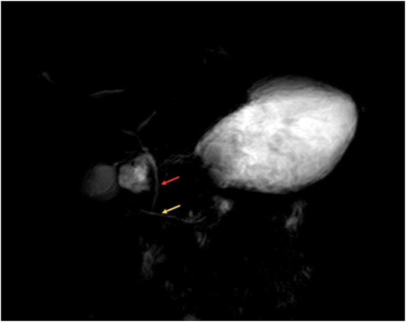
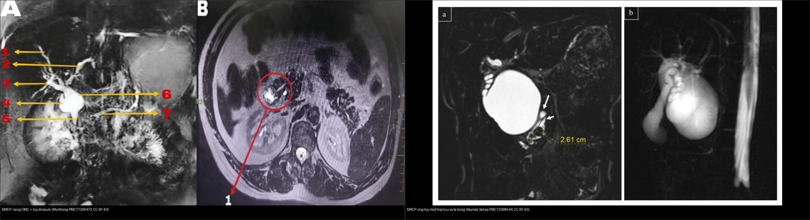
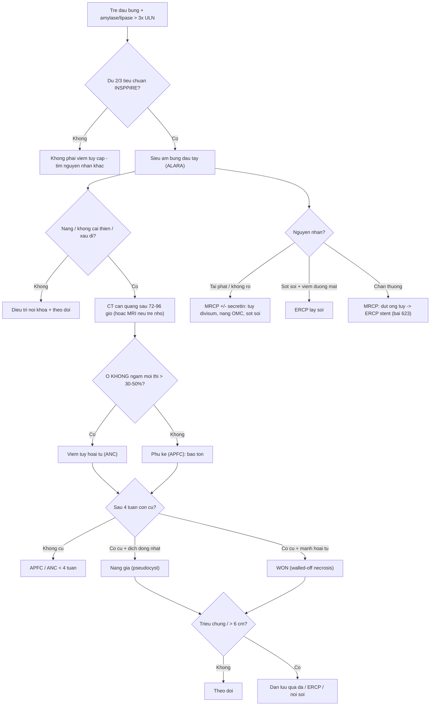
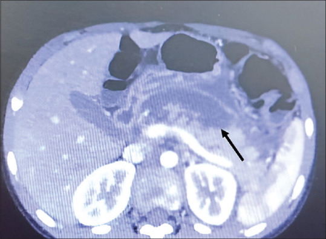
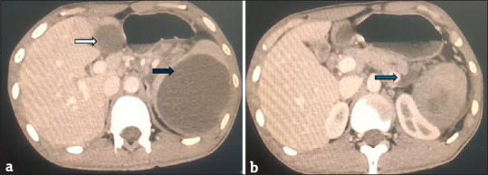
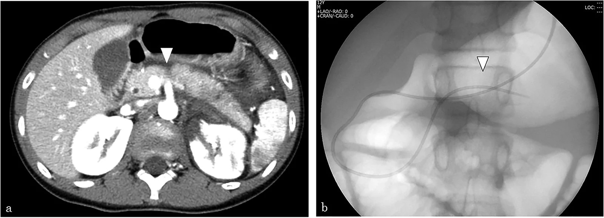

# 626 — Viêm tụy cấp ở trẻ: nguyên nhân, Atlanta nhi (APFC/ANC → nang giả/WON) & MRCP tìm dị dạng ống tụy / Pediatric acute pancreatitis

**Tags:** `pattern:viem-tuy` `pattern:nang-gia-tuy` `vung:tuy` `score:Atlanta` `protocol:MRCP` `protocol:sieu-am-bung`
**Mức chắc chắn (certainty):** tổng hợp y văn (literature synthesis) — nhóm tự biên từ y văn mở (Children 2026, Cureus 2026, JIAPS 2026, Eur J Trauma Emerg Surg 2026) có số; **các ca trong quiz là ca nguyên văn (verbatim case)** chép đúng tuổi – bối cảnh – chú thích gốc (Poonia/Ann Indian Acad Neurol, Thapa/Ann Med Surg, Zhang/Transl Pediatr, Soni/JIAPS, Kouchi/Eur J Trauma Emerg Surg).

## 1. Tổng quan bệnh học – cơ chế hình ảnh

Viêm tụy cấp (acute pancreatitis, AP) ở trẻ là bệnh **ngày càng được nhận diện**, với **~40% trẻ có tụ dịch quanh tụy (pancreatic fluid collection, PFC)** và **~60% tái phát** trong các nhóm theo dõi dài. Ba câu hỏi của mọi trẻ nghi AP: **(1) có đủ tiêu chuẩn chẩn đoán không? (2) còn hoại tử/đang tiến triển không? (3) có nguyên nhân giải phẫu hay di truyền để xử lý gốc không?**

- **Tiêu chuẩn chẩn đoán INSPPIRE 2012 (nhi):** cần **2 trong 3** — (1) đau bụng kiểu tụy; (2) **amylase và/hoặc lipase > 3 lần giới hạn trên (ULN)**; (3) hình ảnh (siêu âm/CT/MRI) phù hợp. TẠI SAO dùng **lipase**: lipase **đặc hiệu tụy hơn amylase**, đỉnh muộn hơn và **còn cao tới ~8 ngày** (amylase về bình thường sau **3–5 ngày**), nên **bình thường amylase/lipase KHÔNG loại trừ** nếu đến muộn hoặc tăng triglyceride máu.
- **TẠI SAO hình ảnh phản ánh mức độ:** viêm tụy nhẹ là **phù kẽ (interstitial edematous)** — tụy to lan tỏa, mỡ quanh tụy thâm nhiễm, **ngấm thuốc đồng nhất**. Hoại tử xuất hiện do **huyết khối vi mạch + thiếu máu cục bộ nhu mô** → vùng **KHÔNG ngấm thuốc** trên CT cản quang, không hồi phục ở thì muộn. Hoại tử **> 30% nhu mô** (hoặc mô tả **> 50%** trong nhiều ca nhi) = **viêm tụy hoại tử**; hoại tử càng nhiều thì nguy cơ **nhiễm khuẩn, WON, suy tạng** càng cao.
- **TẠI SAO CT sớm bỏ sót hoại tử:** trong 48–72 giờ đầu vùng hoại tử **chưa phân định rõ**; CT cản quang đánh giá hoại tử tốt nhất **sau 72 giờ (lý tưởng 72–96 giờ)**. Vì vậy **CT sớm bình thường không loại trừ**; còn ở trẻ ưu tiên **siêu âm đầu tay** và **MRI/MRCP** (không tia).
- **Tiến triển theo thời gian (phân loại Atlanta sửa đổi 2012) — áp cho nhi:** trước **4 tuần** → **APFC** (tụ dịch cạnh tụy cấp, không hoại tử) hoặc **ANC** (tụ hoại tử cấp, có mảnh hoại tử); sau **4 tuần** → **nang giả tụy (pseudocyst)** (không mảnh hoại tử, vỏ mỏng) hoặc **hoại tử khu trú có vỏ (WON, walled-off necrosis)** (còn mảnh hoại tử đặc bên trong). **Số nhi:** PFC gặp **~40%** trẻ AP, trong đó **APFC 70%**; **53% APFC → nang giả**, **54% ANC → WON**; **đường kính > 6 cm** dự báo tiến triển nang giả **và** cần can thiệp.
- **Nguyên nhân (thay đổi theo tuổi):** **vô căn ~70,5%** ở nhóm cohort hỗn hợp (Cureus 2026); **sỏi mật ~11%** tập trung ở trẻ **11–18 tuổi**; ở nhóm **viêm tụy tái phát**, **nguyên nhân di truyền chiếm ~37%** (Children 2026); ngoài ra: **dị dạng ống tụy (tụy divisum, nang ống mật chủ, tụy vòng)**, **chấn thương**, **thuốc (L-asparaginase, valproate)**, **nhiễm trùng**, **tăng triglyceride/tăng calci máu**.

## 2. Mẫu hình + chẩn đoán phân biệt theo cơ chế – vị trí (Gamut)

**Gamut theo cơ chế nguyên nhân (định hướng xử trí gốc):**

- **Tắc dòng mật (gallstone, sỏi ống mật chủ):** trẻ lớn; siêu âm thấy sỏi/túi mật căng; **AP do sỏi có thể cần ERCP lấy sỏi** nếu tắc + viêm đường mật.
- **Dị dạng ống tụy (ductal anomaly):** **tụy divisum** (ống tụy lưng dẫn lưu qua **nhú nhỏ** → tăng áp ống lưng gây viêm tái phát); **nang ống mật chủ** (hợp lưu tụy-mật bất thường → viêm tụy + nguy cơ ung thư đường mật). **MRCP (± secretin) là lựa chọn** để thấy giải phẫu ống.
- **Chấn thương (handlebar/tai nạn):** đụng dập/đứt ống tụy → biểu hiện **muộn** với **nang giả** (xem bài 623).
- **Thuốc – độc chất:** **L-asparaginase** (điều trị ALL), **valproate**, corticosteroid; **chẩn đoán loại trừ** nhưng phải nghĩ khi có yếu tố phơi nhiễm.
- **Di truyền:** **PRSS1** (trội, viêm tụy di truyền), **CFTR/SPINK1/CTRC** (đa gen) — nghĩ khi **tái phát** không rõ nguyên nhân, tiền sử gia đình.
- **Chuyển hóa – nội tiết:** tăng triglyceride máu nặng, tăng calci máu, đái tháo đường nhiễm toan ceton.

**Gamut theo mẫu hình hình ảnh (cùng tụy, khác mức độ):**

- **Phù kẽ (interstitial edematous):** tụy to lan tỏa + thâm nhiễm mỡ quanh tụy + **ngấm đồng nhất**.
- **Hoại tử (necrotizing):** vùng **không ngấm** ở mọi thì, có thể kèm khí nếu nhiễm khuẩn (khí trong nhu mô/tụ dịch).
- **Biến chứng mạch:** **giả phình (pseudoaneurysm)** mạch lách/tá tụy — ổ thuốc giữ hình, giảm đậm độ theo dòng máu; có thể vỡ gây xuất huyết tiêu hóa.
- **Biến chứng lân cận:** huyết khối **tĩnh mạch lách/cửa**, tắc mật, hẹp/tắc tá tràng, **hội chứng chèn ép ổ bụng (ACS)**.

*MRCP: (A) ống mật chủ đổ vào nhú lớn (mũi tên đỏ); (B) **ống tụy lưng** đổ riêng qua **nhú nhỏ** (mũi tên vàng) = **tụy divisum**. Nguồn: Thapa O et al., Ann Med Surg 2022 (PMC9577615), Fig. 1, CC BY-NC-ND 4.0 (giữ nguyên bản).*

## 3. Bảng so sánh phân biệt (ma trận đối chiếu)

| Thực thể (entity) | Hình ảnh điển hình | Chốt vào (rule-in) | Chốt loại (rule-out) | Gợi ý xác nhận |
|---|---|---|---|---|
| Viêm tụy phù kẽ (APFC) | Tụy to lan tỏa, thâm nhiễm mỡ quanh tụy, **ngấm thuốc đồng nhất** | **Lipase > 3× ULN + phù lan tỏa + không ổ không ngấm** | Có ổ không ngấm mọi thì → hoại tử | Siêu âm đầu tay; theo dõi, không CT thường quy |
| Viêm tụy hoại tử (ANC/WON) | **Vùng không ngấm thuốc (> 30–50% nhu mô)**; sau 4 tuần còn **mảnh hoại tử** = WON | **Ổ không ngấm mọi thì + thâm nhiễm quanh tụy** | Ngấm lại thì muộn → đụng dập; tụy bình thường → loại | CT cản quang **sau 72–96 giờ**; MRI nếu cần |
| Nang giả tụy (pseudocyst) | Tụ dịch **> 4 tuần**, vỏ mỏng, **dịch đồng nhất, KHÔNG mảnh hoại tử**, quanh tụy/ổ bụng | **> 4 tuần + dịch đồng nhất + vỏ rõ** | Có mảnh hoại tử/khí → **WON**; có vách/nốt → nghĩ u nang (IPMN/MCN) | Siêu âm/CT/MRI; dẫn lưu khi triệu chứng hoặc **> 6 cm** |
| Tụy divisum | MRCP: ống tụy lưng đổ qua **nhú nhỏ**, ống bụng ngắn | **Hai hệ ống không hợp nhất + viêm tụy tái phát** | Ống hợp nhất bình thường → không phải divisum | **MRCP ± secretin**; ERCP can thiệp nhú nhỏ |
| Nang ống mật chủ | Nang đường mật + giãn đường mật trong/ngoài gan; MRCP thấy nang | **Nang + hợp lưu tụy-mật bất thường + viêm tụy** | Chỉ hẹp ống tụy → nghĩ divisum | MRCP; cắt nang + nối mật-ruột (tránh ung thư) |
| Chấn thương tụy | CT: rách/dập, **dịch khoang cạnh thận trước**, khe dịch đứt ống | **Khe dịch đứt ngang ~10 mm / đường rách > 50% trục ngắn** | Không tổn thương ống → AAST I–II bảo tồn | MRCP + secretin; ERCP đặt stent (xem bài 623) |

*Trái: MRCP — **nang ống mật chủ type 1 kèm tụy divisum**. Phải: MRCP 3D — **ống mật chủ và ống tụy hợp lưu cách xa tá tràng** (hợp lưu tụy-mật bất thường). Nguồn: Myrthong AL et al., Cureus 2024 (PMC11299473), CC BY 4.0 + Kaynak Şahap S & Fitoz S, Turk J Med Sci 2026 (PMC13398544), CC BY 4.0. Ảnh ghép letterbox, giữ tỉ lệ.*

## 4. Protocol chụp + hệ phân độ/điểm chuẩn hóa

- **Siêu âm bụng = đầu tay (ALARA, không tia):** xác nhận tụy to, dịch quanh tụy, sỏi mật, **thay đổi nang giả theo thời gian**; cũng để tìm nguyên nhân (giãn đường mật, nang).
- **CT bụng cản quang:** chỉ khi **không cải thiện/lâm sàng xấu** hoặc nghi biến chứng; thời điểm **sau 72–96 giờ** để tránh bỏ sót hoại tử; nếu đã nhiễm khuẩn/nhiễm độc, CT muộn tìm **khí trong nhu mô/WON**.
- **MRI + MRCP (± secretin):** khi nghi **dị dạng ống tụy, viêm tụy tái phát không rõ nguyên nhân, hoặc biến chứng muộn**; ở trẻ là lựa chọn **không tia** thay cho CT theo dõi.
- **EUS-FNA/ERCP:** chọn lọc — **đặt stent ống tụy/dẫn lưu nang giả qua nhú nhỏ**, lấy mồ (nhú nhỏ) khi divisum có triệu chứng; ERCP **chỉ khi cần can thiệp** (hạn chế viêm tụy sau ERCP).
- **Phân độ** — dùng **NASPGHAN 2017** cho trẻ (nhẹ: không suy tạng, không biến chứng; trung bình/nặng: có biến chứng/suy tạng) và **phân loại hình ảnh Atlanta sửa đổi 2012**: **APFC/ANC < 4 tuần**, **pseudocyst/WON > 4 tuần**.
- **Theo dõi biến chứng:** tụ dịch **> 6 cm** → nguy cơ cao tiến triển/cần can thiệp; nang giả **có triệu chứng** (đau, chèn ép, nhiễm khuẩn) → **dẫn lưu qua da/ERCP** (qua da an toàn ở nhi); **WON nhiễm khuẩn** → dẫn lưu + nội soi/necrosectomy nếu cần.
- **Suy tạng/ACS:** theo dõi **áp lực bàng quang**, hô hấp, thận (tăng creatinine), tuần hoàn — **suy tạng kéo dài > 48 giờ = nặng**.

## 5. Biến thể bình thường và cạm bẫy

- **CT sớm (< 72 giờ) bình thường không loại trừ hoại tử** — đừng kết luận "nhẹ" rồi bỏ theo dõi; đặc biệt khi trẻ xấu đi.
- **Lipase/amylase bình thường** gặp khi đến muộn (> 5–8 ngày), tăng triglyceride máu, hoặc bệnh cảnh mạn; **bình thường không loại trừ**.
- **Nang giả vs WON:** **chỉ WON có mảnh hoại tử đặc** bên trong; nhầm WON thành nang giả → dẫn lưu không đúng, nguy cơ nhiễm khuẩn/chảy máu.
- **Nang giả tụy vs u nang tụy (IPMN/MCN/SCN):** nang giả **luôn có bối cảnh viêm tụy trước**; nang có **vách/nốt đặc** không tiêu biến sau 6 tuần → nghĩ u nang (bài 136).
- **Tụy divisum là biến thể giải phẫu khá phổ biến** — chỉ có ý nghĩa bệnh lý khi kèm **viêm tụy tái phát/dãn ống**, không "chốt" nguyên nhân một mình.
- **Giả phình mạch** dễ bị bỏ qua; tìm khi có **xuất huyết tiêu hóa/giảm Hct** đột ngột ở trẻ viêm tụy — ổ thuốc **giữ hình, giảm theo dòng máu** trên CT động mạch.
- **Đau bụng dữ + trướng + tăng áp lực bàng quang** → nghĩ **ACS**, cần đo áp lực bàng quang (không chỉ dựa trên hình ảnh).

## 6. Tự lượng giá — Blind Quiz (ảnh trơn ngoài, đáp án ẩn trong khối chi tiết)

**Ca 1 — Bé gái có u sán não đang dùng valproate, đau bụng dữ. CECT bụng. Mô tả tụy trước khi mở đáp án.**

- Gợi ý lâm sàng: trẻ dùng valproate, đau bụng cấp; nghi biến chứng do thuốc.
- Câu hỏi: Dấu hiệu chính trên tụy? Tỷ lệ diện tích không ngấm là bao nhiêu và nghĩa là gì? Ba chẩn đoán phân biệt?

<b>Bấm để hiện đáp án (findings + chẩn đoán)</b>

- **Dấu hiệu:** CECT bụng lát ngang — **vùng KHÔNG ngấm thuốc chiếm > 50% nhu mô tụy** (mũi tên đen), kèm **thâm nhiễm mỡ quanh tụy** = **viêm tụy hoại tử cấp**.
- **Chẩn đoán:** **viêm tụy hoại tử do valproate** (biến chứng nặng ở trẻ dùng valproate) — hoại tử **> 30–50%** nhu mô làm tăng nguy cơ WON/nhiễm khuẩn/suy tạng.
- **Phân biệt:** viêm tụy phù kẽ (ngấm đồng nhất), đụng dập tụy sau chấn thương (ngấm lại thì muộn), hoại tử do tăng triglyceride/sốc.
- Nguồn ảnh: Poonia H et al., Ann Indian Acad Neurol 2026 (PMC13349259), Fig. 1, CC BY-NC-ND 4.0 (giữ nguyên bản).

**Ca 2 — Bé gái 13 tuổi viêm tụy tái phát nhiều đợt. MRCP bụng. Tìm nguyên nhân gốc.**

- Gợi ý lâm sàng: viêm tụy tái phát, đã loại trừ nguyên nhân thường gặp.
- Câu hỏi: Hai ống nào đổ riêng? Dấu hiệu gì chỉ tụy divisum? Vì sao gây viêm tái phát?

<b>Bấm để hiện đáp án (findings + chẩn đoán)</b>

- **Dấu hiệu:** (A) ống mật chủ đổ vào **nhú lớn** (mũi tên đỏ); (B) **ống tụy lưng dẫn lưu riêng qua nhú nhỏ** (mũi tên vàng) = **tụy divisum** (không hợp nhất hệ ống lưng – bụng).
- **Chẩn đoán:** **viêm tụy tái phát do tụy divisum** — ống lưng dẫn lưu qua **nhú nhỏ** hẹp → **tăng áp lực ống lưng** → tái phát. MRCP ± **secretin** là lựa chọn; xử trí **mồ/nong nhú nhỏ hoặc ERCP đặt stent** khi có triệu chứng, cân nhắc cắt đầu tụy bảo tồn tá tràng khi xơ hóa.
- Nguồn ảnh: Thapa O et al., Ann Med Surg 2022 (PMC9577615), Fig. 1, CC BY-NC-ND 4.0 (giữ nguyên bản).

**Ca 3 — Bé trai đang điều trị ALL (L-asparaginase), đau bụng. Hai thì CT cách nhau vài ngày + MRI. Diễn tiến?**

- Gợi ý lâm sàng: đau bụng trong đợt hóa trị ALL.
- Câu hỏi: So sánh 2 panel A/B; dấu hiệu nào cho thấy tiến triển hoại tử? Biến chứng muộn là gì?

<b>Bấm để hiện đáp án (findings + chẩn đoán)</b>

- **Dấu hiệu:** (A) CT không cản quang ban đầu — **vùng giảm đậm độ nhẹ ở đuôi tụy, chưa phồng khu trú**; (B) CECT sau đó — **tổn thương tiến triển rõ hơn** (viêm tụy do asparaginase). MRI sau đó (Fig. 3 gốc) cho thấy **hóa lỏng/hoại tử mô sau phúc mạc trái + nhiễm khuẩn + nang giả nhỏ ở thân tụy**.
- **Chẩn đoán:** **viêm tụy hoại tử do L-asparaginase** — CT sớm có thể chỉ giảm đậm độ nhẹ → **không loại trừ**; biến chứng gồm **nang giả, nhiễm khuẩn, hội chứng chèn ép ổ bụng (ACS)**.
- Nguồn ảnh: Zhang H & Lu W, Transl Pediatr 2025 (PMC12163796), Fig. 1, CC BY-NC-ND 4.0 (giữ nguyên bản).

**Ca 4 — Bé trai 13 tuổi đau bụng tái diễn, nhiều tụ dịch trong ổ bụng. CT bụng. Gọi tên các tụ dịch và vị trí.**

- Gợi ý lâm sàng: viêm tụy trước đó, đau bụng tái diễn; dịch được phân tích.
- Câu hỏi: Vị trí các tụ dịch? Vì sao gọi là "nang giả"? Điều kiện để gọi nang giả theo Atlanta?

<b>Bấm để hiện đáp án (findings + chẩn đoán)</b>

- **Dấu hiệu:** (a) CT ban đầu — **nang 8 × 8 × 11 cm ở lách** (mũi tên đen) + **nang 3 × 3 × 5 cm ở ngách gan–dạ dày** (mũi tên trắng); CT cản quang cho thấy lan quanh tụy/ổ bụng phải.
- **Chẩn đoán:** **nang giả tụy lan tới cả gan và lách** (rất hiếm ở trẻ). Chỉ gọi **pseudocyst** khi tụ dịch **tồn tại > 4 tuần, có vỏ rõ, dịch đồng nhất, KHÔNG mảnh hoại tử** (ngược lại là WON).
- Nguồn ảnh: Soni ES et al., J Indian Assoc Pediatr Surg 2026 (PMC13061460), Fig. 1, CC BY-NC-SA 4.0 (giữ nguyên bản).

**Ca 5 — Bé trai chấn thương bụng kín. CECT lúc nhập viện + diễn tiến sau đó. Đọc tổn thương tụy và biến chứng.**

- Gợi ý lâm sàng: chấn thương bụng kín (cơ chế tay lái/tai nạn).
- Câu hỏi: Dấu hiệu ở thân tụy? Biến chứng nào xuất hiện muộn? Vì sao cần đánh giá ống tụy?

<b>Bấm để hiện đáp án (findings + chẩn đoán)</b>

- **Dấu hiệu:** CECT nhập viện — **vùng giảm đậm độ ở thân tụy** (đầu mũi tên) kèm **tụ dịch quanh tụy lan rộng** = **đụng dập tụy (grade IIIA theo AAST 2024)**.
- **Diễn tiến:** các ca **grade IIIB** xuất hiện **nang giả** muộn (đau bụng tăng vào ngày 17) → **nhiễm khuẩn nang giả** → **dẫn lưu xuyên nhú (TPPD)** qua ERCP; một số được **đặt stent ống tụy** để bảo tồn, giảm teo tụy.
- **Vì sao đánh giá ống:** **tổn thương ống tụy** quyết định nguy cơ nang giả/teo tụy và lựa chọn **ERCP stent** (xem bài 623).
- Nguồn ảnh: Kouchi K et al., Eur J Trauma Emerg Surg 2026 (PMC13553718), Fig. 2, CC BY-NC-ND 4.0 (giữ nguyên bản).

**Ca 6 — MRCP ở trẻ viêm tụy tái phát: ghép mỗi panel với dị dạng giải phẫu (tụy divisum vs hợp lưu tụy-mật bất thường).**

- Câu hỏi: Panel trái và phải mô tả gì? Dị dạng nào nguy cơ ung thư đường mật? Hướng xử trí từng loại?

<b>Bấm để hiện đáp án (findings + chẩn đoán)</b>

- **Trái:** **nang ống mật chủ type 1 + tụy divisum** → xử trí **cắt nang + nối mật-ruột (Roux-en-Y)**, theo dõi lâu dài vì nguy cơ **ung thư đường mật**.
- **Phải:** **ống mật chủ và ống tụy hợp lưu cách xa tá tràng** = **hợp lưu tụy-mật bất thường** (liên quan nang ống mật chủ và viêm tụy tái phát) → tìm và xử lý dị dạng gốc; MRCP 3D thấy rõ hơn ảnh slab dày.
- Nguồn ảnh: Myrthong AL et al., Cureus 2024 (PMC11299473), CC BY 4.0 + Kaynak Şahap S & Fitoz S, Turk J Med Sci 2026 (PMC13398544), CC BY 4.0 (ảnh ghép letterbox).

## Bài liên quan chéo
- [600 – Tổng quan Hệ Nhi khoa](../600-tong-quan-nhi-khoa/lesson.md)
- [620 – Cấp cứu tiêu hóa sơ sinh & nhũ nhi](../620-cap-cuu-tieu-hoa-so-sinh-nhu-nhi/lesson.md)
- [623 – Chấn thương tụy–tá tràng ở trẻ (AAST tụy I–V, đứt ống tụy)](../623-chan-thuong-tuy-ta-trang-nhi/lesson.md)
- [625 – Vàng da tắc mật sơ sinh (teo đường mật, nang ống mật chủ)](../625-vang-da-tac-mat-so-sinh-teo-duong-mat/lesson.md)
- [135 – Viêm tụy cấp (Atlanta)](../135-viem-tuy-Atlanta/lesson.md)
- [136 – U đặc & nang tụy (PDAC, pNET, IPMN/MCN/SCN)](../136-u-nang-tuy/lesson.md)
- [665 – Khối u gan ở trẻ em](../665-khoi-u-gan-nhi/lesson.md)

## Ảnh
- Tên file: `NNN_slug_Modality_SourceID.jpg`. Nguồn + giấy phép từng ảnh: `images/CREDITS.md` và `sources.md`.
- Ảnh **CC BY 4.0** dùng cho ảnh ghép; ảnh **CC BY-NC-ND** giữ nguyên bản, **không crop/ghép**; ảnh **CC BY-NC-SA** giữ nguyên bản.

> Không dùng để chẩn đoán độc lập khi chưa có người hướng dẫn.
