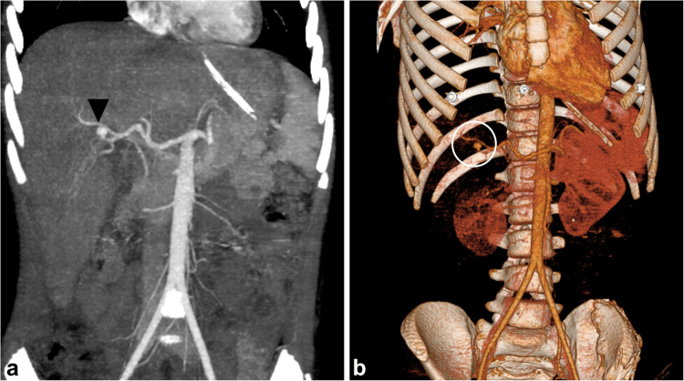
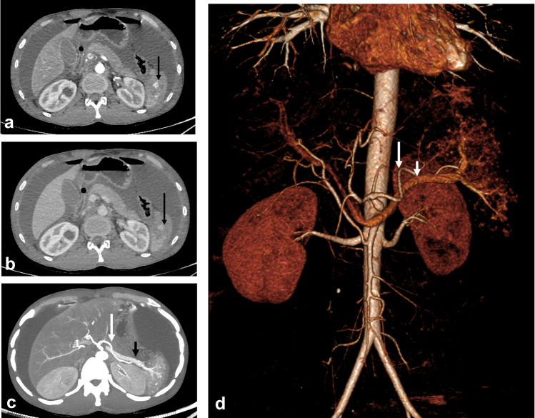
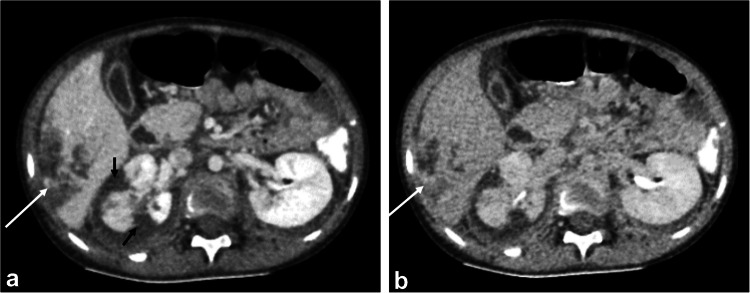
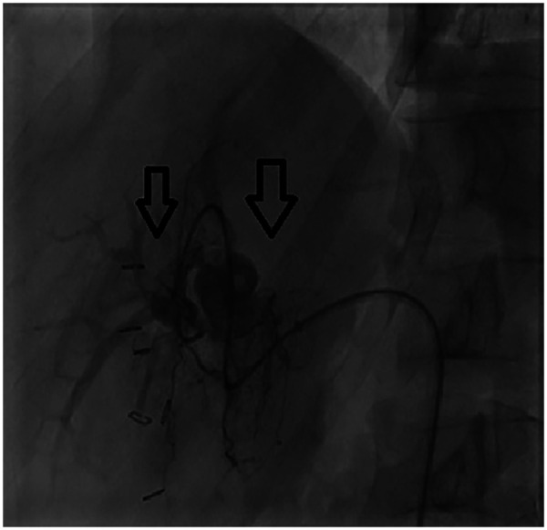
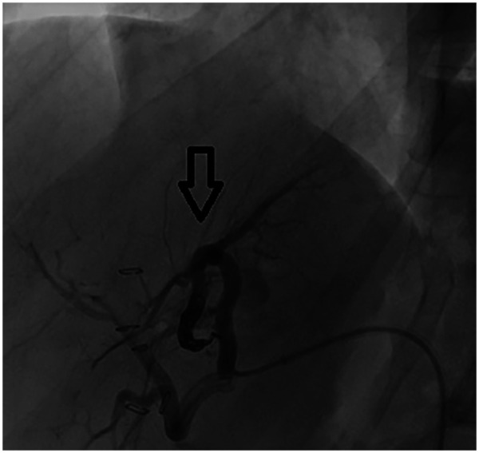
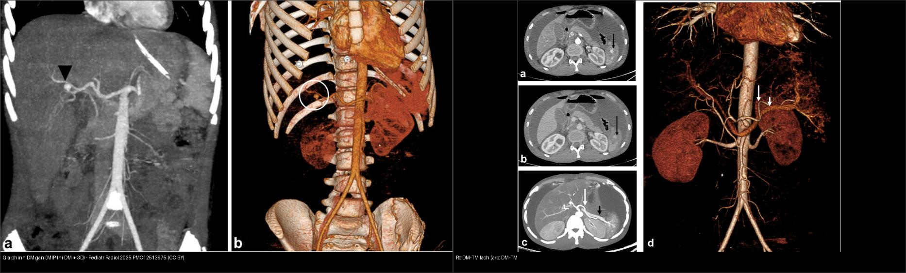

# 627 — Giả phình mạch & xuất huyết MUỘN sau chấn thương gan/lách ở trẻ / Delayed pseudoaneurysm & late hemorrhage after pediatric liver–spleen trauma

**Tags:** `pattern:gia-phinh-mach` `pattern:ro-dong-tinh-mach` `pattern:xuat-huyet-muon` `vung:gan` `vung:lach` `score:AAST` `protocol:CT-bung-can-quang` `protocol:CEUS`
**Mức chắc chắn (certainty):** tổng hợp y văn (literature synthesis) — số liệu từ các đoàn hệ đa trung tâm có PMCID; các ca ảnh là ca nguyên văn (verbatim case) CC BY 4.0.

## 1. Tổng quan bệnh học – cơ chế hình ảnh

- **Tổn thương mạch khu trú (contained vascular injury)** = thành mạch (động mạch) bị rách nhưng **máu bị nhu mô/máu tụ quanh mạch "cầm" lại** (tamponade), tạo một **túi thông với lòng mạch**: **giả phình mạch (pseudoaneurysm)** nếu túi chỉ thông với động mạch; **rò động–tĩnh mạch (arteriovenous fistula, AVF)** nếu thông đồng thời động mạch và tĩnh mạch lân cận (thì động mạch thấy **cả ĐM lẫn TM ngấm đồng thời**, TM bên tổn thương ngấm sớm bất đối xứng).
- **TẠI SAO gọi là "giả" (false) phình:** khác phình mạch thật (cả 3 lớp thành mạch giãn ra), giả phình chỉ có **máu tụ/vỏ xơ bao quanh lỗ rách** làm "thành" — nên nó **không co giãn theo nhịp tim như mạch thật** và có **nguy cơ vỡ** bất kỳ lúc nào. Vỏ này cũng là lý do giả phình **giữ nguyên hình dạng giữa các thì** (khác chảy máu hoạt tính loang ra).
- **Vật lý hình ảnh (chốt bằng thì thuốc):**
  - **Giả phình:** ổ tròn/bầu dục ngấm thuốc **đậm tương đương động mạch đang ngấm ở thì động mạch**, **giữ hình (không to ra, không loang)** và **giảm đậm độ/thải thuốc dần ở thì muộn 5–10 phút** — tức "**đi theo bể máu**" (follows the blood pool).
  - **Xuất huyết hoạt tính (active hemorrhage):** đám thuốc thoát mạch **> 90 HU, TO RA hoặc đậm lên ở thì muộn, KHÔNG theo bể máu**. Đây là khác biệt duy nhất — bắt buộc có **thì muộn**.
  - **Cục máu đông lính gác (sentinel clot):** máu đông đậm độ **> 60 HU** (thực tế 45–70 HU) bám sát cơ quan tổn thương, **bất động giữa các thì** — chỉ điểm vị trí tổn thương, không phải nguồn chảy.
- **Vì sao MUỘN (delayed):** co mạch phản xạ + tamponade + huyết khối tạm bịt lỗ rách → CT cấp có thể **âm tính**; khi cục huyết khối tiêu/co mạch hết, giả phình lộ ra. Định nghĩa nghiên cứu đa trung tâm Nhật (SHIPPs): giả phình muộn = **phát hiện mới từ ngày thứ 2 sau chấn thương trở đi**; thời điểm chẩn đoán trung vị **8 (5–10) ngày** sau nhập viện — muộn hơn hẳn giai đoạn cấp.
- **Ngưỡng định lượng phải nhớ:**
  - Giả phình lách muộn **9,4%** (41/434 ca chấn thương lách kín đơn độc được điều trị bảo tồn), gộp cả nhóm phân tích tiềm ẩn là **10,6%** (46/434).
  - **Có thoát thuốc (contrast extravasation) trên CT đầu → nguy cơ giả phình lách muộn tăng: OR 3,94 (1,45–10,7)** so với nhóm nguy cơ thấp.
  - **Không nút mạch dự phòng: 32% giả phình muộn bị VỠ (9/28) so với 0% ở nhóm nút mạch dự phòng (p = 0,003)**; ngày vỡ trung vị **10 (7–13) ngày**. Tổng 50 ca giả phình muộn, 18% (9 ca) vỡ.
  - Giả phình mạch gan trong chấn thương gan ở trẻ: **13,3% (4/30 ca sống sót có chụp CT lại)** trong một đoàn hệ 5 năm; 2 ca phải nút mạch.

## 2. Mẫu hình + chẩn đoán phân biệt theo vị trí (gamut)

**Mẫu hình chính:** trên CT chấn thương gan/lách ở thì **động mạch** thấy **ổ ngấm thuốc khu trú tròn/bầu dục** → gamut theo vị trí và dạng mạch:

- **Nhu mô gan (thường nhánh ĐM gan phải):** giả phình ĐM gan đơn thuần; **giả phình + rò ĐM–TM (AVF) quanh rốn gan** — thường muộn nhiều ngày–tuần sau chấn thương xuyên thấu/đụng dập nặng.
- **Rốn lách / cực lách:** giả phình nhánh động mạch lách (hay gặp nhất ở lách, kể cả độ I–II); **rò ĐM–TM lách** (ngấm đồng thời ĐM + TM lách) — bài gốc xếp **độ IV**.
- **Trong nhu mô rìa/cạnh bao:** chảy máu hoạt tính **khu trú trong bao** (contained) vs **lan vào khoang phúc mạc** (tự do) — mức độ nặng khác hẳn (AAST: khu trú = độ IV lách, lan vào phúc mạc = độ V).
- **Sau phúc mạc/khoang cạnh thận:** giả phình động mạch/động mạch phân đoạn — cũng có thể "blush" muộn.
- **Tổn thương phối hợp phải tìm:** giả phình **động mạch lách sau chấn thương tụy** (viêm tụy chấn thương bào mòn mạch), giả phình động mạch gan sau thủ thuật.

Gamut "ổ ngấm thuốc khu trú trong/thân tạng": **giả phình** vs **xuất huyết hoạt tính** vs **sentinel clot** vs **mạch lớn thấy qua nhu mô** (mạch tăng đậm độ tự nhiên) vs **ngấm thuốc bất thường ở gan nền** (xem mục 3, 5).

## 3. Bảng so sánh phân biệt (ma trận đối chiếu)

| Thực thể (entity) | Hình ảnh điển hình | Chốt vào (rule-in) | Chốt loại (rule-out) | Gợi ý xác nhận |
|---|---|---|---|---|
| **Giả phình mạch (pseudoaneurysm)** | Ổ tròn/bầu dục ngấm thuốc đậm tương đương ĐM ở thì động mạch, trong ổ máu tụ | **Ổ giữ nguyên HÌNH giữa các thì + giảm đậm độ/thải thuốc ở thì muộn 5–10 phút + "đi theo bể máu"** | Ổ **to ra/đậm lên ở thì muộn** = chảy máu hoạt tính, không phải giả phình | CT 2–3 thì (ĐM–TM–muộn) + MIP/3D; nếu còn nghi → **DSA** |
| **Rò động–tĩnh mạch (AVF)** | ĐM và TM lân cận **ngấm đồng thời ở thì động mạch**, TM bên tổn thương ngấm sớm | **TM ngấm sớm bất đối xứng ngay thì động mạch** | TM ngấm đúng thì muộn → không rò | MIP thì động mạch + DSA |
| **Xuất huyết hoạt tính (active hemorrhage)** | Đám thuốc thoát mạch hình dạng không đều trong máu tụ | **> 90 HU, TO RA/đậm lên ở thì muộn, không theo bể máu** | Đám **bất động, giảm ở thì muộn** = giả phình hoặc cục đông | Bắt buộc **thì muộn 5–10 phút**; cửa sổ mô mềm |
| **Cục máu đông lính gác (sentinel clot)** | Máu đông đậm độ cao bám sát cơ quan tổn thương | **> 60 HU (45–70 HU), bất động giữa các thì** | **Ngấm thuốc như mạch/đổi thì** = tổn thương mạch | Chỉ để định vị tổn thương nguồn |
| **Đường vỡ/đụng dập thuần (không tổn thương mạch)** | Dải/vùng giảm đậm độ, không có ổ ngấm khu trú | **Không có "blush" ngấm bất thường ở mọi thì** | **Có ổ ngấm khu trú giữ/đổi hình** = mạch, phải xử trí | Thì TM cửa; theo dõi nếu độ thấp |
| **Mạch lớn/mạch cửa thấy qua nhu mô (giả tổn thương)** | Cấu trúc ngấm thuốc **chạy dọc, dài, liên tục** theo giải phẫu | **Theo đúng đường mạch, không có túi khu trú** | **Có túi tròn thông lòng mạch** = giả phình | Truy vết trên MPR; không chẩn đoán trên 1 lát |

- Ảnh ghép đối chiếu: `` — **giả phình ĐM gan** (MIP thì ĐM + 3D) đặt cạnh **rò ĐM–TM lách** (thì ĐM/TM + MIP/3D), cùng bài gốc.

### Dấu hiệu cần đọc đúng trên thì muộn

- **"Đi theo bể máu" là chốt của tổn thương mạch khu trú:** đậm độ ổ giảm dần theo thì (thuốc pha loãng trong túi) thay vì đậm lên (máu mới thoát ra). Đây là điểm phân biệt duy nhất giữa giả phình và chảy máu hoạt tính khi cả hai đều sáng ở thì động mạch.
- **Rò ĐM–TM có thể chỉ thấy trên thì động mạch:** nếu không chụp thì động mạch (chỉ chụp thì TM cửa), rò dễ bị bỏ sót → nghi ngờ cao thì phải có thì ĐM.

## 4. Protocol chụp + hệ phân độ/điểm chuẩn hóa

- **CT bụng–chậu có cản quang:** thì **tĩnh mạch cửa (~70 giây)** là thì chính để xếp độ tổn thương nhu mô; **thêm thì động mạch** khi chấn thương năng lượng cao/xuyên thấu hoặc nghi tổn thương mạch — bài gốc nhấn mạnh thì động mạch "có thể hợp lý để đánh giá tổn thương ĐM nghi ngờ và định hướng can thiệp nội mạch". **Thì muộn 5–10 phút** để phân biệt chảy máu hoạt tính với giả phình/rò.
- **Tái tạo MPR + MIP + 3D** bắt buộc khi có "blush" — MIP giúp lần theo **mạch cho ăn** và đo kích thước túi.
- **ALARA:** trẻ nhạy cảm bức xạ nhất; hạn chế số lần CT. Trong đoàn hệ giả phình muộn, nhóm **không nút mạch dự phòng nhận DLP tích lũy 4203 (1802–7503) mGy·cm** so với **2492 (1258–4457) mGy·cm** ở nhóm nút mạch (p = 0,12) — xu hướng chiếu xạ nhiều hơn khi chỉ theo dõi. **Siêu âm cản quang (contrast-enhanced ultrasound, CEUS)** phát hiện chảy máu hoạt tính/giả phình mà siêu âm thường bỏ sót và dùng theo dõi ca bảo tồn **không cần chiếu xạ** — là lựa chọn thay thế CT ở nơi có thủy thuốc.
- **Hệ phân độ AAST-OIS 2018:** bản cập nhật **đưa "tổn thương mạch gồm giả phình và rò ĐM–TM" vào phân độ**; với **lách**: độ IV = tổn thương mạch phân thùy/rốn gây mất tưới máu > 25%, **giả phình/rò ĐM–TM, chảy máu hoạt tính khu trú trong bao**; **độ V = lách nát hoặc chảy máu hoạt tính LAN vào phúc mạc**. Với **gan**: độ III gồm "tổn thương mạch có chảy máu hoạt tính", độ IV = phá hủy 25–75% thùy hoặc **mạch chảy máu lan vào phúc mạc**, độ V = phá hủy > 75% hoặc tổn thương TM gan chủ/TM chủ sau gan. (Bài gốc gọi ca giả phình ĐM gan là "độ III" và ca rò ĐM–TM lách là "độ IV".)
- **Xử trí ở trẻ KHÁC người lớn:** quyết định vẫn **theo huyết động** — trẻ ổn định → **bảo tồn bất kể độ AAST**. Với **tổn thương mạch** (giả phình/rò), lựa chọn là **nút mạch qua ống thông (transcatheter arterial embolization, TAE)**, không mổ ngay. Trong 316 ca chấn thương gan/lách nhi được can thiệp mạch (đoàn hệ 83 trung tâm, 2008–2019): **nút mạch 273 ca**, vật liệu hay dùng nhất là **bọt gelatin 76,2%**, coil 18,7%, NBCA 3,7%; **thất bại can thiệp mạch 3,8%** (toàn bộ nằm trong nhóm chảy máu cấp), **0%** ở nhóm xuất huyết muộn/giả phình vỡ và giả phình chưa vỡ; biến chứng do can thiệp **0,6%**; **bảo tồn lách 98,4%**; tử vong nội viện 1,9%. Thời gian từ nhập viện đến can thiệp: chảy máu cấp **~2 giờ**, xuất huyết muộn/giả phình vỡ **~1 ngày**, giả phình chưa vỡ **~6 ngày**. Nút mạch **phân đoạn xa chiếm 81,8%** ở lách (bảo tồn nhu mô), nhánh tận ĐM gan phải/trái 62,5% ở gan.

```mermaid
flowchart TD
  A[Trẻ chấn thương gan/lách, CT có cản quang] --> B{Có "blush" ngấm thuốc khu trú?}
  B -->|Không| C[Bảo tồn + theo dõi; không CT lại thường quy]
  B -->|Có| D[Đọc thì muộn 5-10 phút]
  D --> E{To ra/đậm lên thì muộn?}
  E -->|Có = chảy máu hoạt tính| F[Nút mạch / mổ theo huyết động]
  E -->|Không, thải thuốc + giữ hình = giả phình/rò ĐM-TM| G{Huyết động ổn định?}
  G -->|Ổn định| H[Cân nhắc nút mạch dự phòng]
  G -->|Không ổn định| F
  H --> I[Theo dõi: CEUS thay CT khi được; CT lại nếu có chỉ định]
  I --> J{Từ ngày 2 trở đi: đau/tụt HA/Hb giảm?}
  J -->|Có| K[CT 2-3 thì tìm giả phình muộn / giả phình VỠ]
  J -->|Không| L[Theo dõi lâm sàng]
```

## 5. Biến thể bình thường và cạm bẫy

- **Âm tính giả ở thì cấp:** co mạch/tamponade/huyết khối tạm bịt → CT đầu **không thấy** tổn thương mạch; vì vậy **giả phình "muộn" xuất hiện ngày 2–10+**. Trẻ có **thoát thuốc trên CT đầu** là nhóm nguy cơ cao (OR 3,94) → cảnh giác theo dõi.
- **Cạm bẫy "chỉ chụp thì tĩnh mạch cửa":** sẽ bỏ sót rò ĐM–TM (chỉ thấy ở thì động mạch). Chấn thương năng lượng cao/xuyên thấu → thêm thì ĐM.
- **Dị vật/bóng sườn, khí tiêu hóa, ống thông** gây **tăng đậm độ giả** cạnh nhu mô — dễ nhầm "blush"; đọc thêm trên MPR, đối chiếu cửa sổ.
- **Tĩnh mạch sinh dục (gonadal vein) dễ nhầm niệu quản** — lần theo đường đi + thì muộn.
- **Thỏa mãn tìm kiếm (satisfaction of search):** đã thấy đường vỡ rõ thì vẫn phải lướt tiếp tìm ổ giả phình ở thì động mạch; trong ổ máu tụ lớn, giả phình **có thể bị máu tụ nhu mô che khuất**.
- **Giả phình không chỉ ở độ cao:** giả phình lách gặp cả ở **độ I–II** (nhóm được điều trị bảo tồn nhẹ hơn) → không loại trừ vì độ thấp.
- **Theo dõi "quá tay" cũng có giá:** nhóm chỉ theo dõi (không nút mạch) nhận DLP nhiều hơn và **32% vỡ**; cân nhắc **nút mạch dự phòng** hoặc **CEUS theo dõi** thay vì chuỗi CT lặp lại.

## 6. Tự lượng giá — Blind Quiz

**Ca 1 — Bé trai 11 tuổi, đau hạ sườn phải, tiền sử chấn thương bụng kín cách 1 tháng. Siêu âm/Doppler thấy giả phình. Đọc MIP thì động mạch + tái tạo 3D.**



- Gợi ý lâm sàng (clinical context): đau khu trú muộn sau chấn thương, đã ổn định huyết động.
- Câu hỏi: Mô tả ổ ngấm thuốc? Nó xuất phát từ đâu? Vì sao gọi là **giả** phình? Điểm nào trên thì muộn giúp chốt?

<details><summary><b>Bấm để hiện đáp án (findings + chẩn đoán)</b></summary>

- Dấu hiệu (findings): **(a)** MIP coronal thì động mạch: ổ tròn ngấm thuốc đậm, giới hạn rõ (đầu mũi tên) phát sinh từ **nhánh sau động mạch gan phải**; **(b)** tái tạo 3D cho thấy túi nhỏ xuất phát từ nhánh ĐM gan phải (vòng tròn). Trên thì muộn, ổ này **giảm đậm độ (thải thuốc)** — đặc điểm "đi theo bể máu".
- Chẩn đoán (diagnosis): **giả phình động mạch gan do chấn thương (hepatic artery traumatic pseudoaneurysm)** — vỏ là máu tụ/nhu mô quanh lỗ rách nên không phải "phình thật"; giữ hình giữa các thì và thải thuốc ở thì muộn, khác chảy máu hoạt tính. Xử trí: **nút mạch** (bài gốc xếp độ III).
- Nguồn ảnh: Fig 1, Mohammad SA et al., *Pediatr Radiol* 2025 (**PMC12513975**), CC BY 4.0.
</details>

**Ca 2 — Bé trai 18 tuổi, tai nạn giao thông, tổn thương lách. Đọc thì động mạch (a), thì TM (b), MIP (c), 3D (d).**



- Gợi ý lâm sàng: chấn thương tốc độ cao, đau bụng, tổn thương lách kèm máu tụ.
- Câu hỏi: Tìm tổn thương mạch? Dấu hiệu nào nói **rò ĐM–TM** chứ không chỉ giả phình? Đây là độ mấy theo AAST?

<details><summary><b>Bấm để hiện đáp án (findings + chẩn đoán)</b></summary>

- Dấu hiệu: **(a, b)** ổ ngấm thuốc khu trú trong lách (mũi tên) **đi theo bể máu** ở thì ĐM và thì TM; **(c, d)** MIP và tái tạo 3D thấy **TM lách ngấm đồng thời với ĐM lách** (mũi tên ngắn/dài) = **rò động–tĩnh mạch (AVF)** sau chấn thương.
- Chẩn đoán: **tổn thương mạch khu trú dạng rò ĐM–TM lách**, bài gốc xếp **độ IV** (AAST 2018 lách: giả phình/rò ĐM–TM = độ IV). Chốt rò bằng **TM ngấm sớm bất đối xứng ở thì động mạch** — chỉ thấy nếu có thì ĐM. Xử trí: **nút mạch**.
- Nguồn ảnh: Fig 10, Mohammad SA et al., *Pediatr Radiol* 2025 (**PMC12513975**), CC BY 4.0.
</details>

**Ca 3 — Bé gái 7 tuổi, tai nạn xe máy, tổn thương gan và thận phải. So sánh hai thì.**



- Gợi ý lâm sàng: chấn thương đa tạng, theo dõi bảo tồn.
- Câu hỏi: Ổ ngấm thuốc ở gan đổi thế nào từ (a) sang (b)? Vì sao đổi như vậy? Có phải chảy máu hoạt tính không?

<details><summary><b>Bấm để hiện đáp án (findings + chẩn đoán)</b></summary>

- Dấu hiệu: **(a)** thì TM cửa: ổ ngấm thuốc khu trú trong gan (mũi tên trắng) **đi theo bể máu**, vùng giảm đậm độ quanh đó; **(b)** thì muộn: ổ **mờ dần/thải thuốc** còn vùng đụng dập chuyển dần đồng đậm độ. Thận phải có nhiều vùng hình nêm **không ngấm ở mọi thì** = nhồi máu phân thùy (độ IV thận).
- Chẩn đoán: **tổn thương mạch khu trú ở gan (contained vascular injury) + đụng dập gan**, KHÔNG phải chảy máu hoạt tính — vì **thải thuốc ở thì muộn** thay vì to ra/đậm lên. Kèm **nhồi máu phân thùy thận phải**.
- Nguồn ảnh: Fig 12, Mohammad SA et al., *Pediatr Radiol* 2025 (**PMC12513975**), CC BY 4.0.
</details>

**Ca 4 — Bệnh nhi, chấn thương gan xuyên thấu, sau đó vài tuần xuất hiện giả phình ĐM gan + rò ĐM–cửa. Chụp DSA và nút mạch.**



- Gợi ý lâm sàng: tổn thương muộn nhiều tuần sau chấn thương xuyên thấu gan.
- Câu hỏi: DSA xác nhận gì? Vì sao phải can thiệp (không chỉ theo dõi)?

<details><summary><b>Bấm để hiện đáp án (findings + chẩn đoán)</b></summary>

- Dấu hiệu: hình DSA thì động mạch thấy **túi giả phình từ ĐM gan trái** kèm **thấy TM cửa ngấm sớm trong thì động mạch** (rò động–cửa) — bất thường ngấm thuốc không có ở gan bình thường.
- Chẩn đoán: **giả phình động mạch gan kèm rò động–cửa (arterioportal fistula)** — nguy cơ vỡ và tăng áp lực TM cửa; **nút mạch là tiêu chuẩn** để loại trừ rò và bảo tồn nhu mô gan.
- Nguồn ảnh: Figure 2, Amro AM et al., *Front Surg* 2026 (**PMC13407643**), CC BY 4.0.
</details>

**Ca 5 — Ảnh DSA trước và sau can thiệp + ảnh ghép đối chiếu gan–lách.**



- Gợi ý lâm sàng: sau nút mạch coil/keo.
- Câu hỏi: Tiêu chuẩn kỹ thuật thành công là gì? Kể 2 tên vật liệu nút mạch hay dùng và tỉ lệ thất bại bảo tồn lách nói chung.

<details><summary><b>Bấm để hiện đáp án (findings + chẩn đoán)</b></summary>

- Dấu hiệu: thì sau nút mạch **không còn ngấm thuốc trong túi giả phình**, rò đã được loại trừ (mũi tên); **thành công kỹ thuật = hết ngấm thuốc ở túi và hết rò, không còn thoát mạch**.
- Chẩn đoán/định lượng: vật liệu hay dùng **bọt gelatin (76,2%), coil (18,7%)**; đoàn hệ can thiệp mạch nhi **thất bại 3,8%, biến chứng do can thiệp 0,6%, bảo tồn lách 98,4%**. Ảnh ghép:



- Nguồn ảnh: Figure 4, Amro AM et al., *Front Surg* 2026 (**PMC13407643**) + Fig 1/10, Mohammad SA et al., *Pediatr Radiol* 2025 (**PMC12513975**); đều CC BY 4.0; ghép bằng `tools/make_composite.py`.
</details>

## Bài liên quan chéo
- [624 – Chấn thương gan & đường mật ở trẻ (AAST gan I–V, biloma)](../624-chan-thuong-gan-duong-mat-nhi/lesson.md)
- [140 – Lách & chấn thương tạng đặc (AAST lách)](../140-lach-tang-dac/lesson.md)
- [636 – Cấp cứu niệu–sinh dục nhi (AAST thận)](../636-cap-cuu-nieu-sinh-duc-nhi/lesson.md)
- [623 – Chấn thương tụy–tá tràng ở trẻ](../623-chan-thuong-tuy-ta-trang-nhi/lesson.md)
- [920 – Nút mạch trong xuất huyết tiêu hóa](../920-vascular-embolization-gi-bleed/lesson.md)

## Ảnh
- Tên file: `627_*`. Nguồn + giấy phép từng ảnh trong `images/CREDITS.md` (toàn bộ **CC BY 4.0**).
- Ảnh ghép: `images/composite_gia-phinh-gan-vs-ro-dmtm-lach.jpg` (Pillow letterbox, giữ aspect, không crop/kéo giãn).

> Không dùng để chẩn đoán độc lập khi chưa có người hướng dẫn.
