# 628 — Viêm tụy cấp do tăng triglyceride máu & nguyên nhân chuyển hóa ở trẻ: ngưỡng TG, insulin – plasmapheresis, khi nào chụp

**Tags:** `pattern:viem-tuy` `pattern:tang-triglyceride` `pattern:hoai-tu-tuy` `pattern:nang-gia-tuy` `vung:tuy` `vung:chuyen-hoa-lipid` `score:Atlanta` `score:INSPPIRE` `protocol:MRCP` `protocol:sieu-am-bung` `protocol:CT-bung`
**Mức chắc chắn (certainty):** tổng hợp y văn (literature synthesis) — ghép dữ liệu đoàn hệ/ca nguyên văn open-access; số liệu để nguyên kèm nguồn, không suy diễn.

> **Điểm chốt của bài:** ở trẻ, nguyên nhân viêm tụy cấp (acute pancreatitis, AP) **không do sỏi/chấn thương** hay gặp nhất là **thiếu insulin (đái tháo đường/DKA) làm tăng triglyceride (TG) máu nặng**. Ba chốt: **(1) ngưỡng** — TG **> 11,3 mmol/L (~1000 mg/dL)** = tăng TG nặng (SHTG, Endocrine Society); nguy cơ AP **~5%** khi TG > 11,2 mmol/L và **10–20%** khi > 22,4 mmol/L; **(2) ống máu đục như sữa (lipemic serum) + ban vàng (xanthoma) là dấu hiệu chỉ điểm tại giường** — nhưng 83% trẻ hoàn toàn **không triệu chứng**; **(3) điều trị là hạ TG bằng insulin tĩnh mạch, plasmapheresis là "cứu hộ" khi thất bại** — chẩn đoán là **sinh hóa**, hình ảnh để **theo dõi biến chứng (hoại tử, tụ dịch)** và **tìm nguyên nhân giải phẫu khi tái phát (MRCP)**.

## 1. Tổng quan bệnh học – cơ chế hình ảnh

### 1.1 Vì sao TG cao gây viêm tụy

Thiếu insulin → **giảm hoạt tính lipoprotein lipase (LPL)** + tăng sản xuất VLDL ở gan → **tăng chylomicron và VLDL** trong máu. Ba cơ chế gây viêm tụy:

1. **Cô đặc – tắc vi mạch:** máu giàu chylomicron tăng độ nhớt, **lấp mao mạch tụy → thiếu máu cục bộ**.
2. **Độc acid béo tự do (free fatty acid, FFA):** lipase tụy thủy phân TG thành FFA vượt khả năng gắn albumin → **FFA tự do gây độc tế bào nang tụy và nội mô**.
3. **Tăng đông tại chỗ:** huyết khối vi mạch, có thể **huyết khối tĩnh mạch cửa/lách** (Jeyabavan A et al., *Cureus* 2026, PMC13422059).

Vì sao mỗi hình ảnh/biểu hiện xuất hiện:

- **Huyết thanh đục như sữa (lipemic):** chylomicron kích thước lớn ~ hạt keo **tán xạ ánh sáng** → ống máu đục; đây là **dấu hiệu chỉ điểm tại giường** nhưng cũng làm **xét nghiệm ban đầu bị chậm/giao thoa** (Jeyabavan et al., PMC13422059 mô tả "xét nghiệm ban đầu bị trì hoãn đáng kể do đục máu rõ").
- **Ban vàng (eruptive xanthoma/xanthelasma):** lắng đọng lipid ở trung bì/bìa → tổn thương sẩn vàng, đôi khi **bị chẩn đoán nhầm là ban nhiễm trùng** (Chan SYC et al., *Cureus* 2026, PMC13544194 — ca 21 tháng tuổi).
- **CT/MRI tụy:** phù nề tụy, **thâm nhiễm mỡ quanh tụy (fat stranding)**, dày thành tá tràng phản ứng; khi nặng: **ổ hoại tử giảm đậm độ không ngấm thuốc** và **tụ dịch**. Vì **hoại tử cần 72–96 giờ mới rõ**, CT **ngay khi nhập viện thường bình thường** (xem thêm [626](../626-viem-tuy-cap-nhi/lesson.md)).

### 1.2 Ngưỡng định lượng nền

- **SHTG = TG > 11,3 mmol/L** (Endocrine Society; dẫn qua Liu M et al., *Front Endocrinol* 2026, PMC13553409). Tương ứng **> 1000 mg/dL** (định nghĩa dùng trong AAHTG — Barbar M et al., *Front Oncol* 2026, PMC13337426).
- **Nguy cơ AP: ~5% khi TG > 11,2 mmol/L; 10–20% khi TG > 22,4 mmol/L** (Liu et al., PMC13553409).
- **Tăng TG (> 2,26 mmol/L) gặp ở tới 40% trẻ có DKA**; **AP trong SHTG + DKA khoảng 26,3% (5/19)** theo Richardson, trong đoàn hệ 21 trẻ của Liu là **33,3% (7/21)**.
- **Thiếu insulin là mấu chốt:** 17/21 bệnh nhi mới chẩn đoán ĐTĐ, **3/4 ca đã biết ĐTĐ tự ngừng insulin trước nhập viện** (Liu et al., PMC13553409). Tuổi trung vị **11,3** (IQR 10,5–13,2), **76,2% ≥ 10 tuổi**.

## 2. Mẫu hình + chẩn đoán phân biệt theo căn nguyên (Gamut)

- **Thiếu insulin / DKA / ĐTĐ mới:** nguyên nhân **hàng đầu ở trẻ ≥ 10 tuổi**, béo phì/đề kháng insulin làm chậm thanh thải TG.
- **Đơn gen (tăng TG gia đình/FCS):** **LPL, GPIHBP1, APOC2, APOA5, LMF1**; TG rất cao (> 22 mmol/L), khởi phát sớm, có thể **bộc lộ khi có stress chuyển hóa** (DKA). FCS **1–10/1.000.000**; **NAFCS ≥ 60 = FCS chắc chắn (Sp 100%/Se 67%)**; **chẩn đoán thường trễ trung vị 24 năm** (Chan et al., PMC13544194).
- **Thuốc:** **asparaginase/pegaspargase** (điều trị ALL) — **AAHTG 2% (12/598)**, khởi phát **trung vị 12 ngày** sau liều asparaginase, **83% không triệu chứng** (Barbar et al., PMC13337426); corticoid kéo dài, valproate, olanzapin.
- **Rối loạn chuyển hóa bẩm sinh:** **thiếu citrin (SLC25A13)** — trẻ gầy, **thích đậu nành, chán tinh bột**, TG 28,96 mmol/L (đỉnh 30,35) (Ye R et al., *Front Pediatr* 2026, PMC13283877).
- **Thứ phát:** hội chứng thận nhiễm mỡ, suy giáp, thai kỳ; **tăng TG hỗn hợp** do béo phì + ĐTĐ.
- **Nguyên nhân TỤY khác (phải loại trừ):** sỏi mật, tụy divisum/nang ống mật chủ ([626](../626-viem-tuy-cap-nhi/lesson.md)), chấn thương tụy ([623](../623-chan-thuong-tuy-ta-trang-nhi/lesson.md)), vi rút/vi khuẩn.

## 3. Bảng so sánh phân biệt (ma trận đối chiếu)

| Thực thể (entity) | Hình ảnh / xét nghiệm điển hình | Chốt vào (rule-in) | Chốt loại (rule-out) | Gợi ý xác nhận |
|---|---|---|---|---|
| **HTG-AP (tăng TG nặng)** | Ống máu đục như sữa; TG > 11,3 mmol/L; CT phù nề/thâm nhiễm mỡ quanh tụy → hoại tử muộn | **TG > 11,3 mmol/L + ≥ 2/3 tiêu chuẩn AP** (đau, lipase/amylase ≥ 3× ULN, hình ảnh) | TG bình thường, sỏi mật, chấn thương rõ | Lipid máu lúc đói + lipase; US/CT‑MRCP loại trừ nguyên nhân khác |
| **HTG do thiếu insulin / DKA** | Đường huyết cao, HbA1c cao, ceton (+), TG tăng (tới 40% trẻ DKA) | **DKA (ISPAD 2022) + TG cao**; sau đó hạ TG khi truyền insulin | TG cao tồn tại mãi dù đã kiểm soát đường huyết | Đường huyết/ceton/máu khí; theo dõi TG theo giờ |
| **FCS (đơn gen)** | TG rất cao, ban vàng, có thể gan–lách to, lipemia retinalis | **TG > 10 mmol/L kháng điều trị + NAFCS ≥ 60** | Đơn gen âm tính và có yếu tố thứ phát rõ | Panel **LPL/APOC2/APOA5/GPIHBP1/LMF1** |
| **AAHTG (asparaginase)** | Đục máu bất ngờ khi xét nghiệm định kỳ; ± AP; peak TG trung vị ~2.645 mg/dL | **TG > 1000 mg/dL sau asparaginase**, thường không triệu chứng | Không liên quan thời điểm dùng asparaginase | Theo dõi TG quanh đợt asparaginase |
| **Thiếu citrin (SLC25A13)** | Trẻ gầy, CT tụy giãn lan + viêm quanh tụy; TG ~29 mmol/L | **Sở thích đậu nành/chán tinh bột + biến thể SLC25A13** | Gen âm và không có kiểu hình điển hình | Gen SLC25A13 + amoni/citrullin |
| **Nang giả tụy vs WON** | Nang dịch sau ≥ 4 tuần; WON có mảnh hoại tử nổi | **Dịch đồng nhất = nang giả; mảnh hoại tử/đậm độ không đồng nhất = WON** | Ổ ngấm thuốc có cấu trúc mạch → giả phình | MRI/MRCP; đối chiếu [626](../626-viem-tuy-cap-nhi/lesson.md) |
| **Viêm tụy do sỏi mật** | Siêu âm: sỏi, giãn ống mật chủ; MRCP | **Sỏi/giãn OMC + men tụy tăng** | Không sỏi, không giãn đường mật | US → MRCP (ERCP khi cần can thiệp) |

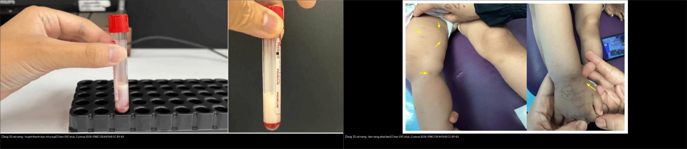
*Hai dấu hiệu chỉ điểm tại giường của tăng TG rất nặng. **Trái:** huyết thanh đục như sữa (lipemic serum). **Phải:** ban vàng (eruptive xanthoma, mũi tên vàng) — ở trẻ nhỏ đôi khi bị chẩn đoán nhầm là ban nhiễm trùng. Nguồn: Chan SYC et al., Cureus 2026, PMC13544194 — CC BY 4.0. Ghép bằng `tools/make_composite.py`, giữ tỉ lệ.*

## 4. Protocol chụp + hệ phân độ/điểm chuẩn hóa

### 4.1 Chẩn đoán (sinh hóa là chính, hình ảnh để phụ trợ)

- **AP ở trẻ = ≥ 2/3 tiêu chuẩn** (Atlanta sửa đổi cho trẻ): (1) **đau thượng vị cấp** lan sau lưng; (2) **lipase và/hoặc amylase ≥ 3× giới hạn trên**; (3) **hình ảnh phù hợp** (phì đại tụy, thâm nhiễm mỡ quanh tụy, hoại tử, tụ dịch) (Liu et al., PMC13553409; Spoială EL et al., *J Clin Med* 2026, PMC12842282).
- **Lipid máu:** đo **TG lúc đói**; SHTG **> 11,3 mmol/L**; đánh giá thêm cholesterol, LDL, và **cân nhắc panel gen** khi TG rất cao/tái phát.

### 4.2 Chọn hình ảnh & thời điểm

- **Siêu âm bụng:** đầu tay, không chiếu xạ — **sỏi mật, phì đại tụy, dịch quanh tụy**.
- **CT có cản quang:** dùng khi **nặng hoặc không cải thiện**; **hoại tử cần 72–96 giờ mới rõ** → chụp sớm có thể bỏ sót (minh họa tiến triển hoại tử + **huyết khối tĩnh mạch lách** ở ca người lớn: Jeyabavan et al., PMC13422059). Ở trẻ, hạn chế chiếu xạ (**ALARA**).
- **MRI/MRCP:** khi **tái phát** hoặc nghi nguyên nhân giải phẫu (tụy divisum, nang ống mật chủ) — nối [626](../626-viem-tuy-cap-nhi/lesson.md).

### 4.3 Điều trị hạ TG & theo dõi — các ngưỡng hành động

- **Insulin tĩnh mạch (đầu tay):** tiếp tục truyền **đến khi TG < 5,6 mmol/L**, kèm **glucose 10%** và theo dõi **đường huyết/kali mỗi giờ** để tránh hạ đường huyết. Ca điển hình: **tiêm insulin aspart 0,1 U/kg/giờ** → **giảm TG 55% trong 24 giờ, 76% ở 48 giờ, 82% ở 96 giờ**, không biến chứng (Spoială et al., PMC12842282).
- **Thời gian hạ TG khi chỉ dùng insulin có thể RẤT DÀI:** trung vị **12,5 ngày** (IQR 6–20; 1–30) để đạt TG < 5,6 mmol/L; **6 ca cần > 15 ngày** (Liu et al., PMC13553409).

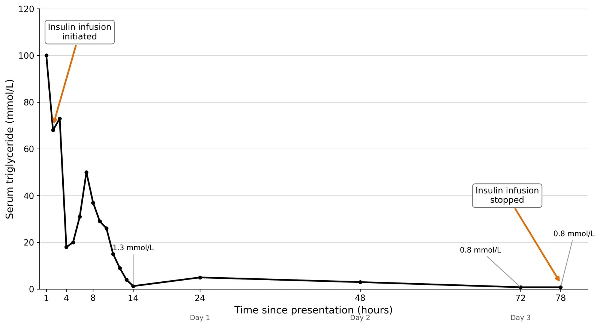
*Đường TG theo giờ sau khi bắt đầu truyền insulin liên tục (case 1, FCS). Nguồn: Chan SYC et al., Cureus 2026, PMC13544194 — CC BY 4.0.*

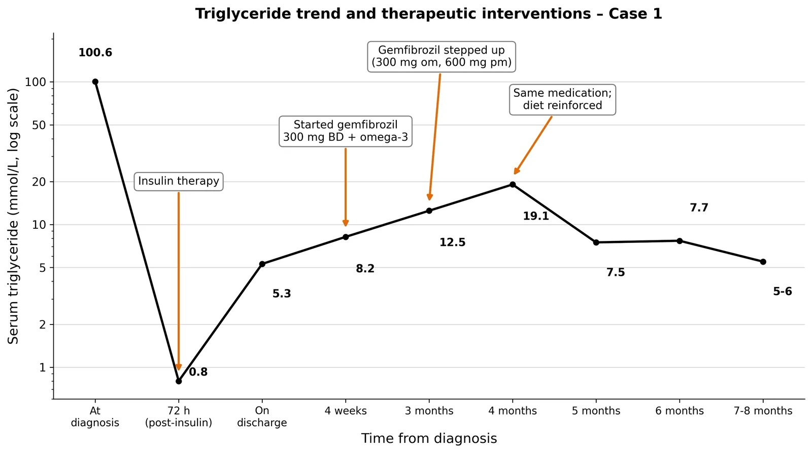
*TG huyết thanh và các can thiệp tương ứng theo thời gian (case 1). Nguồn: Chan SYC et al., Cureus 2026, PMC13544194 — CC BY 4.0.*

- **Plasmapheresis (thay huyết tương — "cứu hộ"):** khi **TG không giảm thỏa đáng hoặc đau bụng dai dẳng dù đã truyền insulin**; khuyến cáo của **Hội Gây mê–Hồi sức và Tiêu hóa Pháp 2021**: thay huyết tương khi **thất bại điều trị nội khoa** (Liu et al., PMC13553409). Trung vị đạt TG < 5,6 mmol/L: **3,0 ngày** (IQR 1–5) vs **12,5 ngày** — nhưng **thận trọng do chọn lọc bệnh**, và **4/7 ca thay huyết tương xuất hiện huyết khối tĩnh mạch**.
- **Dinh dưỡng & thuốc:** hạn chế **LCT**, bổ sung **MCT + omega‑3**; fibrate/gemfibrozil; kiểm soát đường huyết. **AAHTG:** insulin truyền (11 ca, trung vị 3 ngày) + omega‑3 + fibrate; **plasmapheresis** trong 3 ca (TG > 6000 mg/dL hoặc hội chứng tăng độ nhớt); **tái dùng asparaginase khi TG đã < 1000 mg/dL** (Barbar et al., PMC13337426).

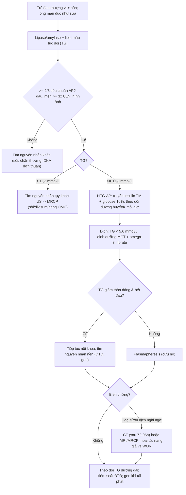

## 5. Biến thể bình thường và cạm bẫy

- **"CT bình thường" không loại trừ viêm tụy:** hoại tử cần **72–96 giờ** mới hiện; chụp quá sớm dễ âm tính giả. Chỉ chụp CT khi nặng/không cải thiện (ALARA ở trẻ).
- **Huyết thanh đục làm xét nghiệm chậm/giao thoa:** "xét nghiệm ban đầu bị trì hoãn đáng kể do đục máu" (PMC13422059) → **đừng chờ kết quả mới nghĩ tới HTG**; nhìn ống máu là gợi ý.
- **83% trẻ hoàn toàn KHÔNG triệu chứng:** AAHTG thường phát hiện tình cờ qua **đục máu trên xét nghiệm định kỳ** (Barbar et al., PMC13337426) → phải chủ động đo TG ở nhóm nguy cơ (DKA, asparaginase).
- **Đừng quy mọi đau bụng ở DKA cho "toan ceton":** đau thượng vị + nôn có thể là **AP thật** — đây là lý do phải đo **lipase/amylase và TG** ngay khi vào viện (Liu et al., PMC13553409).
- **Plasmapheresis không phải "thuốc chữa lành vô hại":** **4/7 ca có huyết khối tĩnh mạch**, và nhóm được chọn có TG nền cao hơn → lợi ích nhanh một phần do chọn lọc; chỉ dùng **cứu hộ**.
- **Ban vàng bị nhầm ban nhiễm trùng:** ở nhũ nhi, ban vàng có thể là **biểu hiện đầu tiên của FCS** — tránh bỏ sót (Chan et al., PMC13544194).
- **TG rất cao có thể "giấu" bệnh nền:** peak TG tới 69,3 mmol/L gợi ý **rối loạn đơn gen** (LPL/APOC2/APOA5/GPIHBP1) bị bộc lộ bởi DKA — **cân nhắc xét nghiệm gen** (Liu et al., PMC13553409).

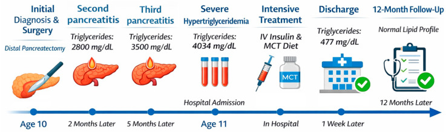
*Dòng thời gian ca bé gái 11 tuổi: viêm tụy tái phát → TG lúc đói > 4000 mg/dL → truyền insulin + chế độ MCT → TG về bình thường và không tái phát trong 12 tháng theo dõi. Nguồn: Spoială EL et al., J Clin Med 2026, PMC12842282 — CC BY 4.0.*

## 6. Tự lượng giá — Blind Quiz (ảnh trơn ngoài, đáp án ẩn trong khối chi tiết)

**Ca 1 — Bé gái 12 tuổi, đau thượng vị cấp, nôn, mất nước, khởi phát ĐTĐ type 1. Nhìn ống máu, bạn nghĩ gì?**

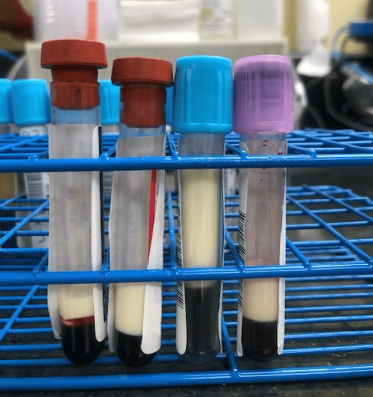

- Gợi ý lâm sàng: xanthelasma và ban vàng khi khám; HbA1c 10,4%.
- Câu hỏi: Dấu hiệu trên ống máu là gì? Cần xét nghiệm nào để xác nhận? Vì sao vừa DKA vừa viêm tụy?

<b>Bấm để hiện đáp án (findings + chẩn đoán)</b>

- **Dấu hiệu:** **huyết thanh đục như sữa (lipemic serum)** — dấu hiệu chỉ điểm tăng TG nặng.
- **Chẩn đoán:** **viêm tụy cấp do tăng triglyceride máu** đồng thời **DKA** ở trẻ mới chẩn đoán ĐTĐ type 1.
- **Số liệu ca:** TG **15.630 mg/dL**, cholesterol 561 mg/dL, HbA1c 10,4%; điều trị insulin truyền + dịch, **TG bình thường trong 9 ngày**; xuất viện với chế độ ăn ĐTĐ + insulin + hạ lipid (olezarsen).
- **Cơ chế:** thiếu insulin → giảm LPL → máu giàu chylomicron → ứ trệ mao mạch tụy + FFA độc.
- Nguồn ảnh: Padilla AL et al., Cureus 2025 (PMC12802807), Fig. 1, CC BY 4.0.

**Ca 2 — Bé 21 tháng tuổi, ban sẩn vàng rải rác được chẩn đoán nhầm là "ban nhiễm trùng". TG = 100,6 mmol/L. Chẩn đoán?**

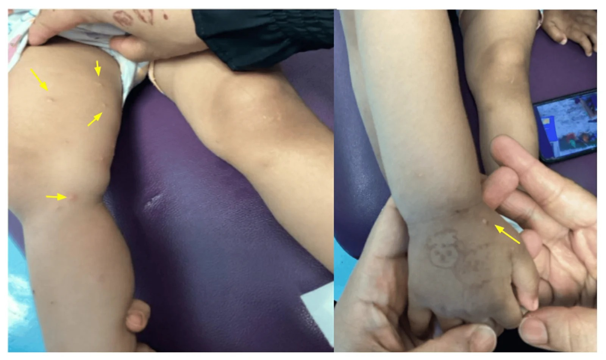

- Gợi ý: các tổn thương sẩn vàng không liên tục ở thân, chi; sau đó mới đo lipid máu.
- Câu hỏi: Đây là bệnh gì? Cần xét nghiệm gì để xác định nguyên nhân?

<b>Bấm để hiện đáp án (findings + chẩn đoán)</b>

- **Dấu hiệu:** **ban vàng (eruptive xanthoma)** — lắng đọng lipid do TG rất cao; ở trẻ nhỏ dễ bị nhầm ban nhiễm trùng.
- **Chẩn đoán:** **hội chứng tăng chylomicron máu gia đình (FCS)** do **đột biến gen GPIHBP1**; TG 100,6 mmol/L.
- **Xử trí:** insulin liều cao + hạn chế mỡ nghiêm ngặt + gemfibrozil; **FCS 1–10/1.000.000**, NAFCS ≥ 60 (Sp 100%/Se 67%), chẩn đoán thường trễ **trung vị 24 năm**.
- Nguồn ảnh: Chan SYC et al., Cureus 2026 (PMC13544194), Fig. 1, CC BY 4.0.

**Ca 3 — Bé gái 11 tuổi béo, TG lúc đói > 4000 mg/dL, được truyền insulin aspart 0,1 U/kg/giờ. Đọc biểu đồ TG.**

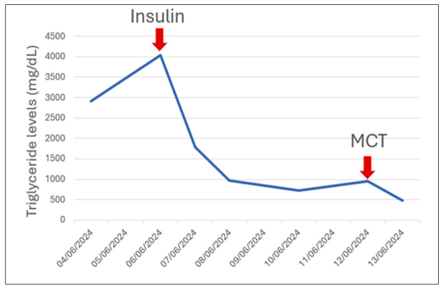

- Gợi ý: đánh dấu thời điểm insulin và thời điểm bắt đầu chế độ MCT.
- Câu hỏi: Mức giảm TG ở 24/48/96 giờ? Vì sao phải truyền kèm glucose 10%?

<b>Bấm để hiện đáp án (findings + chẩn đoán)</b>

- **Dấu hiệu:** TG giảm **55% trong 24 giờ, 76% ở 48 giờ, 82% ở 96 giờ**; sau đó duy trì thấp với MCT.
- **Chẩn đoán:** **HTG-AP ở trẻ** đáp ứng nhanh với insulin; chế độ **MCT** để giảm tạo chylomicron.
- **Vì sao thêm glucose 10%:** insulin làm hạ đường huyết → phải truyền glucose và theo dõi đường huyết/kali **mỗi giờ**.
- Nguồn ảnh: Spoială EL et al., J Clin Med 2026 (PMC12842282), Fig. 1, CC BY 4.0.

**Ca 4 — Kiểm tra "đòn bẩy" của bài: khi nào chuyển sang thay huyết tương (plasmapheresis)?**

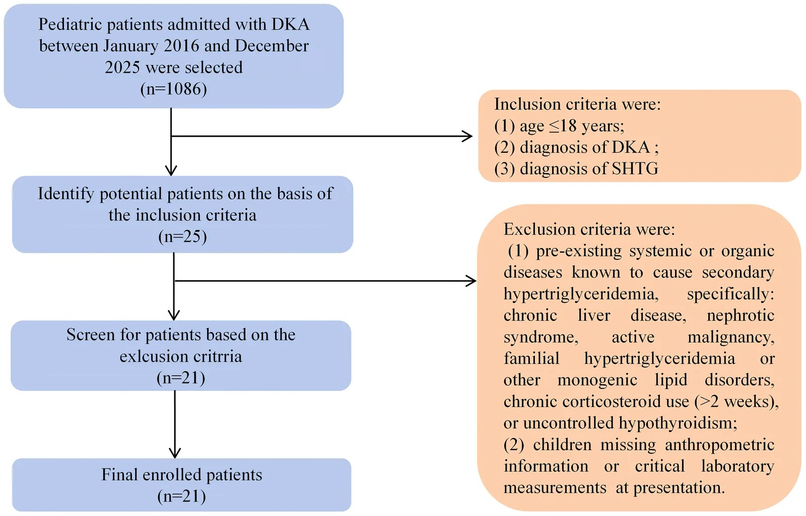

- Gợi ý: 1.086 ca DKA → 25 ca SHTG → 21 ca cuối.
- Câu hỏi: Plasmapheresis có phải điều trị đầu tay? Thời gian đạt TG < 5,6 mmol/L khác nhau thế nào?

<b>Bấm để hiện đáp án (findings + chẩn đoán)</b>

- **Dấu hiệu:** **SHTG = TG > 11,3 mmol/L**; 21 trẻ DKA + SHTG; **7 ca có AP (33,3%)**.
- **Chẩn đoán/xử trí:** **insulin là đầu tay**; **plasmapheresis là cứu hộ** khi TG không giảm thỏa đáng/đau bụng dai dẳng (đồng thuận Pháp 2021).
- **Số liệu chốt:** đạt TG < 5,6 mmol/L trung vị **3,0 ngày** (plasmapheresis) vs **12,5 ngày** (insulin đơn thuần); **4/7 ca plasmapheresis có huyết khối tĩnh mạch** → không dùng đại trà.
- Nguồn ảnh: Liu M et al., Front Endocrinol 2026 (PMC13553409), Fig. 1, CC BY 4.0.

**Ca 5 — Người lớn (tham chiếu): viêm tụy hoại tử do tăng TG. CT có cạnh báo gì ngoài tụy?**

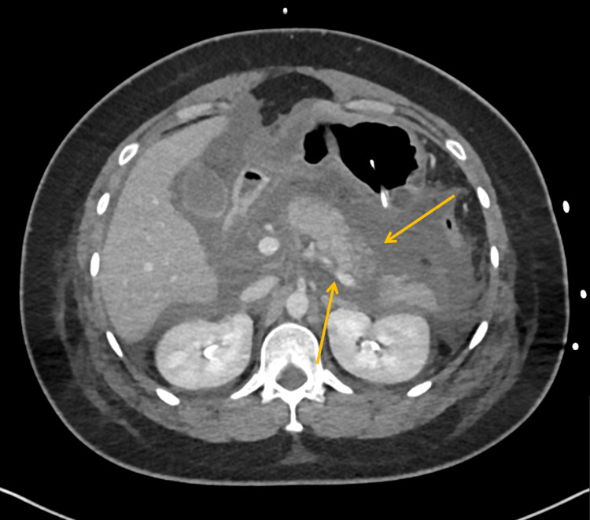

- Gợi ý: đây là **ca người lớn** (nữ 30–40 tuổi), TG 20,4 mmol/L, amylase 2636 IU/L; xét nghiệm ban đầu bị chậm vì máu đục.
- Câu hỏi: Mô tả tổn thương tụy và biến chứng mạch? Vì sao cần CT muộn?

<b>Bấm để hiện đáp án (findings + chẩn đoán)</b>

- **Dấu hiệu:** **hoại tử thân/đuôi tụy** + **huyết khối tĩnh mạch lách** (biến chứng mạch của viêm tụy nặng).
- **Chẩn đoán:** viêm tụy hoại tử do tăng TG nặng, biến chứng huyết khối tĩnh mạch lách.
- **Vì sao CT muộn:** hoại tử cần **72–96 giờ** mới rõ; chụp sớm dễ bỏ sót; ở trẻ càng phải cân nhắc **ALARA**.
- Nguồn ảnh: Jeyabavan A et al., Cureus 2026 (PMC13422059), Fig. 3, CC BY 4.0. *(Ca người lớn — chỉ minh họa hình thái biến chứng.)*

**Ca 6 — Trẻ đau thượng vị kéo dài, CT cho thấy phù đầu tụy + dày thành tá tràng. Có phải chỉ cần nhìn tụy?**

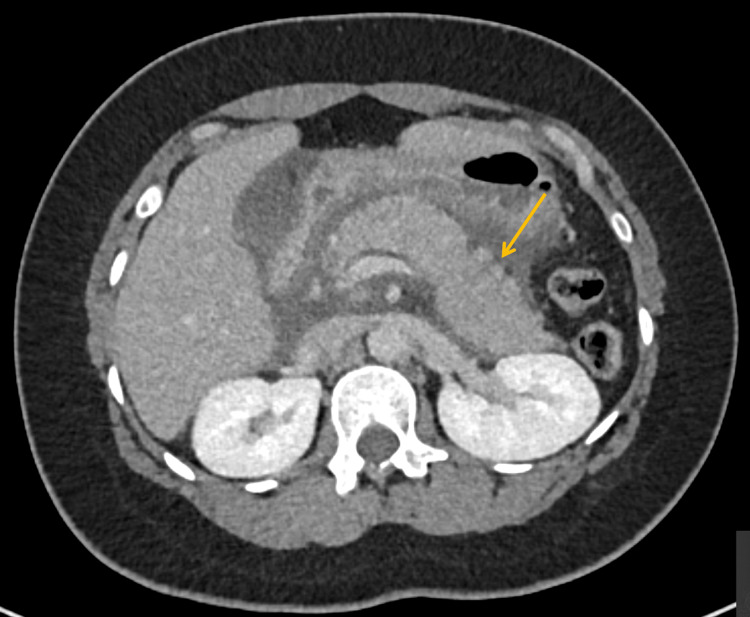

- Gợi ý: mũi tên vàng trỏ thành tá tràng dày.
- Câu hỏi: Mô tả hai bất thường? Vì sao dày thành tá tràng lại liên quan?

<b>Bấm để hiện đáp án (findings + chẩn đoán)</b>

- **Dấu hiệu:** **tụy đầu to, thâm nhiễm mỡ quanh tụy** và **dày thành tá tràng phản ứng (descending duodenal mural oedema)**.
- **Chẩn đoán:** **viêm tụy cấp nặng do tăng TG** — dày thành tá tràng là **phản ứng viêm lan**, không phải tổn thương nguyên phát.
- **Ý nghĩa:** viêm tụy nặng lan sang tá tràng/ổ bụng; theo dõi biến chứng tụ dịch/hoại tử.
- Nguồn ảnh: Jeyabavan A et al., Cureus 2026 (PMC13422059), Fig. 2, CC BY 4.0. *(Ca người lớn.)*

## Bài liên quan chéo
- [626 – Viêm tụy cấp ở trẻ (Atlanta nhi, MRCP, tụy divisum, nang ống mật chủ)](../626-viem-tuy-cap-nhi/lesson.md) — khung hình ảnh & nguyên nhân giải phẫu.
- [620 – Cấp cứu tiêu hóa sơ sinh & nhũ nhi](../620-cap-cuu-tieu-hoa-so-sinh-nhu-nhi/lesson.md) — phân biệt nôn/đau bụng cấp ở trẻ nhỏ.
- [623 – Chấn thương tụy–tá tràng ở trẻ](../623-chan-thuong-tuy-ta-trang-nhi/lesson.md) — nguyên nhân chấn thương (đứt ống tụy).
- [624 – Chấn thương gan & đường mật ở trẻ](../624-chan-thuong-gan-duong-mat-nhi/lesson.md) — cùng bối cảnh chấn thương/đa chấn thương.
- [627 – Giả phình mạch & xuất huyết muộn ở trẻ](../627-gia-phinh-mach-xuat-huyet-muon-gan-lach-nhi/lesson.md) — biến chứng mạch (huyết khối, giả phình).
- [630 – Khối u bụng nhi (neuroblastoma vs Wilms)](../630-u-bung-nhi-neuroblastoma-vs-wilms/lesson.md) — phân biệt khối bụng.
- [665 – Khối u gan ở trẻ em](../665-khoi-u-gan-nhi/lesson.md) — bối cảnh asparaginase/onkology.

## Ảnh
- Tên file: `628_viem-tuy-tang-triglyceride_Modality_SourceID.jpg`; nguồn + giấy phép từng ảnh trong `images/CREDITS.md`.
- Toàn bộ ảnh là **CC BY 4.0** (được phép tải/ghép, ghi nguồn). Ảnh ghép letterbox giữ tỉ lệ, không crop/kéo giãn.
- Ca PMC13422059 là **người lớn** — chỉ dùng minh họa hình thái biến chứng hoại tử/huyết khối lách.

> **Disclaimer:** Bài học dành cho mục đích học tập, không dùng để chẩn đoán độc lập khi chưa có bác sĩ chuyên khoa hướng dẫn. Ngưỡng TG, liều insulin và chỉ định thay huyết tương phải theo phác đồ tại cơ sở.
