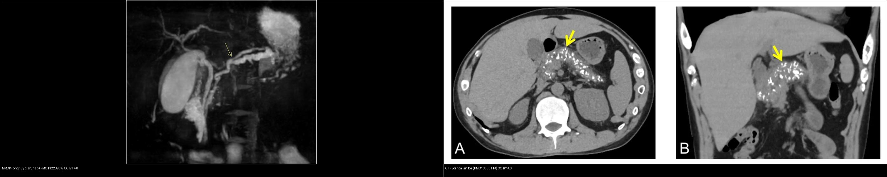
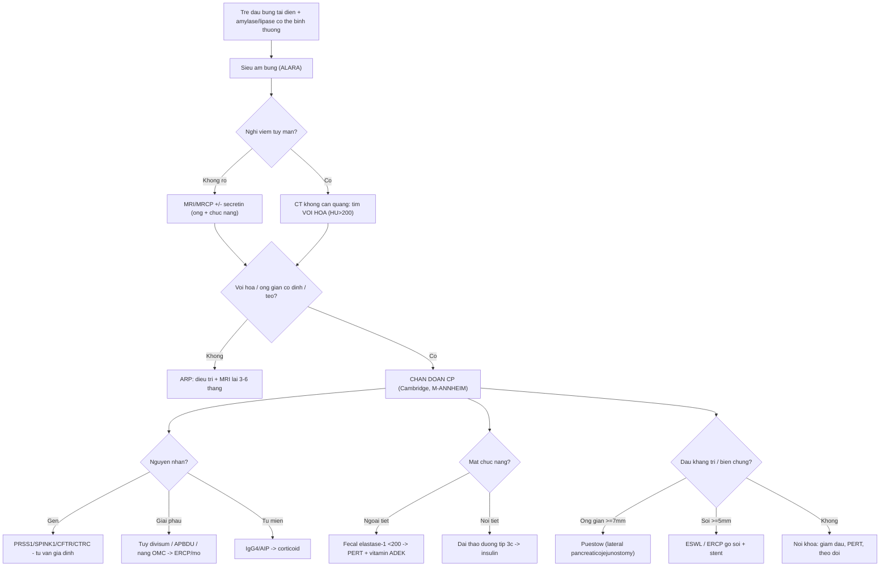
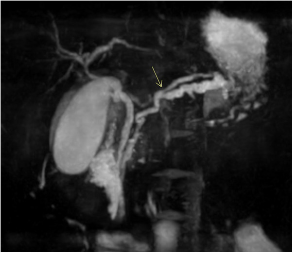
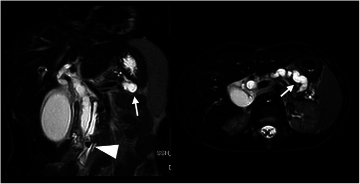
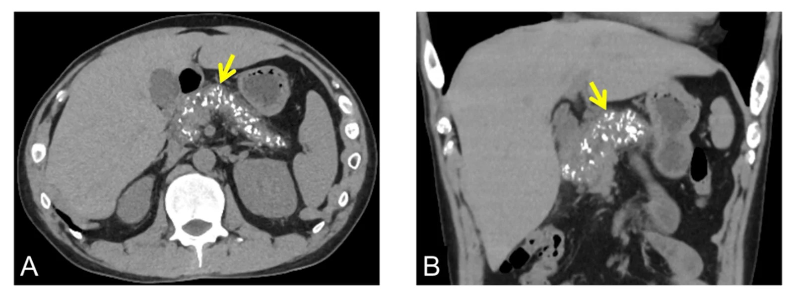
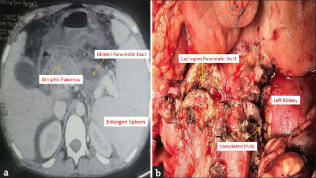
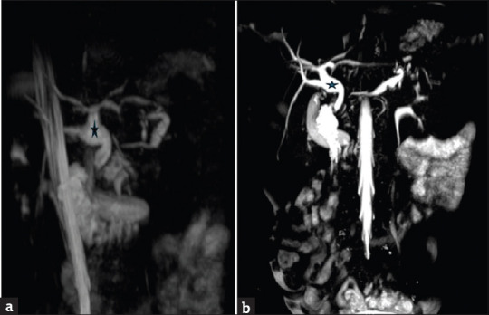
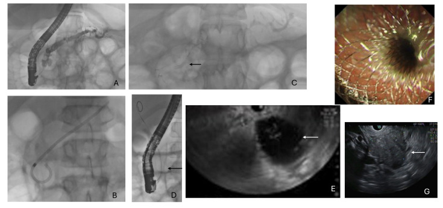
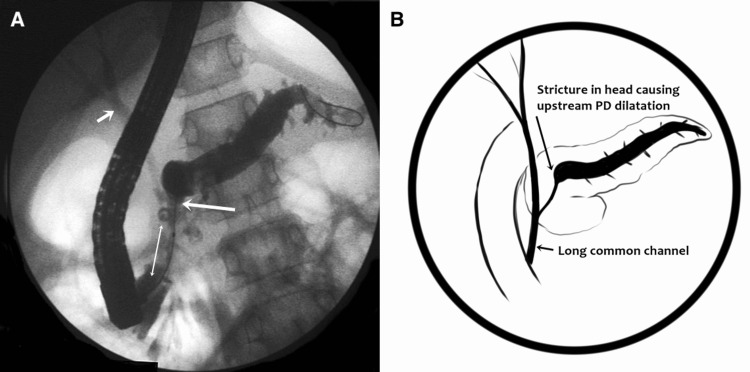

# 629 — Viêm tụy mạn ở trẻ & suy tụy ngoại tiết: vôi hóa, ống tụy giãn "hồ nước" & định lượng thiếu hụt men / Pediatric chronic pancreatitis & exocrine pancreatic insufficiency

**Tags:** `pattern:viem-tuy-man` `pattern:suy-tuy-ngoai-tiet` `vung:tuy` `score:Cambridge` `protocol:MRCP-secretin` `protocol:EUS`
**Mức chắc chắn (certainty):** tổng hợp y văn (literature synthesis) — nhóm tự biên từ y văn mở (Front Pediatr 2024, J Clin Med 2024, Pediatr Radiol/Diagnostics 2025–2026, JIAPS 2025–2026) có số; **các ca trong quiz là ca nguyên văn (verbatim case)** chép đúng tuổi – bối cảnh – chú thích gốc (Destro/Front Pediatr, Kumar V/JIAPS, Kumar B/JIAPS, Joshi/J Clin Med, Sundaram/Cureus). Ca minh họa người lớn (Kawaguchi/Cureus, 34 tuổi) được ghi rõ tuổi để không ngộ nhận là ca nhi.

## 1. Tổng quan bệnh học – cơ chế hình ảnh

Viêm tụy mạn (chronic pancreatitis, CP) ở trẻ là một **hội chứng viêm–xơ tiến triển, KHÔNG hồi phục**, khác về bản chất với viêm tụy cấp/tái phát (acute recurrent pancreatitis, ARP). Mỗi trẻ nghi CP cần trả lời 3 câu: **(1) đã có tổn thương cấu trúc không hồi phục chưa (vôi hóa/ống giãn/teo)? (2) đã mất chức năng ngoại tiết/ngoại tiết chưa? (3) có nguyên nhân GIẢI PHẪU hay DI TRUYỀN xử lý được gốc không?**

- **Dịch tễ:** CP trẻ em **~0,5–2,0/100.000 trẻ/năm** (Joshi 2024: 0,5–2,0; nhóm châu Âu ~2/100.000). Trong các cohort chuyên khoa, **suy tụy ngoại tiết (exocrine pancreatic insufficiency, EPI) gặp tới 76%** trẻ CP; **vôi hóa tụy 44–46%**, trong đó **38% có nang giả** (Kumar V 2025: 48 trẻ, calcific 22/48 = 44%). Bệnh thường **được chẩn đoán muộn** vì đau bụng mơ hồ.
- **Cơ chế tiến triển:** viêm tái diễn do ứ đọng dịch tụy (tăng tiết sau bữa ăn béo), hẹp ống, sỏi calci + hoạt hóa men nội bào → **xơ hóa, mất tế bào nang (acinar) rồi tế bào đảo (islet)** → mất dần chức năng ngoại tiết rồi nội tiết (đái tháo đường típ 3c, "brittle"). Đây là "học thuyết mất nhu mô": tổn thương **tích lũy và không đảo ngược**, khác phù kẽ hồi phục của viêm tụy cấp.
- **TẠI SAO vôi hóa = tín hiệu chốt:** calci carbonat/phosphate lắng trong lòng ống và nhu mô → **đậm độ rất cao trên CT (~200–1000 HU), thấy cả trên X-quang bụng không cản quang**; ngược lại **MRI/MRCP có "điểm mù": vôi hóa nhỏ gần như không thấy** (vì calci không có proton) → *CP vôi hóa có thể bị bỏ sót trên MRI*. Vì vậy khi **nghi CP phải có 1 lát CT không cản quang** dù theo dõi chủ yếu bằng MRI.
- **TẠI SAO ống tụy giãn sáng trên T2/MRCP:** ống chứa dịch giàu bicarbonate/nước → tín hiệu **rất sáng trên T2/MRCP** (nước tự do); khi có hẹp/sỏi tạo tăng áp lực → ống chính giãn, uốn lượn, phình–hẹp xen kẽ ("**chain of lakes** — chuỗi hồ"). Vôi hóa/sỏi trong lòng ống là **khuyết thiếu (filling defect)** trên MRCP và **nốt đậm** trên CT.
- **TẠI SAO tụy teo và tăng echo/xơ:** thay nhu mô tụy bằng mô xơ → tụy **nhỏ, tăng hồi âm (hyperechoic), giảm tín hiệu T1** (mất mỡ/giàu protein sinh lý) và **ngấm thuốc không đồng nhất**.
- **Định nghĩa thiếu hụt chức năng (quantitative):** **steatorrhea chỉ xuất hiện khi mất > 90% chức năng acinar**, và **lipase (không phải amylase)** suy giảm/bị phá hủy sớm nhất → thiếu hụt chủ yếu là **mỡ và vitamin tan trong mỡ**. Xét nghiệm sàng lọc: **fecal elastase-1 (ELISA) < 200 µg/g phân = EPI**; **100–200 µg/g = nhẹ–trung bình**, **< 100 µg/g = nặng, gắn với steatorrhea**. Tiêu chuẩn vàng là **hệ số hấp thu mỡ CFA (coefficient of fat absorption)**, bình thường **> 90–93%**.

## 2. Mẫu hình + chẩn đoán phân biệt theo cơ chế – vị trí (Gamut)

**Gamut theo CƠ CHẾ NGUYÊN NHÂN (nhớ bằng TIGAR-O):** **T**oxic–metabolic (rượu, tăng triglyceride, tăng calci, ĐTĐ), **I**diopathic, **G**enetic (**PRSS1** trội, **SPINK1/CFTR/CTRC/CPA1**), **A**utoimmune (AIP típ 1/2), **R**ecurrent acute (hoại tử nặng để lại sẹo), **O**bstructive (tụy phân đôi, hợp lưu tụy–mật bất thường, nang ống mật chủ, tụy vòng, hẹp/sỏi).
- **Ở trẻ, thứ tự khác người lớn** (Joshi 2024, n ≈ 104–110): **cryptogenic/vô căn ~28%**, **giải phẫu 22%**, **di truyền 20%**, **tự miễn 12%**, **sỏi mật 7%** — nghĩa là **bất thường ống tụy–mật + gen chiếm gần một nửa**, phải chủ động tìm.
- **Tụy phân đôi (pancreas divisum):** hai hệ ống không hợp nhất; ống tụy **lưng** dẫn lưu gần như toàn bộ tụy qua **nhú nhỏ** hẹp → tăng áp ống lưng → viêm tái phát. Là biến thể khá phổ biến, **chỉ bệnh lý khi kèm viêm tái phát/giãn ống**.
- **Hợp lưu tụy–mật bất thường (anomalous pancreatobiliary ductal union, APBDU):** kênh chung dài, trào ngược dịch tụy vào đường mật → viêm tụy–đường mật tái phát, liên quan **nang ống mật chủ** và nguy cơ **ung thư đường mật** về sau.

**Gamut theo MẪU HÌNH HÌNH ẢNH (cùng tụy, khác giai đoạn):**
- **Vôi hóa + ống giãn + teo** = CP tiến triển (calcific CP).
- **Ổ không ngấm > 30–50% nhu mô** = hoại tử (viêm tụy cấp/đợt cấp trên mạn).
- **Tụ dịch > 4 tuần, vỏ rõ** = nang giả tụy (pseudocyst); kèm mảnh hoại tử = WON.
- **Tụy to hình xúc xích, viền ngấm, ống NOT dilated** = viêm tụy tự miễn (AIP, thường IgG4+).

*Trái: MRCP — ống tụy chính giãn, uốn lượn, hẹp xen kẽ (mũi tên vàng). Phải: CT không cản quang (A lát ngang, B tái tạo coronal) — vôi hóa tụy lan tỏa (mũi tên vàng). Nguồn: Destro F et al., Front Pediatr 2024 (PMC11228964, CC BY 4.0) + Kawaguchi Y & Hamaoka K, Cureus 2026 (PMC13500114, CC BY 4.0). Ảnh ghép letterbox, giữ tỉ lệ.*

## 3. Bảng so sánh phân biệt (ma trận đối chiếu)

| Thực thể (entity) | Hình ảnh điển hình | Chốt vào (rule-in) | Chốt loại (rule-out) | Gợi ý xác nhận |
|---|---|---|---|---|
| Viêm tụy mạn vôi hóa (calcific CP) | CT: **vôi hóa lan tỏa/HU > 200** + ống chính giãn > 5 mm + teo; X-quang bụng thấy sỏi calci | **Vôi hóa nhu mô hoặc sỏi ống + ống giãn không hồi phục** | Vôi hóa đơn độc mạch máu/nốt lành; ống bình thường + tụy không teo → chưa mạn | CT không cản quang **bắt buộc**; đối chiếu phim cũ |
| Viêm tụy cấp/tái phát (ARP) | Tụy to lan tỏa, thâm nhiễm mỡ quanh tụy, ngấm đồng nhất; **không vôi hóa, không teo** | Hồi phục trên phim lại, men > 3× ULN | Có vôi hóa/ống giãn **cố định** → đã chuyển mạn | Siêu âm đầu tay; MRI 3–6 tháng để phát hiện chuyển mạn |
| Tụy phân đôi (pancreas divisum) | MRCP: ống lưng dẫn lưu qua **nhú nhỏ**, ống bụng ngắn | **Hai hệ ống không hợp nhất + viêm tụy tái phát** | Ống hợp nhất bình thường → không phải divisum | MRCP ± secretin; ERCP can thiệp nhú nhỏ |
| Hợp lưu tụy–mật bất thường (APBDU) | MRCP/chụp mật: **kênh chung dài bất thường**, ống tụy–mật hợp lưu xa tá tràng | **APBDU + nang ống mật chủ/viêm tái phát** | Hội lưu đúng vị trí tại nhú → loại | MRCP; ERCP (phân loại Komi); theo dõi nguy cơ ung thư mật |
| Viêm tụy tự miễn (AIP/IgG4) | Tụy to hình xúc xích, viền ngấm đối xứng, ống **KHÔNG giãn** | **IgG4 máu cao + ngấm đối xứng + đáp ứng corticoid** | Vôi hóa + ống giãn + teo → CP cổ điển, không AIP | MRCP/CT động, IgG4, sinh thiết nếu cần |
| Nang giả tụy vs u nang | Nang dịch, vỏ mỏng, quanh tụy/ổ bụng | **Bối cảnh viêm tụy trước + dịch đồng nhất, KHÔNG mảnh hoại tử** | Nốt/vách/tăng dần hoặc không thoái triển → u nang (IPMN/MCN) | MRI/MRCP; theo dõi > 4 tuần |

**Bảng phân biệt thiếu hụt ngoại tiết (EPI) với kém hấp thu khác:**

| Chỉ số | EPI (nguồn tụy) | Kém hấp thu không do tụy | Ngưỡng/ghi chú |
|---|---|---|---|
| Fecal elastase-1 | **< 200 µg/g** (nặng < 100) | Bình thường | Đặc hiệu cao (96,4%), độ nhạy thấp (~25%) |
| CFA (72 giờ) | **< 90%** | Bất thường theo nguyên nhân | Tiêu chuẩn vàng, không đặc hiệu tụy |
| Lipase/amylase | Có thể **bình thường** giai đoạn muộn | Bình thường | Bình thường KHÔNG loại trừ |
| Vitamin A/D/E/K | **Thiếu** (thiếu hụt mỡ) | Tùy bệnh | Soi đáy mắt (A), xương (D), đông máu (K) |

### Dấu hiệu "đọc chuẩn xác"
- **"Chain of lakes" (chuỗi hồ):** ống chính giãn > 5 mm phình–hẹp xen kẽ + sỏi/hẹp = CP tiến triển.
- **Vôi hóa là chốt trên CT, nhưng MRI mù:** nếu chỉ có MRI, đừng kết luận "không vôi hóa" — nên đối chiếu X-quang/CT không cản quang.
- **Teo tụy + giảm T1 + tăng echo** = mô xơ thay nhu mô; tương quan với EPI (vôi hóa NẶNG > 14 điểm OR 2,9; tổn thương toàn tụy OR 2,1).

## 4. Protocol chụp + hệ phân độ/điểm chuẩn hóa

- **Siêu âm bụng = đầu tay (ALARA, không tia):** thấy ống giãn, sỏi/vôi hóa (**64%** ca CP), nang giả, tụy teo/tăng echo. Hạn chế: phụ thuộc người đọc, khó thấy đuôi tụy sau ruột.
- **CT không cản quang (± cản quang):** **nhạy nhất với vôi hóa/sỏi calci** (vôi hóa gặp **51%** ca CP trên CT); độ chính xác chẩn đoán CP của CT (Cambridge ≥ 2) **Se 68% / Sp 75%**, một số nghiên cứu cao hơn **Se 75% / Sp 91%**. CT **kém nhạy với thay đổi ống/nhu mô sớm**.
- **MRI/MRCP (± secretin):** tốt nhất cho **hình thái ống và chức năng** không tia. **S-MRCP (secretin)**: đo **mức đổ đầy tá tràng (duodenal filling grade 0–3)** và lưu lượng dịch tụy → phát hiện EPI/ tổn thương ống khi CT còn mờ. Điểm mù: **không thấy vôi hóa nhỏ**.
- **EUS (siêu âm nội soi):** **nhạy nhất với CP sớm/tối thiểu**; phân loại **Rosemont** (tiêu chí nhu mô + ống). Xâm lấn nhẹ, dùng khi MRI/CT không kết luận mà nghi CP.
- **Phân độ — Cambridge (ERCP gốc, đã chuyển cho CT/MRCP):** **Độ 1 (nghi ngờ):** ống chính bình thường, ≥ 3 nhánh phụ bất thường; **Độ 2 (nhẹ):** ≥ 3 nhánh phụ bất thường, ống chính bình thường; **Độ 3 (trung bình):** ống chính bất thường nhẹ; **Độ 4 (nặng):** ống chính giãn ≥ 7 mm, hẹp, sỏi, vôi hóa, tụ dịch.
- **Phân độ M-ANNHEIM:** nhóm yếu tố nguy cơ (**A**lcohol, **N**icotine, **N**utrition, **H**ereditary, **E**fferent duct, **I**mmunological, **M**iscellaneous) + **chỉ số độ nặng (0–IV)** theo đau/biến chứng/điều trị.
- **Điều trị EPI:** **PERT (pancreatic enzyme replacement therapy)** — liều khởi đầu **1.000 U lipase/kg/bữa, 500 U/kg/bữa phụ**, nhũ nhi **2.000–4.000 U/120 mL sữa công thức**, **trần 10.000 U lipase/kg/ngày**; uống cùng bữa; thêm **PPI** nếu còn đau bụng/steatorrhea; bổ sung **vitamin A/D/E/K**; theo dõi tăng trưởng.
- **Can thiệp gốc:** ERCP (± đặt stent ống tụy, gỡ sỏi), **ESWL** cho sỏi ≥ 5 mm (nhóm trẻ ESWL giải quyết đau hoàn toàn **77%**), **phẫu thuật Puestow (lateral pancreaticojejunostomy)** khi ống giãn **đều ≥ 7 mm** và không có khối đầu tụy viêm; **TPIAT** (cắt toàn tụy–ghép đảo) ở ca đau kháng trị; nội soi/chỉnh hình dị dạng (APBDU, nang OMC).

## 5. Biến thể bình thường và cạm bẫy

- **Tụy phân đôi là biến thể phổ biến (~7% dân số)** — đừng "chốt" nguyên nhân viêm tụy chỉ vì có divisum; cần bệnh cảnh tái phát/giãn ống.
- **Điểm mù vôi hóa của MRI:** MRI/MRCP bình thường **KHÔNG loại trừ** CP vôi hóa; nếu nghi, thêm CT không cản quang/X-quang bụng.
- **CT bình thường giai đoạn sớm:** CT kém nhạy với thay đổi ống/nhu mô sớm — **CT sớm bình thường không loại trừ**, nhất là trẻ mới ARP; cân nhắc MRI/secretin hoặc EUS.
- **Nang giả tụy vs u nang:** nang giả **luôn có bối cảnh viêm tụy trước**, dịch đồng nhất, vỏ mỏng; nang **có nốt/vách/tăng dần** → nghĩ u nang; **WON chỉ khi còn mảnh hoại tử đặc**.
- **Vôi hóa "burn-out" và đau:** vôi hóa nặng có thể đi kèm **giảm đau** khi tụy đã "cháy hết" chức năng — đừng diễn giải là bệnh nhẹ.
- **AIP dễ nhầm ung thư tụy:** tụy to hình xúc xích + viền ngấm; **ống KHÔNG giãn** và **đáp ứng corticoid** là điểm phân biệt, tránh mổ oan.
- **Cạm bẫy mặt cắt:** vôi hóa tụy trên CT dễ nhầm **vôi hóa hạch/mạch lách** hoặc **thuốc cản quang còn lại trong ruột** — đọc trên phim không cản quang và đối chiếu nhiều thì.

## 6. Tự lượng giá — Blind Quiz (ảnh trơn ngoài, đáp án ẩn trong khối chi tiết)

**Ca 1 — Nam 10 tuổi viêm tụy tái phát nhiều đợt; MRCP bụng. Đọc ống tụy trước khi mở đáp án.**

- Gợi ý lâm sàng: viêm tụy tái phát, tiền sử gia đình có người bị nặng; nghi di truyền.
- Câu hỏi: Dấu hiệu chính của ống tụy? Ba chẩn đoán phân biệt? Dấu hiệu nào chốt nguyên nhân gốc?

<b>Bấm để hiện đáp án (findings + chẩn đoán)</b>

- **Dấu hiệu:** MRCP — **ống tụy chính giãn, uốn lượn, hẹp xen kẽ** (mũi tên vàng) = tổn thương ống **không hồi phục** của viêm tụy mạn.
- **Chẩn đoán:** viêm tụy mạn ở trẻ có **đột biến PRSS1 + nhân đôi ống tụy** (ca nguyên văn nam 10 tuổi). Phân biệt: tụy phân đôi (hai hệ ống riêng), hợp lưu tụy–mật bất thường, hẹp ống do sỏi.
- **Chốt nguyên nhân:** tiền sử gia đình + gen **PRSS1** (trội); đi kèm dị dạng ống → cần **MRCP + ERCP/thầy thuốc đa chuyên khoa**.
- Nguồn ảnh: Destro F et al., Front Pediatr 2024 (PMC11228964), Fig. 3, CC BY 4.0.

**Ca 2 — Cùng bệnh nhân: đau bụng, nôn, phân lỏng; MRI T2 bụng. Có gì trong lòng ống tụy?**

- Gợi ý lâm sàng: nghĩ sỏi ống tụy gây tắc.
- Câu hỏi: Kích thước sỏi? Hệ quả thượng nguồn? Xử trí nội soi nào được thực hiện?

<b>Bấm để hiện đáp án (findings + chẩn đoán)</b>

- **Dấu hiệu:** T2 sagittal + axial — **sỏi nhú trong lòng ống ~7 mm** (mũi tên) gây **giãn nặng đường mật–tụy thượng nguồn**.
- **Chẩn đoán:** sỏi ống tụy trên nền viêm tụy mạn; đã được **ERCP: nong bóng + lấy sỏi (dilation-assisted stone extraction) + đặt stent tụy 7 Fr × 7 cm**.
- Nguồn ảnh: Destro F et al., Front Pediatr 2024 (PMC11228964), Fig. 4, CC BY 4.0.

**Ca 3 — Bé viêm tụy mạn nhiều năm; CT không cản quang bụng (A lát ngang, B coronal). Mô tả nhu mô tụy.**

- Gợi ý lâm sàng: tiền sử viêm tụy cấp 3 năm trước, tình cờ phát hiện khi thăm khám khác (ca minh họa **nam 34 tuổi** — cùng nguyên lý hình ảnh; ở trẻ vôi hóa sớm ít gặp hơn).
- Câu hỏi: Đậm độ các nốt trong tụy? Vì sao thấy trên CT mà có thể bỏ sót trên MRI?

<b>Bấm để hiện đáp án (findings + chẩn đoán)</b>

- **Dấu hiệu:** CT không cản quang — **vôi hóa lan tỏa rải rác trong tụy** (mũi tên vàng), đậm độ rất cao; tụy gọn teo.
- **Chẩn đoán:** **viêm tụy mạn vôi hóa (calcific CP)**. Vôi hóa là calci → **đậm trên CT (~200–1000 HU) nhưng MRI gần như KHÔNG thấy** (điểm mù) → nghi CP nhất thiết có CT/X-quang không cản quang.
- Nguồn ảnh: Kawaguchi Y & Hamaoka K, Cureus 2026 (PMC13500114), Fig. 4, CC BY 4.0 (**ca người lớn 34 tuổi** — minh họa tiến triển ARP → CP vôi hóa trong 3 năm).

**Ca 4 — Bé gái viêm tụy mạn biến chứng; CT bụng kèm minh họa mổ. Đọc tổn thương tụy và biến chứng.**

- Gợi ý lâm sàng: viêm tụy mạn lâu năm, khó mổ.
- Câu hỏi: Panel (a) cho thấy 3 dấu hiệu gì? Vì sao lách to? Biến chứng mạch nào cần cân nhắc?

<b>Bấm để hiện đáp án (findings + chẩn đoán)</b>

- **Dấu hiệu (panel a):** **tụy teo**, **ống tụy chính giãn**, **lách to** + tuần hoàn bàng hệ = **tăng áp lực cửa (portal hypertension) do huyết khối tĩnh mạch lách** trên nền viêm tụy mạn.
- **Chẩn đoán:** viêm tụy mạn **biến chứng huyết khối tĩnh mạch lách/tăng áp cửa** — lách to do tăng áp tĩnh mạch lách; phần minh họa mổ cho thấy **mở dọc ống tụy (LPJ) + nối tĩnh mạch lách–thận gần (proximal splenorenal shunt)**.
- **Ý nghĩa:** biến chứng mạch (huyết khối TM lách/cửa, giả phình mạch) thay đổi chiến lược mổ — cần CTA trước khi can thiệp.
- Nguồn ảnh: Kumar B et al., J Indian Assoc Pediatr Surg 2026 (PMC13061493), Fig. 1a, CC BY-NC-SA 4.0 (giữ nguyên bản).

**Ca 5 — Trẻ viêm tụy mạn; MRCP (a) và MIP (b). Có mấy bất thường? Nghĩ nguyên nhân gì?**

- Gợi ý lâm sàng: đau bụng tái diễn, nhập viện vì biến chứng.
- Câu hỏi: Mô tả (a) và (b). Dấu sao chỉ gì? Vì sao cần phân độ Cambridge/đánh giá chức năng?

<b>Bấm để hiện đáp án (findings + chẩn đoán)</b>

- **Dấu hiệu:** (a) MRCP — **teo thân tụy + ống tụy giãn + vôi hóa** (viêm tụy mạn vôi hóa), kèm **nang ống mật chủ típ 1b** (dấu sao); (b) MIP MRCP thấy rõ hệ ống giãn + nang OMC.
- **Chẩn đoán:** **viêm tụy mạn vôi hóa (Cambridge độ 4) + nang ống mật chủ** — hai bệnh lý ống tụy–mật đi kèm, giải thích viêm tái phát; cần đánh giá EPI (fecal elastase-1) và đường mật.
- Nguồn ảnh: Kumar V et al., J Indian Assoc Pediatr Surg 2025 (PMC12643358), Fig. 3, CC BY-NC-SA 4.0 (giữ nguyên bản).

**Ca 6 — Trẻ viêm tụy mạn có sỏi/hẹp ống; ERCP + EUS (A–G). Ghép mỗi panel với kỹ thuật.**

- Gợi ý lâm sàng: đau kháng trị, ống tụy hẹp + sỏi.
- Câu hỏi: Panel A, B, C, D là gì? Panel E, G là gì? Vì sao ERCP có biến chứng?

<b>Bấm để hiện đáp án (findings + chẩn đoán)</b>

- **Panel:** (A) **hẹp ống tụy chính + sỏi ống**; (B) **stent nhựa** (plastic); (C) **stent kim loại phủ toàn phần ("Bumpy")**; (D) **stent phân hủy sinh học Archimedes**; (E) **tụ dịch quanh tụy** (mũi tên trắng); (F) **nội soi sau đặt stent**; (G) **EUS**.
- **Chẩn đoán:** viêm tụy mạn nhi được **ERCP (nong bóng + stent) + EUS dẫn lưu tụ dịch**. **Biến chứng ERCP ở trẻ ~3,6%** (viêm tụy sau ERCP, di trú stent, chảy máu, thủng — đa số nhẹ/trung bình) → chỉ làm khi cần can thiệp.
- Nguồn ảnh: Joshi D et al., J Clin Med 2024 (PMC11432529), Fig. 2, CC BY 4.0.

**Ca 7 — Chụp mật ở trẻ viêm tụy–đường mật tái phát: (A) hình chụp, (B) sơ đồ. Chẩn đoán nguyên nhân.**

- Gợi ý lâm sàng: viêm tụy cấp tái phát và/hoặc viêm đường mật ở trẻ–vị thành niên.
- Câu hỏi: Đặc điểm giải phẫu nào bất thường? Nguy cơ lâu dài? Hướng xử trí?

<b>Bấm để hiện đáp án (findings + chẩn đoán)</b>

- **Dấu hiệu:** (A) hình chụp mật — **kênh chung dài (long common channel)** nối ống mật chủ và ống tụy (hợp lưu tụy–mật bất thường, APBDU típ Y, Komi IIa); **hẹp đầu tụy** gây **giãn ống tụy thượng nguồn**; (B) sơ đồ minh họa.
- **Chẩn đoán:** **APBDU gây viêm tụy–đường mật tái phát ở trẻ**. Nguy cơ lâu dài: **nang ống mật chủ, viêm đường mật, ung thư đường mật** → cần xác định bằng MRCP/ERCP, theo dõi và cân nhắc phẫu thuật tái tạo đường mật.
- Nguồn ảnh: Sundaram S et al., Cureus 2023 (PMC10024245), Fig. 2, CC BY 4.0.

**Ca 8 — Ghép đối chiếu: MRCP (tổn thương ống) vs CT không cản quang (vôi hóa). Kể tên 2 mẫu hình và điểm mù của từng phương thức.**

<b>Bấm để hiện đáp án (findings + chẩn đoán)</b>

- **Trái:** MRCP thấy rõ **hình thái ống** (giãn, hẹp xen kẽ) nhưng **mù với vôi hóa nhỏ**.
- **Phải:** CT không cản quang thấy **vôi hóa lan tỏa** nhưng **kém nhạy với thay đổi ống sớm**.
- **Kết luận:** hai phương thức **bổ sung cho nhau**; nghi CP nên chụp **cả** CT không cản quang + MRCP ± secretin, cân nhắc EUS khi còn nghi ngờ.
- Nguồn ảnh: Destro F et al. (PMC11228964) + Kawaguchi Y & Hamaoka K (PMC13500114), đều CC BY 4.0. Ảnh ghép letterbox.

## Bài liên quan chéo
- [600 – Tổng quan Hệ Nhi khoa](../600-tong-quan-nhi-khoa/lesson.md)
- [626 – Viêm tụy cấp ở trẻ (Atlanta nhi, tụy divisum)](../626-viem-tuy-cap-nhi/lesson.md)
- [623 – Chấn thương tụy–tá tràng ở trẻ (AAST tụy, đứt ống tụy)](../623-chan-thuong-tuy-ta-trang-nhi/lesson.md)
- [135 – Viêm tụy cấp (Atlanta) — người lớn](../135-viem-tuy-Atlanta/lesson.md)
- [136 – U đặc & nang tụy (PDAC, pNET, IPMN/MCN/SCN)](../136-u-nang-tuy/lesson.md)
- [625 – Vàng da tắc mật sơ sinh (teo đường mật, nang ống mật chủ)](../625-vang-da-tac-mat-so-sinh-teo-duong-mat/lesson.md)

## Ảnh
- Tên file: `629_viem-tuy-man-tre_Modality_SourceID.jpg`. Nguồn + giấy phép từng ảnh: `images/CREDITS.md` và `sources.md`.
- Ảnh **CC BY 4.0** dùng cho ảnh ghép; ảnh **CC BY-NC-SA** giữ nguyên bản, **không crop/ghép**.

> Không dùng để chẩn đoán độc lập khi chưa có người hướng dẫn.
