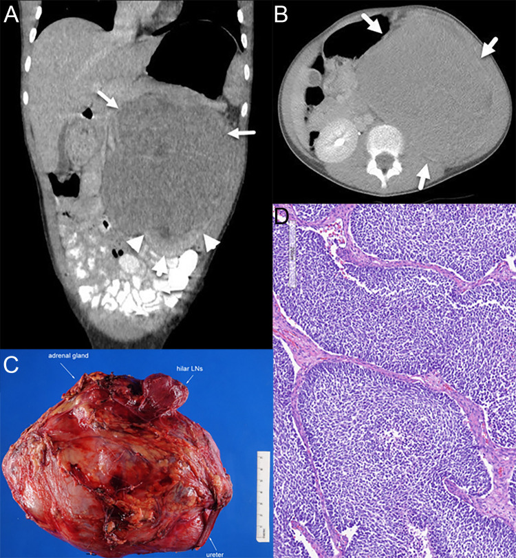
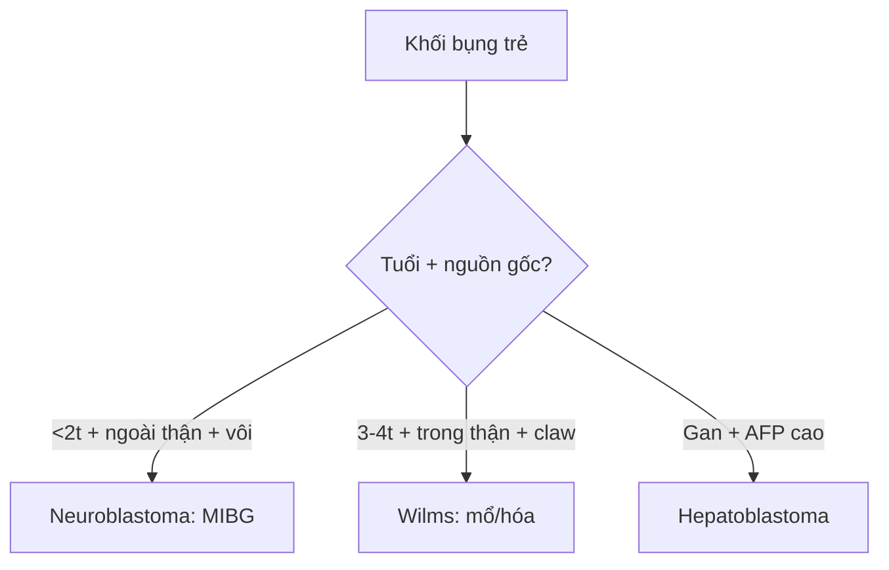

# 630 — U bụng nhi: neuroblastoma vs Wilms / Peds abdominal mass

**Tags:** `pattern:khoi-bung-nhi` `vung:sau-phuc-mac-nhi`
**Mức chắc chắn (certainty):** tổng hợp y văn (literature synthesis) — nhóm tự biên từ y văn mở, chưa gắn ca nguyên văn đơn lẻ.

## 1. Tổng quan — ngoài thận ôm mạch vs trong thận đẩy mạch

- Neuroblastoma (< 2 tuổi, giao cảm/thượng thận): u bao bọc mạch (encasement) mà không xâm nhập lòng — TẠI SAO vượt đường giữa + vôi 85–90%: u lan theo chuỗi giao cảm 2 bên + hoại tử vôi hóa.
- Wilms (3–4 tuổi, nhu mô thận): u đẩy mạch + **móng vuốt (claw)** + huyết khối TM thận/IVC 5–10% — TẠI SAO không vượt giữa mà vào tĩnh mạch: u từ thận, đường lan là tĩnh mạch dẫn lưu.
- Ngưỡng: vôi neuroblastoma 85–90% vs Wilms < 10–15%; IVC thrombus 5–10% Wilms.

## 2. Gamut khối bụng trẻ (Gamut)

- **< 2 tuổi + vôi + ôm mạch + vượt giữa:** neuroblastoma — hóa trị + mổ + MIBG.
- **3–4 tuổi + claw + đẩy mạch + thrombus IVC:** Wilms — mổ trước/hóa trước theo NWTS/SIOP.
- **Sơ sinh + AFP rất cao:** hepatoblastoma — AFP + hóa + mổ gan.
- **Bàng quang + nho (botryoid):** rhabdomyosarcoma — sinh thiết + hóa-xạ.

## 3. Bảng so sánh phân biệt (ma trận đối chiếu)

| Thực thể (entity) | Hình ảnh điển hình | Chốt vào (rule-in) | Chốt loại (rule-out) | Gợi ý xác nhận |
|---|---|---|---|---|
| Neuroblastoma | **Vôi 85% + ôm mạch + vượt giữa + đẩy thận xuống (drooping lily)** | **< 2 tuổi + encasement + vôi** | Claw + thrombus → Wilms | MIBG + N-myc + hóa-mổ |
| Wilms | **Claw + đẩy mạch + thrombus IVC + không vượt giữa** | **3–4 tuổi + claw + thrombus** | Vượt giữa + vôi → neuro | Mổ/hóa + xạ khi vỡ |
| Hepatoblastoma | **Gan + AFP > 10.000 + sơ sinh** | **AFP cao + khối gan** | Ngoài gan → neuro/Wilms | AFP + PRETEXT + mổ gan |
| Rhabdomyosarcoma | **Bàng quang/tiền liệt + nho + tắc tiểu** | **Botryoid + bí tiểu** | Trong thận → Wilms | Sinh thiết + hóa-xạ |

*(A–B) CT: móng vuốt thận ôm u; (C–D) bệnh phẩm + blastemal. Nguồn: Troullioud Lucas et al., Front Oncol 2025 Fig. 1, CC BY 4.0.*

## 4. Protocol u bụng nhi

- **Siêu âm + CT/MRI (ôm vs đẩy + thrombus + vôi) + AFP/neuron đặc hiệu + MIBG** khi khối bụng trẻ; sinh thiết có kế hoạch (vỡ Wilms lên giai đoạn!).

## 5. Cạm bẫy

- **Sinh thiết/vỡ Wilms** lên giai đoạn III + xạ bụng — mổ nguyên khối khi điển hình.
- **Neuroblastoma gọi nhầm Wilms** mổ trước — ôm mạch + vôi là hóa trước (không mổ ngay!).
- **Huyết khối IVC lên nhĩ** bỏ sót — Doppler/MRI tĩnh mạch trước mọi mổ Wilms.

## 6. Tự lượng giá — Blind Quiz

**Ca 1 — Bé gái 11 tuổi đau bụng + u thận trái 14 cm. Đọc CT + bệnh phẩm.**

- Hỏi: dấu thận ôm u là gì? Wilms hay neuroblastoma? Giai đoạn?

<b>Bấm để hiện đáp án</b>

- Dấu hiệu (findings): **dấu móng vuốt (claw sign)** thận trái ôm u + hạch rốn thận.
- Chẩn đoán (diagnosis): **Wilms blastemal giai đoạn III** (xâm nhập mạch-hạch) — mổ + hóa DD4A→M + xạ sườn (không phải neuro vì trong thận + claw + đẩy mạch).
- Nguồn: Troullioud Lucas et al., Fig. 1, CC BY 4.0.

**Ca 2 — Trẻ 18 tháng + vôi + ôm ĐMC + vượt giữa:** neuro hay Wilms? *(Bảng mục 3.)*

<b>Bấm để hiện đáp án</b>

- **Neuroblastoma:** hóa trước + MIBG (Wilms là claw + đẩy mạch + thrombus).

## Bài liên quan chéo
- [600 – Tổng quan Nhi](../600-tong-quan-nhi-khoa/lesson.md)
- [330 – U xương](../330-tiep-can-u-xuong-va-dont-touch/lesson.md) (tuổi-vị trí)
- [331 – Myeloma/di căn](../331-u-ac-nguoi-lon/lesson.md) (người lớn)

> Không dùng để chẩn đoán độc lập khi chưa có người hướng dẫn.
