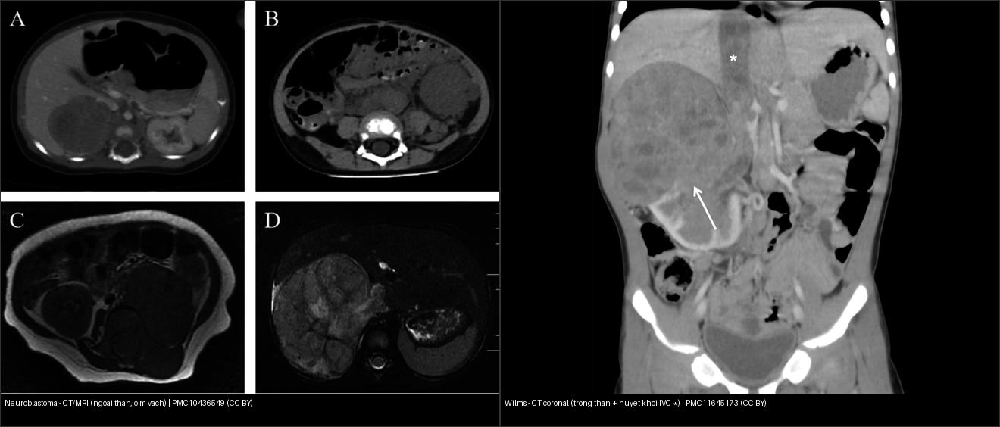
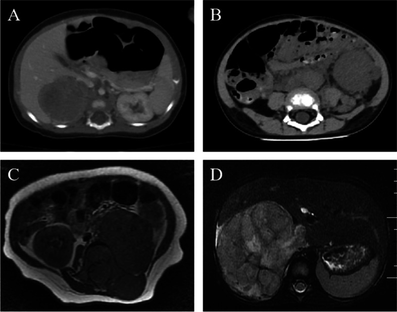
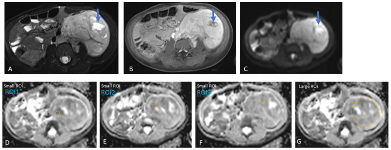
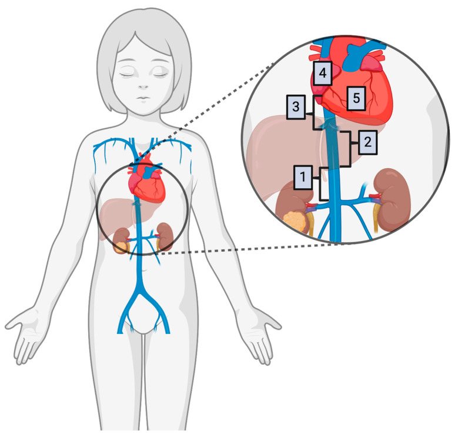
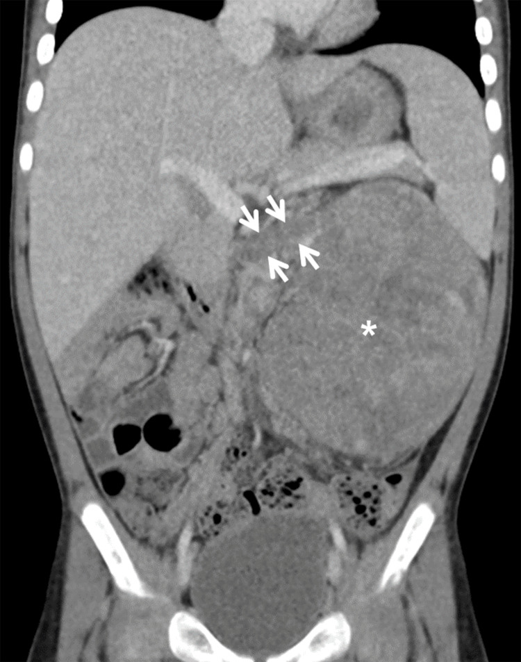
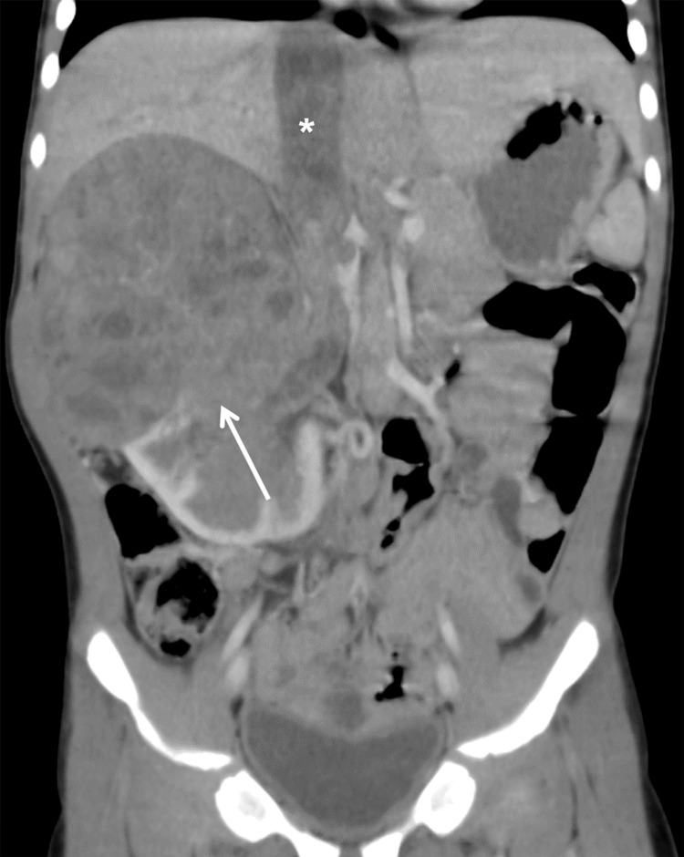
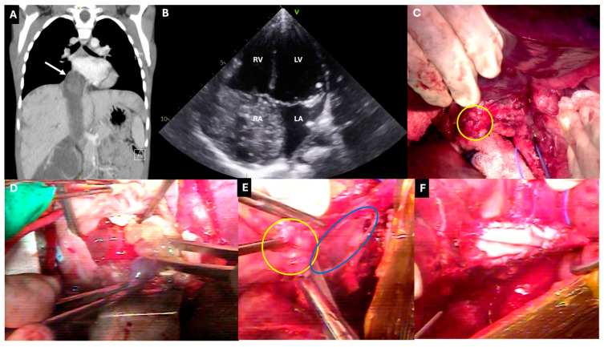

# 630 — U bụng nhi: neuroblastoma vs Wilms / Peds abdominal mass

**Tags:** `pattern:khoi-bung-nhi` `vung:sau-phuc-mac-nhi`
**Mức chắc chắn (certainty):** tổng hợp y văn (literature synthesis) — tổng hợp review + ca nguyên văn từ y văn mở; các ca minh họa ghi PMCID + Fig trong `images/CREDITS.md`.

## 1. Tổng quan — ngoài thận ôm mạch vs trong thận đẩy mạch

- **Neuroblastoma** (u nguyên bào thần kinh, < 2 tuổi, từ chuỗi giao cảm/nội tiết/thượng thận): u **bao bọc (encasement) mạch** lớn — **ĐẨY/ÔM mà KHÔNG xâm nhập lòng mạch**. **TẠI SAO vượt đường giữa + vôi 85–90%:** u lan theo **chuỗi giao cảm hai bên cột sống** nên hay vượt đường giữa, và vì u phát triển nhanh, **hoại tử trung tâm lắng đọng canxi** → **vôi hóa thô/đám** trên CT.
- **Wilms** (u nguyên bào thận, 3–4 tuổi, từ **nhu mô thận**): u **đẩy mạch dẹt ra** + **dấu móng vuốt (claw sign)** — thận lành bị ôm quanh u — và **lan theo tĩnh mạch** (thrombus TM thận → TM chủ dưới [IVC] → nhĩ phải). **TẠI SAO không vượt giữa mà vào tĩnh mạch:** u sinh từ thận nên đường lan là **tĩnh mạch dẫn lưu**, không phải mô mềm quanh mạch.
- **Ngưỡng định lượng:** vôi hóa neuroblastoma **85–90%** vs Wilms **< 10–15%**; **huyết khối tĩnh mạch (TM thận/IVC) ở Wilms 5–10%**; **ADC u nguyên bào ác (NB) < 1,06 × 10⁻³ mm²/s** phân biệt với ganglioneuroma/ganglioneuroblastoma lành (**AUROC 0,86; Se 83% / Sp 75%**, Tambasco D et al., *J Clin Med* 2024, PMC11594407).
- **MIBG (²³I/¹²³I-metaiodobenzylguanidine):** chất tương tự noradrenalin, được **tế bào giao cảm có chuyển hoá catecholamine bắt giữ** → xác định **đa ổ/di căn** và đánh giá đáp ứng; u hoạt tính **hấp thu MIBG** (Wilms thì **không** — dương tính giả MIBG rất hiếm ở Wilms).
- **AFP/neuron đặc hiệu:** neuroblastoma tăng **catecholamine (VMA/HVA) nước tiểu**, NSE/LDH; Wilms thường không có marker đặc hiệu (khác neuroblastoma); hepatoblastoma tăng **AFP rất cao**.

## 2. Gamut khối bụng trẻ (Gamut)

- **< 2 tuổi + vôi + ôm mạch + vượt giữa:** neuroblastoma — hóa trị + mổ + MIBG.
- **3–4 tuổi + claw + đẩy mạch + thrombus IVC:** Wilms — mổ trước/hóa trước theo NWTS/SIOP.
- **Sơ sinh–nhũ nhi + AFP rất cao:** hepatoblastoma — AFP + hóa + mổ gan.
- **Bàng quang + nho (botryoid):** rhabdomyosarcoma — sinh thiết + hóa-xạ.
- **Cạnh thận + tăng huyết áp + catecholamine:** pheochromocytoma/paraganglioma (nối bài 157).
- **Một thận to ở nhũ nhi + không vôi + không vượt giữa:** u cơ trung mô thận lành (mesoblastic nephroma) — mổ ngay, khác Wilms.

## 3. Bảng so sánh phân biệt (ma trận đối chiếu)

| Thực thể (entity) | Hình ảnh điển hình | Chốt vào (rule-in) | Chốt loại (rule-out) | Gợi ý xác nhận |
|---|---|---|---|---|
| Neuroblastoma | **Vôi 85% + ôm mạch + vượt giữa + đẩy thận xuống ("drooping lily")**; T2 hỗn hợp, hoại tử; **ADC thấp < 1,06 × 10⁻³ mm²/s** | **< 2 tuổi + encasement + vôi hóa thô** | **Dấu móng vuốt (claw) + huyết khối tĩnh mạch → Wilms** | MIBG + catecholamine (VMA/HVA) + N-myc + hóa-mổ |
| Wilms | **Claw + đẩy mạch + huyết khối TM thận/IVC ± nhĩ + không vượt giữa** | **3–4 tuổi + claw + huyết khối tĩnh mạch** | **Vượt đường giữa + vôi hóa → nghĩ neuroblastoma** | Doppler/MRI tĩnh mạch trước mổ; mổ/hóa + xạ khi vỡ |
| Hepatoblastoma | **Gan + AFP > 10.000 ng/mL + vôi hóa thô 40–50%** | **AFP rất cao + khối trong gan** | **Ngoài gan → neuro/Wilms** | AFP + PRETEXT + mổ gan |
| Rhabdomyosarcoma | **Bàng quang/tiền liệt tuyến + khối dạng nho + tắc tiểu** | **Botryoid + bí tiểu** | **Trong thận có claw → Wilms** | Sinh thiết + hóa-xạ |
| Pheochromocytoma/PGL | Khối cạnh thận/ĐMC, ngấm mạnh, ± xuất huyết | **Tăng huyết áp + catecholamine + MIBG (+)** | **Không marker + claw → Wilms** | MIBG/DOTATATE + metanephrine |

*(A–B) CT: móng vuốt thận ôm u; (C–D) bệnh phẩm + blastemal. Nguồn: Troullioud Lucas AG et al., Front Oncol 2025 Fig. 1, CC BY 4.0.*

## 4. Protocol u bụng nhi

- **Siêu âm đầu tay** (khối đặc/nang, tưới máu); **CT/MRI bụng đa thì** trả lời 4 câu: **(1) trong/ngoài thận; (2) ôm hay đẩy mạch; (3) vượt đường giữa?; (4) huyết khối tĩnh mạch (TM thận/IVC/nhĩ)?**
- **Marker:** **AFP** (hepatoblastoma), **catecholamine niệu VMA/HVA + NSE/LDH** (neuroblastoma), **MIBG** để xác định đa ổ/di căn.
- **Wilms — phân độ lan nội mạch (Abdullah):** **(1) dưới gan, (2) sau gan (retrohepatic), (3) trên gan (suprahepatic), (4) tới nhĩ phải.** **Huyết khối trên tĩnh mạch gan → hóa trị tân bổ trợ** (thường làm thrombus thoái triển, tránh phải dùng tuần hoàn ngoài cơ thể). Chống chỉ định mổ ngay khi chưa kiểm soát thrombus trên gan.
- **Cảnh báo trước mổ (CT Wilms):** **bao bọc ĐM chủ bụng (OR 10,11)**, **xâm lấn tuyến thượng thận cùng bên (OR 7,61)**, **vỡ u (tumor spillage, OR 55,57)** → tăng nguy cơ phẫu thuật; DFS 1/2/5 năm **83% / 78,2% / 72,6%** (Kritsaneepaiboon S et al., *Cureus* 2024, PMC11645173).
- **Sinh thiết có kế hoạch:** **vỡ Wilms làm tăng lên giai đoạn III + phải xạ bụng** → với khối trong thận điển hình, **mổ nguyên khối** thay vì sinh thiết qua da.

```mermaid
flowchart TD
  A[Khối bụng trẻ] --> B{Tuổi + nguồn gốc?}
  B -->|< 2 tuổi + ngoài thận + vôi + ôm mạch| C[Neuroblastoma: MIBG + catecholamine -> hóa trước rồi MỔ]
  B -->|3-4 tuổi + trong thận + claw| D{Thrombus IVC/nhĩ?}
  D -->|Không| E[Mổ nguyên khối]
  D -->|Có &#40;trên TM gan&#41;| F[Hóa trị tân bổ trợ -> mổ + lấy huyết khối]
  B -->|Trong gan + AFP rất cao| G[Hepatoblastoma: PRETEXT + mổ gan]
```

## 5. Cạm bẫy

- **Sinh thiết/vỡ Wilms** làm tăng lên giai đoạn III + phải xạ bụng — **mổ nguyên khối khi điển hình**.
- **Neuroblastoma bị gọi nhầm Wilms rồi mổ trước** — **ôm mạch + vôi** phải **hóa trước** (không mổ ngay!).
- **Bỏ sót huyết khối IVC lên nhĩ** — **Doppler/MRI tĩnh mạch trước mọi mổ Wilms**; huyết khối trên TM gan cần hóa tân bổ trợ.
- **Chỉ dựa tuổi:** u cơ trung mô thận lành (mesoblastic nephroma) ở nhũ nhi cũng là khối thận lớn nhưng **mổ ngay, không hóa** — khác Wilms.
- **Không có marker ≠ không phải u ác:** Wilms không có marker đặc hiệu; đừng loại Wilms vì AFP/catecholamine bình thường.

## 6. Tự lượng giá — Blind Quiz ngay trên trang tĩnh

**Ca 1 — Bé gái 11 tuổi đau bụng + u thận trái 14 cm. Đọc CT + bệnh phẩm.**

- Hỏi: dấu thận ôm u là gì? Wilms hay neuroblastoma? Giai đoạn?

<b>Bấm để hiện đáp án (findings + chẩn đoán)</b>

- Dấu hiệu (findings): **dấu móng vuốt (claw sign)** thận trái ôm u + hạch rốn thận.
- Chẩn đoán (diagnosis): **Wilms blastemal giai đoạn III** (xâm nhập mạch-hạch) — mổ + hóa + xạ sườn (không phải neuro vì trong thận + claw + đẩy mạch).
- Nguồn ảnh: Troullioud Lucas AG et al., *Front Oncol* 2025, PMC12325027, Fig. 1 — **CC BY 4.0**.

**Ca 2 — Trẻ 18 tháng, khối sau phúc mạc, CT có vôi hóa ôm ĐM chủ, vượt đường giữa.**

- Hỏi: neuroblastoma hay Wilms? Bước tiếp theo là gì?

<b>Bấm để hiện đáp án</b>

- Dấu hiệu: khối **ngoài thận**, tỷ trọng không đồng nhất + ổ giảm tỷ trọng (hoại tử), **vôi hóa**, **ôm mạch, vượt đường giữa** — không có claw.
- Chẩn đoán: **Neuroblastoma** — **hóa trị trước + MIBG + catecholamine niệu (VMA/HVA)**, KHÔNG mổ ngay (Wilms là claw + đẩy mạch + huyết khối tĩnh mạch).
- Nguồn ảnh: Hao J et al., *World J Surg Oncol* 2023, PMC10436549, Fig. 1 — **CC BY 4.0**.

**Ca 3 — Bé gái 5 tuổi, khối thận phải; đọc CT vành, tìm huyết khối.**

- Hỏi: dấu hiệu chốt chẩn đoán? Vì sao phải đánh giá tĩnh mạch trước mổ?

<b>Bấm để hiện đáp án</b>

- Dấu hiệu: khối **trong thận phải** (mũi tên trắng) + **huyết khối trong TM chủ dưới (*)**; thận lành còn lại tạo dấu móng vuốt.
- Chẩn đoán: **Wilms + lan nội mạch** — nếu huyết khối **trên tĩnh mạch gan** → **hóa trị tân bổ trợ** (thường làm thoái triển, tránh tuần hoàn ngoài cơ thể); phân độ Abdullah (1) dưới gan → (4) nhĩ phải.
- Nguồn ảnh: Kritsaneepaiboon S et al., *Cureus* 2024, PMC11645173, Fig. 4 — **CC BY 4.0**.

## Bài liên quan chéo
- [600 – Tổng quan Nhi](../600-tong-quan-nhi-khoa/lesson.md)
- [665 – Khối u gan ở trẻ (hepatoblastoma, hemangioma, hamartoma, HCC)](../665-khoi-u-gan-nhi/lesson.md)
- [663 – Sarcoma phôi gan (UESL) & u gan hiếm ở trẻ](../663-sarcoma-phoi-gan-chua-biet-hoa/lesson.md)
- [330 – Tiếp cận u xương](../330-tiep-can-u-xuong-va-dont-touch/lesson.md) (tuổi–vị trí)
- [331 – Myeloma/di căn](../331-u-ac-nguoi-lon/lesson.md) (người lớn)

> Không dùng để chẩn đoán độc lập khi chưa có người hướng dẫn.
