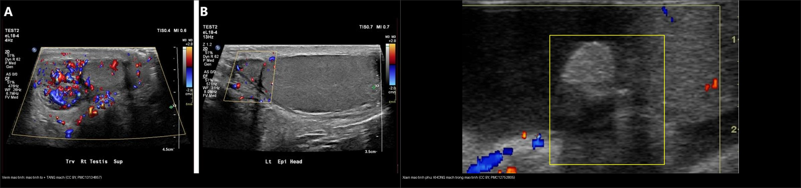
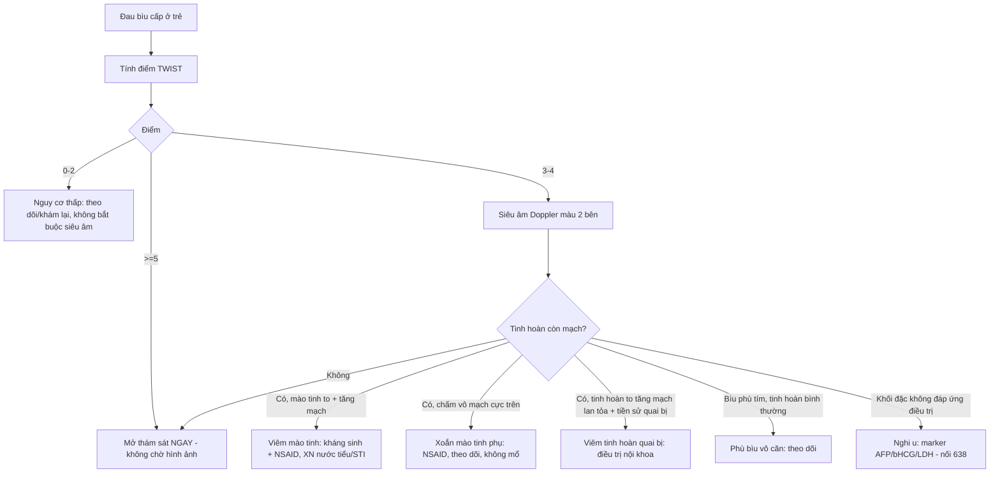
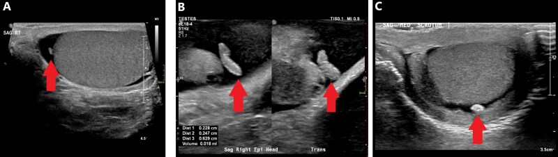
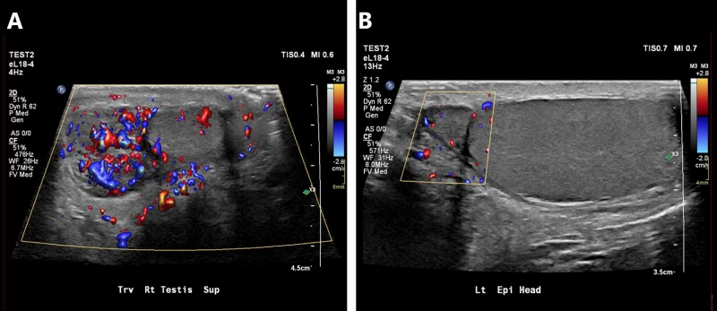
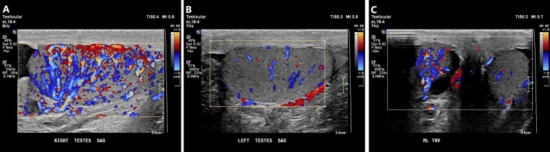
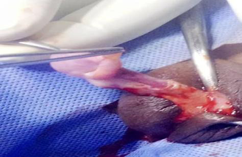
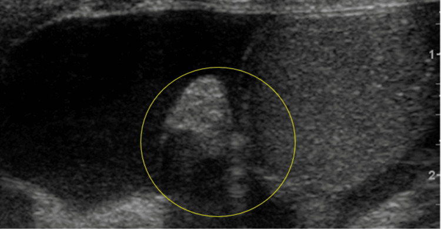
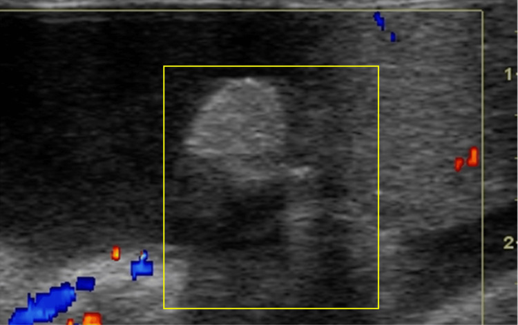
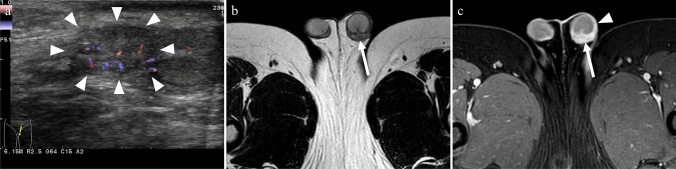

# 631 — Đau bìu cấp ở trẻ KHÔNG do xoắn tinh hoàn / Acute scrotum beyond testicular torsion

**Tags:** `pattern:dau-biu-cap` `pattern:xoan-mao-tinh-phu` `pattern:vien-mao-tinh-tinh-hoan` `pattern:vien-tinh-hoan-quai-bi` `vung:biu-tinh-hoan-nhi` `score:TWIST` `protocol:sieu-am-Doppler-biu` `protocol:xet-nghiem-nuoc-tieu`
**Mức chắc chắn (certainty):** tổng hợp y văn (literature synthesis) — số liệu từ các nguồn truy cập mở (PMC13134857, PMC12752805, PMC12220859, PMC12337970, PMC12130081, PMC10980613, PMC12074864) + 3 ca nguyên văn minh họa.

> Bổ trợ trực tiếp cho [636 – Cấp cứu niệu–sinh dục nhi](../636-cap-cuu-nieu-sinh-duc-nhi/lesson.md) (xoắn tinh hoàn) và [638 – Khối bìu–tinh hoàn không đau](../638-khoi-biu-tinh-hoan-nhi/lesson.md) (khối không đau). Bài này phủ nhánh **đau bìu cấp nhưng KHÔNG phải xoắn tinh hoàn**.

## 1. Tổng quan bệnh học – cơ chế hình ảnh

- **Đau bìu cấp (acute scrotum):** khởi phát đau + đỏ phù bìu đột ngột, là cấp cứu nhi–niệu khoa. **Ba nguyên nhân hàng đầu:** **xoắn tinh hoàn (testicular torsion – TT)**, **xoắn mào tinh phụ (torsion of the appendix testis/epididymis – TATE)**, **viêm mào tinh–tinh hoàn (epididymo-orchitis)** (PMC12220859).
- **Cơ chế từng nhóm:**
  - **Xoắn mào tinh phụ (appendix testis/epididymis):** các **tàn dư phôi (Müllerian – appendix testis; Wolffian – appendix epididymis)** bị xoắn → **hoại tử vô mạch (avascular)** → đau nhói, khu trú **cực trên tinh hoàn**; là **tàn dư không có chức năng**, **đa số tự khỏi**.
  - **Viêm mào tinh (epididymitis):** vi khuẩn (STI: *Chlamydia*, *N. gonorrhoeae*; hoặc vi khuẩn đường ruột *E. coli*/*Proteus*) hoặc **virus ở trẻ nhỏ (enterovirus/adenovirus)**, đôi khi do **trào ngược nước tiểu (dysfunctional voiding — "epididymitis hóa học")** → **mào tinh phù, tăng mạch (hyperemia)** trên Doppler.
  - **Viêm tinh hoàn do quai bị (mumps orchitis):** virus → tinh hoàn to, đau, **tăng mạch lan tỏa**; **tới 20% ca quai bị có viêm tinh hoàn** (PMC13134857).
- **TẠI SAO hình ảnh phân biệt được (vật lý Doppler):**
  - Viêm = **tăng tưới máu (hyperemia)** → nhiều tín hiệu màu trên **Doppler màu/năng lượng**, phổ tâm thu-tâm trương tăng.
  - Xoắn mào tinh phụ = **mô chết vô mạch** → **KHÔNG có tín hiệu trong "chấm" hồi âm nằm giữa tinh hoàn và đầu mào tinh**.
  - **Kích thước tương đối + tín hiệu Doppler** là hai trục: mào tinh to + tăng mạch = viêm; chấm nhỏ không mạch = xoắn mào tinh phụ.

### Ngưỡng định lượng bắt buộc (Argon – cửa 1)
| Đại lượng | Ngưỡng | Nguồn |
|---|---|---|
| Tuổi trung vị: xoắn tinh hoàn vs xoắn mào tinh phụ | **14,0** vs **10,5 tuổi** (p = 0,026) | PMC12220859 |
| Mào tinh phụ là **appendix testis** | **91–95%** ca xoắn mào tinh phụ | PMC12752805 |
| Dấu "chấm xanh" (blue dot sign) khi khám | Có nhưng **chỉ ~1/5 ca** — thiếu dấu **không loại trừ** | PMC12337970 |
| Siêu âm phát hiện xoắn tinh hoàn | **Se 0,86 / Sp 0,96** — **dòng chảy bình thường KHÔNG loại trừ** (xoắn từng lúc/xoắn một phần) | PMC12752805 |
| Kích thước bình thường | Đầu mào tinh **10–12 mm** đường kính | PMC13134857 |
| Điểm **TWIST** (7 điểm) | Phù tinh hoàn 2 · tinh hoàn chắc 2 · tinh hoàn nằm cao 1 · mất phản xạ cơ bìu 1 · nôn/buồn nôn 1 | PMC12337970 |
| Phân tầng TWIST | **0–2 thấp · 3–4 trung bình · ≥ 5 cao** (≥ 5 → mổ ngay, < 3 → có thể chỉ theo dõi/không cần siêu âm) | PMC12337970 |

## 2. Mẫu hình + chẩn đoán phân biệt theo tuổi (Gamut)

- **Sơ sinh – < 2 tuổi:** **xoắn ngoài bao tinh hoàn (extravaginal torsion)** (cấp cứu), **thoát vị bẹn nghẹt (incarcerated hernia)**, **viêm mào tinh do virus** (enterovirus), **phù bìu vô căn (idiopathic scrotal edema — "bìu tím", sốt nhẹ, tự khỏi)**, hội chứng **Henoch–Schönlein (IgA vasculitis)**.
- **2–11 tuổi (prepubertal):** **xoắn mào tinh phụ (TATE) là nguyên nhân hay gặp nhất**; viêm mào tinh do virus/dị dạng niệu; chấn thương.
- **≥ 12 tuổi (postpubertal):** **phải loại trừ xoắn tinh hoàn trước tiên**; **viêm mào tinh do STI** (nhiều nhất ở 18–35 tuổi); **viêm tinh hoàn do quai bị**; u tinh hoàn xuất huyết (giả "viêm"); Fournier ở người suy giảm miễn dịch.
- **Không theo tuổi nhưng phải nhớ:** **u tinh hoàn** hoại tử/xuất huyết (đau + khối), **xoắn từng lúc (intermittent torsion)**, **trào ngược bàng quang–niệu quản** gây đau bìu, **bệnh lý mào tinh lao**, **Fournier** (đau nhiều, khí trong mô mềm).
- **Quy tắc cửa vào:** mọi **đau bìu cấp** phải **loại trừ xoắn tinh hoàn trước** (nối 636); chỉ khi loại trừ xong mới chẩn đoán các nguyên nhân "không xoắn" dưới đây.

## 3. Bảng so sánh phân biệt (ma trận đối chiếu)

| Thực thể (entity) | Hình ảnh điển hình (siêu âm Doppler / MRI) | Chốt vào (rule-in) | Chốt loại (rule-out) | Gợi ý xác nhận |
|---|---|---|---|---|
| **Xoắn mào tinh phụ (TATE)** | "Chấm" hồi âm (isoechoic) **giữa cực trên tinh hoàn và đầu mào tinh**, có thể to ≥ 5–6 mm; **vô mạch** trên Doppler; ± tràn dịch phản ứng | **Chấm vô mạch ở cực trên** + đau **khu trú tại chỗ** + khởi phát từ từ ("insidious"); dấu "chấm xanh" khi khám | **Tinh hoàn có mạch bình thường** + mào tinh không to → không phải viêm mào tinh; xoắn **toàn bộ** tinh hoàn → 636 | Điều trị nội khoa (NSAID), không cần mổ nếu loại trừ được xoắn |
| **Viêm mào tinh (epididymitis)** | Mào tinh **to, không đồng nhất, TĂNG mạch rõ**; ± tràn dịch/tràn mủ phản ứng; tinh hoàn cùng bên có thể tăng mạch nhẹ | **Mào tinh to + tăng mạch (hyperemia)**; đau khi ấn dọc ống bẹn; vi khuẩn trong nước tiểu (STI/UTI) | **Mào tinh bình thường + vô mạch** → nghĩ xoắn mào tinh phụ; tinh hoàn mất mạch → 636 | XN nước tiểu/cấy + NAAT STI; kháng sinh + NSAID |
| **Viêm tinh hoàn do quai bị (mumps orchitis)** | Tinh hoàn **to, hồi âm không đồng nhất, tăng mạch lan tỏa**; ± tràn dịch | **Tiền sử quai bị/sốt + tinh hoàn to tăng mạch**; **tới 20% ca quai bị có viêm tinh hoàn** | Tinh hoàn mất mạch → 636; mào tinh là ổ chính → viêm mào tinh | Triệu chứng/miễn dịch; điều trị nội khoa |
| **Phù bìu vô căn (idiopathic scrotal edema)** | **Dày mô mềm bìu – vách bìu** lan xuống thừng tinh; **tinh hoàn & mào tinh bình thường, dòng chảy bình thường** | **Da bìu tím, phù nề nhiều, đau nhẹ, tinh hoàn hoàn toàn bình thường** | Tinh hoàn/mào tinh bất thường → loại trừ; mất mạch → 636 | Theo dõi, tự khỏi; kháng sinh không cần |
| **Xoắn ngoài bao sơ sinh (extravaginal torsion)** | Sơ sinh: tinh hoàn to, **hồi âm không đồng nhất, mất mạch**, da bìu đổi màu | **Sơ sinh bìu to cứng + mất mạch toàn bộ** | Có mạch → không phải (nhưng **không loại trừ xoắn từng lúc**) | Mổ cấp cứu (cửa sổ vàng ngắn) |
| **U tinh hoàn xuất huyết/hoại tử (giả viêm)** | Khối đặc trong tinh hoàn **tăng mạch không đồng nhất** ± hoại tử; **không giảm khi điều trị viêm** | **Khối đặc + AFP/hCG/LDH ± tăng**, không đáp ứng kháng sinh | Tổn thương nhỏ vô mạch ở mào tinh → TATE | Siêu âm lại sau điều trị; marker + mổ (nối 638) |
| **Fournier (viêm cân hoại tử bìu)** | **Khí trong mô mềm (hồi âm dày + "dirty shadow")**, dày thành bìu, tổn thương lan | **Khí trong mô mềm bìu + nhiễm trùng toàn thân** | Không khí + mô mềm bình thường → loại trừ | Kháng sinh phổ rộng + cắt lọc cấp cứu |

*Trái: **viêm mào tinh** — mào tinh to, hồi âm không đồng nhất + **tăng mạch rõ** trên Doppler. Phải: **xoắn mào tinh phụ** — "chấm" to ở cạnh tinh hoàn **KHÔNG có tín hiệu mạch**. Nguồn: Lam Shin Cheung J & Bhaduri M., Br J Radiol 2026 (PMC13134857, CC BY 4.0) + Louviere CD et al., Cureus 2025 (PMC12752805, CC BY 4.0); ảnh ghép letterbox.*

## 4. Protocol chụp + thang điểm TWIST + flowchart

- **Siêu âm bìu – Doppler màu (đầu tay, khẩn):** đầu dò thẳng **≥ 10 MHz**, bìu nâng bằng khăn; **quét ngang qua cả hai tinh hoàn trong cùng một khung màu** để so sánh đối xứng (tránh dương tính/âm tính giả do cài đặt PRF); chụp đầu – thân – đuôi mào tinh + **tìm "chấm" mào tinh phụ ở cực trên**; thêm Doppler xung (phổ) hai bên; siêu âm lại sau khi tràn dịch giảm.
- **Khi nào chụp CT/MRI:** **không** để chẩn đoán đau bìu cấp thường quy; **MRI** hữu ích khi viêm phức tạp/u, trẻ nhỏ cần đánh giá mô mềm (nối PMC10980613).
- **Xét nghiệm:** tổng phân tích nước tiểu + cấy; **NAAT *Chlamydia*/*gonorrhoeae*** ở trẻ vị thành niên có hoạt động tình dục; marker u (AFP/β-hCG/LDH) nếu có khối.
- **TWIST (Testicular Workup for Ischemia and Suspected Torsion) — 7 điểm:** phù tinh hoàn **2**, tinh hoàn chắc **2**, tinh hoàn nằm cao **1**, mất phản xạ cơ bìu **1**, nôn/buồn nôn **1**. Phân tầng: **0–2 thấp**, **3–4 trung bình** (siêu âm), **≥ 5 cao → mở thám sát ngay** (không chờ hình ảnh).
- **Xử trí theo nguyên nhân:** TATE → NSAID, nghỉ ngơi, theo dõi; viêm mào tinh → kháng sinh theo nguyên nhân (± NAAT STI) + NSAID; viêm tinh hoàn quai bị → nội khoa; phù bìu vô căn → theo dõi; xoắn → mổ cấp cứu.

## 5. Biến thể bình thường và cạm bẫy

- **Mào tinh phụ bình thường (appendix testis/epididymis):** cấu trúc nhỏ hồi âm, **cực trên tinh hoàn**; khi không xoắn rất dễ bỏ qua — cần chủ động tìm khi đau khu trú cực trên.
- **Dòng chảy bình thường KHÔNG loại trừ xoắn:** xoắn **một phần** và **xoắn từng lúc (intermittent)** có thể còn tín hiệu mạch; **TWIST cao vẫn phải mổ** (nối 636).
- **Cài đặt Doppler sai:** **PRF quá cao → dương tính giả (bỏ sót tăng mạch)**; **PRF quá thấp → âm tính giả (giả mất mạch)**; luôn so sánh hai bên cùng khung màu.
- **Tràn dịch lớn (hydrocele)** che lấp mào tinh/tinh hoàn → giảm tín hiệu; **chụp lại ở nhiều góc**, chờ dịch bớt.
- **"Chấm xanh" không phải lúc nào cũng có** (chỉ ~1/5) — thiếu dấu **không loại trừ** xoắn mào tinh phụ.
- **Viêm mào tinh có thể có tràn mủ (pyocele), áp-xe tinh hoàn** → theo dõi muộn; nếu không đáp ứng kháng sinh, **nghĩ u** (nối 638).
- **Viêm mào tinh do virus ở trẻ nhỏ ≠ STI:** đừng bỏ qua nguyên nhân lành tính; ngược lại **không được chẩn đoán "viêm" cho tiện** khi chưa loại trừ xoắn.
- **Cạm bẫy "hài lòng khi tìm thấy" (satisfaction of search):** đã thấy viêm mào tinh tăng mạch nhưng **bỏ sót xoắn tinh hoàn cùng bên / khối u**.

## 6. Tự lượng giá — Blind Quiz (Blind Quiz)

**Ca 1 — Bé trai 10 tuổi, đau nhói vùng cực trên bìu trái, khởi phát từ từ; khám thấy nốt cứng nhỏ, hơi xanh.**

- Hỏi: Cấu trúc hồi âm nhô ra ở cực trên là gì? Có mạch không? Chẩn đoán hàng đầu? Có cần mổ không?

<b>Bấm để hiện đáp án (findings + chẩn đoán)</b>

- Findings: **(A)** cấu trúc bầu dục hồi âm (isoechoic) nhô ra từ **cực trên tinh hoàn = mào tinh phụ (appendix testis)**; **(B)** cấu trúc dạng ống ở đầu mào tinh; (C) "ngọc bìu" (scrotal pearl).
- Chẩn đoán: **mào tinh phụ (appendix testis)** — nếu ca này có **vô mạch + đau khu trú cực trên** thì là **xoắn mào tinh phụ (TATE)**, vốn **đa số tự khỏi, điều trị NSAID, không cần mổ** khi đã loại trừ xoắn tinh hoàn.
- Nguồn ảnh: Lam Shin Cheung J & Bhaduri M., *Br J Radiol* 2026 (PMC13134857), CC BY 4.0.

**Ca 2 — Bé trai 8 tuổi, sốt, đau bìu phải; siêu âm so sánh hai bên.**

- Hỏi: Bên nào bất thường? Dấu hiệu trên Doppler? Chẩn đoán? Xử trí?

<b>Bấm để hiện đáp án (findings + chẩn đoán)</b>

- Findings: **(A)** mào tinh **phải to, không đồng nhất, tăng mạch rõ**; **(B)** mào tinh **trái bình thường** (kích thước và dòng chảy).
- Chẩn đoán: **viêm mào tinh phải (epididymitis)** — tăng tưới máu do viêm. Xử trí: **NSAID + kháng sinh theo nguyên nhân** + xét nghiệm nước tiểu/NAAT STI; siêu âm lại nếu không đỡ.
- Nguồn ảnh: Lam Shin Cheung J & Bhaduri M., *Br J Radiol* 2026 (PMC13134857), CC BY 4.0.

**Ca 3 — Bé trai, tinh hoàn to đau, tiền sử quai bị.**

- Hỏi: Tổn thương lan tới tinh hoàn? Nguyên nhân? Phân biệt với xoắn?

<b>Bấm để hiện đáp án (findings + chẩn đoán)</b>

- Findings: **(A)** tinh hoàn **phải to, tăng mạch**; **(B)** tinh hoàn **trái bình thường**; **(C)** so sánh hai bên cho thấy bên phải to hơn và tăng mạch hơn.
- Chẩn đoán: **viêm tinh hoàn (orchitis)**, thường thứ phát sau viêm mào tinh (epididymo-orchitis) hoặc do **quai bị (tới 20% ca quai bị)**. Phân biệt xoắn bằng **tăng mạch** (xoắn = mất mạch); nhưng nếu TWIST cao vẫn phải mổ.
- Nguồn ảnh: Lam Shin Cheung J & Bhaduri M., *Br J Radiol* 2026 (PMC13134857), CC BY 4.0.

**Ca 4 — Bé trai 9 tuổi, đau bìu trái "giống xoắn"; mổ thám sát thấy tổn thương cực trên.**

- Hỏi: Tổn thương nằm ở đâu? Là cấu trúc nào? Vì sao ca này vẫn phải mổ?

<b>Bấm để hiện đáp án (findings + chẩn đoán)</b>

- Findings: **mào tinh phụ bị viêm/xoắn ở cực trên tinh hoàn**, thâm tím; bên cạnh sơ đồ giải phẫu vị trí các mào tinh phụ.
- Chẩn đoán: **xoắn mào tinh phụ (torsion of the epididymal appendage)** — ca nguyên văn bé 9 tuổi (Olulana DI et al., Ann Ib Postgrad Med 2025) được **mổ thám sát vì lâm sàng giả xoắn tinh hoàn**; khởi phát "insidious", đau khu trú giúp phân biệt.
- Nguồn ảnh: Olulana DI et al., 2025 (PMC12337970), **CC BY-NC 3.0** — giữ nguyên bản, **không ghép**.

**Ca 5 — Bé trai 6 tuổi, đau bìu bán cấp; siêu âm thấy "chấm" cạnh tinh hoàn.**

- Hỏi: Trên ảnh xám thấy gì? Trên Doppler màu? Chốt chẩn đoán?

<b>Bấm để hiện đáp án (findings + chẩn đoán)</b>

- Findings: **mào tinh phụ to, hồi âm hơn tinh hoàn bên cạnh, có tràn dịch kề bên** (ảnh A); trên Doppler màu **HOÀN TOÀN KHÔNG có tín hiệu mạch trong mào tinh phụ** (ảnh B, ô vàng).
- Chẩn đoán: **xoắn mào tinh phụ (testicular appendage torsion)** — tiêu chuẩn là **chấm vô mạch ở cực trên tinh hoàn**; 91–95% là **appendix testis**. Điều trị NSAID/theo dõi.
- Nguồn ảnh: Louviere CD et al., *Cureus* 2025 (PMC12752805), CC BY 4.0.

**Ca 6 — Bé gái/bé trai? — Bé trai 8 tuổi, đau bìu cấp không rõ nguyên nhân, đánh giá thêm MRI.**

- Hỏi: Hai phương thức cho thấy gì? Khi nào cần MRI ở đau bìu cấp?

<b>Bấm để hiện đáp án (findings + chẩn đoán)</b>

- Findings: **(a)** Doppler màu: **mào tinh to + tăng mạch (hyperemia)**; **(b)** MRI T2: **mào tinh trái to, tăng tín hiệu** — phù hợp viêm.
- Chẩn đoán: **viêm mào tinh (epididymitis)** ở bé 8 tuổi — ca nguyên văn (Shibuki S et al., *Jpn J Radiol* 2024). MRI không thường quy; dùng khi **viêm phức tạp, nghi u/áp-xe** hoặc cần đánh giá mô mềm mở rộng.
- Nguồn ảnh: Shibuki S et al., 2024 (PMC10980613), CC BY 4.0.

## Bài liên quan chéo
- [600 – Tổng quan Hệ Nhi khoa](../600-tong-quan-nhi-khoa/lesson.md)
- [636 – Cấp cứu niệu–sinh dục nhi (chấn thương thận & xoắn tinh hoàn)](../636-cap-cuu-nieu-sinh-duc-nhi/lesson.md)
- [638 – Khối bìu–tinh hoàn không đau ở trẻ (u tế bào mầm, nang biểu bì, varicocele)](../638-khoi-biu-tinh-hoan-nhi/lesson.md)
- [634 – Hạ tinh hoàn ẩn & tinh hoàn không sờ thấy](../634-ha-tinh-hoan-an-tinh-hoan-khong-so-thay/lesson.md)
- [635 – Dị tật hệ tiết niệu nhi (SFU/VUR/PUV)](../635-di-tat-tiet-nieu-nhi-SFU-VUR-PUV/lesson.md)

> Không dùng để chẩn đoán độc lập khi chưa có người hướng dẫn.
