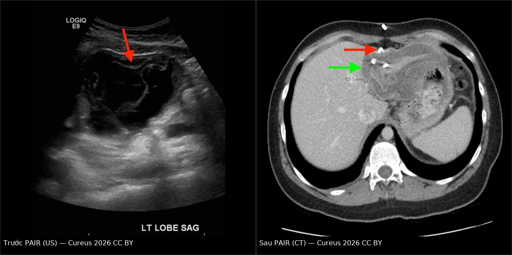
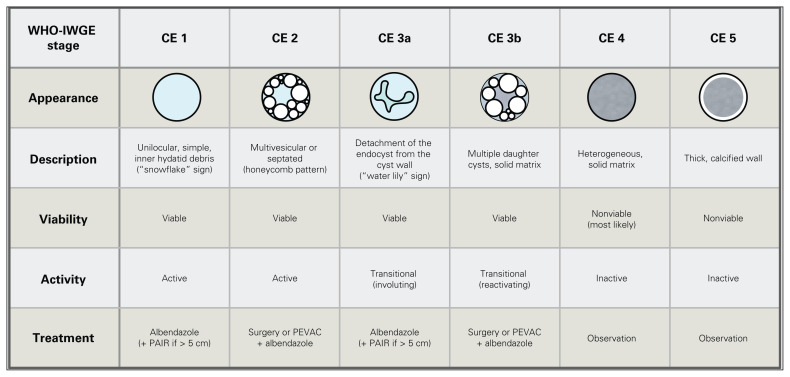
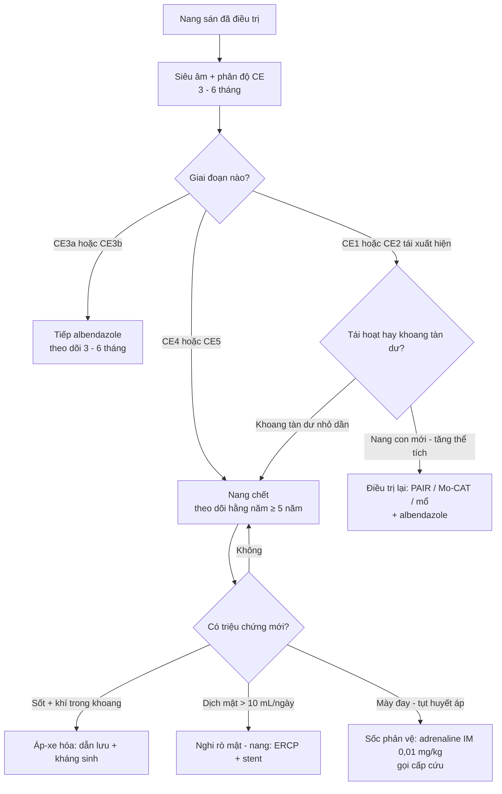
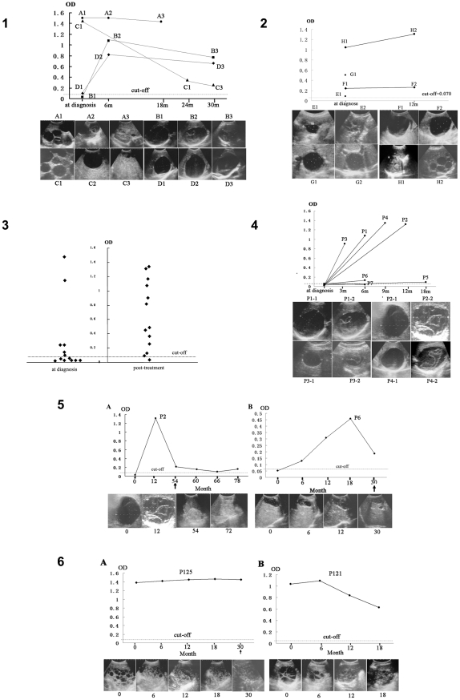

# 632 — Theo dõi dài hạn & dự phòng tái phát nang sán: huyết thanh học, albendazole chu kỳ, PAIR và sốc phản vệ / Long-term follow-up & prevention of recurrence in cystic echinococcosis

**Tags:** `pattern:nang` `pattern:tai-phat` `pattern:ro-mat` `vung:gan` `score:WHO-IWGE-CE` `protocol:US-theo-doi`
**Mức chắc chắn (certainty):** tổng hợp y văn (literature synthesis) — tự biên từ y văn mở (CC BY 4.0, CC BY-NC 4.0, CC BY-NC-ND 4.0); các ca minh họa là **ca nguyên văn** của bài gốc.

> **Ba bài trước, bài này là bài thứ tư.**
> [139 – Sán lá gan](../139-san-la-gan/lesson.md) chốt **chẩn đoán + phân độ WHO-IWGE + chọn PAIR/mổ/theo dõi**; [621 – Nang sán phổi ở trẻ](../621-nang-san-la-phoi-o-tre/lesson.md) phủ **nang phổi + dấu vỡ**; [105 – Theo dõi ống dẫn lưu mật](../105-theo-doi-ong-dan-luu-mat-qua-da/lesson.md) phủ **chăm sóc/rút ống dẫn lưu**. Bài này trả lời câu hỏi **"sau khi đã điều trị xong thì sao?"** — câu hỏi chiếm phần lớn thời gian của bệnh nhi: **theo dõi bao lâu, bằng gì, khi nào gọi là khỏi, khi nào là tái phát, uống albendazole bao lâu, và làm sao không chết vì sốc phản vệ khi nang vỡ.**

## 1. Tổng quan bệnh học – cơ chế hình ảnh

### 1.1 Vì sao theo dõi nang sán khác theo dõi ung thư

- Nang sán **không "biến mất" khi khỏi** — nó **chết tại chỗ**: mất nước, đặc lại, canxi hóa, teo dần. Vì vậy **kích thước không phải thước đo chính**; thước đo là **phân độ WHO-IWGE (CE1–CE5)** và **sự chuyển giai đoạn**.
- **Chiều "khỏi" (involution):** **CE1 → CE3a** (màng trong bong) → **CE4** (đặc, không còn dịch) → **CE5** (vôi hóa toàn bộ). Đây là **dấu hiệu đáp ứng**, không phải "nang xấu đi".
- **Chiều "tái hoạt" (reactivation):** **CE4/CE5 → xuất hiện lại dịch**, **nang con mới**, **thể tích tăng**. TẠI SAO vẫn xảy ra dù đã điều trị: **màng sinh sản (germinal layer)** còn sống sót ở túi cùng, **nang con bị bỏ sót** trong mô đệm, hoặc **scolicidal không tiếp xúc đủ** (nang nhiều ngăn, dịch đặc).
- **Siêu âm là phương thức theo dõi chuẩn** (không tia, trẻ em, lặp lại được). **TẠI SAO siêu âm đọc được các giai đoạn:** dịch nang **trống âm** (không có cấu trúc phản hồi) → **CE1**; **vách/nang con** tạo cấu trúc hồi âm trong lòng → **CE2**; **màng bong** là dải hồi âm **di động** trong dịch → **CE3a**; mô đặc hồi âm không đều → **CE4**; **vôi hóa** tăng âm mạnh + **bóng cản phía sau** → **CE5**.
- **Huyết thanh học không phải "test khỏi bệnh".** Kháng thể **IgG kháng kháng nguyên B tái tổ hợp (rAgB)** giảm chậm và **vẫn dương tính ở phần lớn ca đã khỏi**. TẠI SAO: kháng thể là **dấu vết miễn dịch** (tế bào plasma tồn tại lâu), không phải **dấu vết ký sinh còn sống**. Vì vậy **âm hóa huyết thanh không bắt buộc để gọi là khỏi**, và **dương tính không đồng nghĩa tái phát**.

### 1.2 Ngưỡng định lượng bắt buộc

| Đại lượng | Con số | Nguồn |
|---|---|---|
| Lịch theo dõi sau điều trị | Hình ảnh **3–6 tháng/lần**, sau đó **1 lần/năm, tối thiểu 5 năm liên tiếp** sau khi nang bất hoạt; **đáp ứng hoàn toàn chỉ đánh giá được 12 tháng sau khi kết thúc điều trị** | World J Radiol 2026 (PMC13122038) |
| Albendazole chu kỳ — kết quả | **khỏi 32,7%** (16/49), **cải thiện 49,0%**, **không đổi 14,3%**, **nặng lên 4,1%** sau **6–30 tháng** | PLoS NTD 2011 (PMC3201905) |
| Thời gian điều trị đến khi khỏi theo phân độ | **CE2: 26,4 tháng** > **CE1: 20,4 tháng** > **CE3a: 9 tháng** | PLoS NTD 2011 (PMC3201905) |
| Thời gian điều trị theo kích thước | **≥ 10 cm: 22,3 tháng** > **5–10 cm: 17,3 tháng** > **< 5 cm: 6 tháng** | PLoS NTD 2011 (PMC3201905) |
| Ngưỡng "đủ dài" | Uống **> 18 tháng** → khả năng khỏi cao hơn; **tuân thủ kém → kết cục kém** | PLoS NTD 2011 (PMC3201905) |
| Huyết thanh học rAgB | **53,8%** (7/13) ca **CE1 chưa can thiệp ÂM TÍNH** lúc chẩn đoán; sau **3–18 tháng** albendazole, **6/7 chuyển dương** — kèm **CE1 → CE3a** trên siêu âm | PLoS NTD 2011 (PMC3201905) |
| Tỉ lệ nang tự bất hoạt trong cộng đồng | **18,9%** (37/196) đã ở **CE4/CE5** khi phát hiện — bằng chứng "không phải nang nào cũng cần can thiệp" | PLoS NTD 2011 (PMC3201905) |
| PAIR (n = 255) vs mổ (n = 734) | **tái tích dịch 4,7% vs 1,2%** (p = 0,001); **sốc phản vệ 1,6% vs 0,3%** (p = 0,041); **rò mật–nang 14,9% vs 14,6%** (p = 0,902); nằm viện **3,1 vs 7,3 ngày** | World J Gastroenterol 2026 (PMC12865369) |
| Mo-CAT cho CE2/CE3b | **giảm thể tích 65,84%**; **biến chứng nặng 10,08%**; **tái phát 4,5%**; theo dõi trung bình **51,66 tháng** | Cardiovasc Intervent Radiol 2025 (PMC11958407) |
| Rút catheter sau can thiệp nang | **dịch < 10 mL/ngày** → rút; **> 10 mL/ngày kéo dài 10–14 ngày** → nghi **rò mật–nang**, chuyển ERCP/đặt stent | World J Radiol 2026 (PMC13122038) |
| Tuân thủ báo cáo phân độ | Chỉ **~2/3** ca được điều trị đúng khuyến cáo WHO; lỗi chính là **báo cáo hình ảnh chỉ ghi kích thước, bỏ phân độ** | Can J Surg 2026 (PMC13275138) |

## 2. Mẫu hình + chẩn đoán phân biệt theo trạng thái sau điều trị (Gamut)

### 2.1 Năm trạng thái "sau điều trị" — đọc trước, kết luận sau

1. **NANG CHẾT (inactive):** CE4 đặc / CE5 vôi hóa, **không có dịch, không nang con**, kích thước **giảm dần hoặc đứng yên**. → **Không làm gì thêm**, tiếp tục theo dõi.
2. **NANG ĐANG CHUYỂN (transitional):** CE3a (màng bong) / CE3b (đặc + nang con). → Có thể **tiếp tục albendazole**, theo dõi sát; **không vội kết luận thất bại**.
3. **NANG TÁI HOẠT (reactivated):** nang **có dịch trở lại sau giai đoạn đặc**, **nang con mới**, **thể tích tăng ≥ 20%** so với lần đo trước. → **Điều trị lại** (PAIR/Mo-CAT/mổ) + albendazole.
4. **KHOANG TÀN DƯ (residual cavity):** sau PAIR/mổ, khoang **còn dịch nhưng thành mỏng, không nang con, không ngấm thuốc, nhỏ dần**. → **Theo dõi**, đừng gọi là tái phát.
5. **BIẾN CHỨNG:** **rò mật–nang**, **áp-xe hóa khoang tàn dư**, **vỡ nang → sốc phản vệ**, **hẹp đường mật do xơ hóa**, **nang mới ở cơ quan khác**.

### 2.2 Gamut theo triệu chứng trong giai đoạn theo dõi

| Bệnh cảnh | Nghĩ trước tiên |
|---|---|
| Hoàn toàn không triệu chứng, nang "đặc hơn" | **Đang chết dần (CE4)** — dấu hiệu tốt |
| Sốt + đau hạ sườn phải + khoang tàn dư có mức khí–dịch | **Áp-xe hóa khoang tàn dư** (không phải tái phát) |
| Dịch dẫn lưu **vàng mật, > 10 mL/ngày kéo dài** | **Rò mật–nang (cystobiliary fistula)** |
| Nổi mề đay, khò khè, tụt huyết áp **sau chấn thương/chọc/vỡ nang** | **Sốc phản vệ do rò dịch nang** — cấp cứu ngay |
| Nang mới ở gan khác/phổi/lách/thận trong 2 năm đầu | **Tái phát đa ổ** hoặc **đa cơ quan đồng thời bị bỏ sót** |
| Mệt, vàng da, sốt định kỳ nhiều năm sau mổ | **Xơ hóa đường mật/hẹp** do scolicidal thoát vào đường mật |
| Trẻ chậm tăng cân, đau bụng tái diễn, không sốt | **Nang lớn chèn ép** — đánh giá lại chỉ định can thiệp |

### 2.3 Mnemonic **"SÁN SỐNG"** — 6 việc phải kiểm mỗi lần tái khám

- **S**iêu âm phân độ (ghi **CE**, không chỉ mm).
- **Á**p lực ổ bụng/triệu chứng (đau, chướng, vàng da).
- **N**ang con & thể tích (so **cùng vị trí, cùng tư thế**).
- **S**erology **chỉ để tham khảo**, không chốt khỏi/tái phát.
- **Ố**ng dẫn lưu/lưu lượng mật (nếu còn).
- **N**hắc lại **albendazole + tuân thủ + tác dụng phụ**.
- **G**hi vào hồ sơ **ngày hẹn kế tiếp** (trẻ em dễ mất theo dõi khi chuyển tuyến).

## 3. Bảng so sánh phân biệt (ma trận đối chiếu)

| Thực thể (entity) | Hình ảnh điển hình | Chốt vào (rule-in) | Chốt loại (rule-out) | Gợi ý xác nhận |
|---|---|---|---|---|
| **Nang chết CE4/CE5** | CE4: khối **đặc, hồi âm không đều, không dịch**; CE5: **vôi hóa viền/toàn bộ + bóng cản**; kích thước **giảm hoặc đứng yên** | **Không còn dịch + không nang con + vôi hóa/đặc + kích thước không tăng qua ≥ 2 lần đo** | Xuất hiện **dịch mới hoặc nang con** → không còn "chết" | Siêu âm 3–6 tháng; không cần chọc |
| **Nang tái hoạt** | Nang **có dịch trở lại** sau giai đoạn đặc; **nang con mới**; thể tích **tăng ≥ 20%** | **Dịch trở lại + nang con mới + tăng thể tích so với lần đo trước** | Khoang tàn dư **nhỏ dần**, thành mỏng, không nang con → không phải tái phát | Siêu âm + MRI/MRCP; điều trị lại |
| **Khoang tàn dư sau PAIR/mổ** | Ổ dịch **thành mỏng, không ngấm, không vách**, giảm dần theo tháng | **Giảm thể tích theo thời gian + không nang con + không ngấm thuốc** | **Thành dày, ngấm thuốc, có vách/nang con** → nghi tái phát/áp-xe | Siêu âm seri; CT/MRI nếu không rõ |
| **Rò mật–nang** | Dịch dẫn lưu **màu mật**; cholangiogram/cystogram thấy **cản quang vào đường mật**; khoang tàn dư không nhỏ lại | **Dịch > 10 mL/ngày kéo dài 10–14 ngày + cản quang thấy đường mật** | Dịch **< 10 mL/ngày** và giảm nhanh, không màu mật → không rò | Bilirubin dịch; ERCP + stent; **không bơm scolicidal** |
| **Áp-xe hóa khoang tàn dư** | Mức **khí–dịch** trong khoang, thành dày, mô đệm quanh viêm; sốt, đau | **Sốt + mức khí–dịch trong khoang + bạch cầu/CRP tăng** | Khoang **không khí, không sốt**, nhỏ dần → không áp-xe | Cấy mủ; dẫn lưu + kháng sinh (xem [105](../105-theo-doi-ong-dan-luu-mat-qua-da/lesson.md)) |
| **Sốc phản vệ do vỡ nang** | Không có hình ảnh đặc hiệu; **nang vỡ/màng xẹp** trên siêu âm; mày đay, co thắt phế quản, tụt huyết áp | **Tụt HA + co thắt phế quản/mày đay trong bối cảnh vỡ nang hoặc can thiệp** | Chỉ **đau/nôn đơn thuần**, HA bình thường → không phải sốc phản vệ | Lâm sàng; **adrenaline IM ngay**, không chờ xét nghiệm |
| **Xơ hóa đường mật do scolicidal** | Hẹp đường mật lan tỏa sau PAIR **có thông mật–nang**; giãn mật thượng lưu | **Tiền sử bơm scolicidal + hẹp lan tỏa + vàng da tiến triển** | Hẹp **khu trú tại miệng nối** → nghĩ hẹp sau mổ | MRCP; ERCP/stent; dự phòng bằng **loại trừ thông mật trước PAIR** |
| **Nang mới / đa cơ quan** | Nang mới ở **phổi, lách, thận, tim, não** trong 2 năm đầu | **Nang mới ở vị trí khác + huyết thanh dương** | Nang **cùng vị trí, cùng giai đoạn, không đổi** → tổn thương chỉ điểm | Siêu âm bụng + **X-quang/CT ngực**; MRI não nếu có triệu chứng |

*Trái: siêu âm — nang lớn thùy trái gan, **cấu trúc hỗn hợp, màng bong bên trong** (mũi tên), kích thước ~11,6 × 8 × 8 cm. Phải: CT sau PAIR + albendazole — ổ **giảm kích thước rõ**, còn **catheter pigtail** (mũi tên đỏ) trong khoang tàn dư. Nguồn: Broceta A et al., Cureus 2026 (PMC12884859), CC BY 4.0 — ảnh ghép letterbox giữ nguyên tỷ lệ.*

## 4. Protocol theo dõi + hệ phân độ/điểm chuẩn hóa

### 4.1 Bảng phân độ WHO-IWGE dùng để theo dõi (ảnh gốc, giữ nguyên bản)

*Bảng gốc: hình thái – mô tả – khả năng sống (viability) – hoạt tính – điều trị theo từng giai đoạn. Dùng làm "thẻ theo dõi": mỗi lần tái khám ghi **một ô CE**, không ghi "nang 4 cm". Nguồn: Colucci N et al., Can J Surg 2026 (PMC13275138), CC BY-NC-ND 4.0 — **giữ nguyên bản, không crop/ghép**.*

### 4.2 Lịch theo dõi cụ thể (trẻ em)

| Thời điểm | Việc phải làm |
|---|---|
| **Trước điều trị** | Siêu âm + **phân độ CE** + huyết thanh rAgB (**nền**) + CTM, AST/ALT, bilirubin; **X-quang/CT ngực** tìm nang phổi; khám lách/thận |
| **Trong điều trị albendazole** | **CTM + AST/ALT mỗi 2 tuần trong 2 tháng đầu**, sau đó **mỗi tháng**; cân nặng để chỉnh liều |
| **Sau can thiệp 1 tháng** | Lưu lượng dịch dẫn lưu; **rút catheter khi < 10 mL/ngày**; nếu **> 10 mL/ngày kéo dài 10–14 ngày** → nghi rò mật–nang → ERCP |
| **3–6 tháng** | Siêu âm **phân độ lại** + đo thể tích cùng tư thế; huyết thanh (tham khảo); đánh giá tuân thủ |
| **Hằng năm, ≥ 5 năm** | Siêu âm + huyết thanh; **đáp ứng hoàn toàn chỉ chốt ở mốc 12 tháng sau khi kết thúc điều trị** |
| **Sau 5 năm** | Ngừng theo dõi nếu **CE4/CE5 ổn định ≥ 5 năm**; dặn tái khám nếu đau/sốt/vàng da |
| **Chuyển tiếp người lớn** | Bàn giao **giai đoạn CE cuối + tổng liều/thời gian albendazole + ngày hẹn** — mất dấu là nguyên nhân tái phát muộn hay gặp |

### 4.3 Albendazole chu kỳ dài hạn — liều, thời gian, khi nào ngừng

- **Liều:** **10–15 mg/kg/ngày** chia 2 lần (tối đa **800 mg/ngày**), **chu kỳ 28 ngày uống – 14 ngày nghỉ**.
- **Thời gian:** **không có con số cố định** — theo **phân độ + kích thước**: **CE3a ~9 tháng**, **CE1 ~20 tháng**, **CE2 ~26 tháng**; nang **≥ 10 cm ~22 tháng**; **> 18 tháng** cho kết cục tốt hơn. Thực tế: **điều trị đến khi nang chuyển CE4/CE5** rồi thêm **1–2 chu kỳ**.
- **Theo dõi độc tính:** **giảm bạch cầu, tăng transaminase, rụng tóc hồi phục**; ngừng tạm khi **AST/ALT > 5 lần giới hạn trên** hoặc **bạch cầu < 3 × 10⁹/L**; kiểm tra lại sau 2 tuần.
- **Chống chỉ định / thận trọng:** **thai 3 tháng đầu**, suy tủy, trẻ **< 1 tuổi** (chưa đủ dữ liệu — hội chẩn).
- **Không dùng albendazole thay cho can thiệp ở nang lớn có triệu chứng** — thuốc **không hạ được áp lực nang**, chỉ làm chết màng sinh sản.

### 4.4 Vì sao huyết thanh học KHÔNG phải "đèn báo khỏi bệnh"

- **Kháng thể tồn tại sau khi nang chết** → dương tính kéo dài ở **phần lớn ca đã khỏi**; dùng nó để "theo dõi khỏi" sẽ **điều trị quá mức**.
- **53,8% CE1 âm tính lúc chẩn đoán** → âm tính **không loại trừ** bệnh.
- **Giá trị thật:** (a) **chẩn đoán hỗ trợ** khi hình ảnh không điển hình; (b) **dấu hiệu thuốc có tác dụng** khi ca **ban đầu âm tính chuyển dương** kèm **CE1 → CE3a**; (c) **tăng lại sau âm hóa** ở ca từng âm → **gợi ý tái hoạt**, nhưng phải xác nhận bằng hình ảnh.
- **Nguyên tắc thực dụng:** **hình ảnh quyết định, huyết thanh chỉ phụ**.

### 4.5 Thuật toán theo dõi sau điều trị

### 4.6 Xử trí sốc phản vệ do vỡ nang (bắt buộc thuộc lòng)

1. **Adrenaline (epinephrine) IM mặt trước–ngoài đùi: 0,01 mg/kg** dung dịch **1 mg/mL**, **tối đa 0,5 mg**; lặp lại **mỗi 5–15 phút** nếu chưa cải thiện.
2. **Gọi hỗ trợ + đặt đường truyền lớn**, truyền dịch tinh thể **20 mL/kg** nhanh.
3. **Thở oxy**; co thắt phế quản → **salbutamol khí dung**; tụt HA dai dẳng → **adrenaline truyền tĩnh mạch** (theo phác đồ cấp cứu).
4. **Kháng histamine + corticosteroid** chỉ là **hỗ trợ**, **không thay adrenaline**, **không chậm adrenaline**.
5. **Phòng ngừa (quan trọng hơn cấp cứu):** trước PAIR/mổ — **đường truyền lớn, tiền mê kháng histamine + steroid, adrenaline auto-injector sẵn trong phòng can thiệp, sẵn sàng đặt nội khí quản**; **loại trừ thông mật–nang trước khi bơm scolicidal** (scolicidal vào đường mật → **viêm xơ đường mật**).

## 5. Biến thể bình thường và cạm bẫy

- **"Nang đặc đi" không phải "nang to ra":** CE1 → CE3a → CE4 là **thành công**. Cạm bẫy hay gặp nhất là **đo thể tích bằng mắt** rồi kết luận "không đáp ứng" khi nang **đặc lại nhưng đường kính không đổi**.
- **Nang đơn giản vs CE1:** nang gan đơn thuần **thành mỏng đều, dịch trong, không màng đôi, không cát sán**; **CE1** có **màng đôi/cát sán**, huyết thanh dương. Đo **tỉ trọng trên CT** giúp phân biệt (nang sán dịch **đậm độ cao hơn** nang đơn giản) — nhưng **không thay thế** phân độ siêu âm + huyết thanh.
- **Vôi hóa vành (rim calcification) = CE5, KHÔNG điều trị** — đừng chọc/nổ vì "thấy canxi là sợ".
- **Theo dõi quá sớm:** siêu âm lại sau **2–4 tuần** dễ thấy "không đổi" và kết luận sai; mốc đánh giá là **3–6 tháng** và **12 tháng sau kết thúc điều trị**.
- **Sai lầm "không ghi phân độ":** chỉ ghi kích thước làm **mất thông tin quyết định**; đây là lỗ hổng được ghi nhận ở **1/3** ca trong một loạt 41 bệnh nhân.
- **Bỏ sót đa cơ quan:** đã thấy nang gan **vẫn phải** chụp **phổi** (10–30% ca có nang phổi) và khám **lách/thận/não** nếu có triệu chứng — bỏ sót gây "tái phát" giả sau vài năm.
- **Áp-xe hóa ≠ tái phát:** khoang tàn dư **có khí + sốt** là **nhiễm trùng**, điều trị **dẫn lưu + kháng sinh**, không phải chỉ định PAIR lần 2.
- **Rò mật–nang bị bỏ qua:** dịch dẫn lưu "vàng như mật" kéo dài — nếu tiếp tục bơm scolicidal sẽ **thiêu đường mật**; dừng ngay, ERCP.

## 6. Tự lượng giá — Blind Quiz

**Ca 1 — Bé gái 9 tuổi, nang sán gan CE1 6 cm đã PAIR + albendazole 12 tháng. Tái khám: nang 4 cm, không còn dịch, đặc, viền canxi mảnh. Huyết thanh vẫn dương tính.**

- Câu hỏi: (1) Nang đang ở giai đoạn nào? (2) Có phải thất bại điều trị vì huyết thanh còn dương? (3) Bước tiếp theo?

<b>Bấm để hiện đáp án</b>

- **CE4 → CE5:** đặc, không dịch, canxi hóa = **nang chết** — **thành công**, không phải thất bại.
- **Huyết thanh dương không phải tiêu chuẩn thất bại:** kháng thể **tồn tại lâu sau khi nang chết**; dùng hình ảnh (phân độ) để kết luận.
- **Tiếp theo:** ngừng albendazole sau 1–2 chu kỳ nữa, **theo dõi hằng năm ≥ 5 năm**; đáp ứng hoàn toàn chốt ở **12 tháng sau khi kết thúc điều trị**.
- Nguồn: bảng phân độ — Colucci N et al., Can J Surg 2026 (PMC13275138), CC BY-NC-ND 4.0.

**Ca 2 — Bé trai 7 tuổi, nang sán gan đã PAIR 3 tuần. Dịch dẫn lưu 60 mL/ngày, màu vàng mật, kéo dài 12 ngày, bé sốt nhẹ.**

- Câu hỏi: (1) Biến chứng gì? (2) Vì sao **không được** bơm scolicidal tiếp? (3) Xử trí?

<b>Bấm để hiện đáp án</b>

- **Rò mật–nang (cystobiliary fistula):** dịch **> 10 mL/ngày kéo dài 10–14 ngày**, màu mật. Tỉ lệ **14,9%** ở nhóm PAIR; khi có rò, **thời gian lưu catheter kéo dài 17,8 ± 8,7 ngày** so với **3,5 ± 2,9 ngày** khi không rò.
- **Không bơm scolicidal:** scolicidal (cồn 95%/NaCl 20%) vào đường mật gây **viêm xơ đường mật (sclerosing cholangitis)** — tổn thương không hồi phục.
- **Xử trí:** giữ/thay catheter dẫn lưu, **ERCP + stent** để hạ áp lực đường mật, kháng sinh, tiếp albendazole; theo dõi bilirubin dịch.
- Nguồn ảnh: Broceta A et al., Cureus 2026 (PMC12884859), CC BY 4.0.

**Ca 3 — Bé gái 12 tuổi, nang sán gan CE1 đã điều trị 2 năm, siêu âm ổn định. Đột ngột đau bụng dữ dội, mày đay toàn thân, khò khè, HA 70/40 mmHg sau va chạm nhẹ vào bụng.**

- Câu hỏi: (1) Chẩn đoán? (2) Thuốc đầu tay, liều? (3) Sau cấp cứu, kế hoạch theo dõi thay đổi thế nào?

<b>Bấm để hiện đáp án</b>

- **Sốc phản vệ do vỡ nang** (dịch nang giàu kháng nguyên rò vào phúc mạc) — chẩn đoán **lâm sàng**, **không chờ xét nghiệm/hình ảnh**.
- **Adrenaline IM 0,01 mg/kg (1 mg/mL), tối đa 0,5 mg, mặt trước–ngoài đùi**, lặp mỗi 5–15 phút; song song **oxy + dịch tinh thể 20 mL/kg**; kháng histamine/steroid chỉ hỗ trợ.
- **Sau cấp cứu:** nang đã vỡ → **dẫn lưu/kiểm soát rò + albendazole**; theo dõi **3–6 tháng** rồi **hằng năm ≥ 5 năm**; tầm soát **đa cơ quan** (phổi, lách, thận); dặn **tránh va chạm mạnh** cho tới khi nang bất hoạt.
- **Ảnh minh họa (bài gốc):** đồ thị **OD kháng thể rAgB** song song ảnh siêu âm của 6 bệnh nhân — cho thấy kháng thể **giảm nhưng thường vẫn trên ngưỡng** dù nang đã khỏi (panel 3–6), và **chuyển dương ở ca CE1 ban đầu âm tính** (panel 3–4). Đây là bằng chứng trực quan cho quy tắc "**hình ảnh quyết định, huyết thanh chỉ phụ**".
- Nguồn ảnh: Li T et al., PLoS Negl Trop Dis 2011 (PMC3201905), CC BY 4.0.

## Bài liên quan chéo

- [139 – Sán lá gan: phân độ WHO-IWGE, PAIR & albendazole](../139-san-la-gan/lesson.md) — **bài chẩn đoán/điều trị** (bài trước)
- [621 – Nang sán lá phổi ở trẻ](../621-nang-san-la-phoi-o-tre/lesson.md) — nang phổi, dấu vỡ
- [105 – Theo dõi ống dẫn lưu mật qua da](../105-theo-doi-ong-dan-luu-mat-qua-da/lesson.md) — chăm sóc/rút ống, hemobilia
- [910 – Dẫn lưu: áp-xe, PTBD & thận qua da](../910-abscess-biliary-nephrostomy/lesson.md)
- [123 – Nang gan & bệnh gan đa nang](../123-nang-gan-va-benh-gan-da-nang/lesson.md) — phân biệt nang đơn thuần
- [100 – Tổng quan hệ Bụng](../100-tong-quan-he-bung/lesson.md)
- [600 – Tổng quan Nhi khoa](../600-tong-quan-nhi-khoa/lesson.md)

## Ảnh

- Tên file: `632_slug_Modality_SourceID.jpg`; nguồn + giấy phép từng ảnh trong `images/CREDITS.md`.
- **CC BY-NC-ND** (Colucci N 2026): **giữ nguyên bản**, không crop/ghép.
- **CC BY 4.0** (Broceta A 2026; Li T 2011): được ghép letterbox kèm attribution.

> Không dùng để chẩn đoán độc lập khi chưa có người hướng dẫn.
