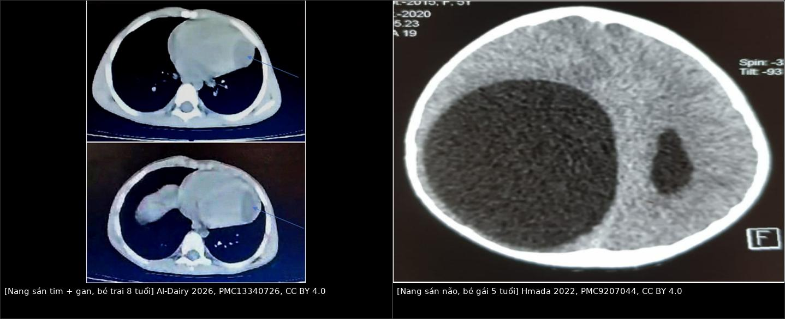
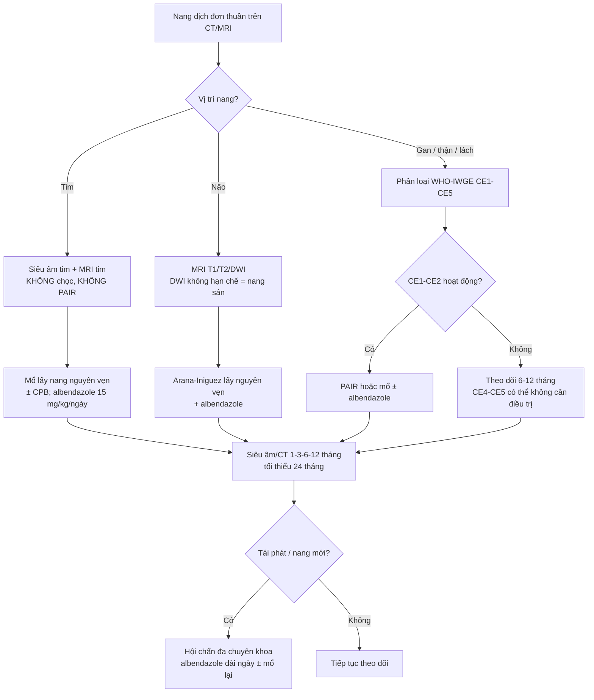
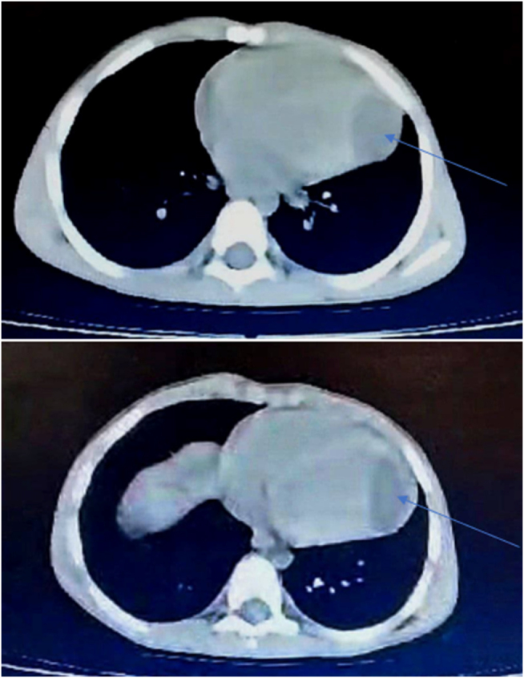
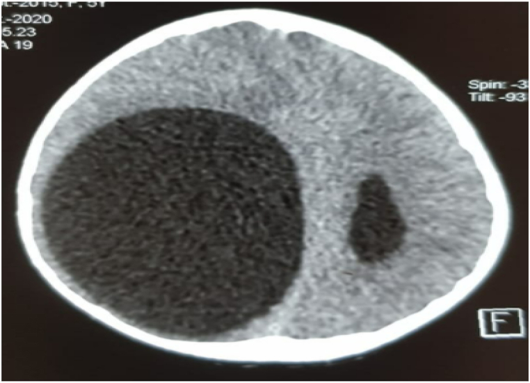
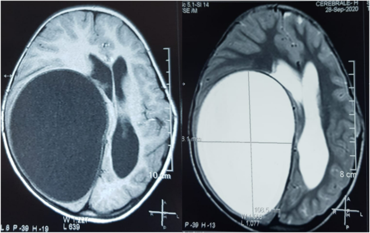
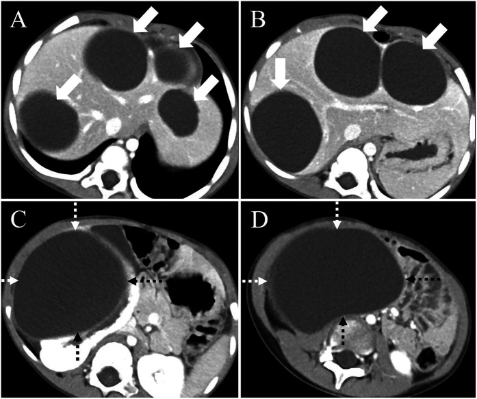

# 633 — Nang sán lá NGOÀI PHỔI ở trẻ: tim, não, thận, cơ–xương, mắt / Extrapulmonary hydatid cysts in children

**Tags:** `pattern:nang` `pattern:vo-nang` `pattern:da-co-quan` `vung:tim` `vung:nao` `vung:than` `vung:co-xuong` `vung:hoc-mat` `protocol:CT` `protocol:MRI` `score:WHO-IWGE-CE`
**Mức chắc chắn (certainty):** tổng hợp y văn (literature synthesis) — nhóm tự biên từ y văn mở (CC BY 4.0, CC BY-NC 4.0); các ca minh họa là **ca nguyên văn**, giữ đúng tuổi và mô tả của bài gốc.

> Đây là **bài anh em của [621 – Nang sán lá phổi ở trẻ](../621-nang-san-la-phoi-o-tre/lesson.md)** và **bước tiếp theo của [632 – Theo dõi dài hạn & tái phát nang sán](../632-theo-doi-dai-han-nang-san-tai-phat/lesson.md)**. 621 trả lời "nang ở **phổi**"; bài này trả lời câu hỏi hay bị bỏ sót: **khi nang nằm ngoài phổi — tim, não, thận, cơ, xương, hốc mắt — thì hình ảnh khác gì, và vì sao "chọc dò" đổi từ thủ thuật điều trị thành tai biến chết người**. Nền tảng nang sán gan: [139 – Nang sán lá gan](../139-san-la-gan/lesson.md).

## 1. Tổng quan bệnh học – cơ chế hình ảnh

- **Tác nhân:** ấu trùng ***Echinococcus granulosus*** (bệnh nang sán — cystic echinococcosis). Chu kỳ **chó (vật chủ chính) – cừu/gia súc (trung gian)**; người nhiễm do nuốt **trứng** (rau sống, nước bẩn, tay bẩn khi chăn nuôi). Trẻ ở vùng chăn thả (Tây Tạng, Trung Á, Địa Trung Hải, Nam Mỹ, Việt Nam) là nhóm nguy cơ.
- **Đường đi quyết định "vì sao đa cơ quan":** trứng nở ở ruột non → ấu trùng vào **tĩnh mạch cửa** → **gan là bộ lọc đầu tiên** (63%) → một phần qua gan vào **phổi** (25%) → **~10% vượt được phổi vào đại tuần hoàn** và gieo tới **cơ (5%), xương (3%), thận (2%), lách (1%)**; **tim 0,02–2%**, **não 1,7%** [PMC11205266; PMC12751996; PMC9207044]. Vì vậy **thấy nang ở một cơ quan phải quét toàn thân**: trong 22 ca nang tim/màng tim, **63,4% có nang ở cơ quan khác** (phổi 40,9%, gan 36,4%) [BMC Cardiovasc Disord 2025, PMC12751996].
- **Ở trẻ, đa cơ quan lại HIẾM** dù nang mọc nhanh hơn: cơ quan nhỏ + hệ miễn dịch chưa hoàn chỉnh → thường **một cơ quan** [Front Pediatr 2025, PMC12313717]. Đừng vì "trẻ thì hiếm đa cơ quan" mà bỏ tầm soát.
- **TẠI SAO hình ảnh là "nang nước điển hình" (vật lý → tín hiệu):**
  - Dịch nang = **nước + muối + protein ít** → **T1 tối, T2 rất sáng, không ngấm cản quang**; trên CT **0–20 HU** (ca nang đồi thị đo **+16 HU**) [PMC11205266].
  - **Vỏ xơ (pericyst)** do **vật chủ** tạo → **ngấm thuốc mỏng thì muộn**, có thể **vôi hóa** (vôi hóa ngoại vi gặp **33%**, vôi hóa dày đặc **15%**) — dấu hiệu "của người, không của sán".
  - **Màng sán (endocyst)** không ngấm; khi bong khỏi vỏ → **dấu màng nổi (floating membrane)**; có **nang con (daughter cysts)** xếp ngoại vi → hình **"bánh xe" / "nang trong nang"**.
  - **Ở xương không có vỏ xơ** (xương đặc, không mô mềm bao quanh) → nang **không vôi hóa, không giới hạn rõ**, ăn dọc bè xương → **hình tiêu xương dễ nhầm lao/di căn**, đây là lý do nang xương "khó" nhất.
- **Ngưỡng định lượng nằm lòng (chỉ ghi số đã kiểm chứng):** dịch nang **0–20 HU** (ca đồi thị **+16 HU**); **vôi hóa ngoại vi 33%**, **vôi hóa dày đặc 15%**, **vách trong nang 25%**, **nang con 6%**, **màng nổi 5%** (187 ca) [Cureus 2024, PMC11205266]; nang gan **72 × 55 mm** đã chèn ép tĩnh mạch chủ dưới ở trẻ 5 tuổi [PMC12313717]. Theo dõi bằng **đường kính lớn nhất (mm)**, không ước lượng mắt.

*Trái: **nang dưới thượng tâm mạc đè thất trái** (mũi tên) ở bé trai **8 tuổi**, kèm **nhiều nang gan đã vôi hóa** — CT không cản quang (Al-Dairy A et al., Int J Surg Case Rep 2026, PMC13340726, CC BY 4.0). Phải: **nang sán não khổng lồ** vùng trán–thái dương–đỉnh phải, **dịch đồng nhất, không phù quanh, đẩy lệch đường giữa** ở bé gái **5 tuổi** (Hmada S et al., Ann Med Surg 2022, PMC9207044, CC BY 4.0). Ảnh ghép letterbox, giữ nguyên tỷ lệ.*

## 2. Mẫu hình + chẩn đoán phân biệt theo CƠ QUAN (Gamut)

- **TIM (0,02–2%) — nguy hiểm nhất vì vỡ là tử vong nhanh:** trong 18 ca nang tim, **thất trái 8, thất phải 5, vách liên thất 5**; màng tim 4/22 ca [PMC12751996]. Triệu chứng **đau ngực 50%, khó thở 22,7%, ho 18,2%** — hoàn toàn không đặc hiệu, nhiều ca **không triệu chứng tới khi vỡ**. Cơ chế chết: **vỡ vào khoang màng tim → chèn ép tim cấp**, vỡ vào buồng tim → **thuyên tắc phổi/hệ thống**, hoặc **sốc phản vệ** do rò dịch nang. **Điều trị = mổ** (20/22 ca mổ, **không tái phát**); 2 ca từ chối mổ **đều tử vong trong 1–2 năm** do biến chứng nang [PMC12751996].
- **NÃO (1,7%, 75% là TRẺ EM):** thường **một nang, trên lều, thùy đỉnh/bán cầu**, **không phù quanh**, không ngấm; bệnh cảnh **tăng áp lực nội sọ + liệt nửa người**, có thể động kinh. Kỹ thuật mổ **Arana–Iniguez (đẩy nước — hydropsion)** để lấy **nguyên vẹn** nang; **cấm chọc hút** [PMC9207044].
- **THẬN (2%):** nang **nhiều thùy**, đẩy cong **đài–bể thận**, có thể **vỡ vào đường niệu** (đái ra màng nang, đau quặn); dễ bị gọi nhầm là **nang đơn** rồi **chọc xơ hóa** — sai lầm gieo rắc. Trong ca trẻ 5 tuổi: nang gan lớn nhất **72 × 55 mm** chèn ép tĩnh mạch chủ dưới + nang thận phải lớn [PMC12313717].
- **CƠ (5%):** khối **mềm, đau âm ỉ, không sốt**; nang **dịch đồng nhất trong bụng cơ**, có thể có **nang con**; dễ nhầm **áp-xe cơ (psoas)/tụ máu/u mô mềm**.
- **XƯƠNG (3%):** hay ở **cột sống, xương chậu, xương dài**; **tiêu xương bờ không rõ, không vôi hóa, không phản ứng màng xương**, có thể **xẹp đốt sống** và **chèn ép tủy**; dễ nhầm **lao cột sống (Pott), di căn, u xương**.
- **LÁCH (1%), TỤY, TUYẾN GIÁP, HỐC MẮT (rất hiếm, ca lẻ):** khối nang đơn độc; hốc mắt gây **lồi mắt một bên** ở trẻ → phân biệt **nang bì (dermoid), nang coloboma, u mô mềm**.
- **Gợi nhớ thứ tự tần suất:** **Gan → Phổi → Cơ → Xương → Thận → Lách → Tim → Não** (63 – 25 – 5 – 3 – 2 – 1 – <2 – ~2%).

## 3. Bảng so sánh phân biệt (ma trận đối chiếu)

| Thực thể (entity) | Hình ảnh điển hình | Chốt vào (rule-in) | Chốt loại (rule-out) | Gợi ý xác nhận |
|---|---|---|---|---|
| **Nang sán TIM** | Nang **dịch đồng nhất trong cơ tim**, thường **thất trái/dưới thượng tâm mạc**, thành mỏng, **không ngấm**, ± nang con | **Nang trong cơ tim + nang ở gan/phổi + dịch tễ** | Nang **nằm ngoài cơ tim, ngấm thành dày** → nang màng ngoài tim/u | **Siêu âm tim đầu tay**; MRI tim T2; CT có cản quang |
| **Nang màng ngoài tim / nang phế quản trung thất** | Nang **ngoài cơ tim**, thành mỏng, ranh giới với cơ tim rõ | **Mặt phẳng tách được khỏi cơ tim mọi thì** | **Nang nằm trong thành cơ tim, di động theo thành tim** → nang sán tim | MRI cine; siêu âm |
| **Nang sán NÃO** | Nang **dịch, HU 0–20, thành mỏng đều, KHÔNG phù quanh, không ngấm**, đẩy lệch đường giữa | **Nang lớn không phù quanh + tăng áp lực nội sọ ở trẻ vùng dịch tễ** | **Phù quanh rõ + thành ngấm + sốt** → áp-xe; **hạn chế khuếch tán** → áp-xe/mủ | MRI T1/T2/**DWI**; CT; huyết thanh |
| **Nang màng nhện (arachnoid cyst)** | Nang **dịch = dịch não tủy**, bờ mỏng, **không đè lệch nhiều**, hay ở hố thái dương | **Tín hiệu trùng hoàn toàn dịch não tủy mọi chuỗi + không vỏ** | **Có vỏ/màng + đẩy lệch mạnh + nang con** → nang sán | MRI cắt mỏng; so tín hiệu với dịch não tủy |
| **U tế bào hình sao dạng nang (cystic astrocytoma)** | Nang + **phần đặc ngấm thuốc**, phù quanh | **Có thành phần đặc ngấm + phù** | **Nang thuần dịch, không phần đặc, không phù** → nang sán | MRI + cản quang; mô bệnh |
| **Nang sán THẬN** | Nang **nhiều thùy** vỏ thận, đẩy cong đài–bể thận, ± vôi hóa vỏ | **Nang nhiều thùy + nang gan + huyết thanh dương** | **Nang đơn thành mỏng ngoại vi (Bosniak I)** → nang đơn | Siêu âm + CT; **không chọc khi chưa loại nang sán** |
| **K thận dạng nang (cystic RCC)** | Thành **dày, ngấm, vách/nốt trong nang**, canxi hóa không đều | **Thành/vách ngấm > 1 mm hoặc nốt đặc trong nang** | **Thành mỏng không ngấm, dịch đồng nhất** → nang lành/nang sán | CT đa thì; Bosniak; mô bệnh |
| **Nang sán CƠ** | Khối **dịch trong bụng cơ**, có nang con, **không phù mô mềm quanh** | **Nang dịch + nang con + dịch tễ** | **Phù quanh + ngấm viền + sốt** → áp-xe cơ | Siêu âm/CT/MRI; huyết thanh |
| **Nang sán XƯƠNG** | **Tiêu xương bờ không rõ, không vôi hóa, không màng xương**, có thể xẹp đốt sống | **Tiêu xương + nang mô mềm cạnh + dịch tễ** | **Hẹp đĩa đệm + phá hủy 2 thân đốt + áp-xe lạnh** → lao; **bờ phá xương rộng, đa ổ** → di căn | MRI cột sống; sinh thiết khi không chắc |

## 4. Protocol + phân loại WHO-IWGE + đường điều trị

- **Chụp gì, theo thứ tự:**
  - **Tim:** **siêu âm tim là đầu tay** (nang, vị trí, chèn ép) → **MRI tim T2** khi cần phân biệt trong/ngoài cơ tim; **CT ngực có cản quang** cho Canxi hóa, tương quan mạch vành.
  - **Não:** **MRI sọ T1 + T2 + DWI** (không cản quang nếu chỉ tìm nang); **CT** khi cấp cứu/tăng áp lực nội sọ. **DWI là chốt loại áp-xe**: nang sán **không hạn chế khuếch tán**, áp-xe **hạn chế (ADC thấp)**.
  - **Bụng/thận:** **siêu âm bụng** (phân loại WHO-IWGE) → **CT bụng 3 thì**; **MRI/MRCP** khi nang gần đường mật.
  - **Toàn thân:** **CT ngực–bụng** một lần khi phát hiện nang tim/não, vì **63,4%** có nang thứ hai [PMC12751996].
- **Xét nghiệm:** **ELISA/kháng thể IgG** hỗ trợ — **âm tính KHÔNG loại trừ** (nang còn nguyên vỏ, nang xương, nang não thường âm tính); theo dõi **hiệu giá** sau điều trị [632](../632-theo-doi-dai-han-nang-san-tai-phat/lesson.md).
- **Phân loại WHO-IWGE (CE1–CE5)** quyết định can thiệp — dùng chung cho gan/thận/lách:
  - **CE1** nang đơn, **CE2** đa thùy/nang con → **hoạt động**;
  - **CE3a** màng trong bong, **CE3b** đặc chủ yếu + nang con → **chuyển tiếp**;
  - **CE4** đặc, **CE5** vôi hóa → **không hoạt động**.
- **Điều trị (nguyên tắc "không chọc vào nang nguyên vẹn ở tim/não"):**
  - **Albendazole 15 mg/kg/ngày** (tối đa **800 mg/ngày**), **2 tuần trước mổ**, tiếp **3 tháng sau mổ**, **theo dõi men gan hàng tuần** [PMC13340726]. Ca trẻ 5 tuổi đa cơ quan: hội chẩn đa chuyên khoa, **cắt vỏ nang (pericystectomy) bảo tồn cơ quan**, tránh kẹp mạch gan vì trẻ nhỏ [PMC12313717].
  - **Tim:** mổ tim hở lấy nang; **tuần hoàn ngoài cơ thể (CPB)** khi tụt huyết áp lúc bộc lộ nang (đã gặp trong ca 8 tuổi) [PMC13340726].
  - **Não:** **lấy nguyên vẹn bằng kỹ thuật Arana–Iniguez**, không làm vỡ; albendazole sau mổ [PMC9207044].
  - **PAIR (chọc–hút–bơm–hút lại)** chỉ dùng cho **gan/thận/lách CE1–CE2 chọn lọc**, có albendazole kèm; **chống chỉ định tuyệt đối với nang tim và nang não**.
- **Theo dõi:** khám + siêu âm/CT tại **1, 3, 6, 12 tháng rồi mỗi 6–12 tháng**, tối thiểu **24 tháng** (ca 8 tuổi lên lịch 24 tháng) [PMC13340726]; tái phát thường **trong 2–3 năm đầu**.

> **Đọc flowchart:** nhánh **tim/não** không bao giờ đi qua PAIR — đây là điểm khác biệt cốt lõi so với nang gan (bài 139) và nang phổi (bài 621).

## 5. Biến thể bình thường và cạm bẫy

- **Nang sán não "sạch" (không phù quanh)** bị coi là nang lành → **chọc dẫn lưu** → vỡ, gieo rắc màng sán, viêm màng não kéo dài. **Quy tắc: nang não một bên, không phù, ở trẻ vùng dịch tễ = cấm chọc.**
- **Nang thận bị nhầm nang đơn** → chọc xơ hóa bằng cồn: cồn vào nang sán gây **kích ứng, sốc phản vệ, tái phát**. Trước khi chọc bất kỳ nang thận nào: **hỏi dịch tễ + siêu âm tìm nang con + quét gan**.
- **Tăng natri máu thoáng qua sau mổ** do **dung dịch NaCl ưu trương diệt đầu sán** tràn vào tuần hoàn — theo dõi điện giải 24–48 giờ đầu [PMC12313717].
- **Nang nhỏ (< 1 cm)** có thể **bỏ sót** trên CT lát dày → dùng **lát ≤ 1 mm** ở gan/thận và **MRI** cho não; đừng kết luận "chỉ một nang" sau một lần chụp.
- **Nang xương không vôi hóa** nên dễ bị loại khỏi chẩn đoán phân biệt — nếu **tiêu xương + nang mô mềm cạnh + dịch tễ**, phải nghĩ nang sán dù không có vôi hóa.
- **Trẻ em = ALARA:** ưu tiên **siêu âm + MRI** cho bụng/não; CT chỉ khi cần xương hoặc cấp cứu. Một CT ngực–bụng "tầm soát toàn thân" chỉ nên làm **một lần** khi đã xác định nang tim/não.
- **Đừng quên mắt/hốc mắt:** lồi mắt một bên ở trẻ vùng chăn nuôi — thêm nang sán vào gamut cạnh **dermoid, nang coloboma** ([450 – Mắt nhi](../450-mat-nhi/lesson.md)).

## 6. Tự lượng giá — Blind Quiz

**Ca 1 — Bé trai 8 tuổi, đau bụng + nôn + ho khan. Nhìn CT ngực, mô tả trước khi đọc đáp án.**

- Hỏi: tổn thương nằm **trong hay ngoài cơ tim**? Có ngấm thuốc không? Cơ quan thứ hai ở đâu? Vì sao **không được chọc hút**?

<b>Bấm để hiện đáp án</b>

- **Nang dưới thượng tâm mạc đè thất trái** (mũi tên), thành mỏng, **dịch đồng nhất, không ngấm**; lát cắt dưới thấy **nhiều nang gan đã vôi hóa** → **nang sán tim + gan đồng thời** ở trẻ **8 tuổi**.
- Chọc hút → **vỡ nang, chèn ép tim cấp, thuyên tắc, sốc phản vệ** → đây là chỉ định **mổ**, không phải can thiệp qua da.
- Xử trí thực tế của ca: **albendazole 15 mg/kg/ngày × 2 tuần trước mổ** → mổ bóc nang tim (tụt huyết áp khi bộc lộ → **CPB**), **1 tháng sau mổ nang gan**, albendazole tiếp **3 tháng**, theo dõi **24 tháng**.
- Nguồn: Al-Dairy A et al., *Int J Surg Case Rep* 2026, **PMC13340726**, CC BY 4.0.

**Ca 2 — Bé gái 5 tuổi, đau đầu tăng dần + liệt nửa người. CT sọ không cản quang:**

- Hỏi: 3 chẩn đoán phân biệt? Dấu hiệu nào **loại áp-xe**? Kỹ thuật mổ?

<b>Bấm để hiện đáp án</b>

- **Nang lớn dịch đồng nhất, thành mỏng, KHÔNG phù quanh, đẩy lệch đường giữa** → nang sán não; phân biệt **nang màng nhện**, **u tế bào hình sao dạng nang**, **áp-xe não**.
- **Loại áp-xe:** không phù quanh, không ngấm viền, và trên MRI **DWI không hạn chế khuếch tán** (áp-xe hạn chế).

- MRI cùng bệnh nhân: **trái T1 tối, phải T2 rất sáng** (nang ~**10,3 cm** theo thước đo trên ảnh), **không phần đặc ngấm** — đúng tín hiệu nang nước; hiệu ứng khối đẩy lệch đường giữa.
- Mổ **lấy nguyên vẹn bằng kỹ thuật Arana–Iniguez (đẩy nước)**, không chọc; albendazole sau mổ. Bệnh nhân hồi phục, CT kiểm tra còn **khoang tồn dư**.
- Nguồn: Hmada S et al., *Ann Med Surg* 2022, **PMC9207044**, CC BY 4.0.

**Ca 3 — Bé trai 5 tuổi vùng chăn nuôi, khối bụng phải 5 cm, không sốt:**

- Hỏi: A/B là gì, C/D là gì? Vì sao **không gọi đây là nang đơn**? Biến chứng nội khoa cần theo dõi sau mổ?

<b>Bấm để hiện đáp án</b>

- **A/B: nhiều nang gan** (lớn nhất **72 × 55 mm**) chèn ép tĩnh mạch chủ dưới; **C/D: nang thận phải khổng lồ** đẩy lệch đài–bể thận.
- Không phải nang đơn vì **nhiều thùy, vỏ dày, không ngấm, kèm nang gan + ELISA dương** → **nang sán đa cơ quan**; chọc xơ hóa sẽ gieo rắc.
- Điều trị: hội chẩn đa chuyên khoa → **cắt vỏ nang bảo tồn cơ quan** cả gan và thận; theo dõi **tăng natri máu thoáng qua** sau mổ.
- Nguồn: Zhou Q, Xia Y, Zou H., *Front Pediatr* 2025, **PMC12313717**, CC BY 4.0.

## Bài liên quan chéo
- [621 – Nang sán lá phổi ở trẻ](../621-nang-san-la-phoi-o-tre/lesson.md) (dấu hoa súng, Cumbo)
- [632 – Theo dõi dài hạn & tái phát nang sán](../632-theo-doi-dai-han-nang-san-tai-phat/lesson.md)
- [139 – Nang sán lá gan](../139-san-la-gan/lesson.md) (PAIR, phân loại WHO-IWGE)
- [150 – Nang thận & Bosniak](../150-nang-than-Bosniak/lesson.md) (phân biệt nang đơn)
- [151 – U thận đặc](../151-u-than-dac/lesson.md) (K thận dạng nang)
- [450 – Mắt nhi](../450-mat-nhi/lesson.md) (lồi mắt một bên ở trẻ)

> Không dùng để chẩn đoán độc lập khi chưa có người hướng dẫn.
