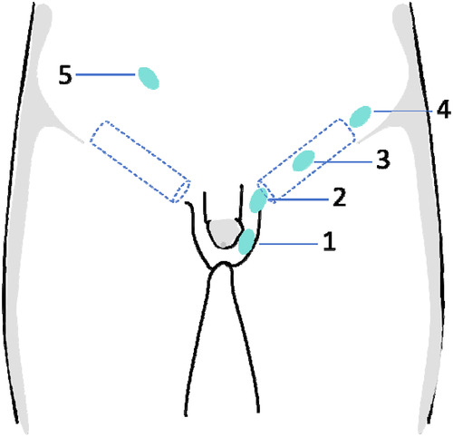
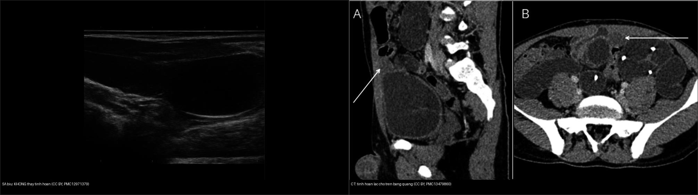
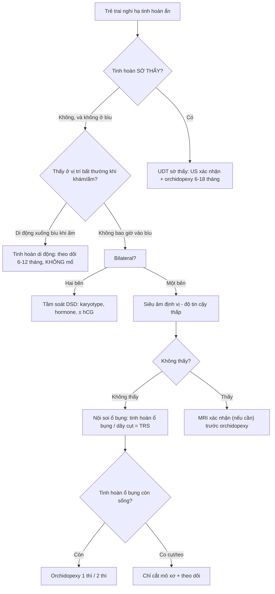
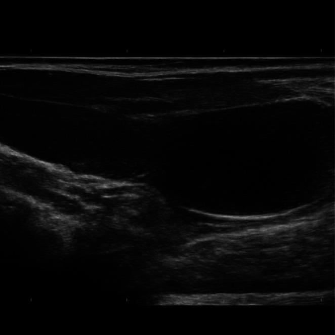
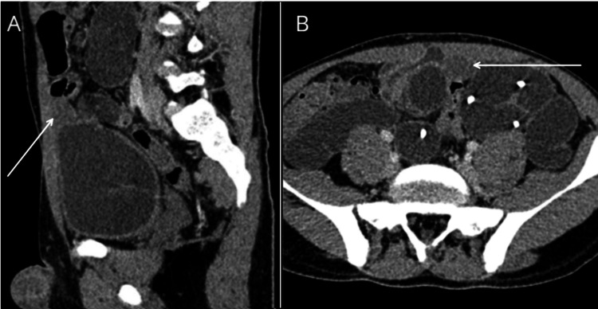
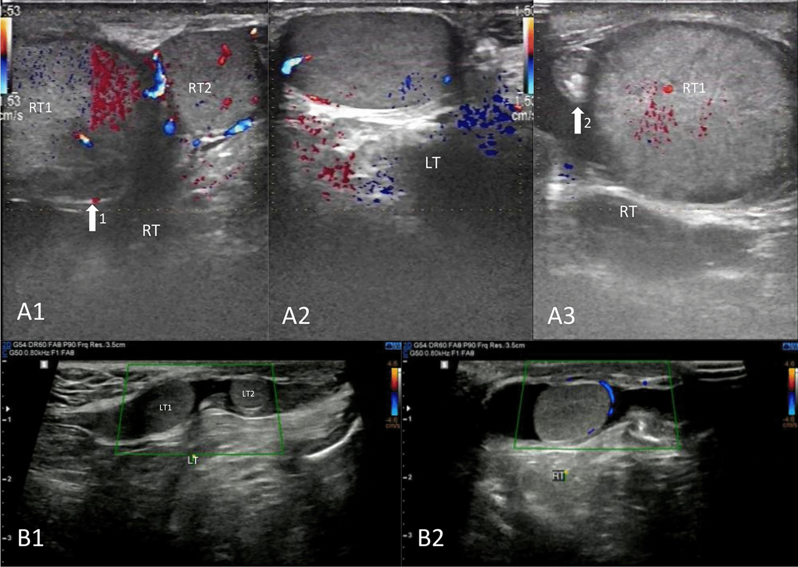
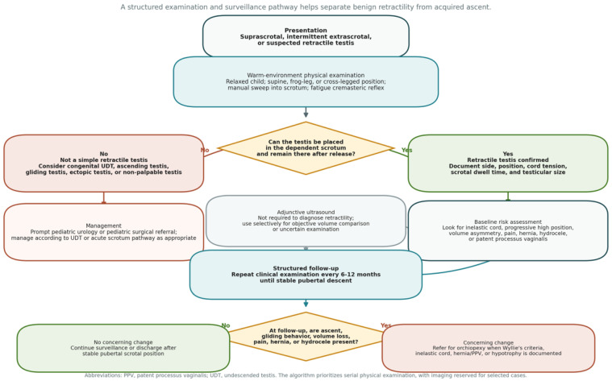

# 634 — Hạ tinh hoàn ẩn & tinh hoàn không sờ thấy / Cryptorchidism & the non-palpable testis

**Tags:** `pattern:tinh-hoan-khong-xuong` `pattern:tinh-hoan-khong-so-thay` `pattern:tinh-hoan-lac-cho` `vung:biu-tinh-hoan-nhi` `vung:ben-bung` `protocol:sieu-am-biu` `protocol:MRI-chau` `protocol:noi-soi-o-bung`
**Mức chắc chắn (certainty):** tổng hợp y văn (literature synthesis) — số liệu lấy từ tổng quan/cohort truy cập mở (PMC13204224, PMC13467042, PMC12929493) + 2 ca nguyên văn minh họa (PMC13479860, PMC12971379); không tự suy diễn ngoài nguồn.

> Nối tiếp [638 – Khối bìu–tinh hoàn không đau](../638-khoi-biu-tinh-hoan-nhi/lesson.md) và [636 – Cấp cứu niệu–sinh dục nhi](../636-cap-cuu-nieu-sinh-duc-nhi/lesson.md) (xoắn tinh hoàn). Bài này phủ nhánh **tinh hoàn không xuống bìu / không sờ thấy**.

## 1. Tổng quan bệnh học – cơ chế hình ảnh

- **Hạ tinh hoàn ẩn (cryptorchidism / undescended testis – UDT):** tinh hoàn dừng lại dọc đường xuống bình thường (ổ bụng → ống bẹn → bìu), có thể **trong ổ bụng (intra-abdominal)**, **trong ống bẹn (canalicular)**, **ngoài lỗ bẹn ngoài/cạnh bìu (suprascrotal)** hoặc **lạc chỗ (ectopic)**.
- **Tần suất (định lượng):** ~ **1–9%** trẻ trai đủ tháng lúc sinh (Đan Mạch ~9% vs Phần Lan ~2,4% — dao động theo chủng tộc/môi trường), giảm còn **~1% ở tuổi 1** do **xuống tự phát chủ yếu trong 3–6 tháng đầu** (PMC13204224). Noninguinal ectopic < **1%** ca UDT.
- **TẠI SAO tinh hoàn không thấy được trên hình ảnh:**
  - Tinh hoàn là **mô đặc mềm nước**; trên siêu âm đầu dò cao tần nó là **cấu trúc hình bầu dục đồng nhất, hồi âm trung bình, có "trung thất tinh hoàn" (mediastinum testis) hồi âm dày** — dấu hiệu định vị trong ống bẹn/bìu.
  - **Trong ổ bụng**, tinh hoàn **nhỏ, teo (atrophic)** và bị **hơi ruột/bèo ruột che lấp** → siêu âm mất độ tương phản, dương tính giả do hạch/hơi; đây là lý do **siêu âm không đủ tin cậy**.
  - Trên **MRI**, tinh hoàn ổ bụng/teo hiện là **cấu trúc tròn–bầu dục T1 đồng nhất trung bình, T2 tăng tín hiệu** (mô giàu nước) nằm dọc đường đi của tinh hoàn — nhưng tinh hoàn **teo hết (vanishing)** thì **không có mô đặc** để thấy.

### Ngưỡng định lượng bắt buộc (Argon – cửa 1)
| Đại lượng | Ngưỡng | Nguồn |
|---|---|---|
| Tần suất UDT (đủ tháng lúc sinh) | **1–9%**; còn **~1% ở tuổi 1** | PMC13204224 |
| Siêu âm định vị tinh hoàn **không sờ thấy** | **Se ~45%, Sp ~78%** → không thay thế được nội soi ổ bụng | PMC13204224, PMC12929493 |
| Dương tính giả siêu âm trong hội chứng tinh hoàn thoái triển (TRS) | **27,9%** (12/43) | PMC12929493 |
| Tinh hoàn đối bên phì đại bù (TRS) | **0,86 ± 0,23 mL so 0,44 ± 0,14 mL** (< 24 tháng); **0,90 ± 0,44 so 0,57 ± 0,16 mL** (24–60 tháng), p < 0,05 | PMC12929493 |
| Thời điểm mổ hạ tinh hoàn (orchidopexy) | **trước 12 tháng, muộn nhất 18 tháng** | PMC13204224 |
| Nguy cơ ung thư tinh hoàn sau mổ | Tỉ suất **5,4** nếu mổ ≥ 13 tuổi vs **2,2** nếu mổ < 13 tuổi (cohort > 16.000 nam) | PMC13204224 |

- **Hệ quả nếu bỏ sót:** tăng nguy cơ **ung thư tế bào mầm** (qua tổn thương tiền ung thư **GCNIS – germ cell neoplasia in situ**), **vô sinh**, **xoắn** và **chấn thương** tinh hoàn. Mổ sớm cải thiện sinh tinh nhưng **không đưa nguy cơ ung thư về mức nền** → vẫn phải theo dõi suốt đời.

## 2. Mẫu hình + chẩn đoán phân biệt theo vị trí (Gamut)

- **Phân loại đầu tiên tại lâm sàng (quyết định cả đường đi hình ảnh):** **sờ thấy (palpable)** vs **không sờ thấy (non-palpable)**.
- **Sờ thấy được:** nằm trong **ống bẹn (intracanalicular)** hoặc **ngay ngoài lỗ bẹn ngoài (suprascrotal)**; **ổ bụng dưới da bẹn (superficial inguinal pouch / Dennis Browne pouch) là vị trí lạc chỗ hay gặp nhất**.
- **Không sờ thấy:** **trong ổ bụng (intra-abdominal ~5–10%)**, **cao trong ống bẹn**, **thiếu/teo (vanishing/absent)** — hoặc **hai bên mất tinh hoàn (anorchia)** và **rối loạn phát triển giới (DSD)**.
- **Ba "bệnh cảnh giả" cần loại trừ ngay (không phải UDT thật):**
  1. **Tinh hoàn di động (retractile testis):** tinh hoàn đã xuống bìu nhưng bị **phản xạ cơ bìu (cremasteric reflex)** kéo lên; **1,2–3,9% trẻ đi học**, hai bên ~1/3; **không mổ** — chỉ theo dõi 6–12 tháng (có thể "tăng cao" thành UDT mắc phải **2–50%**) (PMC13467042).
  2. **Tinh hoàn tăng cao mắc phải (ascending/acquired testis):** trước đây bìu, nay tụt cao do dây tinh dài/chùng → chuyển sang theo dõi như UDT.
  3. **Tinh hoàn thoái triển (testicular regression syndrome – TRS / vanishing testis):** teo từ trong bào thai; siêu âm kém tin cậy (dương tính giả **27,9%**).
- **Lạc chỗ ectopic:** bìu dưới da, vùng bẹn, đùi, đáy chậu, trước xương mu, bìu đối bên (hiếm nhất).

*Sơ đồ 5 vị trí: 1 bìu bình thường · 2 cạnh bìu (suprascrotal) · 3 trong ống bẹn · 4 lỗ bẹn trong · 5 ổ bụng. Nguồn: Xu Q et al., Front Pediatr 2026 (PMC13345882), CC BY 4.0.*

## 3. Bảng so sánh phân biệt (ma trận đối chiếu)

| Thực thể (entity) | Hình ảnh điển hình (US/CT/MRI) | Chốt vào (rule-in) | Chốt loại (rule-out) | Gợi ý xác nhận |
|---|---|---|---|---|
| **Tinh hoàn di động (retractile)** | Tinh hoàn **nằm bìu khi khám trong phòng ấm/nằm**, bị kéo lên khi lạnh/căng bụng; US hai bìu đối xứng | **Xuống bìu tự phát khi thư giãn/thủ thuật Valsalva (+)**; kích thước bình thường | Tinh hoàn **không bao giờ ở bìu** (ghi nhận kéo dài) → UDT thật | Khám lại 6–12 tháng; không chỉ định mổ |
| **Hạ tinh hoàn ẩn trong ống bẹn (palpable canalicular)** | US đầu dò thẳng cao tần: **bầu dục đồng nhất có mediastinum testis** trong ống bẹn; có mạch trên Doppler | **Sờ được + US thấy trong ống bẹn/ngoài lỗ bẹn ngoài** | Thấy trong bìu → không phải UDT | Mổ inguinal orchidopexy (6–18 tháng) |
| **Tinh hoàn trong ổ bụng (intra-abdominal, không sờ thấy)** | US thường **âm tính/không tin cậy (Se 45%)**; **MRI T2 tăng tín hiệu** dọc đường đi; CT ít dùng vì tia xạ | **MRI/nội soi ổ bụng thấy tinh hoàn ổ bụng** + mạch tinh (vas deferens) đi tới | **Thấy dây tinh hoàn cụt (blind-ending vas) + không có mô tinh hoàn** → TRS/thiếu | Nội soi ổ bụng = tiêu chuẩn (~100%) |
| **Tinh hoàn thoái triển (vanishing/TRS)** | US dương tính giả **27,9%** (đọc nhầm hạch/mô xơ là tinh hoàn); **tinh hoàn đối bên phì đại bù**, ưu thế **trái 74,4%** | **Nội soi: dây tinh cụt + mô xơ/hạt hemosiderin**; đối bên to bù | Có mô tinh hoàn đặc → không phải TRS | Mô bệnh (hemosiderin, vôi hóa nhỏ) |
| **Tinh hoàn lạc chỗ (ectopic)** | Khối mô mềm **ngoài ống bẹn** (dưới da bẹn, đùi, đáy chậu, trước xương mu); MRI dễ thấy | **Ngoài đường đi bình thường + không nằm bìu** | Nằm đúng đường ống bẹn → UDT thường | Mổ nếu phù hợp |
| **Nhiều tinh hoàn (polyorchidism — hiếm, ~86% trong bìu)** | US/MRI thấy **thêm tinh hoàn** (thường trong bìu); có thể kèm UDT cùng bên | **Thấy ≥ 3 tinh hoàn, có mô học tinh hoàn lành** | Một cấu trúc không có mô tinh hoàn → hạch/u | MRI để xác nhận vị trí trước mổ |

*Trái: siêu âm vùng bẹn trái — **KHÔNG thấy tinh hoàn trong bìu/ống bẹn**. Phải: CT — **tinh hoàn lạc chỗ trên bàng quang** (khối mô mềm bầu dục). Nguồn: Javaid MH et al., Clin Case Rep 2026 (PMC12971379, CC BY 4.0) + Bounouar O et al., Cureus 2026 (PMC13479860, CC BY 4.0); ảnh ghép letterbox.*

## 4. Protocol chụp + hệ phân độ/điểm + flowchart

- **Siêu âm (đầu tay khi tinh hoàn sờ thấy hoặc không sờ thấy):** đầu dò thẳng **7,5–15 MHz**, phòng ấm, gel ấm; **khám ở tư thế nằm rồi đứng/ngồi xổm** (bộc lộ tinh hoàn di động); quét dọc **ống bẹn, vùng bẹn, đáy chậu, đùi**; đo kích thước, mô tả **mediastinum testis**; Doppler màu/năng lượng so sánh hai bên.
  - **Giới hạn cốt lõi:** với tinh hoàn **không sờ thấy** Se chỉ **~45%**, Sp **~78%** → **không dùng để loại trừ**.
- **MRI (khi không sờ thấy, ổn định, cân nhắc trước nội soi):** T1 + T2 (fat-sat) + DWI, theo đường đi; thấy tinh hoàn teo/ổ bụng. Không dùng thường quy ở trẻ nhỏ (cần gây mê).
- **Không khuyến cáo CT** (tia xạ) và **không khuyến cáo hCG/GnRH** điều trị hạ tinh hoàn (hiệu quả 6–35%, dưới 20–30%) (PMC13204224).
- **Nội soi ổ bụng (laparoscopy):** **tiêu chuẩn vàng** định vị tinh hoàn ổ bụng/khẳng định thiếu (**gần 100%**); thấy **dây tinh hoàn cụt** = thiếu/TRS.
- **Thời điểm & theo dõi:** xuống tự phát có thể trong **3–6 tháng**; **chuyển chuyên khoa trước 6 tháng**; **mổ hạ tinh hoàn trước 12 tháng, muộn nhất 18 tháng**. Nếu **hai bên không sờ thấy** → tầm soát **DSD** (karyotype, testosterone/gonadotropin/MIS, ± hCG test).

## 5. Biến thể bình thường và cạm bẫy

- **Tinh hoàn di động (retractile) là cạm bẫy số 1** — dễ bị "mổ oan": phải khám lại trong **phòng ấm, tư thế nằm + ngồi xổm**, ghi rõ "đã từng thấy xuống bìu hay chưa". **Không bao giờ đọc là UDT nếu tinh hoàn xuống bìu được**.
- **"Peeping testis" (tinh hoàn thập thò):** tinh hoàn lên xuống ở lỗ bẹn ngoài, làm khó phân biệt hạ tinh hoàn thật — xem xu hướng theo thời gian.
- **Hạch bẹn** (lymph node) bị đọc nhầm là tinh hoàn: hạch **có rốn mỡ hồi âm dày + không có trung thất tinh hoàn**; tinh hoàn có **mạch/ngoại vi** trên Doppler.
- **Hơi/đám quai ruột** trong ổ bụng che lấp tinh hoàn trên siêu âm → **không loại trừ**; đừng kết luận "không có tinh hoàn" từ siêu âm.
- **Tinh hoàn teo nhỏ (vanishing)** có thể "biến mất" hoàn toàn; **siêu âm dương tính giả 27,9%** → cần nội soi/mô bệnh.
- **Chấn thương/xoắn tinh hoàn ổ bụng (intra-abdominal torsion)** có thể giả bệnh cảnh viêm ruột thừa/cấp bụng — nếu tinh hoàn không xuống bìu, **đau bụng cấp cần nghĩ xoắn tinh hoàn ổ bụng** (nối 636).
- **Cạm bẫy tia xạ:** trẻ nhỏ **không dùng CT bụng để tìm tinh hoàn không sờ thấy** (ALARA) khi MRI/nội soi thay thế được.

## 6. Tự lượng giá — Blind Quiz (Blind Quiz)

**Ca 1 — Bé trai, không sờ thấy tinh hoàn trái; siêu âm vùng bẹn/bìu trái (hình bên trái của ảnh ghép).**

- Gợi ý lâm sàng: trẻ có khối/u vùng bẹn trái, **không sờ thấy tinh hoàn trái**.
- Hỏi: Siêu âm thấy gì ở bìu trái? Có loại trừ được hạ tinh hoàn ẩn không? Bước tiếp theo?

<b>Bấm để hiện đáp án (findings + chẩn đoán)</b>

- Findings: **vùng bẹn trái/bìu không định vị được tinh hoàn** trong bìu.
- Chẩn đoán: **tinh hoàn không xuống bìu (không sờ thấy) ± thành phần khối kèm** — siêu âm **không loại trừ** được tinh hoàn ổ bụng/teo (Se ~45%). Bước tiếp: **nội soi ổ bụng** (tiêu chuẩn vàng), cân nhắc **MRI**.
- Nguồn ảnh: Javaid MH et al., *Clinical Case Reports* 2026 (PMC12971379), CC BY 4.0.

**Ca 2 — Bé trai 4 tuổi, không sờ thấy tinh hoàn trái; CT bụng (xem ảnh bên phải của ảnh ghép).**

- Gợi ý: đau bụng cấp, không sờ thấy tinh hoàn trái.
- Hỏi: Khối mô mềm nằm đâu? Chẩn đoán? Vì sao cần nghĩ tới xoắn?

<b>Bấm để hiện đáp án (findings + chẩn đoán)</b>

- Findings: **khối mô mềm hình bầu dục nằm trên và trước bàng quang (supravesical)** — phù hợp tinh hoàn lạc chỗ ổ bụng.
- Chẩn đoán: **tinh hoàn ổ bụng lạc chỗ (intra-abdominal ectopic testis)**, ca nguyên văn có **xoắn tinh hoàn ổ bụng** — vì tinh hoàn ổ bụng dễ xoắn (dây treo dài, không cố định) và có thể giả bệnh cảnh cấp bụng.
- Nguồn ảnh: Bounouar O et al., *Cureus* 2026 (PMC13479860), CC BY 4.0.
- **Phản biện:** CT dùng trong ca nguyên văn này; ở thực hành nhi khoa **hạn chế CT** — ưu tiên siêu âm/MRI/nội soi.

**Ca 3 — Bé trai 8 tuổi, vùng bẹn phải có "khối" nhưng bìu phải rỗng.**

- Hỏi: Có mấy tinh hoàn quan sát trên siêu âm? Vị trí? Chẩn đoán phân biệt?

<b>Bấm để hiện đáp án (findings + chẩn đoán)</b>

- Findings: **nhiều cấu trúc tinh hoàn (polyorchidism)** — tinh hoàn phải có **hai tinh hoàn**, cấu trúc phía trên **to và lệch vị trí trong ống bẹn**, kèm **hạ tinh hoàn ẩn bẹn** cùng bên; ổ trên còn **xoắn**.
- Chẩn đoán: **polyorchidism + hạ tinh hoàn ẩn ống bẹn (có xoắn)** — ca nguyên văn (Fang H et al., *Eur J Med Res* 2026).
- Nguồn ảnh: Fang H et al., 2026 (PMC12924418), **CC BY-NC-ND** — giữ nguyên bản, **không crop/ghép**.
- **Phản biện:** polyorchidism rất hiếm (86% trong bìu); không được nhầm với **hạch/u**, vì quyết định mổ bảo tồn khác hẳn.

**Ca 4 — Thuật toán tiếp cận tinh hoàn di động (không cần hình bệnh học).**

- Hỏi: Tinh hoàn "lúc có lúc không" ở bìu nên xử trí thế nào? Khi nào chuyển sang mổ?

<b>Bấm để hiện đáp án (findings + chẩn đoán)</b>

- Findings: tinh hoàn **xuống bìu được** khi khám trong phòng ấm/nằm, không xuống khi lạnh/căng bụng.
- Chẩn đoán: **tinh hoàn di động (retractile testis)** — **KHÔNG mổ**; theo dõi **6–12 tháng**; mổ chỉ khi **tinh hoàn không xuống đều / teo / "tăng cao" thành UDT mắc phải** (2–50%).
- Nguồn ảnh: Florou M et al., *J Clin Med* 2026 (PMC13467042), CC BY.

## Bài liên quan chéo
- [600 – Tổng quan Hệ Nhi khoa](../600-tong-quan-nhi-khoa/lesson.md)
- [636 – Cấp cứu niệu–sinh dục nhi (chấn thương thận & xoắn tinh hoàn)](../636-cap-cuu-nieu-sinh-duc-nhi/lesson.md)
- [638 – Khối bìu–tinh hoàn không đau ở trẻ (u tế bào mầm, nang biểu bì, varicocele)](../638-khoi-biu-tinh-hoan-nhi/lesson.md)
- [635 – Dị tật hệ tiết niệu nhi (SFU/VUR/PUV)](../635-di-tat-tiet-nieu-nhi-SFU-VUR-PUV/lesson.md)
- [639 – Khối thận đặc ở trẻ (Wilms/CMN/RCC)](../639-khoi-than-o-tre-wilms-cmn-rcc/lesson.md)

> Không dùng để chẩn đoán độc lập khi chưa có người hướng dẫn.
