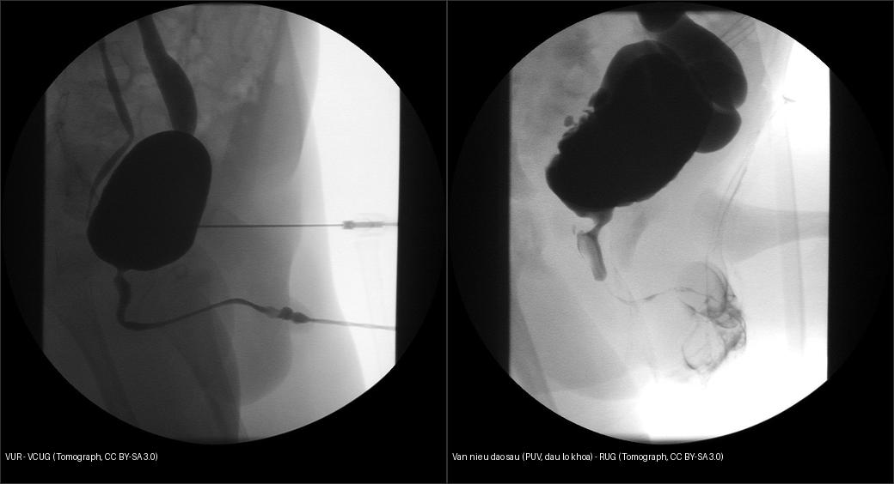
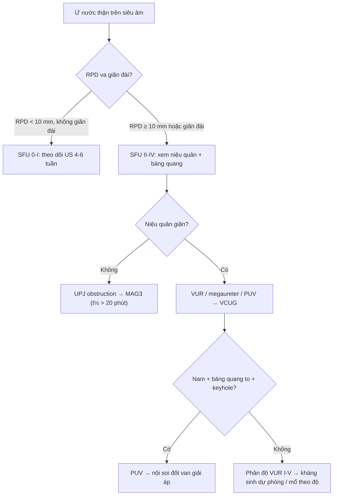
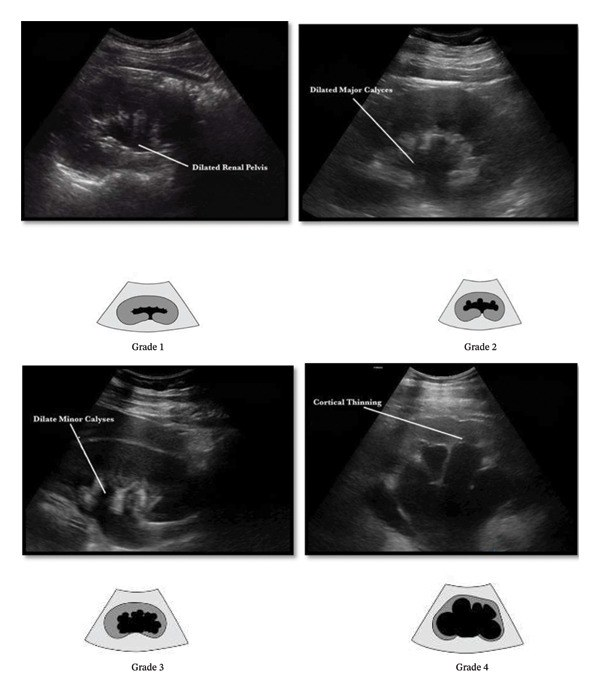
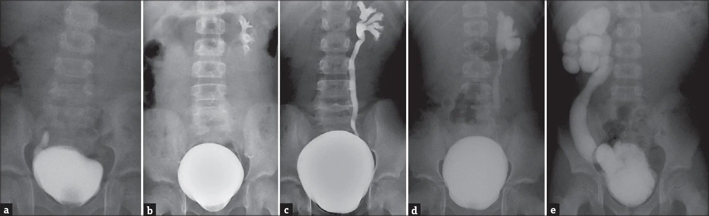

# 635 — Dị tật hệ tiết niệu nhi: ứ nước thận SFU 1–4, trào ngược VUR I–V & van niệu đạo sau (PUV)

**Tags:** `pattern:than-u-nuoc-nhi` `pattern:trao-nguoc-bang-quang-nieu-quan` `pattern:van-nieu-dao-sau` `vung:than-nieu-nhi` `score:SFU` `score:VUR` `protocol:sieu-am-than-nhi-VCUG`
**Mức chắc chắn (certainty):** tổng hợp y văn (literature synthesis) — nhóm tự biên từ y văn mở (hướng dẫn hội + bài review có số), chưa gắn ca nguyên văn đơn lẻ.

## 1. Tổng quan — vì sao siêu âm thấy ứ nước & trào ngược

- **Ứ nước thận (hydronephrosis)** = giãn bể thận (renal pelvis) và/hoặc đài thận (calyces) do **tăng áp lực** trong hệ niệu. Hai cơ chế lớn quyết định can thiệp:
  - **Tắc nghẽn (obstruction):** hẹp khúc nối bể-niệu quản (ureteropelvic junction obstruction, UPJO), van niệu đạo sau (posterior urethral valve, PUV) → cần giải áp/mổ.
  - **Trào ngược (vesicoureteral reflux, VUR):** van chỗ nối bàng quang-niệu quản (ureterovesical junction, UVJ) không đủ → nước tiểu trào lên khi đi tiểu → kháng sinh dự phòng/theo dõi.
- **TẠI SAO siêu âm thấy:** nước tiểu là môi trường **trống âm (anechoic)** kèm **tăng âm sau (posterior acoustic enhancement)**; bể thận/đài giãn tạo các ổ trống âm ở trung tâm thận. **Giãn KHÔNG đồng nghĩa tắc** — phải trả lời 3 câu: (1) bể thận có thông với đài không (nang đơn độc thì không thông); (2) **niệu quản có giãn kèm** không (→ trào ngược/megaureter/PUV); (3) **bàng quang** có bất thường không (thành dày/túi thừa/ổ niệu → nguyên nhân dưới).
- **Định lượng lòng — đường kính bể thận trước-sau (anteroposterior renal pelvic diameter, RPD):**
  - **Trước sinh:** ≥ 28 tuần thai RPD **≥ 4 mm**; ≥ 32 tuần **≥ 7 mm** = giãn bất thường (cần siêu âm lại sau sinh), **≥ 10 mm** = nguy cơ cao.
  - **Sau sinh:** RPD **< 10 mm** thường sinh lý; **10–15 mm** trung bình; **> 15 mm kèm giãn đài = nặng**; nguy cơ tắc/mổ tăng theo RPD.
- **SFU (Society for Fetal Urology, Fernbach 1993)** — phân độ ứ nước thận:
  - **SFU 0:** không giãn (ở nhũ nhi bể thận < 4 mm).
  - **SFU I:** chỉ giãn bể thận, **chưa giãn đài**.
  - **SFU II:** giãn bể + **vài đài**, nhu mô còn bình thường.
  - **SFU III:** giãn bể + **tất cả đài giãn**, nhu mô còn dày.
  - **SFU IV:** giãn bể + đài + **nhu mô mỏng/dẹt (cortical thinning)**.
  - Hệ hợp nhất mới **UTD (Urinary Tract Dilatation, Nguyen & ACR 2014)** gộp RPD + giãn đài + dày thành bể + giãn niệu quản + bất thường bàng quang → **UTD A1–A3 (trước sinh) / P1–P3 (sau sinh)** để chuẩn hóa theo dõi.
- **VUR** — phân độ **International Reflux Study Committee 1985** trên VCUG: **I** trào đến niệu quản (không giãn); **II** đến bể thận (không giãn); **III** giãn nhẹ niệu quản + đài; **IV** giãn vừa + đài tù; **V** giãn lớn/xoắn + đài tù + chèn ảnh nhu mô. VUR đưa vi khuẩn lên thận khi bàng quang co → **nhiễm khuẩn tiết niệu sốt = viêm thận–bể thận cấp**, dẫn tới **sẹo thận** rồi tăng huyết áp/suy thận. VUR độ thấp (I–II) phần lớn **tự khỏi theo tuổi**; độ cao (IV–V) + sốt tái diễn = can thiệp.
- **PUV (van niệu đạo sau)** — trẻ **nam**, màng van ở niệu đạo sau ngăn dòng tiểu: tắc đường ra → **bàng quang thành dày + túi thừa**, niệu quản–thận 2 bên giãn ("hội chứng bàng quang van", valve bladder syndrome). VCUG: **dấu lỗ khóa (keyhole sign)** = bàng quang to + niệu đạo sau giãn. **Creatinine đáy (nadir) sau giải áp > 0,8–1,0 mg/dL = nguy cơ cao** tiến triển bệnh thận mạn; điều trị chuẩn = **nội soi đốt van (valve ablation)**.

## 2. Mẫu hình + chẩn đoán phân biệt theo vị trí (gamut)

- **Ứ nước thận 1 bên:** hẹp khúc nối bể-niệu quản (UPJO — phổ biến nhất), VUR một bên, nang cạnh bể, nang đơn độc.
- **Ứ nước thận 2 bên:** PUV (nam), VUR hai bên, hẹp niệu đạo, bàng quang thần kinh.
- **Niệu quản giãn (hydroureter):** VUR, megaureter nguyên phát (tắc đoạn cắm UVJ), PUV.
- **Nang thận KHÔNG thông:** nang đơn độc; **thận loạn sản đa nang (multicystic dysplastic kidney, MCKD)** — "chùm nho" không nhu mô, không thông, teo dần, tiên lượng tốt; **bệnh thận đa nang lặn NST lặn (ARPKD)** — thận 2 bên to, dải xơ xuyên nhu mô.
- Đọc theo trục **trên → dưới** để không sót nguyên nhân: UPJO → megaureter/UVJ → VUR → **bàng quang (PUV/túi thừa)** → niệu đạo.

## 3. Bảng so sánh phân biệt (ma trận đối chiếu)

| Thực thể (entity) | Hình ảnh điển hình | Chốt vào (rule-in) | Chốt loại (rule-out) | Gợi ý xác nhận |
|---|---|---|---|---|
| Hẹp khúc nối bể-niệu quản (UPJO) | Ứ nước thận **1 bên**, đài giãn, **niệu quản rỗng** | **Niệu quản không giãn** + RPD > 15 mm | Niệu quản giãn → nghĩ VUR/megaureter | MAG3 furosemide (t½ **> 20 phút** = tắc) |
| Trào ngược VUR | Giãn niệu quản ± thận, bàng quang bình thường | **VCUG có trào ngược**; RPD **thay đổi đầy↔rỗng bàng quang** | Niệu quản không trào ngược → UPJO | VCUG phân độ I–V; DMSA tìm sẹo |
| Van niệu đạo sau (PUV) | Bàng quang to thành dày + niệu đạo sau giãn (nam) | **Dấu lỗ khóa (keyhole sign)** + nam + bàng quang thành dày | Nữ, hoặc niệu đạo bình thường → loại PUV | VCUG + nội soi đốt van |
| Megaureter nguyên phát | Niệu quản **giãn dài**, đoạn cắm UVJ hẹp | Niệu quản giãn tới giãn nhiều, **không trào ngược** | Có trào ngược → VUR | VCUG (loại VUR) + MAG3 |
| MCKD | Nhiều nang **không thông**, không thấy nhu mô | **Không có nhu mô chức năng** giữa các nang | Còn nhu mô quanh bể giãn → ứ nước | US chuỗi ± DMSA (thận câm) |
| Giãn bể thận sinh lý | Bể giãn nhẹ < 10 mm, đài **không giãn** | RPD **< 10 mm** + đài bình thường + ổn định | Tăng dần/RPD ≥ 10 mm + giãn đài → bệnh lý | US lặp lại sau 4–6 tuần |

*Trái: VUR trên VCUG — thuốc cản quang trào lên niệu quản giãn + bể thận. Phải: van niệu đạo sau (PUV) — bàng quang to + niệu đạo sau giãn tạo hình lỗ khóa. Nguồn: Tomograph, CC BY-SA 3.0. Ảnh ghép letterbox.*

## 4. Protocol chụp + hệ phân độ/điểm chuẩn hóa

- **Siêu âm thận–bàng quang (US KUB):** làm khi trẻ **> 48 giờ tuổi** (tránh giãn sinh lý sơ sinh); chụp **bàng quang đầy** để đo RPD (chỗ rộng nhất) + đài + độ dày nhu mô, rồi **sau khi đi tiểu (post-void)** để loại giãn do bàng quang căng; luôn khảo sát **bàng quang** (thành dày, túi thừa, ổ niệu).
- **VCUG (voiding cystourethrogram):** tiêu chuẩn vàng **phân độ VUR** + **đánh giá niệu đạo** (phát hiện PUV); chụp trong lúc trẻ đang đi tiểu.
- **DMSA (xạ hình vỏ thận):** phát hiện **sẹo thận** (vùng giảm/không bắt xạ khu trú) + chức năng riêng từng thận; **< 40% = giảm đáng kể**.
- **MAG3 (xạ hình thận):** chức năng + đánh giá tắc nghẽn: t½ sau lợi niệu furosemide **> 20 phút** gợi ý tắc nghẽn có ý nghĩa.
- Hệ điểm/phân độ: **SFU 0–IV** (siêu âm), **UTD A1–A3 / P1–P3** (Nguyen/ACR 2014), **VUR I–V** (IRSC 1985).

## 5. Biến thể bình thường và cạm bẫy

- **Giãn bể thận sinh lý:** sau bú (lợi niệu) hoặc khi bàng quang căng — **chụp lại sau đi tiểu** trước khi kết luận.
- **Cột Bertin (column of Bertin) phì đại giả khối** — thực chất là nhu mô vỏ bình thường; dùng hình thái + không đổi sau tiêm.
- **Nang cạnh bể thận (parapelvic cyst)** không thông với bể → **không thay đổi khi bàng quang đầy**; phân biệt với giãn đài.
- **VUR ẩn:** VUR độ thấp có thể có siêu âm **bình thường** → chỉ VCUG khi có nhiễm khuẩn tiết niệu sốt + bất thường US/NK.
- **Không bỏ qua bàng quang + niệu đạo** khi thấy thận giãn — nguyên nhân dưới bàng quang (PUV) nằm ngoài tầm nhìn của thận.
- **Hội chứng bàng quang van (valve bladder)** có thể tiến triển ứ nước/giảm chức năng **dù đã đốt van** → theo dõi dài hạn creatinine + chức năng bàng quang.

## 6. Tự lượng giá — Blind Quiz (ảnh trơn ngoài, đáp án ẩn trong khối chi tiết)

**Ca 1 — Bé trai 3 tháng, siêu âm thận phải giãn. Hãy phân độ SFU trước khi mở đáp án.**

- Gợi ý lâm sàng: khám định kỳ phát hiện giãn đường niệu trước sinh; không sốt.
- Câu hỏi: Bể + đài thận giãn; nhu mô còn dày hay đã mỏng? Ứng SFU độ mấy? Bước tiếp theo?

<b>Bấm để hiện đáp án (findings + chẩn đoán)</b>

- Bốn mức độ (trên→dưới): **Grade 1** chỉ giãn bể; **Grade 2** giãn bể + đài lớn; **Grade 3** giãn đài nhỏ; **Grade 4** **nhu mô mỏng (cortical thinning)**.
- **SFU I→IV** tương ứng: chỉ bể → vài đài → tất cả đài → **nhu mô mỏng**. Chốt độ nặng là **giãn đài + độ dày nhu mô**, không chỉ RPD.
- Bước tiếp: siêu âm lặp lại, đo RPD, xem niệu quản/bàng quang; nếu RPD lớn/tăng dần → MAG3 đánh giá tắc nghẽn.
- Nguồn ảnh: Bahroudi et al., Int J Nephrol 2026 (PMC13266088), CC BY 4.0.

**Ca 2 — Bé gái 2 tuổi, nhiễm khuẩn tiết niệu sốt, chụp MCUG. Các panel a–e thể hiện điều gì?**

- Gợi ý: đây là ảnh fluoroscopy lúc đi tiểu (micturating cystourethrogram).
- Câu hỏi: Dấu hiệu chốt để phân độ? Phân độ cao (IV–V) khác phân độ thấp ở điểm nào? DMSA dùng để làm gì?

<b>Bấm để hiện đáp án (findings + chẩn đoán)</b>

- Các panel **a→e = VUR độ I→V** (phân độ IRSC 1985): từ trào đến niệu quản không giãn, đến bể thận, rồi giãn niệu quản + đài và nặng nhất là xoắn/giãn lớn + đài tù.
- Chốt phân độ: **mức giãn niệu quản + đài và độ tù của đài** (không phải hướng dòng chảy).
- Độ cao IV–V kèm sốt tái diễn → kháng sinh dự phòng/`Deflux`/tái tạo; **DMSA** phát hiện **sẹo thận** (di chứng của viêm thận–bể thận).
- Nguồn ảnh: J Indian Assoc Pediatr Surg 2026 (PMC13614807), CC BY-NC-ND (giữ nguyên bản, không crop/ghép).

**Ca 3 — Bé trai sơ sinh, siêu âm giãn thận 2 bên + bàng quang thành dày; VCUG có dấu lỗ khóa.**

> Hình gợi ý: panel phải của ảnh ghép dưới (bàng quang to + niệu đạo sau giãn).

- Câu hỏi: Chẩn đoán? Vì sao phải xử trí cấp? Yếu tố tiên lượng chức năng thận?

<b>Bấm để hiện đáp án (findings + chẩn đoán)</b>

- **Van niệu đạo sau (PUV):** tắc nghẽn đường ra bàng quang ở **nam** → bàng quang thành dày + niệu đạo sau giãn (**keyhole sign**) + ứ nước 2 bên (thường kèm thiểu ối thai, loạn sản van thận).
- Xử trí cấp: **đặt catheter giải áp** rồi **nội soi đốt van**; theo dõi hội chứng bàng quang van.
- Tiên lượng: **creatinine đáy (nadir) sau giải áp > 0,8–1,0 mg/dL** = nguy cơ cao tiến triển bệnh thận mạn.
- Nguồn ảnh: Tomograph, Wikimedia Commons, CC BY-SA 3.0.

## Bài liên quan chéo
- [600 – Tổng quan Hệ Nhi khoa](../600-tong-quan-nhi-khoa/lesson.md)
- [622 – Tắc ruột sơ sinh](../622-tac-ruot-so-sinh/lesson.md) (double-bubble, microcolon)
- [630 – U bụng nhi (neuroblastoma vs Wilms)](../630-u-bung-nhi-neuroblastoma-vs-wilms/lesson.md) (khối thận ở trẻ)
- [640 – Háng nhi & NAT](../640-khop-hang-nhi-DDH-Perthes-SCFE-va-NAT/lesson.md)
- [150 – Nang thận & Bosniak](../150-nang-than-Bosniak/lesson.md) (nang thận ở người lớn)
- [411 – Siêu âm nhãn cầu](../411-sieu-am-nhan-cau/lesson.md) (nguyên lý siêu âm: trống âm/tăng âm sau)

## Ảnh
- Chi tiết nguồn + giấy phép từng ảnh: `images/CREDITS.md` và `sources.md`.
- Ảnh **CC BY-NC-ND** (MCUG phân độ VUR) giữ **nguyên bản**, không crop/ghép — chỉ dùng đứng riêng.

> Không dùng để chẩn đoán độc lập khi chưa có người hướng dẫn.
