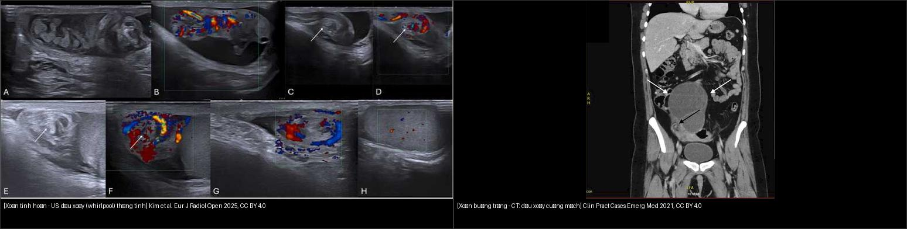
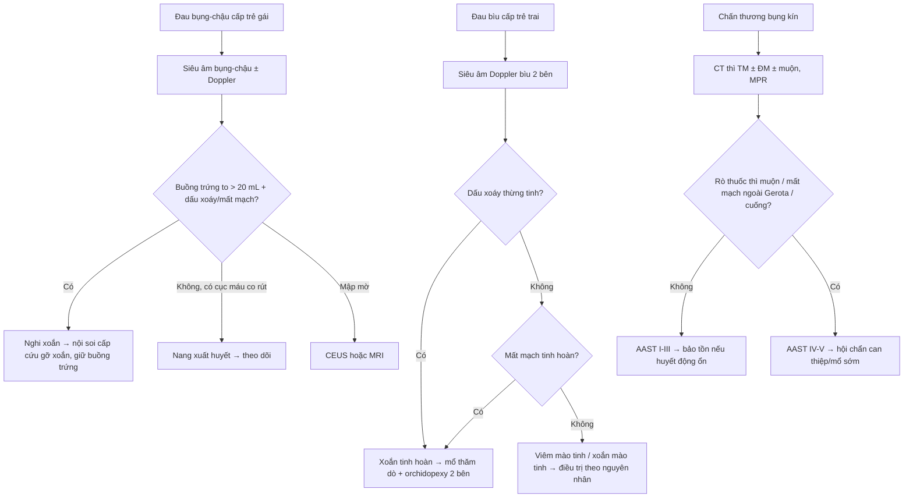
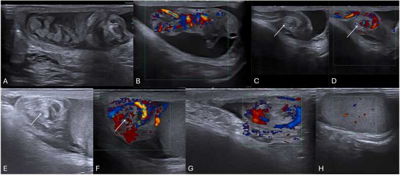
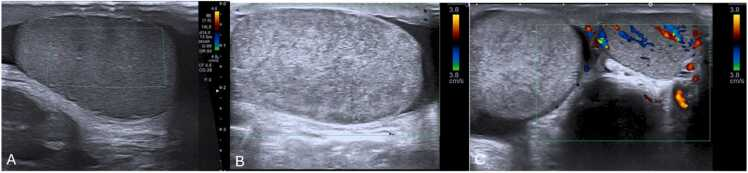
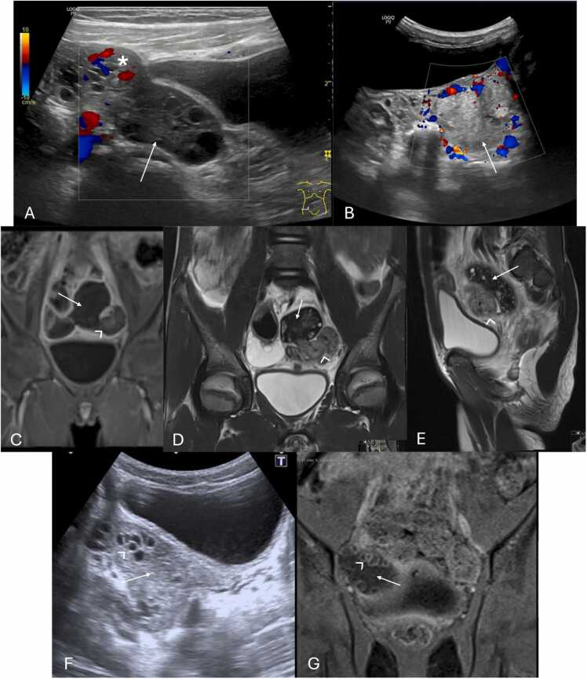
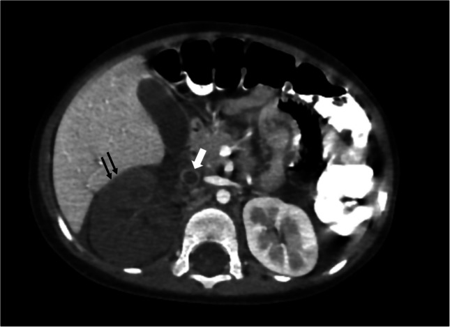

# 636 — Cấp cứu niệu–sinh dục nhi: chấn thương thận (AAST I–V) & xoắn tinh hoàn/buồng trứng (dấu xoáy)

**Tags:** `pattern:chan-thuong-than-nhi` `pattern:xoan-tinh-hoan` `pattern:xoan-buong-trung` `vung:than-nieu-nhi` `vung:sinh-duc-nhi` `score:AAST` `protocol:CT-bung-chap-nhanh` `protocol:sieu-am-Doppler`
**Mức chắc chắn (certainty):** tổng hợp y văn (literature synthesis) — nhóm tự biên từ y văn mở (review + guideline có số), chưa gắn một ca nguyên văn đơn lẻ; 4 ca quiz lấy từ các bài CC BY có số liệu mô tả nguyên văn.

> **Hai bệnh cảnh "cấp cứu niệu–sinh dục nhi" khác nhau về mặt cắt nhưng cùng luật:** tạng/tuyến bị **xoắn hoặc chấn thương làm gián đoạn tưới máu → cửa sổ cứu tạng tính bằng GIỜ**. Hình ảnh phải trả lời 2 câu: (1) **đang còn mạch hay không?** (2) **tổn thương còn khu trú hay đã mất mạch/tràn ra ngoài?** — không dừng ở mô tả hình thái.

## 1. Tổng quan — cơ chế & TẠI SAO ảnh hiện như vậy

**A. Chấn thương thận ở trẻ**

- Thận là **tạng bị chấn thương đứng thứ 3** ở trẻ (sau gan, lách) trong chấn thương bụng kín; trẻ **nhạy cảm hơn người lớn** vì thận to tương đối + ít mỡ quanh thận + lồng ngực/khoang bụng dưới sườn mềm, di động.
- Phần lớn chấn thương thận **kín, độ thấp (I–III)** và **điều trị bảo tồn**; nhưng tổn thương **cuống mạch (grade V)** phải can thiệp sớm để giữ thận.
- **TẠI SAO (vật lý CT có cản quang)** — phân biệt 3 thứ cùng "giảm tỷ trọng" nhưng bản chất khác nhau:
  - **Đụng dập (contusion):** phù/xuất huyết vi mô → giảm ngấm *thoáng qua*; **ngấm lại gần đồng tỷ trọng ở thì muộn** → chốt.
  - **Hoại tử/mất mạch (infarction/devascularization):** mạch bị tắc/huyết khối → **không ngấm ở MỌI thì** (thì ĐM, TM, muộn đều tối) — đây là điểm khác biệt duy nhất với đụng dập.
  - **Thoát thuốc hoạt tính (active extravasation):** máu đang chảy → ổ **tăng tỷ trọng lan rộng dần ra** giữa các thì; khác **giả phình (pseudoaneurysm)** = ổ tròn **giữ hình, không to thêm**, ngấm đồng thì với ĐM.
  - **Cục máu canh gác (sentinel clot) 45–70 HU** nằm sát nhu mô tổn thương nhất — vì cục máu đông **đặc nhất ở gần nguồn chảy**, loãng dần ra xa.
- **Ngưỡng tưới máu bao trùm tất cả:** chấn thương thận nặng **grade IV–V** nguy cơ thận câm; thận còn chức năng đòi hỏi **tưới máu lại trong vài giờ**, nên **không được để thì muộn làm chậm chuyển mổ**.

**B. Xoắn tinh hoàn (testicular torsion)**

- Cơ chế: **thừng tinh xoắn** → ứ máu tĩnh mạch → áp lực tĩnh mạch tăng tới **bằng áp lực động mạch** → ngừng tưới máu → hoại tử. Vì vậy **cửa sổ vàng tính bằng giờ**:
  - **< 12 giờ: cứu được ~90%**; **13–24 giờ: ~54%**; **> 24 giờ: chỉ ~18%** (giảm dần rất dốc).
  - Xoắn tinh hoàn chiếm **86%** các ca "bìu cấp" ở trẻ vị thành niên; tần suất **~25/100.000 nam < 25 tuổi**.
- **Hai kiểu treo bất thường:** **intravaginal** (trong bao tinh hoàn) do **dị dạng bell-clapper** (tinh hoàn xoay tự do trong bao) — tuổi dậy thì; **extravaginal** (ngoài bao) ở **sơ sinh** (70% trước sinh, 30% sau sinh; **tối đa 22% hai bên**).
- **Vì sao cần cố định bên đối diện:** nguy cơ xoắn **đồng thời/lệch thì ở bên còn lại ~40%** → orchidopexy cả hai bên.
- **TẠI SAO siêu âm thấy:** giai đoạn sớm (4–6 giờ đầu) nhu mô **còn đồng âm = còn sống**; sau đó phù → **giảm âm/không đồng nhất = nguy cơ hoại tử** (đồng nhất = còn sống, không đồng nhất = không còn sống).

**C. Xoắn buồng trứng/phần phụ (ovarian–adnexal torsion)**

- Cơ chế: cuống tử cung–buồng trứng xoắn → ứ máu, hoại tử. **Bên phải hay bị hơn** (manh tràng di động, đại tràng sigma cố định chặn bên trái).
- Ở trẻ **25% xoắn xảy ra trên buồng trứng BÌNH THƯỜNG** (dây chằng tử cung–buồng trứng dài, di động) — khác người lớn thường có khối kèm theo; khối kèm theo hay lành (nang, teratoma).
- **Tuổi 2 đỉnh:** năm đầu đời (nang do hormone mẹ) và quanh **menarche**.
- **Đau > 10 giờ → tăng nguy cơ hoại tử nhu mô** (mốc thời gian quyết định "còn cứu được").
- **TẠI SAO Doppler không được tin tuyệt đối:** buồng trứng có **nguồn cấp máu KÉP** (ĐM buồng trứng + ĐM tử cung) → xoắn vẫn có thể **còn thấy phổ mạch**.

## 2. Mẫu hình + chẩn đoán phân biệt theo vị trí (gamut)

- **Đau bìu cấp (acute scrotum) ở trẻ trai:** xoắn tinh hoàn → viêm mào tinh (epididymitis) → xoắn mào tinh (testicular appendage) → thoát vị bẹn nghẹt → viêm tinh hoàn do quai bị.
- **Đau bụng–chậu cấp ở trẻ gái:** xoắn buồng trứng/phần phụ → nang xuất huyết (mimic hay gặp nhất) → áp-xe vòi–buồng trứng → u buồng trứng xoắn/hoại tử → thai ngoài tử cung → viêm ruột thừa (nhất là nhũ nhi với xoắn "lệch chỗ").
- **Chấn thương thận:** phân lớp theo **AAST 2018** (I–V) trên CT; đọc song song **nhu mô (rách/đụng dập) + tụ máu quanh thận (trong/ngoài Gerota) + hệ đài–bể (rò nước tiểu) + mạch (nhồi máu/thoát thuốc/cuống)**.
- **Nguyên tắc vàng nhi khoa:** ở trẻ, **điều trị dựa trên huyết động** chứ không chỉ vào độ AAST — trẻ **ổn định được điều trị bảo tồn dù độ cao** (AAST chủ yếu định hướng theo dõi/nghỉ vận động).

## 3. Bảng so sánh phân biệt (ma trận đối chiếu)

| Thực thể (entity) | Hình ảnh điển hình | Chốt vào (rule-in) | Chốt loại (rule-out) | Gợi ý xác nhận |
|---|---|---|---|---|
| Xoắn tinh hoàn | Tinh hoàn to, **mất/giảm mạch**, **dấu xoáy (whirlpool) thừng tinh**, RI > 0,75 sớm | **Dấu xoáy thừng tinh (Se 92%/Sp 99%)** + mất mạch bất đối xứng | Mào tinh to **tăng mạch** + RI thấp → viêm mào tinh | Siêu âm Doppler bìu; nếu nghi ngờ → **mổ thăm dò, không trì hoãn vì chờ ảnh** |
| Viêm mào tinh (epididymitis) | Mào tinh to, đồng/giảm âm nhẹ, **tăng mạch**, RI thấp | **Tăng phổ mạch mào tinh** + mạch tinh hoàn bình thường | Mất mạch + whirlpool → xoắn | Doppler + bệnh sử (nhiễm trùng, tiểu buốt) |
| Xoắn mào tinh (appendage torsion) | Khối tròn **ngoài tinh hoàn**, không đồng nhất, **mạch tinh hoàn còn** | **Blue dot sign** + mạch tinh hoàn bình thường | Mất mạch trong tinh hoàn → xoắn tinh hoàn | Doppler; điều trị bảo tồn |
| Xoắn buồng trứng | Buồng trứng to **> 20 mL** (bất đối xứng), nhu mô không đồng nhất, **mất mạch**, **dấu xoáy cuống**, buồng trứng "lệch chỗ" (giữa/đối bên) | **Dấu xoáy cuống mạch (Se 65%/Sp 91%)** ± mất mạch | Có "retractable clot sign"/nang xuất huyết không có cuống xoáy → nang xuất huyết | Siêu âm Doppler (transabdominal ở trẻ); MRI/CEUS khi mập mờ |
| Nang buồng trứng xuất huyết (mimic) | Khối lớn, lệch âm phức tạp, **cục máu co rút (retractable clot)**, không mạch | **Cục máu co rút** + không dấu xoáy + đỡ đau theo dõi | Thấy **dấu xoáy cuống** → xoắn | Theo dõi siêu âm; nội soi khi vẫn nghi xoắn |
| Chấn thương thận AAST I–III | Đụng dập/tụ máu dưới bao; rách ≤ 1 cm (II), **> 1 cm không vào hệ đài** (III); mạch **trong Gerota** | **Rách > 1 cm, KHÔNG rò nước tiểu** + tụ máu trong Gerota | Rò thuốc thì muộn (vào hệ đài) → **grade IV** | CT cản quang thì TM ± thì muộn |
| Chấn thương thận AAST IV | Rách **vào hệ đài–bể** (rò nước tiểu), rách UPJ, mạch **lan ra ngoài Gerota**, **nhồi máu phân thùy** | **Thoát thuốc thì muộn = rò nước tiểu** hoặc mất mạch vượt Gerota | Không rò + tụ máu khu trú → grade III | CT 3 thì (ĐM/TM/muộn); MPR |
| Chấn thương thận AAST V | Thận **vỡ nát**, **cuống mạch đứt**, tắc/đứt ĐM–TM thận chính, mất mạch toàn thận | **Không ngấm toàn bộ nhu mô + huyết khối cuống** | Còn ngấm một phần (có ĐM phụ) → không phải V | CT; lưu ý tổn thương **cuống mạch** cần can thiệp sớm |

*Trái: siêu âm bìu — dấu xoáy (whirlpool) của thừng tinh xoắn. Phải: CT — dấu xoáy cuống mạch của buồng trứng xoắn. Nguồn: Freitas et al. Eur J Radiol Open 2025 (CC BY 4.0) + Livingston et al. Clin Pract Cases Emerg Med 2021 (CC BY 4.0). Ảnh ghép letterbox.*

## 4. Protocol chụp + hệ phân độ/điểm chuẩn hóa

- **CT bụng–chậu chấn thương (ưu tiên ALARA):** phần lớn trẻ đủ với **một thì tĩnh mạch (portal venous)**; thêm **thì động mạch** khi nghi tổn thương mạch (thoát thuốc/giả phình/mất mạch), và **thì muộn (delayed 5–10 phút)** khi nghi **rò nước tiểu** (grade IV) hoặc rò động–tĩnh mạch. Luôn **MPR/3D** để đọc cuống mạch và đường rách uốn lượn.
- **Siêu âm Doppler bìu:** đầu dò tần số cao, so sánh **hai bên**, và **soi toàn bộ thừng tinh** để tìm dấu xoáy (kể cả khi còn mạch).
- **Siêu âm bụng–chậu trẻ gái:** đường bụng (transabdominal), đo **thể tích buồng trứng 2 bên**, tìm **cuống xoáy**; **CEUS** khi Doppler mập mờ (Se 94%/Sp 100%, độ chính xác 95% so với siêu âm thường 81%).
- **Hệ phân độ:**
  - **AAST-OIS 2018** (Organ Injury Scale) cho thận — **grade VI gan đã bỏ**, V là cao nhất.
  - **Dấu xoáy (whirlpool)** là dấu **trực tiếp** của xoắn (không phụ thuộc phổ mạch); xoắn tinh hoàn: **Se 92%/Sp 99%** ở trẻ lớn; xoắn buồng trứng: **Se 65%/Sp 91%**.

## 5. Biến thể bình thường và cạm bẫy

- **CÒN DÒNG CHẢY KHÔNG LOẠI TRỪ XOẮN:** buồng trứng có nguồn mạch kép (ĐM buồng trứng + ĐM tử cung); tinh hoàn xoắn **< 360°** hoặc giai đoạn sớm có thể còn phổ — **luôn tìm dấu xoáy**.
- **RI cao (> 0,75) là dấu SỚM, không phải "bình thường":** tăng đề kháng dòng chảy = chèn ép vi mạch.
- **Sơ sinh:** dòng chảy tinh hoàn bình thường vốn khó thấy → **dựa vào hình thái** (to, không đồng nhất, vôi hóa bao tinh hoàn, tràn dịch) hơn là "mất mạch".
- **Nang xuất huyết buồng trứng** là mimic hay nhất — phân biệt bằng **cục máu co rút** và **không có dấu xoáy**.
- **Buồng trứng "lệch chỗ"** (nằm giữa/đối bên) dễ bị bỏ qua nếu chỉ so kích thước.
- **Chấn thương thận — 3 cạm bẫy CT:** (1) vùng giảm tỷ trọng **ngấm lại thì muộn = đụng dập**, không phải nhồi máu; (2) **giả phình giữ hình**, **thoát thuốc lan rộng** giữa các thì; (3) **không chụp lặp lại thừa** ở trẻ ổn định — ưu tiên ALARA, đọc kỹ một lần chụp chất lượng.
- **Tổn thương cuống mạch thận có thể "im lặng" trên thì TM đơn thuần** nếu không có mất mạch rõ → khi nghi ngờ phải thêm thì ĐM / MPR.

## 6. Tự lượng giá — Blind Quiz (ảnh trơn ngoài, đáp án ẩn trong khối chi tiết)

**Ca 1 — Nam 15 tuổi, đau bìu trái cấp, tinh hoàn nằm cao. Tìm dấu hiệu CHỐT trước khi mở đáp án.**

- Gợi ý lâm sàng (clinical context): đau đột ngột, không sốt, mất phản xạ cremaster.
- Câu hỏi: Dấu hiệu trực tiếp của xoắn là gì? Khi mạch vẫn còn thì sao? Xử trí?

<b>Bấm để hiện đáp án (findings + chẩn đoán)</b>

- **Dấu xoáy (whirlpool sign):** thừng tinh cuộn xoáy tại trung tâm (mũi tên) — dấu **trực tiếp**, không phụ thuộc phổ mạch. Se 92%/Sp 99% ở trẻ lớn.
- Hình G–H minh họa ca **mạch tinh hoàn còn nhưng vẫn có dấu xoáy** → chẩn đoán dựa vào dấu xoáy; **không** vì "còn mạch" mà loại xoắn.
- Xử trí: **mổ thăm dò sớm + gỡ xoắn + cố định tinh hoàn cả hai bên** (nguy cơ xoắn bên còn lại ~40%). Cửa sổ vàng: < 12 giờ cứu ~90%; > 24 giờ còn ~18%.
- Nguồn ảnh: Freitas et al., Eur J Radiol Open 2025 (PMC11978341) — CC BY 4.0.

**Ca 2 — Hai bé trai: một đến sau < 6 giờ, một đến sau 12 giờ. Ảnh gợi ý điều gì về khả năng sống của tinh hoàn?**

- Câu hỏi: Panel nào tinh hoàn còn khả năng sống? Vì sao "không đồng nhất" lại là dấu xấu?

<b>Bấm để hiện đáp án (findings + chẩn đoán)</b>

- **(A) < 6 giờ:** mất mạch nhưng nhu mô **còn đồng âm → tinh hoàn còn sống** (đồng nhất = còn khả năng phục hồi).
- **(B, C) 12 giờ:** tinh hoàn to (**24 mL so với 13 mL bên đối diện**), không đồng nhất do phù và hoại tử → **nguy cơ mất tinh hoàn cao**.
- Bài học: **thời gian quyết định**; "đồng nhất ↔ còn sống, không đồng nhất ↔ hoại tử".
- Nguồn ảnh: Freitas et al., Eur J Radiol Open 2025 (PMC11978341) — CC BY 4.0.

**Ca 3 — Trẻ gái 14 tuổi, đau bụng–chậu trái đột ngột. Đọc phần siêu âm Doppler trước, rồi mở đáp án.**

- Câu hỏi: Dấu hiệu chính là gì? Vì sao **còn dòng chảy không loại trừ xoắn**? Xử trí?

<b>Bấm để hiện đáp án (findings + chẩn đoán)</b>

- **(A, B):** buồng trứng bất đối xứng, **mất tín hiệu mạch** (mũi tên) → gợi ý xoắn. Hình C–E (MRI) tương ứng, **F–G: follicular ring sign** (gỡ xoắn bên trước, đợt xoắn bên phải sau này).
- **Còn dòng chảy vẫn có thể xoắn** vì buồng trứng có **nguồn mạch kép** (ĐM buồng trứng + ĐM tử cung); "mất mạch" chỉ Se 40–73%.
- Xử trí: **nội soi cấp cứu gỡ xoắn, bảo tồn buồng trứng** (kể cả buồng trứng trông "hoại tử" vẫn có thể hồi phục sau ~6 tuần); đau > 10 giờ tăng nguy cơ hoại tử.
- Nguồn ảnh: Freitas et al., Eur J Radiol Open 2025 (PMC11978341) — CC BY 4.0.

**Ca 4 — Bé trai 2 tuổi sau tai nạn; thận phải to, không ngấm thuốc. Phân độ AAST trước khi mở đáp án.**

- Câu hỏi: Phân độ? Dấu hiệu mạch máu kèm theo? Vì sao cấp cứu?

<b>Bấm để hiện đáp án (findings + chẩn đoán)</b>

- Thận phải **to, mất mạch hoàn toàn (không ngấm nhu mô)** + **huyết khối trong lòng TM thận lan tới IVC** (mũi tên trắng) → **AAST grade V** (mất mạch toàn thận/cuống mạch).
- Đây là ca hình minh họa của bài về **phân độ khối máu tụ và mạch**: mất ngấm **mọi thì** phân biệt với đụng dập (ngấm lại thì muộn).
- Cấp cứu: tổn thương cuống mạch chính cần can thiệp **trong vài giờ** để giữ nhu mô; nhưng ở trẻ **quyết định dựa trên huyết động**, phần lớn độ thấp bảo tồn.
- Nguồn ảnh: Mohammad et al., Pediatr Radiol 2025 (PMC12513975) — CC BY 4.0.

**Ca 5 — Trẻ 7 tuổi sau tai nạn: nhu mô thận có vùng không ngấm mọi thì + ổ ngấm hình tròn trong gan.**

- Câu hỏi: Hai loại tổn thương mạch khác nhau thế nào (vùng không ngấm vs ổ tròn ngấm)? Vì sao cần thì muộn?

<b>Bấm để hiện đáp án (findings + chẩn đoán)</b>

- **Thận:** các vùng **hình chêm không ngấm cản quang ở MỌI thì** = **nhồi máu phân thùy** (grade IV do tắc mạch, khác đụng dập sẽ ngấm lại thì muộn).
- **Gan:** ổ **ngấm thuốc theo bể máu (contained vascular injury/pseudoaneurysm)** — giữ hình, không lan giữa các thì, khác **thoát thuốc hoạt tính** (lan rộng dần).
- Thì muộn giúp thấy **rò nước tiểu** và phân biệt tổn thương mạch kín (giả phình) với chảy máu đang tiếp diễn.
- Nguồn ảnh: Mohammad et al., Pediatr Radiol 2025 (PMC12513975) — CC BY 4.0.

## Bài liên quan chéo
- [600 – Tổng quan Hệ Nhi khoa](../600-tong-quan-nhi-khoa/lesson.md)
- [635 – Dị tật hệ tiết niệu nhi (SFU/VUR/PUV)](../635-di-tat-tiet-nieu-nhi-SFU-VUR-PUV/lesson.md) (bất thường niệu nhi không do chấn thương)
- [140 – Lách & chấn thương tạng đặc: AAST](../140-lach-tang-dac/lesson.md) (AAST lách/gan + thoát thuốc vs giả phình)
- [622 – Tắc ruột sơ sinh](../622-tac-ruot-so-sinh/lesson.md) (double-bubble, microcolon)
- [630 – U bụng nhi (neuroblastoma vs Wilms)](../630-u-bung-nhi-neuroblastoma-vs-wilms/lesson.md) (khối thận ở trẻ)
- [530 – Phần phụ O-RADS](../530-buong-trung-ORADS-sieu-am-MRI/lesson.md) (khối phần phụ ở người lớn)
- [080 – Chấn thương ngực](../080-chan-thuong-nguc/lesson.md) (đa chấn thương)

## Ảnh
- Chi tiết nguồn + giấy phép từng ảnh: `images/CREDITS.md` và `sources.md`.
- Tất cả ảnh bài này là **CC BY 4.0** (được phép tái sử dụng, ghi nguồn) → không crop ảnh gốc; ảnh ghép dùng `tools/make_composite.py` (letterbox).
- Radiopaedia/Eurorad/AuntMinnie: chỉ **dẫn link** (AuntMinnie không tải).

> Không dùng để chẩn đoán độc lập khi chưa có người hướng dẫn.
