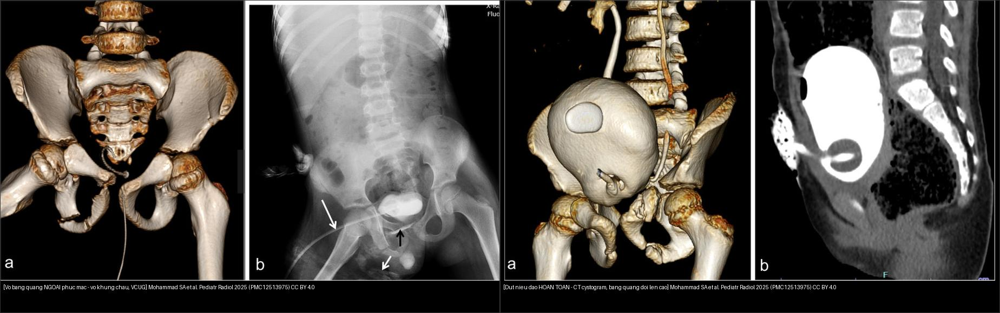
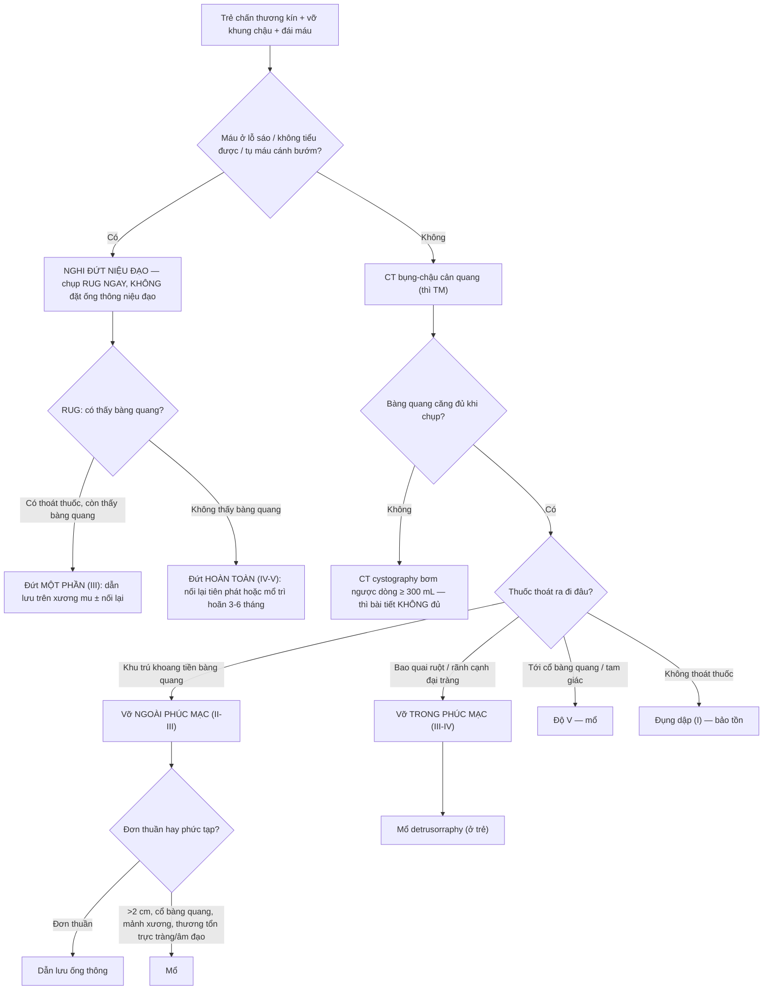
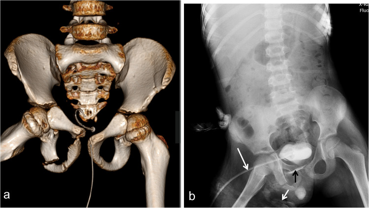
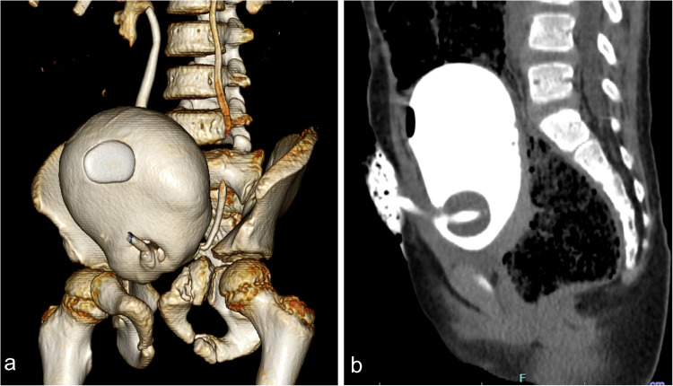
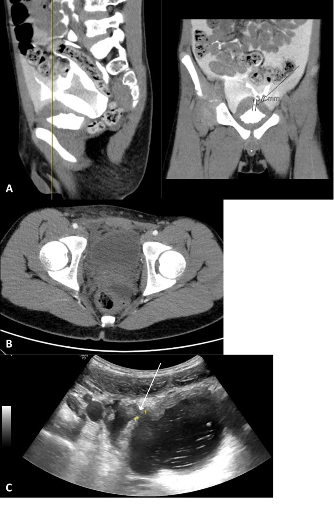
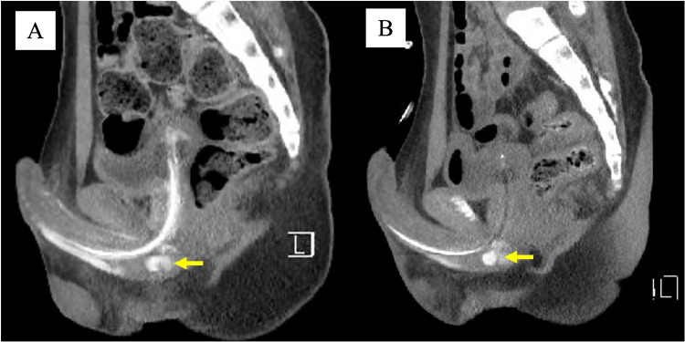

# 637 — Chấn thương bàng quang & niệu đạo ở trẻ: AAST I–V, vỡ ngoài/trong phúc mạc & đứt niệu đạo sau do vỡ khung chậu

**Tags:** `pattern:chan-thuong-bang-quang` `pattern:dut-nieu-dao-sau` `pattern:vo-khung-chau` `vung:bang-quang-nieu-dao-nhi` `vung:khung-chau-nhi` `score:AAST` `protocol:CT-cystography` `protocol:RUG`
**Mức chắc chắn (certainty):** tổng hợp y văn (literature synthesis) — nhóm tự biên từ y văn mở (bài tổng quan + ca có số), chưa gắn một ca nguyên văn đơn lẻ của nhóm; **4 ca trong quiz là ca nguyên văn (verbatim case)** chép đúng tuổi – cơ chế – chú thích gốc.

> **Câu hỏi gốc của mọi chấn thương đường tiết niệu dưới ở trẻ có vỡ khung chậu:** *vỡ ở BÀNG QUANG (trong hay ngoài phúc mạc) hay ở NIỆU ĐẠO?* — vì hai bệnh cảnh **cùng cơ chế, cùng triệu chứng nhưng khác hẳn xử trí** (dẫn lưu bàng quang vs cấp cứu niệu đạo). Sai một bước ở đây (đặt ống thông niệu đạo mù) có thể **biến đứt niệu đạo một phần thành đứt hoàn toàn**.

## 1. Tổng quan — cơ chế & TẠI SAO ảnh hiện như vậy

**A. Giải phẫu quyết định hình thái**

- Bàng quang trẻ em nằm **cao hơn (vị trí ổ bụng nhiều hơn)** và thành bụng mỏng, ít mỡ hơn người lớn → **vỡ trong phúc mạc (intraperitoneal rupture) ở trẻ hay gặp hơn**; phần **thấp của bàng quang** vỡ khi có **gãy khung chậu (pelvic fracture)** → vỡ **ngoài phúc mạc**.
- **TẠI SAO vỡ xảy ra:** bàng quang **đầy nước tiểu** bị **tăng áp lực đột ngột** (va đập vùng hạ vị/khung chậu, tay lái) → căng vỡ ở điểm yếu nhất (**đỉnh bàng quang** nếu còn trong phúc mạc; **thành trước–bên** nếu ngoài phúc mạc). Gãy khung chậu còn gây tổn thương trực tiếp bằng **mảnh xương sắc**.
- **Niệu đạo sau (posterior urethra):** đoạn **màng** ở **ngã ba bóng–màng (bulbo-membranous junction)** bị kéo đứt do **dịch chuyển khung chậu làm rách dây chằng mu–tuyến tiền liệt (puboprostatic ligaments)** → bàng quang + tuyến tiền liệt **trôi lên cao**. Vì tuyến tiền liệt trẻ còn nhỏ, dấu "tuyến tiền liệt nằm cao" **không đáng tin ở trẻ**.

**B. TẠI SAO CT/X-quang thấy được — vật lý đậm độ**

- Nước tiểu **đồng tỷ trọng với dịch** (khoảng −5 đến +15 HU); **thuốc cản quang** pha loãng trong bàng quang đạt **270–320 HU** khi căng đủ (đọc cửa sổ mạch máu width 600–900 HU, level 150–300 HU).
- **Điểm mấu chốt vật lý:** thuốc cản quang chỉ đi tới chỗ có **lỗ thủng thông với lòng bàng quang** → *nhìn đường đi của thuốc thoát ra* để định vị vỡ:
  - **Ngoài phúc mạc:** thuốc **bị giới hạn trong khoang tiền bàng quang (space of Retzius)** và mô mềm quanh bàng quang, **không vượt lên rãnh cạnh đại tràng**.
  - **Trong phúc mạc:** thuốc **bao quai ruột**, chạy lên **rãnh cạnh đại tràng (paracolic gutter)** và túi cùng → chỉ điểm vỡ ở **đỉnh bàng quang**.
  - **Niệu đạo:** **không** có thuốc trong bàng quang mà **thuốc thoát ở ngã ba bóng–màng** trên **chụp niệu đạo ngược dòng (retrograde urethrogram — RUG)**; bàng quang **trôi lên cao**, dạng **"chiếc bánh trên trời" (pie-in-the-sky)**.

**C. Ngưỡng định lượng cần nhớ**

- **Vỡ bàng quang** chiếm khoảng **1,6%** chấn thương bụng kín và **0,36%** số nhập viện vì chấn thương kín ở người lớn; gặp ở **tới ~20%** ca vỡ khung chậu (người lớn tới **89%**). Tổn thương tiết niệu dưới gặp **7,7%** trong một loạt **698** ca vỡ khung chậu.
- **Chấn thương niệu đạo liên quan vỡ khung chậu (PFUI) ở trẻ** gặp **0,47–4,2%** (đa trung tâm Trung Quốc ~**2,3%**); trong loạt 68 bé trai, PFUI chiếm **69,4%** tổng số vỡ niệu đạo.
- **Máu ở lỗ sáo (blood at meatus)** gặp **37–93%** ca chấn thương niệu đạo; kèm **không tiểu được**, **bầm máu hình cánh bướm (butterfly hematoma)** vùng đáy chậu.
- **Chụp bàng quang cản quang ngược dòng (retrograde cystography / CT cystography)** phải bơm **tối thiểu 250 mL, đủ liều 300–400 mL** thuốc pha loãng; **thì bài tiết thụ động (excretory phase) không đủ để loại trừ vỡ**.
- **Hệ quả dài hạn niệu đạo:** hẹp niệu đạo sau đứt niệu đạo ở trẻ gặp **44,1%** (30/68). Khi chỉ dẫn lưu bằng **mở dẫn lưu trên xương mu (suprapubic cystostomy, SCDU)** so với **nối lại niệu đạo tiên phát (primary realignment, PR)**: **hẹp 51,7% vs 38,5%** (p = 0,276 — *không* khác biệt có ý nghĩa), còn **nhiễm trùng niệu sau mổ 93,1% vs 56,4%** (p < 0,001 — đây mới là khác biệt rõ, KHÔNG phải hẹp) (Cui K et al., BMC Pediatr 2025, PMC11969931). **90%** hẹp xuất hiện **trong vòng 1 năm** đầu.

## 2. Mẫu hình + chẩn đoán phân biệt theo vị trí (gamut)

**Gamut theo vị trí bàng quang – niệu đạo:**

- **Đỉnh bàng quang (dome):** vỡ **trong phúc mạc** — thấm thuốc bao quai ruột. Ở trẻ chiếm tỉ lệ **cao hơn** người lớn.
- **Thành trước–bên / khoang tiền bàng quang (space of Retzius):** vỡ **ngoài phúc mạc** — thấm thuốc khu trú, **liên quan vỡ khung chậu**.
- **Cổ bàng quang / tam giác (bladder neck/trigone):** tổn thương **độ V** — nặng, thường phải mổ.
- **Niệu đạo sau (ngã ba bóng–màng):** đứt do vỡ khung chậu — **RUG** phát hiện, **bàng quang trôi cao**.
- **Niệu đạo trước (bóng):** chấn thương **dạng cưỡi ngựa (straddle)** — thường đứt một phần; biến chứng muộn **giả phình niệu đạo (pseudoaneurysm)**.

**Gamut lâm sàng (bộ ba gợi ý):** đái máu (gross hematuria) + đau hạ vị/tíu tiện khó + **vỡ khung chậu** → nghĩ đường tiết niệu dưới. Có **máu ở lỗ sáo / không tiểu được / tụ máu cánh bướm** → nghĩ **niệu đạo** trước tiên.

**Gamut theo dấu hiệu trên CT cản quang:** đụng dập bàng quang (không rò thuốc) → rò khu trú tiền bàng quang (ngoài phúc mạc) → rò lan theo quai ruột/rãnh cạnh đại tràng (trong phúc mạc) → lan tới cổ bàng quang (độ V).

## 3. Bảng so sánh phân biệt (ma trận đối chiếu)

| Thực thể (entity) | Hình ảnh điển hình | Chốt vào (rule-in) | Chốt loại (rule-out) | Gợi ý xác nhận |
|---|---|---|---|---|
| Vỡ bàng quang **ngoài phúc mạc** (AAST II–III) | Thấm thuốc **hình ngọn lửa (flame-shaped)** khu trú ở **khoang tiền bàng quang/Retzius** và mô mềm quanh bàng quang; thành bàng quang mép rách | **Thấm thuốc GIỚI HẠN quanh bàng quang + gãy khung chậu** | Thấm thuốc **bao quai ruột/lên rãnh cạnh đại tràng** → trong phúc mạc | CT cystography bơm ≥ 300 mL; đặt ống thông dẫn lưu |
| Vỡ bàng quang **trong phúc mạc** (AAST III–IV) | Thấm thuốc **bao quanh quai ruột**, lên **rãnh cạnh đại tràng** và túi cùng; vỡ thường ở **đỉnh** | **Thuốc cản quang bao quai ruột/rãnh cạnh đại tràng** | Thấm thuốc khu trú tiền bàng quang → ngoài phúc mạc | CT cystography; **ở trẻ định hướng mổ (detrusorraphy)** |
| Tổn thương **cổ bàng quang / tam giác** (AAST V) | Thấm thuốc tới **cổ bàng quang**, kèm tổn thương niệu đạo/hậu môn/âm đạo | **Thoát thuốc tới cổ bàng quang** hoặc kèm tổn thương tạng lân cận | Thấm thuốc chỉ ở thân/thành bàng quang → dưới độ V | CT ± cystoscopy; mổ |
| **Đụng dập bàng quang** (AAST I) | Đái máu đại thể **nhưng CT cystography KHÔNG rò thuốc** | **Đái máu + căng bàng quang tốt + không thoát thuốc** | **Thấy thoát thuốc ở bất kỳ hướng** → đã rách thành | CT cystography; điều trị bảo tồn |
| **Đứt niệu đạo sau** (đứt một phần / hoàn toàn) | **RUG:** thuốc thoát ở **ngã ba bóng–màng**; đứt **hoàn toàn = bàng quang/niệu đạo tuyến không thấy thuốc** + bàng quang **trôi cao "pie-in-the-sky"** | **Máu lỗ sáo + không tiểu được + RUG thoát thuốc, không thấy bàng quang** | **RUG bình thường** → loại trừ đứt (chỉ đụng dập) | **RUG TRƯỚC mọi nỗ lực đặt ống thông**; CT cystogram thấy bàng quang căng đủ nhưng **trôi lên cao** |
| **Giả phình niệu đạo** (biến chứng muộn niệu đạo trước) | CT cản quang: **ổ thoát thuốc từ động mạch hành (bulbar artery)**, ngấm theo bể máu | **Ổ thuốc đi theo dòng máu, giữ hình giữa các thì** | Thoát thuốc lan rộng/tăng ở thì muộn → chảy máu hoạt tính | CTA + **nút mạch (embolization)** |

*Trái: bé trai 8 tuổi vỡ khung chậu — (a) CT 3D dựng hình: gãy ngành mu trên và dưới bên phải + giãn khớp mu; (b) VCUG qua dẫn lưu trên xương mu: thuốc rò sớm ở bờ dưới bàng quang (mũi tên đen) và mô mềm đáy chậu (mũi tên trắng) = **vỡ ngoài phúc mạc**. Phải: bé gái 4 tuổi vỡ khung chậu + **đứt niệu đạo hoàn toàn** — (a) CT cystogram 3D, (b) tái tạo sagittal: bàng quang **căng đủ, ngấm thuốc, KHÔNG thoát thuốc**, nhưng **trôi lên cao**. Nguồn: Mohammad SA et al., Pediatr Radiol 2025 (PMC12513975), CC BY 4.0. Ảnh ghép letterbox, giữ tỉ lệ.*

## 4. Protocol chụp + hệ phân độ/điểm chuẩn hóa

**Kỹ thuật (technique) — phần quyết định chẩn đoán:**

- **CT cystography:** kẹp ống thông (Foley), bơm **thuốc cản quang pha loãng 300–400 mL** (tối thiểu 250 mL) ngược dòng tới khi căng tối đa/bệnh nhân khó chịu; **chụp khi bàng quang còn căng** (clamp trong lúc quét) — nếu quét sau khi bàng quang đã tháo cạn thì **bỏ sót vỡ**. Túi thuốc treo **cao hơn bàn 50–60 cm**. **Thì bài tiết thụ động không đủ để loại trừ vỡ.**
- **Chụp niệu đạo ngược dòng (RUG):** đặt đầu ống thông tới **hố thuyền (fossa navicularis)**, bơm bóng **2 mL** giữ cố định, bơm **20–30 mL** thuốc — chụp **nghiêng/3/4**, so sánh **có/không thấy bàng quang**. **Bắt buộc chụp RUG TRƯỚC khi thử đặt ống thông niệu đạo.**
- **Siêu âm:** **FAST** phát hiện dịch trong phúc mạc; **siêu âm bơm nước muối sinh lý vào bàng quang** (qua ống thông) thấy **dịch thoát qua chỗ vỡ** — hữu ích đầu tay, không phơi nhiễm tia.

**Hệ phân độ AAST-OIS (theo Moore et al.; cập nhật 2018) — nâng 1 độ cho nhiều tổn thương tới độ III:**

*Bàng quang:*
| Độ | Mô tả |
|---|---|
| I | Đụng dập, máu tụ trong thành, rách **một phần** chiều dày |
| II | Rách thành **ngoài phúc mạc < 2 cm** |
| III | Rách **ngoài phúc mạc ≥ 2 cm** hoặc **trong phúc mạc < 2 cm** |
| IV | Rách thành **trong phúc mạc ≥ 2 cm** |
| V | Rách **liên quan cổ bàng quang / lỗ niệu quản (tam giác)** |

*Niệu đạo:*
| Độ | Mô tả |
|---|---|
| I | Đụng dập, máu ở lỗ sáo, **RUG bình thường** |
| II | Căng giãn (stretch), **dài ra nhưng không thoát thuốc** |
| III | Đứt **một phần**: thoát thuốc tại chỗ, **còn thấy thuốc ở bàng quang** |
| IV | Đứt **hoàn toàn < 2 cm**, **không thấy thuốc ở bàng quang** |
| V | Đứt **hoàn toàn > 2 cm**, hoặc lan vào **tuyến tiền liệt/âm đạo** |

**Hướng điều trị (tam đoạn):** vỡ **ngoài phúc mạc đơn thuần** → **dẫn lưu ống thông** (thường lành); **ngoài phúc mạc phức tạp** (≥ 2 cm, lan cổ bàng quang, mảnh xương, kèm thương tổn trực tràng/âm đạo, rò dai dẳng, chuẩn bị cố định khung chậu) → **mổ**; **trong phúc mạc ở trẻ → mổ (detrusorraphy)**. **Niệu đạo:** đứt một phần (II–III) → **dẫn lưu trên xương mu ± nối lại nội soi chọn lọc**; đứt hoàn toàn → **nối lại tiên phát** hoặc **dẫn lưu trên xương mu rồi mổ tạo hình niệu đạo trì hoãn sau 3–6 tháng** (chờ máu tụ tiêu, bàng quang–tuyến tiền liệt hạ xuống).

## 5. Biến thể bình thường và cạm bẫy

- **CẠM BẪY SỐ 1 — bàng quang không được căng đủ:** đọc CT chỉ có **thì bài tiết** (bàng quang chưa căng) rồi kết luận "không vỡ" → **âm tính giả**. Bắt buộc **bơm ngược dòng ≥ 250–300 mL**. Bàng quang **xẹp** còn giả **thành dày**.
- **ĐẶT ỐNG THÔNG NIỆU ĐẠO MÙ** khi đứt niệu đạo một phần → **đứt hoàn toàn do y tế**. Luôn **RUG trước**.
- **"Tuyến tiền liệt nằm cao" không đáng tin ở trẻ** (tuyến nhỏ, khó sờ); dựa vào **máu ở lỗ sáo + không tiểu được + RUG**.
- **Bàng quang "pie-in-the-sky" (trôi cao) là DẤU BỆNH, không phải bình thường** — gợi ý đứt niệu đạo sau hoàn toàn.
- **Vỡ bàng quang vs máu tụ tiền bàng quang đơn thuần:** chỉ **thoát thuốc cản quang** mới khẳng định vỡ; máu tụ không có thuốc thoát thì không phải rách thành.
- **Bỏ sót ở bé gái:** chấn thương niệu đạo nữ hiếm, dễ quên — tìm **máu ở tiền đình âm đạo, rách âm đạo**, phối hợp **thương tổn trực tràng/âm đạo** (độ V bàng quang).
- **Thỏa mãn tìm kiếm (satisfaction of search):** đã thấy vỡ khung chậu rồi **dừng lại** → bỏ sót bàng quang/niệu đạo; luôn đọc tiếp đường tiết niệu dưới.
- **Bẫy hiếm — phù bạch mạch đơn độc giả vỡ bàng quang** trên BN chấn thương kín: dịch/đậm độ vùng chậu giả rò nước tiểu; dựa vào **không thoát thuốc cản quang vào dịch** để loại trừ (Gupta PK et al., Case Rep Radiol 2026 — PMC13113415).
- **Đừng quên thương tổn tạng đặc đi kèm:** vỡ khung chậu năng lượng cao thường kèm **lách/gan/thận**; đọc bàng quang/niệu đạo **song song** các tạng đặc.

## 6. Tự lượng giá — Blind Quiz (ảnh trơn ngoài, đáp án ẩn trong khối chi tiết)

**Ca 1 — Bé trai 8 tuổi, vỡ khung chậu. Nhìn ảnh, thuốc cản quang thoát ra đi đâu trước khi mở đáp án.**

- Gợi ý lâm sàng: chấn thương năng lượng cao, đau hạ vị/đái máu.
- Câu hỏi: Thuốc thoát ra **khu trú hay lan theo quai ruột**? Đây là vỡ trong hay ngoài phúc mạc? Xử trí khác nhau thế nào?

<b>Bấm để hiện đáp án (findings + chẩn đoán)</b>

- **(a) CT 3D khung chậu:** gãy **ngành mu trên và dưới bên phải + giãn khớp mu** — chấn thương năng lượng cao.
- **(b) VCUG (chụp bàng quang–niệu đạo) qua dẫn lưu trên xương mu:** thuốc **rò sớm ở bờ dưới bàng quang (mũi tên đen)** và **mô mềm đáy chậu (mũi tên trắng)** → **vỡ bàng quang NGOÀI phúc mạc** (thuốc **giới hạn**, **không** bao quai ruột, không lên rãnh cạnh đại tràng).
- **Chẩn đoán – xử trí:** vỡ ngoài phúc mạc **đơn thuần** → **dẫn lưu ống thông**; chỉ mổ khi phức tạp (≥ 2 cm, lan cổ bàng quang, mảnh xương, kèm thương tổn trực tràng/âm đạo, rò dai dẳng).
- Nguồn ảnh: Mohammad SA et al., Pediatr Radiol 2025 (PMC12513975), Fig 15, CC BY 4.0.

**Ca 2 — Bé gái 4 tuổi, vỡ khung chậu, **không tiểu được**. Bàng quang căng đủ, ngấm thuốc, KHÔNG thoát thuốc. Vì sao vẫn là chấn thương nặng?**

- Câu hỏi: Vì sao "bàng quang nguyên vẹn, không rò" mà vẫn chẩn đoán đứt niệu đạo? Dấu hiệu vị trí bàng quang gợi ý gì? Bước tiếp theo?

<b>Bấm để hiện đáp án (findings + chẩn đoán)</b>

- **(a) CT cystogram 3D, (b) tái tạo sagittal:** bàng quang **căng đủ, ngấm thuốc đều, KHÔNG có thuốc thoát ra** → **không vỡ thành bàng quang**.
- Tuy nhiên bệnh nhân **không tiểu được** và trên ảnh bàng quang **trôi lên cao (superior displacement)** → tổn thương ở **niệu đạo sau (đứt niệu đạo hoàn toàn)** chứ không phải bàng quang; bàng quang–tuyến tiền liệt bị kéo lên do rách dây chằng mu–tuyến tiền liệt.
- **Bước tiếp theo:** chụp **RUG** để xác định đứt **một phần hay hoàn toàn** (tiêu chí: có/không thấy thuốc ở bàng quang; khoảng cách **< 2 cm** = độ IV, **> 2 cm** = độ V). **Không đặt ống thông niệu đạo mù.**
- Nguồn ảnh: Mohammad SA et al., Pediatr Radiol 2025 (PMC12513975), Fig 16, CC BY 4.0.

**Ca 3 — Ba cách "nhìn" một ca nghi vỡ bàng quang. Panel nào dùng để chẩn đoán, panel nào là âm tính giả?**

- Câu hỏi: Vì sao (B) không loại trừ được vỡ? (C) bổ sung gì? Kỹ thuật đúng của (A) là gì?

<b>Bấm để hiện đáp án (findings + chẩn đoán)</b>

- **(A) CT với thuốc cản quang bơm TRONG bàng quang (intravesical):** bàng quang căng, ngấm thuốc → **chẩn đoán** (thấy thoát thuốc nếu có).
- **(B) CT KHÔNG có thì bài tiết/bơm căng đủ:** bàng quang xẹp → **không đánh giá được**; đây là **âm tính giả** điển hình ("CT không đặc hiệu"). **Thì bài tiết thụ động không đủ loại trừ vỡ.**
- **(C) Siêu âm bơm nước muối sinh lý vào bàng quang:** thấy **dịch thoát qua chỗ vỡ (mũi tên + thước đo)** — bổ sung **đầu tay, không tia**, hữu ích khi lâm sàng nghi cao mà CT không đặc hiệu.
- Nguồn ảnh: Soares-Aquino C et al., Cureus 2025 (PMC12535678), Fig 1, CC BY 4.0.

**Ca 4 — Bé trai 12 tuổi, chấn thương, sau đó hẹp niệu đạo tiến triển. CT cản quang thấy ổ thoát thuốc ở hành niệu đạo. Chẩn đoán?**

- Câu hỏi: Ổ thuốc ngấm này là gì (giả phình hay chảy máu hoạt tính)? Nguồn mạch từ đâu? Điều trị?

<b>Bấm để hiện đáp án (findings + chẩn đoán)</b>

- **(A)** CT cản quang thấy **thoát thuốc từ động mạch hành (distal bulbar artery)** — ổ **giả phình niệu đạo (urethral pseudoaneurysm)** (mũi tên vàng). **(B)** sau **nút mạch qua ống thông (transcatheter arterial embolization)** 2 ngày, ổ giảm/thoái triển.
- **Chốt:** ổ thuốc **đi theo bể máu (giữ hình giữa các thì)** = **giả phình**; khác **chảy máu hoạt tính** (blush lan rộng/tăng ở thì muộn).
- **Ý nghĩa:** giả phình niệu đạo sau chấn thương hành niệu đạo gây **hẹp niệu đạo tiến triển và bí tiểu**; điều trị = **nút mạch** (không phải mổ niệu đạo ngay).
- Nguồn ảnh: Yoshizawa S et al., Cureus 2026 (PMC12907458), Fig 3, CC BY 4.0.

**Ca 5 — Ảnh ghép đối chiếu: hai bệnh cảnh "cùng vỡ khung chậu" nhưng khác chẩn đoán. Gọi tên từng bên.**

- Câu hỏi: Bên nào là chấn thương bàng quang, bên nào là chấn thương niệu đạo? Dấu hiệu nào chốt?

<b>Bấm để hiện đáp án (findings + chẩn đoán)</b>

- **Trái = vỡ bàng quang NGOÀI phúc mạc** — VCUG thoát thuốc khu trú bờ dưới bàng quang + đáy chậu (gãy ngành mu trên 3D).
- **Phải = đứt niệu đạo HOÀN TOÀN** — CT cystogram: bàng quang **căng, không thoát thuốc, trôi lên cao** + **không tiểu được**.
- **Chốt:** nếu thuốc thoát ra → định vị theo đường đi (ngoài phúc mạc khu trú vs trong phúc mạc bao quai ruột); nếu **không thoát thuốc mà bàng quang trôi cao + không tiểu được** → nghĩ **niệu đạo** (chụp RUG).
- Nguồn: Mohammad SA et al., Pediatr Radiol 2025 (PMC12513975), Fig 15 + 16, CC BY 4.0. Ảnh ghép letterbox.

## Bài liên quan chéo
- [600 – Tổng quan Hệ Nhi khoa](../600-tong-quan-nhi-khoa/lesson.md)
- [636 – Cấp cứu niệu–sinh dục nhi (chấn thương thận AAST & xoắn tinh hoàn/buồng trứng)](../636-cap-cuu-nieu-sinh-duc-nhi/lesson.md) (cùng bài gốc cho chấn thương thận/bàng quang)
- [635 – Dị tật hệ tiết niệu nhi: SFU/VUR/PUV](../635-di-tat-tiet-nieu-nhi-SFU-VUR-PUV/lesson.md) (bệnh cảnh niệu nhi không do chấn thương)
- [623 – Chấn thương tụy–tá tràng ở trẻ](../623-chan-thuong-tuy-ta-trang-nhi/lesson.md) (chấn thương bụng kín, cơ chế tay lái)
- [140 – Lách & chấn thương tạng đặc: AAST](../140-lach-tang-dac/lesson.md) (bảng phân độ AAST tạng đặc + thoát thuốc vs giả phình)
- [159 – Bàng quang: VI-RADS & u đường niệu trên](../159-bang-quang-virads-u-duong-nieu-tren/lesson.md) (bệnh lý bàng quang không chấn thương)
- [920 – Nút mạch trong chảy máu tiêu hóa](../920-vascular-embolization-gi-bleed/lesson.md) (nguyên lý nút mạch — liên hệ giả phình niệu đạo)

## Ảnh
- Tên file: `NNN_slug_Modality_SourceID.jpg`. Chi tiết nguồn + giấy phép từng ảnh: `images/CREDITS.md` và `sources.md`.
- Toàn bộ ảnh tải về là **CC BY 4.0** (ghi nguồn đầy đủ, không crop ảnh gốc); ảnh ghép đối chiếu tạo bằng `tools/make_composite.py` (letterbox, giữ tỉ lệ).
- Radiopaedia/Eurorad/AuntMinnie: chỉ **dẫn link** (AuntMinnie không tải).

> Không dùng để chẩn đoán độc lập khi chưa có người hướng dẫn.
