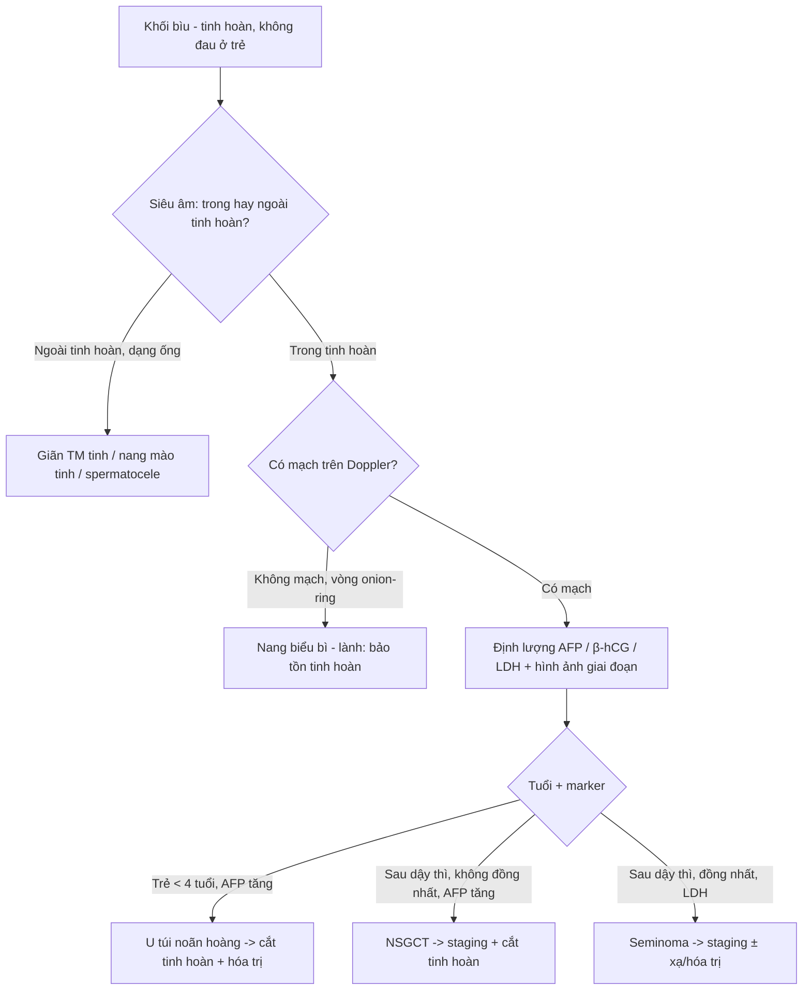
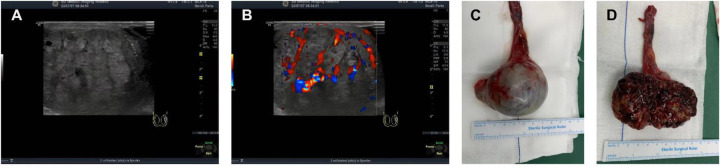
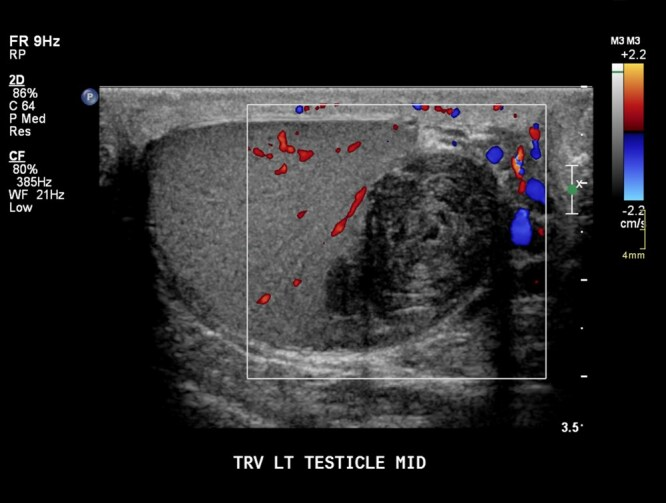
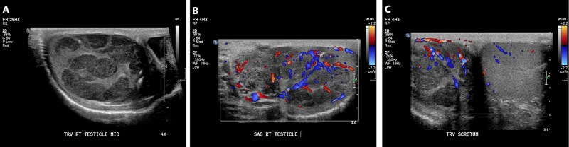
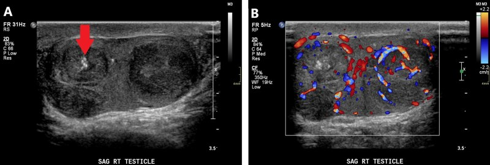
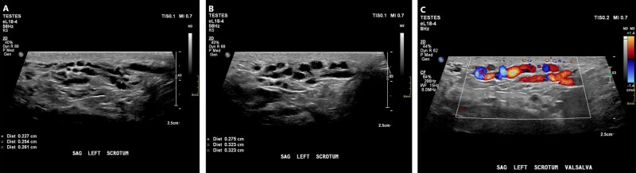
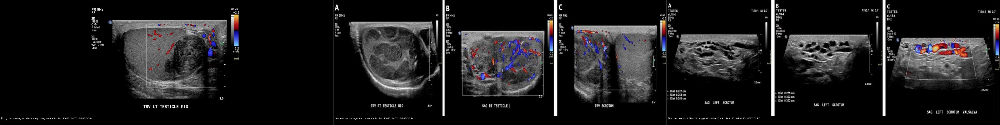

# 638 — Khối bìu–tinh hoàn ở trẻ: u tế bào mầm, nang biểu bì & giãn tĩnh mạch tinh / Pediatric scrotal & testicular masses

**Tags:** `pattern:khoi-tinh-hoan-nhi` `pattern:u-te-bao-mam` `pattern:nang-bieu-bi` `pattern:gian-tinh-mach-tinh` `vung:biu-tinh-hoan-nhi` `score:WHO-2022` `protocol:sieu-am-Doppler-biu`
**Mức chắc chắn (certainty):** tổng hợp y văn (literature synthesis) + ca nguyên văn (verbatim case) cho ca u tế bào mầm hỗn hợp ở bé trai 13 tuổi — ảnh CC BY 4.0.

## 1. Tổng quan bệnh học – cơ chế hình ảnh

- Khối bìu–tinh hoàn ở trẻ chia **hai chân dung theo tuổi**, phản ánh hai con đường sinh bệnh khác nhau (WHO 2022 – "Blue Book"): 
  - **Trước dậy thì (đỉnh 0–4 tuổi):** khối **không sinh từ tân sinh tế bào mầm tại chỗ (non-GCNIS)** — **60–75% lành tính** (chủ yếu **u quái teratoma**), còn lại phần ác tính chủ yếu là **u túi noãn hoàng (yolk sac tumor, YST)**.
  - **Sau dậy thì (đỉnh 15–19 tuổi):** nhóm **sinh từ GCNIS** — **~75% ác tính**, đa số là **u tế bào mầm không seminoma hỗn hợp (mixed non-seminomatous GCT)**.
- **Vì sao trên siêu âm u tế bào mầm thường "giảm âm" (hypoechoic)?** Nhu mô tinh hoàn lành chứa **nhiều vách sinh tinh (septula) + ống sinh tinh** tạo **nhiều mặt phản hồi** nên có hồi âm dày đặc. U tế bào mầm **đặc, mật độ tế bào cao, ít mô liên kết** → **ít mặt phản hồi** → vùng **giảm âm**. **Seminoma** thường **rất đồng nhất** (một dòng tế bào) → khối giảm âm **đều, bờ rõ**; **NSGCT** có **hoại tử, xuất huyết, vôi hóa, nhiều dòng tế bào** → **không đồng nhất, bờ nham nhở**.
- **Nang biểu bì (epidermoid cyst)** là khối **lành tính** ("germ cell tumor" lành theo tên cũ), chiếm **~1,5%** u tinh hoàn: bên trong là **nhiều lớp sừng (keratin) xếp đồng tâm** → mỗi lớp keratin tạo **một mặt phản hồi** → dấu hiệu **"vòng hành" (onion-ring)**: các vòng giảm âm – tăng âm xen kẽ; **hoàn toàn không có mạch** trên Doppler. Tới **60%** ca có hình ảnh onion-ring; ngoài ra có thể gặp dạng **"bia bắn" (target)** với lõi tăng âm.
- **Giãn tĩnh mạch tinh (varicocele):** tĩnh mạch tinh trái đổ **thẳng đứng vào tĩnh mạch thận trái** (khác bên phải đổ thẳng vào IVC) → dễ ứ trệ; **> 90% ở bên trái**, gặp ở **~15% nam giới**. Trên siêu âm thấy **cấu trúc dạng ống, khoang chứa dịch = trống âm (anechoic)**, **giãn thêm khi Valsalva**; Doppler xác nhận **có dòng chảy** (chẩn đoán **Se 97%/Sp 94%**).
- **Dấu ấn khối u (serum tumor markers) quyết định hướng:** **AFP** tăng trong **u túi noãn hoàng / NSGCT** (trừ choriocarcinoma); **β-hCG** tăng trong **choriocarcinoma / tế bào hợp bào nuôi**; **LDH** phản ánh **khối lượng u**, hay tăng ở **seminoma**. **Cạm bẫy:** nhũ nhi có thể **AFP sinh lý cao** trong vài tháng đầu — phải so theo tuổi.

## 2. Mẫu hình + chẩn đoán phân biệt theo vị trí (gamut)

**Mẫu hình chính:** một **khối trong tinh hoàn (intratesticular)** — dễ ác tính — phân biệt với **tổn thương ngoài tinh hoàn (extratesticular)** — dễ lành tính.

- **Đặc, giảm âm, có mạch → u tế bào mầm:** seminoma (đồng nhất, tuổi lớn hơn) vs NSGCT (không đồng nhất, có hoại tử/vôi hóa, tuổi trẻ hơn) vs **u tế bào mầm ở trẻ nhỏ** (u túi noãn hoàng).
- **Đặc, không mạch, "vòng hành" → nang biểu bì** (lành, có thể **bảo tồn tinh hoàn**).
- **Nhiều ổ hai bên → u lympho/bạch cầu** (thứ phát) hoặc **u tế bào thượng thận lạc chỗ** (adrenal rest tumor — ở trẻ có tăng sản thượng thận bẩm sinh).
- **Khối tế bào Leydig/Sertoli:** thường **hiếm**, kèm biểu hiện nội tiết (dậy thì sớm/gynecomastia).
- **Dạng ống ngoài tinh hoàn:** **giãn tĩnh mạch tinh** ("búi giun"), **nang mào tinh (epididymal cyst)**, **spermatocele** — không phải khối đặc tinh hoàn.
- **Biến thể bình thường hay nhầm:** **mào tinh phụ (appendix testis)** — cấu trúc tròn 5–6 mm bám mào tinh, có thể bị xoắn gây đau; **cơ quan mào tinh** và **sỏi mào tinh (scrotal pearl)**.

## 3. Bảng so sánh phân biệt (ma trận đối chiếu)

| Thực thể (entity) | Hình ảnh điển hình (siêu âm) | Chốt vào (rule-in) | Chốt loại (rule-out) | Gợi ý xác nhận |
|---|---|---|---|---|
| **Seminoma** (âm tính) | Khối đặc **giảm âm đều, bờ rõ**, đơn ổ, mạch trong u tăng | **Đồng nhất giảm âm + tăng mạch trong u ở nam trưởng thành (tuổi trung bình 40)** | **Bờ nham nhở + vôi hóa/hoại tử + không đồng nhất** = không phải seminoma đơn thuần | β-hCG/LDH; mô bệnh sau cắt tinh hoàn |
| **NSGCT (u tế bào mầm không seminoma)** | **Không đồng nhất**, giảm âm nhiều ổ, bờ không đều, có thể vôi hóa/hoại tử | **Khối không đồng nhất nhiều ổ + AFP tăng + tuổi trẻ hơn (trung bình ~30)** | **Đồng nhất giảm âm đều, bờ rõ** = nghiêng seminoma/u lành | AFP, β-hCG; CT bụng–ngực giai đoạn |
| **U túi noãn hoàng ở trẻ < 4 tuổi** | Khối đặc giảm âm, đơn ổ, tăng mạch; tinh hoàn thường to | **Trẻ nhỏ (0–4 tuổi) + khối đặc + AFP tăng (so theo tuổi)** | **AFP bình thường theo tuổi + không mạch** = nghĩ nang lành | AFP (so tuổi); mô bệnh |
| **Nang biểu bì (epidermoid cyst)** | Vòng **giảm–tăng âm đồng tâm "onion-ring"** (~60%), hoặc dạng "bia bắn"; bờ rõ; **không mạch** | **Bờ rõ + vòng đồng tâm + hoàn toàn vô mạch + marker bình thường** | **Tăng mạch trong u** = loại nang biểu bì (nghĩ u thật) | Marker âm + **mổ bảo tồn tinh hoàn (testis-sparing)** |
| **U lympho/bạch cầu (thứ phát)** | Khối giảm âm **hai bên**, đơn ổ hoặc nhiều nốt, giàu mạch | **Tổn thương hai bên + bệnh ác tính hệ thống đã biết** | **Một bên, đơn ổ** = nghiêng u tiên phát | Bilan bệnh máu; sinh thiết |
| **Tăng sản thượng thận lạc chỗ (adrenal rest)** | Nốt giảm âm hai bên, bờ thùy múi, giàu mạch, thường ở rốn tinh hoàn | **Hai bên + tăng sản thượng thận bẩm sinh (CAH) + ACTH cao** | **Một bên + marker dương** = u tế bào mầm | Nội tiết (17-OHP, ACTH); theo dõi |
| **Giãn tĩnh mạch tinh (varicocele)** | Cấu trúc **dạng ống trống âm** trên bìu trái; giãn khi Valsalva | **≥ 2,5 mm lúc nghỉ / ≥ 3,0 mm khi Valsalva + có dòng trên Doppler + bên TRÁI** | **Khối đặc trong tinh hoàn có mạch** = loại varicocele (u thật) | Doppler + Valsalva; ≥ 3,0 mm = grade lớn |

- Ảnh ghép đối chiếu: `` — 3 khối bìu–tinh hoàn trên cùng một chuỗi (siêu âm): nang biểu bì (vô mạch) vs seminoma (có mạch) vs varicocele (dạng ống).

## 4. Protocol chụp + hệ phân độ/điểm chuẩn hóa

- **Siêu âm là đầu tay (first-line):** đầu dò **linear tần số cao 7,5–15 MHz**, bệnh nhân nằm ngửa, so sánh **hai bên**, **gray-scale + Doppler màu/năng lượng**, đo **kích thước 3 chiều** rồi tính **thể tích (thể tích ellipsoid ≈ D1 × D2 × D3 × 0,52)**. **Bắt buộc Valsalva** để đánh giá varicocele. Nghi tổn thương mạch/tắc cấp thì kèm Doppler năng lượng.
- **Khi có khối đặc trong tinh hoàn:** (1) **định lượng marker AFP/β-hCG/LDH**; (2) **hình ảnh giai đoạn** — CT ngực–bụng–chậu (hoặc MRI) tìm hạch sau phúc mạc/di căn, đánh giá **bên đối diện**; (3) cân nhắc **MRI bìu** khi siêu âm không kết luận.
- **Phân độ/giai đoạn:** dùng **phân loại WHO 2022 (GCNIS-derived vs non-GCNIS)** để phản ánh sinh bệnh; giai đoạn u tinh hoàn theo **TNM** (hạch sau phúc mạc là nơi di căn trước tiên). **Nang biểu bì và u lành nhỏ: chỉ định bảo tồn (testis-sparing surgery)** để giữ nội tiết/sinh sản — không cắt tinh hoàn toàn bộ mặc định.

## 5. Biến thể bình thường và cạm bẫy

- **Mào tinh phụ (appendix testis)** — cấu trúc tròn nhỏ bám mào tinh, có thể bị xoắn; đừng gọi là u. **Sỏi mào tinh (scrotal pearl)** tăng âm kèm bóng lưng, hay sau phẫu thuật.
- **Nang mào tinh / spermatocele:** tổn thương **ngoài tinh hoàn**, thường không cần mổ; đừng nhầm với khối đặc trong tinh hoàn.
- **AFP sinh lý ở nhũ nhi:** trong vài tháng đầu, AFP có thể cao tự nhiên — **luôn so theo tuổi** để tránh chẩn đoán nhầm u ác.
- **"Khối đơn độc một bên" là quy luật của u tế bào mầm nguyên phát**; nếu thấy **hai bên**, phải nghĩ **u lympho/bạch cầu** hoặc **tăng sản thượng thận lạc chỗ** — hướng xử trí hoàn toàn khác.
- **Varicocele bên phải hoặc mới xuất hiện ở tuổi lớn:** phải **tìm khối sau phúc mạc chèn ép tĩnh mạch** (nguyên nhân thứ phát) — không coi là varicocele "vô căn".
- **Mất tổn thương do đầu dò sai tần số:** khối nhỏ giảm âm có thể bị bỏ sót bằng đầu dò tần số thấp (dùng cho tinh hoàn to); **bắt buộc đầu dò linear tần số cao**.
- **Satisfaction of search:** thấy varicocele không được dừng lại — vẫn phải quét hết tinh hoàn để loại khối đặc kèm theo.

## 6. Tự lượng giá — Blind Quiz

**Ca 1 — Bé trai 13 tuổi, khối bìu trái không đau, đang giai đoạn dậy thì sớm.**

- Gợi ý lâm sàng: khối bìu trái, AFP và hCG đều tăng cao.
- Câu hỏi: Mô tả tổn thương? Vì sao phải định lượng **cả AFP lẫn hCG**? Chẩn đoán?

<b>Bấm để hiện đáp án (findings + chẩn đoán)</b>

- Dấu hiệu: **(A)** siêu âm bìu trái khối đặc giảm âm; **(B)** Doppler màu: **mạch trong u phong phú**; (C) bệnh phẩm cắt tinh hoàn: u đặc ranh giới rõ.
- Chẩn đoán: **u tế bào mầm hỗn hợp (u túi noãn hoàng + ung thư biểu mô bào thai)**. Marker trước mổ: **AFP 399,7 ng/mL (40× ULN)** và **hCG 14.937 mIU/mL (7.469× ULN)**; sau mổ 1 tháng **AFP 1,56 ng/mL, hCG < 0,2 mIU/mL**. Theo dõi **29 tháng** không tái phát/di căn.
- Vì sao đình lượng cả hai: **AFP** chỉ điểm **u túi noãn hoàng**, **hCG** chỉ điểm **thành phần tế bào hợp bào nuôi/ung thư biểu mô bào thai** → cần cả hai để phản ánh **thành phần hỗn hợp** và theo dõi đáp ứng.
- Nguồn ảnh: Fig 1, Yang J et al., *Front Pediatr* 2026 (**PMC13036159**), CC BY 4.0.

**Ca 2 — Khối tinh hoàn trái, vòng hành xen kẽ, không thấy mạch trong u.**

- Gợi ý lâm sàng: nam trẻ, khối bìu không đau, marker khối u bình thường.
- Câu hỏi: Dấu hiệu đặc trưng? Chẩn đoán và hướng xử trí?

<b>Bấm để hiện đáp án (findings + chẩn đoán)</b>

- Dấu hiệu: khối trong tinh hoàn trái, **các vòng giảm âm – tăng âm đồng tâm (onion-ring)**, bờ rõ, **không có mạch** trên Doppler.
- Chẩn đoán: **nang biểu bì (epidermoid cyst)** — lành tính, chiếm ~1,5% u tinh hoàn, tới 60% có hình onion-ring; các lớp **keratin đồng tâm** tạo nhiều mặt phản hồi. Xử trí: **mổ bảo tồn tinh hoàn (testis-sparing surgery)** nếu khẳng định được, không cắt toàn bộ mặc định.
- Nguồn ảnh: Fig 11, Lam Shin Cheung J & Bhaduri M, *Br J Radiol* 2026 (**PMC13134857**), CC BY.

**Ca 3 — Nam trưởng thành, tinh hoàn phải có nhiều ổ giảm âm định khu; so sánh với ca u tế bào mầm không seminoma.**

- Gợi ý lâm sàng: khối bìu không đau, không sốt.
- Câu hỏi: Khối giảm âm đơn độc như thế nào gợi ý seminoma? So với tổn thương **không đồng nhất, vôi hóa, bờ nham nhở** thì nghĩ gì?

<b>Bấm để hiện đáp án (findings + chẩn đoán)</b>

- Dấu hiệu: ảnh trên (Fig 12) — **nhiều ổ giảm âm định khu, có mạch** = **seminoma**; ảnh dưới (Fig 13) — **≥ 3 ổ không đồng nhất, bờ nham nhở, có ổ vôi hóa** = **u tế bào mầm không seminoma (NSGCT)**.
- Chẩn đoán: phân biệt seminoma (đồng nhất giảm âm, tuổi trung bình ~40) vs NSGCT (không đồng nhất, tuổi trẻ hơn ~30). Hai dòng **trùng hình ảnh** nhưng khác **marker (AFP trong NSGCT; LDH ở seminoma)** và **tiên lượng/xử trí** → marker + mô bệnh quyết định.
- Nguồn ảnh: Fig 12–13, Lam Shin Cheung J & Bhaduri M, *Br J Radiol* 2026 (**PMC13134857**), CC BY.

**Ca 4 — Bìu trái, khối "búi giun" giãn khi rặn.**

- Gợi ý lâm sàng: nam trẻ đau bìu âm ỉ, sờ thấy "búi giun" bên trái.
- Câu hỏi: Dấu hiệu? Ngưỡng đường kính chẩn đoán? Vì sao bên trái hay gặp?

<b>Bấm để hiện đáp án (findings + chẩn đoán)</b>

- Dấu hiệu: **(A)** bìu trái có **cấu trúc dạng ống giãn tới 2,6 mm**; **(B)** **giãn thêm khi Valsalva**; Doppler xác nhận có dòng.
- Chẩn đoán: **giãn tĩnh mạch tinh trái (varicocele)** — ngưỡng **≥ 2,5 mm lúc nghỉ / ≥ 3,0 mm khi Valsalva**, siêu âm **Se 97%/Sp 94%**. Bên trái hay gặp vì **tĩnh mạch tinh trái chạy thẳng đứng đổ vào tĩnh mạch thận trái**; gặp ở ~15% nam. Varicocele phải/mới xuất hiện → tìm khối sau phúc mạc.
- Nguồn ảnh: Fig 6, Lam Shin Cheung J & Bhaduri M, *Br J Radiol* 2026 (**PMC13134857**), CC BY.

**Ca 5 — Ảnh tổng hợp 3 khối bìu–tinh hoàn cùng chuỗi siêu âm.**

- Câu hỏi: Xếp 3 khối theo mức độ nguy cơ ác tính từ thấp đến cao và nêu **1 dấu hiệu chốt** cho mỗi khối.

<b>Bấm để hiện đáp án (findings + chẩn đoán)</b>

- Đáp án: **nang biểu bì** (lành — chốt: **vòng onion-ring + vô mạch**) < **varicocele** (lành, nhưng có thể là dấu hiệu khối chèn ép nếu phải/mới xuất hiện — chốt: **dạng ống giãn khi Valsalva có dòng**) < **u tế bào mầm (seminoma/NSGCT)** (ác — chốt: **khối đặc có mạch trong tinh hoàn**).
- Nguồn ảnh: ghép Fig 11 + Fig 12 + Fig 6, Lam Shin Cheung J & Bhaduri M, *Br J Radiol* 2026 (**PMC13134857**), CC BY; ghép bằng `tools/make_composite.py`.

## Bài liên quan chéo
- [636 – Cấp cứu niệu–sinh dục nhi (chấn thương thận & xoắn tinh hoàn/buồng trứng)](../636-cap-cuu-nieu-sinh-duc-nhi/lesson.md)
- [637 – Chấn thương bàng quang & niệu đạo nhi](../637-chan-thuong-bang-quang-nieu-dao-nhi/lesson.md)
- [151 – U thận đặc: RCC vs oncocytoma vs AML](../151-u-than-dac/lesson.md)
- [536 – U mầm & u mô đệm–dây sinh dục buồng trứng ở người trẻ](../536-u-mam-u-mo-dem-buong-trung/lesson.md)
- [450 – Mắt nhi (retinoblastoma vs Coats)](../450-mat-nhi/lesson.md)

## Ảnh
- Tên file: `638_khoi-biu-tinh-hoan_*`. Nguồn + giấy phép từng ảnh trong `images/CREDITS.md` (toàn bộ **CC BY 4.0 / CC BY**).
- Ảnh ghép: `images/composite_epidermoid-vs-u-tinh-hoan-vs-varicocele.jpg` (Pillow letterbox, giữ aspect, không crop/kéo giãn).

> Không dùng để chẩn đoán độc lập khi chưa có người hướng dẫn.
