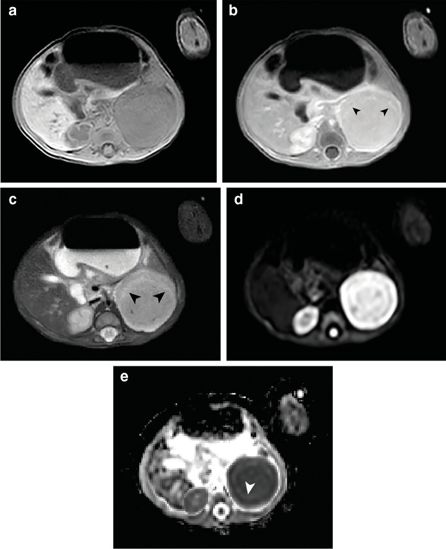
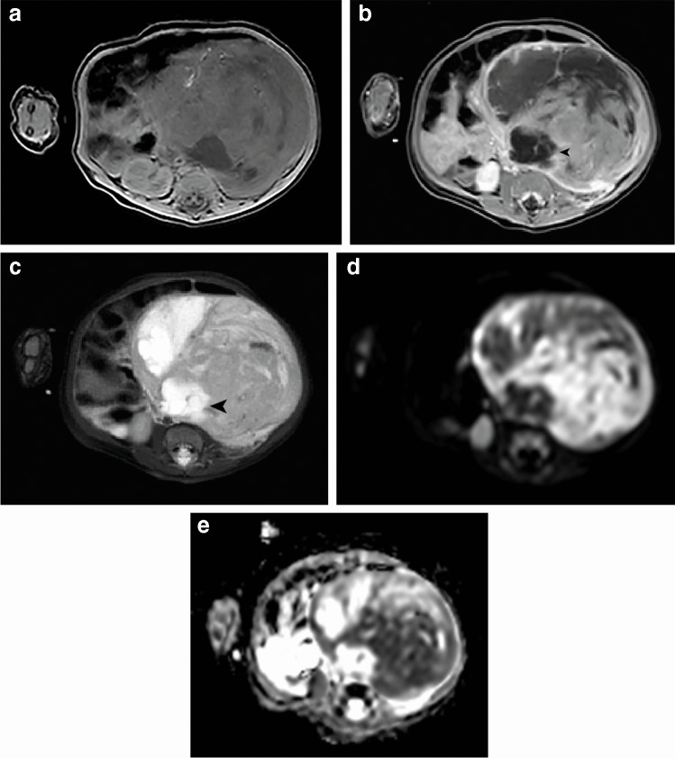
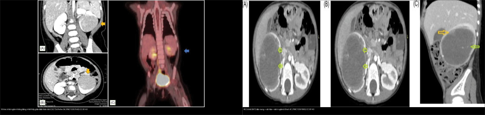
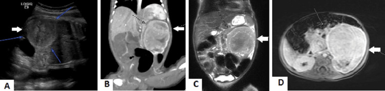
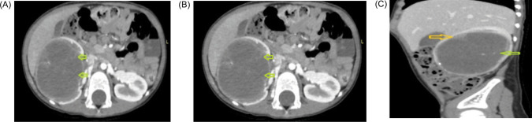
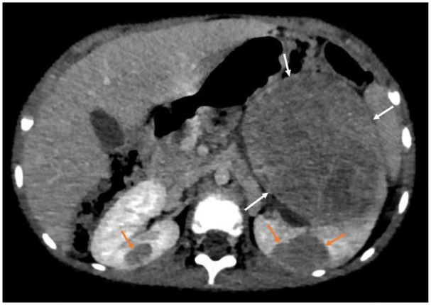
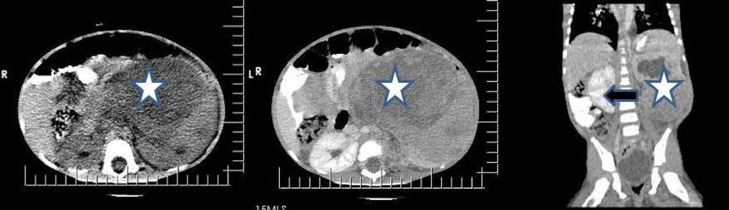

# 639 — Khối thận đặc ở trẻ: u nguyên bào thận (Wilms) vs u cơ trung mô bẩm sinh vs RCC / Pediatric solid renal mass: Wilms tumor vs congenital mesoblastic nephroma vs RCC

**Tags:** `pattern:khoi-than-dac` `pattern:u-nguyen-bao-than` `pattern:u-co-trung-mo` `pattern:rcc-nhi` `vung:than` `vung:o-bung-nhi` `score:COG` `score:SIOP` `protocol:US-CT-MRI-than-nhi` `incidentaloma:o-nguyen-bao-than`
**Mức chắc chắn (certainty):** tổng hợp y văn (literature synthesis) — tổng hợp từ nghiên cứu đoàn hệ/hồi cứu đa trung tâm + ca nguyên văn (verbatim case) giữ đúng tuổi – lâm sàng – chú thích gốc: đặc điểm MRI của u cơ trung mô bẩm sinh (van der Beek JN et al., Pediatr Radiol 2024, PMC11111520), ca u cơ trung mô hỗn hợp sơ sinh (Alpakra M et al., Cureus 2024, PMC11529903), u nguyên bào thận + ổ nguyên bào thận hai bên (Naggar A et al., Glob Pediatr Health 2024, PMC10785724), RCC ở trẻ (Shah AC et al., J Kidney Cancer VHL 2025, PMC12591865), ca u nguyên bào thận điển hình (Ikhuoriah T et al., Radiol Case Rep 2023, PMC10023853), phẫu thuật bảo tồn thận (Pethe SK et al., J Kidney Cancer VHL 2026, PMC13357643).

## 1. Tổng quan — vì sao TUỔI là biến số mạnh nhất, và vì sao mô học quyết định "đồng nhất hay không đồng nhất"

- **Nguyên tắc số 1: đặt tuổi lên trước khi mô tả khối.** Cùng một "khối thận đặc" nhưng **chẩn đoán phân biệt xếp chồng hoàn toàn theo tuổi**:
  - **< 6 tháng tuổi (nhũ nhi):** **u cơ trung mô bẩm sinh (congenital mesoblastic nephroma — CMN)** là **u thận đặc hay gặp nhất ở trẻ sơ sinh** (chiếm **2–5%** u thận nhi), tuổi trung vị **1 tháng** (0 ngày–23 tháng).
  - **1–10 tuổi:** **u nguyên bào thận (nephroblastoma / Wilms tumor)** — u thận ác **hay gặp nhất ở trẻ**, chiếm **~6% mọi ung thư nhi** và **~85% u thận nhi trong thập niên đầu**; tuổi đỉnh **~3 tuổi**.
  - **Thập niên thứ 2 (9–15 tuổi):** **ung thư biểu mô tế bào thận (renal cell carcinoma — RCC)** trở nên **phổ biến hơn Wilms**; trong đó **RCC nhóm chuyển đoạn (MiT-family translocation, TFE3/TFEB)** chiếm **20–40%** RCC ở trẻ.
- **TẠI SAO Wilms có "tiền thân" trên hình ảnh:** Wilms phát sinh từ **ổ nguyên bào thận (nephrogenic rests)** — ổ tế bào thận phôi **tồn tại sau tuần thai 36**. Ổ này **gặp tình cờ ~1% trẻ nhũ nhi**, và **~28–40% Wilms một bên** và **90–100% Wilms hai bên** đi kèm ổ nguyên bào thận; khi lan tỏa/nhiều ổ gọi là **nephroblastomatosis**. Vì vậy **luôn đọc cả hai thận** và tìm các nốt nhỏ vệ tinh.
- **TẠI SAO CMN thể kinh điển lại ĐỒNG NHẤT trên MRI (vật lý + mô học):** thể kinh điển gồm **tế bào hình thoi lành, ít phân bào, KHÔNG hoại tử/xuất huyết**, chất nền đồng nhất → **T2 đồng tín hiệu, ngấm đồng nhất**, có thể thấy **dấu vòng đồng tâm (concentric ring sign)** ở **58,3%**. Ngược lại, **thể tế bào (cellular)** có **chỉ số phân bào cao, hoại tử/xuất huyết/nang** → **T2 không đồng nhất**, kích thước lớn hơn nhiều (**311,6 cm³** so với **41,0 cm³** thể kinh điển, p < 0,001), **hoại tử/xuất huyết 72,7%** và **nang 72,7%**, **xâm lấn 27,3%**.
- **Số liệu định lượng nằm lòng:**
  - **Wilms:** OS ngày nay **> 90%**; **u hai bên 5–8%** ca, **2/3 đồng thời**, tuổi trung vị **24 tháng**, OS dài hạn **~80%** (Martos Rodríguez M et al., Ann Surg Oncol 2026, PMC13452865).
  - **Vỡ u (rupture) là biến cố nặng:** tần suất chung **2–10%** (đoàn hệ **15,3%**); **100% vỡ thuộc giai đoạn III/IV**; **EFS 5 năm 44,1% vs 75,8%** và **OS 58,2% vs 81,4%** (không vỡ); **HR tử vong 17,62 (95% CI 2,69–115,48)** (Emadeldeen H et al., Curr Oncol 2026, PMC13206529).
  - **RCC ở trẻ:** chỉ **1,4–6,3%** u thận nhi; phân bố theo tuổi **1,4% (< 4 tuổi) · 15–20% (5–9 tuổi) · 52,6% (10–15 tuổi)** (Shah AC et al., PMC12591865).
  - **Xử trí đặc thù theo tuổi (SIOP-RTSG):** **< 3 tháng tuổi → cắt thận trước (upfront nephrectomy)** — chuẩn điều trị CMN; **≥ 3 tháng mà u thận** thì **sinh thiết không được khuyến khích**, và **> 6 tháng** thì **hóa trị trước mổ theo phác đồ Wilms (SIOP UMBRELLA)** là chuẩn (van der Beek JN et al., PMC11111520).

*U cơ trung mô bẩm sinh **thể kinh điển**, thể tích 44 cm³: **(a)** T1W axial **đồng nhất, đồng tín hiệu**; **(b)** T1W sau tiêm **ngấm đồng nhất + dấu vòng đồng tâm (concentric ring sign)** (đầu mũi tên); **(c/d)** T2W/chuỗi khác giữ **tính đồng nhất** — mô học tế bào hình thoi lành không hoại tử. van der Beek JN et al., Pediatr Radiol 2024 (PMC11111520, Fig. 1), CC BY 4.0.*

## 2. Mẫu hình + chẩn đoán phân biệt theo tuổi & hình thái (Gamut)

Đọc **hai trục cùng lúc**: **(1) tuổi** và **(2) tính đồng nhất + thành phần (nang/hoại tử/mỡ/vôi hóa) trên siêu âm–CT–MRI**.

- **Nhũ nhi < 6 tháng, khối đặc ĐỒNG NHẤT, không hoại tử:** hướng **CMN thể kinh điển** (lành, chỉ cần cắt thận). Nếu **không đồng nhất + nang + xuất huyết** → **CMN thể tế bào/hỗn hợp** (dễ nhầm u ác, cần đối chiếu mô học).
- **Trẻ 1–10 tuổi, khối lớn không đồng nhất + "giả vỏ" + có thể xâm lấn mạch/tĩnh mạch chủ dưới:** hướng **Wilms**. **Luôn tìm ổ nguyên bào thận hai bên** và **đối bên**.
- **Trẻ ≥ 9–10 tuổi, khối đặc-nang, có vôi hóa, hạch:** hướng **RCC** (ở trẻ hay là **chuyển đoạn MiT**, dương TFE3/PAX8).
- **Gamut "khối bụng sau phúc mạc" ở trẻ (không xuất phát từ thận):** **u nguyên bào thần kinh (neuroblastoma)** — khối **ngoài thận**, thường **vôi hóa thô**, **bao/bọc mạch** ("encasement") thay vì đẩy mạch; **u cơ vân (rhabdomyosarcoma)**, **u lympho**, **u cơ trung mô thận khác**. Phân biệt gốc **trong/ngoài thận** là bước 1 (xem bài `630`).
- **Mẹo nhớ theo tuổi — "0–6–10":** **0–6 tháng → CMN**; **1–10 tuổi → Wilms**; **> 9–10 tuổi → RCC**.

*U cơ trung mô bẩm sinh **thể tế bào** ở bé gái 2 tháng, thể tích 312 cm³: **(a)** T1W axial **không đồng nhất**; **(b)** sau tiêm **ngấm không đồng nhất + nang lớn** (đầu mũi tên); **(c)** T2W lộ rõ **xuất huyết/hoại tử** — vì vậy **thể tế bào dễ bị nhầm với u ác**. van der Beek JN et al., Pediatr Radiol 2024 (PMC11111520, Fig. 2), CC BY 4.0.*

## 3. Bảng so sánh phân biệt (ma trận đối chiếu)

| Thực thể (entity) | Tuổi hay gặp | Hình ảnh điển hình | Chốt vào (rule-in) | Chốt loại (rule-out) | Gợi ý xác nhận |
|---|---|---|---|---|---|
| **CMN thể kinh điển** | **< 6 tháng (trung vị 1 tháng)** | **Đồng nhất**, T2 đồng tín hiệu, ngấm đồng nhất, **dấu vòng đồng tâm (58,3%)**, **không hoại tử/nang** | **Nhũ nhi + khối đồng nhất + không nang/hoại tử + thể tích nhỏ (~41 cm³)** | Có **hoại tử/nang/xuất huyết** → không phải thể kinh điển | **Cắt thận trước (không sinh thiết) nếu < 3 tháng** |
| **CMN thể tế bào/hỗn hợp** | Nhũ nhi, có thể tới **23 tháng** | **Không đồng nhất**, nang (**72,7%**), hoại tử/xuất huyết (**72,7%**), xâm lấn (**27,3%**), thể tích lớn (**311,6 cm³**) | **Khối lớn không đồng nhất ở nhũ nhi** | Đặc **đồng nhất + vòng đồng tâm** → thể kinh điển | Mô bệnh học (phân biệt với u ác); theo dõi tái phát |
| **U nguyên bào thận (Wilms)** | **1–10 tuổi (đỉnh ~3 tuổi)** | Khối **lớn, không đồng nhất**, **giả vỏ**, đẩy mạch; **ổ nguyên bào thận** vệ tinh; có thể **xâm lấn tĩnh mạch chủ dưới/nhĩ phải** | **Trẻ lớn + khối lớn không đồng nhất + ổ nguyên bào thận ± huyết khối mạch** | Tuổi **< 6 tháng + hoàn toàn đồng nhất** → nghĩ CMN | **US → MRI/CT** hai thận; mô bệnh học sau mổ/hóa trị |
| **RCC ở trẻ** | **9–15 tuổi** | Khối **đặc-nang**, vách ngấm, **vôi hóa**, hạch | **Trẻ ≥ 9–10 tuổi + đặc-nang + vôi hóa** | Trẻ nhỏ < 6 tháng → gần như loại RCC | Hóa mô miễn dịch **TFE3/PAX8** (chuyển đoạn MiT) |
| **Neuroblastoma (ngoài thận)** | Nhũ nhi–trẻ nhỏ | Khối **ngoài thận**, **vôi hóa thô** (hay gặp), **bọc/bao mạch** | **Khối không xuất phát từ thận + vôi hóa thô + bao mạch** | Còn **dấu hiệu "giả vỏ" thận + đẩy mạch** → nghĩ Wilms | MIBG, metanephrine; xem bài `630` |

Bảng phân biệt **ổ nguyên bào thận (nephrogenic rest)** vs **u nguyên bào thận** (cùng nằm trong 1 thận):

| Đặc điểm | Ổ nguyên bào thận (rest) | U nguyên bào thận (Wilms) |
|---|---|---|
| Kích thước | Nốt nhỏ, **thường < 1–2 cm** | Khối lớn, thường **> 3–5 cm** |
| Tín hiệu/ngấm | T2 đồng tín hiệu, **hầu như không ngấm** | Không đồng nhất, **ngấm rõ**, có nang/hoại tử |
| Bờ | **Bờ rõ, "nguyên vẹn"** | Giả vỏ, đẩy/ép nhu mô |
| Ý nghĩa | **Tiền ung thư** — theo dõi, có thể **teo nhỏ sau hóa trị** | **U ác** — cần điều trị đa mô thức |
| Số liệu | Gặp tình cờ **~1%** nhũ nhi; đi kèm **28–40%** Wilms một bên | Ổ nguyên bào thận đi kèm **90–100%** Wilms hai bên |

*Trái — **u nguyên bào thận (Wilms)**: khối ngấm thuốc **không đồng nhất** ở thùy giữa–dưới thận trái, **có "giả vỏ"** (đẩy mạch, không bọc). Phải — **RCC ở trẻ**: khối **đặc-nang**, **vách ngấm mỏng**, **vôi hóa** (mũi tên vàng) — chân dung của **RCC chuyển đoạn nhóm MiT** ở tuổi 9–15. Ảnh ghép letterbox giữ tỷ lệ (chỉ ghép 2 ảnh CC BY). Pethe SK et al. (PMC13357643) + Shah AC et al. (PMC12591865), CC BY 4.0.*

## 4. Protocol + phân giai đoạn + sơ đồ

- **Siêu âm (ultrasound) là bước 1 (đầu tay):** xác định khối **trong thận hay ngoài thận**, **đặc hay nang**, tìm **huyết khối tĩnh mạch chủ dưới**, và **khảo sát thận đối bên**. Đây là lý do "phát hiện khối bụng tình cờ trên siêu âm".
- **MRI được ưu tiên cho Wilms** (đánh giá **xuất phát trong thận**, **xâm lấn mạch** — tĩnh mạch chủ dưới/nhĩ phải, **thận đối bên**, **ổ nguyên bào thận**). **CT có cản quang** dùng khi MRI không khả dụng hoặc cần đánh giá phổi (di căn). **Trẻ nhũ nhi: hạn chế liều xạ (ALARA)** — ưu tiên siêu âm/MRI.
- **Tránh "biến u thành biến cố":** **hạn chế nắn/bấm khối** nhiều lần (nguy cơ **vỡ u** làm **tăng giai đoạn** và giảm sống còn) và **không sinh thiết** ở trẻ **< 3 tháng tuổi** theo SIOP-RTSG.
- **Phân giai đoạn (có 2 trường phái, khác nhau ở THỜI ĐIỂM mổ):**
  - **COG/NWTS (Mỹ):** mổ **trước** rồi hóa trị theo giai đoạn bệnh phẩm — **I** khu trú trong thận, cắt hết; **II** lan ra ngoài thận nhưng cắt hết; **III** còn u trong ổ bụng (hạch, phúc mạc, **vỡ u**, bờ cắt dương); **IV** di căn xa (phổi/gan/xương/não); **V** **hai bên**.
  - **SIOP (châu Âu):** **hóa trị trước mổ** để **thu nhỏ và "hạ giai đoạn"**, rồi mới mổ và phân giai đoạn theo **hình ảnh + bệnh phẩm sau hóa trị**.
- **Điều trị – điểm mấu chốt của hình ảnh:** **u hai bên (5–8%)** và **khối chỉ còn ở giai đoạn I, u ≤ 4 cm** là nhóm cân nhắc **phẫu thuật bảo tồn thận (nephron-sparing surgery — NSS)**, trong đó **NSS A (cắt bán phần)** được ưu tiên hơn **NSS B (bóc u)** (Pethe SK et al., PMC13357643).

```mermaid
flowchart TD
  A["Khối bụng/khối thận ở trẻ"] --> US["Siêu âm: khối TRONG hay NGOÀI thận?"]
  US -->|"ngoài thận, vôi hóa thô, bao mạch"| NB["Nghĩ neuroblastoma → xem bài 630"]
  US -->|"trong thận"| AGE{"Tuổi"}
  AGE -->|"< 6 tháng"| CMN{"Đồng nhất?"}
  CMN -->|"đồng nhất, không nang/hoại tử"| C1["CMN thể kinh điển — cắt thận trước, không sinh thiết"]
  CMN -->|"không đồng nhất, nang/xuất huyết"| C2["CMN thể tế bào/hỗn hợp — đối chiếu mô học, theo dõi tái phát"]
  AGE -->|"1-10 tuổi"| W["Nghĩ Wilms (u nguyên bào thận)"]
  W --> IMG["MRI ưu tiên: hai thận + xâm lấn mạch (TM chủ dưới/nhĩ phải) + ổ nguyên bào thận"]
  IMG --> STG{"Hai bên?"}
  STG -->|"có &#40;5-8%&#41;"| B["Giai đoạn V — NSS nếu được"]
  STG -->|"không"| COG["COG: mổ trước rồi hóa trị theo giai đoạn I-IV<br/>SIOP: hóa trị trước mổ rồi phân giai đoạn"]
  AGE -->|"> 9-10 tuổi"| RCC["Nghĩ RCC — hóa mô miễn dịch TFE3/PAX8 (chuyển đoạn MiT)"]
```

## 5. Biến thể bình thường & cạm bẫy

- **Ổ nguyên bào thận KHÔNG phải Wilms:** nốt **nhỏ, bờ rõ, hầu như không ngấm** — **đừng gọi là u ác**; nhưng phải **theo dõi** (tiền ung thư) và **luôn khảo sát thận đối bên**.
- **CMN thể tế bào "giả u ác":** không đồng nhất + nang + xuất huyết ở **nhũ nhi** có thể bị đọc nhầm là u ác → **tuổi < 6 tháng là chốt** + chỉ định mô học.
- **RCC ở trẻ thường bị xếp nhầm vào "Wilms không điển hình":** **trẻ ≥ 9–10 tuổi + vôi hóa + đặc-nang** → nghĩ RCC; khác biệt **hóa trị trước mổ** (Wilms) vs **mổ là chính** (RCC).
- **Cạm bẫy xâm lấn mạch:** huyết khối u lan vào **tĩnh mạch chủ dưới/nhĩ phải** thay đổi kế hoạch mổ (cần MRI/echo tim) — **luôn nêu rõ có/không**.
- **Vỡ u (rupture) là cờ đỏ:** gây **tăng giai đoạn** (III/IV) và giảm sống còn rõ (OS **58,2% vs 81,4%**). **Hạn chế nắn khối**, và cảnh giác ở u đã vỡ (dịch ổ bụng, đau cấp).
- **Hội chứng dễ mắc (predisposition):** Beckwith–Wiedemann, WAGR, Denys–Drash → **tầm soát hai thận định kỳ** và cân nhắc **NSS** để giữ nhu mô (u **đồng thời/đối bên muộn**).
- **Cạm bẫy "thể tích/đo đạc":** ổ nguyên bào thận **teo nhỏ sau hóa trị** (không phải "u biến mất thần kỳ"); đối chiếu **trước–sau** để không đánh giá sai đáp ứng.

## 6. Tự lượng giá — Blind Quiz

**Ca 1 — Bé trai 1 tháng tuổi, sờ thấy khối bụng trái. Nhìn MRI, mô tả trước.**

- Hỏi: tính đồng nhất? có nang/hoại tử không? chẩn đoán và hướng xử trí?

<b>Bấm để hiện đáp án</b>

- **Khối đặc ĐỒNG NHẤT, đồng tín hiệu, ngấm đồng nhất + dấu vòng đồng tâm**, **không** nang/hoại tử → **CMN thể kinh điển**.
- **< 3 tháng tuổi → cắt thận trước (upfront nephrectomy), KHÔNG sinh thiết** theo SIOP-RTSG.
- Nguồn ca: van der Beek JN et al., Pediatr Radiol 2024 (PMC11111520, Fig. 1), CC BY 4.0.

**Ca 2 — Bé gái 2 tháng tuổi, khối thận trái lớn. Đọc MRI, so với Ca 1:**

- Hỏi: khác Ca 1 ở đâu? chẩn đoán? vì sao dễ nhầm?

<b>Bấm để hiện đáp án</b>

- **Không đồng nhất**, **nang lớn + xuất huyết/hoại tử** → **CMN thể tế bào** (thể tích **312 cm³**, lớn gấp ~7 lần thể kinh điển).
- **Dễ nhầm u ác** vì không đồng nhất; chốt vẫn là **tuổi nhũ nhi** + mô học.
- Nguồn: van der Beek JN et al., Pediatr Radiol 2024 (PMC11111520, Fig. 2), CC BY 4.0.

**Ca 3 — Khối bụng ở trẻ nhỏ: khối nào là u nguyên bào thận, khối nào là u cơ trung mô? Nhìn ảnh và lập luận:**

- Hỏi: chuỗi hình ảnh cho thấy gì? cạm bẫy về "phát hiện trước sinh"?

<b>Bấm để hiện đáp án</b>

- **(A)** siêu âm **trong tử cung** đã thấy thận trái to + khối **bờ rõ, đồng tín hiệu, ngấm đồng nhất**; **(B)** CT coronal; **(C/D)** MRI T2 coronal/axial.
- Chẩn đoán: **u cơ trung mô bẩm sinh thể hỗn hợp** — khối **có thể phát hiện trước sinh**, gây **đa ối**; **đại thể + vi thể** (ảnh Fig. 2 cùng bài) cho thấy tế bào hình thoi trong khi còn đảo nhu mô thận.
- **Cạm bẫy:** "khối thận ở thai/nhũ nhi" thường bị nghĩ ngay "Wilms" → **sai tuổi**; < 6 tháng hãy nghĩ **CMN**.
- Nguồn ca: Alpakra M et al., Cureus 2024 (PMC11529903, Fig. 1), CC BY 4.0.

**Ca 4 — Trẻ 12 tuổi, tiểu máu đại thể mạn, khối thận phải. Nhìn CT:**

- Hỏi: mô tả tổn thương? vì sao nghĩ RCC chứ không phải Wilms?

<b>Bấm để hiện đáp án</b>

- **(A)** CT không tiêm: khối **đặc-nang không đồng nhất** trong thận phải, **có vôi hóa** (mũi tên vàng); **(B/C)** CECT: **vách ngấm mỏng**, thành phần đặc **ngoại vi**.
- **Tuổi 12 + đặc-nang + vôi hóa** → nghĩ **RCC** (hóa mô miễn dịch **TFE3+, PAX8+** = **RCC chuyển đoạn nhóm MiT**).
- Nguồn ca: Shah AC et al., J Kidney Cancer VHL 2025 (PMC12591865, Fig. 1), CC BY 4.0.

**Ca 5 — Trẻ 3 tuổi, khối thận trái lớn; CT thấy thêm nốt nhỏ hai bên. Đọc và quyết định bước tiếp theo:**

- Hỏi: khối lớn là gì? các nốt nhỏ hai bên là gì? vì sao phải tìm?

<b>Bấm để hiện đáp án</b>

- Khối lớn (mũi tên trắng) = **u nguyên bào thận (Wilms)** thùy dưới thận trái.
- Các nốt nhỏ **hai bên, bờ rõ, hầu như không ngấm** (mũi tên cam) = **ổ nguyên bào thận** (**nephrogenic rests / nephroblastomatosis**).
- **Vì sao phải tìm:** ổ nguyên bào thận là **tiền ung thư**, đi kèm **28–40%** Wilms một bên và **90–100%** Wilms hai bên → đổi **theo dõi** và cân nhắc **NSS**.
- Nguồn ca: Naggar A et al., Glob Pediatr Health 2024 (PMC10785724, Fig. 2), **CC BY-NC 4.0** (nguyên bản).

**Ca 6 — Trẻ 3 tuổi, khối thận trái lớn trên siêu âm/CT. Nhìn hình, nêu 3 chốt cần ghi trong báo cáo:**

- Hỏi: khối xuất phát từ đâu? có xâm lấn không? báo cáo cần ghi gì?

<b>Bấm để hiện đáp án</b>

- Khối **đặc-nang không đồng nhất ngấm thuốc**, **xuất phát từ thận trái** (không phải khối ngoài thận), **đẩy** (không bọc) mạch và quai ruột → hướng **Wilms**.
- **3 chốt bắt buộc:** (1) **xuất phát trong thận**; (2) **huyết khối mạch** (tĩnh mạch chủ dưới/nhĩ phải) có/không; (3) **thận đối bên + ổ nguyên bào thận** có/không.
- Nguồn ca: Ikhuoriah T et al., Radiol Case Rep 2023 (PMC10023853, Fig. 7), **CC BY-NC-ND 4.0** (nguyên bản, không crop/ghép).

## Bài liên quan chéo
- [600 – Tổng quan Nhi khoa](../600-tong-quan-nhi-khoa/lesson.md)
- [630 – U bụng nhi: neuroblastoma vs Wilms](../630-u-bung-nhi-neuroblastoma-vs-wilms/lesson.md)
- [636 – Cấp cứu niệu–sinh dục nhi](../636-cap-cuu-nieu-sinh-duc-nhi/lesson.md)
- [638 – Khối bìu–tinh hoàn nhi](../638-khoi-biu-tinh-hoan-nhi/lesson.md)
- [665 – Khối u gan nhi](../665-khoi-u-gan-nhi/lesson.md)
- [151 – U thận đặc người lớn (RCC vs oncocytoma vs AML)](../151-u-than-dac/lesson.md)
- [156 – Hội chứng di truyền u thận](../156-hoi-chung-di-truyen-u-than/lesson.md)

> Không dùng để chẩn đoán độc lập khi chưa có người hướng dẫn.
