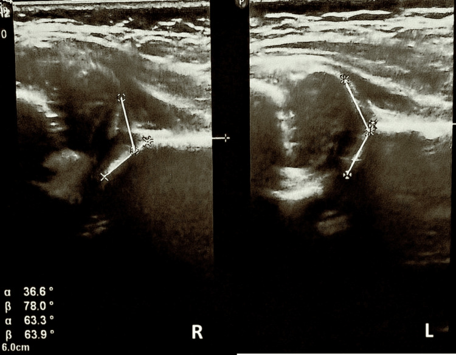
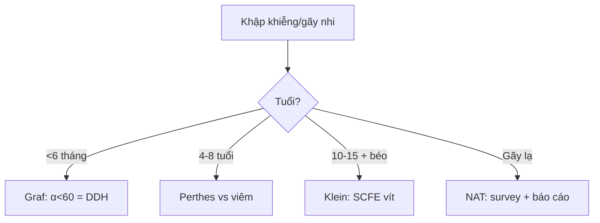

# 640 — Háng nhi: DDH Graf, Perthes, SCFE & NAT / Peds hip & abuse

**Tags:** `pattern:khop-hang-nhi` `pattern:gay-xuong-nhi` `vung:co-xuong-khop-nhi` `score:Graf` `score:Salter-Harris`
**Mức chắc chắn (certainty):** tổng hợp y văn (literature synthesis) — nhóm tự biên từ y văn mở, chưa gắn ca nguyên văn đơn lẻ.

## 1. Tổng quan — tuổi nào bệnh nấy + gãy nào báo động nấy

- DDH (< 6 tháng, sụn chưa cốt hóa): siêu âm Graf — TẠI SAO α ≥ 60° là chuẩn: mái xương che ≥ 50% chỏm; α < 60° = mái dốc, chỏm trật dần.
- Perthes (4–8 tuổi): thiếu máu chỏm tự phát → đặc → vỡ → tái tạo — TẠI SAO chỏm nhỏ + đặc + vỡ: xương chết đặc lại rồi gãy vụn trước khi mạch mới vào.
- SCFE (10–15 tuổi béo phì): sụn tiếp hợp trượt — TẠI SAO Klein không cắt chỏm + đau gối quy chiếu: chỏm trượt sau-xuống, đau lan theo dây bịt.
- NAT (< 2 tuổi): CML (góc/quai xô) + sườn sau + nhiều lứa tuổi — TẠI SAO: giật lắc tay chân + bóp ngực là cơ chế duy nhất tạo các gãy này.

## 2. Gamut khập khiễng/gãy nhi (Gamut)

- **< 6 tháng + α < 60° + Ortolani (+):** DDH — Pavlik (theo dõi trật bịt + hoại tử!).
- **4–8 tuổi + chỏm đặc/vỡ + khập khiễng không sốt:** Perthes — chứa chỏm + theo dõi (khác viêm nhiễm sốt!).
- **Béo phì + Klein (+) + đau gối:** SCFE — vít cố định cấp cứu (trượt tiếp hoại tử!).
- **CML + sườn sau + nhiều tuổi xương:** NAT — báo cáo + skeletal survey + nhãn khoa.

## 3. Bảng so sánh phân biệt (ma trận đối chiếu)

| Thực thể (entity) | Hình ảnh điển hình | Chốt vào (rule-in) | Chốt loại (rule-out) | Gợi ý xác nhận |
|---|---|---|---|---|
| DDH | **Graf α < 60° + β > 55° + che < 50%** | **α 36° + β 78° = Type IV** | α ≥ 60° → bình thường | Pavlik + siêu âm (coi chừng trật bịt!) |
| Perthes | **Chỏm nhỏ + đặc + vỡ + 4–8 tuổi** | **Không sốt + vỡ chỏm** | Sốt + CRP → viêm nhiễm | Chứa chỏm + Herring |
| SCFE | **Klein không cắt chỏm + béo phì + đau gối** | **Trethowan (+) + frog-leg** | Háng thường + tuổi nhỏ → DDH | Vít ngay (cả 2 bên khi nguy cơ!) |
| NAT | **CML + sườn sau + nhiều lứa tuổi** | **Góc/quai + sườn sau = báo cáo** | Đơn gãy + tai nạn rõ → thường | Survey + mắt + bảo vệ trẻ |

*Phải Type IV + Pavlik → trật bịt + hoại tử coxa plana (biến chứng Tg!). Nguồn: Bogojevska Doksevska et al., Cureus 2026 Fig. 2, CC BY 4.0.*

## 4. Protocol háng nhi

- **Siêu âm Graf < 6 tháng + XR AP/frog-leg + skeletal survey** khi nghi NAT; Pavlik + siêu âm hàng tuần (phát hiện trật bịt sớm!).

## 5. Cạm bẫy

- **Pavlik quá gấp gây trật bịt + hoại tử** (ca trên!) — siêu âm hàng tuần + Shenton line.
- **SCFE đau gối bỏ sót háng** — béo phì + đau gối là chụp háng frog-leg.
- **Perthes kháng sinh mù** tưởng viêm — không sốt + vỡ chỏm là Perthes (viêm là sốt + dịch + CRP!).

## 6. Tự lượng giá — Blind Quiz

**Ca 1 — Bé gái 2 tháng sàng lọc DDH. Đọc siêu âm Graf.**

- Hỏi: α/β bao nhiêu? Graf mấy? Pavlik có biến chứng gì phải theo dõi?

<b>Bấm để hiện đáp án</b>

- Dấu hiệu (findings): phải α 36,6° + β 78° (Type IV), trái bình thường.
- Chẩn đoán (diagnosis): **DDH Graf IV** — Pavlik + siêu âm hàng tuần (biến chứng: trật bịt + hoại tử chỏm coxa plana như ca này!).
- Nguồn: Bogojevska Doksevska et al., Fig. 2, CC BY 4.0.

**Ca 2 — Bé trai 12 tuổi béo phì đau gối 1 tháng, háng hơi đau:** gối hay háng? Phim nào? *(Bảng mục 3.)*

<b>Bấm để hiện đáp án</b>

- **SCFE:** chụp háng AP + frog-leg + Klein (đau gối quy chiếu!) — vít ngay.

## Bài liên quan chéo
- [600 – Tổng quan Nhi](../600-tong-quan-nhi-khoa/lesson.md)
- [321 – Gãy trẻ em](../321-gay-tre-em/lesson.md) (Salter-Harris)
- [361 – Háng người lớn](../361-khop-hang/lesson.md) (AVN/FAI)

> Không dùng để chẩn đoán độc lập khi chưa có người hướng dẫn.
