# 641 — Theo dõi hậu phẫu Kasai ở teo đường mật: viêm đường mật, tăng áp lực cửa & nốt gan (HCC) / Post-Kasai follow-up in biliary atresia

**Tags:** `pattern:xo-gan-mat` `pattern:viem-duong-mat` `pattern:tang-ap-luc-cua` `vung:gan` `score:PELD` `protocol:MRI-MRCP-gan` `protocol:FIB-4-APRI`
**Mức chắc mắn (certainty):** tổng hợp y văn (literature synthesis) — nhóm tự biên từ y văn mở (JKSR 2022, Pediatr Surg Int 2025–2026, JPGN 2025–2026, Hepatol Commun 2019, BMC Gastroenterol 2011, J Clin Med 2021) có số; **các ca trong quiz là ca nguyên văn (verbatim case)** chép đúng tuổi – bối cảnh – chú thích gốc (Hwang/JKSR, Park/Pediatr Surg Int, Chong/Am J Case Rep, Cortes-Cerisuelo/J Clin Med).

## 1. Tổng quan bệnh học – cơ chế hình ảnh

Teo đường mật (biliary atresia, BA) là bệnh tắc nghẽn–xơ hóa đường mật tiến triển ở trẻ nhũ nhi. **Kasai portoenterostomy (HPE)** là phẫu thuật đầu tay; mục tiêu là **tái lập dòng mật** (clearance of jaundice, COJ — **bilirubin < 20 µmol/L trong 6 tháng đầu**, hoặc < 2 mg/dL trong 3 tháng). Ngay cả khi thành công, bệnh vẫn tiến triển: **tái lập dòng mật đạt 60–90%**, nhưng tới **75% tiến triển xơ gan** và **~50% cần ghép gan trước tuổi trưởng thành** (Okubo 2025). Vì vậy "Kasai không phải là chữa khỏi, mà là mua thời gian" — **theo dõi hậu phẫu là một lĩnh vực CĐHA riêng**.

Ba trục biến chứng cần theo dõi: **(1) viêm đường mật (cholangitis) & tắc quai mật; (2) tăng áp lực cửa (portal hypertension, PH) — giãn tĩnh mạch, lách to quá mức, giảm tiểu cầu; (3) nốt gan (tái sinh vs loạn sản/HCC).** Mọi trẻ sau Kasai cần trả lời 3 câu mỗi lần khám: **còn dẫn lưu mật không? đã tăng áp cửa chưa? có nốt gan mới không?**

- **TẠI SAO viêm đường mật thấy được trên hình ảnh:** ứ mật + trào ngược ruột qua quai Roux → nhiễm khuẩn đường mật; hình ảnh **giãn ống mật trong gan hình "chuỗi hạt"** trên MRCP/T2, **vi nang trong gan (bile lakes)** đầy thuốc viền thì muộn trên CT, và **dẫn lưu mật kém** trên xạ hình HIDA (thuốc giữ lại lâu). Viêm đường mật tái diễn làm nặng xơ gan nhanh.
- **TẠI SAO tăng áp lực cửa thấy trên hình ảnh:** xơ gan mật → tăng áp tĩnh mạch cửa → **lách to**, **giãn tĩnh mạch thực quản/dạ dày**, **tuần hoàn bàng hệ** (quanh thực quản, lách–thận, sau phúc mạc), tĩnh mạch cửa **nhỏ và có thể đảo dòng** trên Doppler; gan **phì đại thùy đuôi** (caudate) bù trừ. **PH gặp 46,4% toàn bộ BN và 49,8% số người sống với gan tự nhiên 20 năm**; giãn tĩnh mạch thực quản–dạ dày (**GEV) 35–43%**, lách to quá mức (**hypersplenism) 36,8–39,3%** (Okubo 2025).
- **Định nghĩa PH tối thiểu:** giãn tĩnh mạch **độ ≥ 2** trên nội soi VÀ/HOẶC tiểu cầu **< 150 × 10⁹/L** kèm lách to (chiều dài lách ≥ 2 z-score theo tuổi/giới trên siêu âm).
- **TẠI SAO có nốt gan:** xơ gan mật tạo **nốt tái sinh (regenerative) lành tính**; nhưng ở BA **nốt loạn sản (dysplastic) và HCC có thể xuất hiện SỚM, kể cả dưới 1 tuổi** (khác HCC trẻ thường gặp 10–14 tuổi). Trong nhóm sống với gan tự nhiên, **24% (23/96) phát triển nốt gan**, trong đó **17,4% là loạn sản/HCC sớm**, **39,1% tái sinh**; **khoảng cách từ Kasai đến khi phát hiện nốt trung vị 12,8 năm**. Mổ ghép: **43% mảnh ghép có nốt, ~1/4 là tiền ác/ác, phần lớn KHÔNG thấy trên hình ảnh/AFP trước mổ** → **không được bỏ qua**. HCC ở BA có hình ảnh giống người lớn: **ngấm mạnh thì động mạch + thải thuốc (washout) thì cửa/muộn**.
- **Định lượng chức năng gan & tiên lượng (quantitative):** sau COJ, **tới 51% xơ gan (Metavir F4) và 54% tăng áp cửa** (Hukkinen 2019, theo dõi trung vị 8,3 năm); **bile acid máu tại 3 tháng > 150 µmol/L** (hoặc bilirubin > 18,5 µmol/L) → **nguy cơ ghép/tử vong gấp 7–8 lần**; ở trẻ đã COJ, bile acid **> 119 µmol/L** → **12 lần**; **tại 6 tháng, bile acid > 78 µmol/L** → nguy cơ PH **gấp 4 lần** (bilirubin > 8,5 µmol/L → **13 lần**) (Anderson 2025).

## 2. Mẫu hình + chẩn đoán phân biệt theo cơ chế – vị trí (Gamut)

**Gamut theo CƠ QUAN (đúng thứ tự đọc phim sau Kasai):**
- **Đường mật:** viêm đường mật (cholangitis) → giãn ống "chuỗi hạt", hồ mật; **tắc ống mật của quai Roux** (biliary limb obstruction) → ứ thuốc trên HIDA; **hẹp miệng nối**.
- **Gan (mô xơ):** xơ gan mật (biliary cirrhosis) → bờ gan lởm chởm, tăng echo/không đồng nhất; **phì đại thùy đuôi**; sau cùng là suy gan.
- **Tăng áp lực cửa:** **giãn tĩnh mạch thực quản/dạ dày**, **lách to**, **tuần hoàn bàng hệ** (left gastric varix, shunt lách–thận, varices quanh lách/sau phúc mạc), **đảo dòng tĩnh mạch cửa**, báng; biến chứng: **hội chứng gan–phổi (HPS)**, **tăng áp phổi do cửa (PoPH)**.
- **Nốt gan:** tái sinh (lành), u hạt vôi hóa (lành), **nốt loạn sản (dysplastic)/HCC sớm (ác)**, hiếm: hepatoblastoma, cholangiocarcinoma.
- **Sau ghép gan:** **huyết khối động mạch gan (HAT)**, **hẹp tĩnh mạch cửa**, **tắc dòng ra tĩnh mạch gan**, PTLD.

**Gamut theo MẪU HÌNH (cùng gan, khác bản chất):**
- **Nốt tái sinh:** thường **T2 tối, KHÔNG ngấm thuốc**, có **mạch cửa xuyên qua** nốt; kích thước **0,6–13 cm**.
- **Nốt loạn sản/HCC:** **ngấm thì động mạch + thải thuốc thì cửa/muộn**, có khi **hạ tín hiệu T1**; **AFP có thể bình thường** ở nốt loạn sản.
- **U hạt vôi hóa:** nốt **vôi hóa nhỏ** (17,4% nhóm nốt) — lành tính.

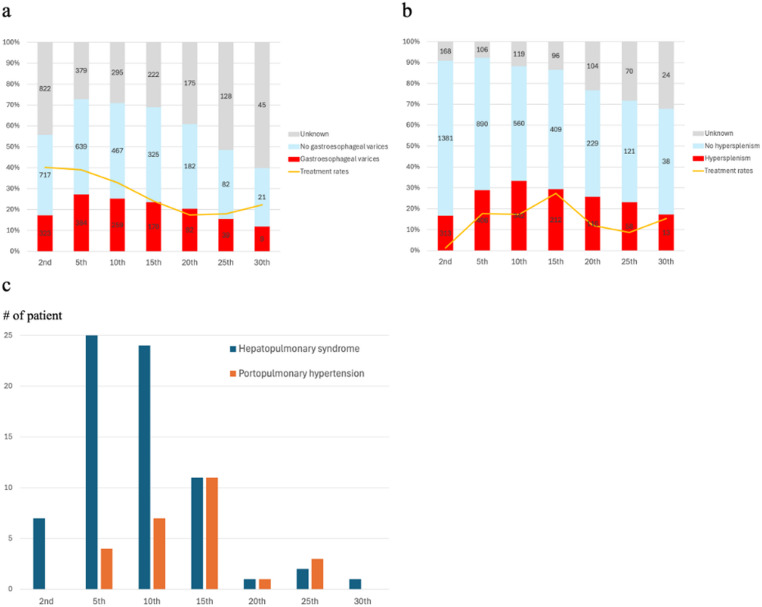
*Biểu đồ thời điểm khởi phát tăng áp lực cửa (đăng ký teo đường mật Nhật Bản, JBAR): **giãn tĩnh mạch thực quản–dạ dày đỉnh ở năm thứ 5**, **lách to quá mức đỉnh ở năm thứ 10** (HPS đỉnh năm 5, PoPH năm 15). Nguồn: Okubo R et al., Pediatr Surg Int 2025 (PMC12578773), Fig. 2, CC BY 4.0.*

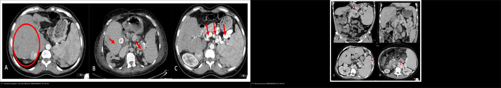
*Trái: CT — **phì đại gan trung tâm** (vòng đỏ), **phình mạch lách vôi hóa** (mũi tên đỏ). Phải: CT các **shunt cửa–chủ** (A: giãn tĩnh mạch vành vị; B: shunt lách–thận; C: varices quanh lách; D: varices sau phúc mạc). Nguồn: Cortes-Cerisuelo M et al., J Clin Med 2021 (PMC8584637), CC BY 4.0. Ảnh ghép letterbox, giữ tỉ lệ.*

## 3. Bảng so sánh phân biệt (ma trận đối chiếu)

| Thực thể (entity) | Hình ảnh điển hình | Chốt vào (rule-in) | Chốt loại (rule-out) | Gợi ý xác nhận |
|---|---|---|---|---|
| Viêm đường mật sau Kasai | MRCP/T2: **giãn ống trong gan "chuỗi hạt"**; CT: **vi nang trong gan ngấm viền** (bile lakes) | **Sốt + bilirubin tăng so nền + phân bạc màu**, kèm giãn ống/vi nang | Không có bối cảnh sốt/ứ mật → ít khả năng | Lâm sàng + siêu âm; điều trị kháng sinh TM 2–3 tuần |
| Tắc ống mật quai Roux | Xạ hình HIDA: **thuốc giữ lại lâu, không/thoát kém** | **Ứ thuốc trên HIDA + không dẫn lưu** | HIDA thoát tốt → loại | HIDA; đối chiếu siêu âm/mổ |
| Xơ gan mật (biliary cirrhosis) | Siêu âm: **echo không đồng nhất + bờ gan lởm chởm + phì đại thùy đuôi**; báng | **Bờ gan nốt + lách to + giảm tiểu cầu** | Gan nhu mô đều, bờ nhẵn → chưa xơ | Siêu âm + elastography + APRI |
| Tăng áp lực cửa | CT/MRI: **giãn TM thực quản/dạ dày**, lách to, tuần hoàn bàng hệ; Doppler: **đảo dòng TM cửa** | **Varices + lách to + tiểu cầu < 150 × 10⁹/L** | Tiểu cầu bình thường + không varices → PH ít khả năng | Nội soi tiêu hóa trên + Doppler + elastography |
| Nốt tái sinh (lành) | MRI: **T2 tối, KHÔNG ngấm**, **có mạch cửa xuyên nốt**, 0,6–13 cm | **Không ngấm + mạch cửa xuyên qua** | **Ngấm ĐM + thải thuốc** → nghi loạn sản/HCC | MRI động ± mô bệnh; theo dõi kích thước |
| Nốt loạn sản / HCC | MRI động: **ngấm mạnh thì ĐM + thải thuốc thì cửa/muộn**, hạ tín hiệu T1 | **Washout điển hình + ngấm ĐM** ở gan xơ | T2 tối không ngấm + mạch xuyên → tái sinh | MRI động, AFP (có thể **bình thường**), sinh thiết nếu mơ hồ |
| Biến chứng sau ghép | Doppler: **HAT (mất tín hiệu ĐM gan)**, **hẹp TM cửa tại miệng nối**, **tắc dòng ra TM gan** | **Mất/đảo dòng mạch ghép** sau ghép | Dòng bình thường → loại | Siêu âm Doppler (± CTA/MRA) |

**Bảng xét nghiệm không xâm lấn dự đoán xơ gan / tăng áp cửa:**

| Chỉ số | Ngưỡng | Hiệu năng | Ghi chú |
|---|---|---|---|
| Transient elastography (TE) | **12,7 kPa** (giãn TM) | **Se 84% / Sp 77%** | Cắt **19,9 kPa** dự đoán biến chứng (JKSR 2022) |
| Liver stiffness (LS) | **16,9 kPa** (PH); **> 24 kPa** (nhóm lớn tuổi, xơ) | AUROC **0,91–0,96** | Hukkinen 2019 |
| APRI | **0,70** (PH); **1,92** (giãn TM) | AUROC **0,92**; Se/Sp **84/83%** | Tăng tiểu cầu giả → cẩn thận |
| Lách to trên siêu âm | ≥ 2 z-score | **Se 92% / Sp 85%** (giãn TM) | Không đặc hiệu riêng PH |
| Bile acid máu | **> 150 µmol/L** (3 tháng); **> 78 µmol/L** (6 tháng) | Nguy cơ ghép/tử vong **7–8×**; PH **4×** | Anderson 2025 |

### Dấu hiệu "đọc chuẩn xác"
- **Vi nang trong gan (bile lakes)** ngấm viền thì muộn là dấu của **viêm đường mật** — nhưng **nang mật cũng gặp ở xơ gan mật không nhiễm trùng**; phải ghép với **sốt + bilirubin tăng**.
- **Nốt tái sinh có thể ngấm nhẹ** → khó phân biệt HCC; khi nghi, dùng **MRI động** và **mô bệnh**.
- **AFP KHÔNG đủ loại trừ nốt loạn sản** (Park 2026: AFP nốt loạn sản ~2,0 ng/mL, tương tự nốt lành).

## 4. Protocol chụp + hệ phân độ/điểm chuẩn hóa

- **Siêu âm bụng (đầu tay, không tia):** kích thước gan/lách, bờ gan, echo nhu mô, ứ mật, tuần hoàn bàng hệ; **Doppler tĩnh mạch cửa–gan** (đảo dòng, đường kính). **Siêu âm đàn hồi (2D-SWE/TE)**: xơ gan **~2D-SWE 11,5 kPa / TE 10,5 kPa**, biến chứng **TE 19,9 kPa**.
- **Xét nghiệm máu theo dõi:** bilirubin, GGT, AST/ALT, albumin, **tiểu cầu**, **APRI**, **bile acid**, **M2BPGi**, **AFP** (kèm siêu âm).
- **Nội soi tiêu hóa trên:** **hằng năm bắt đầu từ 12 tháng tuổi** (hoặc khi nghi chảy máu) để phát hiện giãn tĩnh mạch; **giãn độ ≥ 2 → diệt tĩnh mạch bằng chích xơ/thắt vòng (EVL) hoặc chẹn beta**.
- **MRI gan + MRCP:** khi nghi viêm đường mật/tắc mật, hoặc **phát hiện/đặc trưng nốt gan** (nốt tái sinh vs loạn sản/HCC bằng MRI động); **không tia**, dùng theo dõi lâu dài.
- **CT:** hạn chế ở trẻ (ALARA), dùng khi cần bản đồ mạch/tăng áp cửa phức tạp (CTA) hoặc trước ghép.
- **Phân loại & chỉ định ghép gan:** dùng **PELD** và các chỉ định — **thất bại Kasai sớm: không dẫn lưu mật + bilirubin > 6 mg/dL sau 3 tháng**; xơ gan/tăng áp cửa có biến chứng (chảy máu, báng, HPS/PoPH), **viêm đường mật kháng trị**, **suy dinh dưỡng/chậm tăng trưởng**.
- **Theo dõi nốt gan (chuẩn hóa):** siêu âm + AFP định kỳ; nốt mới/đổi tính chất → **MRI động**; nốt **ngấm ĐM + thải thuốc** hoặc to lên → **sinh thiết/mổ** (không tin AFP bình thường).

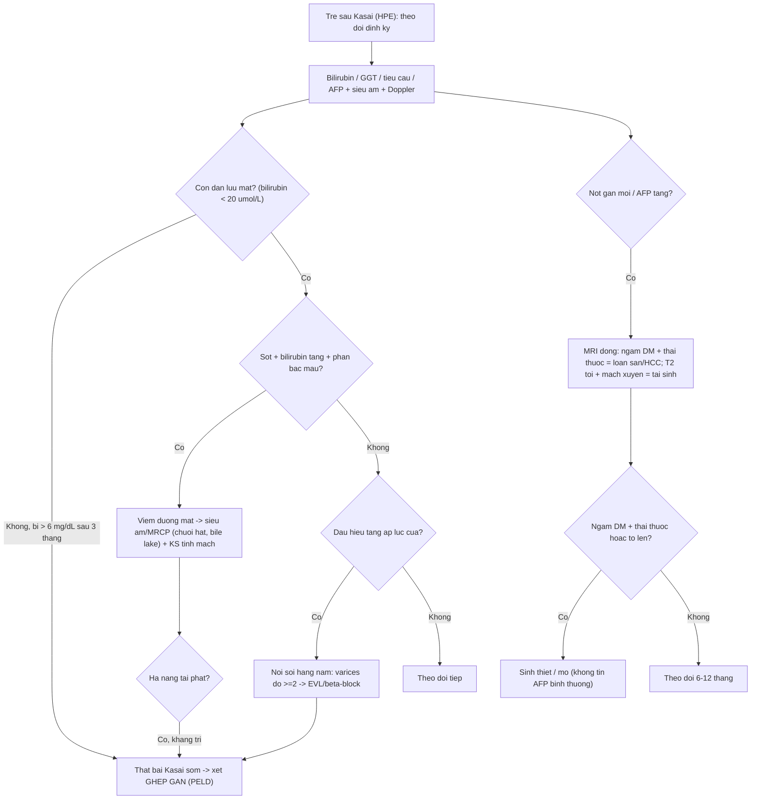

## 5. Biến thể bình thường và cạm bẫy

- **Viêm đường mật là chẩn đoán LÂM SÀNG**, không chỉ hình ảnh: **sốt + bilirubin tăng so nền (± phân bạc màu)**, đáp ứng kháng sinh TM. Hình ảnh có thể **bình thường** trong đợt sớm → đừng loại trừ vì siêu âm sạch.
- **Nốt tái sinh vs loạn sản/HCC:** nốt tái sinh **có thể ngấm nhẹ** và **rất lớn (tới 13 cm)**; ngược lại nốt loạn sản có thể **AFP bình thường** → chỉ **MRI động + mô bệnh** mới phân định.
- **HCC ở BA có thể xuất hiện < 1 tuổi** — khác HCC trẻ điển hình 10–14 tuổi; **không loại trừ theo tuổi**.
- **Elastography bị nhiễu bởi ứ mật/báng/viêm gan cấp** → đọc cùng bối cảnh, không đọc đơn độc.
- **Đảo dòng tĩnh mạch cửa / tĩnh mạch cửa nhỏ** dễ bị bỏ sót khi siêu âm vội → phải ghi nhận hướng dòng bằng Doppler.
- **Sau ghép gan:** các biến chứng **HAT, hẹp TM cửa, tắc dòng ra TM gan** thường biểu hiện bằng **bất thường Doppler**, có thể trước khi có triệu chứng — theo dõi Doppler định kỳ sớm sau ghép.
- **Cạm bẫy mặt cắt:** "vi nang trong gan" ở trẻ Kasai có thể bị nhầm **áp-xe/kén khí**; phân biệt bằng bối cảnh nhiễm trùng và ngấm viền thì muộn.

## 6. Tự lượng giá — Blind Quiz (ảnh trơn ngoài, đáp án ẩn trong khối chi tiết)

**Ca 1 — Bé trai 5 tháng tuổi sốt sau Kasai portoenterostomy; MRCP bụng. Mô tả đường mật trong gan trước khi mở đáp án.**

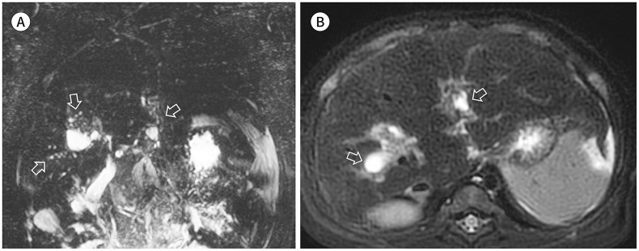

- Gợi ý lâm sàng: sốt, nghi viêm đường mật sau Kasai.
- Câu hỏi: Dấu hiệu đường mật? Vì sao tăng áp lực nội ống? Chẩn đoán và điều trị đầu tay?

<b>Bấm để hiện đáp án (findings + chẩn đoán)</b>

- **Dấu hiệu:** (A) **giãn ống mật trong gan dạng "chuỗi hạt" (beaded dilatation)**; (B) nhiều nang nhỏ trong gan = **viêm đường mật sau Kasai**.
- **Chẩn đoán:** viêm đường mật sau Kasai — cần **kháng sinh tĩnh mạch 2–3 tuần** để bảo tồn gan tự nhiên. Nguy cơ chính là **viêm đường mật tái diễn làm nặng xơ gan**.
- Nguồn ảnh: Hwang J et al., J Korean Soc Radiol 2022 (PMC9574285), Fig. 2, CC BY-NC 4.0 (giữ nguyên bản).

**Ca 2 — Bé trai 7 tháng tuổi sốt sau Kasai; CT cản quang bụng. Dấu hiệu nào chỉ viêm đường mật?**

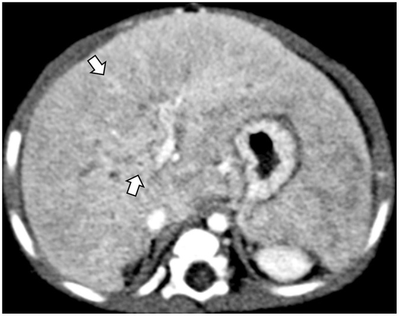

- Gợi ý lâm sàng: đợt viêm đường mật cấp sau Kasai.
- Câu hỏi: Mô tả tổn thương gan? Vì sao là "hồ mật"? Phân biệt áp-xe?

<b>Bấm để hiện đáp án (findings + chẩn đoán)</b>

- **Dấu hiệu:** CT cản quang — **nhiều vi nang nhỏ trong gan ở phần trung tâm** (mũi tên), một số **ngấm viền thì muộn**; nhu mô gan **ngấm không đồng nhất** = xơ gan mật + **hồ mật (bile lakes)**.
- **Chẩn đoán:** **viêm đường mật cấp sau Kasai**. "Hồ mật" = ổ mật nhỏ, ngấm viền thì muộn; phân biệt **áp-xe** (ngấm viền + dịch + sốt nặng) nhưng ở BA thường là viêm đường mật lành hóa bằng kháng sinh, **không dẫn lưu**.
- Nguồn ảnh: Hwang J et al., J Korean Soc Radiol 2022 (PMC9574285), Fig. 3, CC BY-NC 4.0 (giữ nguyên bản).

**Ca 3 — Bé gái 9 tháng tuổi xơ gan mật sau Kasai; siêu âm gan. Mô tả nhu mô và bờ gan.**

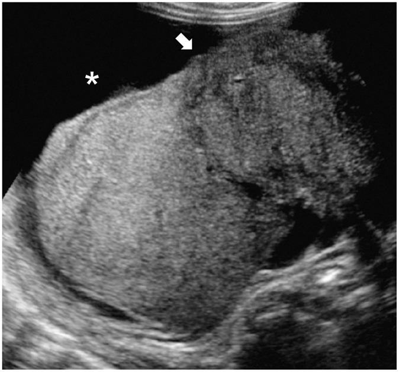

- Gợi ý lâm sàng: theo dõi hậu Kasai, bụng to.
- Câu hỏi: Bờ gan (mũi tên)? Nhu mô? Dấu sao chỉ gì?

<b>Bấm để hiện đáp án (findings + chẩn đoán)</b>

- **Dấu hiệu:** siêu âm — **echo nhu mô không đồng nhất**, **bờ gan lởm chởm/nốt** (mũi tên), **báng màng bụng (perihepatic ascites)** (dấu sao) = **xơ gan mật (biliary cirrhosis)**.
- **Chẩn đoán:** xơ gan mật sau Kasai; theo dấu bờ gan + lách to + giảm tiểu cầu để tiên lượng PH và chỉ định ghép.
- Nguồn ảnh: Hwang J et al., J Korean Soc Radiol 2022 (PMC9574285), Fig. 4, CC BY-NC 4.0 (giữ nguyên bản).

**Ca 4 — Bé trai 9 tháng tuổi tăng áp lực cửa sau Kasai; CT bụng có cản quang (A–D). Tìm dấu hiệu tăng áp lực cửa.**

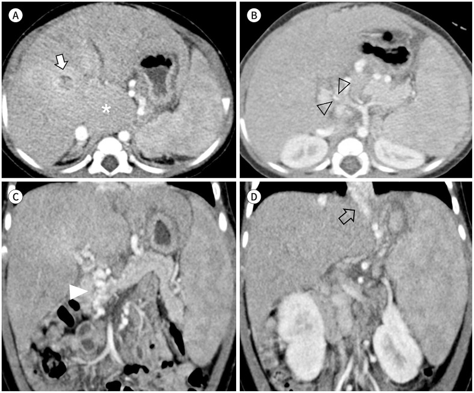

- Gợi ý lâm sàng: gan xơ mật, nghi biến chứng tăng áp lực cửa.
- Câu hỏi: Ba dấu hiệu ở gan/lách/varices? Biến chứng nguy hiểm nhất?

<b>Bấm để hiện đáp án (findings + chẩn đoán)</b>

- **Dấu hiệu:** CT — **gan phì đại dạng nốt (globular) với phì đại thùy đuôi**, **lách to**, **giãn tĩnh mạch thực quản/dạ dày + tuần hoàn bàng hệ** = **tăng áp lực cửa do xơ gan mật**.
- **Chẩn đoán:** tăng áp lực cửa sau Kasai; biến chứng nguy hiểm nhất là **chảy máu do vỡ tĩnh mạch thực quản (variceal hemorrhage)** → cần nội soi và can thiệp (EVL/chẹn beta).
- Nguồn ảnh: Hwang J et al., J Korean Soc Radiol 2022 (PMC9574285), Fig. 6, CC BY-NC 4.0 (giữ nguyên bản).

**Ca 5 — Bé gái 2 tháng tuổi sau Kasai; siêu âm đàn hồi gan (A) + CT 8 tháng sau (B, C). Định lượng độ cứng gan và biến chứng.**

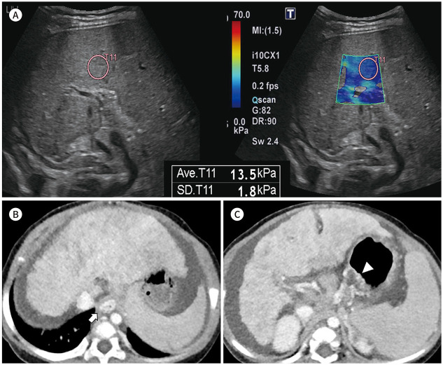

- Gợi ý lâm sàng: theo dõi hậu Kasai sớm.
- Câu hỏi: Độ cứng gan bao nhiêu kPa? Ngưỡng dự báo biến chứng? CT 8 tháng sau cho thấy gì?

<b>Bấm để hiện đáp án (findings + chẩn đoán)</b>

- **Dấu hiệu:** SWE — **độ cứng gan ~13,5 kPa (trung vị 12,1 kPa)** = tăng; CT 8 tháng sau — **nhu mô ngấm không đồng nhất + bờ gan nốt + giãn tĩnh mạch thực quản (mũi tên) và dạ dày (đầu mũi tên)** → tiến triển xơ gan/tăng áp lực cửa, sau đó phải ghép gan.
- **Chẩn đoán:** xơ gan mật tiến triển với tăng áp lực cửa. Ngưỡng đáng nhớ: **TE ~12,7 kPa** (giãn tĩnh mạch), **TE ~19,9 kPa** (biến chứng), **2D-SWE ~11,5 kPa** (xơ gan).
- Nguồn ảnh: Hwang J et al., J Korean Soc Radiol 2022 (PMC9574285), Fig. 8, CC BY-NC 4.0 (giữ nguyên bản).

**Ca 6 — Bé gái 4 tuổi sau Kasai; MRI gan. Nốt gan này lành hay ác?**

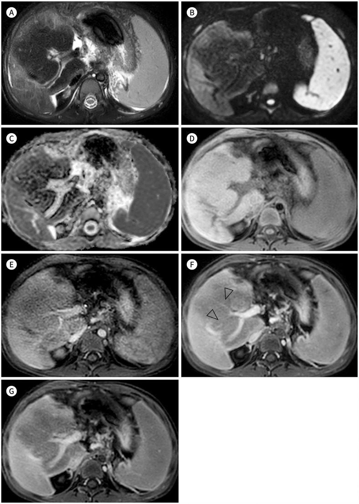

- Gợi ý lâm sàng: theo dõi dài hạn sau Kasai, phát hiện "khối" gan.
- Câu hỏi: Tín hiệu nốt trên T2/T1? Có ngấm không? Dấu hiệu giúp phân biệt với HCC?

<b>Bấm để hiện đáp án (findings + chẩn đoán)</b>

- **Dấu hiệu:** MRI đa chuỗi — **nốt lớn, hạ tín hiệu T2, KHÔNG ngấm thuốc, có mạch cửa xuyên qua nốt** = **nốt tái sinh khổng lồ (giant regenerative nodule)**.
- **Chẩn đoán:** nốt tái sinh (lành). Phân biệt **HCC**: ngấm mạnh thì động mạch + **thải thuốc** thì cửa/muộn (khác nốt tái sinh không ngấm). Nốt tái sinh có thể tới **13 cm** nhưng vẫn lành.
- Nguồn ảnh: Hwang J et al., J Korean Soc Radiol 2022 (PMC9574285), Fig. 11, CC BY-NC 4.0 (giữ nguyên bản).

**Ca 7 — Bệnh nhi BA sống với gan tự nhiên, phát hiện nốt gan; MRI động thì động mạch (trái) và thì cửa (phải). Nguy cơ gì?**

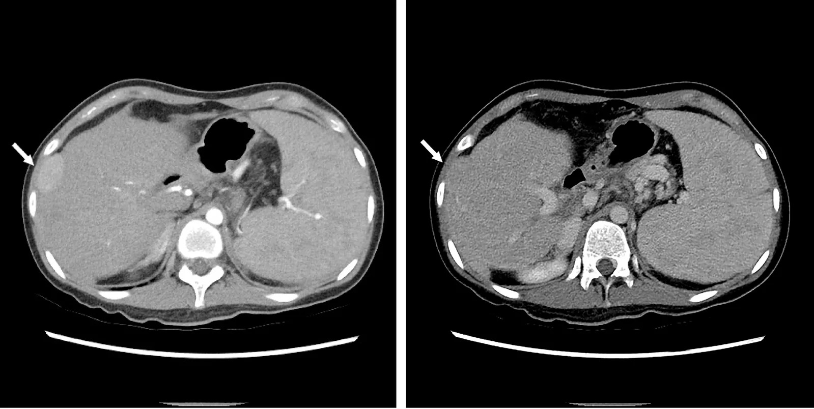

- Gợi ý lâm sàng: tầm soát nốt gan ở BA sống với gan tự nhiên (ca nguyên văn).
- Câu hỏi: Nốt ngấm thì nào? Có thải thuốc không? Vì sao AFP bình thường vẫn đáng lo?

<b>Bấm để hiện đáp án (findings + chẩn đoán)</b>

- **Dấu hiệu:** **nốt ngấm mạnh thì động mạch (trái) và KHÔNG thải thuốc ở thì cửa (phải)** (mũi tên) = **nốt loạn sản/ung thư biểu mô tế bào gan sớm** ở BA sống với gan tự nhiên.
- **Chẩn đoán:** **nốt loạn sản (dysplastic nodule) — có ca tiến triển thành HCC sớm**. Lưu ý: **AFP nốt loạn sản có thể bình thường (~2,0 ng/mL)**, và **43% mảnh ghép BA có nốt, 1/4 là tiền ác/ác, phần lớn bị bỏ sót trên hình ảnh/AFP** → phải **MRI động + sinh thiết** khi nghi.
- Nguồn ảnh: Park JYJ et al., Pediatr Surg Int 2026 (PMC13597636), Fig. 5, CC BY 4.0.

**Ca 8 — Bé sau Kasai, sốt và tăng bilirubin; xạ hình gan–mật HIDA (A, B). Chẩn đoán?**

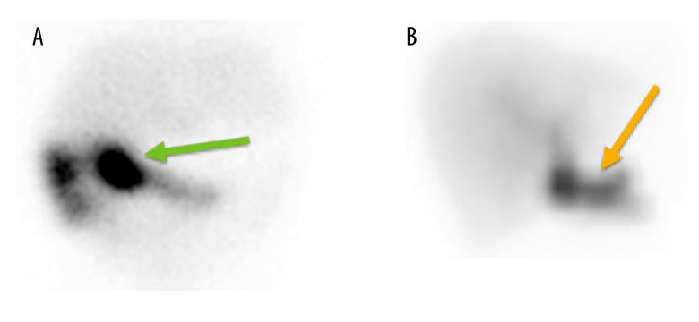

- Gợi ý lâm sàng: không dẫn lưu mật tốt sau Kasai, nghi tắc quai mật.
- Câu hỏi: Thuốc phóng xạ giữ lại ở đâu? Cơ chế gây tắc?

<b>Bấm để hiện đáp án (findings + chẩn đoán)</b>

- **Dấu hiệu:** HIDA — **thuốc phóng xạ giữ lại lâu (persistent tracer retention)** (mũi tên) = dẫn lưu mật kém/ứ.
- **Chẩn đoán:** **tắc ống mật của quai Roux (biliary limb obstruction)** sau Kasai — do **dính quanh miệng nối** làm cản trở làm sạch quai mật; cần xử trí phẫu thuật/dẫn lưu. HIDA là chìa khóa khi siêu âm không rõ.
- Nguồn ảnh: Chong CHQ et al., Am J Case Rep 2026 (PMC13235415), Fig. 2, CC BY-NC-ND 4.0 (giữ nguyên bản).

**Ca 9 — Ghép đối chiếu: CT tăng áp lực cửa ở BA sau Kasai (trung tâm phì đại vs shunt cửa–chủ). Kể tên các dấu hiệu.**

<b>Bấm để hiện đáp án (findings + chẩn đoán)</b>

- **Trái:** CT — **phì đại gan trung tâm** (bù trừ) + **phình mạch lách vôi hóa** (biến chứng mạch của tăng áp cửa/xơ gan).
- **Phải:** CT — **shunt cửa–chủ**: A giãn tĩnh mạch vành vị (left gastric varix), B shunt lách–thận, C varices quanh lách, D varices sau phúc mạc.
- **Kết luận:** các shunt/tuần hoàn bàng hệ này là **dấu hiệu tăng áp lực cửa** ở BA sống lâu với gan tự nhiên (ca người lớn, sau ghép gan).
- Nguồn ảnh: Cortes-Cerisuelo M et al., J Clin Med 2021 (PMC8584637), Fig. 1 và Fig. 2, CC BY 4.0. Ảnh ghép letterbox.

## Bài liên quan chéo
- [600 – Tổng quan Hệ Nhi khoa](../600-tong-quan-nhi-khoa/lesson.md)
- [625 – Vàng da tắc mật sơ sinh: teo đường mật vs viêm gan (nang ống mật chủ)](../625-vang-da-tac-mat-so-sinh-teo-duong-mat/lesson.md)
- [626 – Viêm tụy cấp ở trẻ (Atlanta nhi)](../626-viem-tuy-cap-nhi/lesson.md)
- [121 – LI-RADS & HCC](../121-khoi-gan-LIRADS/lesson.md) (đọc nốt gan trên MRI động)
- [125 – Gan mỡ–xơ (đàn hồi/PDFF)](../125-gan-mo-xo/lesson.md) (định lượng xơ hóa)
- [130 – Túi mật](../130-tui-mat/lesson.md), [131 – Tắc mật](../131-tac-mat/lesson.md)

## Ảnh
- Tên file: `641_kasai-hau-phau_Modality_SourceID.jpg`. Nguồn + giấy phép từng ảnh: `images/CREDITS.md` và `sources.md`.
- Ảnh **CC BY 4.0** dùng cho ảnh ghép; ảnh **CC BY-NC / CC BY-NC-ND** giữ nguyên bản, **không crop/ghép**.

> Không dùng để chẩn đoán độc lập khi chưa có người hướng dẫn.
