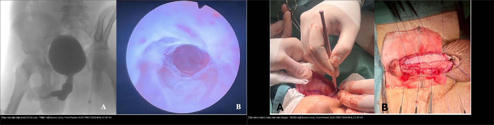
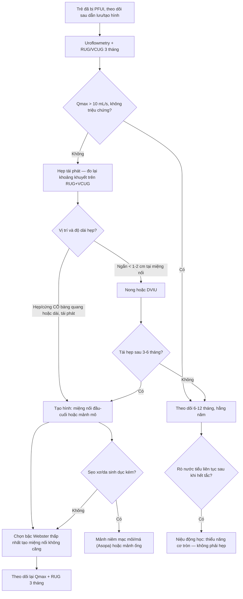
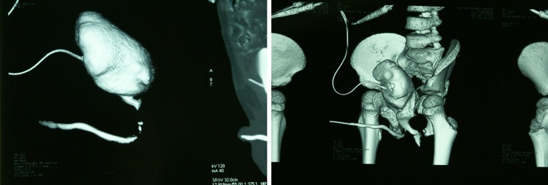
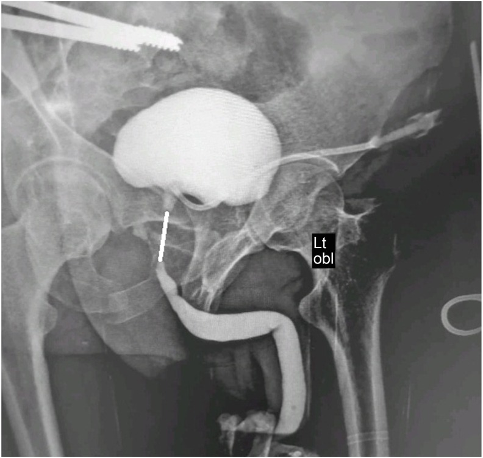
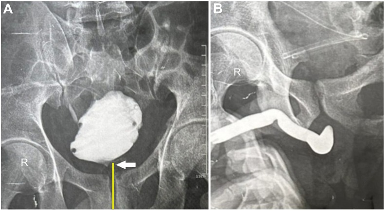
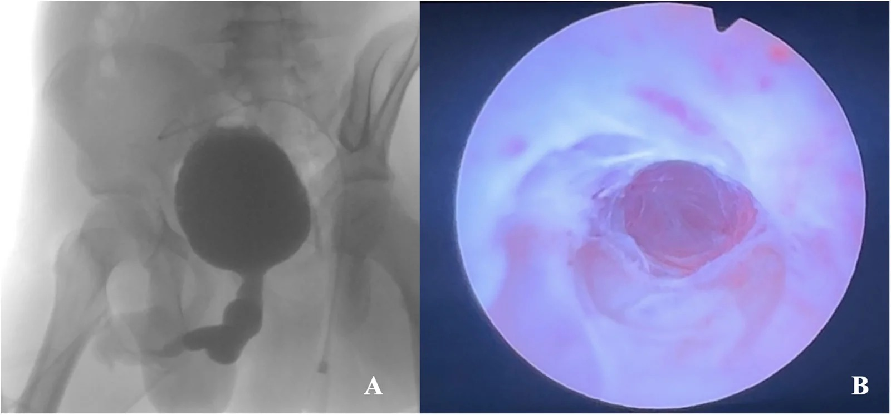
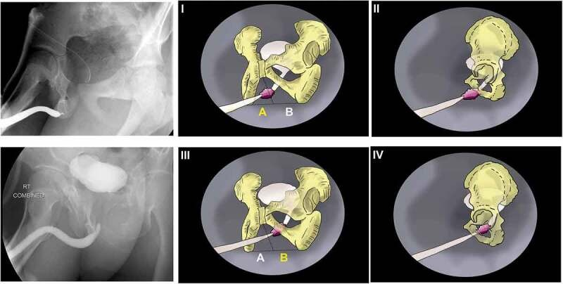

# 642 — Theo dõi & biến chứng dài hạn sau chấn thương đường tiết niệu dưới ở trẻ: hẹp niệu đạo (thời điểm tạo hình), tiểu không tự chủ, rối loạn cương & nhiễm trùng niệu tái phát

**Tags:** `pattern:hep-nieu-dao` `pattern:tieu-khong-tu-chu` `pattern:roi-loan-cuong` `vung:bang-quang-nieu-dao-nhi` `score:Webster` `protocol:RUG` `protocol:VCUG` `protocol:uroflowmetry`
**Mức chắc chắn (certainty):** tổng hợp y văn (literature synthesis) — nhóm tự biên từ y văn mở (nghiên cứu đoàn hệ nhiều ca + tổng quan) có số liệu định lượng; **4 ca trong quiz là ca nguyên văn (verbatim case)** chép đúng tuổi – cơ chế – chú thích gốc.

> **Câu hỏi gốc sau khi đã cứu sống và dẫn lưu được trẻ (bài [637](../637-chan-thuong-bang-quang-nieu-dao-nhi/lesson.md)):** *vài tháng – vài năm sau, cái gì sẽ hành trẻ?* Hơn một nửa trẻ bị chấn thương niệu đạo liên quan vỡ khung chậu (pelvic fracture urethral injury, PFUI) sẽ có **biến chứng muộn** — hẹp niệu đạo là phổ biến nhất (41,7%), rồi rối loạn cương (29,3%), tiểu không tự chủ (22,0%), nhiễm trùng niệu tái phát và phải mổ lại (37,5%). Đây là bài đọc hình ảnh để **theo dõi** các biến chứng đó và **chọn thời điểm mổ**.

## 1. Tổng quan — TẠI SAO hẹp hình thành + ngưỡng định lượng

**A. Sinh lý bệnh (pathophysiology)**

- Đứt niệu đạo sau do lực **cắt (shearing)** ở ngã ba bóng–màng (bulbo-membranous junction) để lại **khoảng khuyết (distraction defect)** giữa đầu niệu đạo hành và cổ bàng quang. Khoảng khuyết này lấp bằng **máu tụ → mô hạt → xơ hóa (fibrosis)**.
- **TẠI SAO phải chờ 3–6 tháng mới mổ tạo hình (urethroplasty):** quá trình **xơ hóa còn "trưởng thành" (maturing)** và bàng quang–tuyến tiền liệt còn co kéo lên cao trong 2–3 tháng đầu. Mổ vào giai đoạn đang viêm/xơ chưa ổn định → miệng nối hở, hẹp lại. Chờ cho **máu tụ tiêu, mô xơ ổn định, bàng quang–tuyến tiền liệt hạ xuống** giúp miệng nối không căng.
- **TẠI SAO trẻ khác người lớn:** tuyến tiền liệt trẻ còn nhỏ → bàng quang nằm **cao hơn** và dài hơn; xơ hóa tiến triển ở mô đang phát triển → hẹp vừa tái phát vừa **cản trở tăng trưởng niệu đạo**; trẻ thường được dẫn lưu bằng **mở dẫn lưu trên xương mu (suprapubic cystostomy, SPC)** trước.

**B. TẠI SAO thấy được trên hình ảnh — vật lý chuỗi xung**

- **Chụp niệu đạo ngược dòng (retrograde urethrography, RUG) + chụp bàng quang khi đi tiểu (voiding cystourethrography, VCUG) kết hợp:** thuốc cản quang pha loãng (~150–250 mg I/mL) bơm ngược từ hố thuyền (fossa navicularis) và bơm trong bàng quang qua dẫn lưu trên xương mu; **hai cột thuốc gặp nhau** cho thấy **khoảng khuyết thực (true gap)** — đo bằng mm/cm giữa **đầu xa niệu đạo hành** và **cổ bàng quang**.
- **Điểm mấu chốt vật lý:** **khoảng cách càng dài → phức tạp càng cao**; **cổ bàng quang lệch khỏi đường giữa** trên mặt phẳng trước–sau (AP) là dấu hiệu **khó mổ** (kéo dài thời gian mổ + mất máu nhiều hơn, tương quan rõ với độ dài khoảng khuyết).
- **MRI (T2W không cản quang):** mô xơ quanh miệng nối **giảm tín hiệu T2** (collagen giàu nước thấp) phân biệt với mô mỡ–cơ lành; đo **chiều dài đoạn đứt, thể tích mô xơ, vị trí cổ bàng quang và tuyến tiền liệt** trên mặt phẳng sagittal → giúp chọn đường mổ (perineal vs abdominoperineal).

**C. Ngưỡng định lượng cần nhớ (kết cục dài hạn)**

| Kết cục (outcome) | Trẻ (pediatric) | Nguồn |
|---|---|---|
| Biến chứng CHUNG (mọi loại) | **54,2%** (26/48, theo dõi trung vị **112 tháng**) | Yang 2026 (PMC13355245) |
| Hẹp niệu đạo (stricture) | **41,7%** (20/48) — và **44,1%** trong loạt 68 bé | Yang 2026 / Cui 2025 |
| Tiểu không tự chủ (incontinence) | **22,0%** (9/41) | Yang 2026 |
| Rối loạn cương (erectile dysfunction, ED) | **29,3%** (12/41) | Yang 2026 |
| Phải mổ/can thiệp lại (reoperation) | **37,5%** (18/48) | Yang 2026 |
| Hẹp lại sau mổ (reintervention) | **16,3%** (32/196 thủ thuật) — thành công **83,7%** | Harraz 2023 (PMC10208150) |
| Rối loạn cương (ED) sau vỡ khung chậu | **37%** (gộp) | Schmid 2021 (PMC8166614) |

- **90% hẹp niệu đạo xuất hiện trong vòng 1 năm đầu** sau chấn thương → cửa sổ theo dõi sát là **3, 6, 12 tháng**.
- **Định nghĩa THÀNH CÔNG sau tạo hình:** Qmax **> 10 mL/s** và **không phải can thiệp thêm** (Yepes 2023) — dùng ngưỡng này thay vì "chỉ số Qmax bình thường".

## 2. Mẫu hình + chẩn đoán phân biệt theo thời điểm (gamut)

**Gamut theo mốc thời gian sau chấn thương:**

| Mốc | Biến chứng chính | Hình ảnh chốt |
|---|---|---|
| **Cấp (< 2 tuần)** | Tụ máu, rò nước tiểu, tắc ống thông, chảy máu muộn | RUG/CT cystography (bài 637) |
| **Sớm (2 tuần – 3 tháng)** | Hẹp đang hình thành, viêm niệu đạo, sỏi niệu đạo mới | RUG lại sau rút ống thông |
| **Trung hạn (3 tháng – 2 năm)** | **Hẹp niệu đạo (đỉnh trong 1 năm)**, hẹp miệng nối tái phát, hẹp/cứng cổ bàng quang, nhiễm trùng niệu tái phát, sỏi | RUG+VCUG, uroflowmetry |
| **Dài hạn (> 2 năm)** | **Tiểu không tự chủ**, rối loạn cương, sỏi bàng quang, suy thận (tắc mạn kéo dài), tái hẹp muộn | Uroflowmetry, siêu âm, IIEF-5, niệu động học |

**Gamut theo VỊ TRÍ hẹp (quyết định đường mổ):**

- **Niệu đạo trước (anterior: penile/bulbar):** hẹp sau chấn thương dạng cưỡi ngựa (straddle) hoặc sau mổ dị tật — **RUG** cho thấy đoạn hẹp, giãn niệu đạo phía trên, đường đi ngoằn ngoèo.
- **Niệu đạo sau tại ngã ba bóng–màng (tại miệng nối):** hẹp ngắn tại chỗ nối sau tạo hình — dễ nong/nội soi.
- **Cổ bàng quang / tuyến tiền liệt:** hẹp–cứng (**contracture**), **bàng quang trôi cao** — khó, đường đi trước ngoài xương mu.
- **Miệng sáo (meatal):** hẹp miệng sáo, thường sau dụng cụ đặt ống thông lâu.

**Mnemonic "STONE-WALL" (biến chứng muộn PFUI):** **S**tricture (hẹp), **T**ract infection (nhiễm trùng niệu tái phát), **O**bstructive uropathy (ứ nước – suy thận), **N**eurologic/incontinence (tiểu không tự chủ), **E**rectile dysfunction; **W**eight (sỏi), **A**nastomotic recurrence (hẹp tái), **L**ong-term reintervention (mổ lại), **L**ate bladder neck contracture (cứng cổ bàng quang).

## 3. Bảng so sánh phân biệt (ma trận đối chiếu)

| Thực thể (entity) | Hình ảnh điển hình | Chốt vào (rule-in) | Chốt loại (rule-out) | Gợi ý xác nhận |
|---|---|---|---|---|
| **Hẹp niệu đạo tái phát tại miệng nối** | RUG: **đoạn hẹp ngắn, vát (tapered)** tại ngã ba bóng–màng, thuốc qua được khe nhỏ; giãn nhẹ niệu đạo trên | **Tiền sử tạo hình niệu đạo + hẹp tại đúng vị trí nối, ngắn < 1–2 cm** | Hẹp lan tỏa suốt niệu đạo trước/dài > 2 cm → phải tạo hình thay thế, không nội soi | Uroflowmetry (Qmax tụt), RUG+VCUG 3 tháng |
| **Cứng/hẹp cổ bàng quang (bladder neck contracture)** | VCUG: **cổ bàng quang không mở / hẹp hình phễu**, bàng quang **trôi lên cao**; có thể kèm trào ngược | **Hẹp ở cổ bàng quang + trôi cao, hướng dụng cụ đi trước ngoài** | Đoạn hẹp ở niệu đạo hành (xa hơn) → hẹp miệng nối thường | Niệu động học; MRI vị trí cổ bàng quang |
| **Tiểu không tự chủ do thiểu năng cơ tròn (sphincter deficiency)** | Không có hẹp còn lại trên RUG; bàng quang **thành dày, cầu bàng quang (trabeculation)** do tắc cũ; niệu động học áp lực thấp | **Rò nước tiểu liên tục SAU khi đã giải quyết tắc hoàn toàn** | Còn tắc/hẹp chưa giải quyết → tiểu máu cục bộ do tắc, không phải cơ tròn | Niệu động học, pad-test, cystoscopy |
| **Rối loạn cương (ED)** | Không thấy trên RUG; hậu quả mạch–thần kinh (mạch hành sâu, đám rối cảnh hang) do chấn thương, không phải do tạo hình | **Khởi phát NGAY sau chấn thương + IIEF-5 thấp (nặng ≤ 10)** | Khởi phát sau mổ tái phát nhiều lần → nghĩ tổn thương mạch mới | IIEF-5, siêu âm Doppler cương (±), testosterone |
| **Nhiễm trùng niệu tái phát** | Bàng quang nhiều cặn/ứ đọng; niệu đạo giãn trên ổ hẹp; sỏi cản quang trong túi thừa/sỏi niệu đạo | **≥ 2 đợt cấy (+) trong 6 tháng + ứ đọng/cặn/sỏi** | Cấy (+) một lần, không ứ đọng → khuẩn trú (colonization), không kháng sinh dài | Cấy nước tiểu, siêu âm bàng quang, RUG |
| **Sỏi niệu đạo/sỏi bàng quang sau chấn thương** | Khuyết cản quang hình bầu dục trong lòng niệu đạo/bàng quang; ± bờ cản quang | **Khuyết thuốc trong lòng ống/bàng quang + cản quang** | Cục máu đông/mảnh mô → không cản quang | CT không cản quang định vị, soi bàng quang |

*Trái: **hẹp niệu đạo trước (anterior urethral stricture)** ở trẻ — (A) chụp bàng quang–niệu đạo (VCUG) cho thấy niệu đạo dương vật hẹp, giãn phía trên và đi ngoằn ngoèo; (B) nội soi xác nhận đoạn hẹp dài. Phải: **tạo hình bằng mảnh niêm mạc môi (labial mucosa graft)** theo kỹ thuật Asopa — (A) lấy mảnh môi, (B) khâu căng (quilt) mảnh ghép lên giường thể hang. Nguồn: Buconi I et al., Front Pediatr 2026 (PMC13500494), CC BY 4.0. Ảnh ghép letterbox, giữ tỉ lệ.*

## 4. Protocol theo dõi + hệ phân độ/điểm chuẩn hóa

**A. Lịch theo dõi sau chấn thương/tạo hình (dựa trên cửa sổ 90% hẹp < 1 năm):**

- **3 tuần – 3 tháng:** RUG + VCUG kết hợp (đo lại khoảng khuyết, vị trí cổ bàng quang) + siêu âm thận–bàng quang (ứ nước, cặn).
- **3, 6, 12 tháng:** **uroflowmetry (đo Qmax, thể tích, nước tiểu tồn dư — PVR)**. Thành công khi **Qmax > 10 mL/s** và không cần can thiệp thêm.
- **> 12 tháng → hằng năm:** tái khám lâm sàng (dòng tiểu, nhiễm trùng), uroflowmetry, hỏi **chức năng cương/tiểu không tự chủ** (IIEF-5 ở tuổi lớn), siêu âm.
- **Theo dõi tối thiểu 2 năm, lý tưởng tới trưởng thành** (nghiên cứu nhi có trung vị theo dõi **112 tháng**).
- **Chuyển tiếp (transition) sang người lớn:** bàn giao hồ sơ, mô tả đường mổ cũ, nguy cơ tái hẹp muộn và ED.

**B. Phân độ phức tạp theo Webster (Step 1–4 + đường bụng–đáy chậu):** đây là "thang phân độ" cho mức can thiệp khi mổ lại —

| Bậc (step) | Can thiệp |
|---|---|
| Step 1 | Mở đáy chậu + cắt mô xơ đơn thuần |
| Step 2 | Cắt xương mu dưới (inferior pubectomy) |
| Step 3 | Tách thể hang sang bên / bóc niệu đạo |
| Step 4 | Đường vòng quanh xương mu (supracrural rerouting) |
| Abdominoperineal | Đường bụng–đáy chậu khi khoảng khuyết rất dài, bàng quang cổ lệch nhiều, có rò hoặc tổn thương cổ bàng quang |

- Tỉ lệ thực hiện trong loạt 737 ca: Step 1 18,8%; Step 2 17,6%; Step 3 46%; Step 4 1,8%; đường bụng–đáy chậu 5,6% (Yepes 2023).
- **Thành công theo bậc:** Step 4 **69,2%**, đường bụng–đáy chậu **74,4%**, mảnh ghép ống (pedicled preputial tube) **86,4%** — bậc càng cao càng giảm thành công.
- **Yếu tố dự báo cần can thiệp lại trên CUG (Harraz 2023):** đầu niệu đạo hành ở **vùng B (sâu, OR 3,1)**, **gãy cung mu (OR 3,9)**, **tiền sử đã tạo hình (OR 4,2)**.

**C. Xử trí hẹp lại — chọn bậc thấp nhất vừa đủ:**

- Hẹp **ngắn, tại miệng nối:** **nong (dilatation)** → thành công ~50–66% (nhi) / **nội soi cắt niệu đạo (DVIU)** → ~33% (nhi); **hẹp lại sau DVIU hay tái phát** → chuyển tạo hình.
- Hẹp **dài, phức tạp, thất bại nhiều lần:** **tạo hình miệng nối đầu–cuối (end-to-end / EPA)** hoặc **thay thế bằng mảnh ghép** — mảnh **niêm mạc môi/má (labial/buccal mucosa)** theo **kỹ thuật Asopa (dorsal inlay)** khi có sẹo xơ (lichen sclerosus) và da sinh dục không dùng được (thành công tới **18 tháng** trong ca nhi khoa đầu; mảnh **7 × 2 cm**).
- **Hẹp đơn độc, chọn lọc, trẻ lớn:** **bóng phủ thuốc (drug-coated balloon, DCB – paclitaxel)** là lựa chọn nội soi dùng ngoài chỉ định — ca nhi đầu tiên (16 tuổi): **Qmax 4,6 → 20,7 mL/s**, duy trì **19,6** (3 tháng) và **18,4 mL/s** (8 tháng), không tồn dư; **chưa có khuyến cáo nhi khoa riêng** (EAU/ESPU).

## 5. Biến thể bình thường và cạm bẫy

- **CẠM BẪY SỐ 1 — "co cơ tròn đóng kín" giả hẹp trên RUG (closed sphincter pitfall):** cơ vòng ngoài co khi bơm thuốc tạo hình **thắt cổ chai giả** ở niệu đạo màng; phân biệt bằng **bơm chậm, tư thế nghiêng/3–4, chụp VCUG thì đi tiểu** (khi cơ mở) — đừng chẩn đoán hẹp thật rồi mổ oan.
- **RUG bàng quang KHÔNG căng đủ / thuốc yếu:** bỏ sót hẹp cổ bàng quang và đánh giá sai khoảng khuyết; luôn **đo lại ở thì VCUG khi bàng quang căng**.
- **Hẹp GIẢ do đè ép/không đặt đúng đầu ống thông ở hố thuyền** → tia thuốc không nằm trục; kiểm tra bóng giữ 2 mL tại hố thuyền.
- **Sau khi giải quyết hẹp (satisfaction of search):** đọc hết **cổ bàng quang, trào ngược, sỏi, ứ nước thận, tồn dư** — đừng dừng khi thấy ổ hẹp đã hết.
- **Nhầm tiểu không tự chủ do TẮC với tiểu không tự chủ do CƠ TRÒN:** trẻ tắc bàng quang có thể **rỉ nước tiểu (overflow)** hoặc nhiễm trùng; chỉ kết luận thiểu năng cơ tròn khi **đã giải quyết tắc hoàn toàn** và niệu động học xác nhận.
- **Đừng quy rối loạn cương cho ca mổ:** phần lớn ED **có NGAY từ chấn thương** (tổn thương mạch hành–đám rối cảnh hang), mổ tạo hình thêm ít gây ED mới; hỏi kỹ mốc khởi phát.
- **Nhiễm trùng niệu "khuẩn trú" vs nhiễm trùng thật:** trẻ đặt ống thông/dẫn lưu lâu có thể **cấy (+) không triệu chứng** — đừng kháng sinh kéo dài vô ích; cần **triệu chứng + cấy (+) ± ứ đọng/sỏi**.
- **Sỏi hình thành quanh miệng nối/trong túi niệu đạo** sau nhiều lần mổ — tìm **khuyết thuốc có cản quang** thay vì chỉ đọc hẹp.
- **Trẻ đang lớn:** tái hẹp có thể biểu hiện **giãn niệu đạo trên** và **bàng quang thành dày/cầu bàng quang** trên siêu âm trước khi trẻ than phiền → đánh giá cả **đường tiết niệu trên**.

## 6. Tự lượng giá — Blind Quiz (ảnh trơn ngoài, đáp án ẩn trong khối chi tiết)

**Ca 1 — Bé trai, chấn thương khung chậu cũ, dẫn lưu trên xương mu. 3D CT sau bơm thuốc: bàng quang nằm ở đâu so với bình thường?**

- Gợi ý lâm sàng: tiền sử vỡ khung chậu, đang dẫn lưu trên xương mu.
- Câu hỏi: Dấu hiệu chính? Điều đó nói gì về đoạn niệu đạo sau? Bước tiếp theo?

<b>Bấm để hiện đáp án (findings + chẩn đoán)</b>

- **(A) mặt phẳng sagittal, (B) tái tạo 3D:** bàng quang **bị đẩy/trôi lên cao (bladder elevation)** và **niệu đạo sau bị xóa (obliteration of the posterior urethra)** — đây là hình ảnh của **đứt niệu đạo sau hoàn toàn**, không phải bàng quang nguyên vẹn.
- **Ý nghĩa:** bàng quang–tuyến tiền liệt bị kéo lên do rách dây chằng mu–tuyến tiền liệt; khoảng khuyết càng dài càng **khó mổ**.
- **Bước tiếp theo:** RUG+VCUG để **đo khoảng khuyết** và vị trí cổ bàng quang; MRI nếu cần đánh giá mô xơ/đường mổ.
- Nguồn ảnh: Yang Z et al., Transl Androl Urol 2026 (PMC13355245), Fig 2, CC BY-NC-ND 4.0 (giữ nguyên bản, không crop/ghép).

**Ca 2 — Bé trai sau vỡ khung chậu, RUG phối hợp VCUG. Đoạn hẹp dài bao nhiêu? Dấu hiệu nào gợi mổ KHÓ?**

- Câu hỏi: Khoảng khuyết dài bao nhiêu? Vì sao độ dài quan trọng? Hai yếu tố nào khác quyết định độ khó?

<b>Bấm để hiện đáp án (findings + chẩn đoán)</b>

- **RUG + VCUG phối hợp** cho thấy **khoảng khuyết (distraction defect) dài 4 cm** (đường trắng) giữa đầu niệu đạo hành và cổ bàng quang.
- **Độ dài quan trọng:** khoảng khuyết càng dài → thời gian mổ càng lâu (tương quan rs = 0,84) và mất máu càng nhiều (rs = 0,78); quyết định bậc Webster/đường mổ.
- **Hai yếu tố khác:** **cổ bàng quang lệch khỏi đường giữa** (tăng thời gian mổ p = 0,004, mất máu p = 0,002) và **gãy cung mu / tiền sử đã mổ**.
- Nguồn ảnh: Osama M & Abdalla MA, Asian J Urol 2025 (PMC12744763), Fig 2, CC BY-NC-ND 4.0.

**Ca 3 — Cùng bệnh nhân trên, mặt phẳng trước–sau (AP). Dấu hiệu nào đây, và vì sao nó báo trước một ca mổ "khó"?**

- Câu hỏi: Cổ bàng quang nằm ở đâu so với đường giữa? (B) trên RUG xác nhận gì?

<b>Bấm để hiện đáp án (findings + chẩn đoán)</b>

- **(A) VCUG:** cổ bàng quang **lệch sang phải (white arrow)** khỏi đường giữa (đường vàng); **(B) RUG** xác nhận đoạn đứt niệu đạo sau.
- **Vì sao "khó":** cổ bàng quang lệch nhiều → đường tiếp cận lệch, phải bóc nhiều hơn, **kéo dài thời gian mổ và tăng mất máu**; có thể phải dùng đường bụng–đáy chậu.
- Nguồn ảnh: Osama M & Abdalla MA, Asian J Urol 2025 (PMC12744763), Fig 3, CC BY-NC-ND 4.0.

**Ca 4 — Bé trai 15 tuổi, tiền sử mổ dị tật niệu đạo nhiều lần, tiểu yếu. Ảnh (A) chụp bàng quang–niệu đạo. Chẩn đoán và bước tiếp theo?**

- Câu hỏi: Hình (A) là chuỗi xung gì, thấy gì? (B) bổ sung gì? Kế hoạch mổ khi hẹp dài?

<b>Bấm để hiện đáp án (findings + chẩn đoán)</b>

- **(A) VCUG:** **niệu đạo dương vật hẹp (stenotic)** với **giãn niệu đạo phía trên và đường đi ngoằn ngoèo (tortuous)** → **hẹp niệu đạo trước dài**; **(B) nội soi** xác nhận đoạn hẹp dài.
- **Bệnh cảnh:** hẹp dài tái phát sau mổ dị tật niệu đạo nhiều lần, kèm **lichen sclerosus** trên mô bệnh.
- **Kế hoạch:** khi da sinh dục không dùng được → **tạo hình bằng mảnh niêm mạc môi/má theo Asopa (dorsal inlay)** một thì (mảnh báo cáo **7 × 2 cm**); theo dõi tới 18 tháng không tái phát.
- Nguồn ảnh: Buconi I et al., Front Pediatr 2026 (PMC13500494), Fig 1, CC BY 4.0.

**Ca 5 — Đọc "bản đồ vùng" trên chụp niệu đạo. Đầu gần niệu đạo hành nằm ở vùng nào dự đoán phải can thiệp lại?**

- Câu hỏi: Vùng A và B khác nhau thế nào? Vị trí nào tiên lượng xấu hơn?

<b>Bấm để hiện đáp án (findings + chẩn đoán)</b>

- Sơ đồ/ảnh minh họa xác định **vị trí đầu gần niệu đạo hành** so với **cung mu**: **vùng A (nông, ngay dưới cung mu)** vs **vùng B (sâu, kéo vào trong ổ chậu)**.
- **Vùng B** là yếu tố dự báo độc lập phải can thiệp lại: **OR 3,1 (KTC 1,1–8,5; p = 0,02)** — cùng với **gãy cung mu (OR 3,9)** và **tiền sử đã tạo hình (OR 4,2)**.
- **Ý nghĩa:** dùng để **tư vấn trước mổ** và chọn bậc can thiệp (nomogram phân biệt 77,3%).
- Nguồn ảnh: Harraz AM et al., Arab J Urol 2023 (PMC10208150), Fig 1, CC BY 4.0.

**Ca 6 — Ảnh ghép đối chiếu: cận lâm sàng (trái) và trong mổ (phải). Gọi tên bệnh và can thiệp.**

- Câu hỏi: Bên trái chẩn đoán gì? Bên phải làm gì? Vì sao chọn mảnh niêm mạc môi?

<b>Bấm để hiện đáp án (findings + chẩn đoán)</b>

- **Trái = hẹp niệu đạo trước dài ở trẻ** — VCUG: đoạn hẹp + giãn phía trên + ngoằn ngoèo; nội soi xác nhận.
- **Phải = tạo hình bằng mảnh niêm mạc môi (Asopa, dorsal inlay)** — (A) lấy mảnh môi, (B) khâu căng mảnh lên giường thể hang.
- **Vì sao mảnh môi/má:** niêm mạc miệng **biểu mô dày, ít lông, giàu mạch, chịu được nước tiểu** tốt hơn da sinh dục đã bị viêm xơ (lichen sclerosus).
- Nguồn: Buconi I et al., Front Pediatr 2026 (PMC13500494), Fig 1 + 3, CC BY 4.0. Ảnh ghép letterbox.

## Bài liên quan chéo
- [600 – Tổng quan Hệ Nhi khoa](../600-tong-quan-nhi-khoa/lesson.md)
- [637 – Chấn thương bàng quang & niệu đạo ở trẻ (AAST, vỡ ngoài/trong phúc mạc, đứt niệu đạo sau)](../637-chan-thuong-bang-quang-nieu-dao-nhi/lesson.md) (bệnh cảnh CẤP — bài này là phần theo dõi MUỘN của cùng đường bệnh)
- [636 – Cấp cứu niệu–sinh dục nhi (chấn thương thận AAST & xoắn tinh hoàn/buồng trứng)](../636-cap-cuu-nieu-sinh-duc-nhi/lesson.md)
- [635 – Dị tật hệ tiết niệu nhi (SFU/VUR/PUV)](../635-di-tat-tiet-nieu-nhi-SFU-VUR-PUV/lesson.md) (PUV cũng gây bàng quang thành dày/tắc nghẽn — DDx)
- [140 – Lách & chấn thương tạng đặc: AAST](../140-lach-tang-dac/lesson.md)
- [920 – Nút mạch trong chảy máu tiêu hóa](../920-vascular-embolization-gi-bleed/lesson.md) (nguyên lý can thiệp mạch — liên hệ chảy máu muộn)

## Ảnh
- Tên file: `642-bien-chung-muon-chan-thuong-nieu-dao-nhi_<Modality>_<SourceID>.jpg`. Chi tiết nguồn + giấy phép: `images/CREDITS.md` và `sources.md`.
- Ảnh **CC BY 4.0** (PMC13500494, PMC10208150) dùng được để ghép letterbox; ảnh **CC BY-NC-ND 4.0** (PMC13355245, PMC12744763, PMC7807316) **giữ nguyên bản, không crop/ghép**.
- Radiopaedia/Eurorad/AuntMinnie: chỉ **dẫn link** (AuntMinnie không tải).

> Không dùng để chẩn đoán độc lập khi chưa có người hướng dẫn.
