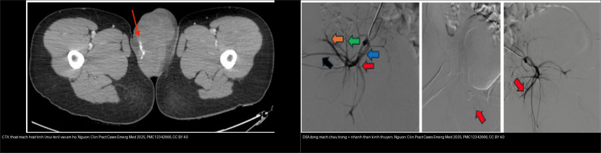
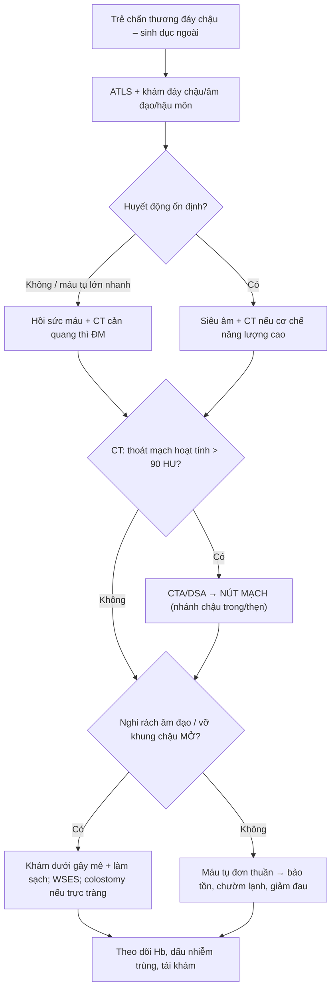
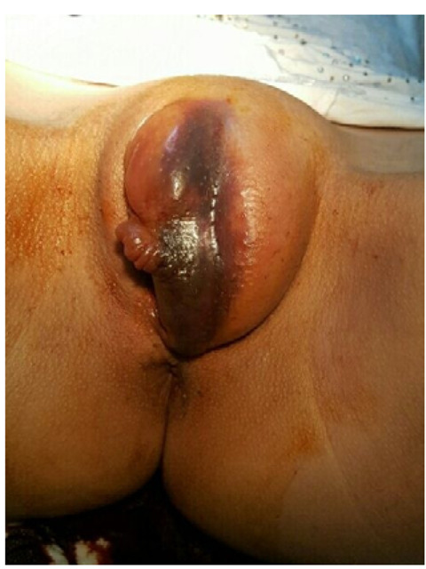
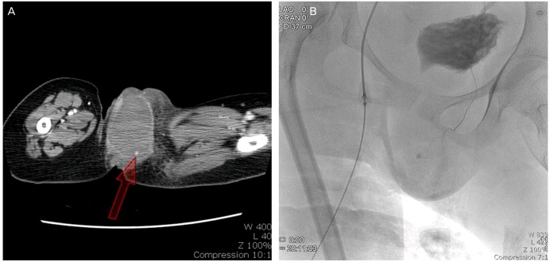
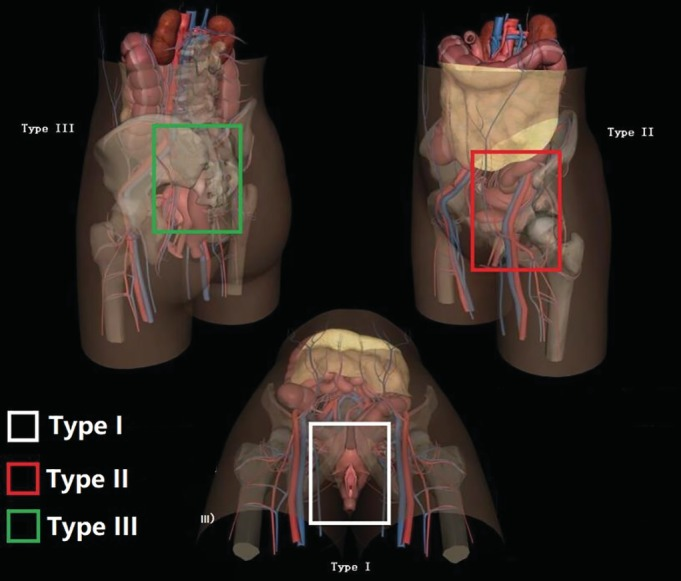
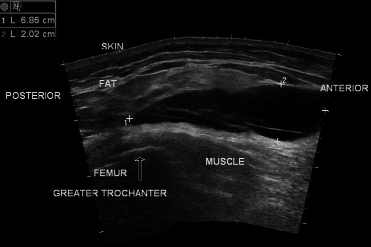

# 643 — Chấn thương đáy chậu – sinh dục ngoài ở trẻ: máu tụ âm hộ, rách âm đạo & tổn thương kèm vỡ khung chậu mở

**Tags:** `pattern:chan-thuong-day-chau` `pattern:mau-tu-am-ho` `pattern:rach-am-dao` `pattern:khung-chau-mo` `vung:day-chau-nhi` `vung:sinh-duc-nhi` `score:WSES-open-pelvic` `protocol:CT-bung-chau-can-quang` `protocol:CTA-nut-mach` `protocol:US-day-chau`
**Mức chắc chắn (certainty):** tổng hợp y văn (literature synthesis) — nhóm tự biên từ y văn mở (bài tổng quan + ca có số); **4 ca trong quiz là ca nguyên văn (verbatim case)** chép đúng tuổi – cơ chế – chú thích gốc.

> **Câu hỏi gốc của mọi chấn thương đáy chậu – sinh dục ngoài ở trẻ:** *máu tụ này đang TỰ CẦM hay đang CHẢY (có thoát mạch hoạt tính), và tổn thương có thông với Ổ BỤNG/vỡ khung chậu không?* — vì **máu tụ âm hộ đơn thuần** thường bảo tồn, còn **thoát mạch hoạt tính (giả phình động mạch thẹn)** và **rách âm đạo kèm vỡ khung chậu mở** là cấp cứu có thể chết người (sốc giảm thể tích, nhiễm trùng huyết).

## 1. Tổng quan — cơ chế & TẠI SAO ảnh hiện như vậy

**A. Giải phẫu quyết định hình thái**

- **Âm hộ (vulva)** = môi lớn, môi nhỏ, âm vật, tiền đình; nằm ở **tam giác niệu–sinh (urogenital triangle)** của đáy chậu. Mạch nuôi chính: **động mạch thẹn trong (internal pudendal)** — nhánh của **động mạch chậu trong** — tách thành **động mạch môi sau, động mạch trực tràng dưới và nhánh ngang đáy chậu** (Hong HR et al., Obstet Gynecol Sci 2014, PMC3965703).
- **TẠI SAO máu tụ dễ hình thành và dễ "khu trú":** âm hộ là **mô liên kết lỏng, mạch máu dày**, được bao bởi **màng đáy chậu (perineal membrane) + mạc Colles** tạo thành **túi đáy chậu nông (superficial perineal pouch)** — một khoang kín. Máu chảy vào khoang này **bị ép lại thành khối căng (fluctuant mass), phồng ra ngoài da, có thể vượt 15 cm**, và **không thấm xuống đùi** (khác máu tụ dưới da lan rộng). Hình thái hai môi bị đẩy sang hai bên = **"máu tụ cánh bướm" (butterfly hematoma)**.
- **TẠI SAO chảy máu nặng:** mạch ở đây thuộc **nhánh tận của chậu trong** → khi đứt (do vỡ khung chậu, đụng dập dạng cưỡi ngựa, hoặc giả phình) **không co mạch tự cầm hiệu quả** vì khoang mô lỏng; máu tụ lớn có thể gây **sốc giảm thể tích** chỉ trong vài giờ.

**B. TẠI SAO thấy được trên từng phương thức — vật lý đậm độ**

- **Siêu âm (đầu tay):** máu tụ = **khối echo hỗn hợp, không có mạch bên trong**, đo được kích thước (ví dụ **6,86 × 2,02 cm** ở một ca Morel-Lavallée, PMC11290411); giúp phân biệt **máu tụ đặc vs tụ dịch dưới da** và hướng dẫn chọc hút. Nhược điểm: khó thấy phần sâu sau xương mu và các tổn thương ổ bụng kèm.
- **CT cản quang:** là **chìa khóa**. Máu tụ cấp **45–70 HU**; **thoát mạch hoạt tính (active extravasation) > 90 HU và lan rộng ở thì muộn** (khác cục máu tụ "sentinel clot" **45–70 HU, không lớn thêm**). Thì **động mạch** phát hiện nguồn chảy (thẹn trong/chậu trong); CT cũng thấy **vỡ khung chậu**, **tràn khí/dị vật**, và tổn thương tạng kèm.
- **CTA + DSA:** khi có thoát mạch → **chụp mạch và nút mạch (TAE)** bằng bọt gelatin (gelfoam), coil…; DSA cho thấy rõ **cây mạch chậu trong và nhánh thẹn** để chọn vị trí nút.
- **MRI:** hữu ích với **máu tụ mạn/tái diễn** và **Morel-Lavallée** — tín hiệu T1/T2 thay đổi theo **tuổi máu** (tối cấp–cấp T1 đẳng/tối, bán cấp T1 sáng do methemoglobin, mạn có viền hemosiderin tối); phân biệt với áp-xe/u.

**C. Ngưỡng định lượng cần nhớ**

- **Dịch tễ:** máu tụ sinh dục **không do sản khoa** chiếm **tới 0,8%** tổng số nhập viện phụ khoa; máu tụ âm hộ **sản khoa 1–2/1.000 ca sinh** (PMC3965703). Ở trẻ, cơ chế hay gặp: **đụng dập dạng cưỡi ngựa (straddle)**, **quan hệ/lạm dụng tình dục**, **vỡ khung chậu**, tai nạn.
- **Ca nguyên văn tiêu biểu (tuổi – kích thước – nguồn chảy):**
  - **13 tuổi** (PMC3965703): máu tụ môi lớn trái **15 × 15 cm**, nghi **giả phình động mạch thẹn trái**, **không chấn thương**; mạch 132 lần/phút.
  - **18 tuổi** (PMC12342666): máu tụ âm hộ trái **12,4 × 6,8 × 7,0 cm**, **thoát mạch hoạt tính từ động mạch chậu trong PHẢI**; hemoglobin **14,3 → 11,9 g/dL**; nút mạch chậu trong phải bằng gelfoam.
  - **14 tuổi** (PMC8142749): máu tụ **12 × 10 cm** che môi nhỏ–môi lớn và **niệu đạo**, kèm **rách màng trinh 2 × 2 cm** ở vị trí 9 giờ; **bí tiểu 24 giờ**.
- **Vỡ khung chậu mở (open pelvic fracture):** phân độ **WSES** cho tử vong **nhẹ 3,5% · trung bình 11,2% · nặng 23,8%** (Li PH et al., World J Emerg Surg 2022, PMC9145531); phân vùng theo giải phẫu **type I đáy chậu** hay kèm tổn thương hậu môn–trực tràng/âm đạo/niệu đạo, tử vong chung của loạt **41,8%** (Wang ZH & Li KN, Orthop Surg 2019, PMC6904613).
- **Cờ đỏ lạm dụng tình dục (sexual abuse):** vết thương/rách **ở màng trinh/vòm âm đạo**, **không khớp cơ chế kể**, **chảy máu nhiều hơn dự kiến**, trẻ **nhỏ tuổi** — phải phối hợp **quy trình pháp y** (khám dưới gây mê, chụp/ghi lại, lấy mẫu theo quy định).

## 2. Mẫu hình + chẩn đoán phân biệt theo cơ chế (gamut)

**Gamut theo cơ chế chấn thương:**

- **Cưỡi ngựa (straddle injury):** ngã đè lên vật cứng → đụng dập **đáy chậu/môi lớn/môi nhỏ**, thường **không rách màng trinh**; có thể rách niệu đạo trước (nam).
- **Quan hệ/lạm dụng (coital/abuse):** **rách màng trinh/âm đạo**, chảy máu; **luôn cân nhắc lạm dụng** nếu cơ chế không khớp.
- **Vỡ khung chậu mở:** vết thương đáy chậu/âm đạo thông với ổ gãy → **nhiễm trùng huyết**; kèm **đứt niệu đạo** (bài [637](../637-chan-thuong-bang-quang-nieu-dao-nhi/lesson.md)) và **vỡ khung chậu** (bài [645](../645-vo-khung-chau-o-tre/lesson.md)).
- **Tự phát/giả phình động mạch:** **không chấn thương**, máu tụ lớn nhanh, **thoát mạch hoạt tính** → nút mạch.
- **Iatrogenic:** sau thủ thuật, đặt ống thông, chọc dò (nhất là trẻ nằm lâu, rối loạn đông máu).

**Gamut theo vị trí:**

- **Môi lớn/môi nhỏ (âm hộ):** máu tụ âm hộ; **Morel-Lavallée** nếu là tụ dịch dưới da/mỡ (lệch giữa mạc nông và mạc sâu, thường ở đùi/hông).
- **Tiền đình/màng trinh/âm đạo:** rách âm đạo (thường cần **khám dưới gây mê**).
- **Đáy chậu sau/hậu môn–trực tràng:** tổn thương trực tràng → **khung chậu mở**, cần **colostomy**.
- **Niệu đạo:** đứt niệu đạo (xem bài [637](../637-chan-thuong-bang-quang-nieu-dao-nhi/lesson.md)).

**Mnemonic — "STAB":** **S**traddle (cưỡi ngựa), **T**rauma năng lượng cao/vỡ khung chậu, **A**buse (lạm dụng), **B**leeding hoạt tính (thoát mạch/giả phình).

## 3. Bảng so sánh phân biệt (ma trận đối chiếu)

| Thực thể (entity) | Hình ảnh điển hình | Chốt vào (rule-in) | Chốt loại (rule-out) | Gợi ý xác nhận |
|---|---|---|---|---|
| **Máu tụ âm hộ đơn thuần** | Khối căng vùng môi lớn/nhỏ; US: echo hỗn hợp **không mạch**; CT: máu tụ **45–70 HU**, **không thoát mạch** | **Máu tụ 45–70 HU, không thấy thuốc thoát ra** | **Thoát mạch > 90 HU/lớn dần** → giả phình/đang chảy | US + CT thì ĐM; điều trị bảo tồn, chọc hút nếu lớn |
| **Giả phình/đứt động mạch thẹn–chậu trong** | CT/CTA: **ổ thuốc thoát mạch hoạt tính**, lan rộng ở thì muộn; DSA: nhánh thẹn | **Thoát mạch hoạt tính từ nhánh chậu trong** | Không thấy thoát mạch → chỉ là máu tụ | CTA → **DSA nút mạch (gelfoam/coil)** |
| **Rách âm đạo (coital/abuse/straddle)** | Soi/khám thấy **vết rách chảy máu ở màng trinh/vòm**; CT không loại trừ | **Rách thấy khi khám dưới gây mê** | Khám ngoài bình thường **KHÔNG** loại trừ (máu tụ che) | **Khám dưới gây mê + soi âm đạo** |
| **Vỡ khung chậu MỞ (đáy chậu thông ngoài)** | Vết thương đáy chậu/âm đạo/trực tràng + ổ gãy; khí/máu tụ | **Thông thương ổ gãy với đáy chậu/hậu môn/âm đạo** | Da/mô nguyên vẹn → khung chậu kín | Phân độ WSES; làm sạch + kháng sinh + colostomy |
| **Morel-Lavallée (tụ dịch dưới da)** | US/CT/MRI: **tụ dịch thấu kính giữa mỡ dưới da và mạc**, thường ở **hông/đùi**, **không máu tụ sâu** | **Tụ dịch dưới da/mỡ, tách mạc, không có mạch** | Máu tụ trong khoang đáy chậu sâu → máu tụ âm hộ | US (đo được), MRI T1/T2 theo tuổi máu |

*Trái: CT cản quang thì động mạch — **thoát mạch hoạt tính** (mũi tên đỏ) từ nhánh chậu trong, máu tụ lan vào âm hộ trái. Phải: **DSA** động mạch chậu trong (xanh = nhánh trước, đỏ = nhánh sau…) trước nút mạch. Nguồn: Raveiro R et al., Clin Pract Cases Emerg Med 2025 (PMC12342666), CC BY 4.0. Ảnh ghép letterbox, giữ tỉ lệ.*

## 4. Protocol chụp + hệ phân độ/điểm chuẩn hóa

**Chuỗi hành động:**

- **Khám toàn diện + đánh giá huyết động (ATLS)** trước tiên: máu tụ lớn nhanh = **sốc giảm thể tích** (ca 18 tuổi: mạch 138, MAP 103 → 72 mmHg).
- **Siêu âm đáy chậu/đường niệu** đầu tay: đo kích thước, loại trừ tụ dịch dưới da, hướng dẫn chọc hút; **siêu âm ổ bụng (FAST)** tìm dịch tự do.
- **CT bụng–chậu cản quang (thì ĐM + TM + muộn)** khi: chấn thương năng lượng cao, máu tụ lớn/nhanh, nghi vỡ khung chậu hoặc tổn thương tạng kèm. Đọc: **máu tụ (45–70 HU)**, **thoát mạch (> 90 HU)**, **vỡ khung chậu**, tổn thương bàng quang/niệu đạo/trực tràng.
- **CTA/DSA + nút mạch** khi có thoát mạch hoặc huyết động không ổn định dù hồi sức.
- **Khám dưới gây mê (EUA) + soi âm đạo/trực tràng** — **bắt buộc** khi nghi rách âm đạo hoặc vỡ khung chậu mở; **hình ảnh học KHÔNG thay thế** bước này.
- **MRI** khi máu tụ mạn/tái diễn, Morel-Lavallée, hoặc phân biệt với áp-xe/u.

**Phân độ và thang điểm liên quan:**

| Hệ | Dùng cho | Ngưỡng chính |
|---|---|---|
| **WSES** (khung chậu mở) | Nguy cơ tử vong | Nhẹ **3,5%** · trung bình **11,2%** · nặng **23,8%** (thêm yếu tố **sepsis**) |
| **Phân vùng giải phẫu** (Wang) | Vùng tổn thương | **Type I đáy chậu** · II bẹn–chậu · III cùng–chậu · IV phối hợp; tử vong loạt **41,8%** |
| **AAST bàng quang/niệu đạo** | Tổn thương niệu kèm | Xem bài [637](../637-chan-thuong-bang-quang-nieu-dao-nhi/lesson.md) |
| **Matta** (khung chậu) | Chất lượng nắn chỉnh | ≤ 4 mm rất tốt · 5–10 mm tốt · > 20 mm kém (bài [645](../645-vo-khung-chau-o-tre/lesson.md)) |

## 5. Biến thể bình thường và cạm bẫy

- **CẠM BẪY SỐ 1 — khám ngoài "bình thường" rồi dừng:** máu tụ lớn **che** vết rách âm đạo/màng trinh → **bỏ sót**. Nghi ngờ cao → **khám dưới gây mê + soi âm đạo**.
- **Tưởng máu tụ "tự cầm" nhưng đang chảy:** máu tụ **lớn dần, đau tăng, mạch nhanh, Hb giảm** → **thoát mạch hoạt tính**; đừng chờ, chụp CT thì ĐM/CTA.
- **Nhầm máu tụ âm hộ với Morel-Lavallée:** Morel-Lavallée là **tụ dịch dưới da/mỡ tách mạc** (thường ở hông/đùi, không máu tụ sâu), xử trí khác (dẫn lưu, băng ép, đôi khi xơ hóa).
- **"Butterfly hematoma" (máu tụ cánh bướm)** là **dấu chấn thương đáy chậu**, không phải biến thể bình thường — kèm đứt niệu đạo (bài [637](../637-chan-thuong-bang-quang-nieu-dao-nhi/lesson.md)).
- **Bỏ sót tổn thương hậu môn–trực tràng:** một vết thương nhỏ ở đáy chậu có thể thông vào trực tràng → **vỡ khung chậu mở**, nguy cơ nhiễm trùng huyết; phải **thăm trực tràng + soi**.
- **Bỏ sót lạm dụng tình dục:** cơ chế "ngã" không khớp tổn thương, trẻ nhỏ, rách ở màng trinh/vòm → **kích hoạt quy trình pháp y**, không tự kết luận.
- **Sụn sinh dục–ngồi/sụn Y ở trẻ giả đường gãy** khi đọc CT khung chậu kèm — luôn đối chiếu tuổi xương (bài [645](../645-vo-khung-chau-o-tre/lesson.md)).
- **Thỏa mãn tìm kiếm:** đã thấy máu tụ âm hộ rồi dừng → bỏ sót **vỡ khung chậu**, **tổn thương tạng đặc**, **đứt niệu đạo**.

## 6. Tự lượng giá — Blind Quiz (ảnh trơn ngoài, đáp án ẩn trong khối chi tiết)

**Ca 1 — Ảnh ghép đối chiếu: một bệnh nhân, hai thì. Ổ thuốc (mũi tên) trên ảnh trái là gì? Ảnh phải dùng để làm gì?**

- Gợi ý lâm sàng: máu tụ âm hộ lớn nhanh, mạch nhanh (138 lần/phút), Hb giảm.
- Câu hỏi: Ổ tăng đậm độ đó là **máu tụ** hay **đang chảy**? Bước tiếp theo?

<b>Bấm để hiện đáp án (findings + chẩn đoán)</b>

- **Trái (CTA thì động mạch):** ổ **thoát mạch hoạt tính** (mũi tên đỏ) từ **động mạch chậu trong PHẢI**, máu tụ lan vào âm hộ trái — **đang chảy máu**, không phải máu tụ đơn thuần.
- **Phải (DSA):** cây động mạch chậu trong để **nút mạch bằng gelfoam**; sau nút, chảy máu ngừng, Hb ổn định.
- **Chốt:** **thoát mạch > 90 HU, lớn dần** = đang chảy → **CTA/DSA nút mạch** (khác máu tụ 45–70 HU không lớn thêm).
- Nguồn ảnh: Raveiro R et al., Clin Pract Cases Emerg Med 2025 (PMC12342666), Image 1 + Image 3, CC BY 4.0. Ảnh ghép letterbox.

**Ca 2 — Bé gái 14 tuổi, sau lần giao hợp đầu: khối lớn vùng âm hộ + bí tiểu. Nhìn ảnh, gọi tên tổn thương.**

- Câu hỏi: Khối này là u hay máu tụ? Vì sao bí tiểu? Cần thăm khám gì thêm?

<b>Bấm để hiện đáp án (findings + chẩn đoán)</b>

- **Máu tụ âm hộ (vulvar hematoma) 12 × 10 cm** che môi nhỏ–môi lớn và **niệu đạo** → chèn ép gây **bí tiểu 24 giờ**; kèm **rách màng trinh 2 × 2 cm ở 9 giờ**.
- **Xử trí:** **khám dưới gây mê**, rạch dẫn lưu máu tụ + khâu vết rách, đặt dẫn lưu; kháng sinh; theo dõi Hb.
- **Cờ đỏ:** tuổi 14 + cơ chế quan hệ → **cân nhắc lạm dụng tình dục**, kích hoạt quy trình pháp y theo quy định.
- Nguồn ảnh: Golbasi C et al., Acta Biomed 2021 (PMC8142749), Fig 1, CC BY 4.0.

**Ca 3 — Bé gái 13 tuổi, nằm lâu, KHÔNG chấn thương: khối môi lớn tăng nhanh tới 15 cm. Hai panel (A) và (B) cho thấy gì?**

- Câu hỏi: Nguồn chảy máu là tĩnh mạch hay động mạch? Vì sao đây là "cờ đỏ" dù không chấn thương?

<b>Bấm để hiện đáp án (findings + chẩn đoán)</b>

- **(A) CT:** máu tụ vùng âm hộ trái (mũi tên). **(B) Chụp mạch:** xác nhận **vỡ/giả phình động mạch thẹn trong (pudendal artery)** — nguồn **động mạch**.
- **Chốt:** máu tụ âm hộ **không chấn thương, lớn nhanh** vẫn có thể do **giả phình động mạch** → cần CT/chụp mạch và cân nhắc **nút mạch**; đừng mặc định là "tự phát lành".
- Nguồn ảnh: Hong HR et al., Obstet Gynecol Sci 2014 (PMC3965703), Fig 2, **CC BY-NC** (giữ nguyên bản).

**Ca 4 — Sơ đồ phân vùng: vùng nào (type I) là "đáy chậu" và hay kèm tổn thương gì?**

- Câu hỏi: Type I nằm ở khung màu nào? Vì sao nhóm này có tử vong cao?

<b>Bấm để hiện đáp án (findings + chẩn đoán)</b>

- **Type I = đáy chậu (khung trắng)** — gồm vùng mu/ngồi, đáy chậu, sàn chậu. Type II bẹn–chậu (khung đỏ), type III cùng–chậu (khung xanh).
- **Vì sao nặng:** vùng đáy chậu hay kèm **tổn thương hậu môn–trực tràng/âm đạo/niệu đạo** → **khung chậu mở**, nhiễm trùng huyết; loạt 67 ca tử vong **41,8%**.
- Nguồn ảnh: Wang ZH & Li KN, Orthop Surg 2019 (PMC6904613), Fig 1, CC BY 4.0.

**Ca 5 — Trên siêu âm: khối dịch "thấu kính" 6,86 × 2,02 cm giữa mỡ và cơ. Đây là máu tụ âm hộ hay tổn thương khác?**

- Câu hỏi: Vị trí so với mạc/cơ gợi ý gì? Xử trí khác máu tụ âm hộ thế nào?

<b>Bấm để hiện đáp án (findings + chẩn đoán)</b>

- Khối dịch **6,86 × 2,02 cm nằm dưới da/mỡ, trên cơ, gần mấu chuyển lớn xương đùi** = **Morel-Lavallée (tổn thương bóc tách kín)** — không phải máu tụ trong khoang đáy chậu.
- **Xử trí:** băng ép, dẫn lưu/chọc hút (đôi khi xơ hóa bằng bleomycin/talc); theo dõi tái tụ; khác máu tụ âm hộ (bảo tồn/chọc hút ± nút mạch).
- Nguồn ảnh: Mudiganti VNKS et al., Cureus 2024 (PMC11290411), Fig 7, CC BY 4.0.

## Bài liên quan chéo
- [600 – Tổng quan Hệ Nhi khoa](../600-tong-quan-nhi-khoa/lesson.md)
- [645 – Vỡ khung chậu ở trẻ (Tile/AO, WSES, kiểm soát chảy máu)](../645-vo-khung-chau-o-tre/lesson.md) (vỡ khung chậu mở + đai/cố định ngoài/nút mạch)
- [1681 – Di chứng muộn niệu–sinh dục ở bé gái sau chấn thương khung chậu](../1681-di-chung-muon-nieu-sinh-duc-be-gai-sau-chan-thuong-khung-chau/lesson.md) (hẹp âm đạo, rò niệu đạo–âm đạo, sa tạng chậu — theo dõi sau giai đoạn cấp)
- [637 – Chấn thương bàng quang & niệu đạo nhi](../637-chan-thuong-bang-quang-nieu-dao-nhi/lesson.md) (đứt niệu đạo, máu lỗ sáo, tụ máu cánh bướm)
- [636 – Cấp cứu niệu–sinh dục nhi](../636-cap-cuu-nieu-sinh-duc-nhi/lesson.md) (chấn thương thận, xoắn tinh hoàn/buồng trứng)
- [548 – Nang/khối lành vùng âm hộ – âm đạo (Bartholin, Gartner, ống Nuck)](../548-nang-lanh-am-ho-am-dao/lesson.md) (khối lành — phân biệt với máu tụ/u)
- [920 – Nút mạch trong chảy máu](../920-vascular-embolization-gi-bleed/lesson.md) (nguyên lý nút mạch TAE)
- [140 – Lách & chấn thương tạng đặc](../140-lach-tang-dac/lesson.md) (thoát mạch vs sentinel clot)

## Ảnh
- Tên file: `NNN_slug_Modality_SourceID.jpg`. Chi tiết nguồn + giấy phép từng ảnh: `images/CREDITS.md` và `sources.md`.
- Ảnh **CC BY 4.0** (PMC12342666, PMC8142749, PMC11290411, PMC6904613) và **CC BY-NC** (PMC3965703) — ảnh **CC BY-NC giữ nguyên bản, không crop/ghép**; ảnh ghép đối chiếu chỉ dùng nguồn **CC BY 4.0**, tạo bằng `tools/make_composite.py` (letterbox, giữ tỉ lệ).

> Không dùng để chẩn đoán độc lập khi chưa có người hướng dẫn.
