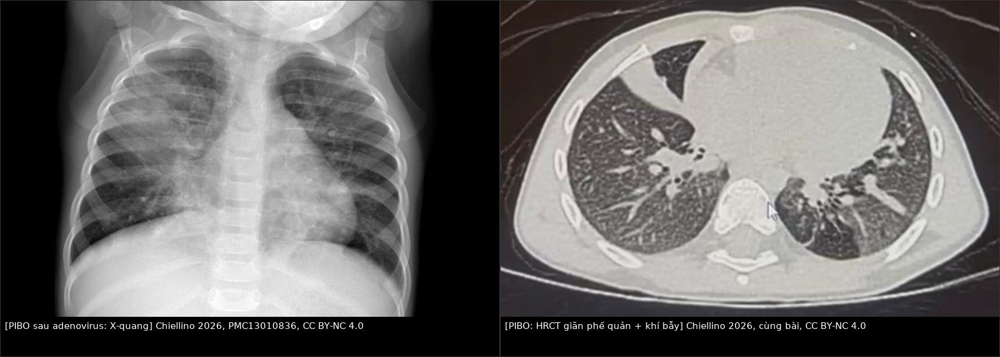
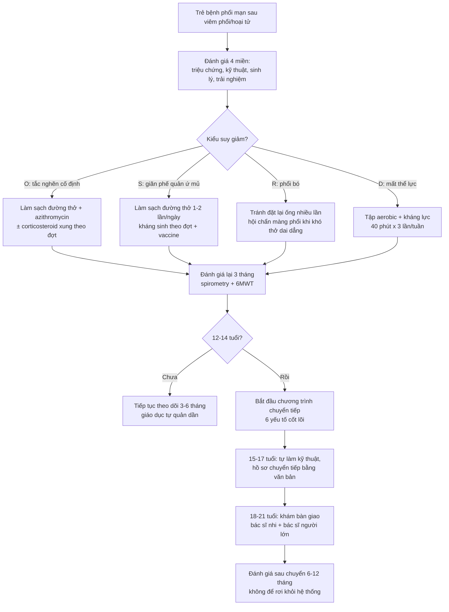
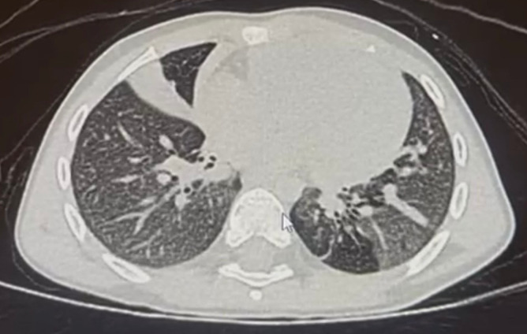
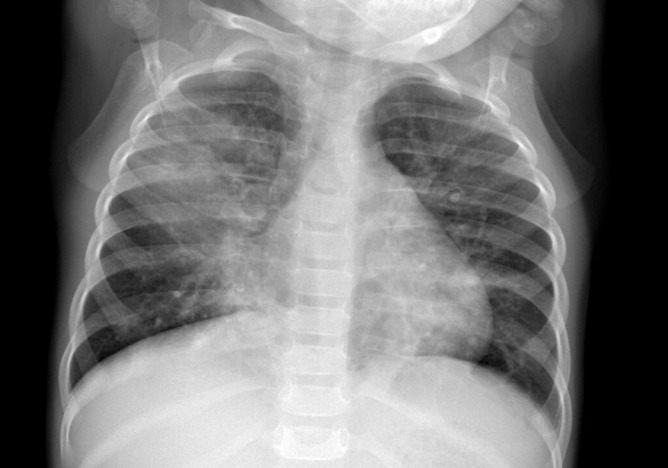

# 644 — Phục hồi chức năng hô hấp & chuyển tiếp người lớn ở trẻ bệnh phổi mạn sau viêm phổi/hoại tử / Pediatric pulmonary rehabilitation & transition to adult care

**Tags:** `pattern:gian-phe-quan` `pattern:khi-bay` `pattern:phoi-bo` `vung:phoi` `protocol:HRCT-thi-tho-ra` `protocol:phuc-hoi-chuc-nang` `score:spirometry` `score:6MWT`
**Mức chắc chắn (certainty):** tổng hợp y văn (literature synthesis) — nhóm tự biên từ y văn mở (CC BY 4.0, CC BY-NC 4.0); các ca minh họa giữ đúng mô tả của bài gốc (**ca nguyên văn**).

> [619 – Di chứng hô hấp sau hoại tử phổi & cắt thùy](../619-di-chung-ho-hap-sau-hoai-tu-phoi-cat-thuy/lesson.md) trả lời **"còn di chứng gì"**. Bài này trả lời hai câu tiếp theo — phần quyết định chất lượng sống nhiều năm: **"mỗi ngày làm gì để giữ phổi"** (làm sạch đường thở, tập luyện, thuốc) và **"khi lớn thì ai theo, chuyển thế nào để không mất dấu"**. Nền tảng đường thở nhỏ: [614 – BO & Swyer–James](../614-benh-tieu-phe-quan-tac-nghen-BO-Swyer-James/lesson.md).

## 1. Tổng quan bệnh học – cơ chế hình ảnh và cơ chế mất chức năng

- **Bệnh phổi mạn sau viêm phổi/hoại tử ở trẻ gồm 3 đích tổn thương chồng lấp:**
  1. **Đường thở nhỏ bị xơ hóa (viêm tiểu phế quản tắc nghẽn sau nhiễm — post-infectious bronchiolitis obliterans, PIBO):** hay sau **adenovirus type 3, 7, 21**, RSV, sởi, **thường ở trẻ < 3 tuổi**; tổn thương **biểu mô tiểu phế quản → viêm → xơ hóa lòng mạch** → tắc nghẽn **cố định** [World J Clin Pediatr 2026, PMC13010836].
  2. **Ứ đọng dịch tiết + giãn phế quản:** sụn và cơ trơn thành phế quản bị phá hủy → phế quản **giãn vĩnh viễn, mất kiểu thon dần** → ổ ứ mủ, đợt cấp tái diễn.
  3. **Phổi không nở (trapped lung) sau mủ màng phổi:** màng phổi xơ như vỏ → phổi **không áp về thành ngực** dù dẫn lưu thông → **tràn khí do giảm thể tích (pneumothorax ex vacuo)**.
- **TẠI SAO đường kính nhỏ lại là "khuếch đại" bệnh (vật lý cơ bản):** theo định luật Poiseuille, **sức cản tỷ lệ nghịch với lũy thừa 4 của bán kính (R ∝ 1/r⁴)** — giảm 20% bán kính làm sức cản tăng ~2,4 lần. Đó là lý do **bệnh tiểu phế quản gây khó thở nặng nhưng X-quang gần như bình thường**, và vì sao **HRCT thì thở ra** mới thấy ứ khí.
- **TẠI SAO tắc nghẽn thành "cố định":** xơ hóa không hồi phục → **FEV₁/FVC giảm, FEF25–75 giảm, đáp ứng giãn phế quản < 12%**; vì tổn thương **đường dẫn khí** chứ không phải phế nang → **DLCO thường bình thường** (khác bệnh mô kẽ) [PMC13010836].
- **Ngưỡng định lượng nằm lòng:**
  - Sau hoại tử phổi/mủ màng phổi: **di chứng hình ảnh 56,41%** (NP) và **40,0%** (PPE) ở mốc **6–9 tháng**, nhưng chỉ **10,25%** còn di chứng dài hạn; **spirometry bất thường 54,54%** lúc 3 tháng → **87% hồi phục bình thường** lúc 6–9 tháng [Pediatr Pulmonol 2025, PMC12363156].
  - **Mỗi đợt cấp để lại "sẹo chức năng":** sau đợt cấp nặng, **23% (7/30) trẻ không lấy lại > 90% FEV₁ nền trong 3 tháng** (dữ liệu PCD — ngoại suy cho PIBO); ở nhóm 85 trẻ/337 đợt cấp, **73,2%** đạt > 90% FEV₁ nền lúc ~3 tháng và **84,2%** trong 12 tháng [PMC13565917 dẫn Sunther 2016; Gatt 2025].
  - **Thể lực giảm độc lập với phổi:** **34%** bệnh nhân PCD 6–29 tuổi có **peak VO₂ bất thường** dù bệnh "ổn định" [J Clin Med 2026, PMC13565917].
- **Vì sao phải làm sạch đường thở chứ không chỉ kháng sinh:** kháng sinh diệt vi khuẩn nhưng **không sửa được vận chuyển niêm mạc** và **không lấy dịch tiết ra** → ứ đọng → viêm → phá hủy thêm. Đây là lý do **làm sạch đường thở (airway clearance) là trụ cột, không phải "hỗ trợ thêm"**.

*Trái: **X-quang** đông đặc thùy trên và giữa phổi phải ở trẻ viêm phổi adenovirus (sau đó tiến triển PIBO). Phải: **HRCT** cùng bệnh cảnh — **xẹp thùy giữa kèm phế quản hơi, giãn phế quản, mô hình khảm và ứ khí lan tỏa** (Chiellino S., World J Clin Pediatr 2026, PMC13010836, CC BY-NC 4.0). Ảnh ghép letterbox, giữ nguyên tỷ lệ.*

## 2. Mẫu hình + chẩn đoán phân biệt theo KIỂU SUY GIẢM CHỨC NĂNG (Gamut)

- **Nhóm O — tắc nghẽn CỐ ĐỊNH (PIBO/BO):** khó thở khi gắng sức, wheeze dai dẳng, **không đáp ứng giãn phế quản**; HRCT **mô hình khảm + ứ khí thì thở ra**; tiên lượng theo **mức giảm FEV₁** và **mức ứ khí**.
- **Nhóm S — ứ mủ/giãn phế quản (non-CF):** **ho đờm hằng ngày**, đợt cấp tái diễn nhiều lần/năm; HRCT **dấu nhẫn con dấu (signet ring)**, **tỷ lệ phế quản/động mạch > 1**, thành phế quản dày.
- **Nhóm R — hạn chế do phổi không nở (trapped lung):** sau mủ màng phổi; **khó thở tăng khi nằm**, lồng ngực lép bên tổn thương, **phổi không nở sau dẫn lưu**, **mất trượt phổi** trên siêu âm; spirometry **kiểu hạn chế** (FVC giảm, FEV₁/FVC bình thường hoặc cao).
- **Nhóm D — mất thể lực (deconditioning):** **6MWT giảm, peak VO₂ giảm**, nhưng **spirometry ổn định**; đây là nhóm **hưởng lợi nhiều nhất từ phục hồi chức năng** và hay bị bỏ qua vì "phổi không xấu thêm".
- **Thực tế thường HỖN HỢP O + S + D** — vì vậy phải đánh giá **4 miền**: triệu chứng/triệu chứng đợt cấp, **hiệu suất kỹ thuật làm sạch**, **chỉ số sinh lý – chức năng**, và **trải nghiệm của trẻ/gia đình** (theo khung 4 miền của bài tổng quan PCD) [J Clin Med 2026, PMC13565917].
- **Gợi nhớ 4 nhóm:** **O-S-R-D** (**O**bstructive, **S**uppurative, **R**estrictive/trapped, **D**econditioning) — mỗi chữ ứng với một "đòn" điều trị khác nhau, không thay thế nhau.

## 3. Bảng so sánh phân biệt (ma trận đối chiếu)

| Thực thể (entity) | Hình ảnh / chức năng điển hình | Chốt vào (rule-in) | Chốt loại (rule-out) | Gợi ý xác nhận |
|---|---|---|---|---|
| **PIBO (tắc nghẽn cố định)** | HRCT **mô hình khảm + ứ khí thì thở ra**, giãn phế quản; **FEV₁/FVC giảm, FEF25–75 giảm, DLCO bình thường**, đáp ứng giãn phế quản **< 12%** | **Tắc nghẽn cố định + ứ khí thì thở ra + tiền sử viêm phổi nặng < 3 tuổi** | **Đáp ứng giãn phế quản rõ ≥ 12% + FeNO cao + dao động** → hen | Spirometry trước/sau giãn phế quản; HRCT hít vào–thở ra |
| **Giãn phế quản non-CF** | **Signet ring**, **BAR > 1**, thành dày, ứ dịch; đờm mủ hằng ngày | **Ho đờm mạn + đợt cấp tái diễn + signet ring** | **Không giãn phế quản trên HRCT lát mỏng** → không phải nhóm S | HRCT lát mỏng; cấy đờm; sweat test/NO mũi |
| **Phổi bó / không nở (trapped lung)** | **Phổi không nở sau dẫn lưu**, **pneumothorax ex vacuo**, màng phổi dày xơ; **FVC giảm** | **Phổi không áp thành ngực + mất trượt phổi + tiền sử mủ màng phổi** | **Phổi nở hết sau dẫn lưu** → tràn khí/dịch đơn thuần | Siêu âm màng phổi; CT sau dẫn lưu; áp lực màng phổi |
| **Hen (asthma)** | Phổi "sạch" giữa cơn; **FEV₁ hồi phục ≥ 12% và ≥ 200 mL** sau giãn phế quản | **Hồi phục rõ + biến thiên theo thời gian + FeNO/ eosinophil** | **Tắc nghẽn cố định, không hồi phục, ứ khí thì thở ra** → PIBO | Hô hấp ký; test giãn phế quản; FeNO |
| **CF (xơ nang)** | Giãn phế quản **thùy trên ưu thế**, tắc ruột phân su, **sweat chloride ≥ 60 mmol/L** | **Sweat chloride dương + đa cơ quan + giãn phế quản thùy trên** | **Sweat chloride bình thường, tổn thương một thùy** → di chứng sau nhiễm | Sweat test; gen CFTR |
| **Mất thể lực (deconditioning)** | **6MWT/peak VO₂ giảm nhưng spirometry không đổi**; không ứ khí mới | **Giảm dung nạp gắng sức + phổi hình ảnh ổn định** | **Ứ khí/giãn phế quản tiến triển** → bệnh phổi đang hoạt động, không chỉ mất thể lực | 6MWT, CPET, đếm bước/ngày |

## 4. Protocol — bộ đánh giá, "thang" làm sạch đường thở, thuốc và chuyển tiếp

### 4.1. Bộ đánh giá tối thiểu (theo tuổi)
- **Spirometry:** làm được khi trẻ **≥ 5–6 tuổi** và hợp tác; ghi **FVC, FEV₁, FEV₁/FVC, FEF25–75**, lặp **trước/sau salbutamol**.
- **Dao động xung (impulse oscillometry — IOS):** **3–6 tuổi** hoặc trẻ không hợp tác; đo **sức cản đường thở nhỏ**, không thay thế spirometry.
- **Thể tích phổi (plethysmography):** **> 5–6 tuổi** — tìm **tăng RV/TLC** (ứ khí).
- **DLCO:** **> 7–8 tuổi** — **bình thường trong PIBO** giúp loại bệnh mô kẽ.
- **Gắng sức:** **6MWT** (đơn giản, lặp được) hoặc **ISWT**; **CPET** khi cần định lượng peak VO₂ và loại nguyên nhân tim – cơ.
- **Hình ảnh:** **HRCT lát mỏng + thì hít vào VÀ thì thở ra** — chỉ chụp thì hít vào **bỏ sót** ca PIBO; liều < **1 mSv**/lần, cân nhắc tích lũy ở trẻ [PMC13010836].
- **Vi sinh:** cấy đờm (hoặc dịch rửa phế quản khi không khạc được) trước khi dùng kháng sinh dài hạn.

### 4.2. "Thang" làm sạch đường thở (airway clearance) — chọn theo tuổi và khả năng, KHÔNG theo "thiết bị tốt nhất"
- **Nguyên tắc:** **không có kỹ thuật nào trội hơn** — tổng quan hệ thống 2024 (2 thử nghiệm, **54 người 6–20 tuổi**) kết luận **bằng chứng rất thấp**, không có ưu thế FEV₁/FVC của thiết bị so với vỗ lồng ngực kinh điển [J Clin Med 2026, PMC13565917].
- **Theo tuổi:** **< 3 tuổi** — kỹ thuật do người chăm sóc làm (đặt tư thế, vỗ rung); **3–6 tuổi** — bắt đầu PEP đơn giản khi hợp tác; **6–11 tuổi** — **ACBT/huff, PEP, OPEP**; **12–18 tuổi** — tự làm, tự theo dõi, tăng theo nhu cầu.
- **Bằng chứng so sánh:** **OPEP vs vỗ lồng ngực** (n = 30, 6–20 tuổi, 2 lần/ngày × 3 tháng, crossover): không khác FEV₁/số đợt cấp, **OPEP dễ chịu hơn**; **HFCWO vs vỗ lồng ngực** (n = 24, 7–18 tuổi, 5 ngày): không khác, **HFCWO dễ chịu hơn**; **ACBT tại nhà vs OPEP** (n = 32, 6–18 tuổi, 12 tuần): **OPEP tốt hơn về FEV₁, MEF25–75 và 6MWT** (cỡ mẫu nhỏ, chỉ là tín hiệu) [J Clin Med 2026, PMC13565917].
- **Liều thực hành:** **1–2 lần/ngày** khi ổn định, **tăng số lần/ngắn hơn nhưng nhiều hơn** khi đợt cấp; ghi rõ **thời điểm so với thuốc hít, kỹ thuật huff/cough, vệ sinh dụng cụ, phân công người chăm sóc** — đây là phần "đơn" dễ bị bỏ nhất.

### 4.3. Vận động – phục hồi chức năng (trụ thứ hai, không thay thế làm sạch đường thở)
- **Chỉ định:** khi có **giảm dung nạp gắng sức** (6MWT thấp) hoặc **peak VO₂ thấp**, hoặc để duy trì thể lực trong đợt ổn định.
- **Liều đã được nghiên cứu ở trẻ (PCD, n = 36 → 32 phân tích):** **40 phút × 3 lần/tuần trong 8 tuần** (trò chơi vận động chủ động) cải thiện **6MWT** và một số chỉ số cơ lực/chất lượng sống — **ngắn hạn**, cỡ mẫu nhỏ, chưa chứng minh thay đổi bệnh nền [J Clin Med 2026, PMC13565917].
- **Thành phần:** aerobic + kháng lực + bài tập cơ hô hấp khi có **yếu cơ hít vào tái lập được**; ưu tiên hình thức trẻ thích để duy trì được lâu.
- **Theo dõi:** 6MWT/ISWT mỗi **3–6 tháng**; đừng lấy "tập thể dục" thay cho kỹ thuật làm sạch đường thở.

### 4.4. Thuốc và hỗ trợ — chỉ dùng khi có đích
- **Azithromycin 10 mg/kg × 3 lần/tuần** (tác dụng chống viêm, dùng trong bệnh đường thở tắc nghẽn mạn) [PMC13010836].
- **Corticoid tĩnh mạch xung:** **methylprednisolone 10–30 mg/kg × 3 ngày**, lặp **hàng tháng trong 3–6 tháng** ở PIBO nặng — bằng chứng yếu, chuỗi nhỏ, không đối chứng; **tránh corticoid uống dài ngày** vì nhiễm trùng, loãng xương, chậm tăng trưởng [PMC13010836].
- **ICS liên tục** ở trẻ **> 5 tuổi** giai đoạn lui bệnh: cải thiện FVC/FEV₁ sau **12 tháng** so với dùng ngắt quãng (hồi cứu, n = 34) [PMC13010836].
- **Khí dung 3 thành phần** (budesonide + terbutaline + ipratropium) ở trẻ nhỏ: cải thiện **TPEF%/TE và VPEF%/VE**, **HRCT cải thiện 82%** (n = 30, trung vị 17 tháng) — không đối chứng.
- **Oxy:** chỉ định khi **SpO₂ < 92%**; không sửa được bệnh nền nhưng phòng tăng áp lực động mạch phổi.
- **Vaccine cúm hằng năm + phế cầu**; **dinh dưỡng** (tăng trưởng = sức cơ hô hấp); **tầm soát trào ngược/hít sặc** nếu có.
- **Mucolytic:** **hypertonic saline 7%** chỉ như **thử nghiệm có theo dõi** (thử nghiệm ở người lớn PCD **n = 22**, 12 tuần: không cải thiện SGRQ, tác dụng phụ nhẹ nhưng nhiều hơn); **mannitol** (n = 343) không cải thiện chất lượng sống rõ; **rhDNase làm TĂNG đợt cấp ở giãn phế quản không-CF (n = 349)** → **không dùng thường quy** [J Clin Med 2026, PMC13565917].

### 4.5. Chuyển tiếp sang người lớn — bắt đầu từ 12–14 tuổi, không đợi đến 18
- **Khung 6 yếu tố cốt lõi (Six Core Elements — Got Transition):** chính sách chuyển tiếp → theo dõi/đăng ký → **hồ sơ chuyển tiếp** → **kế hoạch chuyển tiếp** → **chuyển giao (transfer)** → **đánh giá sau chuyển**. Các chương trình áp dụng khung này **giảm rõ tỷ lệ "rơi khỏi hệ thống"** ở tuổi vị thành niên [PMC13470829].
- **Lịch thực hành:** **12–14 tuổi** bắt đầu giáo dục tự quản (biết tên thuốc, kỹ thuật, đợt cấp); **15–17 tuổi** tập tự đặt lịch, tự làm kỹ thuật, có **bản tóm tắt hồ sơ bằng văn bản**; **18–21 tuổi** chuyển giao chính thức, có **buổi khám bàn giao** giữa 2 bác sĩ.
- **Thực tế đang thiếu:** khảo sát 51 bác sĩ hô hấp nhi/người lớn (14 vùng, Ý): **64,7% không có chương trình chuyển tiếp**, chỉ **15,7%** luôn trao đổi chuyển tiếp với trẻ/gia đình, **13,8%** có phòng khám chuyển tiếp riêng; **76,5%** đề xuất lập phòng khám chuyên biệt [PMC13641742].
- **Nội dung bàn giao tối thiểu:** chẩn đoán + mốc tổn thương, **spirometry gần nhất (FEV₁% và FEV₁/FVC)**, HRCT gần nhất, vi sinh đờm, danh sách thuốc + kỹ thuật làm sạch đang dùng, **kế hoạch đợt cấp**, tiêm chủng, vấn đề tăng trưởng/dậy thì/tâm lý, và **ai là người liên hệ**.

## 5. Biến thể bình thường và cạm bẫy

- **Spirometry bình thường sớm không loại trừ PIBO:** giai đoạn đầu và ca nhẹ có thể bình thường; **theo dõi dọc** quan trọng hơn một lần đo [PMC13010836].
- **Chỉ chụp HRCT thì hít vào = bỏ sót ứ khí:** nhiều ca BO chỉ lộ khi có **thì thở ra**; ở trẻ **< 6 tuổi** có thể cần gây mê/thiết bị siêu nhanh — cân nhắc lợi ích.
- **"Không tuân thủ" thường là "không khả thi":** bỏ buổi tập vì trường học, mệt, thiếu dụng cụ, ngại nơi đông người — hỏi **rào cản** trước khi tăng bậc thiết bị; **dạy lại kỹ thuật trước khi đổi máy**.
- **Đáp ứng giãn phế quản dương ≠ hen:** ở PCD, **18,1% test dương** nhưng không đồng nghĩa cần ICS; chỉ điều trị khi có bệnh cảnh đáp ứng corticoid [J Clin Med 2026, PMC13565917].
- **Corticoid uống dài ngày là bẫy:** lợi ích ngắn hạn nhưng **nhiễm trùng, loãng xương, chậm tăng trưởng** — ưu tiên xung tĩnh mạch/ICS và các trụ cột không corticoid.
- **Phổi bó không phải "tràn khí chưa lành":** đặt lại ống dẫn lưu nhiều lần chỉ tăng nhiễm trùng, **không làm phổi nở**; cần hội chẩn màng phổi khi khó thở dai dẳng.
- **Chuyển tiếp muộn = mất dấu:** chờ đến 18 tuổi mới bàn giao thường rơi vào đúng lúc trẻ đổi trường/nơi ở; **bắt đầu từ 12–14 tuổi** và **luôn có bản tóm tắt bằng văn bản**.
- **Tập luyện không thay thế làm sạch đường thở:** hai trụ **không thể thay thế nhau**; bỏ kỹ thuật làm sạch vì "đã tập thể dục" là sai lầm hay gặp.

## 6. Tự lượng giá — Blind Quiz

**Ca 1 — Trẻ 7 tuổi, ho + wheeze dai dẳng 8 tháng sau viêm phổi adenovirus; không đáp ứng thuốc giãn phế quản.**

- Hỏi: mô tả 3 dấu hiệu chính? Vì sao DLCO có thể bình thường? Cần thêm chuỗi chụp nào?

<b>Bấm để hiện đáp án</b>

- **Xẹp thùy giữa kèm phế quản hơi, giãn phế quản, mô hình khảm và ứ khí lan tỏa** → PIBO.
- **DLCO bình thường** vì tổn thương ở **đường dẫn khí**, không phá vỡ màng phế nang–mao mạch.
- Cần **HRCT thì thở ra** (ứ khí) + **spirometry trước/sau giãn phế quản** (tắc nghẽn cố định, đáp ứng < 12%).
- Nguồn: Chiellino S., *World J Clin Pediatr* 2026, **PMC13010836**, CC BY-NC 4.0.

**Ca 2 — Cùng bệnh nhi, phim chụp ở giai đoạn viêm phổi cấp:**

- Hỏi: đông đặc ở đâu? Vì sao phim này **không** dự đoán được di chứng?

<b>Bấm để hiện đáp án</b>

- **Đông đặc thùy trên và thùy giữa phổi phải** trong viêm phổi adenovirus.
- X-quang **nhạy kém/đặc hiệu kém** cho PIBO: chỉ thấy **tăng thể tích hoặc xẹp phổi không đặc hiệu**; **không loại trừ và không xác nhận** di chứng — phải dựa vào **HRCT + spirometry theo dõi**.
- Nguồn: Chiellino S., *World J Clin Pediatr* 2026, **PMC13010836**, CC BY-NC 4.0.

**Ca 3 — Bệnh nhân 16 tuổi, PIBO + giãn phế quản, FEV₁ 62% dự đoán, sắp thi đại học, hay bỏ buổi tập vì "không có thời gian":**

- Hỏi: 3 việc ưu tiên trong 6 tháng tới? Khi nào bắt đầu chuyển tiếp? Cần gì trong hồ sơ bàn giao?

<b>Bấm để hiện đáp án</b>

- **(1) Giữ làm sạch đường thở hằng ngày** (1–2 lần/ngày, chọn kỹ thuật trẻ làm được — OPEP/ACBT), **(2) tập aerobic + kháng lực 40 phút × 3 lần/tuần** (ưu tiên hình thức trẻ thích, ví dụ trò chơi vận động), **(3) rà rào cản** (thời gian, dụng cụ, ngại) thay vì gọi "không tuân thủ".
- **Bắt đầu chuyển tiếp ngay** (16 tuổi đã trong giai đoạn 15–17): tập tự đặt lịch, tự làm kỹ thuật, **bản tóm tắt hồ sơ bằng văn bản**.
- Hồ sơ bàn giao: chẩn đoán/mốc tổn thương, **FEV₁% + FEV₁/FVC gần nhất**, HRCT gần nhất, vi sinh đờm, thuốc + kỹ thuật đang dùng, **kế hoạch đợt cấp**, vaccine, ai là người liên hệ.
- Nguồn khung chuyển tiếp: *Pediatr Pulmonol* 2026, **PMC13470829**; rào cản hệ thống: **PMC13641742**.

## Bài liên quan chéo
- [619 – Di chứng hô hấp sau hoại tử phổi & cắt thùy](../619-di-chung-ho-hap-sau-hoai-tu-phoi-cat-thuy/lesson.md)
- [614 – BO & Swyer–James](../614-benh-tieu-phe-quan-tac-nghen-BO-Swyer-James/lesson.md)
- [616 – Biến chứng viêm phổi nhi: empyema & hoại tử](../616-bien-chung-viem-phoi-nhi-empyema-hoai-tu/lesson.md)
- [669 – Theo dõi dài hạn BO/Swyer–James](../669-theo-doi-dai-han-BO-Swyer-James/lesson.md)
- [673 – Chuyển tiếp người lớn ở spina bifida/bàng quang thần kinh](../673-chuyen-tiep-nguoi-lon-spina-bifida-bang-quang-than-kinh/lesson.md)

> Không dùng để chẩn đoán độc lập khi chưa có người hướng dẫn.
