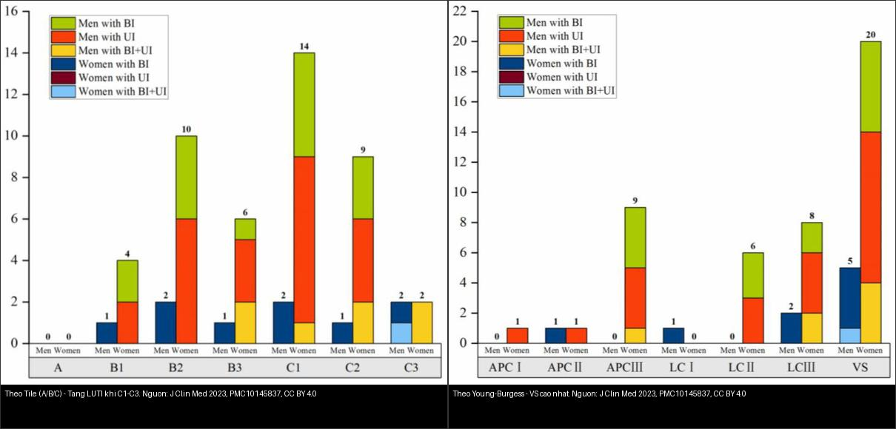
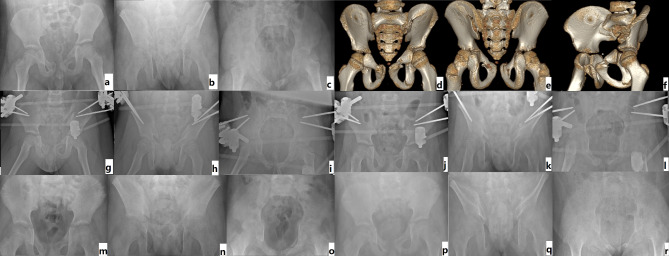
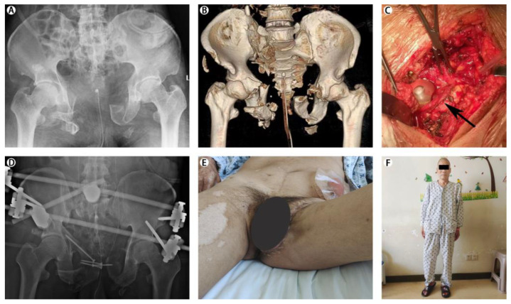
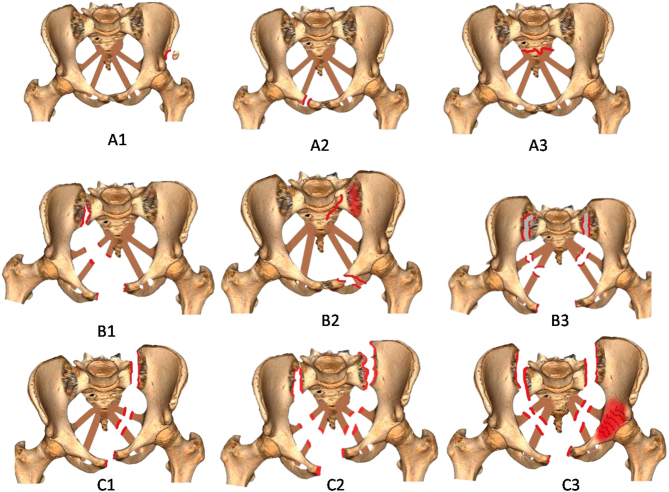

# 645 — Vỡ khung chậu ở trẻ: phân độ Tile/AO – Young–Burgess, quy tắc chụp ALARA & kiểm soát chảy máu

**Tags:** `pattern:vo-khung-chau` `pattern:chan-thuong-bung` `vung:khung-chau-nhi` `score:Tile-AO` `score:Young-Burgess` `score:WSES` `protocol:CT-bung-chau-can-quang` `protocol:pelvic-binder` `protocol:nut-mach`
**Mức chắc chắn (certainty):** tổng hợp y văn (literature synthesis) — nhóm tự biên từ y văn mở (bài tổng quan + loạt ca có số); **3 ca trong quiz là ca nguyên văn (verbatim case)** chép đúng tuổi – cơ chế – chú thích gốc.

> **Câu hỏi gốc của mọi chấn thương khung chậu trẻ:** *khung chậu có CÒN VỮNG không (Tile A/B hay C), và có MÁU ĐANG CHẢY không?* — vì ở trẻ **quyết định điều trị theo HUYẾT ĐỘNG, không theo hình ảnh**: phần lớn vỡ khung chậu nhi lành bảo tồn, nhưng một thiểu số mất vững/đang chảy máu lại cần **đai khung chậu (pelvic binder), cố định ngoài và/hoặc nút mạch** trong giờ vàng.

## 1. Tổng quan — cơ chế & TẠI SAO ảnh hiện như vậy

**A. Giải phẫu quyết định hình thái**

- **Khung chậu = một vòng xương** gồm 2 xương chậu (ilium–ischium–pubis) + xương cùng, khóa nhau bằng **hệ dây chằng sau (sacroiliac, sacrotuberous, sacrospinous)** và **khớp mu (symphysis pubis)** phía trước. Vòng chỉ vững khi **cả cột trước (ngành mu) và cột sau (khớp cùng–chậu + xương cùng) còn nguyên**: phá cột sau = mất vững thật.
- **TẠI SAO trẻ khác người lớn:** xương trẻ **nhiều sụn (sụn Y/triradiate, sụn sinh dục–ngồi)**, đàn hồi cao, màng xương dày → **gãy thường ít di lệch, gãy dạng cành tươi (greenstick)/nứt**; ngược lại **mô mềm và dây chằng yếu hơn xương** nên cùng một lực, trẻ **dễ tổn thương tạng trong khung chậu hơn** (niệu đạo, bàng quang, âm đạo, trực tràng, mạch chậu).
- **TẠI SAO chảy máu:** nguồn chảy máu theo thứ tự — **đám rối tĩnh mạch quanh xương cùng**, **mặt xương gãy**, rồi **động mạch (mông trên, thẹn trong, bịt)**. Vì vậy **phần lớn chảy máu là tĩnh mạch → đáp ứng đai khung chậu + hồi sức**, chỉ thiểu số do **động mạch → cần nút mạch**.

**B. TẠI SAO X-quang/CT thấy được — vật lý đậm độ**

- **X-quang khung chậu (AP, inlet, outlet):** inlet (chếch chậu vào) thấy **di lệch trước–sau**, outlet (chếch ra) thấy **di lệch dọc**. Tổn thương **cột sau dễ bị bỏ sót trên X-quang** vì chồng chập xương cùng và quai ruột.
- **CT cản quang:** là tiêu chuẩn vàng vì xương chậu có **nhiều mảnh mỏng chồng chập**. Đọc 3 thứ: **(1) tái tạo 3D** định hình ổ gãy, **(2) mặt cắt axial** phát hiện máu tụ và đường gãy sau, **(3) thì động mạch** tìm **thoát mạch hoạt tính (active extravasation)**. **Vật lý đậm độ:** máu tụ cấp **45–70 HU**; thuốc cản quang trong lòng mạch **250–400 HU**; **thoát mạch hoạt tính > 90 HU, tăng và lan rộng ở thì muộn** — khác **cục máu tụ "sentinel clot" (45–70 HU, đậm hơn máu xung quanh nhưng KHÔNG lớn thêm)**.
- **Trẻ em + ALARA:** vì mô mềm/niệu đạo nhạy tia và cần giảm liều, **chỉ chụp CT khung chậu khi có cơ chế năng lượng cao/đau khu trú/không đi được/kèm đái máu**; trẻ huyết động ổn định và nghi ngờ thấp có thể dùng **X-quang trước** (Cano JR et al., EFORT Open Rev 2024, PMC11099580).

**C. Ngưỡng định lượng cần nhớ**

- **Dịch tễ nhi:** vỡ khung chậu chỉ chiếm **~2,0% tổng số gãy xương ở trẻ** (so với **~3,9%** ở người lớn); cơ chế chủ yếu **tai nạn giao thông 82,3%**, **ngã cao 14,6%**, thể thao 3,1% (Zhang H et al., BMC Pediatr 2025, PMC12057021).
- **Tử vong** vỡ khung chậu dao động rộng **10% → tới 50%** khi huyết động không ổn định (số liệu người lớn; ở trẻ thấp hơn nhưng **vẫn tử vong vì tổn thương kèm, không vì bản thân xương**).
- **Trong loạt 96 trẻ** (Tile B 47 ca, Tile C 49 ca, tuổi trung bình 95,7 ± 50,3 tháng): **Matta** sau cố định ngoài tốt–rất tốt **91,7%**; lành xương **8,6 ± 1,1 tuần**; kết quả chức năng Cole tốt–rất tốt **83,3%**; **16/96 (16,7%) nhiễm trùng chân đinh (pin site)**, **4 ca mổ lại vì di lệch dụng cụ** (PMC12057021).
- **Yếu tố tiên lượng xấu (hồi quy đa biến):** **Tile C (so với B)** và **sụn Y đã đóng/một phần** tương quan mạnh với điểm chức năng xấu hơn; **di lệch sau mổ còn lớn** tương quan mạnh nhất (r = 0,672, p < 0,001) (PMC12057021).
- **Giãn khớp mu (symphyseal diastasis)** ≥ **2,5 cm** trên X-quang = mất vững cột trước (tương ứng APC II trở lên). **Matta:** di lệch tối đa **≤ 4 mm = rất tốt**, **5–10 mm = tốt**, **10–20 mm = trung bình**, **> 20 mm = kém**.
- **Tổn thương tiết niệu dưới (LUTI)** gặp **7,7%** (54/698) ca vỡ khung chậu; **nam gấp 2,4 lần nữ**; **đứt niệu đạo rõ ở nam (6,1% vs 0,5%, p = 0,001)** nhưng **vỡ bàng quang gần như tương đương hai giới (4,5% vs 4,4%, p = 0,966)**; phân loại **Tile C và Young–Burgess thể thẳng đứng (VS) có tỉ lệ LUTI cao nhất** (Zhao X et al., J Clin Med 2023, PMC10145837).

## 2. Mẫu hình + chẩn đoán phân biệt theo cơ chế (gamut)

**Gamut theo phân loại Tile/AO (nền tảng tư duy):**

- **Tile A:** gãy **không phá vòng** (ngành mu, cánh chậu, gãy ngang cùng) — **vững** cả xoay và dọc.
- **Tile B:** **mất vững xoay, còn vững dọc** — B1 "mở sách" (open book, APC), B2 "ép bên" (lateral compression, LC), B3 hai bên.
- **Tile C:** **mất vững cả xoay và dọc** — C1 một bên, C2 hai bên, C3 kèm gãy ổ cối; **nhóm nặng nhất, tổn thương mạch/tạng nhiều nhất**.

**Gamut theo cơ chế Young–Burgess:**

- **APC (ép trước–sau, "mở sách"):** I (giãn mu < 2,5 cm), II (giãn > 2,5 cm, mở khớp cùng–chậu trước), III (mở cả sau = mất vững hoàn toàn) → **nguy cơ chảy máu lớn nhất**.
- **LC (ép bên):** I (gãy ngành mu), II (kèm cánh chậu "cánh hoa" — bucket-handle), III ("windswept", kèm mất vững dọc đối bên).
- **VS (thẳng đứng/lực cắt):** di lệch **dọc** — **hay kèm đứt niệu đạo, thần kinh, mạch**.
- **CM (kết hợp):** phối hợp cơ chế.

**Gamut lâm sàng theo huyết động (chốt hành động):**

- **Vững/ổn định** (Tile A, phần lớn B) → bảo tồn, tập vận động sớm.
- **Mất vững nhưng đã kiểm soát** (đai + hồi sức) → cố định ngoài (trẻ ưu tiên cố định ngoài hơn mổ mở vì xương còn sụn).
- **Đang chảy máu/không ổn định** → hồi sức máu + đai + **chụp mạch nút mạch**; nếu vẫn chảy → **đóng gói chậu (pelvic packing)/kiểm soát tổn thương**.

**Gamut "vỡ khung chậu mở" (open pelvic fracture) — đáy chậu/hậu môn–trực tràng/âm đạo thông với ngoài:** nguy cơ **nhiễm trùng huyết và tử vong cao** — xem bài [643](../643-chan-thuong-day-chau-sinh-duc-nhi/lesson.md).

## 3. Bảng so sánh phân biệt (ma trận đối chiếu)

| Thực thể (entity) | Hình ảnh điển hình | Chốt vào (rule-in) | Chốt loại (rule-out) | Gợi ý xác nhận |
|---|---|---|---|---|
| **Tile A – vững** | Gãy ngành mu/cánh chậu đơn thuần; vòng sau nguyên | **Chỉ cột trước gãy, vòng sau + khớp mu nguyên** | Có bất kỳ tổn thương cột sau → không còn là A | X-quang AP + CT; điều trị bảo tồn |
| **Tile B – mất vững xoay** | "Mở sách" (giãn mu) hoặc "ép bên" (cánh hoa); cột sau còn vững dọc | **Giãn mu ≥ 2,5 cm hoặc cánh chậu gãy, KHÔNG di lệch dọc** | Di lệch dọc/xương cùng gãy → Tile C | CT 3D; đai khung chậu |
| **Tile C – mất vững xoay + dọc** | Gãy cột sau (khớp cùng–chậu/xương cùng) + di lệch **dọc** nửa khung chậu | **Di lệch dọc trên inlet/outlet + phá vỡ dây chằng sau** | Chỉ giãn mu đơn thuần, cột sau nguyên → Tile B | CT 3D + inlet/outlet; **cân nhắc nút mạch** |
| **Vỡ khung chậu KÍN vs MỞ** | Mở = có **vết thương thông với đáy chậu/âm đạo/trực tràng** | **Thông thương với ngoài (đáy chậu/hậu môn/âm đạo)** | Da nguyên vẹn, không thông → kín | Khám đáy chậu/âm đạo/trực tràng; phân độ WSES |
| **Chảy máu TĨNH MẠCH (đa số) vs ĐỘNG MẠCH** | Máu tụ lan tỏa quanh chậu, không có ổ thuốc | **Máu tụ 45–70 HU, không thấy thoát mạch** | **Thoát mạch > 90 HU, lớn dần thì muộn** → động mạch | CT thì ĐM; DSA nút mạch |
| **Vỡ khung chậu kèm tổn thương tiết niệu dưới** | Đái máu, máu ở lỗ sáo, không tiểu được | **Tile C/VS + máu lỗ sáo/đái máu** | Không đái máu, tiểu được → ít nghĩ | CT cystography/RUG ([637](../637-chan-thuong-bang-quang-nieu-dao-nhi/lesson.md)) |
| **Tổn thương đáy chậu – sinh dục ngoài** | Máu tụ âm hộ, rách âm đạo, máu tụ "cánh bướm" | **Vết thương/máu tụ đáy chậu + vỡ khung chậu** | Chỉ bầm da, không máu tụ sâu | Khám dưới gây mê + CT/CTA ([643](../643-chan-thuong-day-chau-sinh-duc-nhi/lesson.md)) |

*Trái: phân bố tổn thương bàng quang (BI) và niệu đạo (UI) theo **Tile** — tăng dần từ A → C1–C3. Phải: theo **Young–Burgess** — cao nhất ở **VS (thẳng đứng)** rồi APC III và LC III. Nguồn: Zhao X et al., J Clin Med 2023 (PMC10145837), CC BY 4.0. Ảnh ghép letterbox, giữ tỉ lệ.*

## 4. Protocol chụp + hệ phân độ/điểm chuẩn hóa

**Chuỗi hành động cấp cứu (theo ATLS + EFORT 2024, PMC11099580):**

- **Đai khung chậu (pelvic binder)** đặt **càng sớm càng tốt, kể cả trước viện**, ngay khi nghi chấn thương kín năng lượng cao — không phụ thuộc cơ chế. **Đai che mất di lệch trên phim** → phải mô tả "chụp khi có đai" và **nới đai có kiểm soát** khi chụp để đánh giá.
- **X-quang AP/inlet/outlet** khi huyết động ổn định và nghi ngờ thấp; **CT toàn thân cản quang** khi nghi chảy máu/đa chấn thương (thì ĐM + TM + muộn). **CT là chìa khóa phát hiện thoát mạch.**
- **Cố định ngoài (external fixation)** là phương pháp **ưu tiên ở gãy HỞ** và gãy kín khi chưa định mổ trong; **C-clamp** cho vòng sau. Ở trẻ, chân đinh Schanz **3,0–4,0 mm** (dùng 3,0 mm nếu bề rộng cánh chậu < 5 mm) (PMC12057021).
- **Nút mạch (TAE)** khi CT có **thoát mạch hoạt tính** hoặc bệnh nhân không ổn định dù đã đai + hồi sức. Nguồn thường gặp: **động mạch mông trên**, thẹn trong, bịt (xem [920](../920-vascular-embolization-gi-bleed/lesson.md)).

**Phân độ Tile/AO — 3 nhóm (ảnh minh họa bên dưới):**

| Nhóm | Cơ chế mất vững | Ổn định |
|---|---|---|
| A | Không phá vòng chậu | Vững xoay + dọc |
| B | Mất vững **xoay**, còn vững dọc | B1 mở sách / B2 ép bên / B3 hai bên |
| C | Mất vững **xoay + dọc** | C1 một bên / C2 hai bên / C3 + ổ cối |

**Phân độ WSES cho vỡ khung chậu MỞ** (Li PH et al., World J Emerg Surg 2022, PMC9145531 — n = 830): **nhẹ 3,5% · trung bình 11,2% · nặng 23,8% tử vong**; **có nhiễm trùng huyết làm tử vong tăng rõ rệt** → thêm yếu tố sepsis vào phân độ.

**Phân vùng chấn thương khung chậu mở** (Wang ZH & Li KN, Orthop Surg 2019, PMC6904613 — n = 67, tử vong **41,8%**): **type I đáy chậu**, **type II bẹn–chậu (ilioinguinal)**, **type III cùng–chậu (sacroiliac)**, **type IV phối hợp** — vùng đáy chậu (type I) hay kèm tổn thương hậu môn–trực tràng/âm đạo/niệu đạo.

```mermaid
flowchart TD
  A["Trẻ chấn thương năng lượng cao, nghi vỡ khung chậu"] --> B["ATLS: chảy máu? đai khung chậu SỚM"]
  B --> C{"Huyết động ổn định?"}
  C -->|"Không"| D["Hồi sức máu + đai; nghi thoát mạch → CT thì ĐM"]
  C -->|"Có"| E["X-quang AP/inlet/outlet (nghi ngờ thấp) hoặc CT toàn thân"]
  D --> F{"CT: có thoát mạch hoạt tính (>90 HU, lớn dần)?"}
  E --> F
  F -->|"Có"| G["Chụp mạch NÚT MẠCH (TAE)"]
  F -->|"Không"| H{"Còn mất vững?"}
  G --> H
  H -->|"Không &#40;Tile A/B đơn thuần&#41;"| I["Bảo tồn + tập sớm"]
  H -->|"Có &#40;Tile B/C&#41;"| J["Cố định ngoài ± C-clamp; Tile C + traction"]
  J --> K{"Vỡ HỞ / tổn thương đáy chậu?"}
  K -->|"Có"| L["Làm sạch + kháng sinh + colostomy nếu cần (WSES)"]
  K -->|"Không"| M["Theo dõi, X-quang 3–5 ngày"]
  L --> M
```

## 5. Biến thể bình thường và cạm bẫy

- **Sụn Y (triradiate) và sụn sinh dục–ngồi chưa đóng giả "đường gãy"** — đọc theo tuổi xương (Risser, đóng sụn Y) trước khi gọi gãy; ngược lại **gãy nứt/cành tươi ở trẻ dễ bị đọc là bình thường** vì ít di lệch.
- **X-quang bỏ sót cột sau:** xương cùng và khớp cùng–chậu bị quai ruột/xương chồng → **gãy xương cùng/khớp cùng–chậu thường chỉ thấy trên CT**. Đừng loại trừ Tile C chỉ vì X-quang "trông ổn".
- **Đai khung chậu che di lệch:** binder đóng vòng chậu → **giãn mu biến mất trên phim** (Cano, PMC11099580). Luôn ghi rõ "có/không đai" khi chụp.
- **Thỏa mãn tìm kiếm (satisfaction of search):** đã thấy gãy ngành mu rồi dừng → bỏ sót **vỡ bàng quang/đứt niệu đạo** (bài [637](../637-chan-thuong-bang-quang-nieu-dao-nhi/lesson.md)), **chấn thương đáy chậu** (bài [643](../643-chan-thuong-day-chau-sinh-duc-nhi/lesson.md)), **tổn thương tạng đặc** (bài [140](../140-lach-tang-dac/lesson.md), [624](../624-chan-thuong-gan-duong-mat-nhi/lesson.md)).
- **"Gãy ngành mu đơn thuần" ở trẻ không hề nhẹ:** ở trẻ, xương đàn hồi nên **một gãy ngành mu có thể phản ánh lực rất lớn** → luôn tìm tổn thương nội tạng kèm.
- **Thoát mạch hoạt tính vs cục máu tụ "sentinel clot":** cả hai đều tăng đậm độ; chốt bằng **độ đậm (thoát mạch > 90 HU) + lớn dần/lan rộng ở thì muộn**; sentinel clot **45–70 HU, giữ nguyên**.
- **Bỏ sót "khung chậu mở":** thăm khám đáy chậu/âm đạo/trực tràng **bắt buộc** — vết thương nhỏ ở đáy chậu có thể thông vào ổ gãy và gây nhiễm trùng huyết chết người.

## 6. Tự lượng giá — Blind Quiz (ảnh trơn ngoài, đáp án ẩn trong khối chi tiết)

**Ca 1 — Bé trai 8 tuổi, tai nạn giao thông. Nhìn ảnh, mô tả tổn thương trước khi mở đáp án.**

- Gợi ý lâm sàng: đa chấn thương do tai nạn giao thông.
- Câu hỏi: Đây là tổn thương **một bên hay hai bên**, cột **trước hay sau**? Phân loại Tile nào? Xử trí ưu tiên?

<b>Bấm để hiện đáp án (findings + chẩn đoán)</b>

- **(a–c) X-quang AP/outlet/inlet và (d–f) CT 3D:** gãy vòng sau **một bên (Tile C-II)** + gãy **hai bên vòng trước**; có **di lệch dọc** (thấy rõ trên outlet/inlet).
- **Phân loại:** **Tile C-II** (mất vững xoay + dọc) — nhóm nặng, nguy cơ tổn thương mạch/tạng cao.
- **Xử trí:** đai khung chậu sớm + hồi sức; **cố định ngoài** + **kéo chi** cho mất vững dọc (loạt gốc kéo trung bình 9,3 tuần); theo dõi X-quang 3–5 ngày; nếu CT có thoát mạch → nút mạch.
- Nguồn ảnh: Zhang H et al., BMC Pediatr 2025 (PMC12057021), Fig 1, **CC BY-NC-ND 4.0** (giữ nguyên bản, không chỉnh sửa).

**Ca 2 — Ảnh ghép đối chiếu: hai hệ phân loại "nói" cùng một điều gì về nguy cơ tổn thương tiết niệu? Gọi tên hệ trái và hệ phải.**

- Câu hỏi: Cột nào có nguy cơ tổn thương tiết niệu dưới cao nhất trong mỗi hệ? Vì sao?

<b>Bấm để hiện đáp án (findings + chẩn đoán)</b>

- **Trái (Tile):** số ca LUTI tăng dần A → B → **C** — đỉnh ở **C1 (14 ca)**; **Tile C (mất vững xoay + dọc) nguy cơ cao nhất**.
- **Phải (Young–Burgess):** đỉnh ở **VS (thẳng đứng, 20 ca)** rồi **APC III** và **LC III**; **lực thẳng đứng gây di lệch dọc → hay đứt niệu đạo/mạch**.
- **Chốt:** **càng mất vững (Tile C / VS) càng nhiều tổn thương tiết niệu dưới**; đứt niệu đạo nghiêng về nam, vỡ bàng quang gần như tương đương hai giới.
- Nguồn ảnh: Zhao X et al., J Clin Med 2023 (PMC10145837), Fig 2 + Fig 3, CC BY 4.0. Ảnh ghép letterbox.

**Ca 3 — Người lớn (đối chiếu): vỡ khung chậu Tile C kèm tổn thương tiết niệu dưới. Panel nào cho thấy cố định ngoài, panel nào là ảnh trong mổ?**

- Câu hỏi: Mô tả (A)–(F). Cơ chế nào (Tile/YB) hay kèm tổn thương này?

<b>Bấm để hiện đáp án (findings + chẩn đoán)</b>

- **(A)** X-quang khung chậu AP: gãy mất vững; **(B)** CT 3D; **(C)** ảnh trong mổ thấy **bàng quang (có ống thông)**; **(D)** X-quang sau **cố định ngoài**; **(E)** đáy chậu phù nề; **(F)** bệnh nhân hậu phẫu.
- **Chốt:** **Tile C + Young–Burgess VS** là tổ hợp hay kèm tổn thương tiết niệu dưới — luôn đánh giá niệu đạo/bàng quang (bài [637](../637-chan-thuong-bang-quang-nieu-dao-nhi/lesson.md)).
- Nguồn ảnh: Zhao X et al., J Clin Med 2023 (PMC10145837), Fig 1, CC BY 4.0.

**Ca 4 — Sơ đồ phân độ: hai sơ đồ bên dưới mô tả gì, dùng khi nào?**

- Câu hỏi: Sơ đồ 1 phân loại theo **vùng giải phẫu** hay theo **cơ chế lực**? Vùng nào (type I) hay kèm tổn thương hậu môn–trực tràng/âm đạo?

<b>Bấm để hiện đáp án (findings + chẩn đoán)</b>

- **Sơ đồ 1 (khung chậu mở):** phân loại theo **vùng giải phẫu** — **type I đáy chậu (khung trắng)**, type II bẹn–chậu (khung đỏ), type III cùng–chậu (khung xanh). **Type I (đáy chậu)** hay kèm tổn thương **hậu môn–trực tràng/âm đạo/niệu đạo**; loạt 67 ca tử vong **41,8%**.
- **Sơ đồ 2:** phân loại **Tile/AO theo cơ chế mất vững** (A/B/C).
- Nguồn ảnh: Wang ZH & Li KN, Orthop Surg 2019 (PMC6904613), Fig 1, CC BY 4.0; Cano JR et al., EFORT Open Rev 2024 (PMC11099580), Fig 4, **CC BY-NC 4.0** (giữ nguyên bản).

## Bài liên quan chéo
- [600 – Tổng quan Hệ Nhi khoa](../600-tong-quan-nhi-khoa/lesson.md)
- [643 – Chấn thương đáy chậu – sinh dục ngoài ở trẻ](../643-chan-thuong-day-chau-sinh-duc-nhi/lesson.md) (vỡ khung chậu mở + tổn thương đáy chậu/âm đạo/trực tràng)
- [637 – Chấn thương bàng quang & niệu đạo nhi](../637-chan-thuong-bang-quang-nieu-dao-nhi/lesson.md) (đứt niệu đạo sau do vỡ khung chậu)
- [636 – Cấp cứu niệu–sinh dục nhi](../636-cap-cuu-nieu-sinh-duc-nhi/lesson.md) (chấn thương thận AAST, xoắn)
- [623 – Chấn thương tụy–tá tràng ở trẻ](../623-chan-thuong-tuy-ta-trang-nhi/lesson.md) / [624 – Chấn thương gan & đường mật nhi](../624-chan-thuong-gan-duong-mat-nhi/lesson.md) (cùng cơ chế tay lái)
- [140 – Lách & chấn thương tạng đặc](../140-lach-tang-dac/lesson.md) (AAST tạng đặc, thoát mạch vs sentinel clot)
- [320 – Gãy & trật khớp cấp cứu](../320-gay-xuong-trat-khop-cap-cuu/lesson.md) / [321 – Gãy trẻ em (Salter–Harris)](../321-gay-tre-em/lesson.md)
- [920 – Nút mạch trong chảy máu](../920-vascular-embolization-gi-bleed/lesson.md) (nguyên lý TAE)

## Ảnh
- Tên file: `NNN_slug_Modality_SourceID.jpg`. Chi tiết nguồn + giấy phép từng ảnh: `images/CREDITS.md` và `sources.md`.
- Ảnh **CC BY 4.0** (PMC10145837, PMC6904613) và **CC BY-NC/CC BY-NC-ND** (PMC11099580, PMC12057021) — ảnh CC BY-NC/ND **giữ nguyên bản, không crop/ghép**; ảnh ghép đối chiếu chỉ dùng nguồn CC BY 4.0, tạo bằng `tools/make_composite.py` (letterbox, giữ tỉ lệ).

> Không dùng để chẩn đoán độc lập khi chưa có người hướng dẫn.
