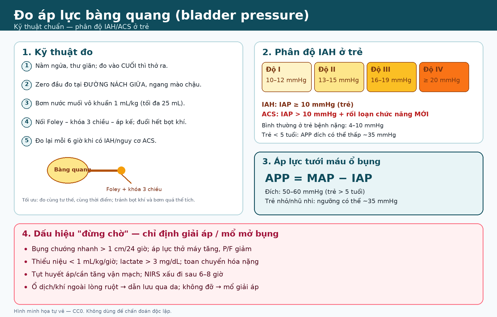
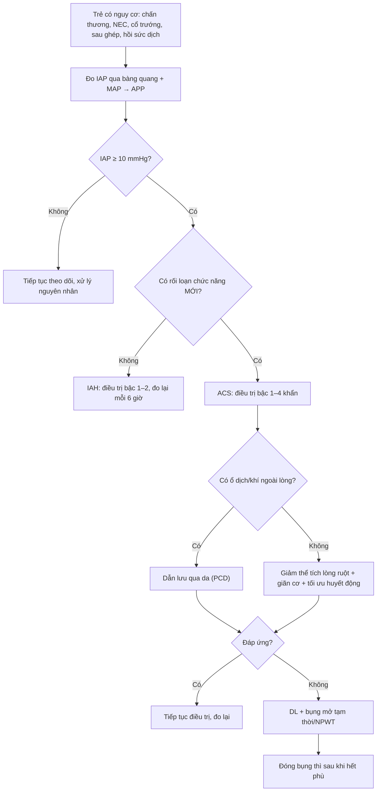

# 646 — Hội chứng khoang bụng ở trẻ: đo áp lực bàng quang, phân độ I–IV & xử trí / Pediatric abdominal compartment syndrome

**Tags:** `pattern:tang-ap-luc-o-bung` `vung:o-bung` `score:WSACS-IAH` `protocol:do-ap-luc-bang-quang` `protocol:CT-bung`
**Mức chắc chắn (certainty):** tổng hợp y văn (literature synthesis) — định nghĩa/ngưỡng lấy từ đồng thuận WSACS và review nhi khoa; ca minh họa là ca nguyên văn có ảnh CC BY-NC-ND (giữ nguyên bản). Chưa có thử nghiệm ngẫu nhiên riêng cho ngưỡng mổ giải áp ở trẻ.

## 1. Tổng quan bệnh học – cơ chế hình ảnh

- **Áp lực ổ bụng (intra-abdominal pressure, IAP)** là áp lực bên trong khoang bụng. Ở trẻ bệnh nặng, **IAP bình thường khoảng 4–10 mmHg** (trẻ thở máy ~7 ± 3 mmHg); ở trẻ khỏe, thở tự nhiên có thể gần 0 mmHg.
- **Tăng áp lực ổ bụng (intra-abdominal hypertension, IAH):** IAP **≥ 10 mmHg** kéo dài hoặc lặp lại ở trẻ (người lớn ≥ 12 mmHg).
- **Hội chứng khoang bụng (abdominal compartment syndrome, ACS):** **IAH + rối loạn chức năng cơ quan MỚI hoặc nặng lên**. Ở trẻ, ngưỡng là **IAP > 10 mmHg**, không phải > 20 mmHg như người lớn — vì **MAP của trẻ thấp hơn**, nên chỉ cần IAP tăng vừa đã đủ làm giảm áp lực tưới máu.
- **Phân độ IAH ở trẻ (WSACS):**
  - **Độ I:** 10–12 mmHg
  - **Độ II:** 13–15 mmHg
  - **Độ III:** 16–19 mmHg
  - **Độ IV:** ≥ 20 mmHg
- **Áp lực tưới máu ổ bụng (abdominal perfusion pressure, APP):** **APP = MAP − IAP**. Đích ở trẻ **> 5 tuổi: 50–60 mmHg**; ở trẻ **< 5 tuổi/ nhũ nhi**, ngưỡng tới hạn có thể **thấp ~35 mmHg** do MAP sinh lý thấp hơn. APP thấp là dấu hiệu **tưới máu tạng kém**, không chỉ là con số IAP.
- **TẠI SAO trẻ dễ bị ACS hơn người lớn?** Khoang bụng nhỏ, thành bụng ít dự trữ thể tích; dù thành bụng đàn hồi hơn, chỉ một lượng dịch/khí/tạng to nhỏ cũng làm IAP tăng nhanh. Trẻ còn **MAP thấp**, nên cùng một IAP sẽ cho **APP thấp hơn**.
- **Cơ chế tổn thương đa cơ quan:**
  - **Hô hấp:** IAP truyền lên lồng ngực → giảm compliance, **tăng áp lực đỉnh (PIP)**, xẹp phổi đáy, giảm oxy hóa, tăng CO₂.
  - **Tuần hoàn:** chèn ép tĩnh mạch chủ dưới → giảm hồi lưu, **CVP có thể giả huyễn cao** dù giảm thể tích; giảm cung lượng tim, tụt huyết áp.
  - **Thận:** chèn ép nhu mô thận và tĩnh mạch thận → **thiểu niệu/oliguria**, tăng creatinine, có thể hoại tử ống thận.
  - **Tiêu hóa:** giảm tưới máu ruột → thiếu máu, tăng tính thấm, **translocation vi khuẩn**, hoại tử ruột.
  - **Thần kinh:** tăng áp lực lồng ngực → giảm hồi lưu tĩnh mạch não → **tăng áp lực nội sọ**.
- **Ngưỡng định lượng/dịch tễ:**
  - IAH/ACS gặp **10–20%** ở NICU/PICU; **17–63%** ở PICU chuyên ghép gan.
  - Tử vong **40–100%**, cao hơn ở sơ sinh và ở trẻ **không được mổ giải áp**.
  - IAH thường gặp **gấp 2–3 lần** ACS (ví dụ IAH 9–12,6% và ACS 4% trong các nghiên cứu).
  - **Tăng đường kính bụng > 1 cm/24 giờ**, **tăng nhu cầu thở máy sau 8–12 giờ**, **NIRS xấu sau 6–8 giờ**, **nước tiểu < 1 mL/kg/giờ** là các mốc cảnh báo sớm.

*Hình minh họa tự vẽ (CC0): zero tại đường nách giữa ngang mào chậu, bơm 1 mL/kg tối đa 25 mL, đo cuối thì thở ra; phân độ I–IV và các dấu hiệu “đừng chờ”.*

## 2. Mẫu hình + chẩn đoán phân biệt theo nguyên nhân (gamut)

### 2.1. ACS nguyên phát (primary ACS) — nguyên nhân trong ổ bụng
- **Chấn thương bụng/khung chậu:** máu tụ sau phúc mạc, vỡ tạng, chèn gạc cầm máu.
- **Bệnh ruột:** **viêm ruột hoại tử (NEC)** ở sơ sinh, tắc ruột, ileus, viêm phúc mạc, thủng ruột.
- **Dịch/khí:** cổ trướng, tràn khí phúc mạc, nang/khối lớn, **u bụng**, **viêm tụy cấp** (hoại tử, tụ dịch).
- **Thành bụng:** **gastroschisis, omphalocele, thoát vị hoành (CDH)** sau mổ, đóng bụng căng, bỏng vòng quanh bụng.
- **Sau mổ:** ghép gan, ghép thận, cắt ruột, đóng bụng thì đầu.

### 2.2. ACS thứ phát (secondary ACS) — nguyên nhân ngoài ổ bụng
- **Hồi sức dịch lớn** (sốc chấn thương, sốc nhiễm khuẩn, bỏng, sốc tim), **truyền máu khối lượng lớn**, rối loạn đông máu.
- **Tăng tính thấm mao mạch:** sepsis, SIRS, bỏng, pancreatitis, suy tim, thẩm phân.
- **Sau ghép tạng** (đặc biệt gan), **ECMO**, **suy thận/thiểu niệu**.
- Cơ chế: phù tạng + dịch trong lòng ruột + thành bụng cứng → IAP tăng dù không có khối choán chỗ.

### 2.3. Gamut theo hình ảnh
- **Bụng chướng căng, vòng bụng tăng nhanh:** ACS cho đến khi chứng minh ngược lại.
- **Cổ trướng lượng nhiều + chèn ép tĩnh mạch chủ dưới:** nghĩ ACS do dịch; **dẫn lưu dịch** vừa chẩn đoán vừa điều trị.
- **Ruột giãn, thành ruột mỏng, khí trong thành/mạch cửa:** **thủng/hoại tử ruột** — ACS có thể là hậu quả, nhưng nguyên nhân ngoại khoa phải xử lý trước.
- **Tụy hoại tử + dịch sau phúc mạc:** ACS thứ phát do viêm tụy; đừng nhầm dịch tụy với “cổ trướng đơn thuần”.
- **Sau ghép gan: gan to, cổ trướng, giảm tưới máu gan:** **large-for-size/ACS**; siêu âm Doppler động mạch gan và tĩnh mạch cửa.

### 2.4. Phân biệt nhanh trên lâm sàng
- **Bụng căng + suy hô hấp + thiểu niệu + tụt huyết áp:** ACS.
- **Bụng căng + sốt + đau + khí tự do:** thủng tạng/viêm phúc mạc — mổ nguyên nhân, không chỉ giải áp.
- **Bụng căng + cổ trướng + gan to:** bệnh gan/tim/thận; đo IAP trước khi kết luận “cổ trướng đơn thuần”.
- **Bụng căng + khí dưới da/trung thất ở trẻ thở máy:** nghĩ **rò khí barotrauma** (bài 617), không vội mổ bụng.

## 3. Bảng so sánh phân biệt (ma trận đối chiếu)

| Thực thể | Hình ảnh/lâm sàng điển hình | Chốt vào (rule-in) | Chốt loại (rule-out) | Gợi ý xác nhận |
|---|---|---|---|---|
| ACS nguyên phát | Bụng chướng nhanh, IAP ≥ 10 + rối loạn cơ quan; CT: dịch/máu/khối, xẹp đáy phổi, chèn ép IVC | **IAP > 10 mmHg + thiểu niệu/tăng PIP/tụt HA mới** | **IAP bình thường + bụng mềm, không rối loạn cơ quan → không phải ACS** | Đo bàng quang, CT bụng, siêu âm tim |
| ACS thứ phát (hồi sức dịch) | Phù toàn thân, cổ trướng, thành bụng căng; sau sốc/bỏng/truyền máu | **Tiền sử hồi sức dịch lớn + IAP tăng dần + APP thấp** | **Có ổ dịch/máu khu trú cần dẫn lưu → ACS nguyên phát** | Cân nặng, bilan dịch, IAP, siêu âm |
| Cổ trướng căng (tense ascites) | Dịch tự do, gan/lách bị đẩy, IVC chèn ép | **Dịch tự do + IAP tăng + đáp ứng sau dẫn lưu** | **IAP không giảm sau dẫn lưu → còn nguyên nhân khác** | Siêu âm, dẫn lưu chẩn đoán |
| Ileus/tắc ruột | Ruột giãn, mức khí–dịch, bụng chướng | **Khí/dịch trong lòng ruột + không khí tự do** | **Khí tự do/thành ruột mỏng → thủng** | X-quang bụng, CT |
| Thủng tạng/viêm phúc mạc | Khí tự do, dịch tự do, thành ruột dày/mỏng bất thường | **Khí ngoài lòng + bụng gồng + sốt** | **Không khí tự do + bụng mềm + IAP tăng đơn thuần → ACS do barotrauma** | CT bụng có cản quang |
| Rò khí barotrauma (bài 617) | Khí phúc mạc ở trẻ thở máy, bụng mềm, có tràn khí trung thất | **Khí tự do + bụng mềm + tiền sử thở máy áp lực cao** | **Bụng gồng, khí trong thành ruột/mạch cửa → thủng tạng** | X-quang/CT, theo dõi lâm sàng |

## 4. Protocol đo IAP + phân độ + xử trí

### 4.1. Khi nào đo?
- **Đo IAP khi có ≥ 1 yếu tố nguy cơ** (chấn thương bụng, NEC, ileus, cổ trướng, bỏng bụng, sau ghép gan, hồi sức dịch lớn, suy hô hấp nặng).
- **Đo lại mỗi 6 giờ** khi đã có IAH hoặc có nguy cơ ACS; đo sau mỗi can thiệp (dẫn lưu, mổ, thay đổi PEEP).

### 4.2. Kỹ thuật đo qua bàng quang (gold standard)
1. **Tư thế:** nằm ngửa, thư giãn; đo **cuối thì thở ra**.
2. **Zero:** đầu đo đặt tại **đường nách giữa, ngang mào chậu**.
3. **Thể tích:** bơm **nước muối vô khuẩn 1 mL/kg**, **tối đa 25 mL** qua Foley.
4. **Hệ thống:** Foley – khóa 3 chiều – áp kế; **đuổi hết bọt khí**, kiểm tra không rò.
5. **Đọc:** IAP theo mmHg; ghi kèm MAP để tính **APP = MAP − IAP**.
- **Lỗi thường gặp:** bơm quá nhiều dịch → IAP giả cao; bọt khí; đầu đo sai vị trí; bàng quang co thắt; đo khi bệnh nhân ho/đang thở mạnh; ống thông bị gập.

### 4.3. Xử trí theo bậc
- **Bậc 1 — giảm thể tích trong lòng ruột:** đặt **sonde dạ dày**, thuốc tăng nhu động, thụt/ống trực tràng, **ngừng nuôi ăn đường ruột** tạm thời.
- **Bậc 2 — giảm thể tích ngoài lòng ruột:** **dẫn lưu dịch/máu/khí qua da (percutaneous catheter drainage, PCD)** khi có ổ dịch; đặc biệt hiệu quả trong **NEC, cổ trướng lượng nhiều, bỏng, IAH độ III/IV có rối loạn cơ quan**.
- **Bậc 3 — cải thiện compliance thành bụng:** giảm đau/an thần sâu, **thuốc giãn cơ** ngắn hạn, tư thế **reverse Trendelenburg**; tránh đầu cao > 30°.
- **Bậc 4 — tối ưu huyết động:** hạn chế dịch tinh thể, đạt **cân bằng dịch âm/không**, lọc máu khi cần, vận mạch để duy trì APP.
- **Bậc 5 — mổ giải áp (decompressive laparotomy, DL):** mở bụng cấp cứu, để bụng mở tạm thời, **NPWT/đóng bụng thì sau** khi hết phù.
- **Chỉ định DL:** theo kinh nghiệm, khi **2 tiêu chí chính** hoặc **1 chính + 3 phụ**:
  - **Chính:** suy hô hấp nặng/tăng PIP, **thiểu niệu kéo dài**, **lactate > 3 mg/dL**.
  - **Phụ:** cần tăng vận mạch, rối loạn đông máu, tuần hoàn bàng hệ, tăng áp lực nội sọ.
- **Không chờ đợi:** bụng chướng nhanh **> 1 cm/24 giờ**, tăng nhu cầu thở máy **8–12 giờ**, NIRS xấu **6–8 giờ**, nước tiểu **< 1 mL/kg/giờ** → đánh giá ngay khả năng DL.

### 4.4. Sơ đồ xử trí

### 4.5. Điểm cần nhớ theo bối cảnh
- **Sơ sinh sau mổ CDH:** nguy cơ ACS rất cao; có thể dùng **áp lực bàng quang để quyết định đóng bụng chậm** thay vì đóng căng thì đầu.
- **Sau ghép gan:** IAH **17–63%**; theo dõi IAP, siêu âm Doppler mạch gan, chức năng gan.
- **Viêm tụy cấp:** dịch tụy + phù tạng → ACS thứ phát; dẫn lưu ổ dịch và kiểm soát dịch là chìa khóa.
- **Bỏng bụng vòng quanh:** thành bụng cứng như “áo giáp” → cần mở bụng giải áp sớm.

## 5. Biến thể bình thường và cạm bẫy

- **Dùng ngưỡng người lớn (> 20 mmHg) cho trẻ là sai:** trẻ có thể có ACS với **IAP > 10 mmHg**; bỏ sót vì “chưa tới 20” là lỗi chết người.
- **CVP cao không loại trừ giảm thể tích:** IAP cao truyền vào lồng ngực làm CVP giả cao; đánh giá kèm siêu âm tim, lactate, nước tiểu.
- **Bơm quá thể tích vào bàng quang** → IAP giả cao, dẫn tới can thiệp không cần thiết; tuân thủ **1 mL/kg, tối đa 25 mL**.
- **Bàng quang co thắt/không có Foley** → đo sai; xem xét đo dạ dày (ống thông có bóng) hoặc trực tràng khi không thể đo bàng quang.
- **APP thấp ở nhũ nhi là sinh lý:** đừng áp dụng đích 50–60 mmHg cho trẻ < 5 tuổi; ngưỡng có thể ~35 mmHg.
- **ACS do barotrauma vs thủng tạng:** trẻ thở máy có khí tự do nhưng **bụng mềm, không gồng, có tràn khí trung thất** → nghĩ khí lan từ phổi (Macklin), **tránh mổ bụng oan**; ngược lại, bụng gồng + khí trong thành ruột/mạch cửa → thủng tạng.
- **Đừng chỉ nhìn CT:** hình ảnh (cổ trướng, chèn ép IVC, xẹp đáy phổi, tưới máu thận không đồng nhất, thành ruột ngấm bất thường, phù dưới da) **gợi ý nhưng không đặc hiệu**; chẩn đoán dựa vào **IAP + rối loạn cơ quan**.
- **Sau khi giải áp:** có thể tái phát IAH khi đóng bụng thì sau; theo dõi IAP và đóng bụng theo bậc.

## 6. Tự lượng giá — Blind Quiz

**Ca 1 — Bé trai 2 tuổi 11 tháng, B-ALL đang điều trị pegaspargase, đau bụng dữ dội, bụng chướng, tụt huyết áp. Đọc CT bụng.**

- Gợi ý lâm sàng: đau bụng sau pegaspargase, bụng chướng, tụt huyết áp; IAP đo qua bàng quang **35 mmHg**, lactate **3,16 mmol/L**.
- Câu hỏi: Chẩn đoán hình ảnh? Vì sao đây là ACS? APP bằng bao nhiêu và ý nghĩa? Bước xử trí?

<b>Bấm để hiện đáp án (findings + chẩn đoán)</b>

- Dấu hiệu: (A) CT không cản quang — vùng giảm đậm độ nhẹ ở đuôi tụy; (B) CT có cản quang — **nhiều ổ giảm đậm độ, bờ không rõ = hoại tử tụy**, kèm **dịch phúc mạc và tràn dịch màng phổi**.
- Chẩn đoán: **viêm tụy cấp do asparaginase (AAP)** biến chứng **ACS** (IAP 35 > 10 + tụt huyết áp/lactate tăng). Nếu MAP = 65 mmHg, **APP = 65 − 35 = 30 mmHg**, thấp hơn đích 50–60 → tưới máu tạng kém.
- Xử trí: nhịn ăn, giảm đau, dịch hạn chế, dẫn lưu dịch nếu có ổ; không đỡ → **mổ giải áp + NPWT**. Ca nguồn được **DL + NPWT**, hồi phục.
- Nguồn ảnh: Zhang H, Lu W. *Transl Pediatr* 2025 (PMC12163796, Fig. 1), **CC BY-NC-ND 4.0 — giữ nguyên bản, không crop/ghép**.

**Ca 2 — Sơ sinh sau mổ thoát vị hoành, đang ECMO, bụng chướng. Đọc sơ đồ kỹ thuật và tính toán.**

- Gợi ý lâm sàng: sau đóng thành bụng, PIP tăng, nước tiểu giảm; IAP **17 mmHg**, MAP **50 mmHg**.
- Câu hỏi: Phân độ IAH? APP? Có nên đóng bụng thì đầu không? Theo dõi gì?

<b>Bấm để hiện đáp án (findings + chẩn đoán)</b>

- Phân độ: IAP 17 mmHg = **IAH độ III** (16–19 mmHg); nếu có rối loạn cơ quan mới → **ACS**.
- APP = 50 − 17 = **33 mmHg**, rất thấp (ngưỡng tới hạn ở nhũ nhi có thể ~35 mmHg).
- Xử trí: trì hoãn đóng bụng, giảm áp lực đường thở, dẫn lưu dịch/khí, tối ưu huyết động; theo dõi IAP mỗi 6 giờ. Ca nguồn dùng **áp lực bàng quang để quyết định đóng bụng chậm** ở trẻ CDH/ECMO.
- Nguồn hình: tự vẽ, CC0.

**Ca 3 — Trẻ 3 tuổi sau chấn thương bụng, bụng chướng, tụt huyết áp. CT có dịch tự do và máu tụ sau phúc mạc.**

- Gợi ý: IAP **24 mmHg**, MAP **65 mmHg**, lactate **4,2 mg/dL**, nước tiểu **0,5 mL/kg/giờ**.
- Câu hỏi: Chẩn đoán? APP? Chỉ định nào cho mổ giải áp? Có nên chỉ dẫn lưu qua da không?

<b>Bấm để hiện đáp án (findings + chẩn đoán)</b>

- Chẩn đoán: **ACS nguyên phát do máu tụ sau phúc mạc/chấn thương**; APP = 65 − 24 = **41 mmHg**.
- Chỉ định DL: **2 tiêu chí chính** (thiểu niệu, lactate > 3 mg/dL) + tăng PIP/tụt HA → **mổ giải áp**; nếu có ổ máu/dịch khu trú, **PCD** có thể là bước cầu nối nhưng không thay thế DL khi đang suy cơ quan.
- Lưu ý: **không chọc dò mù** khi nghi máu tụ sau phúc mạc/tổn thương mạch; kiểm soát nguồn chảy máu là ưu tiên.

## Bài liên quan chéo
- [600 – Tổng quan Hệ Nhi khoa](../600-tong-quan-nhi-khoa/lesson.md)
- [617 – Hội chứng rò khí ở nhũ nhi: tràn khí phúc mạc do barotrauma vs thủng tạng](../617-hoi-chung-ro-khi-o-nhu-nhi/lesson.md)
- [667 – U mạch máu gan ở trẻ (IHH lan tỏa gây ACS)](../667-u-mach-mau-gan-o-tre-va-dieu-tri/lesson.md)
- [687 – Theo dõi & điều trị IHH sau can thiệp](../687-theo-doi-va-dieu-tri-ihh-sau-can-thiep/lesson.md)
- [623 – Chấn thương tụy–tá tràng ở trẻ](../623-chan-thuong-tuy-ta-trang-nhi/lesson.md)
- [626 – Viêm tụy cấp ở trẻ (biến chứng tụ dịch/WON)](../626-viem-tuy-cap-nhi/lesson.md)
- [668 – Theo dõi sau tháo căng tủy & bàng quang thần kinh](../668-theo-doi-sau-thao-cang-tuy-bang-quang-than-kinh/lesson.md) (bàng quang thần kinh — đo áp lực bàng quang khác mục đích)

## Ảnh
- Tên file `646_acs_<Modality>_...`; nguồn + giấy phép từng ảnh trong `images/CREDITS.md`.
- Ảnh CT là **CC BY-NC-ND 4.0 — giữ nguyên bản, không crop/ghép**. Sơ đồ do bài tự vẽ, **CC0**.
- Không tải Google Images/AuntMinnie; nguồn đóng chỉ dẫn link trong `sources.md`.

> Không dùng để chẩn đoán độc lập khi chưa có người hướng dẫn.
