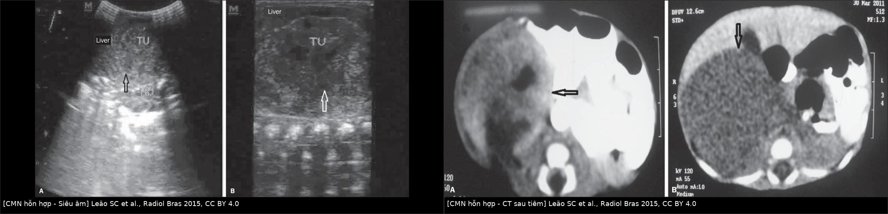
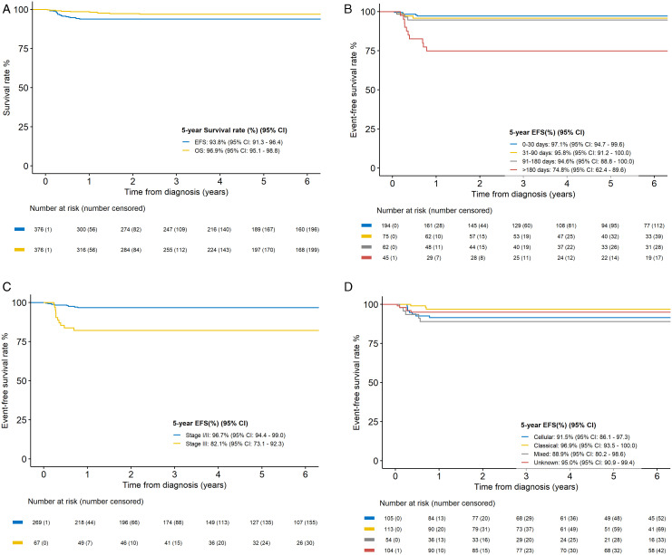
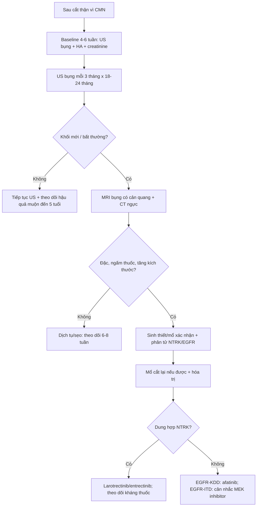
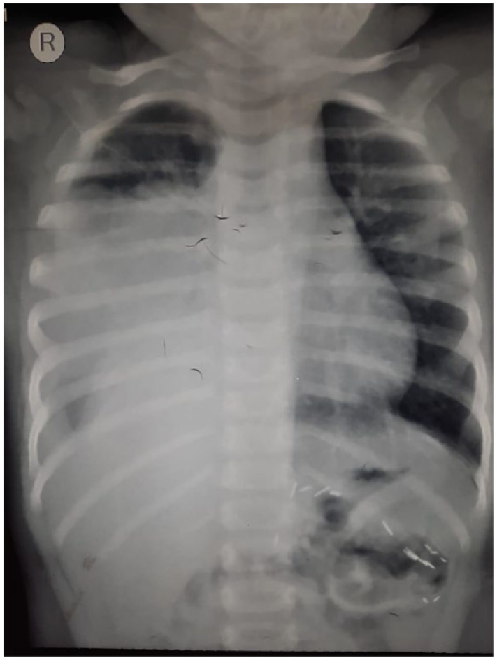
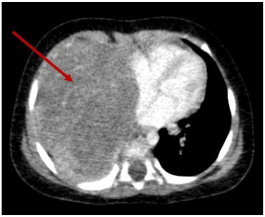
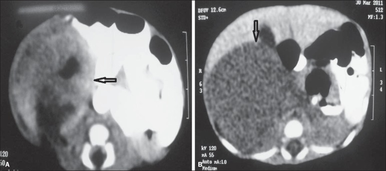

# 647 — U cơ trung mô bẩm sinh thể tế bào: theo dõi sau cắt thận, tái phát/di căn & điều trị đích / Cellular congenital mesoblastic nephroma: post-nephrectomy surveillance, relapse and targeted therapy

**Tags:** `pattern:u-co-trung-mo` `pattern:tai-phat-sau-cat-than` `pattern:di-can-phoi` `vung:than` `vung:o-bung-nhi` `score:SIOP` `protocol:US-theo-doi` `protocol:CT-nguc` `incidentaloma:khong`
**Mức chắc chắn (certainty):** tổng hợp y văn (literature synthesis) — đoàn hệ 376 ca SIOP/UK-IMPORT/AIEOP (Quarello P et al., PLoS One 2026, PMC13210389) + ca nguyên văn di căn phổi (Athapathu AS et al., SAGE Open Med Case Rep 2023, PMC10750505) và các ca tái phát có đột biến phân tử (Sun M et al., Transl Pediatr 2024, PMC11228910; Li J et al., Transl Pediatr 2026, PMC12969158).

## 1. Tổng quan — vì sao CMN "lành" vẫn phải theo dõi

- **U cơ trung mô bẩm sinh (congenital mesoblastic nephroma — CMN)** là u thận đặc hay gặp nhất ở **trẻ dưới 6 tháng**, chiếm **2–5%** u thận nhi; tuổi trung vị trong đoàn hệ 376 ca là **28 ngày** (0–953 ngày).
- **Ba thể mô học — ba chương trình phân tử:**
  - **Thể kinh điển (classic, 41,5%):** tế bào hình thoi lành, ít phân bào; **đột biến lặp đoạn nội bộ gen EGFR (EGFR internal tandem duplication — EGFR-ITD)** ở phần lớn ca.
  - **Thể tế bào (cellular, 38,6%):** tăng sinh dày đặc, nhiều phân bào, **hoại tử/xuất huyết/nang**; **dung hợp ETV6::NTRK3** — t(12;15)(p13;q25) — ở **~70%** ca, cùng phổ với **u sợi bẩm sinh (infantile fibrosarcoma)**.
  - **Thể hỗn hợp (mixed, 19,9%):** trung gian; phân tử ít được định nghĩa, một phần mang **EGFR-ITD**.
- **TẠI SAO thể tế bào khác biệt trên hình ảnh:** mật độ tế bào cao + hoại tử + xuất huyết + nang → **T2 không đồng nhất**, **T1 tăng tín hiệu vùng xuất huyết**, **ngấm thuốc không đồng nhất**, **không vôi hóa**; thể kinh điển **đồng nhất, T2 đồng tín hiệu, ngấm đồng nhất** và có **dấu vòng đồng tâm (concentric ring sign)**. Đây là lý do hình ảnh **không thể thay mô học** để quyết định theo dõi.
- **TẠI SAO phải theo dõi dù đa số khỏi:** dung hợp **ETV6::NTRK3** hoạt hóa con đường **RAS–MAPK** liên tục; thể tế bào có thể **tái phát tại chỗ** hoặc **di căn phổi/gan/tinh hoàn**. Đoàn hệ 376 ca: **EFS 5 năm 93,8%**, **OS 96,9%**, **tỷ suất tái phát tích lũy 5 năm 5,3%** — tức **~1/20 trẻ vẫn có biến cố**.
- **Số liệu định lượng nằm lòng (Quarello P et al., PMC13210389):**
  - **18 ca tái phát**; 16 ca có dữ liệu vị trí: **12 tại chỗ**, **2 phổi**, **1 gan**, **1 tinh hoàn**.
  - **Thời gian tái phát trung vị 3,6 tháng** (1–9,5 tháng) — **rất sớm**, không phải "vài năm sau".
  - **Tái phát theo giai đoạn:** I **2,2%** · II **2,8%** · III **16,4%**.
  - **EFS 5 năm theo giai đoạn:** I **98,7%**, II **96,2%**, III **82,1%**; **OS** tương ứng **98,7% / 98,1% / 93,2%**.
  - **EFS theo thể:** thể tế bào **91,5%**, thể hỗn hợp **93,3%**, thể kinh điển **96,9%** — khác biệt **không có ý nghĩa thống kê**, và **3/16 ca tái phát là thể kinh điển** → **không được loại trừ thể kinh điển**.
  - **Tuổi > 6 tháng lúc chẩn đoán:** EFS 5 năm chỉ **74,8%** (so với **97,1–100%** ở nhóm ≤ 6 tháng).
- **Hóa trị trước mổ:** 21% ca được hóa trị trước; **60% giảm thể tích đo được**, **13,3% ổn định**, **26,7% tăng**; không liên quan rõ với thể mô học (p = 0,22). Vì vậy **không dùng "đáp ứng hóa trị" để suy ra thể**.
- **Điều trị bổ trợ sau mổ còn tranh luận:** chỉ **17,3%** ca giai đoạn III nhận hóa trị bổ trợ; một số chuỗi cho thấy **32,5% tái phát khi không hóa trị** so với **8–11% khi có**, nhưng lợi ích chưa được chứng minh ngay cả ở thể tế bào → **quyết định theo hội đồng đa chuyên khoa**, không theo "thể tế bào = phải hóa trị".

*Trái — **siêu âm**: khối hỗn hợp đặc–giảm âm, bờ rõ, chen giữa gan và thận phải (TU); phải — **CT sau tiêm**: khối lớn **không đồng nhất**, vùng hoại tử/giảm đậm độ trung tâm, **ngấm thuốc không đều**. Hình thái này **không phân biệt được thể tế bào với thể hỗn hợp** — chốt là mô học. Leão SC et al., Radiol Bras 2015 (PMC4725402, Fig. 1–2), CC BY 4.0; ảnh ghép letterbox, không crop.*

## 2. Mẫu hình + chẩn đoán phân biệt của "khối mới sau cắt thận" (Gamut)

Đọc theo **vị trí trước, thời gian sau**:

- **Tại giường cắt thận (ổ bụng sau phúc mạc):**
  - **Tái phát tại chỗ** — hay gặp nhất (12/16 ca), thường **< 12 tháng**, đa số **< 4 tháng**.
  - **Dịch tụ sau mổ** — **lymphocele/seroma** (dịch, không ngấm, giảm dần), **máu tụ** (tăng đậm độ, thay đổi theo thời gian), **áp-xe** (viền ngấm + khí, sốt).
  - **Sẹo xơ/tổ chức hạt** — bờ không đều nhưng **ổn định qua các lần**, không ngấm tiến triển.
  - **Phì đại bù của thận còn lại** — thận to **đồng nhất**, giữ hình thận, **không có khối**, chức năng bình thường.
  - **U nguyên bào thận đồng thời/đối bên** — hiếm ở CMN nhưng phải loại trừ, nhất là có hội chứng dễ mắc (bài 648).
- **Ngoài ổ bụng:**
  - **Di căn phổi** — 2/16 ca, có thể **rất lớn, hoại tử trung tâm**, gây khó thở; có ca xuất hiện **7 tháng sau cắt thận**.
  - **Di căn gan** (1/16) — thường nhiều ổ, giảm đậm độ, ngấm viền.
  - **Tái phát tinh hoàn** (1/16) — khối bìu đặc, cần siêu âm bìu khi thăm khám.
  - **Di căn xương/não** — rất hiếm, chỉ tìm khi có triệu chứng.
- **Mẹo nhớ "LOCAL FIRST":** **L**ocal bed, **O**ther kidney, **C**hest, **A**bscess/collection, **L**iver — thứ tự khảo sát mỗi lần theo dõi.

## 3. Bảng so sánh phân biệt (ma trận đối chiếu)

| Thực thể (entity) | Hình ảnh điển hình | Chốt vào (rule-in) | Chốt loại (rule-out) | Gợi ý xác nhận |
|---|---|---|---|---|
| **Tái phát tại chỗ** | Khối đặc trong giường cắt thận, **ngấm thuốc**, bờ không đều, có thể xâm lấn cơ thắt lưng/tá tràng | **Khối đặc mới + ngấm thuốc + tăng kích thước qua 2 lần chụp** | Dịch **không ngấm**, giảm dần, bờ mỏng → không phải tái phát | MRI bụng có cản quang; so baseline 4–6 tuần sau mổ; **sinh thiết nếu còn do dự** |
| **Di căn phổi** | Nốt/khối **tròn, ngoại vi**, có thể **hoại tử trung tâm**, nhiều ổ; X-quang có thể chỉ thấy mờ lớn | **Nốt đặc mới ≥ 1 nốt + bối cảnh CMN thể tế bào/hỗn hợp** | Mờ do xẹp phổi/viêm: có **phế quản hơi, tam giác xẹp**, đáp ứng kháng sinh | **CT ngực** (không dùng X-quang để loại trừ); đối chiếu CT cũ |
| **U nguyên bào thận đối bên** | Khối **trong thận**, đẩy mạch, có giả vỏ; thường kèm ổ nguyên bào thận | Khối **xuất phát từ nhu mô thận**, không phải giường mổ | Khối **ngoài thận**, bọc mạch → nghĩ neuroblastoma | Siêu âm + MRI hai thận; xem bài 639/648 |
| **Nephrogenic rest** | Nốt **< 1–2 cm**, T2 **tăng nhẹ**, **hầu như không ngấm**, bờ rõ | **Nốt nhỏ, ổn định, không ngấm** ở trẻ có hội chứng | Nốt **tăng kích thước/ngấm mạnh** → nghi Wilms | MRI; **không sinh thiết**; theo dõi 3 tháng |
| **Dịch tụ sau mổ (seroma/lymphocele)** | Dịch **0–20 HU**, thành mỏng, không vách, **giảm kích thước** | **Không ngấm + giảm dần + không triệu chứng** | Thành dày/ngấm + sốt → áp-xe; tăng dần → tái phát | Siêu âm; chọc hút chỉ khi có triệu chứng/nghi áp-xe |
| **Phì đại bù thận còn lại** | Thận **to đều, đồng nhất**, giữ hình thận, không khối | **Hình thận bình thường + không có khối + chức năng ổn định** | Có **khối lệch hình**, ngấm không đều → khảo sát tiếp | Siêu âm đo chiều dài; creatinine/eGFR |

*(A)* EFS **93,8%** và OS **96,9%** toàn đoàn hệ; *(B)* EFS theo tuổi — **> 6 tháng chỉ 74,8%**; *(C)* EFS theo giai đoạn — **III 82,1%**; *(D)* EFS theo thể — **thể tế bào 91,5%** không khác có ý nghĩa so với thể kinh điển **96,9%**. Quarello P et al., PLoS One 2026 (PMC13210389, Fig. 3), CC BY 4.0.

## 4. Protocol theo dõi sau cắt thận + sơ đồ

- **Mốc 0 — baseline sau mổ 4–6 tuần:** siêu âm bụng đánh dấu giường cắt thận, thận còn lại, huyết áp, creatinine/eGFR. **Không có baseline thì không thể gọi "khối mới"**.
- **Theo dõi ung thư học (theo Quarello P et al.):** **siêu âm bụng mỗi 3 tháng, tối thiểu 18–24 tháng** sau chẩn đoán — vì **trung vị tái phát 3,6 tháng** và **ca muộn nhất 9,5 tháng**; một số chuỗi AREN03B2 có ca **14,2 và 17,9 tháng**. Sau 24 tháng, tiếp tục **theo dõi hậu quả muộn của cắt thận** (huyết áp, chức năng thận, phì đại bù) ít nhất đến 5 tuổi.
- **Lâm sàng mỗi lần:** cân nặng, **huyết áp**, khám bụng, **khám bìu** (tái phát tinh hoàn), hỏi ho/khó thở.
- **X-quang ngực không dùng để sàng lọc thường quy** (nhạy kém, bức xạ); **CT ngực** khi có triệu chứng hô hấp, X-quang bất thường, hoặc nghi tái phát. **CT bụng/MRI bụng** khi siêu âm thấy khối mới hoặc không kết luận được.
- **Không đo thể tích bằng hai phương tiện khác nhau:** theo dõi cùng modality, cùng mặt cắt; thể tích u thay đổi **> 20%** mới đáng kể (tránh "đo sai thành tái phát").
- **Khi có tái phát:**
  - **Xác nhận mô học** (sinh thiết hoặc mổ) trước khi hóa trị, vì có thể là **Wilms đồng thời** hoặc tổn thương lành.
  - **Mổ cắt lại nếu còn cắt được**; hóa trị **VAC (vincristine–actinomycin D–cyclophosphamide)** hoặc **ICE (ifosfamide–carboplatin–etoposide)** — nhưng chuỗi nhỏ cho thấy **hiệu quả hạn chế**.
  - **Điều trị đích theo phân tử:** dung hợp **NTRK** → **larotrectinib/entrectinib** (đáp ứng ban đầu rõ, nhưng **kháng thuốc do đột biến điểm TRKA** đã được báo cáo); **EGFR-KDD** → **afatinib** (có ca ổn định bệnh khi phối hợp ức chế PD-1); **EGFR-ITD** → tiềm năng **ức chế MEK** (p-MEK/p-ERK tăng trong nhóm này).
- **Giai đoạn III — hóa trị bổ trợ không mặc định:** thảo luận hội đồng; cân nhắc **thể tế bào + bờ cắt dương/vỡ u** nhưng phải nói rõ **lợi ích chưa được chứng minh**.

## 5. Biến thể bình thường & cạm bẫy

- **Phì đại bù thận còn lại** là **bình thường** sau cắt thận; đừng gọi "khối" nếu thận giữ hình, đồng nhất, không có nốt.
- **Seroma/lymphocele** sau mổ có thể tồn tại **vài tuần**; chỉ can thiệp khi **to lên, sốt, chèn ép**.
- **Sẹo mổ ngấm thuốc** ở thì muộn có thể giả tái phát — so **nhiều lần**, không dựa một lần chụp.
- **Di căn phổi có thể rất lớn và hoại tử**, giống **áp-xe phổi/viêm phổi**; bối cảnh **CMN thể tế bào + không đáp ứng kháng sinh** → CT ngực, không chờ.
- **Thể kinh điển vẫn có thể tái phát** (3/16 ca) — **không bỏ theo dõi** vì mô học "lành".
- **Tái phát muộn > 12 tháng** hiếm nhưng có (đến 17,9 tháng) — không cắt theo dõi quá sớm.
- **Tái phát tinh hoàn** dễ bỏ sót nếu không khám bìu.
- **Đừng suy thể từ hình ảnh:** đồng nhất ≠ chắc chắn kinh điển; không đồng nhất ≠ chắc chắn tế bào.
- **Đừng đo bằng X-quang ngực để loại trừ di căn phổi** — X-quang âm không loại trừ.

## 6. Tự lượng giá — Blind Quiz

**Ca 1 — Bé gái 10 tháng, 7 tháng sau cắt thận trái vì CMN thể tế bào, nay khó thở. Nhìn X-quang trước, mô tả:**

- Gợi ý lâm sàng: tiền sử CMN thể tế bào, khó thở tiến triển, không sốt.
- Hỏi: dấu hiệu chính? 3 chẩn đoán phân biệt? bước tiếp theo?

<b>Bấm để hiện đáp án (findings + chẩn đoán)</b>

- **Mờ đậm toàn bộ nửa ngực phải**, bờ ngoài mờ, **không có phế quản hơi rõ**, trung thất **bị đẩy nhẹ sang trái** — khối choán chỗ.
- Phân biệt: **di căn phổi CMN** (hàng đầu theo bối cảnh), **tràn dịch màng phổi/tràn máu**, **viêm phổi/xẹp phổi**.
- Bước tiếp: **CT ngực có cản quang** — thấy khối lớn **hoại tử trung tâm** ở nửa ngực phải, xác nhận di căn; sau đó **sinh thiết/mô học + đánh giá phân tử** trước khi chọn điều trị.
- **Nguồn ca:** Athapathu AS et al., SAGE Open Med Case Rep 2023 (PMC10750505, Fig. 4), **CC BY-NC 4.0** (nguyên bản).

**Ca 1b — Cùng bệnh nhân, CT ngực:**

<b>Bấm để hiện đáp án</b>

- **Khối lớn ở nửa ngực phải, hoại tử trung tâm**, đè xẹp phổi phải, đẩy trung thất — **di căn phổi của CMN thể tế bào** (mô học phù hợp tổn thương nguyên phát).
- **Bài học:** CMN thể tế bào có thể di căn **dù đã cắt thận "hoàn toàn"**; theo dõi sát **18–24 tháng** và CT ngực khi có triệu chứng.
- **Nguồn:** Athapathu AS et al., SAGE Open Med Case Rep 2023 (PMC10750505, Fig. 5), **CC BY-NC 4.0** (nguyên bản).

**Ca 2 — Bé trai 2 tháng, khối bụng phải lớn. Nhìn CT, mô tả và biện luận:**

- Gợi ý: khối phát hiện tình cờ, không sốt, không vàng da.
- Hỏi: khối xuất phát từ đâu? đặc điểm? vì sao không gọi ngay là Wilms? cần làm gì tiếp?

<b>Bấm để hiện đáp án</b>

- **Khối lớn thay thế thận phải**, **không đồng nhất**, vùng **giảm đậm độ trung tâm (hoại tử/nang)**, **ngấm thuốc không đều**, **không vôi hóa**; trên CT này **chưa thấy huyết khối mạch rõ**.
- **Tuổi 2 tháng** + khối thận đặc → **CMN** là chẩn đoán hàng đầu (Wilms đỉnh ~3 tuổi); hình ảnh **không đồng nhất** gợi **thể tế bào/hỗn hợp**, nhưng **không phân biệt được với thể kinh điển chỉ bằng CT**.
- Tiếp theo: **MRI bụng** (đánh giá thận đối bên, mạch), **không sinh thiết nếu < 3 tháng**, **cắt thận + mô học phân tử**; sau mổ **theo dõi 3 tháng/lần**.
- **Nguồn ca:** Leão SC et al., Radiol Bras 2015 (PMC4725402, Fig. 2), CC BY 4.0.

**Ca 3 — Đọc biểu đồ: thể tế bào có buộc phải hóa trị bổ trợ?**

- Hỏi: EFS 5 năm của thể tế bào so với thể kinh điển? điều đó có nghĩa "thể tế bào phải hóa trị bổ trợ" không?

<b>Bấm để hiện đáp án</b>

- **Thể tế bào 91,5%**, thể hỗn hợp **93,3%**, thể kinh điển **96,9%** — **khác biệt không có ý nghĩa**; **giai đoạn III** mới là yếu tố tiên lượng rõ (**EFS 82,1%**).
- **Không** — lợi ích hóa trị bổ trợ chưa được chứng minh, kể cả ở thể tế bào; quyết định theo **hội đồng + giai đoạn + bờ cắt/vỡ u + phân tử**, không theo mô học đơn thuần.
- **Nguồn:** Quarello P et al., PLoS One 2026 (PMC13210389, Fig. 3), CC BY 4.0.

## Bài liên quan chéo
- [600 – Tổng quan Nhi khoa](../600-tong-quan-nhi-khoa/lesson.md)
- [630 – U bụng nhi: neuroblastoma vs Wilms](../630-u-bung-nhi-neuroblastoma-vs-wilms/lesson.md)
- [639 – Khối thận đặc ở trẻ: Wilms vs CMN vs RCC](../639-khoi-than-o-tre-wilms-cmn-rcc/lesson.md)
- [648 – Hội chứng dễ mắc u nguyên bào thận & tầm soát](../648-hoi-chung-de-mac-wilms-tam-soat-nephroblastomatosis/lesson.md)
- [156 – Hội chứng di truyền u thận ở người lớn](../156-hoi-chung-di-truyen-u-than/lesson.md)

## Ảnh
- `647_cmn-hon-hop_US_PMC4725402-Fig1-CCBY.jpg`, `647_cmn-hon-hop_CT_PMC4725402-Fig2-CCBY.jpg` — CC BY 4.0.
- `647_cmn-dap-ung-hoa-tri_PMC13210389-Fig2-CCBY.jpg`, `647_cmn-song-thoi-gian_PMC13210389-Fig3-CCBY.jpg` — CC BY 4.0.
- `647_cmn-di-can-phoi_XR_PMC10750505-Fig4-CCBYNC.jpg`, `647_cmn-di-can-phoi_CT_PMC10750505-Fig5-CCBYNC.jpg` — **CC BY-NC 4.0** (dùng học phi thương mại, **giữ nguyên bản, không crop**).
- Ảnh ghép `composite_cmn-us-vs-ct.jpg` chỉ ghép 2 ảnh CC BY; letterbox giữ tỷ lệ.
- Nguồn + giấy phép từng ảnh: `images/CREDITS.md`.

> Không dùng để chẩn đoán độc lập khi chưa có người hướng dẫn.
