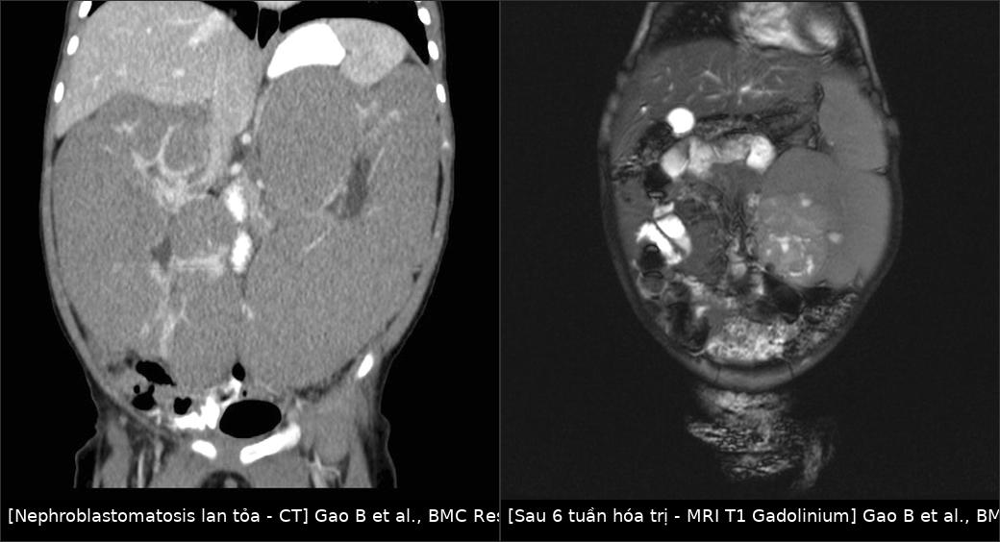
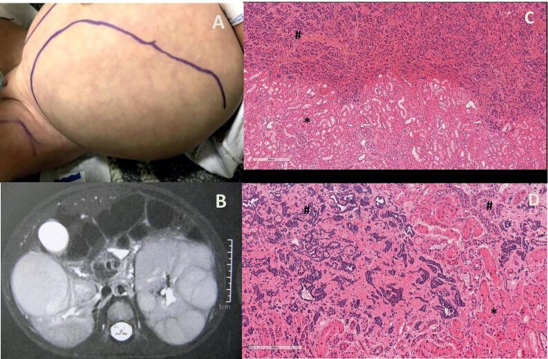
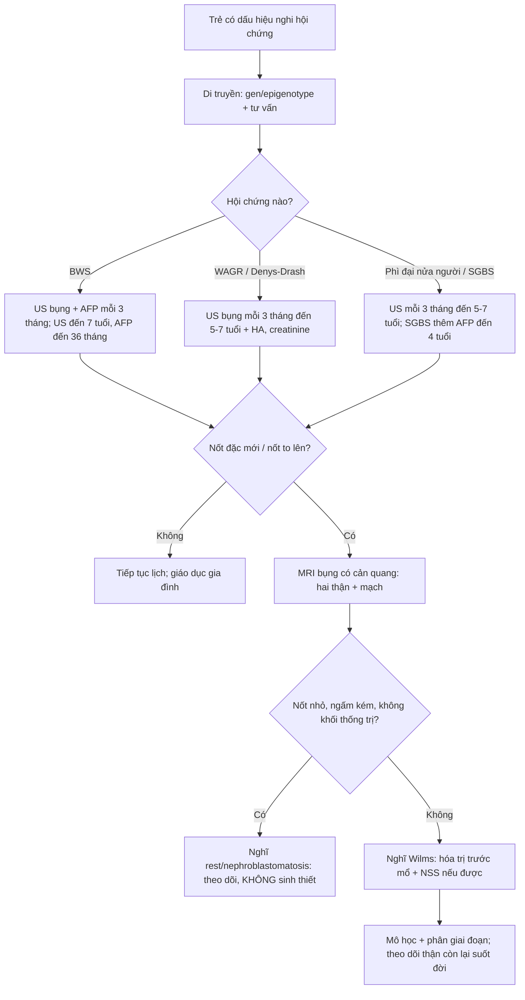
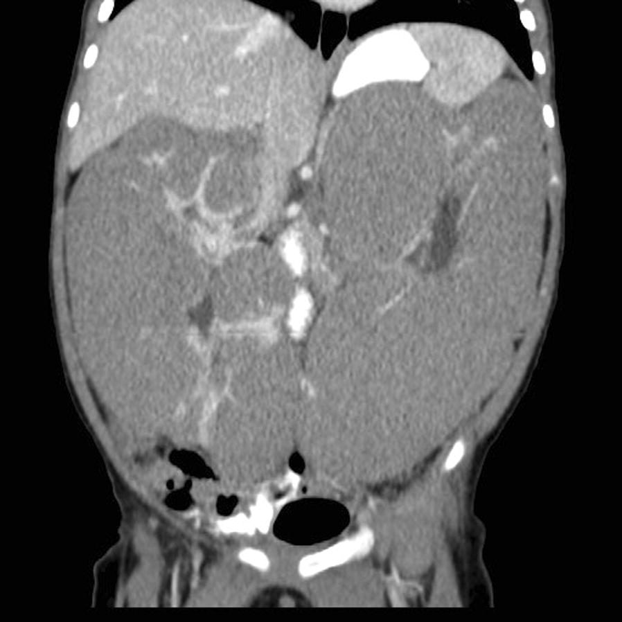
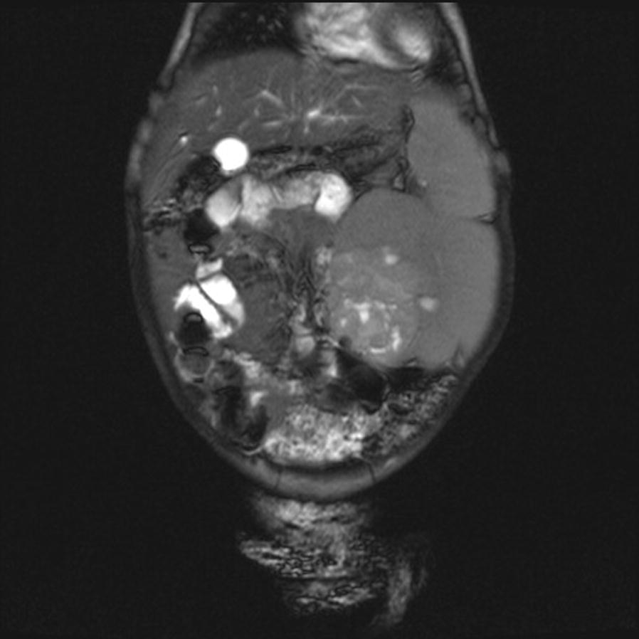
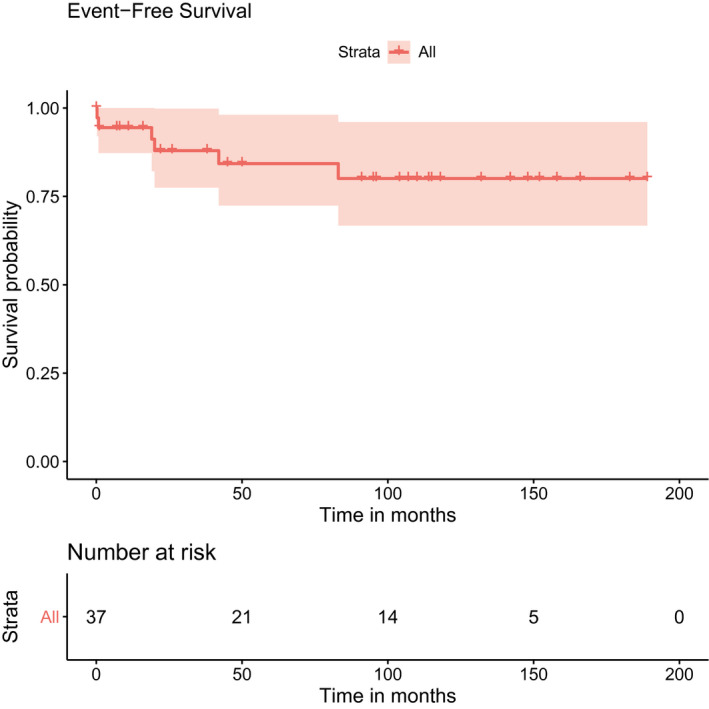

# 648 — Hội chứng dễ mắc u nguyên bào thận: BWS, WAGR, Denys–Drash & lịch tầm soát siêu âm / Wilms tumor predisposition syndromes: surveillance and nephroblastomatosis

**Tags:** `pattern:u-than-hai-ben` `pattern:nephroblastomatosis` `pattern:o-nguyen-bao-than` `vung:than` `vung:o-bung-nhi` `score:SIOP` `protocol:US-tam-soat-3-thang` `incidentaloma:o-nguyen-bao-than`
**Mức chắc chắn (certainty):** tổng hợp y văn (literature synthesis) — đồng thuận BWS 2018 + cập nhật Ý 2025 (Russo S et al., Ital J Pediatr 2025, PMC12542140), đoàn hệ SIOP WAGR 30 năm (Hol JA et al., Cancer 2021, PMC7894534), đoàn hệ Denys–Drash Pháp (Glénisson M et al., Kidney Int Rep 2025, PMC12034853), 2.927 ca SIOP/GPOH (Welter N et al., Cancers 2021, PMC8507684) + ca nguyên văn nephroblastomatosis (Gao B et al., BMC Res Notes 2018, PMC6006723; de Jesus LE et al., Int Braz J Urol 2022, PMC8691244).

## 1. Tổng quan — vì sao phải nhớ "hội chứng" trước khi gọi "Wilms đơn thuần"

- **9–17%** u nguyên bào thận (Wilms tumor — WT) có **hội chứng dễ mắc (cancer predisposition syndrome — CPS)** hoặc dị tật bẩm sinh. Nhóm này khác WT lẻ ở **4 điểm quyết định xử trí**:
  - **Trẻ hơn:** tuổi trung vị **24,5 tháng** so với **39,0 tháng**.
  - **U nhỏ hơn:** **349,4 mL** so với **487,5 mL**.
  - **Ít di căn hơn:** **8,2%** so với **18%**.
  - **Nhiều nephroblastomatosis hơn:** **12,9%** so với **1,9%** (Welter N et al., PMC8507684).
- **TẠI SAO có "tiền ung thư" trên hình ảnh:** WT phát sinh từ **ổ nguyên bào thận (nephrogenic rests)** — tế bào thận phôi tồn tại sau **tuần thai 36**. Ổ đơn lẻ gặp tình cờ **~1%** nhũ nhi; nhiều ổ/lan tỏa = **nephroblastomatosis**. Ổ nguyên bào thận **T2 tăng nhẹ**, **ngấm thuốc kém hơn nhu mô**, bờ rõ; khi **tăng sản lan tỏa (diffuse hyperplastic perilobar nephroblastomatosis — DHPLNB)** hai thận to đều, nhiều nốt vỏ, **không có khối thống trị**.
- **TẠI SAO quét mỗi 3 tháng:** thời gian nhân đôi thể tích của WT **11–40 ngày**; các ca "mọc giữa hai lần quét" được báo cáo ở **4–6 tháng**. Khoảng 3 tháng là dung hòa giữa **bắt được u còn nhỏ** và **giảm bức xạ/gây lo lắng**.
- **Số liệu định lượng theo hội chứng:**
  - **BWS (Beckwith–Wiedemann, 11p15.5):** nguy cơ WT **~4,1%**, tuổi trung vị **24 tháng**; **31%** WT hai bên trong chuỗi SIOP. Tầm soát đến **7 tuổi** phát hiện **~95%** ca WT. Cơ chế: **IC1-GoM** (tăng methyl hóa) và **UPD(11)pat** nguy cơ cao hơn **IC2-LoM** (< 5%).
  - **WAGR (11p13, mất đoạn WT1 + PAX6):** nguy cơ WT **45–60%**, tuổi trung vị **22 tháng** (6–44 tháng), **37,5%** hai bên, **78,9%** có ổ nguyên bào thận; **không có di căn/không anaplasia** trong chuỗi 43 ca; **EFS 5 năm 84,3%**, **OS 91,2%**. **U đối bên muộn xuất hiện tới 7 năm sau chẩn đoán** → phải theo dõi dài.
  - **Denys–Drash (WT1 exon 8/9):** WT **29%**, tuổi trung vị **1,2 tuổi** (0,5–2,2); **29%** hai bên; đột biến **exon 8** → bệnh thận khởi phát sớm hơn, suy thận sớm hơn và tử vong cao hơn exon 9. Thể mô học hay **stromal**; đáp ứng hóa trị **kém** (thể tích **tăng 0,4%** trong chuỗi SIOP).
  - **BWS đáp ứng hóa trị tốt hơn:** giảm **86,9%** thể tích — nhưng **không dùng đáp ứng để chẩn đoán hội chứng**.
- **Điều trị khác WT lẻ ở đâu:** ưu tiên **phẫu thuật bảo tồn thận (nephron-sparing surgery — NSS)** vì nguy cơ **u hai bên/đối bên muộn** và vì nhiều trẻ đã có **bệnh thận nền** (Denys–Drash); **hóa trị trước mổ** để thu nhỏ u; **tránh xạ trị** khi có thể; theo dõi **huyết áp, creatinine/eGFR** suốt đời.

*Trái — **CT bụng có cản quang**: hai thận **to lan tỏa, đồng nhất**, các ổ nguyên bào thận **giảm đậm độ ở vỏ/perinephric** (mũi tên), **không có khối thống trị**. Phải — **MRI T1 sau gadolinium, sau 6 tuần hóa trị**: ổ **tăng sản không đồng nhất 6 × 6,3 cm** ở thận trái, **nhiều nang nhỏ**, cùng **nhân ngấm mạnh 1 cm** — đây là **WT phát triển trên nền nephroblastomatosis**. Gao B et al., BMC Res Notes 2018 (PMC6006723, Fig. 1–2), CC BY 4.0; ảnh ghép letterbox, không crop.*

## 2. Mẫu hình + chẩn đoán phân biệt của "hai thận to/nhiều nốt" ở nhũ nhi (Gamut)

- **Nephroblastomatosis (DHPLNB):** hai thận **to đều**, nhiều **nốt vỏ < 1–2 cm**, **không có khối thống trị**, T2 tăng nhẹ, **ngấm kém**; có thể **teo một phần sau hóa trị**.
- **WT hai bên (giai đoạn V):** thường **một khối lớn chiếm ưu thế** mỗi bên + nốt vệ tinh; **không đồng nhất**, ngấm mạnh, có thể có huyết khối tĩnh mạch chủ dưới.
- **Bệnh thận đa nang lặn (ARPKD):** hai thận **to, tăng âm**, mất phân biệt vỏ–tủy, **vi nang**, kèm **gan xơ hóa**; không có nốt đặc ngấm thuốc.
- **Ứ nước thận hai bên:** **bể thận giãn**, nhu mô mỏng; hỏi **van niệu đạo sau** ở bé trai (bài 635).
- **Huyết khối tĩnh mạch thận sơ sinh:** thận **to, phù nề**, **không có tín hiệu Doppler**, kèm tiểu máu/giảm tiểu cầu.
- **Thâm nhiễm bạch cầu/lymphoma:** hai thận to **đồng nhất**, có thể kèm hạch; bối cảnh huyết học.
- **Neuroblastoma hai bên:** khối **ngoài thận**, **vôi hóa thô**, **bọc mạch** (bài 630).
- **Mẹo nhớ "BIG KIDNEYS":** **B**ilateral Wilms, **I**nfiltration (lymphoma/leukemia), **G**enetic (ARPKD), **K**idney vein thrombosis, **I**nfection (nephritis), **D**ysplasia, **N**ephroblastomatosis, **E**dema/systemic, **Y**oung age (physiologic), **S**yndromes (BWS/WAGR/DDS).

## 3. Bảng so sánh phân biệt (ma trận đối chiếu)

| Hội chứng / thực thể | Gen–cơ chế | Nguy cơ WT | Tuổi trung vị | Hai bên | Tầm soát | U khác cần nhớ |
|---|---|---|---|---|---|---|
| **BWS** | 11p15.5: IC1-GoM, IC2-LoM, UPD(11)pat, CDKN1C | **~4,1%** (cao hơn ở IC1-GoM/UPD) | **24 tháng** | **31%** | **US bụng mỗi 3 tháng đến 7 tuổi**; **AFP mỗi 3 tháng đến 36 tháng** | **Hepatoblastoma**, neuroblastoma (CDKN1C), adrenocortical |
| **WAGR** | 11p13: mất đoạn **WT1 + PAX6** | **45–60%** | **22 tháng** (6–44) | **37,5%** | **US mỗi 3 tháng đến 5–7 tuổi** (ưu tiên 7 vì u đối bên muộn tới 7 năm) | Gonadoblastoma (khi có DSD) |
| **Denys–Drash** | **WT1** exon 8/9 (missense) | **29%** (chuỗi Pháp 2025) | **1,2 tuổi** | **29%** | **US mỗi 3 tháng đến 5–7 tuổi** + HA, creatinine, protein niệu | Bệnh thận màng trong (DMS) → suy thận; gonadoblastoma |
| **Frasier** | WT1 intron 9 (splice) | **5–20%** | Trẻ lớn/thiếu niên | Ít gặp | US mỗi 3 tháng đến 5–7 tuổi; **siêu âm khung chậu** | **Gonadoblastoma** (tới 60%), DSD 46,XY |
| **Phì đại nửa người đơn thuần** | Chưa xác định | **< 5%** | Nhũ nhi–trẻ nhỏ | Thấp | **US mỗi 3 tháng đến 5 tuổi** | Adrenocortical carcinoma (hiếm) |
| **Simpson–Golabi–Behmel** | **GPC3** (Xq26) | **5–20%** | Nhũ nhi | Có thể | **US mỗi 3 tháng đến 7 tuổi**; AFP đến 4 tuổi | Hepatoblastoma, u mô bào |
| **Nephroblastomatosis (DHPLNB)** | Ổ nguyên bào thận tồn tại | **Tiến triển WT ~35%** (1/3–1/2) | **< 1 tuổi** | **Lan tỏa hai bên** | Theo dõi sát sau hóa trị; **US/MRI 3 tháng** | WT đồng thời/đối bên |

- **Phân biệt cốt lõi trên hình ảnh:** **nephroblastomatosis** = nhiều nốt nhỏ, **không khối thống trị**, ngấm kém; **WT** = **khối thống trị**, không đồng nhất, ngấm mạnh, có thể xâm lấn mạch. Khi có **nốt > 1 cm ngấm mạnh** hoặc **tăng kích thước**, phải nghĩ WT.

*(A)* Bụng chướng ở bé gái 18 tháng; *(B)* MRI T2 axial: hai thận to, **nhiều nốt tăng tín hiệu T2** ở vỏ — hình ảnh **nephroblastomatosis**; *(C/D)* mô học: vùng tăng sản nguyên bào thận (#) bên cạnh nhu mô thận. de Jesus LE et al., Int Braz J Urol 2022 (PMC8691244, Fig. 2), CC BY 4.0.

## 4. Protocol tầm soát + sơ đồ quyết định

- **Ai cần tầm soát / xét nghiệm di truyền:**
  - **Aniridia** (đặc biệt không có tiền sử gia đình) → tìm **mất đoạn 11p13/WAGR**.
  - **Dị tật sinh dục – tiết niệu**, **DSD 46,XY**, **tinh hoàn ẩn hai bên**.
  - **Phì đại nửa người**, **macroglossia**, **omphalocele**, **tai có rãnh/lỗ**, **phì đại tạng**.
  - **WT hai bên**, **nephroblastomatosis**, **WT ở trẻ < 1 tuổi**, **tiền sử gia đình**.
- **Lịch tầm soát (US bụng, cả hai thận, đo chiều dài + tìm nốt vỏ):**
  - **BWS:** **mỗi 3 tháng đến 7 tuổi** (đồng thuận 2018 cho IC1-GoM/UPD; cập nhật Ý 2025 theo hướng bao phủ rộng hơn, không dựa vào mức độ phenotype). **AFP mỗi 3 tháng đến 36 tháng** để soát hepatoblastoma.
  - **WAGR:** **mỗi 3 tháng đến 5–7 tuổi**; nhiều trung tâm chọn **7 tuổi** vì u đối bên có thể xuất hiện **7 năm sau chẩn đoán**.
  - **Denys–Drash:** **mỗi 3 tháng đến 5–7 tuổi** + **huyết áp, creatinine/eGFR, protein niệu** mỗi lần khám.
  - **Phì đại nửa người:** đến **5 tuổi**; **SGBS:** đến **7 tuổi** + **AFP đến 4 tuổi**.
- **Kỹ thuật siêu âm:** đo **chiều dài thận** và so với tuổi; ghi rõ **số nốt, vị trí, kích thước, có ngấm/Doppler**; chụp **cả hai thận** và **bàng quang** khi có triệu chứng tiểu.
- **Khi thấy nốt mới:** **MRI bụng có cản quang** (không dùng CT thường quy vì bức xạ). **Không sinh thiết qua da** — nguy cơ **gieo mầm/upstaging**, và mô bệnh nhỏ **không phân biệt được rest với WT**.
- **Điều trị:** **hóa trị trước mổ** (actinomycin D + vincristine) để thu nhỏ; **NSS** (cắt bán phần/bóc u) khi còn khả thi; **cắt thận** chỉ khi không giữ được nhu mô. **Không có chỉ định cắt thận dự phòng thường quy** — ngoại lệ cá biệt (thận mất chức năng, tăng huyết áp khó kiểm soát, lúc ghép thận ở DDS) phải do **hội đồng đa chuyên khoa** quyết định.
- **Theo dõi sau điều trị:** US/MRI theo lịch, **HA + chức năng thận**, tầm soát u khác (AFP, siêu âm khung chậu khi có DSD), **tư vấn di truyền cho gia đình**.

## 5. Biến thể bình thường & cạm bẫy

- **Thận to sinh lý ở nhũ nhi:** thận trái thường lớn hơn phải; **đo chiều dài theo tuổi** và so với chiều cao cơ thể, đừng chỉ nhìn "to".
- **Trụ thận/medullary pyramids giảm âm** ở trẻ nhỏ dễ bị đọc là nang/nốt — đối chiếu **MRI** nếu không chắc.
- **Nephroblastomatosis không phải WT:** không sinh thiết, không cắt thận ngay; nhưng **không được bỏ theo dõi** vì **~35%** tiến triển WT.
- **"U biến mất sau hóa trị"**: rest có thể **teo nhỏ**; đừng gọi là đáp ứng hoàn toàn nếu còn nốt — có thể còn **WT sống**.
- **BWS thể nhẹ:** không có macroglossia/omphalocele vẫn có thể có **IC2-LoM/IC1-GoM**; **WT có thể là biểu hiện đầu tiên** — hỏi kỹ tai, rốn, phì đại nửa người.
- **WAGR dễ bỏ sót aniridia nhẹ** hoặc chỉ có **glaucoma bẩm sinh**; khám mắt + xét nghiệm gen.
- **Denys–Drash:** bệnh thận **có thể tiến triển trước cả WT**; tránh thuốc độc thận, theo dõi eGFR, chuẩn bị **ghép thận**.
- **Kết thúc tầm soát ở 7 tuổi không tuyệt đối:** u đối bên muộn ở WAGR tới 7 năm sau chẩn đoán → **cá thể hóa**, nhất là khi còn thận bệnh lý.
- **Nguy cơ quá chẩn đoán:** nhiều nốt nhỏ ở DHPLNB có thể bị đọc là "WT đa ổ" → **cắt thận quá mức**; cần **MRI + hội đồng**.

## 6. Tự lượng giá — Blind Quiz

**Ca 1 — Bé gái 18 tháng, bụng chướng, tăng huyết áp. Nhìn ảnh, mô tả trước:**

- Gợi ý: hai thận to, không sốt, chức năng thận còn tốt.
- Hỏi: dấu hiệu chính? chẩn đoán? vì sao **không** cắt thận ngay?

<b>Bấm để hiện đáp án (findings + chẩn đoán)</b>

- Hai thận **to lan tỏa**, **nhiều nốt vỏ tăng tín hiệu T2**, **không có khối thống trị** → **nephroblastomatosis (DHPLNB)**, chưa chắc WT.
- **Không cắt thận ngay** vì tổn thương **hai bên/lan tỏa**, có thể **teo sau hóa trị**, và cắt thận sẽ đẩy trẻ vào **suy thận**; ưu tiên **hóa trị actinomycin + vincristine** rồi đánh giá lại bằng MRI.
- **Cạm bẫy:** nốt 19 mm xuất hiện sau đó mới là **WT** — phải theo dõi liên tục, không kết luận một lần.
- **Nguồn ca:** de Jesus LE et al., Int Braz J Urol 2022 (PMC8691244, Fig. 2), CC BY 4.0.

**Ca 2 — Bé gái 9 tháng, bụng to 2 tháng. CT lúc chẩn đoán, rồi MRI sau 6 tuần hóa trị:**

- Hỏi: CT cho thấy gì? vì sao chọn hóa trị trước?

<b>Bấm để hiện đáp án</b>

- Hai thận **to đồng nhất**, thận phải **13,1 cm**, thận trái **15 cm** (bình thường ~6 cm), **mất phân biệt vỏ–tủy**, nhiều **ổ giảm đậm độ perinephric** = **nephrogenic rests** → **DHPLNB**.
- Hóa trị trước để **thu nhỏ tổn thương**, bảo tồn nhu mô; sau đó đánh giá lại bằng MRI để tìm **WT thống trị**.
- **Nguồn ca:** Gao B et al., BMC Res Notes 2018 (PMC6006723, Fig. 1), CC BY 4.0.

**Ca 2b — Cùng bệnh nhân, MRI T1 sau gadolinium sau 6 tuần hóa trị:**

- Hỏi: tổn thương nào đáng ngờ WT? xử trí?

<b>Bấm để hiện đáp án</b>

- Ổ **6 × 6,3 cm không đồng nhất**, **nhiều nang nhỏ**, kèm **nhân ngấm mạnh 1 cm** ở thận trái → **WT phát triển trên nền DHPLNB**.
- Xử trí: **cắt bán phần thận trái** (NSS) — mô bệnh xác nhận **WT không anaplasia**, bờ cắt dương → hóa trị tiếp; theo dõi 3,5 năm, hồi phục hoàn toàn.
- **Bài học:** hóa trị làm **rest teo** nhưng **WT còn ngấm** — đừng đọc "đáp ứng hoàn toàn".
- **Nguồn:** Gao B et al., BMC Res Notes 2018 (PMC6006723, Fig. 2), CC BY 4.0.

**Ca 3 — Đọc biểu đồ WAGR: tầm soát đến khi nào?**

- Hỏi: EFS 5 năm khoảng bao nhiêu? biến cố chính là gì? vì sao phải theo dõi thận đối bên **7 năm**?

<b>Bấm để hiện đáp án</b>

- **EFS 5 năm 84,3%**, **OS 91,2%**; **không có di căn/anaplasia**, nhưng **37,5% hai bên** và **u đối bên muộn tới 7 năm**; 3 ca tử vong do **độc tính điều trị** (2 hepatotoxicity, 1 tắc ruột).
- Vì vậy **siêu âm mỗi 3 tháng** và **kéo dài theo dõi đến 7 tuổi** (hoặc lâu hơn nếu còn thận bệnh lý), đồng thời **giám sát độc tính**.
- **Nguồn:** Hol JA et al., Cancer 2021 (PMC7894534, Fig. 2), **CC BY-NC 4.0** (nguyên bản).

## Bài liên quan chéo
- [600 – Tổng quan Nhi khoa](../600-tong-quan-nhi-khoa/lesson.md)
- [630 – U bụng nhi: neuroblastoma vs Wilms](../630-u-bung-nhi-neuroblastoma-vs-wilms/lesson.md)
- [639 – Khối thận đặc ở trẻ: Wilms vs CMN vs RCC](../639-khoi-than-o-tre-wilms-cmn-rcc/lesson.md)
- [647 – CMN thể tế bào: theo dõi sau cắt thận & tái phát](../647-cmn-the-te-bao-theo-doi-tai-phat/lesson.md)
- [156 – Hội chứng di truyền u thận ở người lớn](../156-hoi-chung-di-truyen-u-than/lesson.md)
- [635 – Dị tật tiết niệu nhi: ứ nước, VUR, van niệu đạo sau](../635-di-tat-tiet-nieu-nhi-SFU-VUR-PUV/lesson.md)

## Ảnh
- `648_nephroblastomatosis_CT_PMC6006723-Fig1-CCBY.jpg`, `648_nephroblastomatosis_MRI-T1-Gd_PMC6006723-Fig2-CCBY.jpg` — CC BY 4.0.
- `648_nephroblastomatosis_MRI-T2_PMC8691244-Fig2-CCBY.jpg` — CC BY 4.0.
- `648_wagr-EFS_PMC7894534-Fig2-CCBYNC.jpg` — **CC BY-NC 4.0** (dùng học phi thương mại, giữ nguyên bản, không crop/ghép).
- Ảnh ghép `composite_nephroblastomatosis-ct-vs-mri.jpg` chỉ ghép 2 ảnh CC BY; letterbox giữ tỷ lệ.
- Nguồn + giấy phép từng ảnh: `images/CREDITS.md`.

> Không dùng để chẩn đoán độc lập khi chưa có người hướng dẫn.
