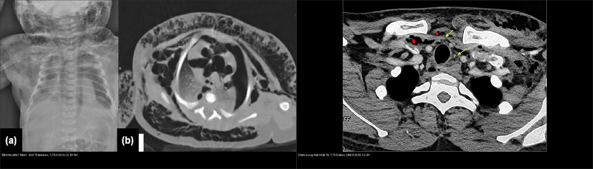
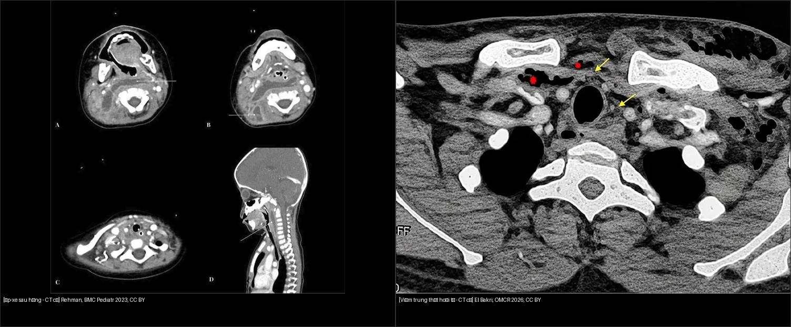
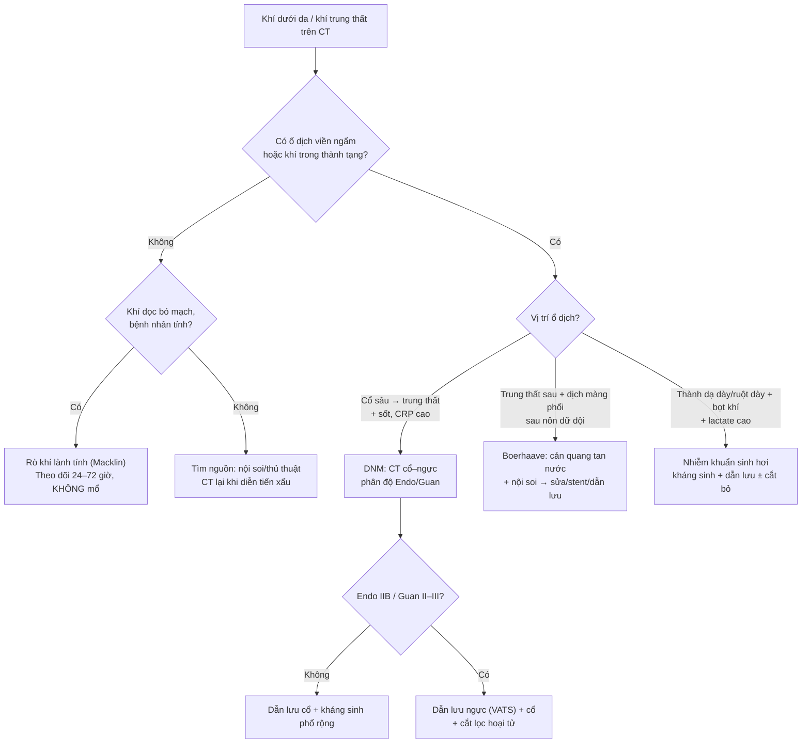
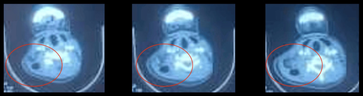
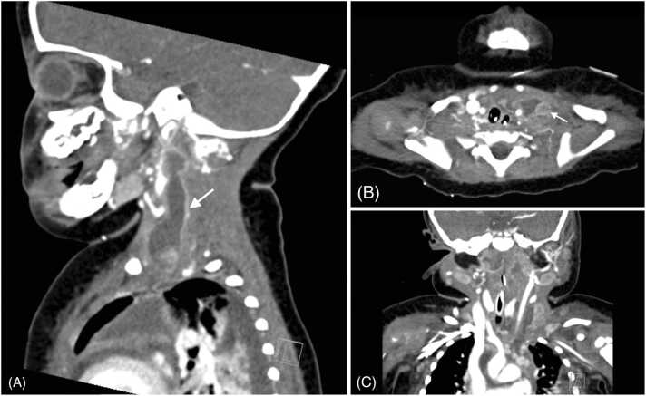
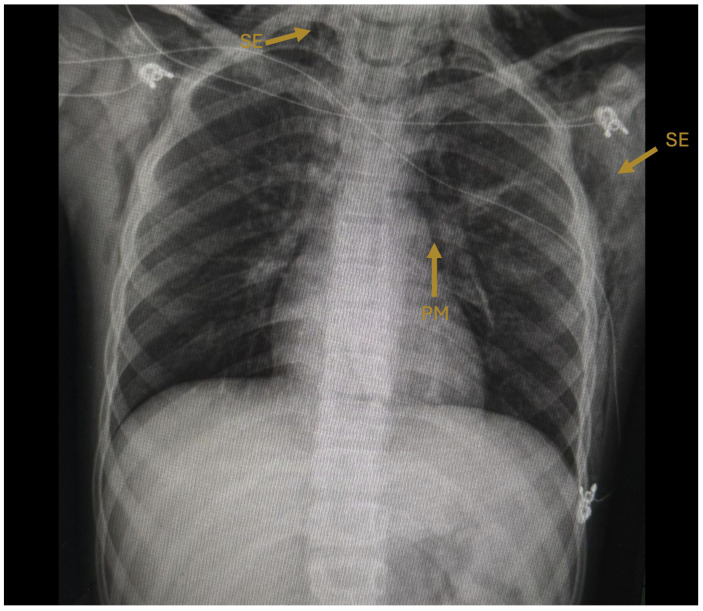
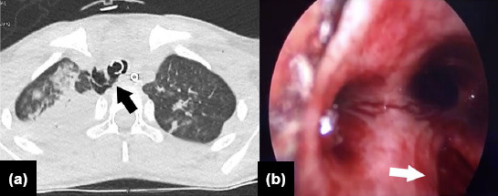
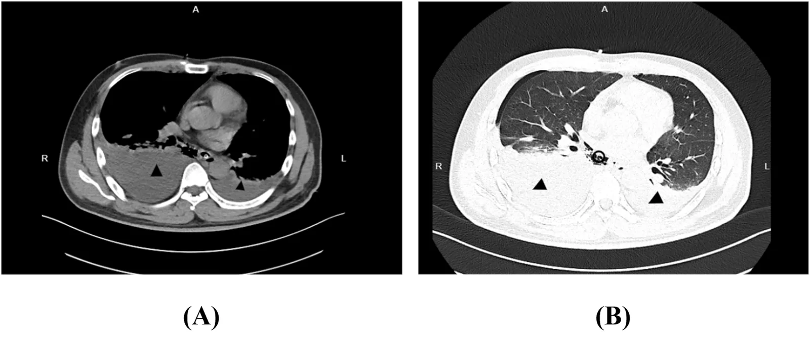
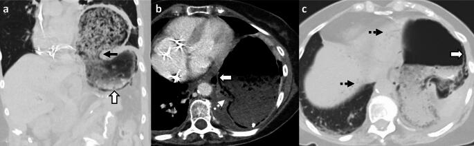

# 649 — Tràn khí dưới da & khí trung thất ở trẻ: rò khí lành tính từ phổi vs viêm trung thất HOẠI TỬ vs nhiễm khuẩn sinh khí / Subcutaneous & mediastinal gas in children — benign air leak vs necrotizing mediastinitis

**Tags:** `pattern:khi-trong-mo-mem` `pattern:khi-trung-that` `pattern:vien-trung-that-hoai-tu` `pattern:ro-khi` `vung:trung-that` `vung:co-sau` `score:Endo` `score:Guan` `protocol:CT-co-nguc-can-quang` `protocol:noi-soi-thuc-quan`
**Mức chắc chắn (certainty):** ca nguyên văn (verbatim case) — neo vào **ba ca có hình ảnh**: (1) nữ **16 tuổi** viêm trung thất hoại tử lan xuống (DNM) từ ổ răng, lan tới **thành ngực** (Gourti et al., *Cureus* 2025, PMC11939028); (2) **nhũ nhi 11 tháng** áp-xe sau họng do *S. aureus* nhạy methicillin → DNM + Lemierre-like + liệt cơ hoành hai bên (Chandran et al., *IDCases* 2025, PMC12555890); (3) **trẻ 9 tuổi** sởi có tràn khí trung thất + khí dưới da + khí phúc mạc **tự khỏi** (Damián-Negrete et al., *Infect Dis Rep* 2026, PMC13214823). Bổ sung tổng hợp y văn mở (bảng phân độ Endo/Guan, Boerhaave, viêm dạ dày sinh hơi).

## 1. Tổng quan bệnh học – cơ chế hình ảnh

- **Cùng một hình ảnh "khí trong mô mềm/trung thất" nhưng 4 cơ chế hoàn toàn khác nhau — và xử trí khác nhau một trời một vực:**
  1. **Rò khí từ phổi (air leak, cơ chế Macklin)** — khí vô khuẩn, tự tiêu, **không mổ**;
  2. **Thủng thực quản (Boerhaave)** — khí + dịch tiêu hóa vào trung thất, **cấp cứu ngoại khoa**;
  3. **Viêm trung thất hoại tử lan xuống (descending necrotizing mediastinitis, DNM)** — nhiễm khuẩn hoại tử từ cổ sâu, **tử vong 11–40%**;
  4. **Nhiễm khuẩn sinh khí tại tạng** (viêm dạ dày sinh hơi, viêm mô tế bào sinh khí, viêm trung thất do vi khuẩn sinh hơi) — khí là **sản phẩm lên men + hoại tử mô**, không phải khí "đi lạc".
- **TẠI SAO thấy được trên hình — vật lý đơn giản:** khí cản tia X rất kém → **CT ≈ −1000 HU**, thấp hơn nhu mô phổi lành (−700 đến −900 HU) và thấp hơn mỡ (−100 HU). Vì vậy **"đen tuyệt đối"** trên cửa sổ mô mềm; muốn thấy khí kẽ mỏng phải đọc **cửa sổ phổi** hoặc cửa sổ rộng, nếu chỉ xem cửa sổ mô mềm hẹp sẽ **bỏ sót**.
- **TẠI SAO khí đi được từ cổ xuống trung thất (giải phẫu = bản đồ lan):** cổ sâu chia theo **mạc cổ** — khoảng **quanh họng (retropharyngeal)**, **nguy hiểm (danger space)**, **trước khí quản (pretracheal)**, **quanh mạch cảnh (carotid sheath)** và **sau họng**. Ba khoảng sau họng/nguy hiểm **thông liên tục xuống trung thất sau** (tới ngang **T4**, nơi mạc dính vào phế quản), còn khoảng trước khí quản chạy xuống **trung thất trước**. Đây là lý do **DNM lan theo giải phẫu, không theo "trọng lực"** — và là lý do **phân độ Endo/Guan dựa trên khoang bị chiếm**.
- **TẠI SAO trẻ khác người lớn:** mạc cổ **ngắn hơn**, đường thở **tương đối lớn hơn**, mô mềm lỏng lẻo → viêm lan nhanh; nguồn hay gặp là **áp-xe sau họng/amidal** (không phải răng như người lớn); vi khuẩn hay gặp **tạp khuẩn + *S. aureus***. Trẻ nhũ nhi có thể **KHÔNG có dấu cổ cứng, nuốt khó, chảy nước miếng** — ca 11 tháng chỉ có sốt + suy hô hấp + sốc nhiễm khuẩn (Chandran 2025).
- **TẠI SAO nhiễm khuẩn sinh khí lại "đen" hơn khí lành:** vi khuẩn lên men đường/axit amin sinh **CO₂ + H₂**; đồng thời hoại tử mô giải phóng nitơ. Khí này nằm **trong thành tạng**, kèm **thành dày, phù quanh tạng, dịch** — khác khí "ngoài lòng" của rò phổi (không viêm quanh, thành mỏng).
- **Ngưỡng định lượng nằm lòng:**
  - **DNM: tử vong 11–40%** ở các loạt hiện đại, **gộp 19,4%** (tổng quan 480 ca); **can thiệp lại > 50%** ở thể lan rộng; **VATS ít biến chứng hơn mở ngực** (Ionescu et al., *Infect Dis Ther* 2026, PMC13476192).
  - **Boerhaave: ~3,1 ca/triệu dân/năm**; **trì hoãn > 24 giờ → tử vong > 40%**; **không điều trị → gần 90%** (Han et al., *Front Surg* 2026, PMC13506687).
  - **Viêm dạ dày sinh hơi (emphysematous gastritis, EG): 189 ca, tử vong 26,9%**; **thủng dạ dày OR 6,59**; **hóa trị OR 5,60**; **rượu OR 4,16** (Adam et al., *Transl Gastroenterol Hepatol* 2026, PMC13263973). Trước đây 60–80%, nay **< 50%** (Panda et al., *Abdom Radiol* 2025, PMC12830503).
  - **Khí dạ dày LÀNH TÍNH (benign gastric emphysema): thành dạ dày < 3 mm, KHÔNG viêm quanh dạ dày, bệnh nhân không nhiễm độc, WBC/lactate bình thường** (Panda 2025).
  - **Tràn khí trung thất thứ phát ở trẻ (n = 26): 65% nam; 23/26 điều trị bảo tồn; 6 tử vong** (Boleken et al., *Ulus Travma Acil Cerrahi Derg* 2024, PMC11843381).

## 2. Mẫu hình + chẩn đoán phân biệt theo cơ chế và vị trí (Gamut)

- **Khí LAN THEO MẠCH từ phổi (Macklin) — lành tính:** dải khí **dọc bó mạch–phế quản**, lên **trung thất → cổ → dưới da**; bệnh nhân **tỉnh, không sốc, không đau kiểu xé**; khí **tự tiêu 2–7 ngày**. Gặp sau **hen cấp, ho dữ dội, gắng sức, thở máy, sởi** (ca 9 tuổi: khí trung thất + dưới da + **khí phúc mạc**, X-quang ngày 3 gần hết — Damián-Negrete 2026).
- **Khí + DỊCH + THÀNH DÀY ở trung thất sau, sau nôn dữ dội (Boerhaave):** tam chứng Mackler (nôn – đau ngực dưới – khí dưới da) **chỉ có ở thiểu số**; hình ảnh then chốt là **tràn dịch màng phổi hai bên + khí trung thất + dày thành thực quản + ổ dịch cạnh thực quản**, thường **lệch bên so với lỗ thủng** (ca 36 tuổi: thủng **thực quản xa TRÁI** nhưng nhiễm bẩn **màng phổi HAI BÊN** — Han 2026).
- **Khí + Ổ DỊCH HOẠI TỬ cổ sâu lan xuống (DNM):** **khí trong khoang quanh họng/trước khí quản/quanh mạch cảnh**, ổ dịch **viền ngấm, có bóng khí bên trong**, mỡ trung thất **thâm nhiễm**; bệnh nhân **sốt, đau cổ, nuốt đau, cứng cổ, CRP/WBC rất cao**; nguồn **răng (người lớn) / amidan–sau họng (trẻ)**. Ca 16 tuổi: **WBC 18.000/mm³, CRP 256 mg/L**, lan tới **nách + thành ngực**, **7 ống dẫn lưu Delbet**.
- **Khí TRONG THÀNH TẠNG (sinh hơi):** **thành dạ dày/ruột/túi mật/thận** có bóng khí **dạng bọt/tổ ong**, kèm **thành dày, phù quanh tạng, dịch**, ± **khí trong tĩnh mạch cửa** (dấu hiệu nặng); bệnh nhân **nhiễm độc, đái tháo đường, lactate cao**.
- **Khí trong mô mềm thành ngực/cổ do viêm cân mạc hoại tử (necrotizing fasciitis):** khí **dọc theo cân (fascial plane)**, **dày cân + dịch dọc cân**, da **đỏ tím, đau vượt xa mức sờ thấy**, bệnh nhân **nhiễm độc nặng**; khác khí dưới da "sạch" của rò khí phổi (chỉ có khí, **không dịch, không dày cân**).
- **Khí do can thiệp/thủ thuật (iatrogenic):** ngay sau **đặt ống ngực bằng trocar**, **mở khí quản**, **nhổ răng bằng tay khoan khí nén**, **nội soi** — khí **khu trú, không ổ dịch, không thành dày**; hỏi **diễn tiến thời gian** là chìa khóa.
- **Mnemonic sàng lọc "GAS-D":** **G**as-forming infection (sinh hơi), **A**ir leak (Macklin), **S**urgery/iatrogenic (can thiệp), **D**isruption of hollow viscus (thủng thực quản/ruột).

## 3. Bảng so sánh phân biệt (ma trận đối chiếu)

| Thực thể (entity) | Hình ảnh điển hình (CT/X-quang) | Chốt vào (rule-in) | Chốt loại (rule-out) | Gợi ý xác nhận |
|---|---|---|---|---|
| **Rò khí phổi lành tính (Macklin)** | Khí **dọc bó mạch–phế quản**, liên tục lên cổ; **KHÔNG ổ dịch, KHÔNG thành dày**; ± tràn khí màng phổi | **Bệnh nhân tỉnh, không nhiễm độc + khí lan theo mạch + tự giảm sau 48–72 giờ** | **Ổ dịch viền ngấm + khí trong ổ + thành tạng dày → nhiễm khuẩn** | X-quang lặp lại 24–48 giờ; CT cửa sổ phổi |
| **Boerhaave (thủng thực quản)** | **Dịch + khí trung thất sau**, dày thành thực quản, **tràn dịch màng phổi (thường trái, có thể hai bên)**, ổ dịch cạnh thực quản | **Nôn dữ dội rồi đau ngực dưới + khí trung thất + dịch màng phổi** | **Không có dịch/khí cạnh thực quản, khí chỉ dọc mạch → rò phổi lành** | CT cản quang; **nuốt cản quang tan trong nước**; nội soi thực quản |
| **DNM (viêm trung thất hoại tử lan xuống)** | **Ổ dịch cổ sâu viền ngấm có bóng khí**, mỡ trung thất thâm nhiễm, khí **trước khí quản/quanh mạch cảnh**, lan thành ngực | **Sốt + đau cổ/nuốt đau + CRP > 100 mg/L + ổ dịch cổ sâu có khí** | **Chỉ có khí, không ổ dịch, không viêm mô → rò khí lành** | CT cổ–ngực cản quang; cấy máu/dịch; phân độ Endo/Guan |
| **Viêm dạ dày sinh hơi (EG)** | Khí **trong thành dạ dày dạng bọt**, **thành dày**, phù quanh dạ dày, ± **khí tĩnh mạch cửa** | **Bệnh nhân nhiễm độc + đau bụng + lactate cao + thành dày + khí trong thành** | **Thành < 3 mm, không phù quanh, WBC/lactate bình thường → khí dạ dày lành (BGE)** | CT bụng cửa sổ rộng; nội soi sinh thiết/cấy |
| **Khí dạ dày lành tính (BGE)** | Khí trong thành nhưng **thành < 3 mm, không viêm quanh**, có thể kèm khí cửa và khí phúc mạc | **Không nhiễm độc, WBC/lactate bình thường, sau nội soi/đặt sonde** | **Sốt + lactate cao + thành dày → EG** | Theo dõi 24 giờ + xét nghiệm lặp lại |
| **Khí do can thiệp (iatrogenic)** | Khí **khu trú đúng đường vào**, không ổ dịch, không phù lan | **Thời điểm khớp thủ thuật + không nhiễm độc** | **Khí lan xa đường vào + ổ dịch mới → nhiễm khuẩn** | So phim trước/sau; hỏi bệnh sử thủ thuật |
| **Viêm cân mạc hoại tử sinh khí** | Khí **dọc cân**, **dày cân + dịch dọc cân**, da đỏ tím, đau không tương xứng | **Khí dọc cân + dịch + nhiễm độc nặng + đau vượt mức** | **Chỉ có khí, không dịch, không dày cân → khí dưới da lành** | CT cản quang; mổ thăm dò + cấy (chẩn đoán mô học là chuẩn) |

*Ảnh ghép letterbox, giữ nguyên tỉ lệ. Trái: Boleken ME et al., *Ulus Travma Acil Cerrahi Derg* 2024, **CC BY-NC 4.0**.*
*Phải: *Oxford Med Case Rep* 2026 (PMC13612233), **CC BY 4.0**.*

*Trái: áp-xe sau họng — ổ dịch viền ngấm sau họng, đẩy thành sau họng ra trước (Rehman AU et al., *BMC Pediatr* 2023, CC BY 4.0).*
*Phải: DNM — ổ dịch cổ sâu + bóng khí (mũi tên vàng) + khí trong mỡ (dấu sao đỏ) (*Oxford Med Case Rep* 2026, PMCID PMC13612233, CC BY 4.0).*

### Ba câu hỏi đọc phim theo thứ tự (áp dụng cho MỌI ca khí trung thất)
1. **Có Ổ DỊCH không?** (viền ngấm, có bóng khí bên trong, mỡ quanh thâm nhiễm) — có ổ dịch = **nhiễm khuẩn**, không phải rò khí đơn thuần.
2. **Khí nằm trong LÒNG TẠNG hay NGOÀI LÒNG?** — khí **trong thành** dạ dày/ruột = sinh hơi; khí **ngoài lòng** thực quản = thủng.
3. **Có DỊCH MÀNG PHỔI / dịch trung thất kèm theo không?** — khí + dịch màng phổi sau nôn = **Boerhaave** cho tới khi loại trừ.

## 4. Protocol chụp + phân độ + xử trí

- **CT cổ–ngực có cản quang (portal venous), lát ≤ 1–2 mm, ĐỌC HAI CỬA SỔ (mô mềm + phổi):** đây là **"gold standard"** cho khí trung thất và ổ dịch cổ sâu; đánh giá **từ đáy răng tới cơ hoành** (không cắt bớt trường chụp — nguồn ổ răng/amidan hay nằm ngoài vùng ngực). Ca DNM 16 tuổi chỉ lộ **lan tới thành ngực/nách** khi chụp đủ trường.
- **X-quang ngực thẳng + nghiêng:** dấu **dải khí dọc trung thất**, **viền khí quanh tim**, **khí dưới da**, **dịch màng phổi**. X-quang **âm tính không loại trừ** — tỉ lệ bỏ sót đáng kể, đặc biệt ở trẻ nằm ngửa.
- **Nghi Boerhaave:** **nuốt cản quang tan trong nước** (không dùng baryt khi nghi thủng) + **nội soi thực quản**. **Lưu ý cứng:** hình ảnh cản quang ÂM TÍNH **KHÔNG loại trừ** rách sau mổ sửa Boerhaave (Jung et al., *J Chest Surg* 2026, PMC13256309) — phải phối hợp CT + nội soi.
- **Phân độ DNM (dùng để chọn đường dẫn lưu):**

| Hệ | Mức | Khoang bị chiếm | Đường tiếp cận |
|---|---|---|---|
| **Endo 1999** | I | Trung thất trên, **trên carina** | Cổ (transcervical) |
| | IIA | Trung thất **trước dưới** | Cổ ± ngực |
| | IIB | Trung thất **trước + sau dưới** | **Ngực (VATS/mở)** |
| **Guan 2021** | Ia | Trung thất trước–trên khu trú | Cổ |
| | I | Trung thất trước | Cổ/ngực |
| | II | Trung thất sau | **Ngực** |
| | III | **Cả trước và sau** | **Ngực ± cổ** |

- **Nguyên tắc xử trí (không thay đổi theo tuổi):** **kiểm soát nguồn sớm** (dẫn lưu cổ + trung thất, cắt lọc hoại tử) + **kháng sinh phổ rộng phủ kỵ khí** + **nuôi dưỡng/ICU** + **chụp lại theo diễn tiến** (can thiệp lại > 50% ở thể nặng). **Không có kháng sinh đơn thuần cho DNM có ổ dịch.**
- **Rò khí lành tính:** **theo dõi + oxy + giảm áp lực đường thở**; **không dẫn lưu trung thất, không mổ**. Ca sởi 9 tuổi khỏi trong **3 ngày** chỉ với điều trị hỗ trợ.
- **Flowchart phân nhánh theo cơ chế:**

## 5. Biến thể bình thường và cạm bẫy

- **Cạm bẫy #1 — "khí nhiều = nặng".** Lượng khí **không tương quan với độ nặng**: ca sởi 9 tuổi có khí **trung thất + dưới da + phúc mạc** mà **tự khỏi 3 ngày**, trong khi ca DNM có **rất ít khí** nhưng **tử vong cao**. Đọc **ổ dịch + thành tạng + bối cảnh lâm sàng**, không đếm lượng khí.
- **Cạm bẫy #2 — bỏ sót ổ dịch vì "chỉ thấy khí".** Trên cửa sổ mô mềm hẹp, ổ dịch **đồng đậm độ cơ** dễ bị đọc là "mô bình thường". Luôn đo **đậm độ ổ dịch** (dịch đơn thuần **0–20 HU**, mủ đặc **20–40 HU**), tìm **viền ngấm** và **bóng khí trong ổ**.
- **Cạm bẫy #3 — khí do chính thủ thuật.** Đặt **ống dẫn lưu màng phổi bằng trocar** gây khí dưới da lan rộng (Jilani et al., *Cureus* 2024, PMC10849260); **nhổ răng bằng tay khoan khí nén** gây khí trung thất (Ulloa Luchsinger et al., *Cureus* 2026, PMC13471718). Hỏi **"có thủ thuật gì trong 24 giờ qua?"** trước khi gọi là nhiễm khuẩn.
- **Cạm bẫy #4 — khí phúc mạc do barotrauma bị mổ bụng oan.** Ở trẻ thở máy, khí tự do dưới cơ hoành có thể **đi từ trung thất xuống** (không thủng ruột); bụng **mềm, không phản ứng**, không có dịch tự do → **không mổ bụng** (xem [617](../617-hoi-chung-ro-khi-o-nhu-nhi/lesson.md)).
- **Cạm bẫy #5 — "khí trong thành dạ dày" do thức ăn/thức uống.** Bọt thức ăn trong lòng dạ dày bắt chước khí trong thành; phân biệt bằng **cửa sổ rộng** và **vị trí khí nằm NGOÀI bờ lòng dạ dày**. BGE thật sự có **thành < 3 mm** và **không phù quanh**.
- **Cạm bẫy #6 — trẻ nhũ nhi "không có dấu cổ điển".** Ca 11 tháng **không cứng cổ, không chảy nước miếng, không nuốt khó** nhưng đã có **DNM + Lemierre-like + liệt cơ hoành**. Ở nhũ nhi sốt + suy hô hấp + sốc, **hạ ngưỡng chụp CT cổ–ngực**.
- **Biến thể bình thường:** **khí trong mô mềm cổ sau mở khí quản** (khu trú, tự tiêu); **khí trong tĩnh mạch do đường truyền** (vài bóng nhỏ, không ý nghĩa); **khí trong xoang/túi thừa** không phải bệnh lý.

## 6. Tự lượng giá — Blind Quiz ngay trên trang tĩnh

**Ca 1 — Nữ 16 tuổi, 1 tuần đau răng, sưng cổ tăng dần, sốt, khó nuốt; CRP 256 mg/L.**

- Câu hỏi: ổ dịch nằm ở khoang nào? Có dấu hiệu gì chứng tỏ **hoại tử** chứ không chỉ là áp-xe đơn thuần? Hai chẩn đoán phân biệt hàng đầu?

<b>Bấm để hiện đáp án (findings + chẩn đoán)</b>

- **Findings:** ổ dịch **cao bên cổ lan xuống dưới**, **có bóng khí bên trong**, **không thoát thuốc cản quang** (khoanh đỏ) — tức là **khí sinh ra trong ổ hoại tử**, không phải mạch máu đang chảy.
- **Chẩn đoán:** **viêm trung thất hoại tử lan xuống (DNM) từ ổ răng**. Đây là ca có **lan tới thành ngực/nách** — hiếm, và là lý do phải chụp **đủ trường cổ–ngực–thành ngực**.
- **Vì sao hoại tử:** khí + dịch đục + mỡ quanh thâm nhiễm + CRP 256 mg/L; vi khuẩn kỵ khí lên men sinh khí.
- **Xử trí:** dẫn lưu cổ hai bên + mở trung thất trên + dẫn lưu thành ngực (**7 ống Delbet**), kháng sinh phổ rộng.
- **Nguồn:** Gourti M et al., *Cureus* 2025, PMC11939028, CC BY 4.0.

**Ca 2 — Nhũ nhi 11 tháng, sốt 39,5 °C, suy hô hấp, sốc; KHÔNG cứng cổ, KHÔNG chảy nước miếng.**

- Câu hỏi: Tổn thương nguyên phát ở đâu? Vì sao trẻ nhũ nhi có thể **không có dấu cổ điển**? Biến chứng mạch máu nào cần tìm?

<b>Bấm để hiện đáp án</b>

- **Findings:** **ổ dịch viền ngấm lan từ cổ bên trái vào khoảng trước đốt sống và xuống trung thất** (mũi tên trắng); mất phân bố mỡ bình thường.
- **Chẩn đoán:** **áp-xe sau họng (RPA) do *S. aureus* nhạy methicillin → DNM + Lemierre-like** (huyết khối tĩnh mạch cảnh trong, dưới đòn, thân tay đầu) + **liệt cơ hoành hai bên**.
- **Vì sao không có dấu cổ điển:** mạc cổ ngắn + đường thở lớn tương đối → triệu chứng **ưu thế hô hấp**; khám cổ có thể bình thường.
- **Bài học:** nhũ nhi sốt + suy hô hấp + sốc → **hạ ngưỡng chụp CT cổ–ngực có cản quang**; tìm **huyết khối tĩnh mạch lớn** và **liệt cơ hoành** (biến chứng thần kinh hoành).
- **Nguồn:** Chandran S et al., *IDCases* 2025, PMC12555890, **CC BY-NC-ND 4.0 — ảnh giữ nguyên bản, không cắt/ghép**.

**Ca 3 — Trẻ 9 tuổi sởi, ho nhiều, đau ngực; X-quang có khí trung thất + khí dưới da.**

- Câu hỏi: Cơ chế nào tạo khí? Có cần mổ/dẫn lưu trung thất không? Theo dõi bao lâu?

<b>Bấm để hiện đáp án</b>

- **Findings:** **quầng khí sáng bao quanh bóng tim (tràn khí trung thất)** + **dải khí trong mô mềm cổ/ngực (khí dưới da)**; không có ổ dịch.
- **Chẩn đoán:** **hội chứng rò khí do ho dữ dội trong sởi** — cơ chế **Macklin**, khí vô khuẩn.
- **Xử trí:** **hỗ trợ, oxy, theo dõi**; **KHÔNG dẫn lưu trung thất, KHÔNG mổ**. Phim ngày 3 gần như hết.
- **Cạm bẫy:** khí có thể lan xuống **phúc mạc** — đừng mổ bụng nếu bụng mềm, không dịch tự do.
- **Nguồn:** Damián-Negrete RM et al., *Infect Dis Rep* 2026, PMC13214823, CC BY 4.0.

**Ca 4 — Trẻ 7 tuổi ngã, chấn thương ngực; X-quang có khí dưới da lan rộng, CT có khí quanh khí quản; nội soi thấy rách khí quản.**

- Câu hỏi: Khí dưới da nhiều có đồng nghĩa tổn thương nặng? Khi nào cần **nội soi phế quản**?

<b>Bấm để hiện đáp án</b>

- **Findings:** (a) **khí quanh khí quản và trung thất** (mũi tên đen), phổi hai bên có đụng dập; (b) **nội soi: vết rách thành khí quản** (mũi tên trắng).
- **Chẩn đoán:** **rách khí quản do chấn thương** — khí dưới da chỉ là dấu hiệu **định hướng**, chẩn đoán nằm ở **nội soi**.
- **Chỉ định nội soi:** khó thở + khí trung thất + **không giải thích được bằng rò phổi**; trong loạt 26 trẻ, nội soi 6 ca phát hiện **2 rách khí quản** (Boleken 2024).
- **Nguồn:** Boleken ME et al., *Ulus Travma Acil Cerrahi Derg* 2024, PMC11843381, **CC BY-NC 4.0**.

**Ca 5 — Người lớn trẻ nôn dữ dội sau uống rượu, đau ngực dưới; CT có dịch + khí trung thất.**

- Câu hỏi: Chẩn đoán? Vì sao **bên tràn dịch không khớp bên lỗ thủng**? Xét nghiệm nào cần làm tiếp?

<b>Bấm để hiện đáp án</b>

- **Findings:** (A) **tràn dịch màng phổi hai bên** (tam giác đen) + **khí trung thất**; (B) cửa sổ phổi — dịch đáy phổi hai bên, không có đông đặc thùy.
- **Chẩn đoán:** **Boerhaave (thủng thực quản tự phát)** — tam chứng Mackler chỉ gặp ở thiểu số.
- **Vì sao lệch bên:** dịch tiêu hóa lan qua **trung thất** rồi vỡ vào **màng phổi hai bên**, nên **bên tràn dịch không phản ánh bên lỗ thủng** (ca này thủng **thực quản xa trái** nhưng nhiễm bẩn **hai bên**).
- **Tiếp theo:** **cản quang tan trong nước + nội soi** để định vị; **VATS dẫn lưu/cắt lọc**; trì hoãn > 24 giờ làm tử vong **> 40%**.
- **Nguồn:** Han J et al., *Front Surg* 2026, PMC13506687, CC BY 4.0.

**Ca 6 — Bệnh nhân đái tháo đường, đau bụng, lactate cao; CT có bọt khí trong thành dạ dày.**

- Câu hỏi: Phân biệt **khí dạ dày lành tính** với **viêm dạ dày sinh hơi** bằng gì? Điều trị?

<b>Bấm để hiện đáp án</b>

- **Findings:** **khí dạng bọt trong thành dạ dày** (mũi tên đen), **thành dạ dày dày**, **khí trong tĩnh mạch cửa** (mũi tên đứt nét) — bệnh nhân nhiễm độc, lactate cao.
- **Chẩn đoán:** **viêm dạ dày sinh hơi (emphysematous gastritis)** — nhiễm khuẩn sinh khí thật sự của thành dạ dày.
- **Chốt loại BGE:** **thành < 3 mm + không phù quanh dạ dày + WBC/lactate bình thường + không nhiễm độc**.
- **Điều trị:** **kháng sinh phổ rộng phủ Gram âm + kỵ khí ± kháng nấm**, nhịn ăn, sonde dạ dày, hồi sức; **mổ khi thủng** (thủng làm tăng tử vong **OR 6,59**). Tử vong chung **26,9%**.
- **Nguồn:** Panda A et al., *Abdom Radiol* 2025, PMC12830503, CC BY 4.0.

## Bài liên quan chéo
- [600 – Tổng quan Nhi khoa](../600-tong-quan-nhi-khoa/lesson.md)
- [617 – Hội chứng rò khí ở nhũ nhi (tràn khí màng phổi & trung thất)](../617-hoi-chung-ro-khi-o-nhu-nhi/lesson.md)
- [611 – Khí kẽ phổi (PIE) & tràn khí áp lực](../611-ro-khi-nang-pie-tran-khi-ap-luc-nhu-nhi/lesson.md)
- [612 – Cấp cứu đường thở trên trẻ em (áp-xe sau họng, viêm nắp thanh quản)](../612-cap-cuu-duong-tho-tren-tre-em/lesson.md)
- [616 – Biến chứng viêm phổi nhi: empyema & hoại tử phổi](../616-bien-chung-viem-phoi-nhi-empyema-hoai-tu/lesson.md)
- [609 – Ống dẫn lưu màng phổi ở trẻ (biến chứng, khí dưới da do trocar)](../609-ong-dan-luu-mang-phoi-o-tre/lesson.md)
- [080 – Chấn thương ngực](../080-chan-thuong-nguc/lesson.md)

## Ảnh
- Tên file: `649_slug_Modality_SourceID.jpg` (Modality = XQ/CT; SourceID = PMCID). Nguồn + giấy phép từng ảnh trong `images/CREDITS.md`.
- Ảnh **CC BY-NC-ND** (`649_DNM-nhu-nhi-11thang_CT_PMC12555890.jpg`, `649_DNM-nhu-nhi-trung-that_CT_PMC12555890.jpg`) **giữ nguyên bản — không crop, không ghép**.
- Không có ảnh nào phải dẫn link vì paywall.

> Không dùng để chẩn đoán độc lập khi chưa có người hướng dẫn.
