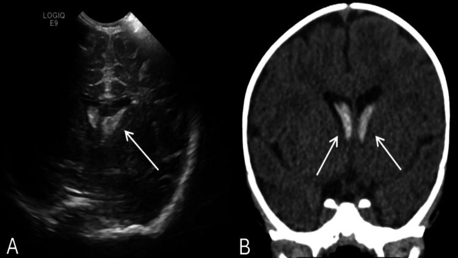
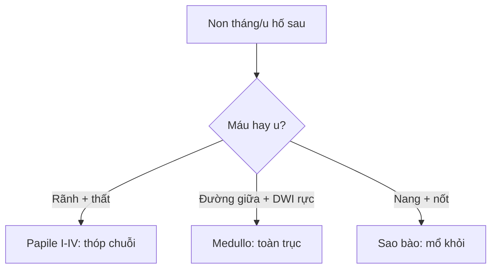

# 650 — Thần kinh nhi: xuất huyết mầm Papile & u hố sau / Peds neuro

**Tags:** `pattern:xuat-huyet-mam` `pattern:u-ho-sau-nhi` `vung:nao-nhi` `score:Papile`
**Mức chắc chắn (certainty):** tổng hợp y văn (literature synthesis) — nhóm tự biên từ y văn mở, chưa gắn ca nguyên văn đơn lẻ.

## 1. Tổng quan — mầm non tháng dễ vỡ + hố sau 70% u nhi + ADC là danh tính

- Vùng mầm (germinal matrix) non tháng < 32 tuần/tuần < 1.500 g: mạch non + tự điều hòa kém — TẠI SAO Papile I→IV theo lan tràn: rãnh nhân đuôi-đồi (I) → não thất không giãn (II) → giãn cấp (III) → nhu mô (nhồi tĩnh mạch xuất huyết, IV).
- Medulloblastoma (đường giữa, WHO 4): tế bào dày đặc — TẠI SAO CT tăng + T2 tối + **DWI sáng rực ADC < 0,7**: mật độ nhân cao nhất u nhi.
- Sao bào lông (bán cầu, WHO 1): nang + nốt ngấm — **ADC > 1,4** (lỏng lẻo); ependymoma dẻo chui Luschka/Magendie; DIPG phình cầu > 50% ôm thân nền.

## 2. Gamut sơ sinh non + u hố sau (Gamut)

- **Rãnh đuôi-đồi + không giãn:** Papile I–II — theo dõi + siêu âm thóp chuỗi.
- **Giãn cấp + nhu mô:** Papile III–IV — dẫn lưu + theo dõi não úng thủy.
- **Đường giữa + DWI rực + gieo màng:** medulloblastoma — MRI toàn trục + mổ + hóa-xạ.
- **Nang + nốt + ADC cao:** sao bào lông — mổ khỏi (tốt nhất u nhi!).

## 3. Bảng so sánh phân biệt (ma trận đối chiếu)

| Thực thể (entity) | Hình ảnh điển hình | Chốt vào (rule-in) | Chốt loại (rule-out) | Gợi ý xác nhận |
|---|---|---|---|---|
| Papile I–II | **Rãnh đuôi-đồi + thất không giãn** | **Non tháng + thóp + không giãn** | Giãn cấp → III | Chuỗi thóp + theo dõi |
| Papile III–IV | **Giãn cấp + nhu mô (nhồi TM)** | **Máu > 50% thất/nhu mô** | Không máu → PVL | Dẫn lưu + chống úng thủy |
| Medulloblastoma | **Đường giữa + DWI rực ADC < 0,7 + gieo màng** | **Rực + gieo + đường giữa** | Nang nốt + ADC cao → sao bào | Toàn trục + mổ + hóa-xạ |
| Sao bào lông | **Nang + nốt ngấm + ADC > 1,4** | **Nốt + bán cầu + ADC cao** | Rực + đường giữa → medullo | Mổ khỏi (tiên lượng tốt!) |

*(A) US: đồi phải tăng âm + lan thất + mầm 2 bên; (B) CT: máu thất 2 bên. Nguồn: Abdulsalam et al., Cureus 2026 Fig. 1, CC BY 4.0.*

## 4. Protocol thần kinh nhi

- **Siêu âm thóp chuỗi + MRI (DWI/ADC) + toàn trục** khi u hố sau; Papile III–IV theo dõi úng thủy + can thiệp.

## 5. Cạm bẫy

- **Nôn + mắt lạ tưởng dị ứng sữa** (ca trên!) — non tháng + mắt + thóp là siêu âm sọ ngay.
- **PVL tưởng Papile** — PVL là trắng quanh thất không máu, Papile là máu rãnh/thất.
- **Medullo không chụp toàn trục** sót gieo màng — DWI rực đường giữa là toàn trục trước mổ.

## 6. Tự lượng giá — Blind Quiz

**Ca 1 — Trẻ 2 tháng non 36 tuần nôn + mắt nhìn lên + mất nhìn theo. Đọc US + CT.**

- Hỏi: máu ở đâu? Papile mấy? U hay máu?

<b>Bấm để hiện đáp án</b>

- Dấu hiệu (findings): đồi phải tăng âm 2,7 cm + lan thất 2 bên + mầm rãnh đuôi-đồi 2 bên.
- Chẩn đoán (diagnosis): **xuất huyết đồi + não thất + mầm (GMH-IVH)** — bảo tồn + theo dõi (đừng mổ u oan; dị ứng sữa là bẫy!).
- Nguồn: Abdulsalam et al., Fig. 1, CC BY 4.0.

**Ca 2 — U nhộng tiểu não + DWI rực + nốt màng tủy:** medullo hay sao bào? *(Bảng mục 3.)*

<b>Bấm để hiện đáp án</b>

- **Medulloblastoma:** MRI toàn trục + mổ + hóa-xạ (sao bào là nang nốt + ADC cao).

## Bài liên quan chéo
- [600 – Tổng quan Nhi](../600-tong-quan-nhi-khoa/lesson.md)
- [450 – Mắt nhi](../450-mat-nhi/lesson.md) (retinoblastoma)
- [213 – U não](../213-u-nao/lesson.md) (người lớn)

> Không dùng để chẩn đoán độc lập khi chưa có người hướng dẫn.
