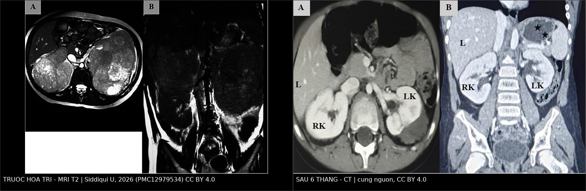
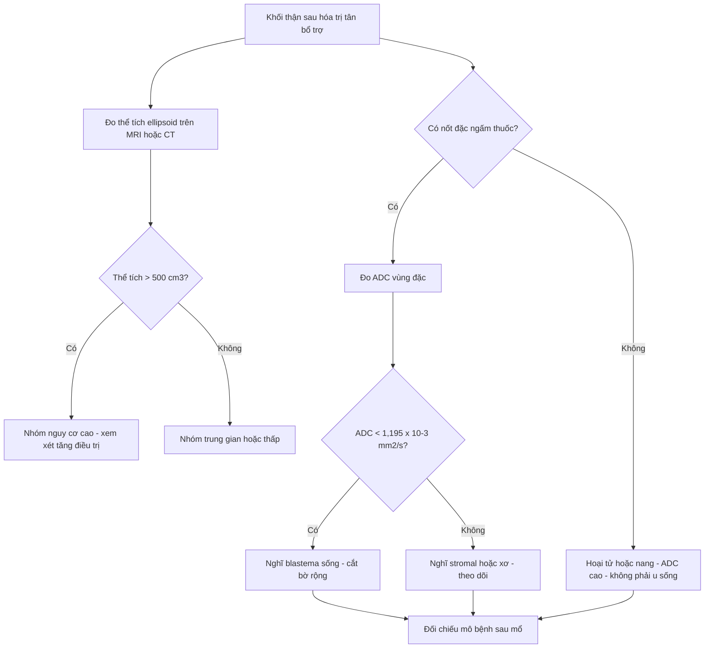
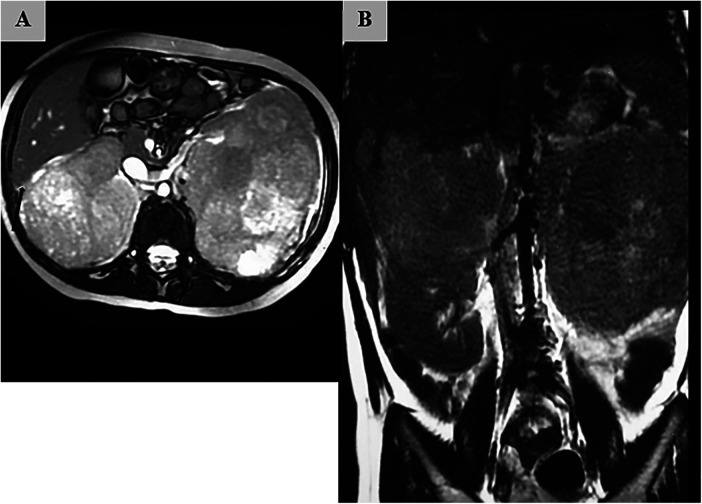
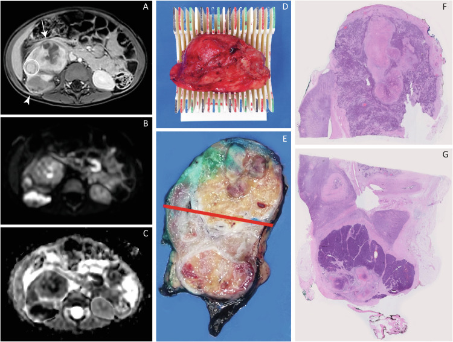

# 651 — Đánh giá đáp ứng & theo dõi sau điều trị u nguyên bào thận (Wilms tumor): thể tích, u sống vs hoại tử, tái phát muộn & di căn phổi / Wilms tumor response assessment and post-treatment surveillance

**Tags:** `pattern:khoi-than` `pattern:dap-ung-hoa-tri` `pattern:u-song-sot` `vung:than` `vung:phoi` `score:SIOP-UMBRELLA` `protocol:MRI-DWI-theo-doi` `incidentaloma:di-can-phoi`
**Mức chắc chắn (certainty):** tổng hợp y văn (literature synthesis) — số liệu từ đoàn hệ 60 bệnh nhi SIOP (Hamdan A et al., Diagnostics 2026, PMC13564508), nghiên cứu đối chiếu MRI-DWI với mô học qua khuôn cắt 3D in (van der Beek JN et al., Eur Radiol 2025, PMC11782413), ca song thận nguyên văn (Siddiqui U et al., Front Pediatr 2026, PMC12979534) và đoàn hệ tái phát 46 ca (Du J et al., Transl Androl Urol 2026, PMC12877638).

## 1. Tổng quan — vì sao "đọc khối còn lại" khó hơn "đọc khối ban đầu"

- **Bối cảnh điều trị:** u nguyên bào thận (Wilms tumor — WT) chiếm khoảng **6% ung thư trẻ em**; thể khu trú có sống còn **> 90%**. Theo **SIOP-RTSG UMBRELLA 2016**, trẻ được **hóa trị tân bổ trợ trước, mổ sau**, rồi phân tầng nguy cơ dựa trên **mô học sau hóa trị** và **thể tích khối u sau hóa trị**.
- **Ngưỡng định lượng quan trọng nhất:** thể tích đo trên hình ảnh **> 500 cm³** được xem là **nguy cơ cao** để lên kế hoạch điều trị bổ trợ, áp dụng cho **nhóm mô học nguy cơ trung gian, không stromal, không epithelial** (đã kiểm chứng trong SIOP 93-01 và SIOP 2001). Đây là **ngưỡng của thể tích X-quang**, không phải thể tích bệnh phẩm.
- **Công thức chuẩn:** thể tích ellipsoid **V = π/6 × L × W × H** (ba đường kính trực giao, cm). Đo trên **cùng một thì** (thường thì tĩnh mạch cửa sau hóa trị, ngay trước mổ), lát cắt mỏng, ghi rõ phương pháp.
- **Số liệu đối chiếu 4 cách đo (60 bệnh nhi, Hamdan 2026):**
  - Thể tích ellipsoid trung vị **201 cm³** (16–1736); planimetry **232 cm³** (13–1952).
  - **Planimetry vs ellipsoid:** r = **0,993**; sai lệch trung bình **+21,1 cm³ (+6,1%)**; giới hạn đồng thuận **−82,8 đến +124,9 cm³**; **đồng thuận 100%** ở ngưỡng 500 cm³ trong đoàn hệ này. Nhưng sai lệch 6% đủ để **480 cm³ thành ~509 cm³** — đúng ngưỡng đổi phân tầng.
  - **Thể tích bệnh phẩm vs ellipsoid:** r = **0,594**; sai lệch trung bình **−119,5 cm³ (−34,1%)**; **47%** ca được xếp nguy cơ cao bằng X-quang lại **≤ 500 cm³** theo bệnh phẩm. Một ca: X-quang **1736 cm³** nhưng bệnh phẩm **38 cm³** (khác > 97%) vì gần như chỉ còn hoại tử/nang.
  - **Cân bệnh phẩm tươi vs ellipsoid:** r = **0,730**; sai lệch **+46,6%** (kèm nhu mô thận, mỡ quanh thận, vỏ giả); nếu dùng cân sẽ **nâng bậc sai 9,1%** ca.
- **TẠI SAO hình ảnh và mô học lệch nhau:** hình ảnh đo **khối u in vivo** gồm cả **vỏ giả, phù, dịch nang, hoại tử chưa hấp thu**; bệnh phẩm đo **mô đã cố định**, co lại, có khi vỡ nang khi cắt. Vì vậy **không được hoán đổi** hai con số khi áp ngưỡng 500 cm³.
- **TẠI SAO DWI phân biệt được u sống/hoại tử:** vùng **nguyên bào thận (blastema)** có mật độ tế bào cao, màng tế bào cản trở chuyển động nước → **ADC thấp**; vùng **hoại tử, xơ, nang, stromal** giàu khoảng ngoại bào → **ADC cao**. Trên 44 tổn thương WT (van der Beek 2025): ADC trung vị trên tiêu bản khớp vị trí là **1,516** (stromal), **0,906** (epithelial) và **0,573 × 10⁻³ mm²/s** (blastemal); ngưỡng **1,195 × 10⁻³ mm²/s** phân biệt stromal với epithelial/blastemal đạt **độ nhạy 95,2%**, **độ đặc hiệu 90,5%**. Blastemal có ADC toàn khối thấp nhất cả trước (**0,600**) và sau hóa trị (**0,628 × 10⁻³ mm²/s**).
- **TẠI SAO thể tích giảm khác nhau theo thể mô học:** stromal WT giảm trung vị chỉ **48 cm³** (có ca **tăng 333 cm³**), trong khi thể "regressive" giảm **335 cm³** (82–1067). Đáp ứng kém **không đồng nghĩa** u còn sống — stromal trưởng thành là mô lành tính hóa, không phải blastema.
- **Vì sao phải theo dõi dài:** tái phát gặp ở **16,2%** (51/314) trong đoàn hệ Bắc Kinh; **trung vị 6,1 tháng** (0,1–52,1), **95,7% trong 24 tháng**; **91,3% tái phát không triệu chứng**, phát hiện nhờ chụp định kỳ. Sau tái phát: **EFS 5 năm 44,5%**, **OS 5 năm 54,7%**; tái phát **< 6 tháng** có EFS 24,9% so với 66,8% (HR tái phát lần hai **3,0**).

## 2. Mẫu hình + chẩn đoán phân biệt của "khối còn lại sau hóa trị" (Gamut)

- **Đáp ứng hoàn toàn:** không còn khối đo được, chỉ còn sẹo nhỏ; mô học có thể chỉ là **xơ/hoại tử** — không cần can thiệp thêm nếu đúng phác đồ.
- **Khối hoại tử/nang hóa:** khối lớn nhưng **không ngấm thuốc**, thành mỏng, **ADC cao**; đây là hình ảnh hay gặp nhất và **không phải u sống**.
- **U sống còn (viable/blastemal):** **nốt đặc ngấm thuốc**, thường nằm trong hoặc sát vỏ khối hoại tử; **ADC thấp (< 1,195 × 10⁻³ mm²/s)**; có thể **tăng thể tích** giữa hai lần chụp.
- **Trưởng thành stromal (stromal maturation):** khối **không nhỏ đi hoặc to lên**, bờ rõ, **ADC cao**, ngấm thuốc ít; mô học là **stroma trưởng thành**, không phải blastema — đây là "giả tiến triển" điển hình sau hóa trị.
- **Tái phát/tái tăng sinh tại chỗ:** khối mới hoặc lớn lại ở **giường mổ/hố thận**, có thể kèm **TP53/anaplasia**; cần so phim cũ và đo lại thể tích.
- **Nephroblastomatosis/ổ nguyên bào thận mới:** nhiều **nốt nhỏ vỏ thận**, không có khối thống trị; gặp ở thận đối bên hoặc thận còn lại, **không phải di căn**.
- **Tổn thương giả u ở gan:** **tăng sản nốt khu trú (FNH)** ở trẻ sau điều trị WT có thể **to dần** và giống di căn gan; FNH chiếm ~**2%** u gan trẻ em (Miyoshino W et al., Surg Case Rep 2026, PMC13148888) — không sinh thiết mù.
- **Mẫu hình di căn:** **phổi** là vị trí xa thường gặp nhất; sau đó **gan, xương, não** (não hiếm, thường muộn). Di căn **kết hợp tại chỗ + xa** có tiên lượng xấu nhất (OS 5 năm **12%** trong đoàn hệ tái phát).

## 3. Bảng so sánh phân biệt (ma trận đối chiếu)

| Thực thể (entity) | Hình ảnh điển hình (MRI/CT sau hóa trị) | Chốt vào (rule-in) | Chốt loại (rule-out) | Gợi ý xác nhận |
|---|---|---|---|---|
| **U sống còn (blastemal)** | Nốt đặc **ngấm thuốc**, T2 trung gian, **DWI sáng/ADC thấp** | **ADC < 1,195 × 10⁻³ mm²/s** + ngấm thuốc + tăng thể tích giữa 2 lần chụp | ADC cao đồng nhất + không ngấm + vôi hóa/xơ → không phải u sống | Đối chiếu mô bệnh sau mổ; cắt toàn bộ để lấy bờ |
| **Hoại tử/nang sau hóa trị** | Khối lớn, **không ngấm**, thành mỏng, dịch T2 rất sáng | **Không ngấm thuốc + ADC cao** + thể tích giảm | Nốt đặc ngấm thuốc trong khối → phải loại u sống | MRI T1 sau tiêm + trừ vùng không ngấm khi đo ADC |
| **Trưởng thành stromal** | Khối bờ rõ, **không nhỏ đi**, ngấm ít, **ADC cao** | **Stromal ADC 1,516** (cao hơn epithelial/blastemal) + giảm thể tích < 48 cm³ | ADC thấp + ngấm mạnh → nghĩ blastema | Mô học là tiêu chuẩn vàng; không tăng điều trị chỉ vì "không nhỏ" |
| **Tái phát tại chỗ** | Khối mới/lớn lại ở giường mổ, có thể xâm lấn cơ/cột sống | **So phim cũ thấy mới xuất hiện** + tăng thể tích + ngấm thuốc | Sẹo xơ co kéo, không ngấm, ổn định ≥ 2 lần chụp | CT/MRI bụng + sinh thiết nếu mổ được |
| **Nephroblastomatosis** | Nhiều **nốt vỏ < 1–2 cm**, không khối thống trị, ngấm kém | **Nhiều nốt hai bên + bối cảnh hội chứng dễ mắc** | Một khối thống trị ngấm mạnh → nghĩ WT | US/MRI 3 tháng; theo dõi, tránh sinh thiết |
| **FNH ở gan (giả di căn)** | Nốt gan **ngấm mạnh thì động mạch**, có thể có vòng xơ trung tâm, **to dần chậm** | **Bối cảnh WT đã lui bệnh + nốt gan đơn độc, ngấm kiểu FNH** | Nốt gan đa ổ + tăng nhanh + bờ không đều → nghĩ di căn | MRI gan đa thì; theo dõi 3–6 tháng; tránh sinh thiết mù |
| **Di căn phổi** | Nốt tròn, bờ rõ, thường **ngoại vi/thùy dưới**, có thể đơn độc | **Nốt mới trên CT ngực** + tiền sử WT + không có ổ nhiễm | Vôi hóa đều, bờ tua gai, ổn định nhiều năm → lành tính | CT ngực lát mỏng; cắt nốt nếu đơn độc và mổ được |

*Trái — **MRI T2 trước hóa trị**: hai thận thay thế bởi khối lớn, bên phải xóa mặt phẳng mỡ với gan (mũi tên). Phải — **CT sau 6 tháng hóa trị**: khối giảm mạnh, mặt phẳng mỡ gan–thận phải được phục hồi; còn **khối nang phức tạp ở cực trên thận trái** (dấu sao). Siddiqui U et al., Front Pediatr 2026 (PMC12979534, Fig. 1–2), CC BY 4.0; ảnh ghép letterbox, không crop.*

## 4. Protocol chụp + hệ phân độ/điểm chuẩn hóa

### 4.1. Chụp và đo thể tích
- **MRI bụng** (ưu tiên ở trẻ nhỏ/đang điều trị): T2 axial/coronal, T1 **trước và sau gadolinium**, **DWI b = 0/1000** + ADC. Lát cắt **≤ 5 mm**, không khoảng trống.
- **CT bụng có cản quang** khi MRI không khả dụng: thì **tĩnh mạch cửa** (60–70 giây) để đo thể tích; thì động mạch để tìm nốt sống.
- **Đo thể tích:** ellipsoid **V = π/6 × L × W × H** trên **ba mặt phẳng trực giao**, cùng một thì; ghi rõ "ellipsoid" hay "planimetry" trong báo cáo. **Không dùng cân bệnh phẩm** thay thể tích.
- **Đo ADC:** đặt ROI **toàn khối**, sau đó **trừ vùng không ngấm thuốc** (nang/hoại tử/xuất huyết) theo ngưỡng cơ dựng sống; báo cáo **ADC trung vị × 10⁻³ mm²/s**. Với tổn thương **< 3 cm³** hoặc phần lớn là nang/xuất huyết, ADC không đáng tin.
- **CT ngực liều thấp** (hoặc X-quang ngực) ở chẩn đoán và khi nghi di căn; **không bỏ sót nốt < 5 mm** bằng cách đọc trên lát 1–2 mm.

### 4.2. Phân tầng SIOP và ngưỡng xử trí
- **Stage V** = WT hai thận tại chẩn đoán; mục tiêu kép: **kiểm soát u + bảo tồn nhu mô thận**. Hóa trị tân bổ trợ thường **6–12 tuần** trước mổ bảo tồn.
- **Nguy cơ cao** sau hóa trị: mô học **blastemal** (hoặc anaplasia) và/hoặc **thể tích > 500 cm³** trong nhóm trung gian không stromal/không epithelial → xem xét **tăng điều trị** (doxorubicin, xạ trị theo phác đồ).
- **Nguy cơ thấp/trung gian:** phẫu thuật ± hóa trị ít độc; **tránh tăng bậc chỉ vì khối "không nhỏ"** nếu ADC cao và mô học stromal.

### 4.3. Lịch theo dõi sau điều trị
- **2 năm đầu:** khám + **siêu âm bụng + X-quang/CT ngực mỗi 3 tháng**.
- **3 năm tiếp:** **mỗi 6 tháng**.
- **Sau 5 năm:** **mỗi năm** (tái phát muộn vẫn có thể gặp, dù 95,7% xảy ra trong 24 tháng).
- **Tái phát:** chụp lại toàn bộ (bụng + ngực), **sinh thiết/cắt nốt** nếu còn mổ được; tái phát **< 6 tháng** và **không mổ được** là yếu tố tiên lượng xấu độc lập.

## 5. Biến thể bình thường và cạm bẫy

- **Đừng dùng thể tích bệnh phẩm để áp ngưỡng 500 cm³:** bệnh phẩm thấp hơn X-quang trung bình **119,5 cm³** và làm **47%** ca nguy cơ cao thành "không nguy cơ cao" — sai lệch hệ thống, không phải sai số ngẫu nhiên.
- **Đừng dùng cân bệnh phẩm:** cân gồm nhu mô lành, mỡ, vỏ giả; sai lệch **+46,6%**, có ca cân **3250 g** trong khi thể tích X-quang **1085 cm³**.
- **ROI ADC sai:** lấy cả vùng hoại tử/nang sẽ **kéo ADC lên** và bỏ sót blastema; ngược lại, **xuất huyết đông đặc** có thể làm **ADC thấp giả** — luôn đối chiếu T1/T2 và ảnh sau tiêm.
- **"Khối to lên" không đồng nghĩa thất bại:** stromal maturation có thể **tăng thể tích** nhưng ADC cao, mô học lành; tăng điều trị oan sẽ thêm độc tính.
- **FNH gan sau WT:** nốt gan **ngấm mạnh, to dần** ở trẻ đã lui bệnh có thể là **FNH**, không phải di căn; sinh thiết mù có nguy cơ chảy máu. Theo dõi bằng MRI đa thì trước.
- **Di căn phổi đơn độc:** không phải mọi nốt phổi mới là di căn — loại trừ **nốt viêm/lao cũ/atelectasis**; nhưng ở trẻ WT, nốt mới **phải loại trừ di căn** bằng CT lát mỏng và theo dõi ngắn.
- **Bỏ sót ổ thứ hai:** WT hai thận và hội chứng dễ mắc có thể có **ổ nguyên bào thận đối bên**; đọc cả hai thận trên mọi lát, không chỉ "khối chính".
- **Tái phát muộn sau 5 năm:** hiếm nhưng có; không ngừng theo dõi hoàn toàn ở bệnh nhi có hội chứng dễ mắc hoặc bảo tồn thận.

## 6. Tự lượng giá — Blind Quiz

**Ca 1 — Bé gái 5 tuổi, bụng to dần, hai bên hông sờ thấy khối rắn. Xem hai ảnh trước và sau hóa trị.**

- Gợi ý: không đau, không sốt, không di căn phổi trên CT ngực.
- Câu hỏi: Mô tả hai khối và mối liên quan với gan? Sau 6 tháng hóa trị, dấu hiệu nào chứng tỏ đáp ứng? Còn khối gì ở thận trái?

<b>Bấm để hiện đáp án (findings + chẩn đoán)</b>

- **Trước hóa trị (A axial, B coronal T2):** hai khối lớn thay thế nhu mô hai thận; khối phải **~10 × 8 cm** ở cực trên, **xóa mặt phẳng mỡ với mặt sau gan** (mũi tên) — gợi ý dính vỏ gan; khối trái cũng rất lớn. Chẩn đoán: **WT song thận (stage V)** theo SIOP, không sinh thiết trước hóa trị.
- **Sau 6 tháng (ảnh ghép, phải):** khối giảm mạnh, **mặt phẳng mỡ gan–thận phải được phục hồi**, thận phải còn nhu mô; thận trái còn **khối nang phức tạp cực trên** (dấu sao) — phần lớn là **hoại tử/nang**, không phải u sống.
- **Chốt:** thể tích giảm + không còn nốt đặc ngấm mạnh = đáp ứng tốt; nhưng ca này sau đó **tái tăng sinh** trước mổ, phải mổ bảo tồn hai bên. Bài học: **đáp ứng ban đầu không bảo đảm đáp ứng bền** — phải chụp lại ngay trước mổ.
- Nguồn: Siddiqui U et al., Front Pediatr 2026 (PMC12979534, Fig. 1–2), CC BY 4.0.

**Ca 2 — Bé trai 3 tuổi, WT sau hóa trị tân bổ trợ; MRI còn nốt đặc trong khối. Ảnh dưới gồm MRI, tiêu bản cắt ngang và mô học.**

- Gợi ý: khối đã nhỏ hơn nhưng còn **nốt ngấm thuốc** ở vỏ.
- Câu hỏi: Nốt còn lại là u sống hay hoại tử? Dùng trình tự nào để chốt? Ngưỡng ADC nào gợi ý stromal?

<b>Bấm để hiện đáp án (findings + chẩn đoán)</b>

- **Findings:** (A) T1 sau tiêm: nốt **ngấm thuốc** ở vỏ; (B) DWI: nốt **tăng tín hiệu**; (C) ADC: nốt **giảm tín hiệu** — tương ứng vùng **blastema sống**. Tiêu bản đại thể (D, E) và mô học (F, G) cho thấy vùng u đặc còn sống cạnh vùng hoại tử/xơ.
- **Chốt:** **DWI/ADC là chốt bổ sung** cho nốt đặc sau hóa trị. ADC trung vị: **blastemal 0,573**, epithelial **0,906**, stromal **1,516 × 10⁻³ mm²/s**; ngưỡng **1,195** phân biệt stromal với phần còn lại (sens **95,2%**, spec **90,5%**).
- **Cạm bẫy:** không đo ADC trên vùng nang/xuất huyết; vùng xuất huyết đông có thể **ADC thấp giả**.
- Nguồn: van der Beek JN et al., Eur Radiol 2025 (PMC11782413, Fig. 2), CC BY 4.0.

**Ca 3 — Bé trai 4 tuổi, đã mổ WT 18 tháng trước, khám định kỳ hoàn toàn khỏe. CT ngực phát hiện một nốt 8 mm ở thùy dưới phổi phải.**

- Câu hỏi: Đây có thể là gì? Vì sao vẫn phải chụp định kỳ dù trẻ không triệu chứng? Bước tiếp theo?

<b>Bấm để hiện đáp án (findings + chẩn đoán)</b>

- **Chẩn đoán nghĩ nhiều: di căn phổi** — vị trí xa thường gặp nhất của WT. Trong đoàn hệ 46 ca tái phát, **91,3% không triệu chứng**, phát hiện nhờ **chụp định kỳ**; **95,7% tái phát trong 24 tháng**, trung vị **6,1 tháng**.
- **Vì sao không được bỏ:** tái phát < 6 tháng có EFS 5 năm **24,9%** và OS **35,8%**, xấu hơn rõ so với tái phát muộn (**66,8%** và **73,4%**). OS sau tái phát chung chỉ **54,7%**.
- **Bước tiếp theo:** CT ngực lát mỏng (1–2 mm) để đếm nốt và vị trí; đánh giá lại bụng; nếu nốt đơn độc/còn mổ được → **cắt nốt/thuỷ thuật** để chẩn đoán mô học; hội chẩn phác đồ cứu vãn.
- Nguồn số liệu: Du J et al., Transl Androl Urol 2026 (PMC12877638), CC BY-NC-ND 4.0.

## Bài liên quan chéo
- [639 – Khối thận ở trẻ: Wilms, CMN, RCC](../639-khoi-than-o-tre-wilms-cmn-rcc/lesson.md)
- [648 – Hội chứng dễ mắc Wilms & nephroblastomatosis](../648-hoi-chung-de-mac-wilms-tam-soat-nephroblastomatosis/lesson.md)
- [647 – CMN thể tế bào: theo dõi tái phát](../647-cmn-the-te-bao-theo-doi-tai-phat/lesson.md)
- [650 – Thần kinh nhi: xuất huyết mầm & u hố sau](../650-than-kinh-nhi-xuat-huyet-mam-va-u-ho-sau/lesson.md) (nguyên tắc theo dõi sau điều trị ung thư nhi)
- [020 – Nốt phổi](../020-not-phoi/lesson.md) (đánh giá nốt phổi trên CT)

> Không dùng để chẩn đoán độc lập khi chưa có người hướng dẫn.
