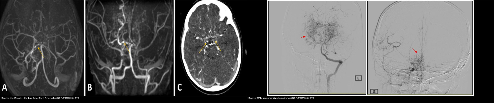
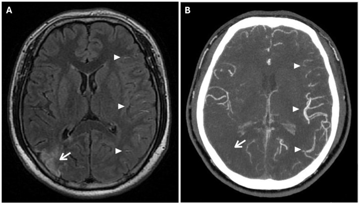
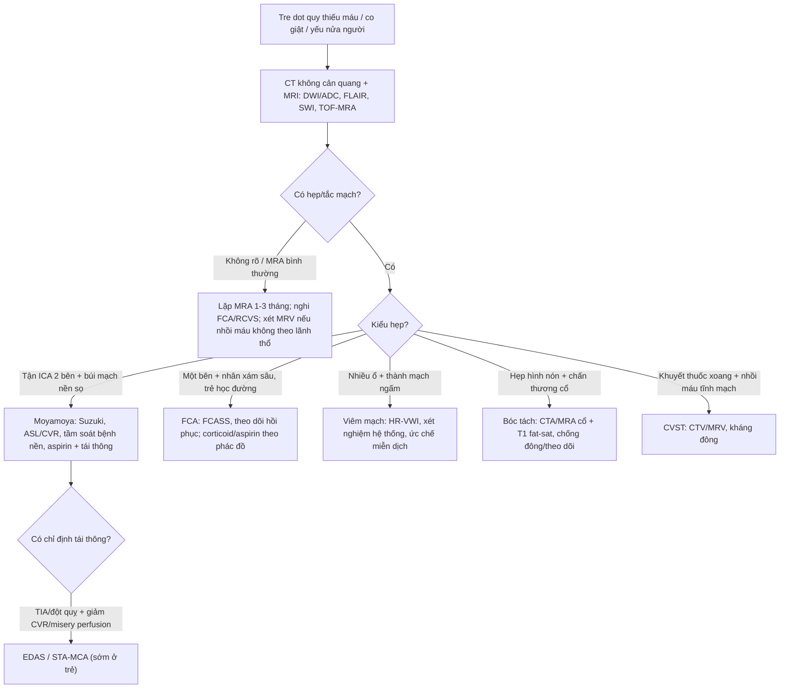
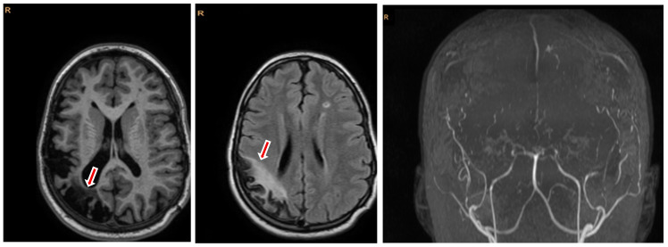
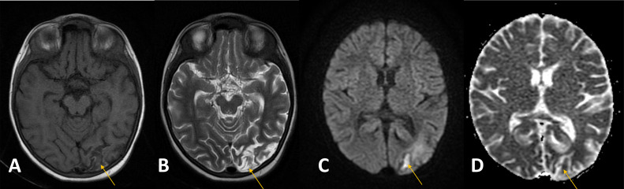
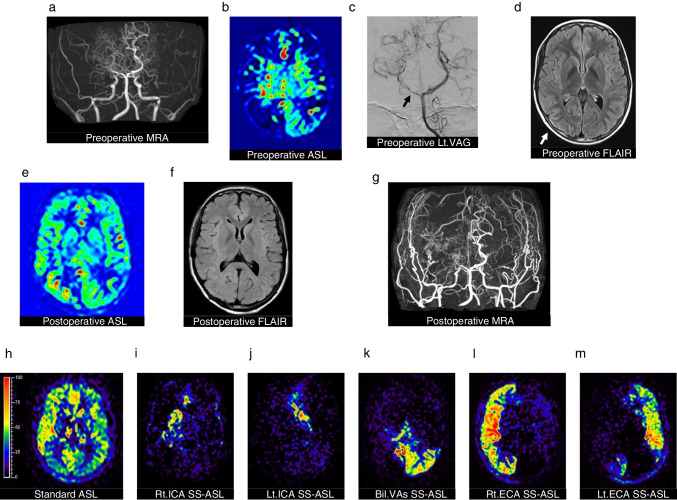
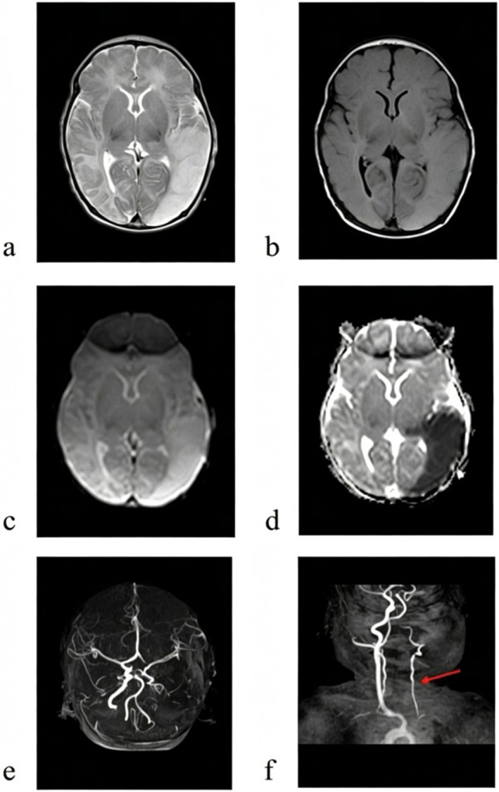
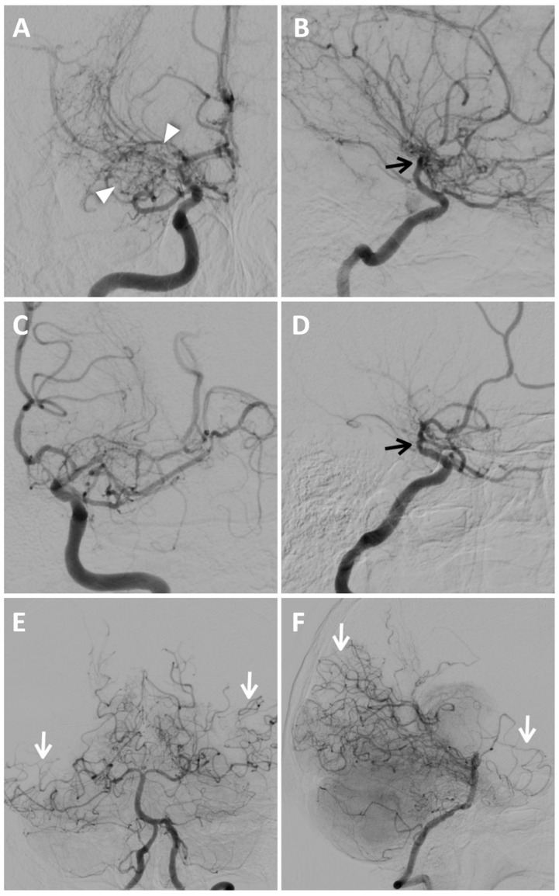

# 652 — Đột quỵ động mạch & bệnh mạch máu não ở trẻ em: moyamoya, viêm mạch, bóc tách — MRA/MRV & ASL

**Tags:** `pattern:hep-tac-mach` `vung:nao-nhi` `score:Suzuki` `score:FCASS` `protocol:MRA-ASL` `pattern:nhoi-mau-nao`
**Mức chắc chắn (certainty):** tổng hợp y văn (literature synthesis) — bài tổng quan hình ảnh + ca nguyên văn (verbatim case) từ các bài open-access; **các ca trong quiz giữ đúng tuổi, bối cảnh và chú thích gốc**, số liệu lấy từ bài gốc có PMCID ghi kèm.

> **Điểm chốt của bài:** ở trẻ bị đột quỵ thiếu máu, **không được dừng ở "nhồi máu"** — phải trả lời câu hỏi *mạch máu nào, bệnh mạch gì*. Ba nhóm hay gặp và hay nhầm: **moyamoya** (hẹp tận ĐM cảnh trong hai bên + búi mạch "khói thuốc"), **bệnh mạch khu trú (focal cerebral arteriopathy, FCA)** (một bên, hồi phục một pha) và **bệnh mạch hệ thống/viêm mạch**. Không thấy hẹp trên MRA tuần đầu **không loại trừ** bệnh mạch.

## 1. Tổng quan bệnh học – cơ chế hình ảnh

### 1.1 Vì sao trẻ bị đột quỵ lại là một bài toán mạch máu

Đột quỵ động mạch ở trẻ (childhood arterial ischemic stroke, AIS) có **tần suất 2–4,6/100.000 người–năm** và đang tăng trên toàn cầu (Liu G et al., *Front Neurol* 2025, PMC12005998). Khác người lớn (xơ vữa/tim), nguyên nhân hàng đầu ở trẻ là **bệnh mạch máu (arteriopathy)** — phân loại theo **CASCADE** (Small vessel; **Unilateral FCA**; Bilateral FCA có/không bàng hệ kiểu moyamoya; Aortic/cervical arteriopathy gồm **bóc tách**; Cardio-embolic; Other; Multi-factorial). Trong một cohort bệnh mạch trẻ, **CASCADE 2 (FCA một bên) là nhóm đông nhất**, tổn thương hay gặp nhất là **nhồi máu vùng nhân xám sâu (basal ganglia)**; **tái phát 20%** và **di chứng vận động 60%** sau 24 tháng (PMC10789414). Vì vậy mọi trẻ nhồi máu não **phải được chụp mạch** (MRA/CTA, khi cần DSA) — không chỉ chụp nhu mô.

### 1.2 Moyamoya: bệnh của lớp nội mạc, không phải xơ vữa

**Moyamoya** (bệnh Moyamoya, MMD) là bệnh **hẹp/tắc tiến triển đoạn tận ĐM cảnh trong (internal carotid artery, ICA)** và đoạn gần **ĐM não trước (ACA)/ĐM não giữa (MCA)**, kèm **mạng bàng hệ bất thường ở nền sọ**. Mô bệnh: **tăng sinh cơ trơn + dày nội mạc dạng xơ–tế bào (fibrocellular intimal thickening)**, *không* có mảng xơ vữa và *không* viêm thành mạch — đây là lý do **HR-VWI (vessel wall MRI) không ngấm thành mạch** trong MMD, khác viêm mạch. Hẹp dần → các động mạch **bèo (lenticulostriate) và đồi thị (thalamoperforating)** giãn ra làm đường vòng → trên DSA tạo **búi mạch "khói thuốc" (puff of smoke)**; chính các mạch bàng hệ mỏng, dễ vỡ này gây **nhồi máu do giảm tưới máu** hoặc **xuất huyết**.

- Dịch tễ: **0,34–0,94/100.000/năm** ở Đông Á (Nhật ước tính **6,03/100.000** hiện mắc, **0,35/100.000** mới mắc); **nữ:nam ≈ 2,2:1**; hai đỉnh tuổi **10–20** và **35–50**; **10–15%** có tiền sử gia đình (Ferraro E et al., *Reports* 2025, PMC12643450; PMC13027234). Trung Quốc: đỉnh trẻ **5–9 tuổi**, tần suất tăng **0,88 → 1,47/100.000** (2016–2018) (Ni W et al., *Stroke Vasc Neurol* 2026, PMC13540286).
- Di truyền: **RNF213 p.R4810K** ở người Đông Á, **độ thấm thấp** — người mang gen có thể chỉ biểu hiện khi có yếu tố môi trường/thứ phát.
- **Moyamoya syndrome (MMS)** = hình ảnh moyamoya **kèm bệnh nền**: **Down, hồng cầu hình liềm, NF1, thalassemia, xạ trị, Turner, Alagille, Williams, Noonan, Marfan, xơ cứng củ**. Đây không phải khác biệt học thuật: MMS do Down có **đột quỵ lúc chẩn đoán 71,4%** so với **20,7%** ở MMS không Down (aOR **14,50**; 95% CI 6,65–31,60) và **chẩn đoán muộn hơn** (Santoro JD et al., *Stroke* 2026, PMC13439558).

### 1.3 Cơ chế hình ảnh: tại sao DWI sáng, FLAIR có "ivy sign", ASL lại giảm

- **Nhồi máu cấp:** thiếu máu → **phù độc tế bào (cytotoxic edema)** → nước chuyển nội bào → **hạn chế khuếch tán**: **DWI tăng tín hiệu, ADC giảm**. T1/T2/FLAIR có thể **bình thường trong vài giờ đầu**; FLAIR dương tính thường sau **4–6 giờ**. Vì vậy **DWI/ADC là chuỗi quyết định** ở trẻ co giật/yếu nửa người cấp.
- **Ivy sign (dấu dây thường xuân):** trên **FLAIR**, các rãnh vỏ não có **đường tăng tín hiệu mảnh men theo bề mặt não**, do **dòng chảy chậm/xuôi ngược trong các mạch màng nuôi (leptomeningeal collaterals) đã giãn** — không phải máu dưới nhện. Ivy sign tương quan với **giảm dự trữ mạch máu não (cerebrovascular reserve, CVR)** và giảm sau khi tái thông: **95,5% bán cầu** giảm ivy sau STA–MCA (Kawashima), tới **100%** trong một chuỗi khác (Ideguchi) (Yu J et al., *Ther Adv Chronic Dis* 2020, PMC7549182). Đây là dấu **động**, dùng để theo dõi tưới máu.
- **ASL (arterial spin labeling):** dùng **nước trong máu động mạch làm chất đánh dấu nội sinh** (không cần thuốc cản quang, không bức xạ), cho **CBF định lượng (mL/100 g/phút)**. Trong hẹp–tắc, **thời gian vận chuyển động mạch (arterial transit time, ATT) kéo dài** → tín hiệu đến muộn, **ASL có thể đánh giá thấp CBF**; vì vậy cần **multi-delay ASL/ATT correction**, và **ASL bình thường không loại trừ thiếu máu vùng sâu**. **SS-ASL (super-selective ASL)** đánh dấu riêng từng động mạch (ICA/ECA/ĐM đốt sống), mỗi mạch ~**2 phút**, tỷ lệ thất bại **1/125** — hữu ích ở trẻ sau phẫu thuật bắc cầu (Yoshikane T et al., *Neuroradiology* 2024, PMC11246266).
- **CVR/OEF:** khi CBF giảm, não tăng **phân suất chiết oxy (oxygen extraction fraction, OEF)** để bù ("misery perfusion"). Trên SPECT, **OEF > 51,3%** là ngưỡng; **CBF tương đối** phát hiện misery perfusion với **Se 100%/Sp 91%**, PPV 67%, NPV 100% (PMC13374456). Đây là cơ sở để chọn bệnh nhân phẫu thuật tái thông.
- **MRA TOF:** tín hiệu phụ thuộc dòng chảy → **hẹp giả do mất tín hiệu (flow gap)**, nhất là ở chỗ hẹp lệch tâm; **MRA có thể đánh giá quá mức độ hẹp**. Trong một nghiên cứu tiến cứu 26 bệnh nhân (6 tháng–54 tuổi, trung bình 14 tuổi), **MRA nhạy 73%**, **MRI cấu trúc nhạy 92%**, đặc hiệu **100%** cả hai; phối hợp **92%/100%** (PMC13027234). Vì vậy phải đọc **source images**, đối chiếu CTA/DSA khi quyết định can thiệp.

## 2. Mẫu hình + chẩn đoán phân biệt theo vị trí (gamut)

**Gamut theo mẫu hình mạch máu + vị trí tổn thương nhu mô:**

- **Hẹp/tắc đoạn tận ICA hai bên + búi mạch nền sọ (basal ganglia/thalamus) + nhồi máu phân thủy/vỏ:** **bệnh moyamoya** (MMD) — nếu có bệnh nền gọi là **MMS**.
- **Hẹp một bên ICA/MCA ở trẻ tuổi học đường + nhồi máu nhân xám sâu + hồi phục dần trong 3–6 tháng:** **FCA thể viêm (FCA-inflammatory, FCA-i)** — CASCADE 2, thường **một pha** (monophasic).
- **Hẹp nhiều ổ, mạch "chuỗi hạt"/bờ không đều, nhồi máu nhiều lãnh thổ, thành mạch dày–ngấm trên HR-VWI, có bệnh hệ thống:** **viêm mạch não** (PACNS, lupus, ADA2/DADA2, Takayasu, sau thủy đậu). Phân biệt với **RCVS** (co mạch có hồi phục, đau đầu sét đánh, không corticoid) — xem [219].
- **Hẹp hình nón/đuôi nhọn ở ICA cổ + màng nội mạc (intimal flap) + máu tụ thành mạch T1 sáng + tiền sử chấn thương/cổ:** **bóc tách động mạch (dissection)**.
- **Nhồi máu không theo lãnh thổ động mạch + tổn thương đồi thị hai bên/xuất huyết + khuyết thuốc xoang:** **huyết khối xoang tĩnh mạch não (CVST)** — xem [216].
- **Sơ sinh co giật + nhồi máu bán cầu lớn + ICA/MCA tắc:** **đột quỵ động mạch chu sinh (perinatal AIS)**.
- **Hẹp mạch + canxi hóa/loạn sản xương + bất thường mắt–da:** nghĩ **hội chứng** (NF1, TSC, Alagille, Williams) → khám toàn thân + tầm soát gia đình.

## 3. Bảng so sánh phân biệt (ma trận đối chiếu)

| Thực thể (entity) | Hình ảnh điển hình (CT/MRI/DSA) | Chốt vào (rule-in) | Chốt loại (rule-out) | Gợi ý xác nhận |
|---|---|---|---|---|
| **Bệnh moyamoya (MMD)** | Hẹp/tắc **đoạn tận ICA hai bên** + hẹp gần ACA/MCA + **búi mạch "khói thuốc"** ở nền sọ; nhồi máu phân thủy/vỏ; **ivy sign** trên FLAIR | **Hẹp tận ICA tiến triển HAI BÊN + mạng bàng hệ nền sọ**; ở trẻ **một bên cũng đủ chẩn đoán** sau khi loại trừ nguyên nhân khác | Hẹp một đoạn ngắn, không tiến triển, không bàng hệ → FCA/viêm mạch | MRA/CTA → DSA (Suzuki); HR-VWI **không ngấm** thành mạch; tầm soát bệnh nền (Down, SCD, NF1, xạ trị) |
| **Moyamoya syndrome (MMS)** | Như MMD + dấu hiệu bệnh nền (ví dụ Down: **hẹp hai bên + bàng hệ**, đôi khi **tuần hoàn sau** nhiều hơn) | **Hình moyamoya + bệnh nền đã biết** | MMD vô căn (không bệnh nền, RNF213) | Khám Down/SCD/NF1; siêu âm tim; xét nghiệm hồng cầu hình liềm; hỏi xạ trị |
| **FCA thể viêm (CASCADE 2)** | **Hẹp một bên** ICA/MCA/ACA, bờ không đều, **nhồi máu nhân xám sâu**; hồi phục dần | **Một bên + trẻ học đường + hồi phục một pha**; FCASS cao nhất ~**2 tháng** rồi giảm | Hẹp tiến triển không hồi phục + bàng hệ nền sọ → moyamoya một bên | MRA lúc nhập viện **và lặp 1–3 tháng**; FCASS; loại trừ thủy đậu/viêm mạch |
| **Viêm mạch não (PACNS/ADA2/lupus)** | Hẹp **nhiều ổ, nhiều mạch, hai bên**, nhồi máu nhiều lãnh thổ; **thành mạch dày + ngấm trên HR-VWI** | **Nhiều ổ + thành mạch ngấm + bệnh hệ thống** (sốt, phát ban, tổn thương thận/phổi) | Một ổ đơn độc, thành mạch không ngấm → FCA/MMD | HR-VWI, DSA, dịch não tủy, ANA/ANCA, gen **ADA2**; sinh thiết não–màng não khi cần |
| **Bóc tách động mạch cổ** | **Hẹp hình nón/đuôi nhọn ("string sign")**, màng nội mạc, **máu tụ thành mạch T1 sáng**, nhồi máu theo lãnh thổ | **Tiền sử chấn thương cổ + hẹp hình nón + máu tụ thành mạch** | Hẹp dài đối xứng hai bên không chấn thương → moyamoya/viêm mạch | CTA/MRA cổ + **T1 fat-sat**; DSA khi cần can thiệp |
| **CVST** | **Tăng đậm độ xoang trên CT không cản quang**; **empty delta**; **nhồi máu không theo lãnh thổ**, có thể xuất huyết; MRV/CTV khuyết thuốc | **Khuyết thuốc trong xoang + nhồi máu tĩnh mạch/xuất huyết + đau đầu/phù gai** | Nhồi máu theo lãnh thổ ĐM + mạch máu bình thường → AIS | CTV/MRV; D-dimer; kháng đông **kể cả khi có xuất huyết** (bài [216]) |
| **Đột quỵ chu sinh (perinatal AIS)** | Nhồi máu **một bán cầu lớn**, mất phân biệt vỏ–chất trắng, **DWI sáng/ADC tối**; MRA thấy **tắc ICA/MCA** | **Sơ sinh co giật + nhồi máu bán cầu + tắc ICA/MCA** | Nhồi máu nhỏ, nhiều ổ → nguyên nhân khác (nhiễm trùng/chuyển hóa) | MRI sọ + MRA (không cần DSA); siêu âm tim, đông máu, nhau thai |

*Trái: MRA TOF (A, B) mạch bờ không đều, "chuỗi hạt" và CTA (C) thấy rõ búi mạch bàng hệ nền sọ ở trẻ 6 tuổi β-thalassemia. Phải: DSA (A, B) tắc đoạn tận ICA hai bên + búi mạch "khói thuốc" ở trẻ 7 tuổi. Nguồn: Shaukat M et al., Radiol Case Rep 2025, PMC12159822; Grigore I et al., J Clin Med 2026, PMC13027288 — đều CC BY 4.0. Ảnh ghép letterbox, giữ tỉ lệ.*

**Ivy sign — dấu hiệu động của giảm dự trữ mạch máu:**

*(A) FLAIR: đường tăng tín hiệu mảnh men theo rãnh vỏ (đầu mũi tên) — **ivy sign**; mũi tên chỉ ổ nhồi máu bán cấp. (B) CTA MIP: mạng màng nuôi dày, ngấm mạnh ("ivy-like"). Nguồn: Ferraro E et al., Reports 2025, PMC12643450, CC BY 4.0. Đây là ca người lớn 31 tuổi, dùng minh họa dấu hiệu.*

## 4. Protocol chụp + hệ phân độ/điểm chuẩn hóa

### 4.1 Protocol tối thiểu khi trẻ nghi đột quỵ/bệnh mạch não

1. **CT không cản quang** nếu trẻ đến cấp cứu (loại trừ xuất huyết, tìm **dấu tăng đậm độ mạch**); nhưng **CT bình thường không loại trừ nhồi máu**.
2. **MRI sọ cấp:** **DWI + ADC** (bắt buộc), **FLAIR**, **T2**, **T1**, **SWI/T2\*** (vi xuất huyết/huyết khối), **TOF-MRA** (đầu + cổ khi nghi bóc tách). **Thời gian chụp ngắn**, cân nhắc an thần nhẹ ở trẻ nhỏ (ALARA).
3. **ASL** (nếu có): đánh giá CBF **không cản quang**; ưu tiên **multi-delay/ATT correction**; **SS-ASL** khi cần đánh giá từng cuống mạch sau bắc cầu.
4. **HR-VWI (T1 3D sau tiêm)** khi nghi **viêm mạch/bóc tách**: thành mạch dày–ngấm = viêm; **không ngấm** = moyamoya (xơ nội mạc).
5. **MRV/CTV** khi nhồi máu **không theo lãnh thổ** hoặc có đau đầu/phù gai → CVST.
6. **DSA** là **tiêu chuẩn vàng** để xác định Suzuki, bàng hệ, phình kèm; ở trẻ cần gây mê và **chỉ định có chọn lọc**.
7. **Lặp hình ảnh:** MRA lúc nhập viện **có thể bình thường trong tuần đầu** (FCA/RCVS) → **lặp sau 1–3 tháng** trước khi kết luận; theo dõi ivy sign/ASL sau tái thông.

### 4.2 Tiêu chuẩn chẩn đoán moyamoya (2021/đồng thuận Trung Quốc 2024)

- **DSA:** hẹp/tắc **đoạn tận ICA** và/hoặc **nguyên ủy ACA/MCA** + **mạng mạch bất thường ở nền sọ** thì động mạch; có thể **hai bên hoặc một bên**, hai bên có thể **khác giai đoạn**.
- **MRI/MRA:** hẹp/tắc đoạn tận ICA ± nguyên ủy ACA/MCA + **mạng mạch bất thường vùng nhân xám trung tâm** (trên một lát cắt thấy **> 2 flow void rõ**).
- **Trẻ em:** **bất thường mạch MỘT BÊN + tiêu chuẩn 3** (loại trừ nguyên nhân khác: xơ vữa, bệnh tự miễn, viêm màng não, NF1, Down, chấn thương, xạ trị, Turner, Alagille, Williams, Noonan, Marfan, xơ cứng củ…) đã đủ chẩn đoán — **không được chờ đến khi hai bên** (Ni W et al., PMC13540286).

### 4.3 Phân độ Suzuki (DSA) — dùng để theo dõi, không phải tiên lượng tuyệt đối

| Giai đoạn | Hình ảnh |
|---|---|
| I | Hẹp chỗ chia đôi ICA |
| II | Búi mạch moyamoya xuất hiện; ACA/MCA giãn; chỗ chia ICA hẹp |
| III | Búi mạch **tăng**; ACA/MCA hẹp rõ |
| IV | Búi mạch **giảm**; ICA/ACA/MCA xấu đi; bắt đầu có bàng hệ từ **ĐM cảnh ngoài (ECA)** |
| V | Tắc ICA/ACA/MCA; búi mạch giảm thêm; bàng hệ ngoài sọ tăng |
| VI | Mất búi mạch; mất ACA/MCA; còn bàng hệ ECA/ĐM đốt sống |

*Lưu ý: hai bên thường **không cùng giai đoạn**; Suzuki không phản ánh đầy đủ mức giảm tưới máu.*

### 4.4 FCASS — phân biệt FCA hồi phục với moyamoya một bên tiến triển

**Focal Cerebral Arteriopathy Severity Score (FCASS)** chấm mức hẹp/tổn thương từng đoạn mạch (ICA, M1, A1, M2, A2…). Trong cohort trẻ Hàn Quốc (Lee S et al., *Stroke* 2026, PMC13281982):

- **FCA-i hồi phục một pha**, FCASS đỉnh ~**2,0 tháng** rồi giảm; **moyamoya một bên** có FCASS **cao hơn ở mọi thời điểm** (nền **6,0 vs 2,0**; cuối **8,0 vs 3,0**; p < 0,001) và **không hồi phục**.
- **FCASS nền ≥ 8,0** dự báo **tiến triển sang bên đối diện** ở moyamoya một bên: **AUC 0,962** (95% CI 0,888–1,000), **Se 83%, Sp 91%**.

### 4.5 Điều trị và theo dõi (các mốc có số)

- **Chống kết tập tiểu cầu:** aspirin được dùng rộng rãi sau nhồi máu/TIA; **liều theo cân nặng cần đối chiếu phác đồ địa phương** — bài này không đưa con số vì chưa kiểm chứng từ nguồn đã đọc.
- **Tái thông phẫu thuật** là điều trị nền của moyamoya có triệu chứng/giảm tưới máu: **EDAS** (gián tiếp) hoặc **STA–MCA** (trực tiếp), có thể **hai bên**. Cohort 45 trẻ (Nurimanov C et al., *Children* 2026, PMC13406446): tuổi trung bình **9,5 ± 3,8**, theo dõi **20,6 ± 17,5 tháng**, đau đầu **77,8%**, đột quỵ thiếu máu **> 70%**, Suzuki **IV–V > 75%**; **mRS 2,09 → 1,64** (p = 0,004), **82,2% kết cục tốt (mRS 1–2)**, **64,4%** mổ hai bên; **mức độ tuần hoàn bàng hệ sau mổ** (không phải kỹ thuật) là yếu tố liên quan kết cục (p = 0,005).
- **Xuất huyết ở trẻ moyamoya** hiếm nhưng nặng: **96 biến cố/1103 patient–năm**; đỉnh ở **thập niên thứ hai** (nữ 13–15 tuổi, nam 10–12 tuổi); **EDAS sớm trong 3 tháng** sau xuất huyết đầu làm giảm tái xuất huyết (**OR 0,107**; 95% CI 0,012–0,933) (Chen C et al., *Stroke Vasc Neurol* 2026, PMC13540288).
- **Down syndrome – MMS:** ngưỡng chụp mạch **thấp hơn**, vì **đột quỵ lúc chẩn đoán 71,4%** và **huyết áp tâm thu percentile tăng dần từ 6 tháng trước chẩn đoán**; trẻ Down có triệu chứng thần kinh + tăng huyết áp "không giải thích" → **MRA** (PMC13439558).
- **FCA:** kiểm soát viêm (corticoid ở thể viêm theo phác đồ), theo dõi MRA; **không** mặc định là moyamoya khi mới thấy hẹp một bên.

## 5. Biến thể bình thường và cạm bẫy

- **"MRA bình thường tuần đầu" không loại trừ bệnh mạch.** FCA/RCVS có thể có MRA bình thường sớm; **phải lặp sau 1–3 tháng**. Ngược lại, **hẹp một bên ở trẻ không đồng nghĩa FCA** — moyamoya một bên cũng bắt đầu như vậy và **tiến triển** (FCASS ≥ 8).
- **MRA TOF đánh giá quá mức hẹp** do mất tín hiệu dòng chảy; luôn xem **source images** và đối chiếu **CTA/DSA** trước khi nói "tắc hoàn toàn".
- **Ivy sign không phải máu dưới nhện.** FLAIR tăng tín hiệu rãnh vỏ còn gặp trong **SAH, viêm màng não, di căn màng não, oxy liệu pháp, propofol**; phân biệt bằng **SWI/CT + bối cảnh**. Ivy sign thật **giảm sau tái thông** và đi kèm **bàng hệ màng nuôi trên CTA**.
- **ASL có thể "bình thường giả"** vì ATT kéo dài → tín hiệu đến muộn; dùng **multi-delay**, và nhớ **ASL không thay thế DSA** trong đánh giá giải phẫu hẹp.
- **Bỏ sót bệnh nền:** sau khi chẩn đoán moyamoya, **bắt buộc** khám Down/NF1, hỏi xạ trị, tầm soát **hồng cầu hình liềm/thalassemia**, siêu âm tim; MMS do Down có **đột quỵ lúc chẩn đoán gấp ~14 lần**.
- **Sơ sinh:** co giật ở trẻ sơ sinh **không được quy hết cho HIE** — nhồi máu động mạch chu sinh có thể **một bán cầu lớn**, **MRA thấy tắc ICA/MCA**; nếu bỏ qua, trẻ mất cơ hội theo dõi động kinh/vận động.
- **Satisfaction of search:** thấy nhồi máu rồi dừng là bẫy phổ biến — **luôn đọc mạch** và **tìm ổ thứ hai** (nhồi máu phân thủy hai bên gợi ý hẹp nặng/tắc).
- **Xuất huyết ở trẻ moyamoya** có thể là biểu hiện đầu tiên (thập niên thứ hai) — đừng chỉ nghĩ AVM.

*Trẻ 7 tuổi: T1 (trái) và FLAIR (giữa) — **di chứng thiếu máu chẩm–đỉnh phải mạn** (mũi tên), teo vỏ; MRA (phải) — bất thường mạch phù hợp moyamoya. Đây là lý do phải **theo dõi lâu dài** kể cả khi trẻ hồi phục lâm sàng. Nguồn: Grigore I et al., J Clin Med 2026, PMC13027288, Fig. 3, CC BY 4.0.*

## 6. Tự lượng giá — Blind Quiz (ảnh trơn ngoài, đáp án ẩn trong khối chi tiết)

**Ca 1 — Bé gái 6 tuổi, β-thalassemia thể nặng, yếu nửa người trái đột ngột. MRI sọ không cản quang (T1, T2, DWI, ADC). Mô tả trước khi mở đáp án.**

- Gợi ý lâm sàng: thiếu máu mạn, không chấn thương, không sốt.
- Câu hỏi: Ổ tổn thương ở đâu? Chuỗi nào chốt tổn thương cấp? Có phải chỉ là "nhồi máu" không?

<b>Bấm để hiện đáp án (findings + chẩn đoán)</b>

- **Dấu hiệu:** (A) T1 iso–giảm nhẹ, (B) T2 tăng nhẹ vùng **vỏ chẩm trái**; (C) **DWI tăng**, (D) **ADC giảm** — ổ **nhồi máu cấp** vỏ chẩm trái.
- **Chẩn đoán:** **nhồi máu động mạch cấp** — nhưng ở trẻ phải tìm **bệnh mạch**: đây là ca **moyamoya syndrome** trên nền β-thalassemia (xem Ca 2). DWI/ADC chốt vì phù độc tế bào làm hạn chế khuếch tán; T1/T2 có thể chưa rõ trong giờ đầu.
- **Bẫy:** chỉ báo "nhồi máu" mà không chụp mạch → bỏ sót bệnh nền và nguy cơ tái phát.
- Nguồn ảnh: Shaukat M et al., Radiol Case Rep 2025 (PMC12159822), Fig. 1, CC BY 4.0.

**Ca 2 — Cùng bệnh nhi, MRA 3D trục/dọc và CTA trục. Đây là hẹp gì?**

- Gợi ý: không có mảng xơ vữa; bệnh nền thalassemia.
- Câu hỏi: Mô tả bất thường mạch? Dấu hiệu nào gợi ý moyamoya thay vì bóc tách/viêm mạch?

<b>Bấm để hiện đáp án (findings + chẩn đoán)</b>

- **Dấu hiệu:** (A, B) MRA: các mạch trong sọ **bờ không đều, "chuỗi hạt"**, hẹp đoạn gần; (C) CTA: **nhiều mạch bàng hệ nhỏ tụ ở nền sọ** = **"puff of smoke"**.
- **Chẩn đoán:** **moyamoya syndrome (MMS) do β-thalassemia** — bệnh mạch hệ thống thứ phát. Khác bóc tách (hình nón, máu tụ thành mạch) và viêm mạch (nhiều ổ + thành mạch ngấm).
- **Ngưỡng:** hẹp tận ICA/MCA + **> 2 flow void** bất thường một lát cắt đủ cho MRA; trẻ có thể chỉ **một bên**.
- Nguồn ảnh: Shaukat M et al., Radiol Case Rep 2025 (PMC12159822), Fig. 2, CC BY 4.0.

**Ca 3 — Bé gái 7 tuổi, đột quỵ thiếu máu (yếu nửa người trái), chụp DSA. Có phải hẹp đơn thuần?**

- Gợi ý: sau đột quỵ được phẫu thuật bắc cầu gián tiếp; 4 năm sau xuất hiện cơn động kinh cục bộ vận động–cảm giác.
- Câu hỏi: Hai bên hay một bên? Búi mạch nằm ở đâu? Giai đoạn Suzuki ước lượng?

<b>Bấm để hiện đáp án (findings + chẩn đoán)</b>

- **Dấu hiệu:** tắc/hẹp nặng **đoạn tận ICA hai bên**; mạng lưới mạch mảnh, rối ở **nền sọ/nhân xám** (mũi tên) = **moyamoya vessels**.
- **Chẩn đoán:** **bệnh moyamoya — Suzuki IV** (bài gốc ghi rõ stage IV): hẹp/tắc tiến triển đoạn tận ICA hai bên + bàng hệ từ ĐM mắt và mạch bèo.
- **Vì sao quan trọng:** đây là tổn thương **tiến triển**, cần **DSA/MRA theo dõi + đánh giá CVR/ASL** để chỉ định tái thông, không chỉ theo dõi nhồi máu.
- Nguồn ảnh: Grigore I et al., J Clin Med 2026 (PMC13027288), Fig. 1, CC BY 4.0.

**Ca 4 — Bé gái 9 tuổi, moyamoya giai đoạn IV, trước và sau phẫu thuật bắc cầu. MRA + ASL + FLAIR. Điều gì thay đổi sau mổ?**

- Gợi ý: trước mổ có giảm tưới máu; hình sau phẫu thuật bắc cầu.
- Câu hỏi: (a–d) trước mổ có gì? (e–g) sau mổ có gì? Vì sao FLAIR thay đổi? SS-ASL dùng để làm gì?

<b>Bấm để hiện đáp án (findings + chẩn đoán)</b>

- **Trước mổ:** (a) MRA hẹp/tắc đoạn tận ICA, nhiều bất thường hiệu chỉnh; (b) **ASL giảm CBF hai bên**; (c) DSA ĐM đốt sống: **hẹp ĐM não sau phải**; (d) **FLAIR có ivy sign** (mũi tên).
- **Sau mổ:** (e) ASL **tăng tưới máu toàn não**; (f) **ivy sign mất**, không còn bất thường; (g) MRA thấy **bàng hệ phát triển từ ECA hai bên**. (h–m) SS-ASL tách riêng vùng tưới máu của từng ICA/ĐM đốt sống/ECA.
- **Chẩn đoán:** moyamoya **giai đoạn IV** đáp ứng tái thông; **ivy sign là dấu động** — mất sau khi CVR cải thiện.
- **Cơ chế:** ivy sign do dòng chảy chậm trong mạch màng nuôi; khi có bàng hệ tốt, dòng chảy bình thường hóa → FLAIR hết tăng tín hiệu. ASL định lượng CBF không cần thuốc cản quang, phù hợp trẻ nhỏ.
- Nguồn ảnh: Yoshikane T et al., Neuroradiology 2024 (PMC11246266), Fig. 2, CC BY 4.0.

**Ca 5 — Sơ sinh 1 ngày tuổi, co giật, giảm vận động nửa người phải. MRI T2/T1/DWI/ADC + MRA. Chẩn đoán?**

- Gợi ý: sinh đủ tháng, mẹ không bệnh lý, Apgar tốt; co giật sau sinh.
- Câu hỏi: Tổn thương ở đâu? Có tắc mạch không? Phân biệt với HIE?

<b>Bấm để hiện đáp án (findings + chẩn đoán)</b>

- **Dấu hiệu:** (a–d) nhồi máu **bán cầu trái** lan rộng (T2 tăng, T1 giảm, **DWI tăng/ADC giảm**); (e) MRA nội sọ: **mất tín hiệu ICA/MCA trái**; (f) MRA cổ: **tắc ICA trái** (mũi tên).
- **Chẩn đoán:** **đột quỵ động mạch chu sinh (perinatal AIS)** do tắc ICA trái — không phải HIE (HIE thường đối xứng, theo phân thủy/nhân xám, có biến cố ngạt).
- **Vì sao quan trọng:** cần **MRI + MRA sớm**; theo dõi động kinh, vận động, ngôn ngữ; tìm nguyên nhân (tim, đông máu, nhau thai).
- Nguồn ảnh: Wang J et al., Clin Case Rep 2026 (PMC13328211), Fig. 2, CC BY 4.0.

**Ca 6 — Người lớn 31 tuổi (ca minh họa dấu hiệu), đau đầu + yếu nửa người tái diễn; DSA. Đây là búi mạch gì và dấu "cổ chai sâm panh" nằm ở đâu?**

- Gợi ý: người trẻ, TIA lặp lại, không yếu tố nguy cơ xơ vữa.
- Câu hỏi: Nhận diện búi mạch bàng hệ; vì sao gọi là "puff of smoke"? So với búi mạch của AVM khác gì?

<b>Bấm để hiện đáp án (findings + chẩn đoán)</b>

- **Dấu hiệu:** (A–D) hẹp nặng M1 và đoạn trên yên ICA hai bên, **"champagne bottle neck"**; mạng mạch bàng hệ dày ở nhân xám (mũi tên/đầu mũi tên). (E, F) tuần hoàn sau cấp thêm bàng hệ.
- **Chẩn đoán:** **moyamoya** (búi mạch "khói thuốc" do các mạch bàng hệ nhỏ, chảy chậm, không phải nidus AVM có shunt động–tĩnh mạch sớm).
- **Cạm bẫy:** trên MRA/CTA có thể chỉ thấy "nhiều mạch nhỏ" — cần DSA để chấm Suzuki và loại AVM/DAVF.
- Nguồn ảnh: Ferraro E et al., Reports 2025 (PMC12643450), Fig. 5, CC BY 4.0. **Ca người lớn**, dùng minh họa giải phẫu/dấu hiệu.

## Bài liên quan chéo
- [219 – PRES & RCVS](../219-pres-rcvs/lesson.md) — co mạch não có hồi phục, phân biệt với viêm mạch; MRA có thể âm tuần đầu.
- [216 – Dị dạng mạch & huyết khối xoang tĩnh mạch (CVST)](../216-di-dang-mach-CVST/lesson.md) — nhồi máu không theo lãnh thổ + empty delta.
- [223 – Chấn thương tủy sống & SCIWORA](../223-chan-thuong-tuy-so/lesson.md) — bệnh cảnh chấn thương, phân độ ASIA.
- [654 – Tổn thương não sơ sinh không do ngạt](../654-ton-thuong-nao-so-sinh-khong-do-ngat/lesson.md) — phân biệt đột quỵ chu sinh với HIE/hạ đường huyết.
- [650 – Thần kinh nhi: xuất huyết mầm & u hố sau](../650-than-kinh-nhi-xuat-huyet-mam-va-u-ho-sau/lesson.md) — tiếp cận khối/u và xuất huyết ở trẻ.

## Ảnh
- Tên file: `652_moyamoya_Modality_SourceID.jpg`; nguồn + giấy phép từng ảnh trong `images/CREDITS.md`.
- Ảnh **CC BY 4.0** được phép tải và ghép (giữ attribution); không dùng ảnh CC BY-NC-ND để ghép.
- Không tải được/paywall: chỉ dẫn link trong `sources.md`.

> **Disclaimer:** Bài học dành cho mục đích học tập, không dùng để chẩn đoán độc lập khi chưa có bác sĩ chuyên khoa hướng dẫn. Liều thuốc và chỉ định can thiệp phải theo phác đồ tại cơ sở.
