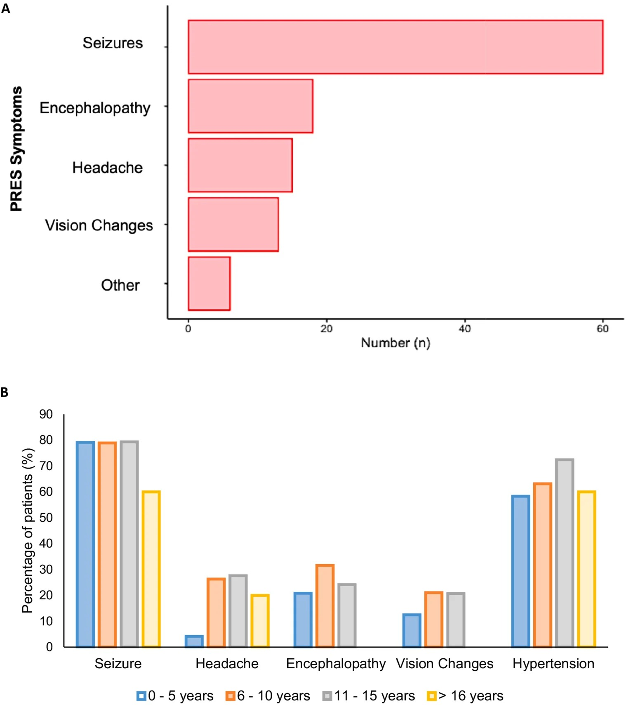
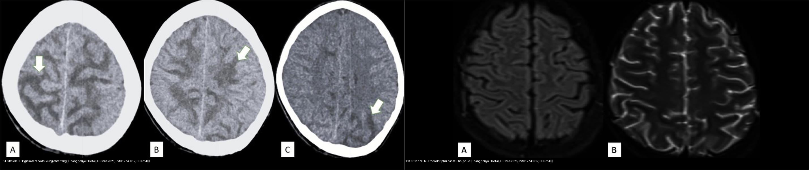
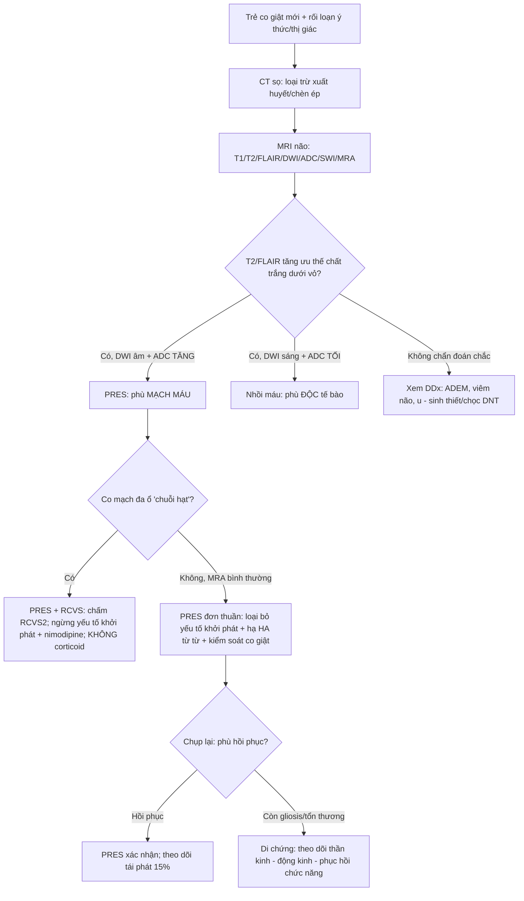
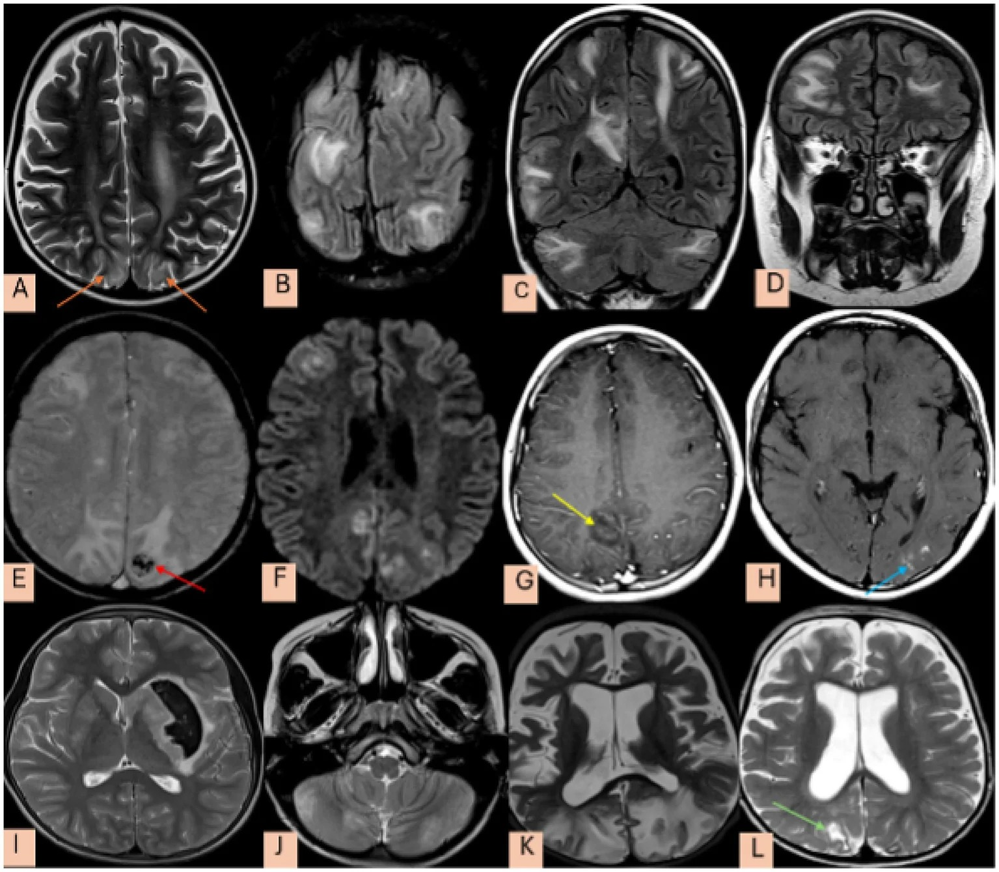
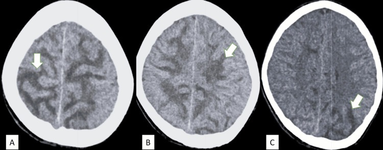
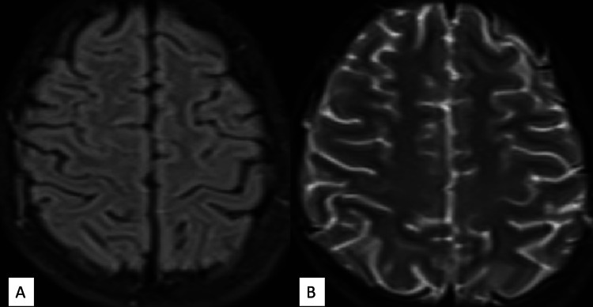
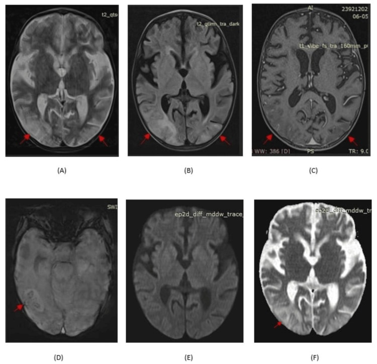
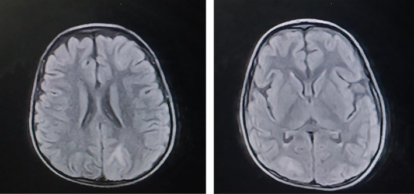
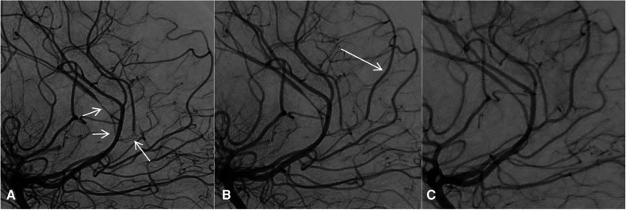
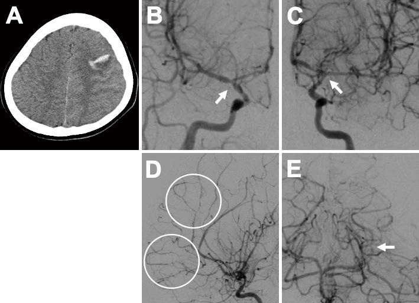

# 653 — PRES & RCVS ở trẻ em: biến thể không điển hình & ngưỡng tự điều hòa thấp / Pediatric PRES & RCVS: atypical variants and low autoregulation threshold

**Tags:** `pattern:phu-nao-sau` `pattern:co-mach-nao` `vung:nao-nhi` `vung:nao` `score:RCVS2` `protocol:MRI-nao-nhi`
**Mức chắc chắn (certainty):** tổng hợp y văn (literature synthesis) — nhóm tự biên từ y văn mở (Front Neurol 2026, Headache 2026, Front Pediatr 2023, Cureus 2025 CC BY/BY-NC-ND); **các ca trong quiz là ca nguyên văn (verbatim case)** chép đúng tuổi – lâm sàng – chú thích gốc.

## 1. Tổng quan — bệnh học & cơ chế hình ảnh (TẠI SAO)

- **PRES ở trẻ em** là **hội chứng lâm sàng–hình ảnh** gồm **co giật, tăng huyết áp, rối loạn thị giác, rối loạn ý thức** kèm **phù não mạch máu (vasogenic edema)** vùng sau (chẩm–đỉnh) trên MRI. **Khác người lớn ở 3 điểm: (1) ngưỡng tự điều hòa THẤP hơn, (2) biến thể KHÔNG điển hình nhiều hơn, (3) nguyên nhân nền thường là bệnh thận/huyết học–ung thư/thuốc ức chế miễn dịch** hơn là tăng huyết áp đơn thuần.
- **Cơ chế (theo Argon):** phối hợp **rối loạn chức năng nội mô, hở hàng rào máu-não (BBB), giảm tự điều hòa mạch não** → nước thoát vào mô kẽ dưới dạng **phù mạch máu**. Ở trẻ, ngưỡng tự điều hòa **thấp hơn (khoảng 40 mmHg) so với người lớn (50–60 mmHg)** → **PRES có thể xảy ra với huyết áp thấp hơn nhiều** ở trẻ → **co giật mới khởi phát, BẤT KỂ có tăng huyết áp hay không, đều phải nghĩ PRES**.
- **TẠI SAO đọc được bản chất mô bằng vật lý:**
  - Phù **mạch máu** = nước **ngoại bào** → **T2W/FLAIR tăng tín hiệu, T1W giảm nhẹ**, **DWI ÂM + ADC TĂNG**; phân bố **chất trắng dưới vỏ/vùng chuyển tiếp**, thường **chừa vỏ**.
  - **Nhồi máu** (phù độc tế bào) → **DWI SÁNG + ADC TỐI** theo lãnh thổ mạch — **dấu hiệu tiên lượng xấu**, gặp ở thiểu số ca PRES trẻ em.
  - **Xuất huyết** (deoxyhemoglobin/hemosiderin) → **mất tín hiệu, "blooming" trên SWI/GRE** (microhemorrhage/convexity SAH) — cũng là dấu hiệu nặng.
  - **Di chứng gliosis/xơ hóa:** "reversible" là tên lịch sử — một số ca để lại **ổ gliosis** tại vùng đã tổn thương.
- **Ngưỡng định lượng nằm lòng (cohort lớn nhất Vương quốc Anh, n=77, GOSH 20 năm — Bednarczuk N et al., Front Neurol 2026, PMC13613123):**
  - **Tần suất PRES trẻ em ~0,04%**; **co giật là triệu chứng hay gặp nhất 77,9% (n=60)**, rối loạn ý thức **23,3% (n=18)**, đau đầu **19,4% (n=15)**, rối loạn thị giác **16,8% (n=13)**.
  - **Tăng huyết áp 64,9% (n=50)** — nghĩa là **~1/3 trẻ PRES KHÔNG tăng huyết áp**.
  - Bệnh nền: **huyết học/ung thư 32,5% (n=25)**, **thận 22,1% (n=17)**, **miễn dịch 11,7% (n=9)**.
  - **Hình ảnh: điển hình chẩm-đỉnh chỉ 24 ca, KHÔNG điển hình tới 40 ca (~62,5%)** — so với người lớn **10–58%**, trẻ có tỷ lệ biến thể cao hơn (tài liệu ghi tới **61–82%**).
  - **Điện não đồ (EEG) bất thường 90,5% (67/74)**; **thuốc kháng động kinh (ASM) 72,7% (n=56)** — **35,7% phải dùng dài hạn (> 6 tháng)**.
  - **DWI hạn chế (DWI+) 13 trẻ**; **5 trẻ có ổ gliosis tồn lưu khi chụp lại — TẤT CẢ 5 đều có hình ảnh KHÔNG điển hình lúc khởi phát**.
  - **Tái phát lâm sàng 15%** — phần lớn tái phát **sau khi đổi thuốc ức chế miễn dịch** (vd **ciclosporin → tacrolimus**) và tái phát **khi đang dùng thuốc mới**.

## 2. Mẫu hình + chẩn đoán phân biệt theo bối cảnh (Gamut)

- **THEO TUỔI & BỆNH NỀN:**
  - **Nhũ nhi/nhỏ tuổi:** **bệnh thận** (viêm cầu thận cấp sau nhiễm liên cầu, hội chứng thận nhiễm mỡ, HUS), **bỏng nặng**, **truyền máu/thiếu máu tán huyết**, rối loạn điện giải.
  - **Trẻ lớn:** **thuốc ức chế miễn dịch (ciclosporin, tacrolimus), hóa trị**, bệnh **ung thư máu/lymphoma**, **lupus**, tăng huyết áp.
  - **Hậu sản ở vị thành niên:** tiền sản giật/eclampsia → PRES · RCVS.
- **THEO HÌNH THÁI TỔN THƯƠNG (gamut hình ảnh):**
  - **Điển hình:** phù **đối xứng vỏ + dưới vỏ chẩm-đỉnh hai bên** (vùng chuyển tiếp MCA–PCA).
  - **Không điển hình (rất hay gặp ở trẻ):** **nhiều thùy/có tiểu não**, **bất đối xứng**, **tổn thương hạch nền/thân não**, **xuất huyết**, **hạn chế khuếch tán ổ rải rác**, **ngấm màng mềm (leptomeningeal enhancement)**.
  - **RCVS:** hẹp **từng đoạn đa ổ "chuỗi hạt"** hồi phục < 3 tháng; **có thể khởi đầu bằng MRA BÌNH THƯỜNG**.
- **Mnemonic nguyên nhân PRES trẻ (tự soạn):** **"RUB-TIC"** — **R**enal (thận) · **U**ng thư/hóa trị · **B**ỏng/truyền máu · **T**ransplant/ức chế miễn dịch (ciclosporin/tacrolimus) · **I**nfection/nhiễm khuẩn huyết · **C**ơn THA cấp.

*Biểu hiện PRES ở trẻ em: **co giật là triệu chứng hay gặp nhất 77,9% (n=60)**, tiếp theo rối loạn ý thức 23,3%, đau đầu 19,4%, rối loạn thị giác 16,8%; **đau đầu ít gặp hơn ở nhóm 0–5 tuổi** (trẻ khó mô tả chủ quan). Nguồn: Bednarczuk N et al., Front Neurol 2026 (PMC13613123), Fig. 3. CC BY 4.0.*

## 3. Bảng so sánh phân biệt (ma trận đối chiếu)

| Thực thể (entity) | Hình ảnh điển hình | Chốt vào (rule-in) | Chốt loại (rule-out) | Gợi ý xác nhận |
|---|---|---|---|---|
| **PRES trẻ em điển hình** | FLAIR/T2 tăng tín hiệu **đối xứng vỏ + dưới vỏ chẩm-đỉnh hai bên**; **DWI âm/ADC tăng** | **Đối xứng + dưới vỏ ưu thế + ADC TĂNG** + bối cảnh bệnh thận/thuốc/THA | DWI sáng + ADC tối theo lãnh thổ mạch → **nhồi máu** | MRI não (T2/FLAIR/DWI/ADC/SWI/MRA); theo dõi hồi phục |
| **PRES trẻ em KHÔNG điển hình** | **Nhiều thùy ± tiểu não, bất đối xứng, hạch nền/thân não**, xuất huyết, **hạn chế khuếch tán ổ** | **Có bối cảnh PRES + phù ưu thế chất trắng dưới vỏ dù phân bố "lạ"** | Tổn thương **một ổ, chèn ép, mở rộng khoang** → u/áp-xe | MRI đa chuỗi + theo dõi; đối chiếu lâm sàng |
| **RCVS trẻ em** | Hẹp **từng đoạn đa ổ "chuỗi hạt"**; **convexity SAH**, nhồi máu/xuất huyết; có thể **MRA bình thường tuần đầu** | **Đau đầu sét đánh tái diễn + yếu tố khởi phát (thuốc cảm cúm/triptan, hậu sản) + co mạch hồi phục < 3 tháng** | Hẹp **một mạch, không hồi phục, ngấm đồng tâm mạnh** → viêm mạch/xơ vữa | MRA/CTA + **lặp 2–3 tuần**; RCVS2/RCVS-TCH; DSA |
| **Nhồi máu não cấp ở trẻ** | **DWI SÁNG + ADC TỐI** theo lãnh thổ động mạch, **bất đối xứng** | **Bất tương hợp DWI–ADC trong một lãnh thổ mạch** | Đối xứng + ADC tăng + chừa vỏ theo lãnh thổ → PRES | DWI/ADC, MRA/CTA cổ–não |
| **Hạ đường huyết sơ sinh / vàng nhân (kernicterus)** | Hạ đường huyết: vùng **chẩm-đỉnh**; vàng nhân: **T1 thể vân sáng + DWI ÂM** (globus pallidus) | **T1 globus pallidus sáng + DWI âm = vàng nhân** (TSB cao) | Ưu thế chẩm-đỉnh dưới vỏ + ADC tăng + bối cảnh bệnh thận/thuốc → PRES | MRI sọ sơ sinh + TSB; xem bài 654 |
| **ADEM / viêm não mất myelin** | Tổn thương **chất trắng nhiều ổ, ranh giới mờ, hai bên (bất đối xứng)**, ± tủy; **DWI có thể hạn chế** | **Sau nhiễm trùng/vaccine + tổn thương chất trắng rải rác + đáp ứng corticoid** | Ưu thế chẩm-đỉnh dưới vỏ + hồi phục nhanh + bối cảnh PRES → PRES | MRI não–tủy + DNT (băng oligoclonal); xem bài 215 |

*Trái: **CT** trẻ — giảm đậm độ **đối xứng** chất trắng hai bên (mũi tên), còn phân biệt trắng–xám. Phải: **MRI theo dõi** — **phù ĐÃ HỒI PHỤC** (disappearance of oedema). Đây là ca **viêm cầu thận cấp sau nhiễm liên cầu** ở trẻ. Ảnh ghép letterbox: Ghanghoriya PK et al., Cureus 2025 (PMC12745017), CC BY 4.0.*

## 4. Protocol chụp + hệ thống điểm & flowchart

- **Chỉ định & protocol (trẻ em — ALARA ưu tiên):**
  - **Co giật mới khởi phát KHÔNG rõ nguyên nhân** (kể cả huyết áp bình thường) → **MRI não là tiêu chuẩn vàng** (nhạy **98%** vs CT **46%**): **T1W, T2W, FLAIR, DWI + ADC, SWI/GRE, TOF-MRA ± CE-FLAIR**.
  - **DWI/ADC là chuỗi quyết định** (phù mạch máu vs nhồi máu); **SWI** tìm xuất huyết/microhemorrhage; **MRA** tìm co mạch (nếu âm tuần đầu → **lặp sau 2–3 tuần**).
  - **Chụp lại** sau điều trị để xác nhận hồi phục; cảnh giác **ổ gliosis tồn lưu** (gặp ở nhóm hình ảnh không điển hình).
- **Điều trị PRES trẻ em:**
  - **Loại bỏ/điều trị yếu tố khởi phát**: kiểm soát huyết áp, **giảm/đổi thuốc ức chế miễn dịch** (không bỏ hoàn toàn tùy bệnh nền), điều trị bệnh thận/nhiễm trùng/rối loạn điện giải.
  - **Kiểm soát co giật** bằng ASM (levetiracetam hay dùng) — nhiều trẻ cần **dài hạn (> 6 tháng)**.
  - **Tăng huyết áp:** hạ từ từ, tránh tụt nhanh gây thiếu máu (nguyên tắc như người lớn).
- **Điểm chuẩn hóa (phân biệt RCVS với bệnh mạch nội sọ khác — chủ yếu xây trên người lớn, dùng thận trọng ở trẻ):**
  - **RCVS2 score** (CTA): thunderclap tái diễn/đơn **+5** · ĐM cảnh trong nội sọ **−2** · yếu tố khởi phát **+3** · nữ **+1** · SAH **+1** — **≥ 5: Se 90%/Sp 99%**.
  - **RCVS-TCH score:** thunderclap tái diễn **+2** · nữ **+3** · THA đột ngột **+4** · yếu tố khởi phát (nhiều **+3**/một **+2**) — **≥ 7: Se 80%/Sp 97%**.
  - **RCVS trẻ em:** co mạch có thể **BÌNH THƯỜNG trên MRA tuần đầu** (ca minh họa triptan: ngày 11 bình thường → ngày 16 SAH lồi + hẹp → ngày 19 nhồi máu) → **lặp chụp mạch là bắt buộc**.

## 5. Biến thể bình thường và cạm bẫy

- **KHÔNG loại trừ PRES vì hình ảnh "không điển hình":** ở trẻ **~62,5% (cohort 77 ca) đến 61–82%** có phân bố không điển hình (nhiều thùy, tiểu não, bất đối xứng, hạch nền/thân não, xuất huyết, hạn chế khuếch tán ổ). **Đây là cạm bẫy hay gặp nhất**.
- **Co giật mới + huyết áp BÌNH THƯỜNG vẫn có thể là PRES:** **~35%** trẻ PRES không tăng huyết áp → đừng đòi hỏi THA để nghĩ PRES.
- **"Reversible" không bảo đảm hồi phục hoàn toàn:** **5 trẻ** trong cohort còn **ổ gliosis** khi chụp lại — **tất cả đều thuộc nhóm hình ảnh không điển hình lúc khởi phát**; cần theo dõi động kinh và phục hồi chức năng.
- **Tái phát 15% — cẩn thận khi đổi thuốc ức chế miễn dịch:** nhiều ca tái phát **khi đang dùng thuốc mới** (ciclosporin → tacrolimus) → theo dõi sát khi đổi phác đồ.
- **RCVS có thể MRA bình thường tuần đầu:** nếu đau đầu sét đánh tái diễn → **lặp mạch 2–3 tuần**, tìm **convexity SAH**, dùng CE-FLAIR hở BBB; **không chốt từ một lần chụp**.
- **Đừng chẩn đoán "viêm mạch/viêm não" vội** khi thấy co mạch kèm phù: RCVS ngấm thành mạch **nhẹ/không** và **hồi phục** — điều trị **ngược** viêm mạch (tránh corticoid).
- **Phân biệt với hạ đường huyết/vàng nhân ở sơ sinh:** nếu **T1 globus pallidus sáng + DWI âm** → nghĩ **vàng nhân (kernicterus)**, không phải PRES (xem bài 654).

## 6. Tự lượng giá — Blind Quiz (ảnh trơn ngoài, đáp án trong)

**Ca 1 — Trẻ PRES, nhìn chuỗi MR điển hình và không điển hình:**

- Gợi ý lâm sàng (clinical context): trẻ co giật, có bệnh nền thận/huyết học hoặc đang dùng thuốc ức chế miễn dịch.
- Câu hỏi: Hàng trên (A–D) khác hàng giữa/dưới (E–L) thế nào? Kể tên các kiểu "không điển hình"?

<b>Bấm để hiện đáp án (findings + chẩn đoán)</b>

- Dấu hiệu (findings): (A, B) **T2W/FLAIR: tổn thương đối xứng vỏ + dưới vỏ chẩm-đỉnh hai bên** = **điển hình**. (C, D) **kiểu thùy "không điển hình": nhiều thùy + có tiểu não**. (E–H) đặc điểm tín hiệu không điển hình: **xuất huyết chẩm trái (E)**, **ổ hạn chế khuếch tán rải rác trong tổn thương (F)**, **xuất huyết nhu mô trong tổn thương (G)**, **ngấm màng mềm (H)**. (I, J) **xuất huyết hạch bao trái** + thay đổi tín hiệu hạch nền/cerebellar hai bên. (K, L) tổn thương đối xứng chẩm-đỉnh để lại **ổ gliosis (mũi tên xanh) khi chụp lại sau 1 năm**.
- Chẩn đoán (diagnosis): **PRES trẻ em** — trong đó **hình ảnh không điển hình rất hay gặp**; xuất huyết/hạn chế khuếch tán gợi **tiên lượng nặng hơn** và **ổ gliosis tồn lưu**. Không loại trừ PRES vì phân bố "lạ".
- Nguồn ảnh: Bednarczuk N et al., Front Neurol 2026 (PMC13613123), Fig. 4. CC BY 4.0.

**Ca 2 — Trẻ viêm cầu thận cấp sau nhiễm liên cầu, co giật; CT rồi chụp lại MRI:**

- Câu hỏi: (a) CT thấy gì? (b) Vì sao cần MRI dù CT đã có bất thường? (c) Điều trị nền là gì?

<b>Bấm để hiện đáp án (findings + chẩn đoán)</b>

- Dấu hiệu (findings): (A, B) **giảm đậm độ ĐỐI XỨNG chất trắng hai bên** mức centrum semiovale, **còn phân biệt trắng–xám** (mũi tên); (C) tổn thương chất trắng **bất đối xứng** vùng sau.
- Chẩn đoán (diagnosis): **PRES** ở trẻ **viêm cầu thận cấp sau nhiễm liên cầu** — cơ chế **tăng huyết áp cấp + hở BBB**. Đối chiếu MRI theo dõi:

- **MRI theo dõi: phù ĐÃ HỒI PHỤC** ("disappearance of oedema"). Xử trí: **kiểm soát huyết áp + điều trị bệnh thận nền + kiểm soát co giật**.
- Nguồn ảnh: Ghanghoriya PK et al., Cureus 2025 (PMC12745017), Fig. 1 & 2. CC BY 4.0.

**Ca 3 — Trẻ bỏng nặng, co giật. Nhìn MRI đa chuỗi:**

- Câu hỏi: Chuỗi nào chốt **phù mạch máu**? Có xuất huyết hay hạn chế khuếch tán không?

<b>Bấm để hiện đáp án (findings + chẩn đoán)</b>

- Dấu hiệu (findings): **T2 (A) và FLAIR (B) tăng tín hiệu chẩm-đỉnh hai bên**; **T1 giảm (C)**; **SWI (D) có vi xuất huyết**; **DWI (E) KHÔNG hạn chế khuếch tán**, **ADC (F) tăng (facilitated diffusion)** = **phù mạch máu** điển hình của PRES.
- Chẩn đoán (diagnosis): **PRES trẻ em sau bỏng** — bối cảnh đau/bỏng → tăng huyết áp & rối loạn nội mô. **SWI có microhemorrhage** nhưng **DWI/ADC vẫn xác nhận phù mạch máu** (khác nhồi máu: DWI sáng + ADC tối). Điều trị theo nguyên nhân + hạ HA + kiểm soát co giật.
- Nguồn ảnh: Shouri S et al., Cureus 2025 (PMC12451477), Fig. 1. CC BY 4.0.

**Ca 4 — Trẻ lymphoma Hodgkin nhập viện vì hội chứng thận nhiễm mỡ, biến chứng PRES. Nhìn FLAIR:**

- Câu hỏi: Mô tả tổn thương? Vì sao trẻ ung thư máu/lymphoma dễ PRES?

<b>Bấm để hiện đáp án (findings + chẩn đoán)</b>

- Dấu hiệu (findings): **FLAIR: tăng tín hiệu vùng chẩm-đỉnh hai bên**, phù hợp **PRES**.
- Chẩn đoán (diagnosis): **PRES** ở trẻ **lymphoma Hodgkin + hội chứng thận nhiễm mỡ** (phù, tăng huyết áp, thuốc/hóa trị). Nhóm **huyết học–ung thư chiếm tới 32,5% bệnh nền PRES trẻ em** — cần nghĩ PRES khi trẻ ung thư có co giật/rối loạn thị giác.
- Nguồn ảnh: Al-Shohef B et al., Clin Case Rep 2026 (PMC13322745), Fig. 2. CC BY-NC 4.0.

**Ca 5 — Bé gái 12 tuổi, đau đầu sét đánh, hẹp mạch nặng; DSA trước và sau thuốc giãn mạch nội động mạch:**

- Câu hỏi: (A) và (B) khác nhau thế nào? Chẩn đoán? Vì sao KHÔNG dùng corticoid?

<b>Bấm để hiện đáp án (findings + chẩn đoán)</b>

- Dấu hiệu (findings): (A) DSA ngày 12: **hẹp lan tỏa và nặng nhiều động mạch não** (mũi tên); (B) **sau truyền thuốc giãn mạch nội động mạch lần 1: các đoạn hẹp CẢI THIỆN rõ**.
- Chẩn đoán (diagnosis): **RCVS ở trẻ em** — co mạch **hồi phục**, đáp ứng giãn mạch. Xử trí: **ngừng yếu tố khởi phát + nimodipine**; **TRÁNH corticoid** (có thể làm nặng/thiếu máu). **Đây là bệnh cảnh hiếm ở trẻ và khác hoàn toàn viêm mạch (PACNS)** — điều trị ngược nhau.
- Nguồn ảnh: Rizzati F et al., Front Pediatr 2023 (PMC10020348), Fig. 2. CC BY 4.0.

**Ca 6 — Vị thành niên dùng triptan, đau đầu sét đánh; CT/DSA ngày 16. Nhìn ảnh:**

- Câu hỏi: CT (A) và chụp mạch (B, C) cho thấy gì? Đây là "chuỗi hạt" — cẩn thận điều gì?

<b>Bấm để hiện đáp án (findings + chẩn đoán)</b>

- Dấu hiệu (findings): (A) CT: **SAH LỒI (convexity) vùng trán trái**; (B, C) chụp mạch: **hẹp đoạn tận động mạch cảnh hai bên** = co mạch (RCVS).
- Chẩn đoán (diagnosis): **RCVS ở trẻ vị thành niên do TRIPTAN** (yếu tố khởi phát). Lưu ý: **MRA ngày 11 BÌNH THƯỜNG**, tới **ngày 16 mới thấy SAH + hẹp**, **ngày 19 có nhồi máu** (các chuỗi sau) — **bài học: co mạch có thể xuất hiện MUỘN, một lần chụp bình thường KHÔNG loại trừ RCVS** → lặp chụp mạch; theo dõi nhồi máu/xuất huyết.
- Nguồn ảnh: Okazaki Y et al., 2025 (PMC12391675), Fig. 2. CC BY-NC-ND 4.0 — ảnh giữ nguyên bản.

**Ca 7 — Nhìn ảnh ghép, chốt chuỗi nào quyết định phù mạch máu:**

- Câu hỏi: Dấu hiệu trên CT (trái) và MRI theo dõi (phải)? Chuỗi nào xác nhận **phù mạch máu** (không phải nhồi máu)?

<b>Bấm để hiện đáp án (findings + chẩn đoán)</b>

- Dấu hiệu (findings): **CT: giảm đậm độ đối xứng chất trắng hai bên** (mũi tên), còn phân biệt trắng–xám; **MRI theo dõi: phù hồi phục hoàn toàn**.
- Chẩn đoán (diagnosis): **PRES trẻ em**. **DWI ÂM + ADC TĂNG** trên MRI là chuỗi **xác nhận phù mạch máu** (nếu DWI sáng + ADC tối thì là **nhồi máu**). CT chỉ nhạy ~46%, MRI ~98% → **CT âm không loại trừ PRES**.
- Nguồn ảnh: ghép từ Ghanghoriya PK et al., Cureus 2025 (PMC12745017), Fig. 1 & 2. CC BY 4.0.

## Bài liên quan chéo
- [600 – Tổng quan Nhi khoa](../600-tong-quan-nhi-khoa/lesson.md)
- [219 – PRES & RCVS (người lớn): phù não sau & co mạch não có hồi phục](../219-pres-rcvs/lesson.md) (nền tảng Bartynski, RCVS2/RCVS-TCH)
- [654 – Tổn thương não sơ sinh KHÔNG do ngạt: hạ đường huyết & vàng nhân](../654-ton-thuong-nao-so-sinh-khong-do-ngat/lesson.md)
- [655 – HIE sơ sinh & dị dạng bẩm sinh thần kinh](../655-hie-so-sinh-va-di-dang-bam-sinh-than-kinh/lesson.md)
- [652 – Đột quỵ & bệnh mạch máu não trẻ em: moyamoya, viêm mạch, ASL](../652-dot-quy-mach-mau-nao-nhi-moyamoya-viem-mach/lesson.md)
- [650 – Thần kinh nhi: xuất huyết mầm & u hố sau](../650-than-kinh-nhi-xuat-huyet-mam-va-u-ho-sau/lesson.md)
- [224 – Chấn thương sọ não ở trẻ (TBI nhi)](../224-chan-thuong-so-nao-nhi/lesson.md)
- [657 – Dị tật hố sau: Joubert & rhombencephalosynapsis](../657-di-dang-ho-sau-joubert-rhombencephalo/lesson.md)

## Ảnh
- `images/653_pres_MRI_PMC13613123-Fig4-CCBY.jpg` — MRI trẻ: PRES điển hình + không điển hình (CC BY 4.0).
- `images/653_pres_bieu-hien_PMC13613123-Fig3-CCBY.jpg` — biểu hiện lâm sàng PRES trẻ theo tuổi (CC BY 4.0).
- `images/653_pres_CT_PMC12745017-Fig1-CCBY.jpg` — CT trẻ viêm cầu thận cấp sau liên cầu (CC BY 4.0).
- `images/653_pres_MRI_PMC12745017-Fig2-CCBY.jpg` — MRI theo dõi: phù hồi phục (CC BY 4.0).
- `images/653_pres_MRI_PMC12451477-Fig1-CCBY.jpg` — MRI đa chuỗi PRES ở trẻ bỏng (CC BY 4.0).
- `images/653_pres_MRI_PMC13322745-Fig2-CCBYNC.jpg` — FLAIR trẻ Hodgkin (CC BY-NC 4.0).
- `images/653_rcvs_DSA_PMC10020348-Fig2-CCBY.jpg` — DSA trước/sau giãn mạch, RCVS trẻ 12 tuổi (CC BY 4.0).
- `images/653_rcvs_CT-DSA_PMC12391675-Fig2-CCBYNCND.jpg` — CT convexity SAH + hẹp mạch, RCVS do triptan (CC BY-NC-ND 4.0, giữ nguyên bản).
- `images/composite_653_pres-tre-em_CT-vs-MRI.jpg` — ảnh ghép đối chiếu (CC BY 4.0).
- Nguồn + giấy phép đầy đủ: `images/CREDITS.md`; link gốc: `sources.md`.

> Không dùng để chẩn đoán độc lập khi chưa có người hướng dẫn.
