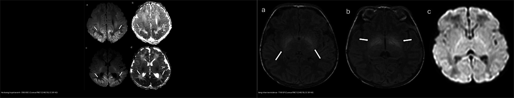
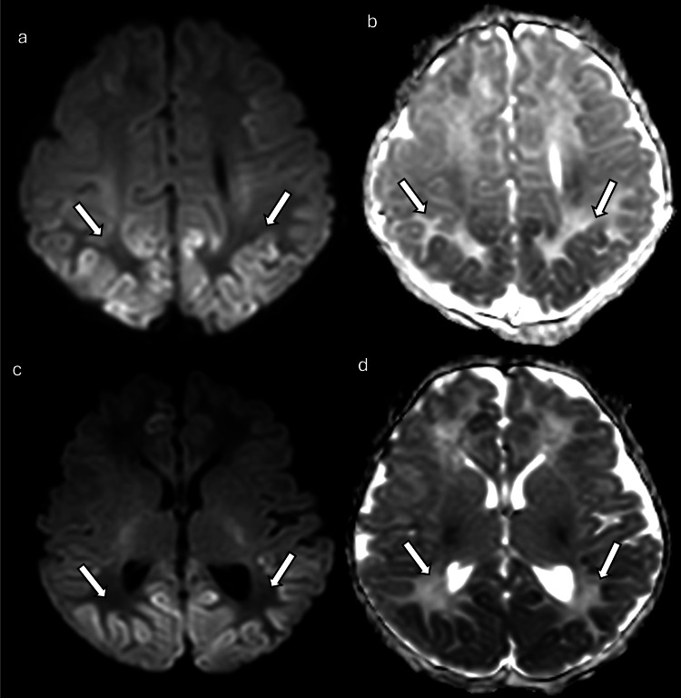
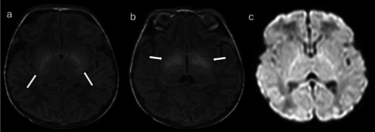
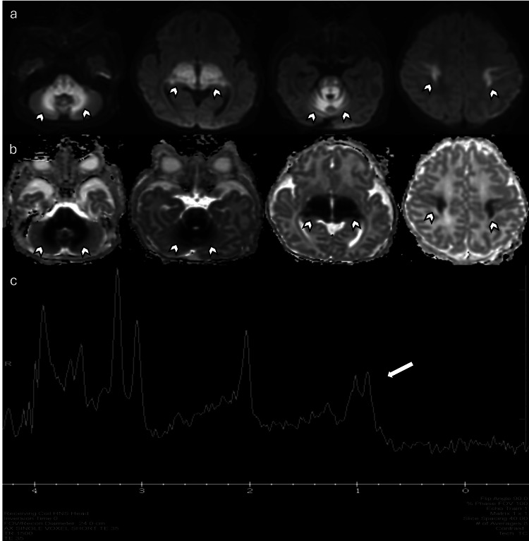
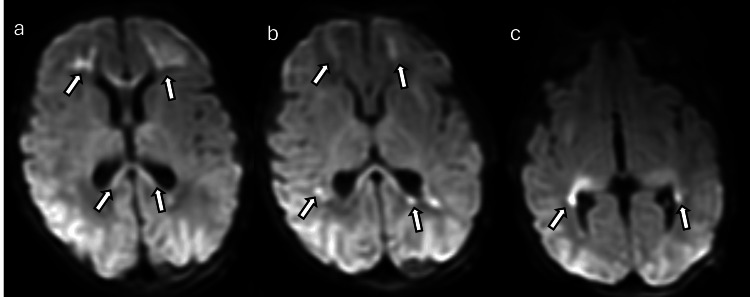
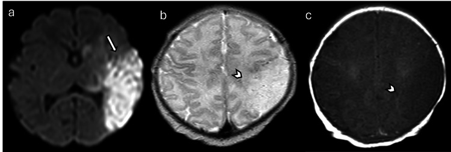

# 654 — Tổn thương não sơ sinh KHÔNG do ngạt: hạ đường huyết, vàng nhân (kernicterus) & các bệnh não giả HIE

**Tags:** `pattern:benh-nao-so-sinh` `pattern:han-che-khuech-tan` `vung:nao-nhi` `score:BIND` `protocol:MRI-nao-so-sinh`
**Mức chắc chắn (certainty):** tổng hợp y văn (literature synthesis) — nhóm tự biên từ bài tổng quan hình ảnh có số (pictorial review CC BY) + y văn về ngưỡng đường huyết/bilirubin; **các ca trong quiz là ca nguyên văn (verbatim case)** chép đúng tuổi – bối cảnh – chú thích gốc.

## 1. Tổng quan bệnh học – cơ chế hình ảnh

**Bệnh não sơ sinh (neonatal encephalopathy, NE)** là hội chứng lâm sàng ở trẻ **≥ 35 tuần** (rối loạn tri giác, co giật, giảm trương lực, khó bú, suy hô hấp). Ngạt (HIE) chỉ chiếm một phần; **các nguyên nhân *không* do ngạt** (nhiễm trùng, chuyển hóa, hạ đường huyết, vàng nhân, đột quỵ, dị tật) chiếm phần còn lại và **hình ảnh có thể giống HIE đến mức gây điều trị sai** (hạ nhiệt trị liệu vô ích, kháng sinh muộn, bỏ sót hạ đường huyết/vàng nhân).

- **Vàng nhân / bệnh não do bilirubin (kernicterus – acute bilirubin encephalopathy, ABE).** Bilirubin **gián tiếp, thân dầu (lipophilic)** khi vượt khả năng gắn albumin sẽ **qua được hàng rào máu–não** và lắng đọng chọn lọc ở **thể vân (globus pallidus), nhân dưới đồi (subthalamic nuclei), hải mã, nhân vận nhãn, nhân ốc tai bụng, tế bào Purkinje/nhân răng**. Vì trẻ sơ sinh còn **ít myelin**, bilirubin gắn vào màng tế bào non → **rút ngắn T1 (T1 hyperintensity)** ở thể vân. **TẠI SAO DWI ÂM trong ABE** (khác HIE): tổn thương **không phải phù độc tế bào cấp** mà là nhiễm độc màng/thần kinh trục → **không hạn chế khuếch tán** trong giai đoạn cấp. Khi thành **kernicterus mạn** (sau nhiều tháng), tổn thương chuyển thành **T2 tăng tín hiệu ở cùng vị trí** (gliosis/hoại tử).
  - Ngưỡng định lượng: bilirubin toàn phần (TSB) **≥ 20 mg/dL** sau 72 giờ là ngưỡng chiếu đèn thường dùng; **TSB ≥ 25 mg/dL** có **độ đặc hiệu 92%** nhưng **độ nhạy chỉ 67%** cho kernicterus spectrum disorder (KSD); nguy cơ ABE tăng rõ khi **TSB > 30 mg/dL**. Thang lâm sàng **BIND-M ≥ 3** có **độ nhạy 100% / độ đặc hiệu 83%** cho KSD tương lai. MRI **T1 thể vân tăng tín hiệu** gặp ở **8/13** trẻ ABE (Coskun 2005), xuất hiện **5–25 ngày** sau sinh — nhưng **cả trẻ lành cũng có thể T1 thể vân sáng** (xem cạm bẫy).
- **Hạ đường huyết sơ sinh (neonatal hypoglycemia).** Não sơ sinh phụ thuộc glucose; hạ đường huyết kéo dài → suy năng lượng ở vùng **nhu cầu chuyển hóa cao / ngã ba tưới máu sau** → **phù độc tế bào** → **ADC giảm, DWI tăng**. Vùng điển hình: **vỏ/dưới vỏ chẩm–đỉnh–thái dương sau (posterior predominant)**, đồi thị, hải mã, đôi khi tiểu não/thân não (ca trong bài còn có **nhộng tiểu não + trung não lưng-bên + đồi thị hai bên**). **Khác HIE**: hạ đường huyết **né đồi thị bó vỏ-tủy – bao trong (PLIC)** và **không thiên về vùng phân thủy**; tổn thương chẩm có thể **hồi phục nếu bù glucose sớm**.
  - Ngưỡng định lượng (không có một ngưỡng tuyệt đối): **< 47 mg/dL (2,6 mmol/L)** là ngưỡng được dùng phổ biến; **AAP** can thiệp khi **< 40 mg/dL ở 4 giờ đầu** (có triệu chứng) và **< 45 mg/dL lúc 4–24 giờ**, mục tiêu **≥ 45 mg/dL trước bú**; **PES** mục tiêu **> 50 mg/dL (48 giờ đầu) → > 60 mg/dL** sau đó. *Lưu ý: các phiên bản guideline (AAP 2011/2021, PES 2015) khác nhau — ghi rõ nguồn khi trích.*
- **Bệnh chuyển hóa (metabolic).** Ví dụ **bệnh nước tiểu mùi si-rô phong (maple syrup urine disease, MSUD)**: ứ **axit amin chuỗi nhánh** → phù độc tế cơ ở **tủy, thân não, tiểu não, đồi thị, bó vỏ-tủy** (DWI hạn chế khuếch tán); **MRS có đỉnh bất thường 0,9 ppm** (axit amin chuỗi nhánh). **Tăng đường huyết không ceton (nonketotic hyperglycemia)**: **MRS đỉnh glycine 3,56 ppm** (TE 144 ms) + DWI hạn chế ở bó vỏ-tủy/thân não lưng/cuống tiểu não.
- **Nhiễm trùng thần kinh trung ương.** **Viêm màng não–não do parechovirus** ở trẻ nhỏ: DWI **nhiều ổ chất trắng dưới vỏ ưu thế thùy trán + bó thể chai + đồi thị**; **viêm màng não do GBS** (trẻ 11 ngày): ổ hạn chế khuếch tán rải rác + **ngấm màng não dọc thùy thái dương dưới/nắp chẩm**, có thể tụ mủ dưới màng cứng.
- **Đột quỵ nhũ nhi (perinatal arterial ischemic stroke).** Hạn chế khuếch tán **một bên theo lãnh thổ động mạch (thường ĐM não giữa)**, có thể kèm co giật khu trú; trên T2/T1 thấy phù/mất tín hiệu T1 bình thường khi sang giai đoạn bán cấp.

## 2. Mẫu hình + chẩn đoán phân biệt theo vị trí (gamut)

**Gamut theo vùng tổn thương trên MRI (đọc DWI/ADC trước, T1/T2 sau):**

- **Vỏ–dưới vỏ vùng chẩm–đỉnh–thái dương sau, đối xứng, né nhân xám sâu:** **hạ đường huyết** (thêm đồi thị/hải mã/nhộng tiểu não), PRES (nối [219]).
- **Thể vân + nhân dưới đồi, T1 SÁNG, DWI ÂM:** **vàng nhân/ABE** — dấu hiệu gần như đặc trưng khi có tăng bilirubin gián tiếp nặng.
- **Đồi thị + PLIC + vỏ quanh rãnh trung tâm, ĐỐI XỨNG, DWI sáng:** **HIE thể nhân xám trung tâm** (đối chiếu, nối [655]).
- **Vỏ/dưới vỏ nhiều ổ rải rác + chất trắng thùy trán + bó thể chai:** **nhiễm trùng** (parechovirus, GBS) hoặc bệnh chuyển hóa.
- **Một bên theo lãnh thổ ĐM não giữa:** **đột quỵ nhũ nhi**.
- **Dị tật vỏ (polymicrogyria) + DWI bình thường:** bệnh lý **rối loạn phát triển vỏ** (di truyền), không phải tổn thương cấp.

## 3. Bảng so sánh phân biệt (ma trận đối chiếu)

| Thực thể (entity) | Hình ảnh điển hình | Chốt vào (rule-in) | Chốt loại (rule-out) | Gợi ý xác nhận |
|---|---|---|---|---|
| Hạ đường huyết (hypoglycemic encephalopathy) | DWI sáng **vỏ–dưới vỏ vùng chẩm/đỉnh–thái dương sau**, đồi thị, hải mã, có khi nhộng tiểu não/trung não lưng-bên | **Vùng sau (posterior) chiếm ưu thế + đường huyết thấp + né PLIC** | Đồi thị + PLIC sáng đối xứng, thiên phân thủy → HIE | Đo glucose huyết tương; ca 1 ngày tuổi có co giật/lơ mơ; bù glucose, MRI lại |
| Vàng nhân / ABE (kernicterus) | **T1 tăng tín hiệu đối xứng thể vân + nhân dưới đồi**, **DWI KHÔNG hạn chế** | **T1 thể vân sáng + bilirubin gián tiếp nặng (TSB cao)** | DWI sáng thể vân → nghĩ HIE/thể nhân xám, không phải ABE | TSB/BIND-M, ABR, theo dõi T2 (kernicterus mạn → T2 thể vân sáng) |
| HIE (đối chiếu) | BGT: DWI sáng đồi thị + PLIC; watershed: vỏ đỉnh-chẩm né đồi thị | **Đối xứng + bối cảnh ngạt (sentinel event)** | Vùng chẩm đơn thuần + né PLIC → nghĩ hạ đường huyết | Sarnat I–III; ADC < 0,8 × 10⁻³ mm²/s (bài [655]) |
| Bệnh chuyển hóa (MSUD, nonketotic hyperglycemia) | DWI hạn chế **tủy/thân não/cuống tiểu não/đồi thị/bó vỏ-tủy**; MRS bất thường | **MRS bất thường đặc trưng (0,9 ppm MSUD; glycine 3,56 ppm)** | MRS bình thường + tổn thương đối xứng nhân xám → HIE | Ammonia, lactate, axit amin/axit hữu cơ niệu, MRS |
| Nhiễm trùng TKTW (parechovirus, GBS) | DWI **nhiều ổ chất trắng dưới vỏ ưu thế trán + bó thể chai ± đồi thị**; ngấm màng não | **Ổ rải rác nhiều ổ + bối cảnh nhiễm trùng (sốt/sepsis)** | Một vùng theo lãnh thổ mạch đơn thuần → đột quỵ | Dịch não tủy, PCR virus, cấy; ngấm màng não sau tiêm |
| Đột quỵ nhũ nhi (perinatal stroke) | **Một bên theo lãnh thổ ĐM não giữa**, T2 phù/T1 mất tín hiệu | **Một bên + thuận lãnh thổ mạch + co giật khu trú** | Hai bên đối xứng → nghĩ hạ đường huyết/HIE | MRA/MRV, siêu âm Doppler, đối chiếu phim cũ |

*Trái (a–d): DWI/ADC — **hạ đường huyết sơ sinh**: hạn chế khuếch tán vùng chẩm–thái dương sau, đồi thị, hải mã, nhộng tiểu não. Phải (a–c): T1W/DWI — **vàng nhân**: T1 tăng tín hiệu thể vân + nhân dưới đồi, **DWI không hạn chế**. Nguồn: Cureus PMC12240218, CC BY 4.0. Ảnh ghép letterbox, giữ tỉ lệ.*

## 4. Protocol chụp + hệ phân độ/điểm chuẩn hóa

- **MRI sọ không cản quang** là chìa khóa phân biệt. Chuỗi tối thiểu: **T1W, T2W, DWI + ADC, T2*/SWI**; thêm **MRS** (đỉnh chuỗi nhánh/glycine/lactate) khi nghi chuyển hóa; **MRA/MRV** khi nghi đột quỵ/huyết khối xoang.
- **Thời điểm:** DWI chốt tổn thương **ngày 2–4** (ADC đáy); T1 thể vân trong vàng nhân rõ ở **5–25 ngày**; nhớ **giả bình thường hóa DWI khoảng ngày 7–10**. Chụp lại khi lâm sàng tiến triển.
- **Xét nghiệm song song (bắt buộc trước khi quy kết "HIE"):** glucose huyết tương, **bilirubin toàn phần (TSB)**, khí máu/lactate, ammonia, điện giải, **axit amin + axit hữu cơ niệu**, cấy máu/dịch não tủy + PCR virus, và **ABR** khi nghi vàng nhân.
- **Ngưỡng xử trí:**
  - Hạ đường huyết: can thiệp theo ngưỡng mục tiêu (AAP: **< 40 mg/dL 4 giờ đầu / < 45 mg/dL 4–24 giờ; mục tiêu ≥ 45 mg/dL**; PES: **> 50 → > 60 mg/dL**).
  - Vàng nhân: **chiếu đèn khi TSB ≥ 20 mg/dL sau 72 giờ**; **thay máu** theo ngưỡng phụ thuộc tuổi thai/cân nặng/yếu tố nguy cơ + albumin; cân nhắc **truyền IVIG** trong bệnh tan máu.
- **Thang điểm:** **BIND/BIND-M** (đánh giá độc thần kinh do bilirubin lúc giường — ≥ 3 điểm có giá trị tiên lượng KSD); **Sarnat** cho HIE (đối chiếu [655]).

```mermaid
flowchart TD
  A["Tre so sinh benh nao (co giat / lo mo / giam truong luc)"] --> B{"Bang chung ngat ro (sentinel event) + Sarnat II-III?"}
  B -->|Co| C["Nghi HIE: ha nhiet tri lieu neu du tieu chuan (< 6 gio, >= 36 tuan)"]
  B -->|Khong ro| D["Do glucose + bilirubin (TSB) + ammonia/lactate + MRS/DWI"]
  D --> E{"Kieu ton thuong MRI + xet nghiem?"}
  E -->|"Vo-doi vo vung sau, ne PLIC, glucose thap"| F["Ha duong huyet: bu glucose, MRI lai"]
  E -->|"T1 the van sang, DWI am, TSB cao"| G["Vang nhan ABE: chieu den / thay mau, ABR"]
  E -->|"DWI nhieu o chat trang + bo the chai"| H["Nhien trung TKTW: khang sinh + PCR virus"]
  E -->|"Mot ben theo lanh tho DM nao giua"| I["Dot quy nhu nhi: MRA/MRV, theo doi"]
  E -->|"MRS bat thuong 0,9 / 3,56 ppm"| J["Benh chuyen hoa: che do an dac biet"]
  E -->|"Doi xung doi thi + PLIC &#40;BGT&#41;"| C
```

## 5. Biến thể bình thường và cạm bẫy

- **T1 thể vân sáng ở trẻ sơ sinh KHÔNG đồng nghĩa vàng nhân.** Myelin hóa bình thường và cả trẻ lành cũng có thể có T1 sáng nhẹ ở thể vân → **đừng chẩn đoán ABE chỉ dựa vào một ảnh T1**; phải khớp **TSB cao + bối cảnh lâm sàng** (cảnh báo sai dương đã được nêu trong y văn). Đọc T1 **so với PLIC/thân não** — myelin hóa bình thường cho tương phản rõ, không "sáng bệnh lý lan tỏa".
- **Không hạn chế khuếch tán KHÔNG loại trừ vàng nhân.** ABE cấp thường **DWI âm**; nếu chỉ dựa DWI sẽ bỏ sót. Ngược lại, **DWI sáng nhân xám sâu đối xứng** phải nghĩ **HIE**, không phải ABE.
- **Hạ đường huyết giả HIE thể watershed**: vùng chẩm–đỉnh cũng có thể sáng trong HIE thể phân thủy → phân biệt bằng **đường huyết**, **đồi thị/hải mã**, và **né PLIC**.
- **Bỏ sót nguyên nhân "phối hợp":** trẻ ngạt HOÀN TOÀN có thể kèm **hạ đường huyết, vàng nhân, nhiễm trùng** — "thấy HIE rồi dừng" (satisfaction of search) là bẫy thường gặp; làm đủ xét nghiệm chuyển hóa/nhiễm trùng.
- **Giả ảnh DWI:** hố sau/đáy sọ méo hình do tiếp giáp xương, dễ nhầm "tổn thương" — đối chiếu **ADC + T2**.
- **MRS đọc theo TE:** đỉnh glycine chỉ rõ ở **TE 144 ms**; đỉnh chuỗi nhánh ở **0,9 ppm** — ghi rõ TE khi trích.

## 6. Tự lượng giá — Blind Quiz (ảnh trơn ngoài, đáp án ẩn trong khối chi tiết)

**Ca 1 — Trẻ 1 ngày tuổi, co giật, lơ mơ, bú kém, đường huyết thấp. DWI + ADC. Mô tả trước khi mở đáp án.**

- Gợi ý lâm sàng: nhập viện ngày đầu, co giật, đường huyết hạ.
- Câu hỏi: Vùng nào hạn chế khuếch tán? Có né nhân xám sâu/PLIC không? 3 chẩn đoán phân biệt và dấu hiệu chốt?

<b>Bấm để hiện đáp án (findings + chẩn đoán)</b>

- **Dấu hiệu:** DWI/ADC (a–d) hạn chế khuếch tán **đối xứng vùng chẩm hai bên, thái dương sau, đồi thị, hải mã, nhộng tiểu não, trung não lưng-bên, hồi đai** — bố cục **ưu thế vùng sau**.
- **Chẩn đoán:** **bệnh não do hạ đường huyết (hypoglycemic encephalopathy)** — vì não sơ sinh phụ thuộc glucose, vùng sau có nhu cầu chuyển hóa cao → phù độc tế bào → ADC giảm. Dấu hiệu chốt: **đường huyết thấp + ưu thế vùng sau, né PLIC** (khác HIE nhân xám trung tâm).
- Nguồn ảnh: Silva G et al., Cureus 2025 (PMC12240218), Fig 14, CC BY 4.0.

**Ca 2 — Trẻ 7 ngày tuổi, vàng da tăng bilirubin gián tiếp nặng. MRI T1W và DWI. Đây có phải ngạt không?**

- Gợi ý lâm sàng: vàng da tiến triển, không có biến cố ngạt rõ.
- Câu hỏi: Chuỗi nào bắt tổn thương? Vị trí? Vì sao DWI không sáng? Chẩn đoán?

<b>Bấm để hiện đáp án (findings + chẩn đoán)</b>

- **Dấu hiệu:** (a,b) **T1W tăng tín hiệu nhẹ đối xứng ở thể vân (globus pallidus) + nhân dưới đồi**; (c) **DWI KHÔNG hạn chế khuếch tán**.
- **Chẩn đoán:** **vàng nhân (kernicterus)/ABE**. Bilirubin tự do thân dầu lắng đọng chọn lọc thể vân/nhân dưới đồi, gắn màng tế bào non → **rút ngắn T1**; **không phải phù độc tế bào → DWI âm** (điểm khác HIE). Khi mạn → **T2 thể vân sáng**.
- Phản biện/ngưỡng: **T1 thể vân sáng cũng gặp ở trẻ lành** → chỉ chốt khi khớp **TSB cao**; BIND-M ≥ 3 và TSB ≥ 25 mg/dL gợi ý nguy cơ KSD.
- Nguồn ảnh: Silva G et al., Cureus 2025 (PMC12240218), Fig 13, CC BY 4.0.

**Ca 3 — Trẻ 7 ngày tuổi, bú kém, lơ mơ tăng dần. DWI/ADC + MRS.**

- Gợi ý lâm sàng: không sốt rõ, không biến cố ngạt; bệnh cảnh nặng dần sau bú.
- Câu hỏi: Vùng hạn chế khuếch tán? MRS gợi ý gì? Chẩn đoán nhóm nào?

<b>Bấm để hiện đáp án (findings + chẩn đoán)</b>

- **Dấu hiệu:** DWI/ADC hạn chế khuếch tán **tủy sống, thân não, chất trắng tiểu não, đồi thị, bó vỏ-tủy**; **MRS (TE 35 ms) có đỉnh bất thường 0,9 ppm** (axit amin chuỗi nhánh).
- **Chẩn đoán:** **bệnh chuyển hóa — MSUD (maple syrup urine disease)**. Ứ axit amin chuỗi nhánh → phù độc tế bào; MRS đỉnh 0,9 ppm là chìa khóa. Xử trí: chế độ ăn hạn chế chuỗi nhánh (khác hoàn toàn hạ nhiệt trị liệu của HIE).
- Nguồn ảnh: Silva G et al., Cureus 2025 (PMC12240218), Fig 9, CC BY 4.0.

**Ca 4 — Trẻ 12 ngày tuổi, sốt/sepsis + co giật. DWI.**

<b>Bấm để hiện đáp án (findings + chẩn đoán)</b>

- **Dấu hiệu:** DWI **nhiều ổ hạn chế khuếch tán ưu thế chất trắng dưới vỏ thùy trán + bó thể chai + đồi thị**.
- **Chẩn đoán:** **viêm màng não–não do parechovirus** (nhóm nhiễm trùng TKTW). Bố cục **nhiều ổ + bối cảnh nhiễm trùng** phân biệt với HIE đối xứng một vùng. Xử trí: kháng sinh + PCR virus; ngấm màng não sau tiêm (nếu chụp) là dấu hiệu kèm.
- Nguồn ảnh: Silva G et al., Cureus 2025 (PMC12240218), Fig 8, CC BY 4.0.

**Ca 5 — Trẻ 2 ngày tuổi, co giật. DWI thấy bất thường MỘT BÊN. Chẩn đoán?**

<b>Bấm để hiện đáp án (findings + chẩn đoán)</b>

- **Dấu hiệu:** DWI hạn chế khuếch tán **một bên theo lãnh thổ động mạch não giữa trái** (thùy thái dương trái + vùng phân thủy đỉnh trái + mặt sau thùy trán trái).
- **Chẩn đoán:** **đột quỵ nhũ nhi (perinatal arterial ischemic stroke)** — tổn thương **một bên, thuận lãnh thổ mạch** (khác hạ đường huyết/HIE đối xứng). Cần MRA/MRV loại trừ bệnh mạch; theo dõi động kinh và di chứng vận động.
- Nguồn ảnh: Silva G et al., Cureus 2025 (PMC12240218), Fig 11, CC BY 4.0.

## Bài liên quan chéo
- [600 – Tổng quan Hệ Nhi khoa](../600-tong-quan-nhi-khoa/lesson.md)
- [655 – HIE sơ sinh & dị tật bẩm sinh hệ thần kinh](../655-hie-so-sinh-va-di-dang-bam-sinh-than-kinh/lesson.md) (đối chiếu HIE — bắt buộc đọc trước)
- [650 – Thần kinh nhi: xuất huyết vùng mầm & u hố sau](../650-than-kinh-nhi-xuat-huyet-mam-va-u-ho-sau/lesson.md)
- [610 – Suy hô hấp sơ sinh & dị dạng phổi bẩm sinh](../610-suy-ho-hap-so-sinh-va-di-dang-phoi/lesson.md)
- [210 – Giải phẫu sọ não cắt lớp](../210-giai-phau-so-nao/lesson.md)
- [201 – Protocol sọ não](../201-protocol-so-nao/lesson.md)

## Ảnh
- Tên file: `NNN_slug_Modality_SourceID.jpg`. Chi tiết nguồn + giấy phép từng ảnh: `images/CREDITS.md` và `sources.md`.
- Toàn bộ ảnh nguồn **CC BY 4.0** (ghi nguồn đầy đủ); ảnh ghép đối chiếu tạo bằng `tools/make_composite.py` (letterbox, không crop/kéo giãn).

> Không dùng để chẩn đoán độc lập khi chưa có người hướng dẫn.
