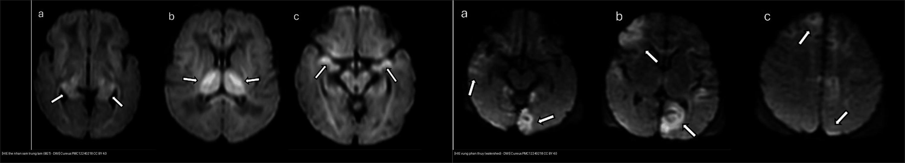
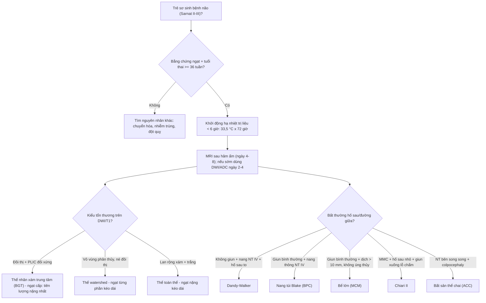
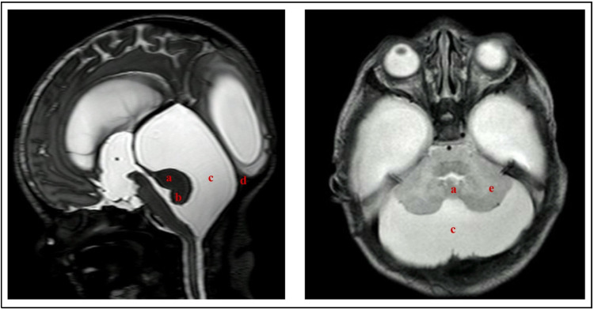
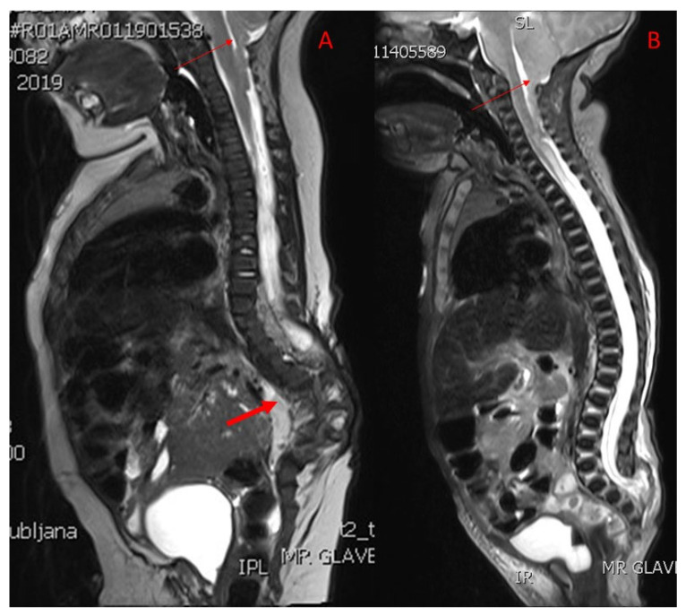
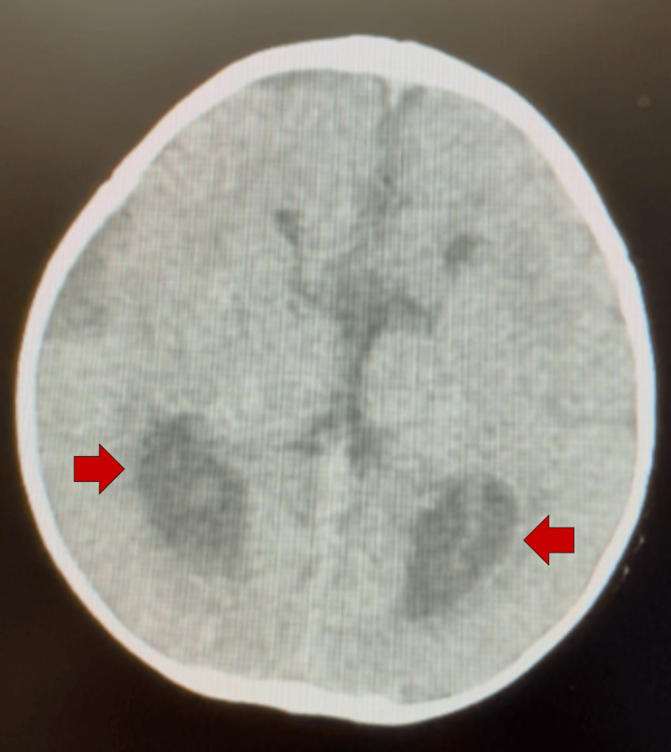
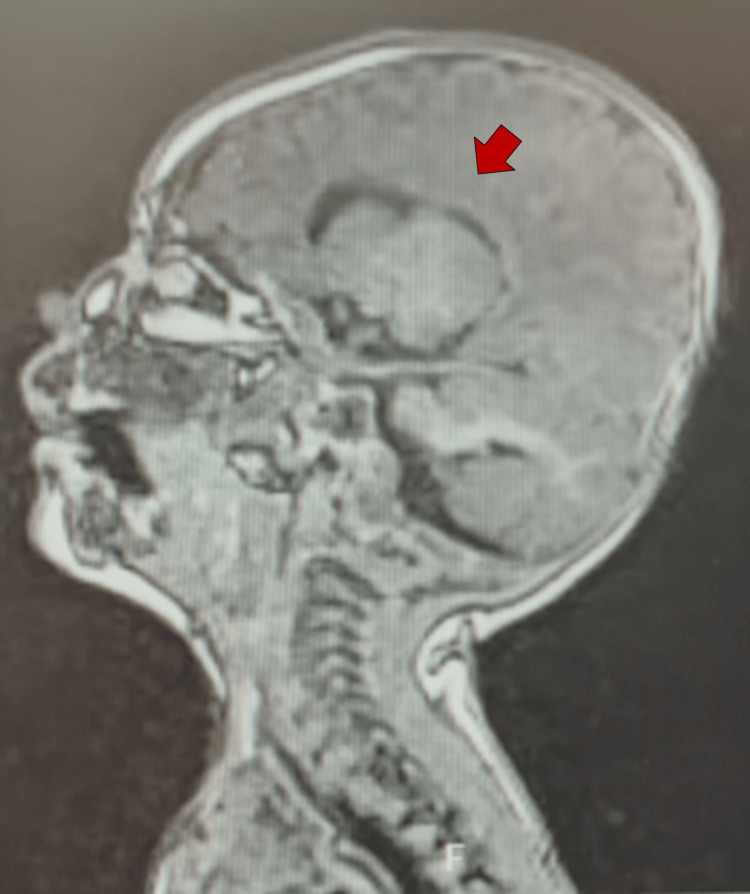
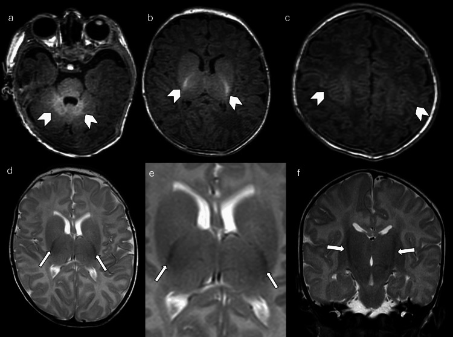

# 655 — Bệnh não thiếu oxy–thiếu máu sơ sinh (HIE) & dị tật bẩm sinh hệ thần kinh (Chiari II, Dandy-Walker, bất sản thể chai)

**Tags:** `pattern:hie-dwi` `pattern:di-dang-ho-sau` `pattern:bat-san-the-chai` `vung:nao-nhi` `score:Sarnat` `score:TVA` `protocol:MRI-nao-so-sinh`
**Mức chắc chắn (certainty):** tổng hợp y văn (literature synthesis) — nhóm tự biên từ y văn mở (bài tổng quan có số + case report CC BY), chưa gắn một ca nguyên văn duy nhất.

## 1. Tổng quan bệnh học – cơ chế hình ảnh

### a) Bệnh não thiếu oxy–thiếu máu (hypoxic-ischemic encephalopathy, HIE)
- **Bệnh học:** ngạt chu sinh (perinatal asphyxia) → giảm tưới máu/oxy não → **suy năng lượng sơ phát** (ATP sụp) rồi **suy năng lượng thứ phát** sau 6–24 giờ (viêm, stress oxy hóa, kích thích độc tế bào thần kinh, apoptosis). Tần suất HIE ~**1–2/1.000** trẻ sinh sống; là nguyên nhân hàng đầu bại não (cerebral palsy) ở trẻ đủ tháng.
- **TẠI SAO DWI dương tính sớm:** bơm Na⁺/K⁺–ATPase ngừng → tế bào sưng (phù độc tế bào – cytotoxic edema) → nước từ ngoại bào vào nội bào → chuyển động Brown của phân tử nước bị hạn chế → **ADC giảm** — sinh ra **tín hiệu DWI cao** (restricted diffusion). ADC đạt **đáy vào ngày 2–4**, rồi **giả hồi phục (pseudonormalization) khoảng ngày 7–10** (khớp với **T2 giả bình thường** khi phù thoái triển). Vì vậy: **MR sớm ngày 2–4 chốt bằng DWI/ADC**, còn **T1/T2 chốt sau khoảng ngày 4–8** (sau khi hâm ấm lại) khi tổn thương ngấm T1.
- **TẠI SAO T1 sáng – T2 sáng muộn:** ở tuần đầu, nhân xám sâu (đồi thị – basal ganglia) **tăng tín hiệu T1** (T1 shortening) do phản ứng mô (xuất huyết vi thể, hoại tử), rồi chuyển **tăng tín hiệu T2** ở tuần 2 do phù/gliosis. **MRS:** tỷ lệ **lactate/NAA tăng** trong vài ngày đầu (lactate đỉnh rồi giảm cuối tuần 1) — trong nghiên cứu HEAL, vùng **ADC < 800 × 10⁻⁶ mm²/s (0,8 × 10⁻³ mm²/s)** được đo tự động để định lượng tổn thương toàn não.
- **Chuỗi xung phải đọc TRƯỚC DWI — não chưa myelin hóa:** trẻ đủ tháng **bình thường** vẫn có **T1 sáng ở phần sau bao trong (posterior limb of internal capsule, PLIC), nhân bụng-bên đồi thị, thân não sau, vùng quanh rãnh trung tâm (perirolandic)** và chất trắng tâm bán cầu; tuổi myelin hóa đạt **PLIC ~37–38 tuần**. **Mất tín hiệu T1 sáng bình thường của PLIC** là dấu hiệu kinh điển của tổn thương nhân xám sâu vì PLIC là nơi phản ánh sớm nhất tình trạng bó vỏ-tủy.
- **Điều trị:** **hạ nhiệt trị liệu (therapeutic hypothermia, TH)** — làm lạnh toàn thân hoặc đầu chọn lọc, mục tiêu **33,5 °C × 72 giờ**, khởi động **trong vòng 6 giờ sau sinh** ở trẻ **≥ 36 tuần** có bằng chứng bệnh não vừa–nặng. TH giảm tử vong/di chứng nhưng KHÔNG điều trị khỏi: thay đổi hình thái tổn thương và cần MRI đúng thời điểm sau hâm ấm.

### b) Dị tật bẩm sinh hố sau & đường giữa (posterior fossa & midline malformations)
- **Phôi thai để hiểu hình ảnh:** tiểu não sinh từ **môi hình thoi (rhombic lips)** ở bờ bên não sau từ khoảng **tuần 6**; thùy giun (vermis) khép đường giữa theo hướng trên→dưới, hoàn tất quanh **tuần 15–18**. **Thể chai (corpus callosum)** tạo từ **tuần 8 và hoàn tất ~tuần 18–20** (thứ tự: genu → thân → splenium). Can thiệp trước tuần 12 → **bất sản hoàn toàn**; tuần 12–20 → **bất sản một phần (dysgenesis)**.
- **Dandy-Walker (DWM):** có **giãn nang não thất IV** + **thiểu sản/không có giun tiểu não (vermis)** với **quay lên/xoay trước** + **hố sau giãn to** (torcular–lambdoid inversion: xoang ngang ở cao hơn khớp lambdoid). Tần suất **1/25.000–35.000** trẻ sinh sống, **nữ:nam ≈ 3:1**; **não úng thủy ~80%** (chiếm 4–12% não úng thủy nhi).
- **Hội chứng giun tiểu não (Dandy-Walker complex):** DWM ↔ **nang túi Blake (Blake's pouch cyst, BPC)** ↔ **bể lớn (mega cisterna magna, MCM)**. **Góc tegmento-giun (tegmento-vermian angle, TVA)** rộng hơn rõ rệt ở DWM so với BPC/thiểu sản giun.
- **Chiari II:** bệnh lý **hộp sọ nhỏ phía sau** làm thùy giun/hạnh nhân thoát vị xuống lỗ chẩm, kèm **thoát vị tủy màng (myelomeningocele, MMC) ~100%**, **não úng thủy ~70–90%**, **dị dạng thể chai**, thân não "beaking" (mỏ chim — tectal beaking), vòm sọ "Luckenschädel". Trước sinh: **dấu chanh (lemon sign — xương trán lõm)** và **dấu chuối (banana sign — tiểu não ôm thân não)**.
- **Bất sản thể chai (agenesis of corpus callosum, ACC):** không có bó thể chai → sợi ức chế hai bên bộc lộ thành **bó Probst** chạy dọc ép thành bên não thất. Kết quả: **não thất bên song song, dẹt, chạy xa nhau**; **giãn sừng chẩm (colpocephaly)**; não thất ba **nằm cao (high-riding third ventricle)**; hồi não **"race car"/"Texas longhorn"** trên mặt phẳng ngang và **"mũ Viking"** trên mặt phẳng trán.

## 2. Mẫu hình + chẩn đoán phân biệt theo vị trí (gamut)

### Nhánh 1 — Tổn thương não do thiếu oxy–thiếu máu (xếp theo kiểu mạch máu bị ảnh hưởng)
- **Nhân xám trung tâm (basal ganglia–thalamus, BGT):** ngạt **cấp, gần như toàn bộ** (vỡ tử cung, sa dây rốn, sa mạch máu) → tổn thương **đối xứng đồi thị, PLIC, vỏ quanh rãnh trung tâm, thân não sâu**. Tiên lượng thần kinh nặng nhất.
- **Vùng phân thủy (watershed/peripheral):** ngạt **từng phần kéo dài** → tổn thương **vỏ–dưới vỏ vùng kẽ các động mạch lớn (đỉnh–chẩm, parasagittal)**, **né nhân xám sâu**.
- **Toàn thể (global):** tổn thương lan rộng cả chất xám và chất trắng (ngạt nặng kéo dài).
- **Điểm chất trắng (punctate white matter injury, PWM):** ổ tăng tín hiệu T1/giảm T2 nhỏ ở chất trắng **bán bầu dục/trên não thất**, hay gặp ở trẻ **non tháng**, thường lành hoặc di chứng nhẹ.
- **Gamut theo hình dạng vùng tổn thương:** đối xứng hai bên ở nhân xám sâu = BGT; đối xứng vỏ vùng phân thủy = watershed; một bên theo **lãnh thổ động mạch não giữa** = **đột quỵ nhũ nhi (perinatal arterial ischemic stroke)**; nhiều ổ rải rác = hạ đường huyết (vùng chẩm–đỉnh) / bệnh chuyển hóa.

### Nhánh 2 — Dị tật hố sau (xếp theo hình thái giun tiểu não + não thất IV)
- **Giun tiểu não khiếm khuyết + nang não thất IV thông:**
  - **DWM** — thiểu sản/không giun + quay giun + hố sau giãn to + não úng thủy.
  - **BPC** — giun bình thường (nhưng quay lên nhẹ) + **nang thông với não thất IV**, não thất IV bình thường, có thể giãn nhẹ não thất.
- **Giun tiểu não bình thường + dịch hố sau nhiều:**
  - **MCM** — khoang dịch sau/dưới tiểu não **> 10 mm**, giun nguyên vẹn, **không não úng thủy**, torcular bình thường.
- **Khối/u hố sau** (u nguyên bào tủy, sao bào lông, u màng não thất) — có **phần đặc ngấm thuốc**, không phải nang dịch thuần (nối [650]).

### Nhánh 3 — Dị tật đường giữa liên quan thể chai
- Bất sản thể chai (ACC) đơn độc, một phần (dysgenesis) vs **liên quan bệnh cảnh**: Chiari II, Dandy-Walker, hội chứng Aicardi (ACC + co giật nhũ nhi + bất thường đáy mắt), rối loạn chuyển hóa thần kinh.

## 3. Bảng so sánh phân biệt (ma trận đối chiếu)

| Thực thể (entity) | Hình ảnh điển hình (MRI) | Chốt vào (rule-in) | Chốt loại (rule-out) | Gợi ý xác nhận |
|---|---|---|---|---|
| HIE thể nhân xám trung tâm (BGT) | DWI sáng lan **đồi thị 2 bên + PLIC + vỏ quanh rãnh trung tâm**; T1 đồi thị sáng tuần 1 | **Đối xứng đồi thị + bó vỏ-tủy**; bối cảnh ngạt cấp (sentinel event) | Vỏ vùng phân thủy đơn thuần, nhân xám sâu bình thường → thể watershed | DWI/ADC ngày 2–4; ADC < 0,8 × 10⁻³ mm²/s; MRS lactate/NAA |
| HIE thể vùng phân thủy (watershed) | DWI sáng **vỏ–dưới vỏ vùng đỉnh-chẩm/kẽ mạch (parasagittal)**, **né đồi thị** | **Vỏ vùng kẽ mạch sáng + nhân xám sâu bình thường** | Đồi thị/PLIC sáng → thể BGT/global | DWI ngày 2–4; đối chiếu tuần hoàn |
| HIE thể toàn thể (global) | DWI sáng **lan rộng** cả chất xám và chất trắng hai bán cầu | Tổn thương lan rộng ≥ 2 vùng mạch + phù não | Chỉ một vùng → nghĩ BGT hoặc watershed khu trú | DWI + T2 axial; theo dõi tiên lượng |
| Tổn thương chất trắng dạng điểm (PWM) | Ổ **T1 sáng/T2 tối nhỏ ≤ 2–3 mm** ở chất trắng trên não thất; hay trẻ non tháng | Nhiều ổ nhỏ rải rác chất trắng, không theo mạch | Ổ lớn theo lãnh thổ mạch → nhồi máu | Chuỗi T1/T2/T2*; đối chiếu tuổi thai |
| Dandy-Walker (DWM) | **Thiểu sản/không giun tiểu não + quay lên**, nang não thất IV rộng, hố sau giãn to | **Không/quá thiểu giun + TVA rộng + hố sau giãn to** | Giun nguyên vẹn + não thất IV bình thường → MCM/BPC | MRI sọ/khung sọ; TVA; tầm soát não úng thủy |
| Nang túi Blake (BPC) | **Nang dịch thông với não thất IV**, giun **bình thường**, hố sau giãn nhẹ | **Giun tiểu não nguyên vẹn** + nang sau tiểu não thông não thất IV | Giun khiếm khuyết → DWM | MRI sagittal T2; theo dõi (thường lành, ít/có thể não úng thủy thoáng qua) |
| Bể lớn (mega cisterna magna) | Khoang dịch sau/dưới tiểu não **> 10 mm**, giun + não thất IV bình thường | **Giun nguyên vẹn + não thất IV bình thường + KHÔNG não úng thủy** | Não úng thủy hoặc giun khiếm khuyết → DWM/BPC | MRI sagittal T1/T2 (đo khoang dịch) |
| Chiari II | **Hố sau nhỏ**, giun/hạnh nhân thoát vị qua lỗ chẩm, thân não "mỏ chim" (tectal beaking) | **MMC + hố sau nhỏ + thùy giun/hạnh nhân xuống lỗ chẩm** | Tonsil xuống lỗ chẩm > 5 mm mà không MMC → Chiari I | MRI toàn trục + cột sống; US trước sinh (lemon/banana) |
| Bất sản thể chai (ACC) | Não thất bên **song song, dẹt, xa nhau**; **colpocephaly**; não thất ba cao | **Không bó thể chai + bó Probst + colpocephaly** | Thể chai mỏng nhưng còn → teo (atrophy), không phải bất sản | MRI sagittal giữa + mặt phẳng trán (mũ Viking) |

*Trái (a–c): DWI — HIE thể BGT: ổ tăng tín hiệu đối xứng ở đồi thị hai bên (mũi tên trắng). Phải (a–c): DWI — HIE thể vùng phân thủy: ổ sáng vỏ–dưới vỏ vùng kẽ mạch, né nhân xám sâu. Nguồn: Cureus PMC12240218, CC BY 4.0. Ảnh ghép letterbox.*

### Dấu hiệu chốt trên từng chuỗi xung
- **DWI/ADC:** bản đồ chốt tổn thương **ngày 2–4** (ADC giảm); nhớ pseudonormalization ngày 7–10.
- **T1W:** trẻ đủ tháng bình thường phải có **PLIC sáng**; **mất PLIC sáng** = dấu sớm của tổn thương nhân xám — đọc T1W TRƯỚC khi kết luận.
- **T2W/T2*:** **T2 sáng muộn** (tuần 2); T2* tìm xuất huyết/xuyết tĩnh mạch (một biến chứng cần loại trừ — nối [212]).

## 4. Protocol chụp + hệ phân độ/điểm chuẩn hóa

- **Thời điểm MRI:** khi **nghi HIE vừa–nặng**, MRI sọ (không cản quang) lý tưởng **4–8 ngày** sau sinh (đã hâm ấm xong) để T1/T2 phản ánh tổn thương; nếu cần đánh giá sớm, chụp **ngày 2–4** và dựa vào DWI/ADC.
- **Chuỗi xung tối thiểu:** axial **T1W, T2W, DWI + ADC**, **T2* (GRE/SWI)** (loại trừ xuất huyết/huyết khối tĩnh mạch), **MRS** (lactate/NAA) khi cần tiên lượng; **MRA/MRV** khi nghi đột quỵ/tắc xoang.
- **Phân độ lâm sàng — Sarnat (đánh giá trước khi chụp, quyết định TH):**
  - **Sarnat I (nhẹ):** kích thích quá mức, trương lực hơi tăng; **không** chỉ định TH.
  - **Sarnat II (trung bình):** lơ mơ, giảm trương lực, **co giật**; **chỉ định TH**.
  - **Sarnat III (nặng):** hôn mê, giảm trương lực nặng, không phản xạ; **chỉ định TH** (cân nhắc).
- **Tiêu chuẩn TH:** ≥ 36 tuần thai, có bằng chứng bệnh não, khởi động **< 6 giờ** sau sinh, mục tiêu **33,5 °C trong 72 giờ**.
- **Điểm dự đoán hình ảnh:** **ADC < 800 × 10⁻⁶ mm²/s** (theo phân tích HEAL) và **tỷ lệ lactate/NAA trên MRS** (AUC ước tính ~0,94) — các chỉ số định lượng tiên lượng kém nhất.
- **Đánh giá hố sau:** đo **góc tegmento-giun (TVA)** trên mặt phẳng giữa (TVA rộng hơn ở DWM), **kích thước khoang dịch sau tiểu não** (MCM > 10 mm), đánh giá **giun tiểu não** (DWM vs BPC), tìm **MMC** + hố sau nhỏ (Chiari II).

## 5. Biến thể bình thường và cạm bẫy

- **Không myelin hóa bình thường của trẻ sơ sinh:** T1/T2 **đảo ngược** so với người lớn ở chất trắng chưa myelin → dễ đọc nhầm "tổn thương lan tỏa". **Đọc T1W PLIC trước tiên**; PLIC sáng = myelin hóa tương xứng tuổi.
- **Giãn não thất sinh lý nhẹ** và **khoang dưới nhện rộng** của trẻ sơ sinh — phân biệt với não úng thủy (đo chu vi đầu theo dõi, không kết luận một lần chụp).
- **Dịch hố sau nhiều đơn độc:** đừng vội gọi DWM — kiểm **giun tiểu não** và **góc TVA**; giun nguyên vẹn + não thất IV bình thường → **MCM** (lành tính) hoặc **BPC**.
- **Chiari I vs Chiari II:** hạnh nhân xuống > 5 mm **không kèm MMC** = Chiari I (điển hình vị thành niên, đau đầu/ho, syrinx 30–70%); **MMC + hố sau nhỏ + thoát vị giun/thân não = Chiari II**. Đừng dán nhãn "Chiari" chung chung.
- **Punctate white matter lesions** ở trẻ non tháng hay **tự thoái triển** — không quy kết bại não chỉ dựa vào các điểm nhỏ.
- **Cạm bẫy thỏa mãn tìm kiếm (satisfaction of search):** thấy tổn thương HIE rồi dừng, bỏ sót **huyết khối xoang tĩnh mạch/xuất huyết** (chụp T2*/MRV) — bối cảnh "bệnh não sơ sinh" không loại trừ huyết khối.
- **Bóng giả trên DWI:** DWI bị méo hình (distortion) vùng đáy não/hố sau do giáp xương — đối chiếu ADC và T2 để tránh gọi tổn thương giả.

## 6. Tự lượng giá — Blind Quiz (ảnh trơn ngoài, đáp án ẩn trong khối chi tiết)

**Ca 1 — Trẻ đủ tháng 4 ngày tuổi sau biến cố sa dây rốn, co giật. So sánh 2 ảnh DWI: kiểu tổn thương nào là thể nhân xám trung tâm?**

- Gợi ý lâm sàng: bệnh não sau sinh, đã hâm ấm trị liệu; MRI ngày 4.
- Câu hỏi: Ảnh nào là thể BGT, ảnh nào là thể watershed? Dấu hiệu nào quyết định? Dự đoán tiên lượng?

<b>Bấm để hiện đáp án (findings + chẩn đoán)</b>

- **Trái (a–c) = thể nhân xám trung tâm (BGT):** DWI sáng **đối xứng hai đồi thị** (mũi tên), lan xuống PLIC/thân não; khớp bối cảnh **ngạt cấp, gần như toàn bộ** (sa dây rốn). **Tiên lượng nặng nhất** (nhân xám sâu + bó vỏ-tủy).
- **Phải (a–c) = thể vùng phân thủy (watershed):** DWI sáng **vỏ–dưới vỏ vùng kẽ mạch đỉnh-chẩm**, **né nhân xám sâu**; khớp ngạt **từng phần kéo dài**.
- Nguồn ảnh: Silva et al., Cureus 2025 (PMC12240218), Fig 4 & Fig 5, CC BY 4.0.

**Ca 2 — Bé trai 2 tháng, chu vi đầu tăng nhanh. MRI T2 (giữa + ngang): mô tả hố sau.**

- Gợi ý: đầu to, thóp căng; không có khối đặc ngấm thuốc.
- Câu hỏi: Giun tiểu não ra sao? Não thất IV và hố sau? Chẩn đoán + phân biệt với bể lớn/nang Blake?

<b>Bấm để hiện đáp án (findings + chẩn đoán)</b>

- **Dandy-Walker (DWM):** **thiểu sản giun tiểu não + quay lên**, **nang não thất IV rộng** thông vào bể lớn, **hố sau giãn to** (a,b,c,d = các thành phần nang). Kèm não úng thủy (thường ~80% ca DWS).
- Phân biệt: **BPC** — giun nguyên vẹn, nang thông não thất IV; **MCM** — giun + não thất IV bình thường, khoang dịch **> 10 mm**, **không** úng thủy. Chốt bằng **góc tegmento-giun (TVA)** rộng hơn ở DWM.
- Nguồn ảnh: Ocampo-Navia et al., Childs Nerv Syst 2025 (PMC12125060), Fig 4, CC BY.

**Ca 3 — Trẻ bại hai chi dưới, tiền sử thoát vị tủy màng đã phẫu thuật. MRI T2 cột sống cổ-ngực.**

- Gợi ý: không đứng được, thất điều tiểu não; có sẹo mổ lưng.
- Câu hỏi: Dấu hiệu ở hố sọ sau/cột sống cổ? Chẩn đoán? Vì sao luôn đi kèm dị tật nào?

<b>Bấm để hiện đáp án (findings + chẩn đoán)</b>

- **Chiari II:** thùy giun/hạnh nhân **thoát vị xuống lỗ chẩm** (mũi tên mảnh) + **hố sau nhỏ**; kèm **syringobulbia/hành tủy** và dị dạng cột sống (gù thắt lưng). Là hệ quả của **hạ áp lực nội sọ thai kỳ** (rò dịch qua khuyết tật ống sống) kéo cấu trúc trục sau xuống.
- **Chiari II hầu như luôn kèm MMC**; não úng thủy ~70–90% cần dẫn lưu (VP shunt ~65% trong một đoàn hệ 18 năm). Phân biệt **Chiari I** (hạnh nhân > 5 mm, không MMC).
- Nguồn ảnh: Spazzapan & Velnar, Diagnostics 2026 (PMC13360603), Fig 1, CC BY.

**Ca 4 — Bé 2 tháng, đầu nhỏ, chậm phát triển, không có bệnh lý khớp sọ. CT ngang và MRI dọc giữa.**

- Gợi ý: chu vi đầu dưới bách phân vị 5 kéo dài; không có khối u.
- Câu hỏi: Dấu hiệu "race car" là gì? Não thất ba ở đâu? Chẩn đoán?

<b>Bấm để hiện đáp án (findings + chẩn đoán)</b>

- **Bất sản thể chai (ACC):** CT ngang — não thất bên **song song, chạy xa nhau** + **giãn sừng chẩm (colpocephaly, mũi tên)** tạo hình **"race car"**. MRI dọc giữa — **thiếu toàn bộ bó thể chai**, não thất ba **nằm cao**.
- Cơ chế: bó Probst (sợi thể chai không bắt chéo) chạy dọc ép thành bên não thất → hình thể đặc trưng. Có thể gặp kèm BPC (như ca này) — cần phân tích tầng.
- Nguồn ảnh: Ingram et al., Cureus 2026 (PMC13464584), Fig 3 & Fig 4, CC BY.

**Ca 5 — Trẻ đủ tháng khoẻ, MRI T1W: phần sau bao trong có tín hiệu sáng. Đây là bệnh lý hay bình thường?**

<b>Bấm để hiện đáp án (findings + chẩn đoán)</b>

- **Bình thường:** trẻ đủ tháng có **T1 sáng ở thân não sau, PLIC, đồi thị bên, chất trắng tâm bán cầu và vùng quanh rãnh trung tâm** (mũi tên) — đây là myelin hóa bình thường theo tuổi, KHÔNG phải tổn thương.
- Cạm bẫy: ngược lại, **mất PLIC T1 sáng** ở trẻ có ngạt = dấu hiệu tổn thương sâu sắc. Vì vậy luôn **đọc T1W PLIC trước** khi kết luận tổn thương trên DWI.
- Nguồn ảnh: Silva et al., Cureus 2025 (PMC12240218), Fig 3, CC BY 4.0.

## Bài liên quan chéo
- [600 – Tổng quan Hệ Nhi khoa](../600-tong-quan-nhi-khoa/lesson.md)
- [650 – Thần kinh nhi (xuất huyết mầm, u hố sau)](../650-than-kinh-nhi-xuat-huyet-mam-va-u-ho-sau/lesson.md)
- [610 – Suy hô hấp sơ sinh & dị dạng phổi bẩm sinh](../610-suy-ho-hap-so-sinh-va-di-dang-phoi/lesson.md)
- [210 – Giải phẫu sọ não cắt lớp](../210-giai-phau-so-nao/lesson.md)
- [201 – Protocol sọ não](../201-protocol-so-nao/lesson.md)

## Ảnh
- Tên file: `NNN_slug_Modality_SourceID.jpg`. Chi tiết nguồn + giấy phép từng ảnh: `images/CREDITS.md` và `sources.md`.
- Ảnh nguồn đều **CC BY** (ghi nguồn đầy đủ); ảnh ghép đối chiếu tạo bằng `tools/make_composite.py` (letterbox, không crop/kéo giãn).

> Không dùng để chẩn đoán độc lập khi chưa có người hướng dẫn.
