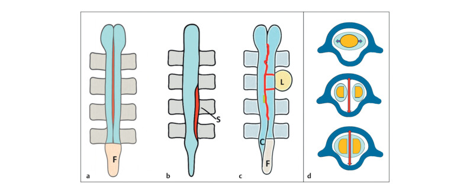
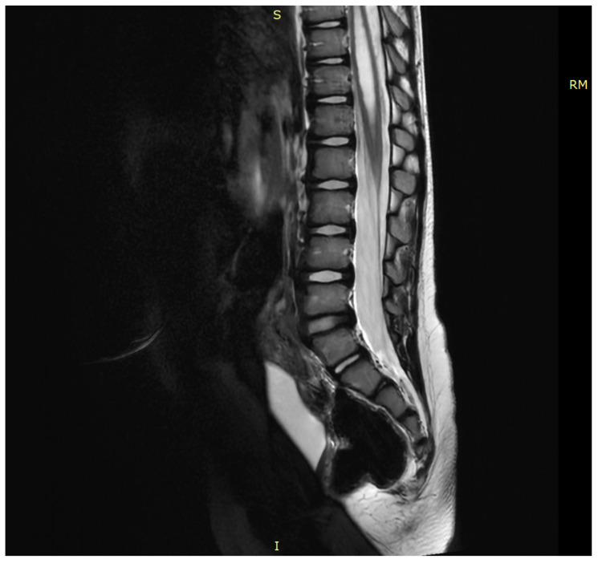
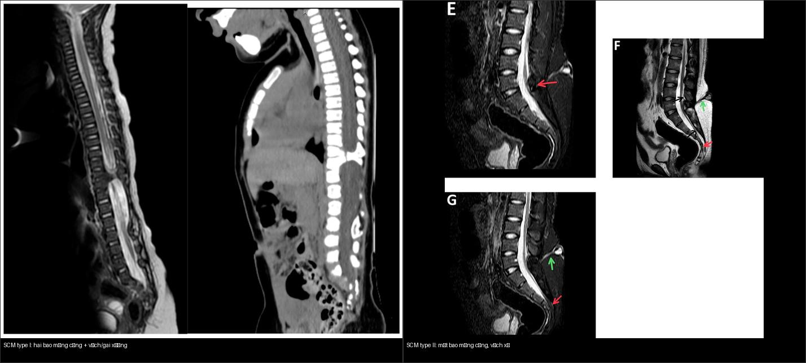
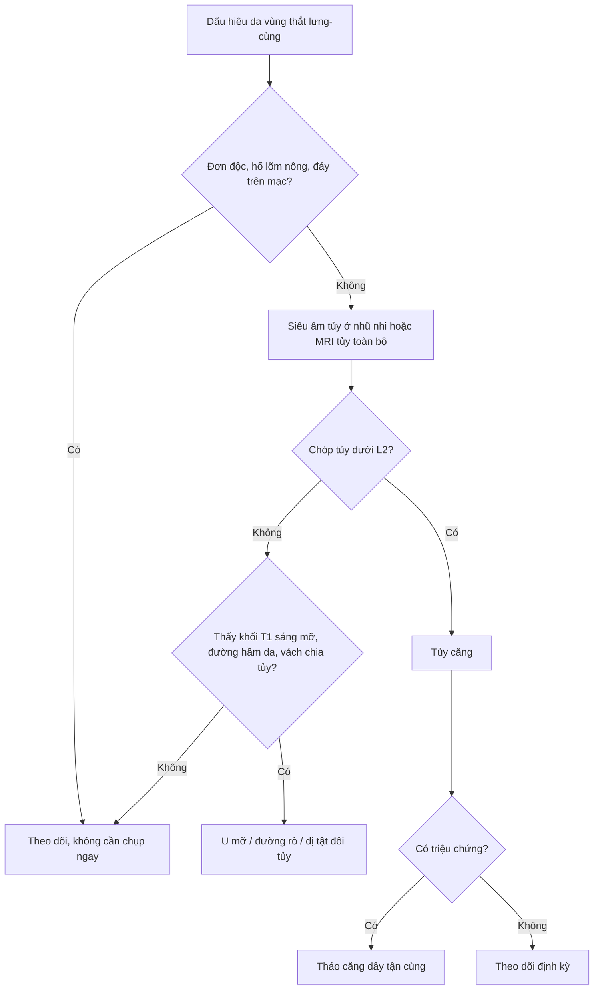
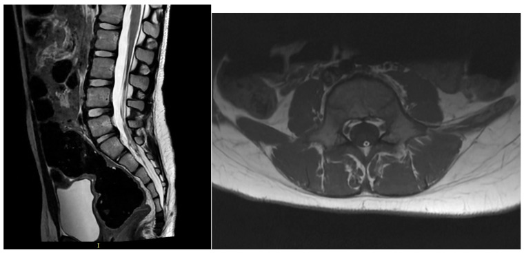
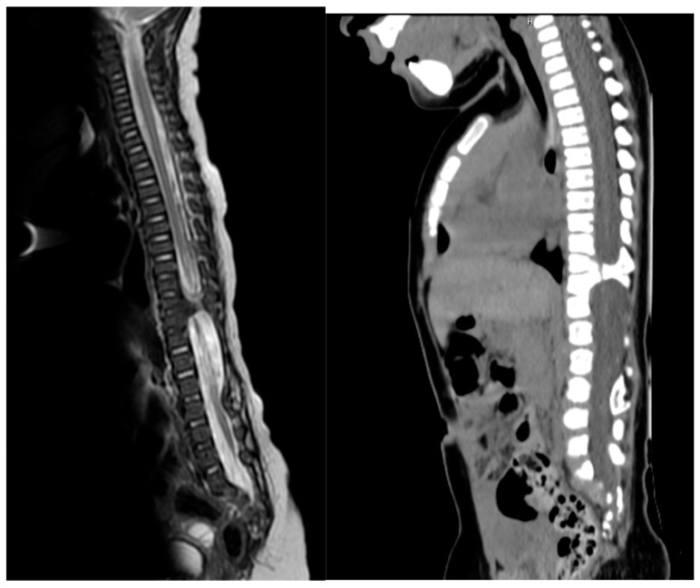
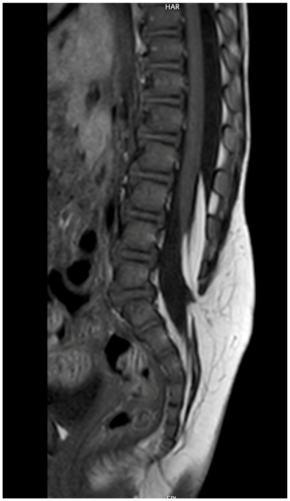
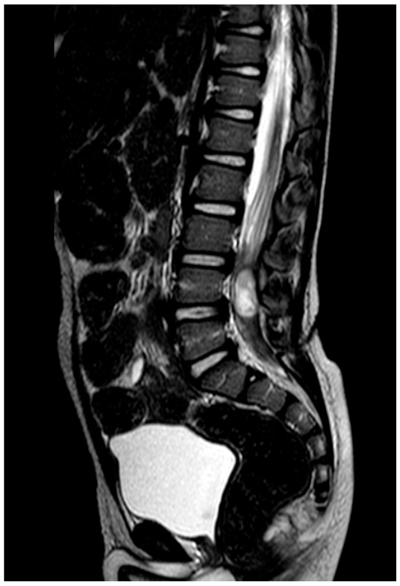

# 656 — Bất thường tủy–cột sống kín ở trẻ: dị tật đôi tủy, tủy căng, u mỡ & đường rò da / Closed spinal dysraphism

**Tags:** `pattern:di-dang-tuy-cot-song` `vung:tuy-cot-song-nhi` `score:Orphanet-SBoD` `protocol:MRI-cot-song-toan-bo` `incidentaloma:u-mo-tuy`
**Mức chắc chắn (certainty):** tổng hợp y văn (literature synthesis) — tổng hợp từ bài tổng quan điều trị tủy căng (Lampros M et al., Children 2026, PMC13114283), bài luận ảnh dị tật đôi tủy (Borthakur K et al., Ultrasound Int Open 2026, PMC13077585), ca diastematomyelia type II (Thapa S et al., Radiol Case Rep 2025, PMC12546449) và phân loại Orphanet SBoD 2025 (PMC12239321).

## 1. Tổng quan bệnh học – cơ chế hình ảnh

- **Dị tật ống thần kinh (neural tube defect)** chia **mở (spina bifida aperta)** — tủy hở ra ngoài da (myelomeningocele) — và **kín (spina bifida occulta / closed spinal dysraphism)** — da nguyên vẹn, tổn thương ẩn dưới da. Dạng kín sinh ra từ bất thường **tạo tủy thứ cấp (secondary neurulation)** nên **rất dễ bỏ sót trên lâm sàng**: trẻ chỉ có một **dấu hiệu da ở vùng cùng cụt** (nốt ruồi lông, hố lõm, nốt/phần da phụ, đường rò nhỏ) mà không liệt.
- **Tủy căng (tethered cord syndrome — TCS)** là hậu quả chung: tủy dính vào cấu trúc không đàn hồi (dây tận cùng dày/mỡ, vách sụn-xương của dị tật đôi tủy, u mỡ, đường rò) nên **không “leo lên” theo cột sống** khi trẻ lớn. Triệu chứng thường xuất hiện vào **đợt tăng trưởng (5–6 tuổi)**: co cứng chi dưới, biến dạng bàn chân, rối loạn cơ vòng, đau chi dưới/vùng hậu môn.
- **Ngưỡng định lượng then chốt (giải phẫu di chuyển theo tuổi — TẠI SAO phải đọc tầng):** bình thường **chóp tủy (conus medullaris)** ở **L3 lúc sinh** rồi “leo” lên **L1–L2 ở người lớn**; TCS khi chóp tủy **nằm dưới L2**. Vì vậy một chóp tủy ở đúng L2 là **giới hạn** — không tự kết luận bệnh nếu không có triệu chứng (xem mục 5).
- **TẠI SAO tín hiệu như vậy?** Trên **T1W**: **mô mỡ (lipoma, dây tận cùng mỡ)** luôn **sáng** (T1 ngắn, tương phản với tủy xám trung gian) — đây là “đèn báo” u mỡ/dây mỡ. Trên **T2W**: **dịch não tủy (CSF)** trong bao màng cứng sáng rực nên dễ nhận diện **chóp tủy tận cùng ở đâu**, có/không **vách chia đôi**, và **ống tủy rỗng (syringomyelia)**. Vách xơ (mô sợi/collagen) **tối** trên mọi chuỗi; **gai xương/sụn** của type I thấy rõ trên CT (đậm độ xương) và cũng tối trên MRI.
- **Phân độ dị tật đôi tủy (split cord malformation — SCM)** theo Pang: **type I** — hai bao màng cứng riêng biệt, mỗi nửa tủy có bao riêng, chia cách bởi **vách/gai xương-sụn cứng**; **type II** — **một bao màng cứng duy nhất**, một nửa tủy nằm trong một bao, chia bởi **vách xơ mềm**; **type III** — tủy bị chia cả dọc và ngang nhiều tầng (hiếm).

## 2. Mẫu hình + chẩn đoán phân biệt theo vị trí & loại (gamut)

- **Theo dấu hiệu da vùng thắt lưng-cùng:** hố lõm cùng cụt (sacral dimple) đơn thuần (lành), nốt lông/búi lông (hair patch), **nốt dưới da mềm** (u mỡ), **lỗ nhỏ chảy dịch** (đường rò da — dermal sinus), **phần da/tổ chức phụ lạ (ectopic tissue)**. Mọi dấu hiệu da nằm **trên nếp mông (gluteal cleft)** hoặc có nhiều dấu hiệu cùng lúc → chỉ định MRI tủy.
- **Dị tật đôi tủy (SCM / diastematomyelia):** đau lưng, yếu chi dưới, bàn chân khoèo một bên, đôi khi **hội chứng tủy đôi bán phần**. Type I thường có **gai xương** kèm vẹo cột sống bẩm sinh; type II thường đơn độc.
- **Tủy căng [do] dây tận cùng dày/mỡ (tight/fatty filum):** đau/co cứng chi dưới, rối loạn cơ vòng, chóp tủy thấp; dây tận cùng **> 2 mm** và **T1 sáng** (mỡ) là chỉ điểm.
- **U mỡ tủy (spinal cord lipoma):** u mỡ dính vào tủy (conus lipoma), hay gặp **lipomyelocele/lipomyelomeningocele** (u mỡ chạy từ dưới da qua khe cung sau vào trong tủy) — T1 sáng đặc trưng, gây dính.
- **Đường rò da (dorsal dermal sinus tract):** đường hầm từ da vào ống sống, có thể kèm **nang bì/nang biểu bì (dermoid/epidermoid)** và **viêm màng não tái diễn** — là **cấp cứu nhiễm trùng** nếu viêm.
- **Ống tủy rỗng (syringomyelia/hydromyelia):** khoang dịch T2 sáng ở trung tâm tủy, thường thứ phát sau tủy căng/Chiari; **không phải** nguyên nhân chính mà là hậu quả cần đi kèm.
- **Nhóm hiếm khác:** nang ruột thần kinh (neurenteric cyst), myelocele thể tận (terminal myelocystocele — “trumpet conus”), hội chứng thoái triển cùng (caudal regression).

## 3. Bảng so sánh phân biệt (ma trận đối chiếu)

| Thực thể (entity) | Hình ảnh điển hình (MRI T1/T2) | Chốt vào (rule-in) | Chốt loại (rule-out) | Gợi ý xác nhận |
|---|---|---|---|---|
| Dị tật đôi tủy type I (SCM I) | Hai bao màng cứng, **gai/vách xương-sụn** giữa hai nửa tủy; tủy căng | **Hai bao màng cứng riêng + vách xương/sụn (thấy trên CT)** | **Một bao màng cứng duy nhất → type II** | MRI T2 axial/sagittal + CT xương; cắt vách giải ép |
| Dị tật đôi tủy type II (SCM II) | **Một bao màng cứng**, vách xơ mềm chia đôi tủy | **Một bao màng cứng + vách sợi tối trên mọi chuỗi** | **Thấy gai xương → type I** | MRI ± CT để loại gai xương ẩn |
| Tủy căng do dây tận cùng dày/mỡ (tight/fatty filum) | Chóp tủy **dưới L2**; dây tận cùng dày **> 2 mm**, T1 **sáng** nếu mỡ | **Chóp tủy thấp < L2 + dây > 2 mm/T1 sáng** | **Chóp tủy tại L1–L2, dây mảnh < 2 mm, không triệu chứng → không cần mổ** | MRI T1/T2 sagittal + axial; điều trị khi có triệu chứng |
| U mỡ tủy (conus/lipomyelomeningocele lipoma) | Khối **T1 sáng như mỡ**, T2 tăng vừa; dính tủy, có thể có thành phần dưới da | **Khối mỡ đồng tín hiệu mỡ từ dưới da vào ống sống** | **Khối T1 tối → không phải mỡ (u khác)** | MRI T1 (bão hòa mỡ), đánh giá khe cung sau |
| Đường rò da (dermal sinus) | Đường hầm tín hiệu thấp/thấy rõ từ da vào ống sống; ± nang bì | **Đường hầm da → ống sống (một đầu ở da)** | **Hố lõm nông, đáy trên mạc → chỉ theo dõi** | MRI T1/T2; cắt sớm để tránh viêm màng não |
| Ống tủy rỗng (syringomyelia) | Khoang dịch **T2 sáng**, tín hiệu như CSF, trong tủy | **Khoang dịch trung tâm tủy đồng tín hiệu CSF** | **Nang u có thành ngấm thuốc → nghĩ u** | MRI toàn bộ tủy tìm nguyên nhân (Chiari/tủy căng) |

<b>Bấm để hiện đáp án (nhãn bệnh trong ảnh ghép)</b>

- **Trái (type I):** MRI T2 + CT dọc cho thấy **hai bao màng cứng** tách bởi **gai xương** — dấu hiệu chốt type I. Nguồn: Lampros M et al., Children 2026 (PMC13114283, Fig. 4), CC BY.
- **Phải (type II):** MRI T2 axial + STIR dọc cho thấy **một bao màng cứng** với vách xơ chia đôi tủy, kèm u mỡ và tủy bám thấp. Nguồn: Thapa S et al., Radiol Case Rep 2025 (PMC12546449, Fig. 1), CC BY.

## 4. Protocol chụp + hệ phân loại chuẩn hóa

- **Protocol MRI tủy sống toàn bộ (whole-spine MRI):** T2W dọc (sagittal) và ngang (axial), T1W dọc + ngang, **không cần tiêm thuốc cản quang thường quy**; bổ sung **CT xương** khi nghi **gai xương (type I)** hoặc xẹo vẹo cột sống bẩm sinh. Ở **trẻ nhũ nhi**, **siêu âm tủy** (thóp/qua khe cung sau chưa cốt hóa) là bước sàng lọc đầu tay hữu ích.
- **Chỉ định chụp:** mọi dấu hiệu da bất thường vùng thắt lưng-cùng (hố lõm sâu/cao, nốt lông, phần da phụ, lỗ rò), yếu/teo chi dưới không giải thích, rối loạn cơ vòng ở trẻ, bàn chân khoèo một bên, hoặc vẹo cột sống bẩm sinh.
- **Phân loại Orphanet SBoD (Spina Bifida and other Dysraphisms) sửa đổi 2025 (ORPHA:823):** giữ đối lập **mở/kín**, chuẩn hóa **16 dấu hiệu da – 7 dấu hiệu xương – 33 dấu hiệu tủy**, được kiểm định trên các thể **u mỡ chóp tủy (conus lipoma), đường rò da, dị tật đôi tủy (diastematomyelia), u mỡ dây tận cùng (filum lipoma), myelomeningocele, lipomyelomeningocele, myelocele-thể tận và nang ruột thần kinh**.
- **Ngưỡng số chốt:** chóp tủy **dưới L2** = tủy căng; dây tận cùng **> 2 mm** = dày; **70% trẻ myelomeningocele có tủy căng trên phim** nhưng chỉ **20–30% thành triệu chứng**; biến chứng **rò dịch não tủy sau mổ 5–15%**.
- **Sơ đồ tiếp cận dấu hiệu da vùng cùng cụt:**

## 5. Biến thể bình thường và cạm bẫy

- **Chóp tủy tại L1–L2 ở trẻ lớn và người lớn là bình thường** — không được gọi tủy căng chỉ vì “chóp tủy hơi thấp”. Tủy căng cần **chóp dưới L2** cộng bối cảnh/triệu chứng (nguồn nhấn mạnh: “không có chẩn đoán rõ ràng thì **không chỉ định tháo căng**”).
- **Dây tận cùng mỡ (fatty filum) là cạm bẫy hai chiều:** một dây mỡ mảnh, không triệu chứng có thể chỉ theo dõi; nhưng dây **> 2 mm, T1 sáng rõ** kèm triệu chứng thì cần can thiệp. Đừng nhầm điểm sáng T1 của **mỡ** với **xuất huyết dưới màng cứng** (T1 sáng nhưng bối cảnh chấn thương).
- **Hố lõm cùng cụt đơn độc (đáy trên mạc, không cách xa hậu môn)** thường lành. **Ngược lại**, nhiều dấu hiệu da cùng lúc, hố lõm **cao/sâu**, hoặc lệch trên nếp mông → phải chụp.
- **Ảnh giả/dễ bỏ sót:** dị tật đôi tủy có thể bị đọc nhầm là “tủy đôi do lát cắt xiên” — luôn khẳng định bằng **nhiều lát cắt liên tiếp** và tìm vách; đường rò da rất mảnh có thể **không thấy trên lát 3–4 mm** → dùng lát mỏng 1–2 mm.
- **Thỏa mãn tìm kiếm (satisfaction of search)** là bẫy lớn: thấy u mỡ là dừng lại, bỏ sót **vách chia tủy** hoặc **ống tủy rỗng** kèm theo → đọc toàn bộ trục tủy.

## 6. Tự lượng giá — Blind Quiz

**Ca 1 — Trẻ đau lưng tăng dần, yếu chi dưới. Đọc MRI T2 + CT dọc.**

- Gợi ý lâm sàng: đau/yếu chi dưới tiến triển.
- Câu hỏi: Tủy có bị chia không? Kiểu dị tật? Có gai xương không và type I hay II?

<b>Bấm để hiện đáp án (findings + chẩn đoán)</b>

- Dấu hiệu (findings): tủy bị **chia đôi**, giữa hai nửa có **gai xương** (thấy rõ trên CT dọc) tạo **hai bao màng cứng riêng**; tủy bám thấp gây căng.
- Chẩn đoán (diagnosis): **dị tật đôi tủy type I (SCM type I)** — vách cứng gây cố định tủy. Điều trị: tháo vách + tháo căng khi có triệu chứng.
- Nguồn ảnh: Lampros M et al., Children 2026 (PMC13114283, Fig. 4), CC BY.

**Ca 2 — Trẻ có khối mềm vùng cùng cụt từ nhỏ. Đọc MRI T1 dọc.**

- Gợi ý lâm sàng: khối dưới da mềm, không đau, da phủ bình thường.
- Câu hỏi: Tín hiệu khối là gì? Khối đi từ đâu tới đâu? Chẩn đoán?

<b>Bấm để hiện đáp án (findings + chẩn đoán)</b>

- Dấu hiệu (findings): **khối T1 sáng như mỡ** chạy từ dưới da qua khe cung sau vào ống sống và dính vào tủy — **lipomyelocele (u mỡ tủy)**.
- Chẩn đoán (diagnosis): **lipomyelocele/lipomyelomeningocele** — u mỡ đè/dính tủy gây **tủy căng**; cần đánh giá chóp tủy và khe cung sau.
- Nguồn ảnh: Lampros M et al., Children 2026 (PMC13114283, Fig. 5), CC BY.

**Ca 3 — Trẻ bị viêm màng não tái diễn, thấy lỗ nhỏ vùng cùng cụt. Đọc MRI T2 dọc.**

- Gợi ý lâm sàng: viêm màng não không rõ nguồn, có lỗ nhỏ ở da.
- Câu hỏi: Có đường hầm từ da vào ống sống không? Vì sao cần cắt sớm?

<b>Bấm để hiện đáp án (findings + chẩn đoán)</b>

- Dấu hiệu (findings): **đường hầm (dermal sinus tract)** đi từ da vào ống sống, kéo căng tủy, kèm **nang biểu bì/nang bì (epidermoid cyst)** trên đường đi.
- Chẩn đoán (diagnosis): **đường rò da (dorsal dermal sinus)** — cửa vào cho vi khuẩn gây viêm màng não; **cắt sớm** để loại nguồn nhiễm và mọi nang kèm theo, sau khi đã điều trị nhiễm trùng.
- Nguồn ảnh: Lampros M et al., Children 2026 (PMC13114283, Fig. 6), CC BY.

## Bài liên quan chéo
- [600 – Tổng quan Hệ Nhi khoa](../600-tong-quan-nhi-khoa/lesson.md) (bảng DDx)
- [650 – Thần kinh nhi: xuất huyết mầm & u hố sau](../650-than-kinh-nhi-xuat-huyet-mam-va-u-ho-sau/lesson.md)
- [655 – HIE sơ sinh & dị tật bẩm sinh hệ thần kinh (Chiari II)](../655-hie-so-sinh-va-di-dang-bam-sinh-than-kinh/lesson.md)
- [220 – Ống sống 3 khoang](../220-ong-song-tuy/lesson.md) (thoát vị đĩa, hẹp ống sống, schwannoma)
- [221 – Chấn thương cột sống](../221-chan-thuong-cot-song/lesson.md) (phân bố 3 cột Denis, SCIWORA)
- [640 – Háng nhi & NAT](../640-khop-hang-nhi-DDH-Perthes-SCFE-va-NAT/lesson.md) (dị tật/bất thường khác ở trẻ)

## Ảnh
- Tên file `656_..._PMCxxxxx-FigN-...jpg`, nguồn + giấy phép từng ảnh trong `images/CREDITS.md`. Toàn bộ ảnh: **CC BY 4.0** (Children 2026, PMC13114283; Ultrasound Int Open 2026, PMC13077585) và **CC BY 4.0** (Radiol Case Rep 2025, PMC12546449).
- Ảnh ghép `images/composite_SCM-type1-vs-type2.jpg` tạo bằng `tools/make_composite.py`, letterbox nền đen, giữ tỷ lệ.
- Không tải Google Images / AuntMinnie; nguồn đóng chỉ dẫn link tại `sources.md`.

> Không dùng để chẩn đoán độc lập khi chưa có người hướng dẫn.
